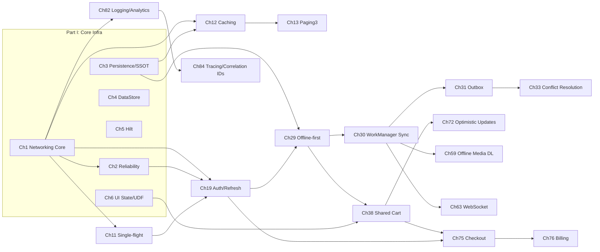
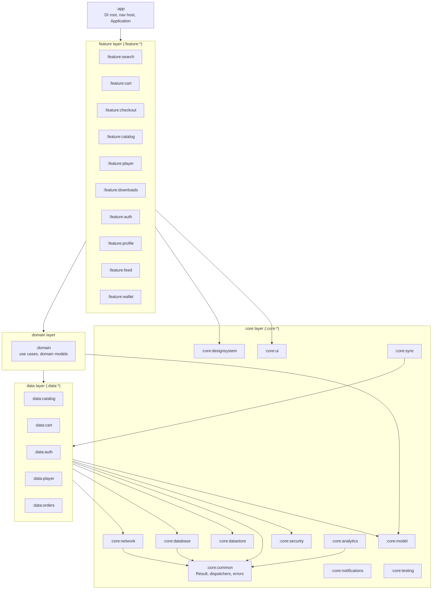
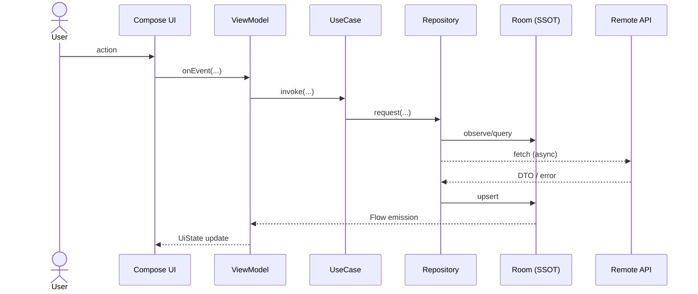

# Android Application System Design — Book Blueprint (Phase 1)

> This document is the **Phase 1 planning deliverable**. It defines the book's
> identity, audience, complete table of contents, the full catalog of 100
> application system-design topics, the dependency-aware chapter ordering, the
> topics that are deliberately consolidated, the book-wide reference
> application and architecture, a glossary, and the shared code and diagram
> conventions that every later chapter must follow.
>
> **No feature chapter is written yet.** Authoring proceeds one topic at a time,
> on request, after this plan is approved.

---

## 1. Title & Subtitle

**Primary title:**
> **Android System Design in Practice**

**Subtitle:**
> *Designing, Building, and Defending Production-Scale Mobile Features in Kotlin*

**Working series tagline:** *From a single screen to an enterprise-scale app.*

Rationale: the title foregrounds *system design* (the discriminator for senior
roles and interviews) while *in Practice* and the subtitle promise working
Kotlin and production concerns rather than whiteboard theory. The book is not a
"learn Android" book; it is a "how senior engineers reason about Android
features" book.

---

## 2. Intended Audience

**Primary readers**

- Senior Android Developers moving toward Lead/Staff scope.
- Android Tech Leads responsible for architecture decisions.
- Staff / Principal Android Engineers who must set patterns across teams.
- Mobile Application Architects.
- Engineers preparing for Senior SDE, SDE-III, Staff, and Android-Lead
  **system-design interviews**.

**Assumed prior knowledge** (the book does *not* re-teach these)

- Kotlin (generics, sealed types, delegation, scope functions, inline/reified).
- Coroutines and Flow fundamentals (suspend functions, `launch`/`async`,
  cold vs hot flows).
- Android fundamentals (Activity/Fragment, the main thread, `Context`,
  `Lifecycle`, process model).
- Jetpack basics (ViewModel, Navigation, Room, Compose).
- MVVM and Clean Architecture at a conceptual level.

**What readers get that other resources don't**

- The *engineering decisions* behind each feature, not just the API calls.
- Concurrency, failure, and lifecycle analysis for each pattern.
- A consistent reference app so patterns compose into a real system.
- Interview defense material (questions, follow-ups, design-change curveballs,
  and a full mock walkthrough) per topic.

---

## 3. The Mandatory 18-Section Chapter Structure

Every topic chapter uses the same section skeleton. Depth is adapted to the
topic, but **no section is dropped**. (This is the structure defined in the
project brief; it is restated here as the authoring contract.)

| # | Section | Purpose |
|---|---------|---------|
| 1 | Problem Definition & Real-World Context | What/why/where, ≥3 use cases, naive-implementation failures |
| 2 | Requirements Engineering | Functional + non-functional, scope, assumptions, constraints, requirements table |
| 3 | System Design Fundamentals | The core concepts the solution rests on and why they apply |
| 4 | High-Level Architecture | Component map + Mermaid architecture diagram, SSOT, state owners, dependency direction |
| 5 | Detailed Component Design | Per-component responsibility/IO/deps/interfaces/state/lifecycle + class diagrams |
| 6 | End-to-End Data Flow | Sequence diagrams for success and failure paths |
| 7 | Complete Kotlin Implementation | Production-oriented code: models, repos, data sources, use cases, ViewModels, UI, DI, errors, utilities + module structure |
| 8 | Concurrency & Race Conditions | Concrete race scenarios and correct primitives (Mutex, atomics, channels, single-flight, transactions) |
| 9 | Failure Scenarios & Recovery | The full production failure matrix with detection, response, UX, retry, recovery, telemetry + failure diagrams |
| 10 | Scaling the Implementation | Levels 1→5, from one screen to enterprise scale, with "when is this necessary?" |
| 11 | Alternative Approaches & Trade-offs | Comparison tables with selection criteria |
| 12 | Security Considerations | Client-side protections vs backend-enforced guarantees |
| 13 | Performance & Resource Optimization | CPU/memory/battery/network/main-thread/rendering + profiling tools |
| 14 | Testing Strategy | Unit/repo/VM/coroutine/flow/db/integration/UI/concurrency/failure-injection with real Kotlin tests |
| 15 | Production Observability | Logging, metrics, tracing, crash reporting, correlation IDs, privacy |
| 16 | System Design Interview Preparation | ≥25 (standard) / ≥40 (complex) categorized Q&A, follow-ups, ≥5 design-change challenges, full mock walkthrough |
| 17 | Practical Exercises | Beginner → advanced + debugging + design challenge, with evaluation criteria |
| 18 | Chapter Summary & Reference Sheet | Decisions, concepts, mistakes, checklist, key APIs, official references |

> **Interview depth rule:** topics marked **(Complex)** in §5 carry ≥40
> interview questions and a longer mock; **(Standard)** topics carry ≥25.

---

## 4. The 100 Topics — Categorized Catalog

The 100 topics are grouped into 11 thematic categories. Each topic becomes one
chapter. The **Ch#** column is the final teaching order (see §6); the
categories below are the *conceptual* grouping, which is also the book's Part
structure.

### Category A — Core Infrastructure (reused book-wide)
| Ch# | Topic | Complexity |
|----|-------|-----------|
| 1 | Networking Core: API request orchestration (OkHttp/Retrofit/interceptors/error model) | Complex |
| 2 | Network reliability: timeouts, retries, backoff, circuit breaking | Standard |
| 3 | Persistence core & Single Source of Truth (Room + Repository) | Complex |
| 4 | DataStore: Preferences & Proto for app configuration | Standard |
| 5 | Dependency injection at scale (Hilt, module conventions) | Standard |
| 6 | UI state modeling & unidirectional data flow (StateFlow / MVI) | Complex |
| 7 | One-time events & side effects (Channel vs SharedFlow) | Standard |
| 8 | Process death & state restoration (SavedStateHandle) | Standard |

### Category B — Networking Patterns
| Ch# | Topic | Complexity |
|----|-------|-----------|
| 9 | Debounced network search | Complex |
| 10 | Search suggestions & autocomplete (extends Ch 9) | Standard |
| 11 | Request deduplication & single-flight | Standard |
| 12 | Caching strategies: HTTP, in-memory, disk | Complex |
| 13 | Pagination & caching with Paging 3 (offset vs cursor) | Complex |
| 14 | Request prioritization, queueing & client-side rate limiting | Standard |
| 15 | Idempotency for mutations | Standard |
| 16 | API schema evolution & backward compatibility | Standard |
| 17 | Multipart & resumable uploads | Standard |
| 18 | File download manager | Standard |

### Category C — Authentication & Security
| Ch# | Topic | Complexity |
|----|-------|-----------|
| 19 | Authentication & token refresh | Complex |
| 20 | Credential & token storage (Android Keystore) | Complex |
| 21 | Biometric authentication | Standard |
| 22 | Session management & logout-everywhere | Standard |
| 23 | Secure network communication & certificate pinning | Standard |
| 24 | Encryption of sensitive data at rest (incl. SQLCipher) | Standard |
| 25 | Secure file storage | Standard |
| 26 | App integrity, root/tamper detection (Play Integrity) | Standard |
| 27 | Secrets management & obfuscation (R8) | Standard |
| 28 | Secure logging & PII redaction | Standard |

### Category D — Offline-First & Synchronization
| Ch# | Topic | Complexity |
|----|-------|-----------|
| 29 | Offline-first architecture | Complex |
| 30 | Background synchronization with WorkManager | Complex |
| 31 | The outbox pattern for reliable writes | Standard |
| 32 | Delta / incremental sync | Standard |
| 33 | Conflict resolution & a sync engine | Complex |
| 34 | Cache invalidation strategy | Standard |
| 35 | Local full-text search (FTS4/FTS5) | Standard |
| 36 | Room migrations & schema management | Standard |
| 37 | Data export, import & backup | Standard |

### Category E — Shared & Global State
| Ch# | Topic | Complexity |
|----|-------|-----------|
| 38 | Shared shopping cart across screens | Complex |
| 39 | Global app state management | Standard |
| 40 | Shared ViewModel scoping | Standard |
| 41 | Feature flags & remote config | Standard |
| 42 | Multi-account & account switching | Standard |
| 43 | Personalization & user-preference sync | Standard |

### Category F — Lifecycle, Background & Platform
| Ch# | Topic | Complexity |
|----|-------|-----------|
| 44 | Application lifecycle management | Standard |
| 45 | App startup optimization (App Startup + init ordering) | Standard |
| 46 | Foreground services | Standard |
| 47 | Doze, App Standby & background execution limits | Complex |
| 48 | Alarms & exact scheduling | Standard |
| 49 | Push notifications (FCM) architecture | Complex |
| 50 | Notification center / inbox | Standard |
| 51 | Runtime permissions management | Standard |
| 52 | Deep links & app links routing | Standard |
| 53 | Navigation architecture (multi-module) | Standard |
| 54 | App update & forced-upgrade flow | Standard |
| 55 | Widgets & app shortcuts | Standard |

### Category G — Media & Files
| Ch# | Topic | Complexity |
|----|-------|-----------|
| 56 | Image loading & caching (Coil) | Standard |
| 57 | Thumbnail generation & caching | Standard |
| 58 | Media playback state (Media3/ExoPlayer) | Complex |
| 59 | Offline media downloads (OTT) | Complex |
| 60 | Camera capture pipeline (CameraX) | Standard |
| 61 | Large file & streaming handling | Standard |
| 62 | File sharing & content providers (Storage Access Framework) | Standard |

### Category H — Real-Time & Connectivity
| Ch# | Topic | Complexity |
|----|-------|-----------|
| 63 | Real-time communication over WebSocket | Complex |
| 64 | Chat / messaging architecture | Complex |
| 65 | Presence & typing indicators | Standard |
| 66 | Server-sent events & long polling | Standard |
| 67 | Live location tracking | Standard |
| 68 | Network state monitoring (Wi-Fi / cellular / metered) | Standard |
| 69 | Bluetooth Low Energy (BLE) connectivity | Complex |
| 70 | Peer-to-peer / Nearby Connections | Standard |

### Category I — Feature Architectures (domain-rich)
| Ch# | Topic | Complexity |
|----|-------|-----------|
| 71 | Infinite scrolling feed (social) | Complex |
| 72 | Optimistic updates (likes/comments) | Complex |
| 73 | Recommendations feed | Standard |
| 74 | Wishlist | Standard |
| 75 | Checkout flow (fintech-grade) | Complex |
| 76 | In-app purchases / Play Billing | Complex |
| 77 | Wallet & payments | Standard |
| 78 | Order tracking & live status | Standard |
| 79 | Reviews & ratings | Standard |
| 80 | Onboarding & feature discovery | Standard |
| 81 | In-app feedback & diagnostics | Standard |

### Category J — Performance, Observability & Quality
| Ch# | Topic | Complexity |
|----|-------|-----------|
| 82 | Centralized logging & analytics | Complex |
| 83 | Crash & ANR reporting | Standard |
| 84 | Distributed tracing & correlation IDs | Standard |
| 85 | Performance monitoring (startup, frames, custom metrics) | Standard |
| 86 | A/B testing & experimentation | Standard |
| 87 | Error classification & telemetry pipeline | Standard |
| 88 | Cold start optimization | Complex |
| 89 | Memory management & leak prevention | Complex |
| 90 | Rendering / jank performance in Compose | Complex |
| 91 | Battery & network efficiency | Standard |
| 92 | Baseline profiles & R8 | Standard |
| 93 | Large list performance | Standard |

### Category K — Reach, Scale & Platform Breadth
| Ch# | Topic | Complexity |
|----|-------|-----------|
| 94 | Multi-module architecture at enterprise scale | Complex |
| 95 | Localization, RTL & regionalization | Standard |
| 96 | Accessibility architecture | Standard |
| 97 | Theming & dynamic configuration | Standard |
| 98 | Android TV / STB / Fire TV state & input architecture | Complex |
| 99 | Wear OS companion & cross-device state sync | Standard |
| 100 | Capstone: StreamCart end-to-end system design | Complex |

**Count check:** A(8) + B(10) + C(10) + D(9) + E(6) + F(12) + G(7) + H(8) +
I(11) + J(12) + K(7) = **100.** No topic from the brief's example list is
lost; items the brief named explicitly (debounced search, auth/refresh, shared
cart, offline-first, centralized logging, secure file storage, background sync,
API orchestration, pagination/caching, real-time, lifecycle, network
reliability, image/media, Bluetooth, performance, security) each map to a
dedicated chapter above.

---

## 5. Table of Contents (final book structure)

```
Front Matter
  - Preface: who this book is for and how to read it
  - How to use the reference application (StreamCart)
  - Conventions used in this book (code, diagrams, terminology)

Part I   — Core Infrastructure ................. Ch 1–8
Part II  — Networking Patterns ................. Ch 9–18
Part III — Authentication & Security ........... Ch 19–28
Part IV  — Offline-First & Synchronization ..... Ch 29–37
Part V   — Shared & Global State ............... Ch 38–43
Part VI  — Lifecycle, Background & Platform .... Ch 44–55
Part VII — Media & Files ....................... Ch 56–62
Part VIII— Real-Time & Connectivity ............ Ch 63–70
Part IX  — Feature Architectures ............... Ch 71–81
Part X   — Performance, Observability & Quality  Ch 82–93
Part XI  — Reach, Scale & Platform Breadth ..... Ch 94–100

Appendices
  A. Glossary of architectural concepts (see §8)
  B. Cross-chapter dependency map
  C. Shared reference code index (what lives in :core:*)
  D. Interview question bank — consolidated
  E. Official documentation reference list
```

Each chapter title = its topic from §4; each chapter body = the 18 sections
from §3.

---

## 6. Recommended Chapter Ordering (dependency-driven)

The ordering above is chosen so that **every chapter can rely on infrastructure
already established earlier**, mirroring how a real app is built outward from
its core. The guiding dependency rules:

1. **Infrastructure before features.** Part I establishes the networking core,
   persistence/SSOT, DI, state modeling, and process-death handling. Almost
   every later chapter references these instead of re-deriving them.
2. **Networking patterns before auth.** Retries, dedup, and caching (Part II)
   are prerequisites for a correct token-refresh design (Ch 19), which is a
   single-flight + queueing problem layered on the networking core.
3. **Auth/security before offline.** Offline-first (Part IV) persists
   user-scoped data; it must assume secure storage and session semantics from
   Part III.
4. **Offline/sync before shared state.** The shared cart (Ch 38) is the first
   feature to combine SSOT + offline + optimistic writes + conflict handling,
   so it follows Parts II–IV.
5. **Platform/background before media & real-time.** Media downloads (Ch 59)
   and WebSockets (Ch 63) depend on WorkManager, foreground services, Doze
   behavior, and network monitoring (Part VI).
6. **Feature architectures (Part IX) compose earlier parts.** Checkout,
   billing, feeds, and optimistic updates are integration chapters that
   explicitly reuse prior modules.
7. **Performance & observability (Part X) come late** because they instrument
   the whole system; examples draw on features already built.
8. **Capstone last (Ch 100)** assembles StreamCart end-to-end.

### Key dependency edges (Appendix B, abbreviated)



> This is a *suggested* path. Experienced readers can jump to a target topic;
> each chapter's **Prerequisites** box names the earlier chapters it builds on
> so a non-linear reader knows what to skim first.

---

## 7. Topics Consolidated / Combined (and why)

To avoid both redundancy and loss of coverage, several closely related subjects
are **taught as one chapter with an explicit multi-part treatment**, rather than
split into thin chapters. Each still appears in the catalog, but the pairing is
intentional:

| Combined chapter | Absorbs | Why |
|------------------|---------|-----|
| Ch 1 Networking Core | Interceptors, the shared **error model**, serialization setup | These have no meaning apart from the core client; splitting them produces stubs |
| Ch 12 Caching Strategies | HTTP cache + in-memory + disk cache | Selection *between* them is the actual lesson; treating one per chapter hides the trade-off |
| Ch 13 Paging 3 | Offset vs cursor pagination + remote mediator caching | Pagination and its cache are one design problem |
| Ch 19 Auth & Token Refresh | Authenticator + single-flight refresh + 401 handling | Refresh *is* a concurrency + reliability problem; inseparable |
| Ch 29 Offline-First | Read-side SSOT + `NetworkBoundResource` pattern | The pattern defines the chapter |
| Ch 33 Conflict Resolution | Merge strategies (LWW, version vectors), the "sync engine" | Conflict strategy and sync engine are the same subsystem |
| Ch 66 SSE & Long Polling | Both server-push fallbacks | Taught as "the alternatives to WebSocket," compared directly |
| Ch 68 Network State Monitoring | Wi-Fi, cellular, metered, VPN detection | One `ConnectivityManager` abstraction |
| Ch 82 Logging & Analytics | Structured logging + analytics dispatch | Share one event pipeline (`:core:analytics`) |

**Deliberately kept separate** (resist the urge to merge): Room *migrations*
(Ch 36) vs persistence core (Ch 3) — migrations are a deep, failure-prone topic
of their own; image loading (Ch 56) vs media playback (Ch 58) — different
subsystems, different failure modes; biometrics (Ch 21) vs Keystore (Ch 20) —
one is UX+auth, the other is key material.

---

## 8. Book-Wide Reference Application & Architecture

Every chapter demonstrates its pattern inside one fictional app so examples
accumulate into a coherent system instead of unrelated snippets.

### 8.1 The app: **StreamCart**

StreamCart is a fictional super-app that combines **e-commerce** and **content
streaming**, with light **social** and **fintech** surfaces. This single app
lets the book show how the *same* architectural problem differs across domains
(the brief's requirement to compare e-commerce / OTT / social / fintech /
travel / productivity):

- **Shop** — product catalog, search, cart, wishlist, checkout, orders.
- **Watch** — video catalog, playback, offline downloads, subscriptions,
  multiple viewer profiles.
- **Social** — reviews, ratings, follow creators, a content feed, likes/comments.
- **Wallet** — stored payment methods, StreamCart credit, transactions.
- **Account** — auth, multi-profile, preferences, devices, logout-everywhere.

StreamCart ships on **phone, tablet, Android TV / Fire TV / STB, and Wear OS**,
which lets the book treat input models, form factors, and cross-device state
sync (Ch 98–99) without inventing a new app.

### 8.2 Module architecture

Gradle multi-module, Clean-Architecture-influenced, convention-plugin driven.
Modeled on Google's *Now in Android* conventions and adapted.



**Dependency rules (enforced by convention plugins + module boundaries):**

- Dependencies point **inward**: `app → feature → domain → data → core`.
  `:core:*` modules never depend on `:feature:*` or `:data:*`.
- `:domain` is pure Kotlin where possible (no Android framework dependency),
  exposing use cases and domain models.
- `:feature:*` modules never depend on each other; cross-feature navigation
  goes through the `app` module / a navigation contract module.
- The **single source of truth** for any entity is its repository in
  `:data:*`, backed by Room (`:core:database`) — the UI never reads the
  network directly.
- State is owned by **ViewModels** (screen/UI state) and **repositories**
  (domain data). Nothing else holds mutable shared state.

### 8.3 Layer responsibilities

| Layer | Owns | Exposes | Never does |
|-------|------|---------|-----------|
| **UI (Compose)** | View hierarchy, user input | — | Business logic, I/O |
| **ViewModel** | `UiState` (StateFlow), one-time events | `StateFlow<UiState>`, `onEvent()` | Direct network/DB access |
| **UseCase** | One unit of business logic | `suspend operator fun invoke()` / `Flow` | Hold state, know about UI |
| **Repository** | SSOT, cache policy, orchestration | domain models via `Flow`/`suspend` | Expose DTOs or entities |
| **Local data source (DAO)** | Room access | entities | Network |
| **Remote data source** | Retrofit calls | DTOs | Persistence decisions |

---

## 9. Shared Code Conventions

These conventions are fixed for the whole book. Chapters reuse them verbatim.

### 9.1 Package structure (per feature)

```
com.streamcart.<feature>
├── ui/            # Composables, UiState, UiEvent, previews
├── presentation/  # ViewModel, state reducers
com.streamcart.<feature>.domain   # (or :domain) use cases, models
com.streamcart.<feature>.data
├── repository/    # XxxRepository + XxxRepositoryImpl
├── local/         # XxxDao, XxxEntity
├── remote/        # XxxApi (Retrofit), XxxDto
├── mapper/        # toDomain(), toEntity(), toDto()
└── di/            # Hilt modules
```

### 9.2 Naming

| Kind | Convention | Example |
|------|-----------|---------|
| UI state | `XxxUiState` | `SearchUiState` |
| UI event / action | `XxxUiEvent` | `CartUiEvent.RemoveItem` |
| ViewModel | `XxxViewModel` | `CheckoutViewModel` |
| Repository | `XxxRepository` / `XxxRepositoryImpl` | `CartRepository` |
| Use case | `VerbNounUseCase`, `operator fun invoke` | `AddToCartUseCase` |
| Room entity | `XxxEntity` | `CartItemEntity` |
| Network DTO | `XxxDto` | `ProductDto` |
| Domain model | plain noun | `Product` |
| DAO | `XxxDao` | `CartDao` |
| Mapper | extension fns | `ProductDto.toDomain()` |

### 9.3 The shared error model (`:core:common`)

Used by every repository and ViewModel so error handling is uniform.

```kotlin
/** Result wrapper used across all data-layer boundaries. */
sealed interface Outcome<out T> {
    data class Success<T>(val data: T) : Outcome<T>
    data class Failure(val error: AppError) : Outcome<Nothing>
}

/** Canonical, exhaustive error taxonomy. Chapters extend leaves, not the root. */
sealed interface AppError {
    data object NoConnectivity : AppError
    data object Timeout : AppError
    data class Http(val code: Int, val body: String?) : AppError   // 4xx/5xx
    data object Unauthorized : AppError                             // 401 → refresh/login
    data object Forbidden : AppError                                // 403
    data object RateLimited : AppError                             // 429
    data class Serialization(val cause: Throwable) : AppError
    data class Database(val cause: Throwable) : AppError
    data object DiskFull : AppError
    data class Unknown(val cause: Throwable) : AppError
}

inline fun <T, R> Outcome<T>.map(transform: (T) -> R): Outcome<R> = when (this) {
    is Outcome.Success -> Outcome.Success(transform(data))
    is Outcome.Failure -> this
}
```

### 9.4 Dispatcher injection (testable concurrency)

```kotlin
interface DispatcherProvider {
    val main: CoroutineDispatcher
    val io: CoroutineDispatcher
    val default: CoroutineDispatcher
}

@Qualifier annotation class IoDispatcher   // + Default, Main qualifiers
```

Rules: no hard-coded `Dispatchers.IO`; always inject. Repositories expose
`Flow`/`suspend` and do their own threading; ViewModels launch in
`viewModelScope`. Structured concurrency and cancellation are mandatory
(every chapter's §8 justifies its scope choices).

### 9.5 Logging & analytics (`:core:analytics`)

```kotlin
interface Logger {
    fun log(event: LogEvent)
}
data class LogEvent(
    val level: Level,
    val tag: String,
    val message: String,
    val correlationId: String? = null,   // threads a request across layers
    val attributes: Map<String, String> = emptyMap(),
    val throwable: Throwable? = null,
)
```

One pipeline carries structured logs, analytics, and crash breadcrumbs.
Correlation IDs (introduced in Ch 1, formalized in Ch 84) flow from the
networking core through to telemetry. PII redaction rules (Ch 28) apply here.

### 9.6 Testing conventions

- `kotlinx-coroutines-test` (`runTest`, `StandardTestDispatcher`), Turbine for
  Flow assertions, MockK for mocks, Room in-memory DB for DAO tests, MockWebServer
  for API tests, Compose UI test + `createAndroidComposeRule`, Robolectric for
  JVM Android tests where justified.
- **Fakes over mocks** for repositories and data sources (in `:core:testing`);
  mocks only for interaction verification. Each chapter's §14 states what is
  faked vs real and why.

---

## 10. Diagram Conventions

Mermaid is used throughout. The book uses a fixed visual grammar so diagrams
are comparable across chapters.

| Diagram type | Mermaid | Used for |
|--------------|---------|----------|
| Architecture / module | `graph TD` / `flowchart` | §4 high-level architecture, module maps |
| Class | `classDiagram` | §5 component relationships, interfaces vs impls |
| Sequence | `sequenceDiagram` | §6 end-to-end flows (success + failure) |
| State machine | `stateDiagram-v2` | connection states, playback states, sync states |
| Data flow | `flowchart LR` | §6 data movement across layers |
| Failure recovery | `flowchart` with error branches | §9 |

**Visual grammar (applied consistently):**

- **Solid arrow (`-->`)** = synchronous / direct call.
- **Dashed arrow (`-.->`)** = asynchronous (Flow emission, callback, event,
  coroutine).
- **Error paths** are labeled and drawn as explicit branches, never implied.
- Node labels use the **real component names** from the reference app
  (`CartRepository`, `:core:network`, `CheckoutViewModel`), not generic boxes.
- Every diagram is explained in prose immediately after it; no decorative
  diagrams.
- Sequence diagrams annotate the dispatcher/thread where it matters
  (`Note over VM: viewModelScope (Main)`).

Example skeleton (reused and adapted per chapter):



---

## 11. Glossary of Architectural Concepts

Terms used consistently across the book. (Full definitions live in Appendix A;
this is the controlled vocabulary.)

| Term | Meaning as used in this book |
|------|------------------------------|
| **Single Source of Truth (SSOT)** | The one component that authoritatively owns an entity's state — in StreamCart, the Room-backed repository. UI observes it; nothing bypasses it. |
| **Unidirectional Data Flow (UDF)** | State flows down (Repository → ViewModel → UI); events flow up (UI → ViewModel). |
| **Offline-first** | The local store is authoritative for reads; the network updates the local store, which then updates the UI (`NetworkBoundResource`). |
| **Single-flight** | Collapsing concurrent identical requests into one in-flight call whose result is shared (used for dedup and token refresh). |
| **Outbox pattern** | Local writes are recorded as pending operations and replayed to the server by a background worker until acknowledged. |
| **Optimistic update** | The UI reflects a change immediately, before server confirmation, and rolls back on failure. |
| **Last-Writer-Wins (LWW)** | A conflict strategy resolving by latest timestamp/version. |
| **Backpressure** | Handling a producer faster than its consumer (Flow buffering/conflation strategies). |
| **Structured concurrency** | Coroutines run in a scope that bounds their lifetime and propagates cancellation. |
| **Correlation ID** | An identifier threaded through a request across layers/services for tracing. |
| **Idempotency key** | A client-supplied key letting the server safely dedupe retried mutations. |
| **Circuit breaker** | A client guard that stops calling a failing endpoint for a cooldown window. |
| **Conflation** | Dropping intermediate state values, keeping only the latest (`StateFlow` semantics). |
| **Cold vs hot flow** | Cold flows run per-collector; hot flows (`StateFlow`/`SharedFlow`) are shared. |
| **Process death** | The OS reclaims the app process; transient in-memory state is lost and must be restored (`SavedStateHandle`). |
| **Doze / App Standby** | OS power states that defer background work and network access. |
| **WorkManager** | The platform-guaranteed deferrable background execution API. |
| **Remote mediator** | Paging 3 component that coordinates network + local cache for paged data. |
| **Repository** | The data-layer type owning cache policy and orchestrating local + remote sources. |
| **Use case / interactor** | A single business operation in the domain layer. |
| **Debounce / throttle** | Rate-limiting user-driven emissions (debounce waits for a pause; throttle caps frequency). |

---

## 12. Authoring Workflow (recap of the contract)

1. **Phase 1 (this document):** plan. → *awaiting approval.*
2. **Phase 2:** On a given topic name/number, the chapter is written in full
   using the 18-section structure, honoring prerequisites and prior
   conventions.
3. **Phase 3:** Large chapters are split into numbered parts with continuity;
   no mandatory section is summarized away.
4. **Phase 4:** Each finished chapter ends with a completeness checklist,
   missing-scenario notes, interview-coverage assessment, and improvement
   suggestions.
5. **Phase 5:** A running record (this repo's chapter files + a changelog)
   tracks completed chapters, shared interfaces, and dependencies, so changes
   propagate consistently.

A chapter is **done** only when it satisfies the 12-point Definition of Done
(brief §10): the reader can independently design, implement, test, operate, and
defend the feature at Senior/Staff level.

---

## 13. Open Questions for Approval

Before writing Chapter 1, confirmation on the following would help lock the
plan:

1. **Title choice** — is *"Android System Design in Practice"* acceptable, or
   do you prefer an alternative (e.g., *"Designing Android at Scale"*)?
2. **Reference app** — is **StreamCart (e-commerce + streaming)** the right
   anchor, given your TV/STB/Fire TV background (Ch 98 leans into this)?
3. **Starting chapter** — the dependency graph recommends starting with
   **Ch 1 (Networking Core)**. Confirm, or name a different first topic.
4. **Code depth** — full compilable modules in `reference-app/`, or
   chapter-embedded snippets only? (Plan assumes embedded snippets first, with
   extracted runnable modules added opportunistically.)
5. **Per-chapter length** — confirm the expectation that chapters may span
   multiple authoring turns rather than being compressed to fit one response.

---

*End of Phase 1 blueprint. Awaiting approval before Chapter 1.*
