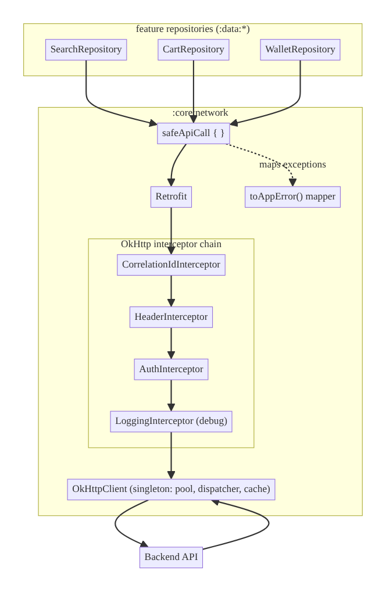
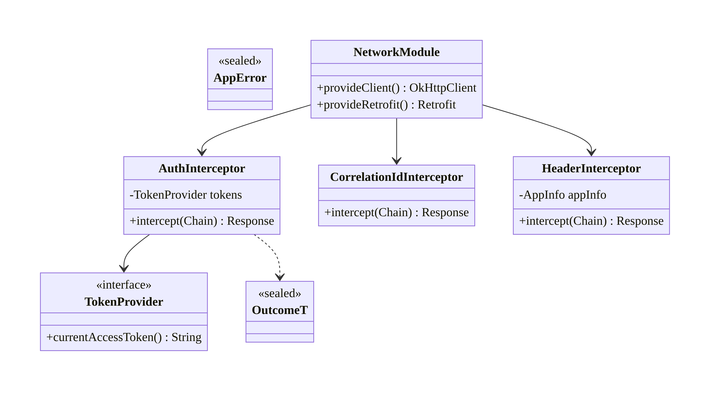
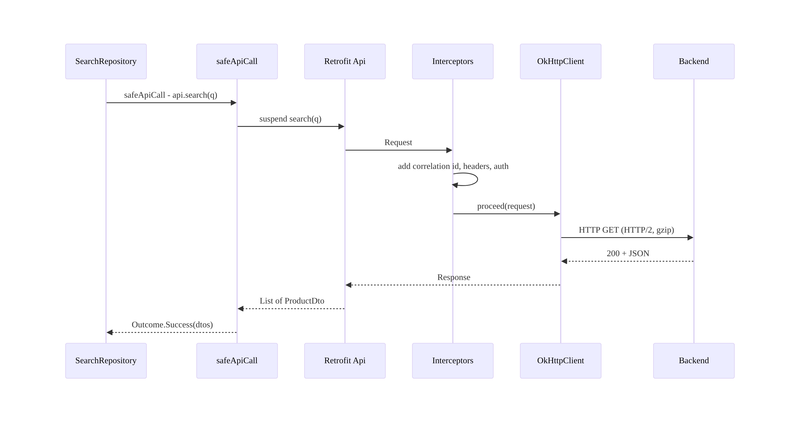
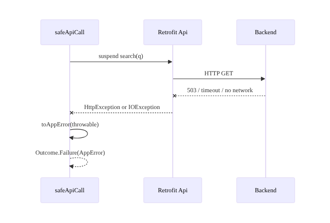
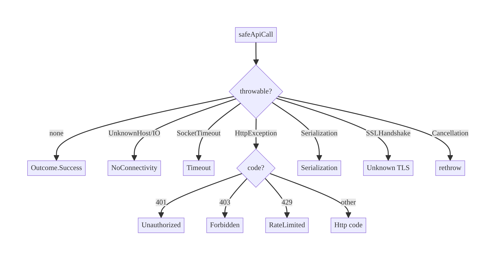

# Chapter 1 — The Networking Core: API Request Orchestration

> **Part I — Core Infrastructure** · Complexity: **Complex** (≥40 interview questions)
>
> **Prerequisites:** none — this is the foundation chapter. It **defines** the
> shared networking stack, the `Outcome`/`AppError` model, correlation IDs, and
> `safeApiCall()` that every later chapter reuses (Ch 2 reliability, Ch 9 search,
> Ch 19 auth, Ch 29 offline-first…).
>
> **Reference surface in StreamCart:** the `:core:network` module — one OkHttp
> client and Retrofit instance shared by Shop, Watch, Wallet, and Account.

---

## 1.1 Problem Definition and Real-World Context

Every non-trivial app talks to a backend, and the networking layer is the one
piece of infrastructure that **every feature depends on**. Teams that let each
feature spin up its own `Retrofit.Builder()` pay for it later: inconsistent
timeouts, five different ways of handling a 401, secrets accidentally logged,
no request tracing, and duplicated boilerplate in every repository.

The naive approach — a Retrofit interface per feature, each creating its own
client — fails in production because:

- **No shared connection pool.** Multiple `OkHttpClient` instances each keep
  their own pool and thread pool, wasting sockets, memory, and battery. OkHttp
  is explicitly designed to be created **once** and shared.
- **Inconsistent error handling.** One repo catches `IOException`, another lets
  it crash, a third checks `response.isSuccessful` differently. The UI can't
  present coherent error states.
- **Cross-cutting concerns scattered.** Auth headers, correlation IDs, logging,
  and gzip get re-implemented (or forgotten) per feature.
- **Untraceable production issues.** Without a correlation ID threaded through
  every request, you cannot tie a client-side failure to a backend trace.

A networking core turns all of this into a single, configured, observable
boundary. Deciding what belongs in it — and what must stay out — is an
architectural decision, which is why it leads the book.

### Three practical use cases

1. **E-commerce (StreamCart Shop).** Dozens of endpoints (catalog, search, cart,
   orders) share one client; a single auth interceptor attaches the token, one
   error model drives every screen's error UI.
2. **OTT (StreamCart Watch).** Playback manifests, license requests, and catalog
   calls need different timeouts and sometimes a different base URL/CDN, but
   still share pooling, logging, and tracing.
3. **Fintech (StreamCart Wallet).** Strict TLS (pinning), idempotency keys on
   mutations (Ch 15), and PII-safe logging are enforced centrally so no feature
   team can accidentally weaken them.

### Why this is architectural, not a coding task

The networking core decides ownership (who holds the client), dependency
direction (features depend on it, never the reverse), the error contract that
the entire app's UI is built around, and the observability spine (correlation
IDs). Those are system-level decisions.

---

## 1.2 Requirements Engineering

### Functional requirements

| ID | Requirement |
|----|-------------|
| F1 | Provide a single shared `OkHttpClient` + `Retrofit` for the whole app. |
| F2 | Attach common headers (auth, content-type, app version, correlation ID) via interceptors. |
| F3 | Serialize/deserialize JSON (kotlinx.serialization). |
| F4 | Expose a uniform result type (`Outcome<T>`) so callers never touch raw exceptions. |
| F5 | Map every transport/HTTP/parse failure to a typed `AppError`. |
| F6 | Support configurable base URL(s) and per-call timeouts. |
| F7 | Log requests/responses in debug; redact sensitive fields always. |
| F8 | Thread a correlation ID from client to backend on every request. |
| F9 | Allow features to declare their own Retrofit API interfaces without re-creating the client. |

### Non-functional requirements

| Attribute | Policy |
|-----------|--------|
| **Performance** | One client (shared pool, HTTP/2, gzip, keep-alive); no main-thread calls. |
| **Reliability** | Sane timeouts; failures are typed, never swallowed. (Retry policy → Ch 2.) |
| **Security** | HTTPS only; cert pinning hook (Ch 23); never log tokens/PII (Ch 28). |
| **Maintainability** | Cross-cutting concerns live in interceptors, not repositories. |
| **Observability** | Correlation IDs + structured logging on every call. |
| **Testability** | Client assembled by Hilt; swappable base URL; MockWebServer-friendly. |
| **Battery/Network** | Connection reuse; gzip; cancel on coroutine cancellation. |

### Scope

- **In scope:** client assembly, interceptor chain, serialization, the error
  model, `safeApiCall`, correlation IDs, DI wiring.
- **Out of scope (other chapters):** retry/backoff/circuit-breaking (Ch 2),
  token refresh (Ch 19), cert pinning details (Ch 23), caching strategy (Ch 12),
  offline SSOT (Ch 29).

### Assumptions & constraints

- REST/JSON backend; `minSdk 24`; Kotlin + Coroutines; Hilt; Retrofit 2.9+,
  OkHttp 4.12+, kotlinx.serialization.
- Base URL comes from build config / remote config (Ch 41).

---

## 1.3 System Design Fundamentals

- **OkHttp is a shared singleton.** It owns a connection pool, a thread pool
  (`Dispatcher`), and a cache. Creating it once maximizes connection reuse and
  HTTP/2 multiplexing. This is the single most important networking decision.
- **Interceptors are the extension point.** *Application interceptors* run once
  per call (good for auth, correlation IDs, logging the logical request).
  *Network interceptors* run per network hop (good for seeing redirects/retries,
  gzip). Choosing the right layer matters.
- **Retrofit** turns a Kotlin interface into HTTP calls; with `suspend`
  functions it integrates with coroutines and propagates cancellation to the
  underlying `Call`.
- **A uniform result type** (`Outcome<T>`) keeps exceptions out of the domain
  layer and makes error handling exhaustive via `when`.
- **Correlation ID** is a per-request UUID placed in a header and in logs,
  enabling end-to-end tracing (Ch 84).

The core insight: **concentrate cross-cutting concerns in the interceptor chain
and collapse all failure modes into one typed `Outcome`**, so every feature gets
auth, tracing, logging, and consistent errors for free.

---

## 1.4 High-Level Architecture



**Components & ownership**

- **`OkHttpClient`** — the single shared transport (connection pool, dispatcher,
  timeouts, cache). Owned by `:core:network`, provided as a Hilt `@Singleton`.
- **Interceptor chain** — correlation ID → headers → auth → logging. Order
  matters: correlation ID is set first so logging and auth can read it; logging
  is last so it records the final outgoing request.
- **`Retrofit`** — one instance built on the client, with the kotlinx
  serialization converter. Features call `retrofit.create(XxxApi::class.java)`.
- **`safeApiCall`** — the suspend wrapper every repository uses; it executes the
  call, catches throwables, and returns `Outcome`.
- **`toAppError()`** — the single exception→`AppError` mapper.

**Dependency direction:** `:data:* → :core:network`. The core knows nothing
about features. Auth token *reading* is injected into the core via an interface
(`TokenProvider`) implemented in the auth module, so the core doesn't depend on
auth (dependency inversion).

---

## 1.5 Detailed Component Design



| Component | Responsibility | Input | Output | Errors |
|-----------|----------------|-------|--------|--------|
| `CorrelationIdInterceptor` | add `X-Correlation-Id` | request | request+header | — |
| `HeaderInterceptor` | add content-type, app version, locale | request | request+headers | — |
| `AuthInterceptor` | add `Authorization` when a token exists | request | request+auth | — |
| `LoggingInterceptor` | debug logging with redaction | request/response | unchanged | — |
| `safeApiCall` | run call, convert failures | suspend block | `Outcome<T>` | maps to `AppError` |
| `toAppError` | classify throwable | `Throwable` | `AppError` | — |

> `AuthInterceptor` only **adds** a token here. **Refreshing** on 401 is a
> separate concern handled by an OkHttp `Authenticator` in Ch 19, so this
> chapter's interceptor stays simple.

---

## 1.6 End-to-End Data Flow

### Success path



### Failure path



---

## 1.7 Complete Kotlin Implementation

Package: `com.streamcart.core.network`.

### 1.7.1 The result type and error taxonomy

```kotlin
sealed interface Outcome<out T> {
    data class Success<T>(val data: T) : Outcome<T>
    data class Failure(val error: AppError) : Outcome<Nothing>
}

sealed interface AppError {
    data object NoConnectivity : AppError
    data object Timeout : AppError
    data object Unauthorized : AppError              // 401
    data object Forbidden : AppError                 // 403
    data object RateLimited : AppError               // 429
    data class Http(val code: Int, val body: String?) : AppError   // other 4xx/5xx
    data class Serialization(val cause: Throwable) : AppError
    data class Database(val cause: Throwable) : AppError
    data object DiskFull : AppError
    data class Unknown(val cause: Throwable) : AppError
}

fun AppError.isRetryable(): Boolean = when (this) {
    AppError.NoConnectivity, AppError.Timeout, AppError.RateLimited -> true
    is AppError.Http -> code >= 500
    else -> false
}
```

### 1.7.2 The exception mapper

```kotlin
fun Throwable.toAppError(): AppError = when (this) {
    is CancellationException -> throw this               // never swallow cancellation
    is UnknownHostException -> AppError.NoConnectivity
    is SocketTimeoutException -> AppError.Timeout
    is SSLHandshakeException -> AppError.Unknown(this)    // pinning failures surface here (Ch 23)
    is HttpException -> when (val c = code()) {
        401 -> AppError.Unauthorized
        403 -> AppError.Forbidden
        429 -> AppError.RateLimited
        else -> AppError.Http(c, response()?.errorBody()?.string())
    }
    is SerializationException -> AppError.Serialization(this)
    is IOException -> AppError.NoConnectivity            // generic transport failure
    else -> AppError.Unknown(this)
}
```

> **Why rethrow `CancellationException`?** Structured concurrency relies on
> cancellation propagating. Converting it to an error would make a cancelled
> request look like a failed one and break coroutine semantics. This is the most
> common bug in hand-rolled `safeApiCall` helpers.

### 1.7.3 `safeApiCall`

```kotlin
suspend fun <T> safeApiCall(
    dispatcher: CoroutineDispatcher,
    block: suspend () -> T,
): Outcome<T> = withContext(dispatcher) {
    try {
        Outcome.Success(block())
    } catch (t: Throwable) {
        Outcome.Failure(t.toAppError())   // rethrows CancellationException via toAppError
    }
}
```

### 1.7.4 Interceptors

```kotlin
class CorrelationIdInterceptor @Inject constructor() : Interceptor {
    override fun intercept(chain: Interceptor.Chain): Response {
        val request = chain.request().newBuilder()
            .header("X-Correlation-Id", UUID.randomUUID().toString())
            .build()
        return chain.proceed(request)
    }
}

class HeaderInterceptor @Inject constructor(
    private val appInfo: AppInfo,     // versionName, platform, locale
) : Interceptor {
    override fun intercept(chain: Interceptor.Chain): Response {
        val request = chain.request().newBuilder()
            .header("Accept", "application/json")
            .header("X-App-Version", appInfo.versionName)
            .header("X-Platform", "android")
            .header("Accept-Language", appInfo.locale)
            .build()
        return chain.proceed(request)
    }
}

// Only ADDS a token. Refresh-on-401 is an Authenticator in Ch 19.
class AuthInterceptor @Inject constructor(
    private val tokens: TokenProvider,
) : Interceptor {
    override fun intercept(chain: Interceptor.Chain): Response {
        val token = tokens.currentAccessToken()
        val request = if (token != null) {
            chain.request().newBuilder()
                .header("Authorization", "Bearer $token")
                .build()
        } else chain.request()
        return chain.proceed(request)
    }
}

/** Dependency inversion: core defines the port; :data:auth implements it. */
interface TokenProvider {
    fun currentAccessToken(): String?
}
```

### 1.7.5 Client & Retrofit assembly (Hilt)

```kotlin
@Module @InstallIn(SingletonComponent::class)
object NetworkModule {

    @Provides @Singleton
    fun provideJson(): Json = Json {
        ignoreUnknownKeys = true      // tolerate schema evolution (Ch 16)
        explicitNulls = false
        coerceInputValues = true
    }

    @Provides @Singleton
    fun provideOkHttp(
        correlationId: CorrelationIdInterceptor,
        headers: HeaderInterceptor,
        auth: AuthInterceptor,
        @ApplicationContext context: Context,
    ): OkHttpClient = OkHttpClient.Builder()
        .connectTimeout(10, TimeUnit.SECONDS)
        .readTimeout(20, TimeUnit.SECONDS)
        .writeTimeout(20, TimeUnit.SECONDS)
        .callTimeout(30, TimeUnit.SECONDS)        // whole-call ceiling
        .retryOnConnectionFailure(true)
        .addInterceptor(correlationId)
        .addInterceptor(headers)
        .addInterceptor(auth)
        .apply {
            if (BuildConfig.DEBUG) {
                addInterceptor(HttpLoggingInterceptor().apply {
                    level = HttpLoggingInterceptor.Level.BODY
                    redactHeader("Authorization")   // never log tokens
                })
            }
        }
        .cache(Cache(File(context.cacheDir, "http"), 10L * 1024 * 1024))
        .build()

    @Provides @Singleton
    fun provideRetrofit(client: OkHttpClient, json: Json): Retrofit {
        val contentType = "application/json".toMediaType()
        return Retrofit.Builder()
            .baseUrl(BuildConfig.API_BASE_URL)
            .client(client)
            .addConverterFactory(json.asConverterFactory(contentType))
            .build()
    }
}
```

### 1.7.6 How a feature declares an API

```kotlin
// :data:catalog — declares its interface, does NOT build a client
interface ProductSearchApi {
    @GET("search/products")
    suspend fun search(@Query("q") q: String, @Query("limit") limit: Int = 20): List<ProductDto>
}

@Module @InstallIn(SingletonComponent::class)
object CatalogNetworkModule {
    @Provides fun provideApi(retrofit: Retrofit): ProductSearchApi =
        retrofit.create(ProductSearchApi::class.java)
}

// repository usage
class SearchRepositoryImpl @Inject constructor(
    private val api: ProductSearchApi,
    private val dispatchers: DispatcherProvider,
) {
    suspend fun search(q: String): Outcome<List<Product>> =
        safeApiCall(dispatchers.io) { api.search(q).map { it.toDomain() } }
}
```

### 1.7.7 Module structure

```
:core:network
  Outcome.kt, AppError.kt, toAppError.kt, safeApiCall.kt
  interceptor/  CorrelationIdInterceptor, HeaderInterceptor, AuthInterceptor
  di/           NetworkModule
  TokenProvider.kt (port), AppInfo.kt
:data:catalog/di   CatalogNetworkModule (provides ProductSearchApi)
```

---

## 1.8 Concurrency and Race Conditions

| Scenario | Risk | Handling |
|----------|------|----------|
| Many concurrent calls | Socket/thread exhaustion | Shared `OkHttpClient`; `Dispatcher` caps (default 64 total / 5 per host) |
| Coroutine cancelled mid-call | Leaked socket, wasted work | `suspend` Retrofit propagates cancellation → OkHttp `Call.cancel()` |
| Shared mutable interceptor state | Data race | Interceptors are stateless; `TokenProvider` reads are atomic |
| Correlation ID uniqueness | Collisions in logs | `UUID.randomUUID()` per call |
| `errorBody().string()` consumed twice | `IllegalStateException` | Read once in the mapper |

- **OkHttp `Dispatcher`** bounds concurrency. For a client that issues many
  parallel calls to one host, tune `maxRequestsPerHost`. Don't create extra
  clients to "get more parallelism" — share one and raise the limit.
- **Cancellation** is first-class: when `viewModelScope` cancels, the suspended
  Retrofit call throws `CancellationException`, OkHttp cancels the socket, and
  `toAppError` rethrows it (never converted to `Failure`).

---

## 1.9 Failure Scenarios and Recovery

| Failure | Detection | Response | UX | Retry? | Telemetry |
|---------|-----------|----------|----|--------|-----------|
| No internet | `UnknownHostException`/`IOException` → `NoConnectivity` | `Failure` | "You're offline" | yes (Ch 2) | `net_error{type=offline}` |
| Timeout | `SocketTimeoutException`/call timeout → `Timeout` | `Failure` | "Taking too long" | yes | `net_error{type=timeout}`, `latency_ms` |
| 401 | `HttpException(401)` → `Unauthorized` | Authenticator refresh (Ch 19) | invisible | auto | `auth_refresh` |
| 403 | `Forbidden` | `Failure` | "Not allowed" | no | `net_error{type=forbidden}` |
| 429 | `RateLimited` | backoff (Ch 2) | brief wait | delayed | `net_error{type=rate_limited}` |
| 5xx | `Http(5xx)` | `Failure` + capped retry | "Something went wrong" | yes | `net_error{type=server, code}` |
| Malformed JSON | `SerializationException` → `Serialization` | `Failure` | generic error | no | `net_error{type=parse}` + schema version |
| TLS/pinning | `SSLHandshakeException` | `Failure` | "Secure connection failed" | no | `net_error{type=tls}` (possible MITM) |



---

## 1.10 Scaling the Implementation

- **Level 1 — single module.** One client, one Retrofit, a handful of APIs.
- **Level 2 — multi-feature.** Each feature declares its own Retrofit interface
  and a tiny DI module; the client stays shared.
- **Level 3 — production.** Add caching hooks (Ch 12), the `Authenticator`
  (Ch 19), cert pinning (Ch 23), reliability/backoff (Ch 2), redacted logging,
  correlation IDs wired into telemetry (Ch 84).
- **Level 4 — multiple backends / CDNs.** Qualified Retrofit instances
  (`@CatalogRetrofit`, `@LicenseRetrofit`) sharing one `OkHttpClient` but with
  different base URLs and timeouts; per-host tuning.
- **Level 5 — enterprise.** `:core:network` is a platform module owned by one
  team; API interfaces are generated from OpenAPI; versioned, backward-compatible
  DTOs (Ch 16); mandatory lint rules forbidding `OkHttpClient.Builder()` outside
  the core.

**Avoid overengineering:** a small app doesn't need multiple qualified Retrofit
instances or OpenAPI codegen. Add those only when real multi-backend or
multi-team needs appear.

---

## 1.11 Alternative Approaches and Trade-offs

| Dimension | Option A | Option B | When |
|-----------|----------|----------|------|
| HTTP client | Retrofit + OkHttp | Ktor Client | Retrofit for Android REST maturity; Ktor for KMP/multiplatform |
| Result handling | `safeApiCall` wrapper | Retrofit `CallAdapter` returning `Outcome` | Wrapper is explicit/simple; CallAdapter removes per-call boilerplate at the cost of magic |
| Serialization | kotlinx.serialization | Moshi | kotlinx for Kotlin-first + KMP; Moshi for reflection-free Java interop/legacy |
| Error type | Sealed `AppError` | Exceptions up the stack | Sealed type for exhaustive UI handling; exceptions only at the very edge |
| Logging | `HttpLoggingInterceptor` | Custom structured interceptor | Built-in for dev; custom for prod structured logs + redaction |
| Token on 401 | `Authenticator` | Manual retry in repo | Authenticator (built-in, single-flight friendly) — Ch 19 |

**kotlinx.serialization vs Moshi:** kotlinx is compile-time, no reflection,
multiplatform, and pairs naturally with Kotlin. Moshi is battle-tested with
great Java interop and adapters. For a greenfield Kotlin app, kotlinx is the
default.

---

## 1.12 Security Considerations

- **HTTPS only**; cleartext disabled via network security config. **Certificate
  pinning** is added here as an OkHttp `CertificatePinner` (details Ch 23) — a
  client protection against MITM, not a substitute for backend authz.
- **Never log secrets.** `redactHeader("Authorization")`; logging only in debug;
  response bodies may contain PII — redact or disable body logging in release
  (Ch 28).
- **Header injection:** values derived from user input must be sanitized before
  becoming headers.
- **Correlation IDs** must be random (UUID), not sequential, to avoid leaking
  volume/ordering information.
- **Client vs backend:** the client enforces transport security and sane
  defaults; **authentication, authorization, rate limiting, and input
  validation are backend guarantees**. State this explicitly in interviews.

---

## 1.13 Performance and Resource Optimization

- **Connection reuse:** one client ⇒ one pool ⇒ HTTP/2 multiplexing + keep-alive;
  fewer TLS handshakes (big battery/latency win on mobile).
- **gzip:** OkHttp adds `Accept-Encoding: gzip` and decompresses transparently
  when you don't set it manually.
- **Timeouts:** connect/read/write + an overall `callTimeout` ceiling so a slow
  body can't hang forever.
- **Off main thread:** `safeApiCall` runs on `dispatchers.io`; verify with
  StrictMode `detectNetwork()`.
- **Profiling:** Android Studio **Network Inspector** (requests, sizes, timing),
  OkHttp `EventListener` for connection/DNS/TLS timing, Perfetto for thread
  activity.

---

## 1.14 Testing Strategy

Fake the **backend** with MockWebServer (real OkHttp/Retrofit, real
serialization); unit-test interceptors and the error mapper directly.

```kotlin
class NetworkCoreTest {
    private val server = MockWebServer()
    private lateinit var api: ProductSearchApi

    @Before fun setUp() {
        server.start()
        val client = OkHttpClient.Builder()
            .addInterceptor(CorrelationIdInterceptor())
            .build()
        api = Retrofit.Builder()
            .baseUrl(server.url("/"))
            .client(client)
            .addConverterFactory(Json { ignoreUnknownKeys = true }
                .asConverterFactory("application/json".toMediaType()))
            .build()
            .create(ProductSearchApi::class.java)
    }
    @After fun tearDown() = server.shutdown()

    @Test fun `attaches correlation id header`() = runTest {
        server.enqueue(MockResponse().setBody("[]"))
        api.search("shoes")
        val recorded = server.takeRequest()
        assertNotNull(recorded.getHeader("X-Correlation-Id"))
    }

    @Test fun `maps 503 to Http error`() = runTest {
        server.enqueue(MockResponse().setResponseCode(503))
        val out = safeApiCall(UnconfinedTestDispatcher()) { api.search("x") }
        val err = (out as Outcome.Failure).error
        assertTrue(err is AppError.Http && err.code == 503)
    }

    @Test fun `unknown host maps to NoConnectivity`() = runTest {
        val badApi = Retrofit.Builder().baseUrl("https://nonexistent.invalid/")
            .client(OkHttpClient()).addConverterFactory(/* ... */ ).build()
            .create(ProductSearchApi::class.java)
        val out = safeApiCall(UnconfinedTestDispatcher()) { badApi.search("x") }
        assertEquals(AppError.NoConnectivity, (out as Outcome.Failure).error)
    }

    @Test fun `cancellation is not swallowed`() = runTest {
        val job = launch {
            safeApiCall(UnconfinedTestDispatcher()) { delay(10_000); Unit }
        }
        job.cancelAndJoin()
        assertTrue(job.isCancelled)   // CancellationException propagated, not mapped
    }
}
```

What to mock vs real: **real** OkHttp/Retrofit/serialization + MockWebServer
(catches converter/interceptor bugs); **fake** `TokenProvider`. Never mock
Retrofit interfaces when the thing under test *is* the networking core.

---

## 1.15 Production Observability

- **Structured logs** (`:core:analytics`, Ch 82): `net_request{method, host,
  path_template, correlation_id}`, `net_response{code, latency_ms, bytes,
  correlation_id}`, `net_error{type, code, correlation_id}`. Log the **path
  template** (`/products/{id}`), never the full URL with IDs/PII.
- **Metrics:** p50/p95 latency per endpoint, error rate by type, 5xx rate,
  timeout rate, bytes transferred, connection reuse ratio.
- **Tracing:** the correlation ID is the join key between client logs, crash
  breadcrumbs, and backend traces (Ch 84). Attach it to crash reports.
- **Debugging in prod:** a spike in `NoConnectivity` across users suggests a DNS/
  CDN outage; rising `Serialization` errors after a backend deploy signals a
  schema break (Ch 16); correlate a user's failed request to the backend trace
  by ID.
- **Privacy:** redact tokens and PII; honor logging consent; sample verbose logs.

---

## 1.16 System Design Interview Preparation

> 40+ questions. The networking core is a favorite because it exposes ownership,
> cross-cutting concerns, error modeling, and coroutine/cancellation depth.

### A. Questions & answers

**Fundamentals**

1. *Why one `OkHttpClient`?* Shared connection pool, dispatcher, cache → reuse,
   HTTP/2 multiplexing, lower battery/latency. Multiple clients waste resources.
2. *Application vs network interceptor?* App interceptor runs once per logical
   call (auth, logging the request); network interceptor runs per hop (sees
   redirects/retries, gzip). Pick by what you need to observe/modify.
3. *Why a uniform `Outcome` type?* Keeps exceptions out of domain/UI; makes
   handling exhaustive; one error contract app-wide.
4. *Where does the networking core sit in the architecture?* `:core:network`,
   depended on by `:data:*`; it depends on nothing feature-specific.
5. *How do features add endpoints without touching the core?* Declare a Retrofit
   interface + a small DI module calling `retrofit.create(...)`.

**Architecture**

6. *How does the core get the auth token without depending on auth?* Dependency
   inversion: core defines `TokenProvider`; `:data:auth` implements it.
7. *Interceptor order — does it matter?* Yes. Correlation ID first (so logging/
   auth can read it), logging last (records final request).
8. *Multiple base URLs/CDNs?* Qualified Retrofit instances sharing one client.
9. *Why not build Retrofit per repository?* Duplicate clients, inconsistent
   config, no shared pool.

**Kotlin / Android internals**

10. *How does cancellation reach the socket?* `suspend` Retrofit call is
    cancellable; coroutine cancellation → `Call.cancel()`.
11. *Why rethrow `CancellationException` in the mapper?* Converting it to a
    failure breaks structured concurrency and mislabels cancelled calls.
12. *`callTimeout` vs read/connect/write timeouts?* `callTimeout` bounds the
    entire call (incl. all retries/redirects/body); the others bound individual
    phases.
13. *Who executes the HTTP work?* OkHttp's `Dispatcher` thread pool; `withContext
    (io)` just suspends the coroutine.
14. *How is JSON parsed off the main thread?* The converter runs on the OkHttp/
    IO thread, within `safeApiCall`'s `withContext(io)`.

**Concurrency**

15. *How is parallelism bounded?* `Dispatcher` max requests (64 total / 5 per
    host by default); tune per host rather than adding clients.
16. *Are interceptors thread-safe?* They must be; keep them stateless.
17. *Can `errorBody()` be read twice?* No — it's a one-shot stream; read once.

**Lifecycle**

18. *What happens to in-flight calls on screen destruction?* `viewModelScope`
    cancels → calls cancel.
19. *Does the client survive config change?* Yes — it's an app-scoped singleton.

**Persistence / caching**

20. *Does the core cache?* It wires an OkHttp `Cache` (HTTP cache) hook; the
    caching *strategy* (what/when) is Ch 12; offline SSOT is Ch 29.
21. *HTTP cache vs repository cache?* HTTP cache honors server headers; repo/DB
    cache is app-controlled and offline-capable.

**Networking**

22. *How do you handle 401?* An `Authenticator` refreshes and retries once
    (Ch 19), not the interceptor.
23. *429?* Map to `RateLimited`; backoff (Ch 2); backend must enforce limits.
24. *How do you tolerate added JSON fields?* `ignoreUnknownKeys = true` (Ch 16).
25. *gzip?* Automatic when you don't set `Accept-Encoding` yourself.

**Scalability**

26. *10M users — what changes in the core?* Little; it's stateless per call.
    Scaling is backend + CDN; client adds pinning, tuned timeouts, observability.
27. *How to cut mobile data?* gzip, HTTP cache, field filtering/`fields` params,
    protobuf for hot endpoints.

**Security**

28. *Where does cert pinning go?* `CertificatePinner` on the client (Ch 23);
    client protection, not authz.
29. *How do you avoid logging tokens?* `redactHeader`, debug-only logging, PII
    redaction (Ch 28).
30. *Client-enforceable vs backend-only security?* Client: TLS, pinning, log
    hygiene. Backend: authn/authz, rate limits, validation.

**Performance**

31. *Biggest mobile networking win?* Connection reuse via a shared client
    (fewer handshakes).
32. *How to measure networking perf?* Network Inspector, OkHttp `EventListener`,
    per-endpoint latency metrics.

**Testing**

33. *How test without a real server?* MockWebServer with real OkHttp/Retrofit.
34. *What do you deliberately NOT mock?* The converter/interceptors — bugs live
    there.
35. *How test error mapping?* Enqueue specific codes / point at an invalid host;
    assert `AppError`.

**Production debugging**

36. *Users report intermittent failures — how triage?* Correlation IDs to join
    client + backend; check error-type breakdown; look for a bad deploy.
37. *Serialization errors spike post-deploy — cause?* Backend schema change;
    tolerant parsing + versioning (Ch 16).
38. *All requests slow on one network — diagnose?* Inspect DNS/TLS timing via
    `EventListener`; could be captive portal/MITM (watch TLS errors).

**Design/trade-off**

39. *Retrofit vs Ktor?* Retrofit for Android REST maturity; Ktor for KMP.
40. *CallAdapter returning `Outcome` vs `safeApiCall`?* CallAdapter removes
    boilerplate but adds indirection; wrapper is explicit and debuggable.
41. *Why sealed `AppError` over throwing?* Exhaustive, type-safe UI handling;
    no forgotten catch blocks.
42. *When would you allow a second `OkHttpClient`?* Rarely — e.g., a different
    trust config (pinned vs unpinned analytics host) or wildly different
    timeouts; still share the pool if possible.

### C. Staff-level follow-ups
- "Your `Authenticator` and a single-flight refresh — how do you prevent a
  thundering herd of refreshes when 50 calls 401 at once?" (Ch 19: mutex + token
  version check.)
- "How do you keep the path template (not the raw URL) in metrics without manual
  tagging?" (annotation/`Invocation` tag from Retrofit, or an `EventListener`.)
- "If you move to KMP next year, what breaks?" (Retrofit is JVM/Android; Ktor +
  kotlinx keeps the error model portable.)

### D. Design-change challenges
1. **Add a second backend (license server) with pinning.** Qualified Retrofit +
   a second `CertificatePinner`; share the pool if trust allows, else a second
   client.
2. **Cut 5xx-driven crashes to zero.** Ensure all calls go through `safeApiCall`;
   add lint forbidding raw calls; add reliability (Ch 2).
3. **Backend adds required idempotency keys on POST.** Central interceptor adds
   `Idempotency-Key` for mutations (Ch 15).
4. **Switch Moshi → kotlinx without touching features.** Swap converter in the
   core; DTOs already annotated.
5. **Protobuf for the hot search endpoint.** Per-endpoint converter; keep JSON
   elsewhere.

### E. Mock walkthrough (abridged)
Clarify (REST/JSON, single backend, auth, offline?) → state F/NFR and the error
contract → draw `:core:network` with the interceptor chain and `safeApiCall` →
deep-dive the mapper and cancellation → failures + reliability hook → scale to
multi-backend/enterprise lint → defend kotlinx vs Moshi and wrapper vs
CallAdapter.

---

## 1.17 Practical Exercises

1. **Beginner.** Stand up `:core:network` with the three interceptors and
   `safeApiCall`; prove via MockWebServer that every request carries a
   correlation ID. *Eval:* header present; one shared client.
2. **Intermediate.** Implement `toAppError` and unit-test the full matrix
   (offline, timeout, 401/403/429/5xx, malformed). *Eval:* all branches covered;
   cancellation rethrown.
3. **Advanced.** Add a second qualified Retrofit for a license host with its own
   timeouts and a `CertificatePinner`, sharing the pool. *Eval:* one client, two
   base URLs, pinning verified.
4. **Production debugging.** Given a repo that creates a Retrofit per call
   (latency + socket churn), find and fix it. *Eval:* single shared client;
   connection reuse ratio improves.
5. **System design challenge.** Design the core to support KMP later and
   protobuf on one endpoint without breaking the error contract. *Eval:* portable
   `Outcome`, per-endpoint converter, no feature changes.

*(Solutions withheld unless requested.)*

---

## 1.18 Chapter Summary & Reference Sheet

**Key decisions:** one shared `OkHttpClient`; cross-cutting concerns in
interceptors; collapse all failures into a sealed `AppError` via `safeApiCall`;
features declare interfaces, never clients; correlation IDs on every request;
dependency-invert the token via `TokenProvider`.

**Concepts:** connection pooling/HTTP-2 reuse, app vs network interceptors,
suspend-call cancellation, uniform result type, correlation IDs.

**Common mistakes:** multiple clients; swallowing `CancellationException`;
logging tokens; reading `errorBody()` twice; building Retrofit per repository;
throwing exceptions into the domain layer instead of returning `Outcome`.

**Checklist:**

- [ ] single client
- [ ] interceptor order
- [ ] redacted debug logging
- [ ] timeouts + `callTimeout`
- [ ] `safeApiCall` everywhere
- [ ] exhaustive `toAppError`
- [ ] cancellation rethrown
- [ ] correlation ID
- [ ] `ignoreUnknownKeys`
- [ ] pinning hook.

**Key APIs:** `OkHttpClient.Builder`, `Interceptor`, `Authenticator` (Ch 19),
`Cache`, `HttpLoggingInterceptor.redactHeader`, `Retrofit`,
`kotlinx-serialization-converter`, `HttpException`, `withContext`,
`CancellationException`, MockWebServer.

**Official references:**
- OkHttp: https://square.github.io/okhttp/
- OkHttp interceptors: https://square.github.io/okhttp/features/interceptors/
- Retrofit: https://square.github.io/retrofit/
- kotlinx.serialization: https://github.com/Kotlin/kotlinx.serialization
- Android network security config: https://developer.android.com/privacy-and-security/security-config
- Coroutines cancellation: https://kotlinlang.org/docs/cancellation-and-timeouts.html

### Chapter review (Phase 4)
- **Completeness:** all 18 sections; architecture/class/sequence/failure diagrams;
  full client + interceptors + error model + DI; concurrency + cancellation;
  failure matrix; 5 scaling levels; trade-offs; security split; perf/profiling;
  MockWebServer tests; observability; 42 Q&A + follow-ups + 5 challenges. ✅
- **Expand later:** `Authenticator`/refresh (Ch 19), caching strategy (Ch 12),
  pinning specifics (Ch 23), OpenAPI codegen.
- **Interview coverage:** exceeds ≥40 bar.
- **Shared artifacts introduced:** `Outcome`, `AppError`, `toAppError`,
  `safeApiCall`, `TokenProvider`, correlation IDs — reused book-wide.
