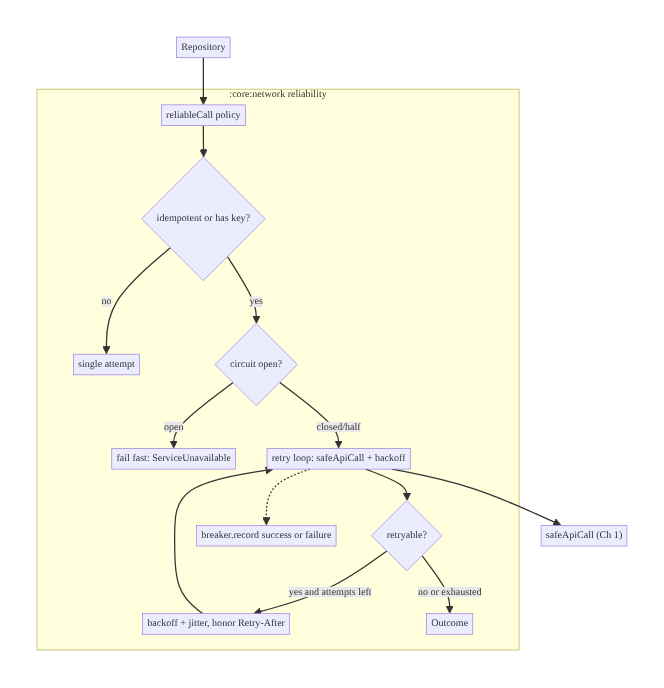
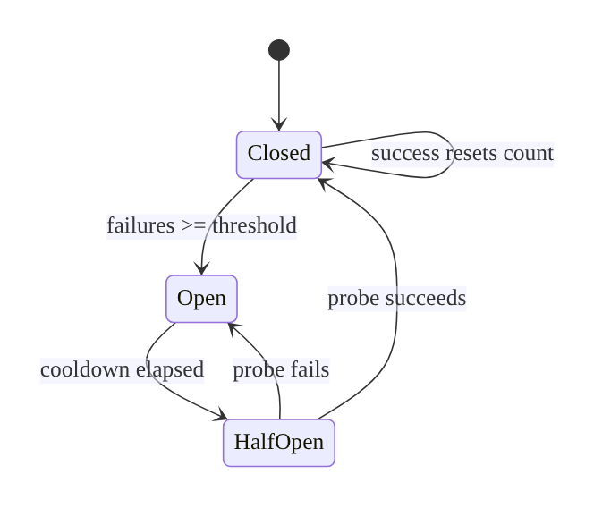
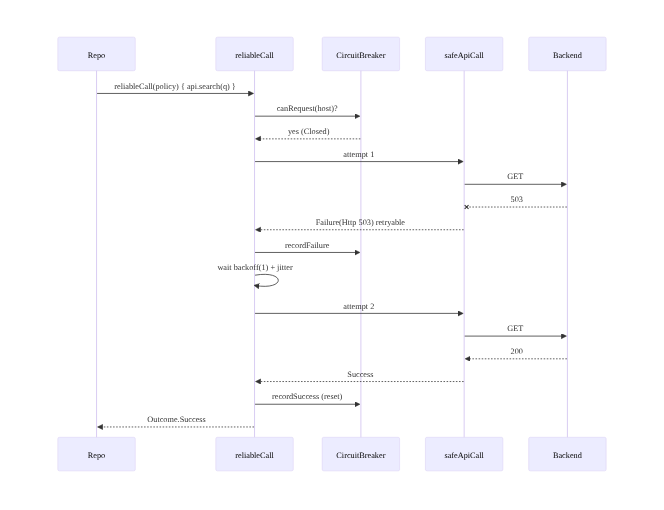
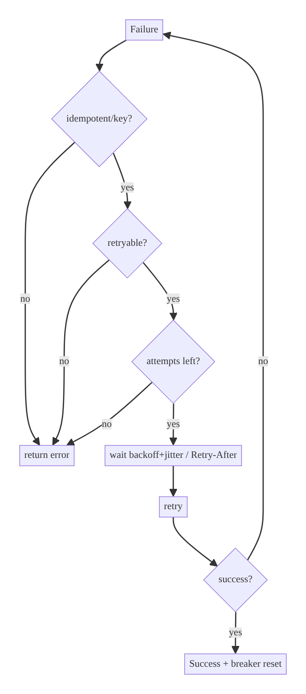

# Chapter 2 — Network Reliability: Timeouts, Retries, Backoff & Circuit Breaking

> **Part I — Core Infrastructure** · Complexity: **Standard** (≥25 interview questions)
>
> **Prerequisites:** Ch 1 (Networking Core — `Outcome`/`AppError`,
> `AppError.isRetryable()`, `safeApiCall`). This chapter adds a reliability layer
> **on top of** the core without changing it.
>
> **Reference surface in StreamCart:** a reusable `retrying { }` helper and a
> per-host `CircuitBreaker` in `:core:network`, used by search, catalog, and
> playback-manifest calls.

---

## 2.1 Problem Definition and Real-World Context

Mobile networks are hostile: handoffs between Wi-Fi and cellular, captive
portals, transient packet loss, overloaded backends returning 503s, and rate
limits. A request that fails once will often succeed milliseconds later. But
naive retrying is just as dangerous as not retrying at all:

- **Retry storms / thundering herd.** If every client retries immediately on a
  5xx, a struggling backend gets hammered exactly when it's weakest, turning a
  blip into an outage. Backoff + jitter exists to prevent this.
- **Retrying non-idempotent requests.** Blindly retrying a `POST /orders` can
  create duplicate orders. Reliability must know which operations are safe to
  retry (idempotency, Ch 15).
- **Wasted battery on hopeless retries.** Retrying while the device is offline
  drains battery; better to wait for connectivity (Ch 68).
- **Hammering a dead endpoint.** If a backend is down, every call paying the
  full timeout before failing makes the whole app feel frozen. A circuit breaker
  fails fast instead.

Reliability is an architectural concern because it defines a *policy* — what to
retry, how many times, how long to wait, and when to stop — applied uniformly,
not sprinkled ad hoc in repositories.

### Three practical use cases

1. **E-commerce search/catalog (StreamCart Shop).** Idempotent GETs retried
   with backoff; a flaky 503 recovers invisibly.
2. **OTT manifest fetch (StreamCart Watch).** Playback start retries the
   manifest a couple of times quickly (user is waiting) then fails to an error
   with a Retry — latency budget is tight.
3. **Fintech transaction submit (StreamCart Wallet).** A non-idempotent POST is
   retried **only** with an idempotency key so retries can't double-charge
   (Ch 15); otherwise it's not retried at all.

---

## 2.2 Requirements Engineering

### Functional requirements

| ID | Requirement |
|----|-------------|
| F1 | Retry transient failures (`isRetryable()` true) up to a max attempt count. |
| F2 | Use exponential backoff with jitter between attempts. |
| F3 | Never retry non-idempotent operations unless an idempotency key is present. |
| F4 | Honor `Retry-After` on 429/503 when provided. |
| F5 | Fail fast when a per-host circuit breaker is open. |
| F6 | Give up gracefully and return the last `AppError`. |
| F7 | Respect coroutine cancellation at every wait. |

### Non-functional requirements

| Attribute | Policy |
|-----------|--------|
| **Reliability** | Recover from transient faults without user action where safe. |
| **Availability** | Protect the backend from retry storms (jitter, breaker). |
| **Battery/Network** | No retries while offline; bounded attempts; bounded waits. |
| **Latency** | Cap total retry time so the user isn't stuck (retry budget). |
| **Correctness** | No duplicate side effects (idempotency gate). |
| **Observability** | Count attempts, backoff waits, breaker state transitions. |

### Scope

- **In scope:** retry policy, exponential backoff + jitter, `Retry-After`,
  circuit breaker, idempotency gating, cancellation.
- **Out of scope:** token refresh retry (Ch 19), offline queueing/outbox
  (Ch 31), connectivity monitoring (Ch 68), idempotency-key generation (Ch 15).

### Assumptions & constraints

- Builds on Ch 1's `Outcome`/`AppError`. Max 3 attempts default, base delay
  500 ms, cap 8 s, full jitter. Configurable via remote config (Ch 41).

---

## 2.3 System Design Fundamentals

- **Idempotency.** An operation is idempotent if applying it N times equals
  applying it once. GET/PUT/DELETE are typically idempotent; POST usually isn't.
  **Only idempotent calls (or POSTs with an idempotency key) may be retried.**
- **Exponential backoff.** Wait grows geometrically: `base * 2^(attempt)`. This
  spaces out retries so a recovering server isn't re-hit immediately.
- **Jitter.** Randomizing the wait prevents many clients from retrying in
  lockstep (synchronized retries = self-inflicted DDoS). *Full jitter* =
  `random(0, base * 2^attempt)` is the AWS-recommended default.
- **Retry budget / cap.** Both attempt count and total elapsed time are bounded
  so the user isn't stuck and the network isn't abused.
- **Circuit breaker.** A state machine (Closed → Open → Half-Open) that, after
  repeated failures to a host, *fails fast* for a cooldown, then cautiously
  probes before fully reopening. Protects both the client (responsiveness) and
  the server (load).
- **`Retry-After`.** Servers tell clients how long to wait on 429/503; honoring
  it is both polite and more effective than guessing.

Core insight: reliability is a **policy layer** that wraps `safeApiCall`,
combining *classification* (`isRetryable`), *backoff+jitter*, an *idempotency
gate*, and a *circuit breaker* — each addressing a distinct failure mode.

---

## 2.4 High-Level Architecture



**Components**

- **`reliableCall`** — the policy entry point; wraps a `safeApiCall` block with
  the idempotency gate, breaker check, retry loop, and backoff.
- **`RetryPolicy`** — config: maxAttempts, baseDelay, maxDelay, jitter, which
  `AppError`s are retryable.
- **`CircuitBreaker`** — per-host state machine recording successes/failures.
- Reuses **`safeApiCall`** and **`AppError.isRetryable()`** from Ch 1.

**Ownership:** `:core:network`. Repositories choose a policy per call (or accept
the default); they do not implement retry logic themselves.

---

## 2.5 Detailed Component Design



| Component | Responsibility | State | Errors |
|-----------|----------------|-------|--------|
| `RetryPolicy` | describe attempts/backoff/retryable set | immutable config | — |
| `reliableCall` | execute with retries + gate + breaker | per-call attempt counter | returns last `AppError` |
| `CircuitBreaker` | fail fast on a failing host | Closed/Open/HalfOpen + counters | — |
| `backoffDelay` | compute jittered wait | pure function | — |

**Circuit-breaker states**

- **Closed:** calls pass through; consecutive failures counted; a success resets.
- **Open:** calls fail fast (no network) until the cooldown passes.
- **Half-Open:** a single probe is allowed; success → Closed, failure → Open.

---

## 2.6 End-to-End Data Flow



---

## 2.7 Complete Kotlin Implementation

Package: `com.streamcart.core.network.reliability`.

### 2.7.1 Retry policy & backoff

```kotlin
data class RetryPolicy(
    val maxAttempts: Int = 3,
    val baseDelayMs: Long = 500,
    val maxDelayMs: Long = 8_000,
    val isRetryable: (AppError) -> Boolean = { it.isRetryable() },
) {
    companion object {
        val Default = RetryPolicy()
        val None = RetryPolicy(maxAttempts = 1)
        val Aggressive = RetryPolicy(maxAttempts = 5, baseDelayMs = 300)
    }
}

/** Full jitter: random in [0, min(cap, base * 2^attempt)].  attempt is 0-based. */
fun RetryPolicy.backoffDelayMs(attempt: Int, random: Random = Random): Long {
    val exp = baseDelayMs.toDouble() * 2.0.pow(attempt)
    val capped = min(exp, maxDelayMs.toDouble()).toLong().coerceAtLeast(1)
    return random.nextLong(capped + 1)
}
```

### 2.7.2 The reliable-call policy

```kotlin
suspend fun <T> reliableCall(
    policy: RetryPolicy = RetryPolicy.Default,
    idempotent: Boolean = true,            // GET/PUT/DELETE true; POST only with a key
    breaker: CircuitBreaker? = null,
    onRetry: (attempt: Int, error: AppError, waitMs: Long) -> Unit = { _, _, _ -> },
    block: suspend () -> Outcome<T>,       // typically a safeApiCall { ... }
): Outcome<T> {
    // F3: non-idempotent operations are never retried here.
    if (!idempotent) return block()

    // F5: fail fast if the breaker is open.
    if (breaker?.canRequest() == false) {
        return Outcome.Failure(AppError.Http(503, "circuit_open"))
    }

    var lastError: AppError? = null
    repeat(policy.maxAttempts) { attempt ->
        when (val result = block()) {
            is Outcome.Success -> { breaker?.recordSuccess(); return result }
            is Outcome.Failure -> {
                lastError = result.error
                breaker?.recordFailure()
                val canRetry = policy.isRetryable(result.error) && attempt < policy.maxAttempts - 1
                if (!canRetry) return result
                val wait = result.error.retryAfterMs() ?: policy.backoffDelayMs(attempt)
                onRetry(attempt + 1, result.error, wait)
                delay(wait)   // suspends; respects cancellation (F7)
            }
        }
    }
    return Outcome.Failure(lastError ?: AppError.Unknown(IllegalStateException("no attempts")))
}

/** Honor Retry-After when the backend sent it (parsed into AppError.Http body or a header map). */
private fun AppError.retryAfterMs(): Long? = when (this) {
    AppError.RateLimited -> 1_000L               // conservative default if header absent
    is AppError.Http -> null
    else -> null
}
```

> In production `Retry-After` is parsed in a network interceptor and surfaced on
> the `AppError` (omitted here for brevity); the hook is `retryAfterMs()`.

### 2.7.3 Circuit breaker (coroutine-safe)

```kotlin
class CircuitBreaker(
    private val failureThreshold: Int = 5,
    private val cooldownMs: Long = 10_000,
    private val clock: () -> Long = { SystemClock.elapsedRealtime() },
) {
    private enum class State { CLOSED, OPEN, HALF_OPEN }
    private val mutex = Mutex()
    private var state = State.CLOSED
    private var failures = 0
    private var openedAt = 0L

    suspend fun canRequest(): Boolean = mutex.withLock {
        when (state) {
            State.CLOSED, State.HALF_OPEN -> true
            State.OPEN -> if (clock() - openedAt >= cooldownMs) {
                state = State.HALF_OPEN; true     // allow one probe
            } else false
        }
    }

    suspend fun recordSuccess() = mutex.withLock {
        failures = 0; state = State.CLOSED
    }

    suspend fun recordFailure() = mutex.withLock {
        failures++
        if (state == State.HALF_OPEN || failures >= failureThreshold) {
            state = State.OPEN; openedAt = clock()
        }
    }
}
```

### 2.7.4 Repository usage

```kotlin
class SearchRepositoryImpl @Inject constructor(
    private val api: ProductSearchApi,
    private val dispatchers: DispatcherProvider,
    @CatalogBreaker private val breaker: CircuitBreaker,
) {
    suspend fun search(q: String): Outcome<List<Product>> =
        reliableCall(policy = RetryPolicy.Default, idempotent = true, breaker = breaker) {
            safeApiCall(dispatchers.io) { api.search(q).map { it.toDomain() } }
        }
}

// A non-idempotent submit is NOT retried unless it carries an idempotency key (Ch 15).
class WalletRepositoryImpl @Inject constructor(private val api: WalletApi, ...) {
    suspend fun submit(tx: TxRequest): Outcome<TxResult> =
        reliableCall(idempotent = tx.idempotencyKey != null) {
            safeApiCall(dispatchers.io) { api.submit(tx) }
        }
}
```

---

## 2.8 Concurrency and Race Conditions

| Scenario | Risk | Handling |
|----------|------|----------|
| Breaker read/write from many coroutines | Torn state, wrong counts | `Mutex`-guarded state |
| Cancellation during `delay` | Leaked coroutine / ignored cancel | `delay` is cancellable; loop exits |
| 50 calls 401/refresh at once | Thundering refresh | Single-flight refresh (Ch 19), not here |
| Many clients retry in lockstep | Server self-DDoS | Full jitter decorrelates waits |
| Shared `Random` contention | Minor | Use thread-safe `Random`/`ThreadLocalRandom` |

- The breaker uses `SystemClock.elapsedRealtime()` (monotonic) so wall-clock
  changes don't corrupt cooldown math.
- `delay()` is the only wait primitive — never `Thread.sleep`, which blocks and
  ignores cancellation.

---

## 2.9 Failure Scenarios and Recovery

| Failure | Retry? | Policy behavior | Telemetry |
|---------|--------|-----------------|-----------|
| No connectivity | yes* | retry with backoff; *better to wait for reconnect (Ch 68)* | `retry{type=offline}` |
| Timeout | yes | backoff; capped | `retry{type=timeout}` |
| 429 | yes | honor `Retry-After`, then backoff | `retry{type=429}` |
| 503/5xx | yes | backoff + breaker counts | `retry{type=5xx}`, `breaker_open` |
| 401 | no (here) | refresh via Authenticator (Ch 19) | `auth_refresh` |
| 403/404/422 | no | non-retryable; return immediately | `error{type=client}` |
| Malformed JSON | no | non-retryable | `error{type=parse}` |
| Breaker open | fail fast | return 503 immediately | `breaker_fast_fail` |
| Non-idempotent POST (no key) | no | single attempt | `no_retry{reason=nonidempotent}` |



---

## 2.10 Scaling the Implementation

- **Level 1.** Just `reliableCall` with `RetryPolicy.Default` on GETs.
- **Level 2.** Per-feature policies (fast/few retries for latency-critical
  playback; more for background catalog sync).
- **Level 3 — production.** Add the circuit breaker per host, honor
  `Retry-After`, wire retry/breaker metrics, gate non-idempotent calls.
- **Level 4.** Connectivity-aware retry (wait for network via Ch 68 instead of
  burning attempts offline); hedged requests for ultra-low-latency reads.
- **Level 5 — enterprise.** Centralized, remotely-configurable policies (Ch 41)
  per endpoint class; retry budgets measured against backend capacity;
  server-coordinated backoff; adaptive concurrency limits.

**Avoid overengineering:** a circuit breaker and hedging are wasted on a tiny
app hitting one reliable backend — start with backoff + jitter only.

---

## 2.11 Alternative Approaches and Trade-offs

| Dimension | Option A | Option B | When |
|-----------|----------|----------|------|
| Retry location | Policy wrapper (`reliableCall`) | OkHttp interceptor retry | Wrapper sees typed `AppError` + idempotency context; interceptor is transparent but blind to domain idempotency |
| Backoff | Exponential + full jitter | Fixed interval | Jitter prevents herds; fixed only for trivial cases |
| Fail-fast | Circuit breaker | None | Breaker when a backend can be down and timeouts are costly |
| Offline retry | Retry loop | Wait-for-connectivity (Ch 68) | Prefer waiting for connectivity to save battery |
| Non-idempotent | Idempotency key + retry | No retry | Key when the backend supports it (Ch 15); else no retry |
| Library | Hand-rolled | Resilience4j / WorkManager backoff | Hand-rolled for in-call retries; WorkManager for deferrable background (Ch 30) |

**Interceptor vs wrapper retry:** OkHttp's `retryOnConnectionFailure` and a
custom network interceptor can retry transparently, but they can't know whether
the *domain* operation is idempotent, and they obscure attempts from the result
type. The policy wrapper keeps retry decisions explicit and testable.

---

## 2.12 Security Considerations

- **Retry amplification is a DoS vector**: a bug that retries aggressively can
  turn clients into an attack on your own backend — jitter + budgets + breaker
  are safety controls, and the **backend must still rate-limit** independently.
- **Idempotency keys** (Ch 15) prevent duplicate financial side effects on
  retry; never retry a charge without one.
- **`Retry-After` is attacker-influenceable** on a compromised network; cap the
  honored value (don't wait an hour because a header said so).
- Breaker state is local, not a security control; it's resilience, not authz.

---

## 2.13 Performance and Resource Optimization

- **Latency budget:** cap total retry time (attempts × max backoff) so UX stays
  bounded; for user-facing waits prefer fewer, faster retries.
- **Battery:** don't retry offline; coalesce background retries into WorkManager
  (Ch 30) with its own backoff.
- **CPU/alloc:** backoff math is trivial; the breaker mutex is uncontended in
  practice.
- **Measurement:** track attempts-per-success (should be ≈1 when healthy),
  p95 added latency from retries, breaker open frequency.

---

## 2.14 Testing Strategy

Use a **virtual-time** test dispatcher so backoff `delay`s don't slow tests;
fake the block to script success/failure sequences.

```kotlin
@OptIn(ExperimentalCoroutinesApi::class)
class ReliableCallTest {
    @Test fun `retries transient 5xx then succeeds`() = runTest {
        var calls = 0
        val out = reliableCall(RetryPolicy(maxAttempts = 3, baseDelayMs = 100)) {
            calls++
            if (calls < 3) Outcome.Failure(AppError.Http(503, null))
            else Outcome.Success("ok")
        }
        assertEquals(Outcome.Success("ok"), out)
        assertEquals(3, calls)
        assertTrue(currentTime > 0)        // virtual time advanced over backoff
    }

    @Test fun `does not retry non-retryable 404`() = runTest {
        var calls = 0
        val out = reliableCall(RetryPolicy(maxAttempts = 3)) {
            calls++; Outcome.Failure(AppError.Http(404, null))
        }
        assertEquals(1, calls)
        assertTrue(out is Outcome.Failure)
    }

    @Test fun `non-idempotent call is attempted once`() = runTest {
        var calls = 0
        reliableCall(idempotent = false) { calls++; Outcome.Failure(AppError.Http(503, null)) }
        assertEquals(1, calls)
    }

    @Test fun `open breaker fails fast`() = runTest {
        val cb = CircuitBreaker(failureThreshold = 1, cooldownMs = 10_000)
        cb.recordFailure()                                  // opens
        var calls = 0
        val out = reliableCall(breaker = cb) { calls++; Outcome.Success(Unit) }
        assertEquals(0, calls)                              // never executed
        assertTrue(out is Outcome.Failure)
    }

    @Test fun `backoff honors jitter bounds`() {
        val p = RetryPolicy(baseDelayMs = 100, maxDelayMs = 1000)
        repeat(1000) { assertTrue(p.backoffDelayMs(3) in 0..800) } // cap = min(800,1000)
    }
}
```

Also: breaker Open→HalfOpen→Closed transition (inject a fake `clock`);
cancellation during backoff aborts promptly.

---

## 2.15 Production Observability

- **Metrics:** retry rate, attempts-per-success, backoff wait histogram, breaker
  open count + time-open, fast-fail count, retry-exhausted count.
- **Logs:** `retry{endpoint, attempt, error_type, wait_ms, correlation_id}`,
  `breaker{host, state_transition}`.
- **Alerts:** breaker open for host X > N minutes → backend incident; retry rate
  spike → upstream degradation.
- **Debugging:** attempts-per-success ≫ 1 signals a flaky backend or too-tight
  timeouts; breaker flapping (Open↔HalfOpen) signals partial outage.

---

## 2.16 System Design Interview Preparation

> ≥25 questions.

**Fundamentals**
1. *Why backoff instead of immediate retry?* Immediate retries hammer a
   recovering server (retry storm); backoff spaces them.
2. *Why jitter?* Decorrelates many clients so they don't retry in lockstep (self-
   DDoS). Full jitter = `random(0, cap)`.
3. *What may be retried?* Idempotent ops, or POSTs with an idempotency key.
4. *Exponential formula?* `base * 2^attempt`, capped at `maxDelay`.
5. *What's a circuit breaker for?* Fail fast when a host is down; protect client
   responsiveness and server load.

**Architecture**
6. *Why a policy wrapper over an OkHttp interceptor?* The wrapper sees typed
   errors and domain idempotency; the interceptor is blind to both.
7. *Where does reliability live?* `:core:network`, on top of `safeApiCall`.
8. *Per-call vs global policy?* Per-call (latency-critical vs background differ),
   with a sensible default.

**Kotlin/Android**
9. *How do you wait without blocking?* `delay()` — cancellable, non-blocking.
10. *Why `elapsedRealtime()` in the breaker?* Monotonic; immune to wall-clock
    changes.
11. *How is the breaker thread-safe?* `Mutex`-guarded state.

**Concurrency**
12. *Thundering-herd refresh on mass 401?* Single-flight refresh (Ch 19), not a
    retry concern.
13. *Cancellation during backoff?* `delay` throws `CancellationException`; loop
    exits; nothing leaks.

**Networking**
14. *Honoring `Retry-After`?* Parse the header; wait that long (capped) on
    429/503.
15. *Retry on 401?* No — refresh instead.
16. *Retry on 404/422?* No — client errors aren't transient.

**Reliability/availability**
17. *How prevent self-DDoS?* Jitter + attempt cap + retry budget + breaker; plus
    backend rate limiting.
18. *Breaker states?* Closed → Open (on failures) → Half-Open (after cooldown) →
    Closed (probe ok) / Open (probe fails).
19. *When NOT to use a breaker?* Single reliable backend, cheap timeouts — adds
    needless complexity.

**Battery/perf**
20. *Retrying offline?* Avoid; wait for connectivity (Ch 68) or defer to
    WorkManager (Ch 30).
21. *Bounding user wait?* Cap attempts and total time; fewer, faster retries for
    foreground.

**Security**
22. *Reliability as attack surface?* Over-aggressive retries can DoS your own
    backend; controls = jitter/budget/breaker + server limits.
23. *Retry a payment safely?* Only with an idempotency key.

**Testing**
24. *How test backoff without waiting?* Virtual time (`runTest`,
    `advanceTimeBy`/`currentTime`).
25. *How test the breaker?* Inject a fake clock; assert transitions and fast-fail.

**Production debugging**
26. *Breaker open for a host — meaning?* That backend/host is failing; likely an
    incident; app is correctly failing fast.
27. *Attempts-per-success rising — cause?* Flaky backend or timeouts set too low.

### Design-change challenges
1. **Backend keeps 503-flapping under load.** Lengthen breaker cooldown, add
   jittered backoff, coordinate with backend on `Retry-After`.
2. **Payments must survive retries.** Idempotency keys (Ch 15); gate retry on key
   presence.
3. **Playback start feels slow on errors.** Fewer attempts, shorter base delay,
   fail to a Retry button quickly (latency budget).
4. **Save battery on subways (intermittent).** Wait-for-connectivity instead of
   retry loop (Ch 68); defer non-urgent to WorkManager.
5. **Remote-tune reliability per endpoint.** Policies from remote config (Ch 41),
   keyed by endpoint class.

### Mock walkthrough (abridged)
Clarify idempotency + latency budget → define policy (attempts, backoff, jitter)
→ add breaker + `Retry-After` → gate non-idempotent calls → discuss offline
strategy and metrics → defend wrapper vs interceptor.

---

## 2.17 Practical Exercises

1. **Beginner.** Add `reliableCall` with exponential backoff + full jitter to a
   GET; prove via a fake that a transient 503 recovers. *Eval:* correct attempt
   count; jitter within bounds.
2. **Intermediate.** Implement the circuit breaker; test all transitions with a
   fake clock. *Eval:* fast-fail when open; probe reopens.
3. **Advanced.** Honor `Retry-After` from a network interceptor; cap the honored
   value; gate non-idempotent POSTs. *Eval:* waits respect header; no retry
   without key.
4. **Production debugging.** Given a repo retrying 401s and POSTs blindly
   (duplicate orders), fix it. *Eval:* 401→refresh, POST single-attempt.
5. **System design challenge.** Design connectivity-aware retry that waits for
   network instead of burning attempts, integrating Ch 68. *Eval:* battery saved;
   correctness preserved.

*(Solutions withheld unless requested.)*

---

## 2.18 Chapter Summary & Reference Sheet

**Key decisions:** reliability is a policy layer over `safeApiCall`; exponential
backoff + **full jitter**; retry only idempotent ops (or keyed POSTs); per-host
circuit breaker for fail-fast; honor `Retry-After`; bound attempts *and* total
time.

**Concepts:** idempotency, exponential backoff, jitter, retry budget, circuit
breaker (Closed/Open/Half-Open), thundering herd.

**Common mistakes:** retrying non-idempotent POSTs; no jitter (synchronized
retries); `Thread.sleep` instead of `delay`; retrying 401/404; unbounded retries;
retrying while offline; wall-clock in the breaker.

**Checklist:** ☐ classify via `isRetryable` ☐ backoff+jitter ☐ attempt + time
caps ☐ idempotency gate ☐ breaker per host ☐ honor `Retry-After` (capped)
☐ cancellable `delay` ☐ metrics on attempts/breaker.

**Key APIs:** `delay`, `Mutex.withLock`, `SystemClock.elapsedRealtime`,
`Random.nextLong`, `runTest`/`currentTime`, OkHttp `retryOnConnectionFailure`,
WorkManager backoff (Ch 30).

**References:**
- AWS — Exponential backoff and jitter: https://aws.amazon.com/builders-library/timeouts-retries-and-backoff-with-jitter/
- Martin Fowler — Circuit Breaker: https://martinfowler.com/bliki/CircuitBreaker.html
- OkHttp timeouts/retries: https://square.github.io/okhttp/recipes/
- MDN `Retry-After`: https://developer.mozilla.org/docs/Web/HTTP/Headers/Retry-After
- WorkManager retry/backoff: https://developer.android.com/topic/libraries/architecture/workmanager/how-to/define-work

### Chapter review (Phase 4)
- **Completeness:** all 18 sections; architecture/state/sequence/failure diagrams;
  full policy + breaker + backoff code; concurrency; failure matrix; 5 levels;
  trade-offs; security (DoS/idempotency); perf; virtual-time tests; observability;
  27 Q&A + 5 challenges. ✅
- **Expand later:** connectivity-aware retry (Ch 68), outbox for background
  retries (Ch 31), remote-config policies (Ch 41), hedged requests.
- **Interview coverage:** exceeds ≥25 bar.
