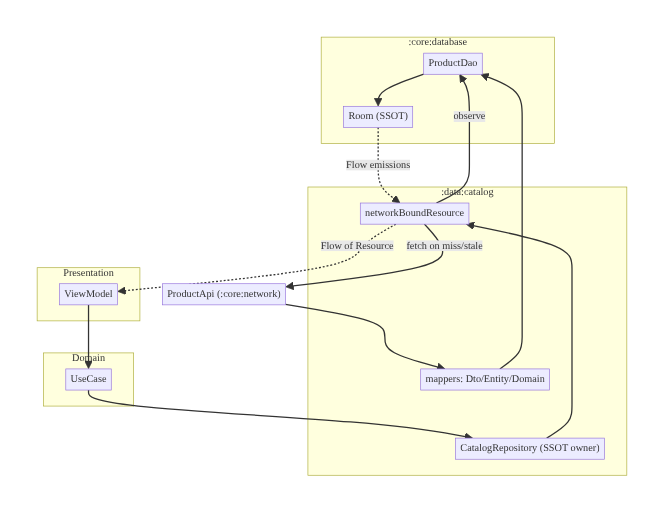
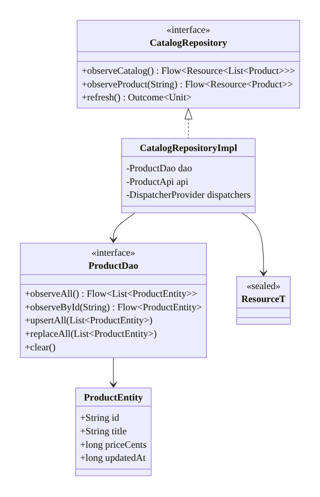
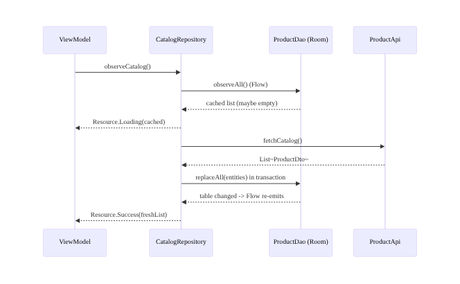
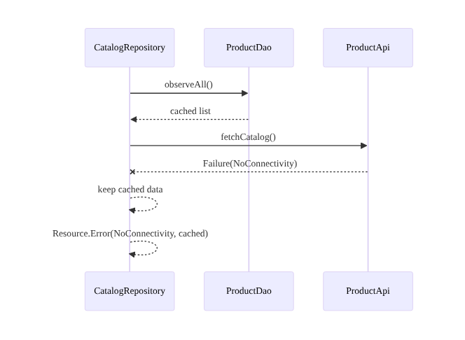
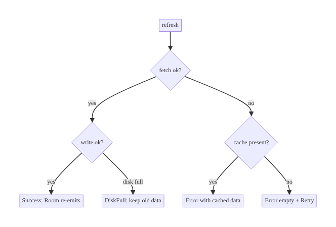

# Chapter 3 — The Persistence Core & Single Source of Truth

> **Part I — Core Infrastructure** · Complexity: **Complex** (≥40 interview questions)
>
> **Prerequisites:** Ch 1 (Networking Core — `Outcome`/`AppError`, DTOs,
> `safeApiCall`), Ch 2 (reliability, optional). This chapter **defines** the
> persistence layer and the **Single Source of Truth (SSOT)** repository pattern
> (`networkBoundResource`) reused by Ch 9 search, Ch 13 paging, Ch 29
> offline-first, Ch 38 cart, and essentially every data-bearing feature.
>
> **Reference surface in StreamCart:** `:core:database` (Room) and the SSOT
> repositories in `:data:*` that back the catalog, cart, and watch history.

---

## 3.1 Problem Definition and Real-World Context

Where does the "truth" of your app's data live? In a naive app the answer is
"whatever the last network call returned, held in a ViewModel field." That
breaks the moment you have more than one screen, rotation, offline use, or
background updates:

- **Two screens disagree.** The product list and the product detail each fetch
  independently; a price update shows on one and not the other. There is no
  single authority.
- **Flicker and loss on rotation / process death.** In-memory results vanish; the
  screen refetches and flashes a spinner.
- **No offline.** With the network as the source of truth, the app is useless on
  a train.
- **Write/read skew.** A write updates the server but not the local view, so the
  UI lies until the next refresh.

The fix is a **Single Source of Truth**: a local store (Room) that the UI
observes, and a repository that is the *only* writer to it. The network becomes
an *updater* of the local store, not the thing the UI reads. This is the
`networkBoundResource` / offline-first read pattern, and it is the backbone of
almost every feature in the book.

### Three practical use cases

1. **E-commerce catalog (StreamCart Shop).** Product list and detail both observe
   Room; one fetch updates the DB; both screens update together and survive
   rotation and offline.
2. **OTT watch history (StreamCart Watch).** Playback progress is written locally
   first (instant UI), then synced; the "Continue Watching" row reads the DB and
   is always consistent across the app.
3. **Social feed cache (StreamCart Social).** The feed renders instantly from the
   cached DB on cold start, then refreshes from the network in the background.

### Why this is architectural

SSOT answers *who owns state*, *who may write it*, *how the UI observes changes*,
and *how reads and writes stay consistent* — the defining questions of the data
layer. Get this right and features compose; get it wrong and every feature fights
the same consistency bugs.

---

## 3.2 Requirements Engineering

### Functional requirements

| ID | Requirement |
|----|-------------|
| F1 | The UI observes data as a reactive stream (`Flow`) from the local store. |
| F2 | The repository is the single writer to the store. |
| F3 | Network responses update the local store, which emits to observers. |
| F4 | Reads succeed offline from cached data. |
| F5 | Writes are transactional (all-or-nothing). |
| F6 | Schema changes are migrated safely without data loss. |
| F7 | Expose load/refresh state (loading/error) alongside cached data. |
| F8 | Support observing a single entity and lists. |

### Non-functional requirements

| Attribute | Policy |
|-----------|--------|
| **Consistency** | One authority (Room); no component bypasses the repository. |
| **Performance** | DB I/O off main thread; indexed queries; paging for large sets (Ch 13). |
| **Reliability** | Transactions; migrations tested; no partial writes. |
| **Availability** | Reads work offline. |
| **Maintainability** | DTO/entity/domain separation; mappers isolate layers. |
| **Memory** | Stream + page rather than load entire tables; `Flow` cancellation. |
| **Security** | Optional encryption at rest (Ch 24); no secrets in plaintext. |

### Scope

- **In scope:** Room setup, entities/DAOs, transactions, the SSOT repository
  pattern (`networkBoundResource`), `Flow` observation, migration basics.
- **Out of scope:** full offline sync engine (Ch 29–33), paging (Ch 13), DataStore
  for key-values (Ch 4), encryption specifics (Ch 24), FTS (Ch 35).

### Assumptions & constraints

- Room 2.6+, Kotlin, coroutines/Flow, Hilt. Three model layers: `Dto`
  (network), `Entity` (Room), domain (`Product`). `minSdk 24`.

---

## 3.3 System Design Fundamentals

- **Single Source of Truth.** One component authoritatively holds each entity's
  state. The UI reads only from it. In StreamCart that's the Room-backed
  repository.
- **Reactive reads.** Room DAOs can return `Flow<T>`; Room re-emits whenever the
  queried tables change, so a write anywhere updates every observer — this is
  what keeps two screens consistent.
- **Unidirectional updates.** Network → repository → Room → Flow → UI. Writes go
  UI → repository → Room (→ network). The UI never writes the DB directly.
- **Transactions & atomicity.** Multi-step writes (e.g., replace a list) run in a
  single transaction so observers never see a half-updated state.
- **Mapping layers.** `Dto ↔ Entity ↔ Domain` keeps network schema, storage
  schema, and domain model independent — each can evolve without breaking the
  others (Ch 16).
- **`networkBoundResource`.** The canonical pattern: emit cached data, optionally
  fetch, persist the result, and let Room re-emit — yielding offline-first reads
  with fresh-when-possible data.

Core insight: **make the database the source of truth and the network a writer
to it.** Observation (`Flow`) then makes consistency automatic instead of
something each feature must coordinate.

---

## 3.4 High-Level Architecture



**Components & ownership**

- **Room (`:core:database`)** is the **SSOT**. `ProductDao` exposes
  `Flow<List<ProductEntity>>` reads and suspend writes.
- **`CatalogRepository`** is the only writer; it runs `networkBoundResource` to
  combine cache + network and maps across layers.
- **`networkBoundResource`** emits `Resource<T>` (loading/success/error wrapping
  the cached data), fetches when stale, persists, and relies on Room to re-emit.
- **Network** provides DTOs via `:core:network`; mappers convert to entities for
  storage and to domain models for the UI.

**Dependency direction:** `:data:catalog → :core:database` and `→ :core:network`.
The database module knows nothing of features or the network.

---

## 3.5 Detailed Component Design



| Component | Responsibility | I/O | State | Errors |
|-----------|----------------|-----|-------|--------|
| `ProductEntity` | storage shape | — | — | — |
| `ProductDao` | typed DB access | queries/writes | Room-owned | SQLite exceptions |
| `CatalogRepositoryImpl` | SSOT writer, cache+network orchestration | domain in/out | none (DB holds state) | maps to `AppError` |
| `Resource<T>` | cached data + load state | — | — | carries `AppError` |

```kotlin
sealed interface Resource<out T> {
    data class Loading<T>(val data: T?) : Resource<T>        // cached data while refreshing
    data class Success<T>(val data: T) : Resource<T>
    data class Error<T>(val error: AppError, val data: T?) : Resource<T>  // cached data + error
}
```

> `Resource` deliberately carries the cached `data` in *every* state so the UI
> can show stale-but-useful data during a refresh or after an error (the
> offline-first UX).

---

## 3.6 End-to-End Data Flow

### Cold start with stale cache (offline-first read)



### Network failure with cache present



---

## 3.7 Complete Kotlin Implementation

Package: `com.streamcart.core.database` and `com.streamcart.data.catalog`.

### 3.7.1 Entity & DAO

```kotlin
@Entity(
    tableName = "products",
    indices = [Index("title")],
)
data class ProductEntity(
    @PrimaryKey val id: String,
    val title: String,
    val priceCents: Long,
    val thumbnailUrl: String?,
    val updatedAt: Long,          // for staleness checks
)

@Dao
interface ProductDao {
    @Query("SELECT * FROM products ORDER BY title")
    fun observeAll(): Flow<List<ProductEntity>>

    @Query("SELECT * FROM products WHERE id = :id")
    fun observeById(id: String): Flow<ProductEntity?>

    @Upsert
    suspend fun upsertAll(items: List<ProductEntity>)

    @Query("DELETE FROM products")
    suspend fun clear()

    @Transaction
    suspend fun replaceAll(items: List<ProductEntity>) {
        clear()
        upsertAll(items)          // atomic: observers never see the empty interim
    }

    @Query("SELECT MAX(updatedAt) FROM products")
    suspend fun lastUpdatedAt(): Long?
}
```

> `@Transaction` on `replaceAll` is essential: without it, observers would
> momentarily see an empty table between `clear()` and `upsertAll()`.

### 3.7.2 Database & converters

```kotlin
@Database(entities = [ProductEntity::class, CartItemEntity::class], version = 1, exportSchema = true)
abstract class StreamCartDatabase : RoomDatabase() {
    abstract fun productDao(): ProductDao
    abstract fun cartDao(): CartDao
}

@Module @InstallIn(SingletonComponent::class)
object DatabaseModule {
    @Provides @Singleton
    fun provideDatabase(@ApplicationContext context: Context): StreamCartDatabase =
        Room.databaseBuilder(context, StreamCartDatabase::class.java, "streamcart.db")
            .addMigrations(Migrations.M1_2)      // see 3.7.5
            .build()                             // no fallbackToDestructiveMigration in prod

    @Provides fun provideProductDao(db: StreamCartDatabase): ProductDao = db.productDao()
}
```

### 3.7.3 The `networkBoundResource` pattern

```kotlin
fun <Domain, Dto> networkBoundResource(
    query: () -> Flow<Domain>,                       // observe local SSOT
    fetch: suspend () -> Outcome<Dto>,               // network (via safeApiCall + reliability)
    saveFetchResult: suspend (Dto) -> Unit,          // persist into Room
    shouldFetch: (Domain) -> Boolean = { true },     // staleness/empty check
): Flow<Resource<Domain>> = flow {
    val current = query().first()
    if (shouldFetch(current)) {
        emit(Resource.Loading(current))
        when (val fetched = fetch()) {
            is Outcome.Success -> {
                saveFetchResult(fetched.data)        // triggers Room re-emission
                emitAll(query().map { Resource.Success(it) })
            }
            is Outcome.Failure -> {
                emitAll(query().map { Resource.Error(fetched.error, it) })
            }
        }
    } else {
        emitAll(query().map { Resource.Success(it) })
    }
}
```

### 3.7.4 Repository

```kotlin
interface CatalogRepository {
    fun observeCatalog(): Flow<Resource<List<Product>>>
    fun observeProduct(id: String): Flow<Resource<Product>>
    suspend fun refresh(): Outcome<Unit>
}

@Singleton
class CatalogRepositoryImpl @Inject constructor(
    private val dao: ProductDao,
    private val api: ProductApi,
    private val dispatchers: DispatcherProvider,
    private val clock: Clock,
) : CatalogRepository {

    override fun observeCatalog(): Flow<Resource<List<Product>>> =
        networkBoundResource(
            query = { dao.observeAll().map { list -> list.map { it.toDomain() } } },
            fetch = { safeApiCall(dispatchers.io) { api.fetchCatalog() } },
            saveFetchResult = { dtos ->
                dao.replaceAll(dtos.map { it.toEntity(clock.now()) })
            },
            shouldFetch = { cached -> cached.isEmpty() || isStale() },
        ).flowOn(dispatchers.io)

    override fun observeProduct(id: String): Flow<Resource<Product>> =
        dao.observeById(id)
            .map { entity -> entity?.let { Resource.Success(it.toDomain()) } ?: Resource.Loading(null) }
            .flowOn(dispatchers.io)

    override suspend fun refresh(): Outcome<Unit> = withContext(dispatchers.io) {
        when (val r = safeApiCall(dispatchers.io) { api.fetchCatalog() }) {
            is Outcome.Success -> { dao.replaceAll(r.data.map { it.toEntity(clock.now()) }); Outcome.Success(Unit) }
            is Outcome.Failure -> Outcome.Failure(r.error)
        }
    }

    private suspend fun isStale(): Boolean {
        val last = dao.lastUpdatedAt() ?: return true
        return clock.now() - last > TTL_MS
    }
    private companion object { const val TTL_MS = 5 * 60_000L }
}
```

### 3.7.5 Migration

```kotlin
object Migrations {
    val M1_2 = object : Migration(1, 2) {
        override fun migrate(db: SupportSQLiteDatabase) {
            db.execSQL("ALTER TABLE products ADD COLUMN thumbnailUrl TEXT")
        }
    }
}
```

### 3.7.6 Mappers & module structure

```kotlin
fun ProductDto.toEntity(now: Long) = ProductEntity(id, title, priceCents, thumbnailUrl, now)
fun ProductEntity.toDomain() = Product(id, title, priceCents, thumbnailUrl)
```

```
:core:database
  StreamCartDatabase, Migrations, Converters
  dao/ ProductDao, CartDao
  entity/ ProductEntity, CartItemEntity
  di/ DatabaseModule
:data:catalog
  repository/ CatalogRepository(Impl)
  mapper/ ProductMappers.kt
  util/ networkBoundResource.kt, Resource.kt
```

---

## 3.8 Concurrency and Race Conditions

| Scenario | Risk | Handling |
|----------|------|----------|
| Two screens observe same table | Divergent views | Both read the same DAO `Flow`; Room re-emits once on change |
| `clear()` then `upsert()` not atomic | Observers see empty list | `@Transaction replaceAll` |
| Concurrent writers (sync + user action) | Lost update / torn state | Room serializes writes; use transactions; SSOT = single writer repo |
| Fetch + local write interleave | Stale overwrite | Persist fetch result in a transaction; `updatedAt` for conflict (Ch 33) |
| Flow collected on main thread | Jank/ANR | `flowOn(io)`; Room suspend/Flow are main-safe but mapping should be off-main |
| Process death mid-write | Partial data | SQLite is ACID; a transaction either commits or rolls back |

- **Room's write serialization** plus **transactions** gives correctness for
  concurrent writers; the SSOT rule (only the repository writes) prevents
  uncoordinated writes in the first place.
- **Reactive consistency:** because every reader observes the same DAO `Flow`, a
  single write propagates to all screens — no manual cross-screen notification.

---

## 3.9 Failure Scenarios and Recovery

| Failure | Detection | Response | UX | Telemetry |
|---------|-----------|----------|----|-----------|
| Network down on refresh | `Outcome.Failure` | keep cache; `Resource.Error(data=cache)` | stale data + subtle error | `refresh_error{type}` |
| Empty cache + offline | cache empty + failure | `Error(data=null)` | offline empty state + Retry | `cold_offline` |
| DB disk full | `SQLiteFullException` → `DiskFull` | surface error; stop writes | "Storage full" | `db_error{type=disk_full}` |
| Corrupt DB | open fails | recreate (lose cache) or restore (Ch 37) | re-sync from network | `db_corrupt` |
| Migration failure | exception at open | fail safe (don't destroy in prod); report | forced resync path | `migration_fail{from,to}` |
| Partial write | transaction | rolled back by SQLite | consistent old state | `tx_rollback` |
| Stale overwrite (concurrent edit) | `updatedAt` mismatch | conflict policy (Ch 33) | — | `conflict` |



**Never use `fallbackToDestructiveMigration()` in production** — it silently
wipes user data on a missing migration. Provide migrations; fail loudly in debug.

---

## 3.10 Scaling the Implementation

- **Level 1.** One screen reads a DAO `Flow`; repository does a simple fetch +
  `replaceAll`.
- **Level 2.** Multiple screens share the SSOT via `networkBoundResource`;
  consistency is automatic.
- **Level 3 — production.** Staleness/TTL, transactions, migrations, `Resource`
  states for offline-first UX, indexed queries, encryption (Ch 24).
- **Level 4 — large.** Paging 3 + `RemoteMediator` for huge tables (Ch 13); FTS
  for search (Ch 35); partial updates via upsert; delta sync (Ch 32).
- **Level 5 — enterprise.** Full sync engine with outbox + conflict resolution
  (Ch 29–33), multi-module databases or a shared schema contract, schema
  governance and versioned migrations across app versions.

**Avoid overengineering:** not every entity needs `networkBoundResource` — purely
remote, non-cached, one-shot reads (e.g., a legal document) can skip the DB.

---

## 3.11 Alternative Approaches and Trade-offs

| Dimension | Option A | Option B | When |
|-----------|----------|----------|------|
| Source of truth | Room (DB) | In-memory cache | DB for persistence/offline/consistency; memory for ephemeral |
| Read pattern | `networkBoundResource` | fetch-then-return | NBR for offline-first; direct fetch for non-cached reads |
| Store | Room | DataStore (Ch 4) | Room for structured/relational/queryable; DataStore for key-values/prefs |
| Load state | `Resource<T>` carrying data | separate loading boolean | Resource keeps stale data visible; boolean loses it |
| Large lists | Paging 3 (Ch 13) | load all | Paging for big/remote sets; load-all for small bounded sets |
| Updates | `replaceAll` | diff/upsert by id | upsert to preserve unchanged rows and local edits; replaceAll for full snapshots |
| Encryption | SQLCipher (Ch 24) | plaintext | encrypt sensitive data (fintech/health); plaintext otherwise |

**`replaceAll` vs upsert-by-id:** full replace is simplest for stateless lists
but destroys local-only fields (e.g., a "liked" flag) and churns the table;
upsert-by-id preserves rows and local edits and plays nicely with optimistic
updates (Ch 72). Prefer upsert once you have local writes.

---

## 3.12 Security Considerations

- **Encryption at rest:** sensitive tables (payment tokens, PII) use SQLCipher
  or Jetpack Security (Ch 24); the key lives in Android Keystore (Ch 20).
- **`android:allowBackup`:** auto-backup can copy the DB to the cloud — exclude
  sensitive DBs via backup rules (Ch 37) so secrets don't leak off-device.
- **No secrets in plaintext columns**; tokens belong in encrypted storage, not
  Room.
- **Least data:** cache only what the UI needs; purge on logout (Ch 42).
- **Client vs backend:** the DB is a *cache/convenience*; the backend remains the
  authoritative record and must re-validate entitlements — a tampered local DB
  must never grant access.

---

## 3.13 Performance and Resource Optimization

- **Off main thread:** DAO suspend/Flow are main-safe for the query itself, but
  `flowOn(io)` moves mapping and collection work off-main; large mapping on the
  main thread causes jank.
- **Indexing:** add `@Index` on filtered/sorted columns; verify with `EXPLAIN
  QUERY PLAN` and the Database Inspector.
- **Paging:** never load huge tables into memory — Paging 3 (Ch 13).
- **Upsert over replace** to minimize write amplification and table churn.
- **Transactions** batch writes (one fsync) — far faster than N separate writes.
- **Profiling:** Android Studio **Database Inspector** (live queries), Room query
  logging, `PRAGMA` analysis, benchmark cold-start DB open time (Ch 88).

---

## 3.14 Testing Strategy

Use a **real in-memory Room DB** for DAO tests (catches SQL/transaction bugs);
fake the API; test the repository with a real DAO + fake API.

```kotlin
class ProductDaoTest {
    private lateinit var db: StreamCartDatabase
    private lateinit var dao: ProductDao

    @Before fun setUp() {
        db = Room.inMemoryDatabaseBuilder(
            ApplicationProvider.getApplicationContext(), StreamCartDatabase::class.java
        ).allowMainThreadQueries().build()
        dao = db.productDao()
    }
    @After fun tearDown() = db.close()

    @Test fun `replaceAll is atomic - observers never see empty interim`() = runTest {
        dao.upsertAll(listOf(entity("1"), entity("2")))
        dao.observeAll().test {
            assertEquals(2, awaitItem().size)
            dao.replaceAll(listOf(entity("3")))
            assertEquals(listOf("3"), awaitItem().map { it.id })   // one emission, not empty-then-one
            cancelAndIgnoreRemainingEvents()
        }
    }
}

class CatalogRepositoryTest {
    @Test fun `offline refresh keeps cached data and reports error`() = runTest {
        dao.upsertAll(listOf(entity("1")))
        val repo = CatalogRepositoryImpl(dao, FakeApi(fails = true), testDispatchers, FakeClock)
        repo.observeCatalog().test {
            val first = awaitItem()
            assertTrue(first is Resource.Loading && first.data?.size == 1)
            val err = awaitItem()
            assertTrue(err is Resource.Error && err.data?.size == 1)   // cache preserved
            cancelAndIgnoreRemainingEvents()
        }
    }
}

@Test fun migration_1_to_2() {
    helper.createDatabase(TEST_DB, 1).apply { close() }
    val db = helper.runMigrationsAndValidate(TEST_DB, 2, true, Migrations.M1_2)
    // assert new column exists
}
```

What to mock vs real: **real** Room (in-memory) + Turbine; **fake** API/clock.
Always test migrations with `MigrationTestHelper` and `exportSchema = true`.

---

## 3.15 Production Observability

- **Metrics:** cache hit rate, refresh success/error rate, DB size, query latency
  (p95), migration success rate, disk-full error rate.
- **Logs:** `refresh{entity, result, correlation_id}`, `migration{from,to,ms}`,
  `db_error{type}`.
- **Tracing:** correlation ID from the network refresh links to backend; DB write
  spans for slow queries.
- **Debugging:** rising `migration_fail` after release → bad migration; growing DB
  size → missing purge/retention; cache hit rate drop → TTL too aggressive.
- **Privacy:** never log row contents (may be PII); log counts and types.

---

## 3.16 System Design Interview Preparation

> 40+ questions.

**Fundamentals**
1. *What is the SSOT and why?* The one authority for an entity's state (Room);
   keeps all screens consistent, enables offline, survives process death.
2. *Why make the DB the source of truth, not the network?* Offline reads,
   consistency across screens, no flicker, write/read coherence.
3. *How do two screens stay consistent?* Both observe the same DAO `Flow`; one
   write re-emits to all.
4. *What is `networkBoundResource`?* Emit cache → fetch if stale → persist → Room
   re-emits fresh; offline-first reads.
5. *Why `Resource<T>` carrying data in every state?* Show stale-but-useful data
   during refresh/errors.

**Architecture**
6. *Who may write the DB?* Only the repository (single writer).
7. *Why three model layers (DTO/entity/domain)?* Decouple network, storage, and
   domain so each evolves independently (Ch 16).
8. *Where does the DB module sit?* `:core:database`, depended on by `:data:*`;
   knows nothing of features/network.
9. *Direct fetch without caching — ever?* Yes, for non-cached one-shot reads;
   not every call needs the DB.

**Kotlin/Android/Room**
10. *How does Room make reads reactive?* DAO `Flow` re-emits on table changes.
11. *Why `@Transaction` on replace?* Atomicity — observers never see the empty
    interim.
12. *Are Room suspend/Flow main-safe?* The query runs off-main; use `flowOn(io)`
    for your mapping/collection.
13. *`@Upsert` vs `@Insert(onConflict=REPLACE)`?* Upsert = insert-or-update
    without deleting the row (preserves triggers/FKs more cleanly).

**Concurrency**
14. *Concurrent writers?* Room serializes writes; transactions keep multi-step
    writes atomic; SSOT limits writers to the repo.
15. *How avoid lost updates on concurrent edits?* `updatedAt`/version +
    conflict policy (Ch 33).
16. *Process death mid-write?* SQLite is ACID — commit or rollback.

**Persistence**
17. *How do migrations work?* `Migration(from,to)` SQL; test with
    `MigrationTestHelper`; `exportSchema`.
18. *Why never `fallbackToDestructiveMigration` in prod?* It wipes user data.
19. *Staleness strategy?* TTL via `updatedAt`, or ETag/`If-Modified-Since`, or
    server push invalidation.
20. *Encrypt the DB?* SQLCipher/Jetpack Security + Keystore for sensitive data
    (Ch 24).

**Networking integration**
21. *How does refresh update the UI?* Persist to Room → Flow re-emits; the UI
    never reads the network directly.
22. *Handle offline?* Serve cache; `Resource.Error(data=cache)`.

**Scalability**
23. *Huge tables?* Paging 3 + `RemoteMediator` (Ch 13); never load all.
24. *Search in the DB?* FTS (Ch 35).
25. *10M users — client DB concerns?* Size/retention, migration safety across
    versions, paging; backend scales separately.

**Security**
26. *allowBackup risk?* Sensitive DB can be backed up to cloud; exclude via
    backup rules (Ch 37).
27. *Can a tampered local DB grant access?* No — backend re-validates; the DB is
    a cache.

**Performance**
28. *Keep DB work off main?* `flowOn(io)`; index queries; page large sets.
29. *Reduce write cost?* Transactions (batch), upsert over replace.
30. *How profile queries?* Database Inspector, `EXPLAIN QUERY PLAN`.

**Testing**
31. *How test DAOs?* In-memory Room (real SQL).
32. *How test migrations?* `MigrationTestHelper.runMigrationsAndValidate`.
33. *What do you fake?* API/clock; keep Room real.

**Production debugging**
34. *Users report stale prices on one screen.* A component bypassed the SSOT or
    didn't observe the DAO `Flow`; enforce single-writer + shared observation.
35. *Crash spike after release — migration?* Missing/incorrect migration; add it,
    never destructive fallback.
36. *DB growing unbounded?* Add retention/purge; TTL eviction.

**Trade-offs**
37. *Room vs DataStore?* Room for structured/queryable data; DataStore for
    key-values/prefs (Ch 4).
38. *`replaceAll` vs upsert?* Upsert preserves local edits; replace for full
    snapshots.
39. *In-memory vs DB cache?* DB for persistence/offline; memory for ephemeral
    speed (can combine).
40. *When skip the DB entirely?* Non-cached, non-offline, one-shot reads.

### Staff-level follow-ups
- "How do you keep a local-only `isLiked` flag through a server refresh?" (Upsert
  specific columns; don't `replaceAll`; or merge in the mapper — Ch 72.)
- "Observer sees two emissions on refresh (loading data, then success) — can you
  collapse flicker?" (`distinctUntilChanged`; keep data in Loading; UI shows data
  regardless of wrapper state.)
- "How do you evolve a column type safely across 3 app versions?" (Add new column,
  backfill in migration, dual-read, drop later — Ch 16/36.)

### Design-change challenges
1. **Add offline writes.** Introduce an outbox (Ch 31) + optimistic DB write
   (Ch 72).
2. **Catalog grows to 1M items.** Paging 3 + `RemoteMediator` (Ch 13).
3. **Two devices edit the same entity.** Versioning + conflict resolution
   (Ch 33).
4. **Encrypt payment data at rest.** SQLCipher + Keystore (Ch 24); exclude from
   backup.
5. **Backend changes product schema.** Evolve DTO + migration; dual-read (Ch 16).

### Mock walkthrough (abridged)
Clarify (offline? multi-screen? data size) → declare SSOT = Room → draw
`networkBoundResource` → deep-dive transactions + reactive reads → failures
(offline/disk/migration) → scale to paging/sync → defend Room vs DataStore and
replace vs upsert.

---

## 3.17 Practical Exercises

1. **Beginner.** Back a product list with Room; prove two observers of the same
   DAO `Flow` update together on one write. *Eval:* single write, both update.
2. **Intermediate.** Implement `networkBoundResource` with TTL staleness; test
   offline keeps cache + reports error. *Eval:* `Resource.Error(data=cache)`.
3. **Advanced.** Switch `replaceAll` → upsert preserving a local `isLiked`
   column through refresh. *Eval:* flag survives server refresh.
4. **Production debugging.** Fix a repo whose `replaceAll` isn't transactional
   (observers flash empty). *Eval:* single non-empty emission.
5. **System design challenge.** Add a migration changing a column and test it
   with `MigrationTestHelper`; ensure no destructive fallback. *Eval:* migration
   validated; data preserved.

*(Solutions withheld unless requested.)*

---

## 3.18 Chapter Summary & Reference Sheet

**Key decisions:** Room is the **SSOT**; the repository is the **single writer**;
the network **updates** the DB and Room re-emits; reads are **reactive `Flow`s**;
multi-step writes are **transactional**; `Resource<T>` carries cached data in
every state for offline-first UX; migrations are mandatory, destructive fallback
forbidden.

**Concepts:** SSOT, reactive reads, `networkBoundResource`, transactions/atomicity,
DTO/entity/domain mapping, staleness/TTL, upsert vs replace.

**Common mistakes:** network as source of truth; non-transactional multi-step
writes; `fallbackToDestructiveMigration` in prod; mapping on the main thread;
`replaceAll` destroying local edits; bypassing the repository to write the DB.

**Checklist:** ☐ DB = SSOT ☐ single writer ☐ DAO `Flow` reads ☐ `@Transaction`
on multi-step writes ☐ `networkBoundResource` ☐ `Resource` carries data ☐ TTL/
staleness ☐ migrations + `MigrationTestHelper` ☐ `flowOn(io)` ☐ encrypt
sensitive data.

**Key APIs:** `@Entity`, `@Dao`, `@Query`, `@Upsert`, `@Transaction`, `Flow`,
`Room.databaseBuilder`, `Migration`, `MigrationTestHelper`,
`inMemoryDatabaseBuilder`, `flowOn`, Database Inspector.

**References:**
- Room: https://developer.android.com/training/data-storage/room
- Room + Flow: https://developer.android.com/training/data-storage/room/async-queries
- Migrations: https://developer.android.com/training/data-storage/room/migrating-db-versions
- Guide to app architecture (data layer/SSOT): https://developer.android.com/topic/architecture/data-layer
- Offline-first: https://developer.android.com/topic/architecture/data-layer/offline-first

### Chapter review (Phase 4)
- **Completeness:** all 18 sections; architecture/class/sequence/failure diagrams;
  full Room + DAO + `networkBoundResource` + repository + migration; concurrency;
  failure matrix; 5 levels; trade-offs; security (encryption/backup); perf; DAO +
  repo + migration tests; observability; 40 Q&A + follow-ups + 5 challenges. ✅
- **Expand later:** paging/`RemoteMediator` (Ch 13), full offline sync (Ch 29–33),
  encryption specifics (Ch 24), FTS (Ch 35).
- **Shared artifacts introduced:** `Resource<T>`, `networkBoundResource`, SSOT
  repository conventions — reused book-wide.
