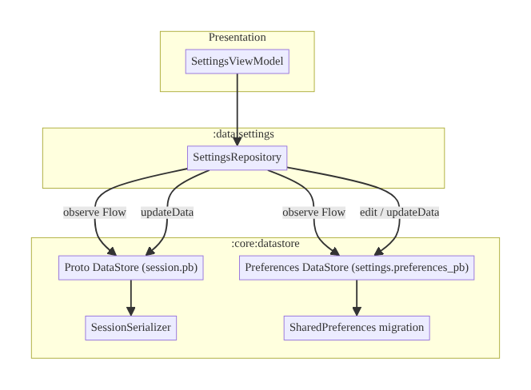
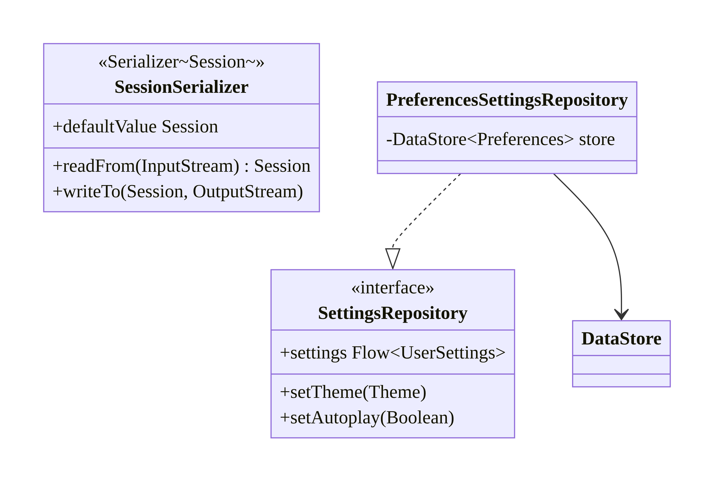
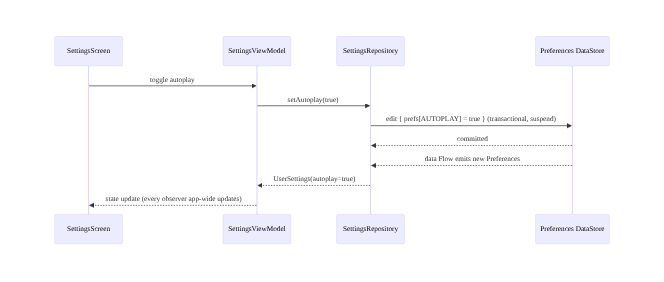
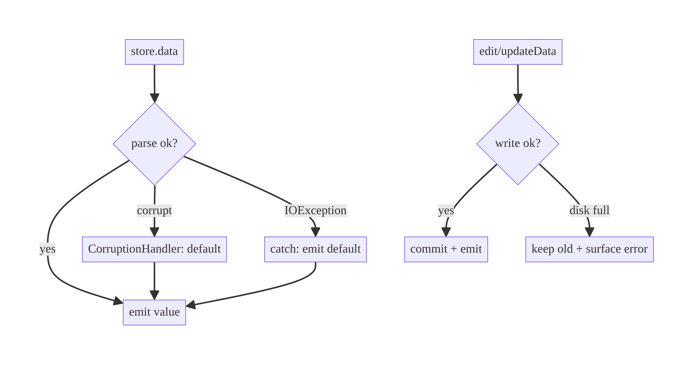

# Chapter 4 — DataStore: Preferences & Proto for Application Configuration

> **Part I — Core Infrastructure** · Complexity: **Standard** (≥25 interview questions)
>
> **Prerequisites:** Ch 1 (`Outcome`/`AppError`, DI patterns), Ch 3 (SSOT, Room —
> to contrast DataStore vs Room). Introduces `:core:datastore`, reused by Ch 41
> (feature flags), Ch 42 (multi-account), Ch 43 (preference sync), Ch 8 (process
> death defaults).
>
> **Reference surface in StreamCart:** app settings (theme, autoplay, data-saver),
> the auth session snapshot, onboarding flags, and the last-selected profile.

---

## 4.1 Problem Definition and Real-World Context

Apps need to persist small amounts of structured state that isn't relational:
user settings, flags, the current session, the selected profile. The legacy tool
— `SharedPreferences` — has real correctness problems that bite in production:

- **Synchronous disk I/O on the main thread.** `getXxx()` can block the UI thread
  on first access (the file is loaded synchronously), and `commit()` writes
  synchronously — both are StrictMode violations and ANR risks.
- **No safe async API / no transactions.** `apply()` is fire-and-forget with no
  way to observe completion or errors; concurrent edits can race.
- **Not reactive.** You can't naturally observe a value as a `Flow`; the
  `OnSharedPreferenceChangeListener` is clunky and leak-prone.
- **Runtime type errors.** Keys are stringly-typed; a `getString` on an int key
  throws `ClassCastException` at runtime.

**Jetpack DataStore** replaces it: fully asynchronous (coroutines + `Flow`),
transactional, and available in two flavors — **Preferences DataStore**
(key-value, untyped) and **Proto DataStore** (typed, schema-defined). Choosing
DataStore (and which flavor) and distinguishing it from Room is the architectural
decision this chapter covers.

### Three practical use cases

1. **App settings (StreamCart).** Theme, autoplay, data-saver, notification
   toggles — observed as `Flow` so the whole app reacts instantly to a change.
2. **Session snapshot (Account).** A small typed record (user id, selected
   profile, token-expiry) persisted via Proto DataStore and read at startup to
   decide the launch destination (Ch 8). *Tokens themselves go in encrypted
   storage — Ch 20 — not here.*
3. **Onboarding / feature-discovery flags (OTT & Shop).** "Has seen downloads
   tutorial" booleans that gate one-time UI.

### Why this is architectural

DataStore is the app's **configuration SSOT**. Where it sits, what goes in it vs
Room vs Keystore, how defaults and migrations work, and how it's observed are
system-level decisions that affect startup, theming, and auth flow.

---

## 4.2 Requirements Engineering

### Functional requirements

| ID | Requirement |
|----|-------------|
| F1 | Persist small structured config across process death. |
| F2 | Read/write fully asynchronously (no main-thread I/O). |
| F3 | Observe values as `Flow` so the UI reacts to changes. |
| F4 | Atomic, transactional updates (read-modify-write safe). |
| F5 | Typed access where schema matters (Proto); key-value where it doesn't (Preferences). |
| F6 | Provide defaults and migrate from `SharedPreferences`/older schemas. |
| F7 | Handle read errors (corruption) gracefully. |

### Non-functional requirements

| Attribute | Policy |
|-----------|--------|
| **Performance** | No main-thread blocking; single reader per file; cached in memory after first read. |
| **Reliability** | Transactional writes; corruption recovery. |
| **Consistency** | One DataStore instance per file (singleton). |
| **Security** | No secrets/PII unless encrypted (Ch 20/24); exclude from backup if sensitive. |
| **Maintainability** | Typed Proto for evolving schemas; clear defaults. |

### Scope

- **In scope:** Preferences vs Proto, async reads/writes, `Flow` observation,
  transactional updates, defaults, SharedPreferences migration, corruption
  handling, DI.
- **Out of scope:** relational/large data (Room, Ch 3), secret storage (Keystore,
  Ch 20), remote config (Ch 41), cross-device preference sync (Ch 43).

### Assumptions & constraints

- `androidx.datastore` 1.1+, coroutines/Flow, Hilt. Proto uses
  protobuf-lite/wire. One `DataStore` per file, app-scoped.

---

## 4.3 System Design Fundamentals

- **Asynchronous by design.** All reads are a cold `Flow<T>`; all writes are
  `suspend` and transactional. There is no synchronous API — by construction you
  cannot block the main thread.
- **Transactional updates.** `edit { }` (Preferences) / `updateData { }` (Proto)
  run a read-modify-write atomically; concurrent updates are serialized, so no
  lost updates.
- **Single source per file.** A `DataStore` must be a singleton per file; creating
  two for the same file throws. This makes it a natural config SSOT.
- **Preferences vs Proto.** Preferences = untyped key-value (fast to adopt, no
  schema). Proto = typed, schema-defined (`.proto`), compile-time safety, better
  for evolving structured state.
- **In-memory caching + durability.** After the first read, the value is cached;
  writes persist durably and update the in-memory copy, then emit to collectors.
- **Defaults & corruption.** A `CorruptionHandler` supplies a default when the
  file can't be parsed, preventing a crash loop.

Core insight: DataStore turns config into **observable, transactional, main-safe
state** — the same reactive model as Room, but for small non-relational data.

---

## 4.4 High-Level Architecture



**Components & ownership**

- **`:core:datastore`** owns the `DataStore` singletons, the Proto serializer,
  and migrations.
- **`SettingsRepository`** maps raw preference keys / proto messages to domain
  models and exposes typed `Flow`s + suspend setters.
- **ViewModels** observe repository `Flow`s; they never touch DataStore directly.

**Dependency direction:** `:data:settings → :core:datastore`. One instance per
file, provided as a Hilt `@Singleton`.

---

## 4.5 Detailed Component Design



| Component | Responsibility | I/O | Errors |
|-----------|----------------|-----|--------|
| Preferences `DataStore` | key-value persistence | `Flow<Preferences>`, `edit{}` | `IOException` on read |
| `SessionSerializer` | encode/decode typed `Session` | streams | corruption → default |
| `SettingsRepository` | map keys ↔ domain, defaults | typed `Flow`, suspend setters | catch `IOException` → defaults |

---

## 4.6 End-to-End Data Flow



---

## 4.7 Complete Kotlin Implementation

Package: `com.streamcart.core.datastore`.

### 4.7.1 Preferences DataStore (settings)

```kotlin
private val Context.settingsStore by preferencesDataStore(
    name = "settings",
    corruptionHandler = ReplaceFileCorruptionHandler { emptyPreferences() },
    produceMigrations = { context ->
        listOf(SharedPreferencesMigration(context, "legacy_prefs"))   // F6
    },
)

@Module @InstallIn(SingletonComponent::class)
object DataStoreModule {
    @Provides @Singleton
    fun provideSettingsStore(@ApplicationContext ctx: Context): DataStore<Preferences> =
        ctx.settingsStore
}
```

```kotlin
object SettingsKeys {
    val THEME = stringPreferencesKey("theme")
    val AUTOPLAY = booleanPreferencesKey("autoplay")
    val DATA_SAVER = booleanPreferencesKey("data_saver")
}

interface SettingsRepository {
    val settings: Flow<UserSettings>
    suspend fun setTheme(theme: Theme)
    suspend fun setAutoplay(enabled: Boolean)
}

class PreferencesSettingsRepository @Inject constructor(
    private val store: DataStore<Preferences>,
) : SettingsRepository {

    override val settings: Flow<UserSettings> = store.data
        .catch { e ->
            if (e is IOException) emit(emptyPreferences()) else throw e   // F7
        }
        .map { prefs ->
            UserSettings(
                theme = prefs[SettingsKeys.THEME]?.let(Theme::valueOf) ?: Theme.System,
                autoplay = prefs[SettingsKeys.AUTOPLAY] ?: true,
                dataSaver = prefs[SettingsKeys.DATA_SAVER] ?: false,
            )
        }
        .distinctUntilChanged()

    override suspend fun setTheme(theme: Theme) {
        store.edit { it[SettingsKeys.THEME] = theme.name }
    }
    override suspend fun setAutoplay(enabled: Boolean) {
        store.edit { it[SettingsKeys.AUTOPLAY] = enabled }
    }
}
```

### 4.7.2 Proto DataStore (typed session)

```proto
// session.proto
syntax = "proto3";
option java_package = "com.streamcart.core.datastore";
option java_multiple_files = true;

message Session {
  string user_id = 1;
  string selected_profile_id = 2;
  int64 token_expiry_epoch_ms = 3;   // metadata only; token itself in Keystore (Ch 20)
  bool onboarding_complete = 4;
}
```

```kotlin
object SessionSerializer : Serializer<Session> {
    override val defaultValue: Session = Session.getDefaultInstance()
    override suspend fun readFrom(input: InputStream): Session =
        try { Session.parseFrom(input) }
        catch (e: InvalidProtocolBufferException) { throw CorruptionException("session", e) }
    override suspend fun writeTo(t: Session, output: OutputStream) = t.writeTo(output)
}

private val Context.sessionStore by dataStore(
    fileName = "session.pb",
    serializer = SessionSerializer,
    corruptionHandler = ReplaceFileCorruptionHandler { Session.getDefaultInstance() },
)

class SessionRepository @Inject constructor(
    private val store: DataStore<Session>,
) {
    val session: Flow<Session> = store.data
        .catch { if (it is IOException) emit(Session.getDefaultInstance()) else throw it }

    suspend fun selectProfile(profileId: String) {
        store.updateData { it.toBuilder().setSelectedProfileId(profileId).build() }   // atomic RMW
    }
    suspend fun clear() { store.updateData { Session.getDefaultInstance() } }   // on logout (Ch 42)
}
```

### 4.7.3 Startup read (process-death defaults, Ch 8)

```kotlin
// Read once at startup to choose the launch destination.
suspend fun initialDestination(session: SessionRepository): Destination {
    val s = session.session.first()
    return when {
        s.userId.isEmpty() -> Destination.Login
        !s.onboardingComplete -> Destination.Onboarding
        else -> Destination.Home
    }
}
```

### 4.7.4 Module structure

```
:core:datastore
  DataStoreModule (DI)
  settings/  SettingsKeys, SettingsRepository(Preferences impl)
  session/   session.proto, SessionSerializer, SessionRepository
```

---

## 4.8 Concurrency and Race Conditions

| Scenario | Risk | Handling |
|----------|------|----------|
| Two `edit{}`/`updateData{}` concurrently | Lost update | DataStore serializes writes; RMW is atomic |
| Multiple DataStore instances for one file | `IllegalStateException` | One singleton per file (DI) |
| Read during write | Torn value | DataStore guarantees readers see committed state |
| Collecting `data` on main thread | Jank on first read | `Flow` is main-safe (reads off-main); map off-main if heavy |
| Rapid toggles | Redundant work/emissions | `distinctUntilChanged`; DataStore conflates |

- **Atomic read-modify-write** is the headline guarantee: `updateData { old ->
  new }` can't interleave with another update, so counters/flags can't be lost —
  something `SharedPreferences.apply()` cannot promise.
- **Single instance per file** is mandatory; enforce via Hilt `@Singleton` and a
  file-scoped delegate.

---

## 4.9 Failure Scenarios and Recovery

| Failure | Detection | Response | UX | Telemetry |
|---------|-----------|----------|----|-----------|
| File corruption | parse throws → `CorruptionException` | `ReplaceFileCorruptionHandler` → defaults | reset to defaults, no crash | `datastore_corrupt{file}` |
| Read `IOException` | `data` flow throws | `.catch { emit(default) }` | defaults, retry on next read | `datastore_read_error` |
| Disk full on write | `IOException` from `edit` | surface/log; keep old value | "Couldn't save setting" | `datastore_write_error{disk_full}` |
| Migration failure (from SharedPrefs) | migration throws | keep new empty store; log | fresh defaults | `datastore_migration_fail` |
| Proto schema break | field removed/retyped | proto3 back-compat (don't reuse tags) | tolerant parse | `proto_schema_warn` |



- **Proto evolution:** proto3 is forward/backward compatible if you **never reuse
  field tag numbers** and only add fields — the same discipline as Ch 16 for API
  schema.

---

## 4.10 Scaling the Implementation

- **Level 1.** A few Preferences keys for settings.
- **Level 2.** A `SettingsRepository` exposing a typed `Flow<UserSettings>`
  observed app-wide (theme reacts instantly).
- **Level 3 — production.** Proto DataStore for structured session/state;
  SharedPreferences migration; corruption handling; backup exclusion for
  sensitive files.
- **Level 4 — large.** Multiple DataStores by concern (settings, session, flags),
  each a singleton; feature flags backed by remote config (Ch 41) cached here.
- **Level 5 — enterprise.** Preference sync across devices (Ch 43) with
  conflict resolution; schema-governed Proto definitions shared across modules;
  per-account partitioning (Ch 42).

**Avoid overengineering:** don't reach for Proto for three booleans — Preferences
is fine. Don't put lists/relational data here — that's Room (Ch 3).

---

## 4.11 Alternative Approaches and Trade-offs

| Dimension | Option A | Option B | When |
|-----------|----------|----------|------|
| Store | DataStore | SharedPreferences | DataStore always for new code (async, transactional, reactive) |
| Flavor | Preferences | Proto | Preferences for a few untyped values; Proto for typed, evolving, structured state |
| Config vs data | DataStore | Room (Ch 3) | DataStore for small key-value/config; Room for relational/queryable/large |
| Secrets | Keystore/EncryptedFile (Ch 20) | DataStore | Never store secrets in plain DataStore |
| Serialization (Proto) | protobuf-lite | Wire / kotlinx via custom serializer | lite is standard; Wire for Kotlin-idiomatic; custom serializer lets you use kotlinx.serialization |

**Preferences vs Proto:** Preferences is zero-schema and quick but stringly-typed
and unstructured; Proto gives compile-time types, defaults, and safe evolution at
the cost of a `.proto` + serializer. Use Proto once the state is more than a
handful of independent flags.

---

## 4.12 Security Considerations

- **DataStore files are plaintext** in app-internal storage — rooted devices and
  backups can read them. **Never store tokens, passwords, or PII** here; use
  Keystore / `EncryptedFile` (Ch 20, 24). The session record stores only
  *metadata* (ids, expiry), not the token.
- **Backup:** exclude sensitive DataStore files via `android:dataExtractionRules`
  / backup rules (Ch 37) so they aren't copied to the cloud.
- **Clear on logout / account switch** (Ch 42): `updateData { default }` and
  delete the file for the departing account.
- **Client vs backend:** DataStore flags are client convenience; entitlements and
  feature access must be re-validated server-side — a flipped local flag must not
  unlock a paid feature.

---

## 4.13 Performance and Resource Optimization

- **Main-safety is automatic:** no synchronous API means no main-thread I/O —
  this alone fixes a common ANR class from `SharedPreferences`.
- **First read cost:** reading `data.first()` at startup does disk I/O — do it in
  a background scope and cache; avoid blocking the splash (Ch 45/88).
- **Conflation + `distinctUntilChanged`:** avoid redundant recompositions on
  rapid writes.
- **Keep it small:** DataStore loads the whole file into memory; it's for small
  config, not blobs/lists (use Room).
- **Profiling:** StrictMode (`detectDiskReads/Writes`) to catch accidental
  main-thread access; measure startup DataStore read time.

---

## 4.14 Testing Strategy

Use a **real DataStore** on a temp file with a `TestScope`; fake nothing — the
store is the unit under test.

```kotlin
@OptIn(ExperimentalCoroutinesApi::class)
class SettingsRepositoryTest {
    @get:Rule val tmp = TemporaryFolder()
    private lateinit var store: DataStore<Preferences>

    @Before fun setUp() {
        store = PreferenceDataStoreFactory.create(
            scope = TestScope(UnconfinedTestDispatcher()),
            produceFile = { tmp.newFile("test.preferences_pb") },
        )
    }

    @Test fun `default when unset`() = runTest {
        val repo = PreferencesSettingsRepository(store)
        assertEquals(Theme.System, repo.settings.first().theme)
        assertTrue(repo.settings.first().autoplay)    // default true
    }

    @Test fun `set then observe`() = runTest {
        val repo = PreferencesSettingsRepository(store)
        repo.settings.test {
            assertEquals(Theme.System, awaitItem().theme)
            repo.setTheme(Theme.Dark)
            assertEquals(Theme.Dark, awaitItem().theme)
            cancelAndIgnoreRemainingEvents()
        }
    }

    @Test fun `concurrent updates do not lose writes`() = runTest {
        val repo = PreferencesSettingsRepository(store)
        coroutineScope {
            repeat(100) { launch { repo.setAutoplay(it % 2 == 0) } }
        }
        // no exception, store readable; atomic RMW guaranteed
        assertNotNull(repo.settings.first())
    }
}
```

Also: corruption handler returns defaults (write garbage to the file, assert no
crash); SharedPreferences migration populates keys; Proto serializer round-trips.

---

## 4.15 Production Observability

- **Metrics:** DataStore read/write error rate, corruption-recovery count,
  startup read latency, migration success rate.
- **Logs:** `datastore{file, op, result}` (never log values — may be
  PII/settings), `datastore_corrupt{file}`, `migration{from=sharedprefs}`.
- **Debugging:** a spike in corruption after release → bad serializer/schema
  change; slow startup → blocking DataStore read on the critical path;
  settings "not sticking" → multiple instances or wrong scope.
- **Privacy:** config can be sensitive (e.g., accessibility settings); keep it
  on-device and out of third-party analytics unless consented.

---

## 4.16 System Design Interview Preparation

> ≥25 questions.

**Fundamentals**

1. *Why DataStore over SharedPreferences?* Async (no main-thread I/O),
   transactional, reactive `Flow`, typed (Proto), corruption handling.
2. *Preferences vs Proto?* Preferences = untyped key-value; Proto = typed,
   schema-defined, safe evolution.
3. *What problem did SharedPreferences have?* Synchronous disk I/O, no
   transactions, not reactive, runtime type errors.
4. *Is there a synchronous DataStore API?* No — by design; you can't block the UI.
5. *How do you observe a value?* Collect `store.data` (a `Flow`), mapped to a
   domain model.

**Architecture**

6. *Where does DataStore sit?* `:core:datastore`; features depend on it via a
   repository; ViewModels never touch it directly.
7. *DataStore vs Room?* Config/key-value vs relational/queryable/large data.
8. *One instance per file?* Yes — required; a singleton via DI.

**Kotlin/Android**

9. *How are writes atomic?* `edit{}`/`updateData{}` run read-modify-write
   transactionally and serialize concurrent updates.
10. *How read at startup without blocking?* `data.first()` in a background scope;
    cache the result (Ch 45).
11. *How handle read errors?* `.catch { emit(default) }` for `IOException`.

**Concurrency**

12. *Concurrent writes?* Serialized; no lost updates (unlike `apply()`).
13. *Why not two instances for one file?* Breaks the single-writer guarantee;
    throws.

**Persistence**

14. *How migrate from SharedPreferences?* `SharedPreferencesMigration` in
    `produceMigrations`.
15. *How evolve a Proto schema safely?* Only add fields; never reuse tag numbers
    (proto3 back-compat) — same discipline as API evolution (Ch 16).
16. *Corruption handling?* `ReplaceFileCorruptionHandler` returns a default.

**Security**

17. *Store a token in DataStore?* No — plaintext; use Keystore/`EncryptedFile`
    (Ch 20). Store only metadata (expiry/ids).
18. *Backup risk?* Exclude sensitive files via backup rules (Ch 37).
19. *Logout?* `updateData { default }` + delete the file (Ch 42).

**Scalability**

20. *Many settings/flags?* Split DataStores by concern; back flags with remote
    config (Ch 41).
21. *Sync settings across devices?* Ch 43 with conflict resolution.

**Performance**

22. *Main-thread safety?* Automatic — no sync API.
23. *Keep it fast?* Small files only; `distinctUntilChanged`; off critical path
    at startup.

**Testing**

24. *How test?* Real DataStore on a temp file + `TestScope`; round-trip and
    corruption tests.
25. *What about migration tests?* Seed SharedPreferences, assert keys migrate.

**Production debugging**

26. *Setting not persisting — causes?* Multiple instances, wrong scope, or write
    error swallowed.
27. *Crash loop on launch — cause?* Corrupt file without a corruption handler;
    add `ReplaceFileCorruptionHandler`.

### Design-change challenges
1. **Grow from 3 flags to a structured session.** Migrate to Proto DataStore.
2. **Sensitive flag must be encrypted.** Move to `EncryptedFile`/Keystore (Ch 20)
   or encrypt the value; keep only non-sensitive config in DataStore.
3. **Feature flags from backend.** Cache remote config (Ch 41) in DataStore for
   offline/startup reads.
4. **Per-account settings.** Partition by account id; clear on switch (Ch 42).
5. **Sync settings across devices.** Add a sync layer + conflict resolution
   (Ch 43).

### Mock walkthrough (abridged)
Clarify (what state, typed?, sensitive?) → pick Preferences vs Proto → show
repository exposing `Flow` + suspend setters → defaults/migration/corruption →
security (no secrets, backup) → contrast with Room/Keystore.

---

## 4.17 Practical Exercises

1. **Beginner.** Back app theme with Preferences DataStore; observe it so the
   whole app reacts. *Eval:* no main-thread I/O; reactive update.
2. **Intermediate.** Add a corruption handler and an `IOException` `.catch`;
   prove defaults on a garbage file. *Eval:* no crash; defaults emitted.
3. **Advanced.** Model the session with Proto DataStore; implement
   `selectProfile` and `clear`; read at startup to pick the destination. *Eval:*
   typed access; atomic update; correct launch routing.
4. **Production debugging.** Fix a bug where two DataStore instances exist for one
   file (settings flicker/throw). *Eval:* single singleton; stable.
5. **System design challenge.** Migrate 10 SharedPreferences keys to Proto with a
   `SharedPreferencesMigration` and a schema that can evolve. *Eval:* keys
   migrate; schema adds fields safely.

*(Solutions withheld unless requested.)*

---

## 4.18 Chapter Summary & Reference Sheet

**Key decisions:** DataStore replaces SharedPreferences everywhere; Preferences
for a few untyped values, Proto for typed/evolving state; one singleton per file;
expose a repository `Flow` + suspend setters; provide defaults, migration, and a
corruption handler; **never** store secrets/PII in plain DataStore.

**Concepts:** async/transactional config, reactive `Flow` reads, atomic
read-modify-write, Preferences vs Proto, corruption handling, SharedPreferences
migration, proto3 compatibility.

**Common mistakes:** storing tokens/PII in DataStore; multiple instances per
file; blocking startup on the first read; using DataStore for lists/relational
data (should be Room); reusing Proto field tags; forgetting the corruption
handler.

**Checklist:**

- [ ] DataStore not SharedPreferences
- [ ] Preferences vs Proto chosen
- [ ] one singleton/file
- [ ] repository exposes `Flow`
- [ ] defaults
- [ ] corruption handler
- [ ] `IOException` `.catch`
- [ ] migration from SharedPrefs
- [ ] no secrets
- [ ] backup exclusion for sensitive files.

**Key APIs:** `preferencesDataStore`, `dataStore`, `DataStore<Preferences>`,
`edit {}`, `updateData {}`, `Serializer`, `ReplaceFileCorruptionHandler`,
`SharedPreferencesMigration`, `PreferenceDataStoreFactory`, `stringPreferencesKey`.

**References:**
- DataStore: https://developer.android.com/topic/libraries/architecture/datastore
- Proto DataStore: https://developer.android.com/topic/libraries/architecture/datastore#proto-datastore
- Migrate from SharedPreferences: https://developer.android.com/topic/libraries/architecture/datastore#shared-prefs
- Protobuf language guide: https://protobuf.dev/programming-guides/proto3/

### Chapter review (Phase 4)
- **Completeness:** all 18 sections; architecture/class/sequence/failure diagrams;
  Preferences + Proto + migration + corruption code; concurrency; failure matrix;
  5 levels; trade-offs; security (no secrets/backup); perf; real-DataStore tests;
  observability; 27 Q&A + 5 challenges. ✅
- **Expand later:** remote-config-backed flags (Ch 41), preference sync (Ch 43),
  per-account partitioning (Ch 42).
- **Interview coverage:** exceeds ≥25 bar.
