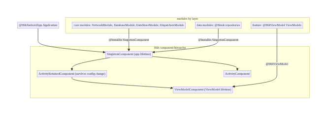
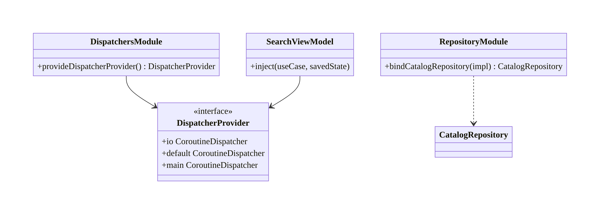
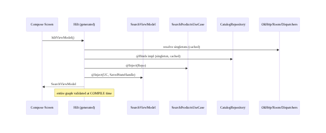
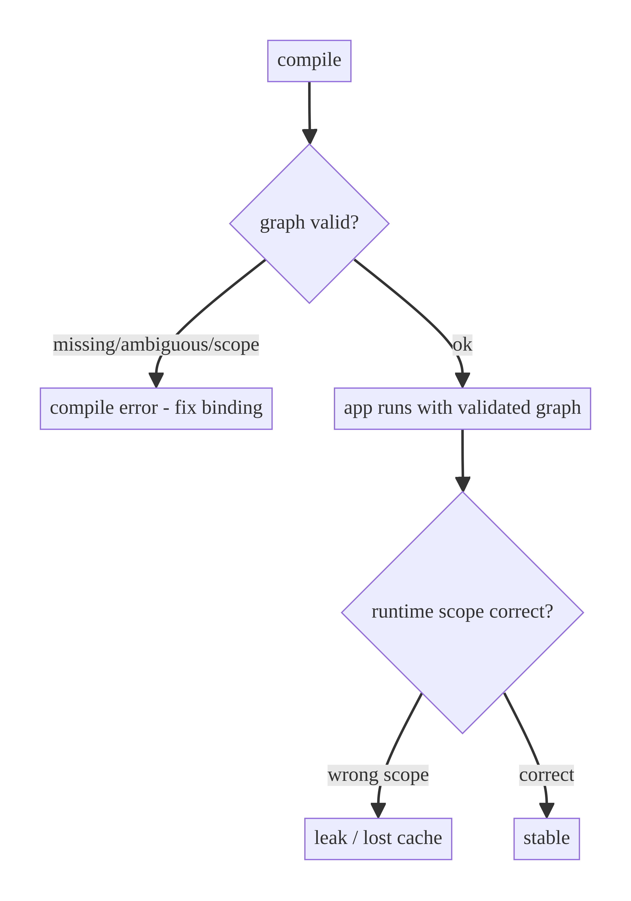

# Chapter 5 — Dependency Injection at Scale with Hilt

> **Part I — Core Infrastructure** · Complexity: **Standard** (≥25 interview questions)
>
> **Prerequisites:** Ch 1 (networking `@Module`s), Ch 3 (database modules), Ch 4
> (DataStore modules). This chapter formalizes the **DI conventions** every other
> chapter's `@Module`s follow — scoping, qualifiers, multi-module graphs, and
> testing.
>
> **Reference surface in StreamCart:** the Hilt graph wiring `:core:*`,
> `:data:*`, and `:feature:*` modules into one application.

---

## 5.1 Problem Definition and Real-World Context

As an app grows past a few screens, object creation becomes a system in its own
right: a ViewModel needs a use case, which needs a repository, which needs a DAO,
an API, a dispatcher, a clock, and a logger. Wiring this by hand (or with
service locators / singletons) fails at scale:

- **Construction sprawl.** Every screen manually assembles a deep object graph;
  change one constructor and dozens of call sites break.
- **Wrong lifetimes.** A repository accidentally recreated per screen loses its
  cache; a `Context` captured in a singleton leaks an Activity.
- **Untestable code.** Hard-coded `Dispatchers.IO`, `Retrofit.create`, or
  `FirebaseAnalytics.getInstance()` inside classes make unit tests impossible or
  flaky.
- **Hidden coupling.** Service locators hide dependencies, so you can't tell what
  a class needs without reading its body.

**Hilt** (built on Dagger) solves this with compile-time dependency injection:
dependencies are declared in constructors, provided by modules, scoped to
Android components, and verified **at compile time**. Designing the graph —
scopes, qualifiers, module boundaries, and the seams for testing — is the
architectural work this chapter covers. It is what lets every other feature in
the book say "`@Inject constructor(...)`" and get a correctly-scoped, testable
object.

### Three practical use cases

1. **Shared singletons (StreamCart core).** One `OkHttpClient`, one Room DB, one
   `DataStore` — provided once, injected everywhere, correct lifetime guaranteed.
2. **Screen-scoped state (any feature).** `@HiltViewModel` ViewModels get their
   dependencies injected and survive config changes with the right scope.
3. **Swapping implementations (testing / flavors).** Replace the real
   `AnalyticsLogger` with a fake in tests via `@TestInstallIn`, or a no-op in a
   debug flavor, without touching feature code.

### Why this is architectural

DI decides object **lifetimes**, **boundaries** between modules, and **testing
seams**. Wrong scoping causes leaks and lost caches; good module boundaries keep
`:core` independent of `:feature`. These are system-level decisions, not
boilerplate.

---

## 5.2 Requirements Engineering

### Functional requirements

| ID | Requirement |
|----|-------------|
| F1 | Declare dependencies via constructor injection. |
| F2 | Provide types that can't be constructor-injected (interfaces, third-party) via modules. |
| F3 | Scope singletons (client, DB, DataStore) to the application. |
| F4 | Inject ViewModels with the correct (config-change-surviving) scope. |
| F5 | Disambiguate same-typed dependencies with qualifiers (e.g., IO vs Default dispatcher). |
| F6 | Keep `:core` modules free of feature dependencies (correct dependency direction). |
| F7 | Allow swapping implementations for tests and build flavors. |

### Non-functional requirements

| Attribute | Policy |
|-----------|--------|
| **Correctness** | Compile-time graph validation; no runtime "missing binding" surprises. |
| **Performance** | No reflection at runtime (Dagger codegen); minimal startup cost; lazy where useful. |
| **Maintainability** | Clear module conventions; stable boundaries. |
| **Testability** | Fakes injected via `@TestInstallIn`; no hard-coded singletons. |
| **Memory** | No `Activity`/`Context` leaks via wrong scoping. |

### Scope

- **In scope:** constructor injection, modules (`@Provides`/`@Binds`), scopes,
  qualifiers, `@HiltViewModel`, multi-module conventions, testing seams,
  WorkManager/`@AssistedInject` integration points.
- **Out of scope:** Dagger internals beyond what's needed, Koin/manual DI deep
  dive (compared in §5.11), dynamic feature modules specifics.

### Assumptions & constraints

- Hilt 2.50+, Kotlin, KSP, multi-module Gradle. StreamCart layering: `app →
  feature → domain → data → core`.

---

## 5.3 System Design Fundamentals

- **Inversion of Control.** A class declares what it needs; the framework
  supplies it. The class doesn't construct or locate its dependencies.
- **Compile-time DI (Dagger/Hilt).** The graph is generated and validated at
  build time — a missing or ambiguous binding is a *compile error*, not a crash.
- **Scopes map to Android lifetimes.** `@Singleton` (app), `@ActivityRetainedScoped`
  (survives config change — ViewModel lifetime), `@ViewModelScoped`,
  `@ActivityScoped`, etc. Scope = how long one instance lives and who shares it.
- **`@Provides` vs `@Binds`.** `@Provides` supplies an instance you construct
  (third-party types, builders). `@Binds` maps an interface to its implementation
  (no body, more efficient).
- **Qualifiers** distinguish multiple bindings of the same type (`@IoDispatcher`
  vs `@DefaultDispatcher`).
- **Components & `@InstallIn`.** Modules are installed into Hilt components
  (`SingletonComponent`, `ViewModelComponent`, …) that mirror Android lifetimes.
- **Dependency direction** is enforced by *module placement*: `:core` modules
  install into `SingletonComponent` and never reference feature types; features
  depend inward.

Core insight: **scope is a design decision, not a default.** Match each
dependency's lifetime to the state it owns — singletons for shared infra,
retained scope for ViewModel-lifetime state, unscoped for cheap stateless objects.

---

## 5.4 High-Level Architecture



**Components & ownership**

- **`@HiltAndroidApp`** bootstraps the graph at the `Application`.
- **`SingletonComponent`** holds app-lifetime infra (client, DB, DataStore,
  dispatchers, repositories).
- **`ViewModelComponent`** holds per-ViewModel bindings; `@HiltViewModel` + the
  `hiltViewModel()` Compose accessor wire screens.
- **Modules** are placed by layer so dependency direction is structural.

---

## 5.5 Detailed Component Design



| Element | Mechanism | Scope | Notes |
|---------|-----------|-------|-------|
| `OkHttpClient`, Room, DataStore | `@Provides @Singleton` | app | shared infra (Ch 1/3/4) |
| Repositories | `@Binds` (interface→impl) | `@Singleton` (if stateful cache) | SSOT lifetime |
| Dispatchers | `@Provides` + qualifiers | unscoped/singleton | injectable for tests |
| ViewModels | `@HiltViewModel @Inject` | ViewModel | `SavedStateHandle` auto-provided |
| Use cases | `@Inject constructor` | unscoped | cheap, stateless |

---

## 5.6 End-to-End Data Flow (object graph resolution)



---

## 5.7 Complete Kotlin Implementation

Package: `com.streamcart.core.di` and per-module `di` packages.

### 5.7.1 Application & dispatchers

```kotlin
@HiltAndroidApp
class StreamCartApp : Application()

@Qualifier @Retention(AnnotationRetention.BINARY) annotation class IoDispatcher
@Qualifier @Retention(AnnotationRetention.BINARY) annotation class DefaultDispatcher
@Qualifier @Retention(AnnotationRetention.BINARY) annotation class MainDispatcher

@Module @InstallIn(SingletonComponent::class)
object DispatchersModule {
    @Provides @IoDispatcher fun io(): CoroutineDispatcher = Dispatchers.IO
    @Provides @DefaultDispatcher fun default(): CoroutineDispatcher = Dispatchers.Default
    @Provides @MainDispatcher fun main(): CoroutineDispatcher = Dispatchers.Main

    @Provides @Singleton
    fun dispatcherProvider(
        @IoDispatcher io: CoroutineDispatcher,
        @DefaultDispatcher def: CoroutineDispatcher,
        @MainDispatcher main: CoroutineDispatcher,
    ): DispatcherProvider = object : DispatcherProvider {
        override val io = io; override val default = def; override val main = main
    }
}
```

### 5.7.2 `@Binds` for repositories (interface → impl)

```kotlin
@Module @InstallIn(SingletonComponent::class)
abstract class RepositoryModule {
    @Binds @Singleton
    abstract fun bindCatalogRepository(impl: CatalogRepositoryImpl): CatalogRepository

    @Binds @Singleton
    abstract fun bindSearchRepository(impl: SearchRepositoryImpl): SearchRepository
}
```

### 5.7.3 Dependency inversion across modules (TokenProvider from Ch 1)

```kotlin
// :core:network defines the port; :data:auth binds the implementation.
@Module @InstallIn(SingletonComponent::class)
abstract class AuthBindingsModule {
    @Binds abstract fun bindTokenProvider(impl: DataStoreTokenProvider): TokenProvider
}
```

### 5.7.4 ViewModel injection + Compose

```kotlin
@HiltViewModel
class SearchViewModel @Inject constructor(
    private val searchProducts: SearchProductsUseCase,     // @Inject constructor, unscoped
    private val savedState: SavedStateHandle,              // auto-provided
) : ViewModel() { /* ... */ }

@AndroidEntryPoint
class MainActivity : ComponentActivity() { /* hosts Compose */ }

@Composable
fun SearchRoute(viewModel: SearchViewModel = hiltViewModel()) { /* ... */ }
```

### 5.7.5 Assisted injection (runtime params) & WorkManager

```kotlin
// A worker needs runtime inputs + injected deps:
@HiltWorker
class SyncWorker @AssistedInject constructor(
    @Assisted appContext: Context,
    @Assisted params: WorkerParameters,
    private val repository: CatalogRepository,       // injected
) : CoroutineWorker(appContext, params) {
    override suspend fun doWork(): Result = /* ... */ Result.success()
}
// plus HiltWorkerFactory wired in the Application (see WorkManager chapter Ch 30)
```

### 5.7.6 Module conventions (the rules every chapter follows)

```
Rule 1  Infra singletons (client, DB, DataStore, dispatchers) → @Provides/@Binds
        @Singleton in :core:* installed in SingletonComponent.
Rule 2  Repositories → @Binds (interface in :data or :domain, impl in :data),
        @Singleton only if they hold a cache/SSOT; else unscoped.
Rule 3  Use cases → plain @Inject constructor, unscoped (cheap, stateless).
Rule 4  ViewModels → @HiltViewModel; never manually scope.
Rule 5  Same-type deps → qualifiers (dispatchers, multiple Retrofit instances).
Rule 6  :core modules never import :feature/:data types; invert via ports.
Rule 7  Tests swap bindings with @TestInstallIn; never new up singletons in tests.
```

### 5.7.7 Module structure

```
:app        StreamCartApp(@HiltAndroidApp), MainActivity(@AndroidEntryPoint)
:core:common  DispatchersModule, DispatcherProvider, qualifiers
:core:network NetworkModule (@Provides client/retrofit), TokenProvider (port)
:core:database DatabaseModule
:core:datastore DataStoreModule
:data:catalog  RepositoryModule(@Binds), CatalogNetworkModule
:data:auth     AuthBindingsModule(@Binds TokenProvider)
:feature:*     @HiltViewModel ViewModels
```

---

## 5.8 Concurrency and Race Conditions

| Scenario | Risk | Handling |
|----------|------|----------|
| Singleton provider called concurrently | Double creation | Dagger guarantees single instance per scope (double-checked) |
| Mutable singleton state | Data race | Keep singletons stateless or internally synchronized (e.g., Mutex, Ch 2 breaker) |
| Dispatcher hard-coded | Untestable/flaky | Inject `DispatcherProvider`; swap `TestDispatcher` |
| Worker needs deps + runtime params | Can't constructor-inject both | `@AssistedInject` + `@HiltWorker` |
| ViewModel captures Activity `Context` | Leak | Inject `@ApplicationContext`; never Activity context into a ViewModel |

- **Scoped singletons are created thread-safely by Dagger** (one instance even
  under concurrent first access). Your responsibility is to keep their *state*
  thread-safe.
- **Injected dispatchers** are the linchpin of testable concurrency across the
  whole book — never `Dispatchers.IO` inline.

---

## 5.9 Failure Scenarios and Recovery

DI failures are mostly **compile-time**, which is the point — they can't reach
production.

| Failure | When | Symptom | Fix |
|---------|------|---------|-----|
| Missing binding | compile | "cannot be provided without an @Provides/@Inject" | add provider/`@Inject` |
| Ambiguous binding | compile | "bound multiple times" | qualifier or remove duplicate |
| Scope mismatch | compile | "cannot be scoped to..." | correct `@InstallIn`/scope |
| `Context` leak | runtime | retained Activity | inject `@ApplicationContext` |
| Lost cache | runtime | repository recreated per screen | add `@Singleton` to the SSOT binding |
| Test can't swap dep | test | real impl runs in test | `@TestInstallIn` / `@BindValue` |



> The design goal is to make **lifetime bugs into compile errors** where possible
> and to catch the rest (leaks, lost caches) with scope discipline and LeakCanary
> (Ch 89).

---

## 5.10 Scaling the Implementation

- **Level 1.** A single app module with a few `@Provides`.
- **Level 2.** Split core infra modules (network, db, datastore, dispatchers);
  `@Binds` repositories.
- **Level 3 — production.** Qualifiers, `@HiltViewModel` everywhere, `@HiltWorker`,
  test seams via `@TestInstallIn`, strict module placement for dependency
  direction.
- **Level 4 — large multi-module.** Per-feature `di` packages; ports in `:core`
  with implementations bound in `:data` (dependency inversion); build-time graph
  validation across ~50 modules; convention Gradle plugins apply Hilt uniformly.
- **Level 5 — enterprise.** Dynamic feature modules with their own entry points;
  per-variant bindings (prod/staging/mock); multiple apps sharing `:core`; CI
  guards on module boundaries.

**Avoid overengineering:** a tiny app doesn't need 15 modules — start with one
and split as boundaries emerge. Don't scope everything `@Singleton` "to be safe";
over-scoping causes leaks and memory bloat.

---

## 5.11 Alternative Approaches and Trade-offs

| Dimension | Option A | Option B | When |
|-----------|----------|----------|------|
| DI framework | Hilt (Dagger) | Koin | Hilt: compile-time safety, no reflection, Android-aware; Koin: simpler, runtime, KMP-friendly but errors at runtime |
| DI framework | Hilt | Manual/pure Dagger | Hilt for standard Android; pure Dagger for non-Android/advanced graphs; manual for tiny apps |
| Bind interface | `@Binds` | `@Provides` | `@Binds` for interface→impl (efficient); `@Provides` when you must construct |
| Scope | `@Singleton` | unscoped | Singleton only for shared state/infra; unscoped for stateless |
| Runtime params | `@AssistedInject` | pass via function args | Assisted when the object is injected but needs runtime inputs (workers, paging sources) |
| Test seam | `@TestInstallIn` | constructor injection in test | TestInstallIn for Hilt instrumentation tests; plain constructors for JVM unit tests |

**Hilt vs Koin:** Hilt validates the graph at compile time (missing bindings
fail the build) and generates code (no reflection), at the cost of annotation
processing and build time. Koin is lighter and KMP-friendly but surfaces graph
errors at runtime. For a large Android app where correctness and startup matter,
Hilt is the default; the book uses it throughout.

---

## 5.12 Security Considerations

- **Don't inject secrets as plain strings** across the graph; inject a
  `SecretProvider` backed by Keystore (Ch 20) so secrets aren't easily dumped
  from a heap or logged.
- **Scope sensitive state tightly** (e.g., decrypted keys) and clear on logout
  (Ch 42) — a long-lived singleton holding decrypted PII is a bigger exposure
  window.
- **`@EntryPoint` escape hatches** (for non-Hilt classes) must not expose
  security-critical singletons to untrusted call sites.
- DI is not a security boundary; access control is enforced at runtime/backend,
  not by who can `@Inject` a type.

---

## 5.13 Performance and Resource Optimization

- **No runtime reflection:** Dagger generates factories at build time, so
  injection is just constructor calls — negligible runtime cost.
- **Startup:** the `SingletonComponent` is built lazily; avoid doing heavy work in
  `@Provides` on the main thread at startup (e.g., opening the DB eagerly) — defer
  via `App Startup`/lazy (Ch 45/88).
- **`Lazy<T>` / `Provider<T>`** to defer creation of expensive singletons until
  first use.
- **Over-scoping cost:** scoped bindings are retained for the scope's lifetime —
  scope only what must be shared to avoid memory bloat.
- **Build time:** KSP (not KAPT) for faster incremental builds; keep modules
  small for parallel compilation.

---

## 5.14 Testing Strategy

Two seams: **JVM unit tests** construct classes directly (no Hilt needed) with
fakes; **instrumentation tests** swap bindings via `@TestInstallIn`/`@BindValue`.

```kotlin
// JVM unit test — no Hilt; constructor injection makes this trivial.
class SearchViewModelTest {
    private val useCase = FakeSearchUseCase()
    private val vm = SearchViewModel(useCase, SavedStateHandle())
    // ... assert behavior with injected fakes and a TestDispatcher
}

// Instrumentation — replace a real singleton with a fake across the graph.
@Module @TestInstallIn(components = [SingletonComponent::class], replaces = [AnalyticsModule::class])
object FakeAnalyticsModule {
    @Provides @Singleton fun logger(): Logger = FakeLogger()
}

@HiltAndroidTest
class CheckoutFlowTest {
    @get:Rule val hilt = HiltAndroidRule(this)
    @BindValue @JvmField val clock: Clock = FakeClock(0)   // per-test override
    // ...
}
```

Guidance: prefer plain constructor injection + JVM tests (fast, no device);
reserve Hilt test machinery for integration/instrumentation. **Never** `new` up a
singleton in a test to bypass the graph — inject a fake instead.

---

## 5.15 Production Observability

- DI is compile-time, so there's little runtime telemetry; focus on **leak and
  lifetime** signals: LeakCanary (Ch 89) catches wrong-scope `Context` leaks;
  memory profiler shows over-retained singletons.
- **Startup tracing** (Ch 45/88) reveals expensive `@Provides` on the critical
  path.
- **Build metrics:** annotation-processing time, module count, graph size — guard
  against build-time regressions in CI.
- **Debugging:** "repository state resets unexpectedly" → missing `@Singleton`;
  "Activity leaked" → Activity `Context` injected where `@ApplicationContext` was
  needed; "crash: EntryPoint not found" → `@AndroidEntryPoint` missing.

---

## 5.16 System Design Interview Preparation

> ≥25 questions.

**Fundamentals**

1. *Why DI?* Decouples construction from use; correct lifetimes; testability;
   compile-time validation.
2. *Hilt vs Dagger?* Hilt is an opinionated Android layer over Dagger with
   predefined components/scopes.
3. *`@Provides` vs `@Binds`?* Provides constructs an instance; Binds maps an
   interface to its impl (no body, efficient).
4. *What is a scope?* How long one instance lives and who shares it, mapped to an
   Android lifetime.
5. *Compile-time vs runtime DI?* Hilt validates the graph at build time (errors
   fail the build); Koin resolves at runtime.

**Architecture**

6. *How enforce dependency direction?* Module placement: `:core` installs into
   `SingletonComponent` and never references features; invert via ports
   (`TokenProvider`).
7. *Where do repositories get scoped?* `@Singleton` if they own a cache/SSOT;
   unscoped otherwise.
8. *How does `:core:network` get the auth token without depending on auth?*
   Define `TokenProvider` in core; bind the impl in `:data:auth`.

**Kotlin/Android**

9. *How are ViewModels injected?* `@HiltViewModel` + `hiltViewModel()`;
   `SavedStateHandle` auto-provided.
10. *What is `@AssistedInject` for?* Objects that are injected but also need
    runtime params (workers, paging sources).
11. *Why inject dispatchers?* Testability — swap `TestDispatcher`; never
    hard-code `Dispatchers.IO`.
12. *`@ApplicationContext` vs Activity context?* Use app context in singletons to
    avoid leaking the Activity.

**Concurrency**

13. *Is singleton creation thread-safe?* Yes — Dagger guarantees one instance per
    scope even under concurrent access.
14. *Singleton mutable state?* Make it thread-safe (Mutex/atomics); DI doesn't
    make state safe.

**Scalability**

15. *50 modules — how keep DI sane?* Per-feature `di` packages; ports in core;
    convention plugins; compile-time validation.
16. *Dynamic feature modules?* Their own entry points/components.

**Scoping/lifetime**

17. *`@Singleton` vs `@ActivityRetainedScoped`?* App lifetime vs
    survives-config-change (ViewModel) lifetime.
18. *Over-scoping risk?* Memory bloat and leaks; scope only shared state.
19. *Lost repository cache — cause?* Missing `@Singleton`.

**Testing**

20. *How test an injected class?* Constructor-inject fakes in a JVM test; no Hilt
    needed.
21. *How swap a singleton in instrumentation?* `@TestInstallIn` / `@BindValue`.
22. *Why not `new` a singleton in a test?* Bypasses the graph; hides wiring bugs.

**Performance**

23. *Runtime cost of Hilt?* Minimal — generated factories, no reflection.
24. *Defer expensive singletons?* `Lazy<T>`/`Provider<T>`; App Startup.

**Production debugging**

25. *Activity leaked — DI cause?* Activity `Context` in a singleton/ViewModel; use
    `@ApplicationContext`.
26. *Crash "EntryPoint"/"not an entry point"?* Missing `@AndroidEntryPoint`/
    `@HiltAndroidApp`.
27. *State resets between screens?* Binding not `@Singleton`.

### Design-change challenges
1. **Add staging/mock backends per build variant.** Variant-specific modules
   providing different base URLs/fakes.
2. **A worker needs injected repos + runtime input.** `@HiltWorker` +
   `@AssistedInject` + `HiltWorkerFactory`.
3. **Swap analytics for a fake in UI tests.** `@TestInstallIn replaces`.
4. **Share `:core` across two apps.** Keep core feature-agnostic; apps provide
   their own `app` module/graph root.
5. **Reduce build time at 80 modules.** KSP, smaller modules, convention plugins,
   avoid giant god-modules.

### Mock walkthrough (abridged)
Clarify (module count, shared infra, testing needs) → define component/scopes →
place modules by layer for dependency direction → qualifiers for dispatchers →
ViewModel/worker injection → testing seams → defend Hilt vs Koin and scoping
choices.

---

## 5.17 Practical Exercises

1. **Beginner.** Provide a shared `OkHttpClient` and inject it into two
   repositories; prove it's the same instance. *Eval:* single instance; no manual
   construction.
2. **Intermediate.** Add `@IoDispatcher`/`@DefaultDispatcher` qualifiers and a
   `DispatcherProvider`; swap a `TestDispatcher` in a unit test. *Eval:*
   deterministic test; no hard-coded dispatcher.
3. **Advanced.** Invert a dependency: define a port in `:core` and bind its impl
   in `:data` so core doesn't depend on the feature. *Eval:* core compiles
   without the feature.
4. **Production debugging.** Fix a repository that loses its cache (recreated per
   screen) and an Activity leak (wrong `Context`). *Eval:* `@Singleton` added;
   `@ApplicationContext` used; LeakCanary clean.
5. **System design challenge.** Introduce a `@HiltWorker` with `@AssistedInject`
   for background sync and swap its repo with a fake in an instrumentation test.
   *Eval:* worker injected; test overrides binding.

*(Solutions withheld unless requested.)*

---

## 5.18 Chapter Summary & Reference Sheet

**Key decisions:** constructor injection everywhere; shared infra as
`@Singleton`; repositories `@Binds` (+`@Singleton` only if stateful); use cases
unscoped; ViewModels via `@HiltViewModel`; qualifiers for same-typed deps;
dependency direction enforced by module placement + ports; inject dispatchers for
testability; swap impls via `@TestInstallIn`.

**Concepts:** IoC, compile-time DI, scopes/components, `@Provides` vs `@Binds`,
qualifiers, assisted injection, dependency inversion via ports.

**Common mistakes:** hard-coding `Dispatchers.IO`/singletons inside classes;
over-scoping `@Singleton`; injecting Activity `Context` into singletons (leak);
missing `@Singleton` on an SSOT (lost cache); `new`-ing singletons in tests;
`:core` importing `:feature` types.

**Checklist:**

- [ ] `@HiltAndroidApp`
- [ ] infra `@Singleton`
- [ ] `@Binds` repos
- [ ] dispatcher qualifiers
- [ ] `@HiltViewModel`
- [ ] ports for dependency inversion
- [ ] `@ApplicationContext` in singletons
- [ ] `@TestInstallIn` seams
- [ ] scope matches owned state
- [ ] KSP.

**Key APIs:** `@HiltAndroidApp`, `@AndroidEntryPoint`, `@HiltViewModel`,
`@Module`, `@InstallIn`, `@Provides`, `@Binds`, `@Singleton`, `@Qualifier`,
`@AssistedInject`/`@HiltWorker`, `hiltViewModel()`, `@TestInstallIn`,
`@BindValue`, `Lazy`/`Provider`.

**References:**
- Hilt: https://developer.android.com/training/dependency-injection/hilt-android
- Hilt components/scopes: https://developer.android.com/training/dependency-injection/hilt-android#component-scopes
- Hilt + Jetpack (ViewModel/Worker): https://developer.android.com/training/dependency-injection/hilt-jetpack
- Hilt testing: https://developer.android.com/training/dependency-injection/hilt-testing
- Dagger: https://dagger.dev/hilt/

### Chapter review (Phase 4)
- **Completeness:** all 18 sections; component/class/sequence/failure diagrams;
  modules, scopes, qualifiers, `@Binds`/`@Provides`, assisted injection, ports,
  conventions; concurrency; compile-time failure model; 5 levels; Hilt vs Koin
  trade-offs; security; perf/build; JVM + instrumentation test seams;
  observability (leaks); 27 Q&A + 5 challenges. ✅
- **Expand later:** `@HiltWorker` depth (Ch 30), dynamic feature modules,
  convention Gradle plugins (Ch 94).
- **Interview coverage:** exceeds ≥25 bar.
- **Shared conventions introduced:** the 7 module rules, dispatcher qualifiers,
  ports-for-inversion — followed by every later chapter.
