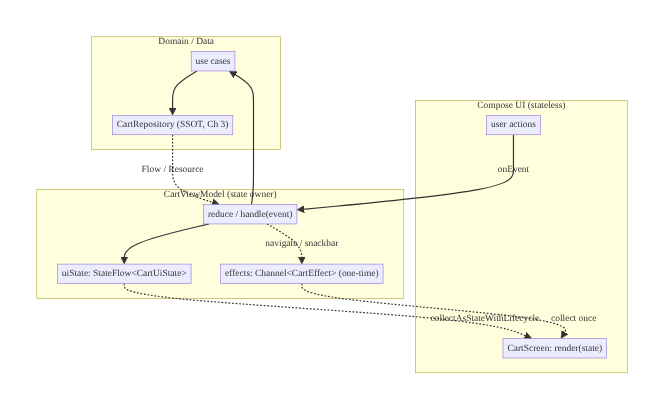
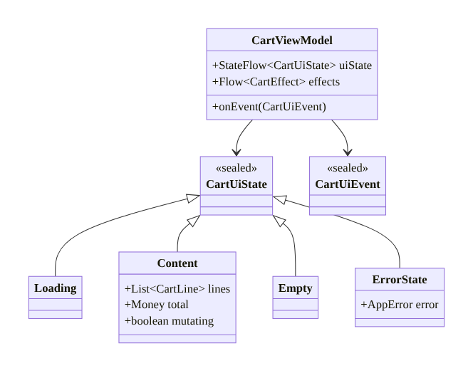
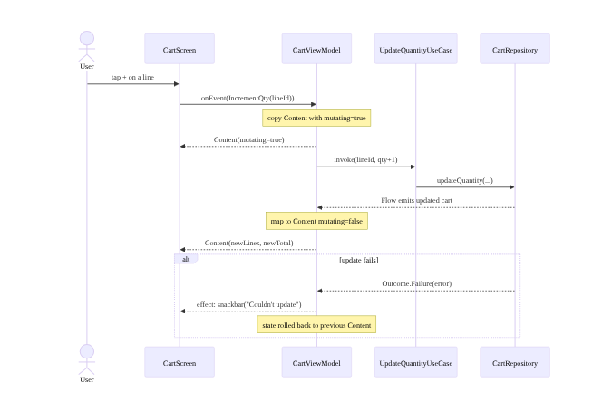
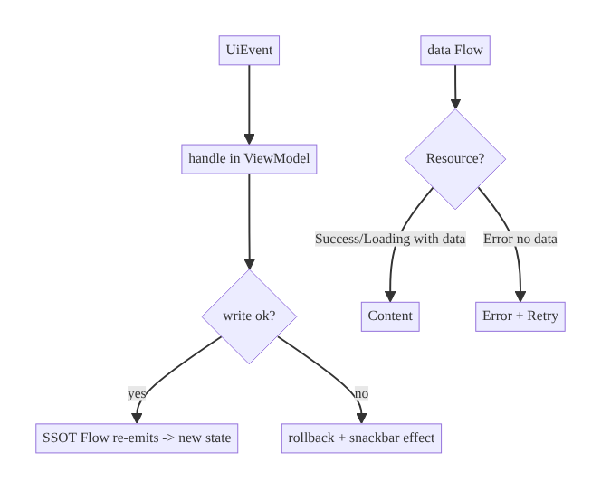

# Chapter 6 — UI State Modeling & Unidirectional Data Flow

> **Part I — Core Infrastructure** · Complexity: **Complex** (≥40 interview questions)
>
> **Prerequisites:** Ch 1 (`Outcome`/`AppError`), Ch 3 (`Resource<T>`, SSOT),
> Ch 5 (Hilt/`@HiltViewModel`). This chapter **defines** the UI-state and UDF
> conventions (`UiState`, `UiEvent`, `StateFlow`, `stateIn`/`WhileSubscribed`,
> one-time events preview) that every feature ViewModel in the book follows —
> Ch 7 deepens events, Ch 8 adds process-death restoration, Ch 9 applies it to
> search.
>
> **Reference surface in StreamCart:** the presentation layer of every feature —
> we use the Cart screen as the running example.

---

## 6.1 Problem Definition and Real-World Context

The UI layer's job is to render *state* and forward *events*. It sounds simple,
yet it's where most Android bugs live: inconsistent screens, lost state on
rotation, flicker, double-submits, and "impossible" UI combinations (a spinner
and an error and data all at once). The root cause is almost always an
**unprincipled state model** and **bidirectional data flow**.

Naive approaches fail because:

- **Scattered mutable fields.** `isLoading`, `error`, `items`, `isEmpty` as
  separate `MutableState`s let the UI reach illegal combinations (loading *and*
  error) and force every composable to re-derive what to show.
- **Views mutating state directly.** When a composable flips a flag and the
  ViewModel flips another, there's no single place that defines "what the screen
  shows," so two screens or two code paths disagree.
- **State owned by the View.** Holding state in composables/Fragments loses it on
  rotation and process death and makes it untestable.
- **One-time events modeled as state.** Showing a snackbar or navigating by
  setting a boolean causes the event to re-fire on rotation (the snackbar
  reappears).

**Unidirectional Data Flow (UDF)** fixes this: state flows *down* from a single
owner (the ViewModel's `StateFlow<UiState>`) to the UI; events flow *up* from the
UI to the ViewModel. State is modeled explicitly so illegal combinations are
unrepresentable. This is the backbone pattern for every screen in the book.

### Three practical use cases

1. **E-commerce cart (StreamCart Shop).** One `CartUiState` drives item list,
   totals, loading, and error; quantity changes are events; the screen can't
   show a stale total.
2. **OTT detail screen (StreamCart Watch).** Content metadata, "in my list"
   toggle, and download state are one cohesive state; actions are events; it
   survives rotation.
3. **Social feed (StreamCart Social).** Infinite list + refresh + per-item
   optimistic likes modeled as state; a like tap is an event handled by the
   ViewModel (Ch 72).

### Why this is architectural

UDF decides **who owns state**, **how the UI observes it**, **how events are
dispatched**, and **what states are even possible**. These determine testability,
lifecycle-safety, and whether screens stay consistent — system-level concerns,
not view code.

---

## 6.2 Requirements Engineering

### Functional requirements

| ID | Requirement |
|----|-------------|
| F1 | The screen renders from a single `UiState` exposed by the ViewModel. |
| F2 | The UI sends user intents as `UiEvent`s to the ViewModel; it never mutates business state. |
| F3 | Illegal state combinations are unrepresentable by construction. |
| F4 | State survives configuration changes (rotation). |
| F5 | One-time effects (snackbar, navigation) fire exactly once, not on rotation. |
| F6 | State collection is lifecycle-aware (stops when the UI is not visible). |
| F7 | The ViewModel is unit-testable without Android/UI. |

### Non-functional requirements

| Attribute | Policy |
|-----------|--------|
| **Correctness** | Exhaustive `when` over state; no impossible combinations. |
| **Performance** | Minimal recomposition; conflated state; stable types. |
| **Memory** | `viewModelScope` bounds work; `WhileSubscribed` stops idle pipelines. |
| **Testability** | Pure state logic; injected dispatchers (Ch 5). |
| **Maintainability** | One state model per screen; consistent naming. |

### Scope

- **In scope:** `UiState` modeling (sealed vs single-immutable), UDF loop,
  `StateFlow`/`stateIn`, event handling, one-time effects (intro), lifecycle-aware
  collection, MVVM-with-UDF vs MVI.
- **Out of scope:** one-time events deep dive (Ch 7), process-death persistence
  (Ch 8), debounced input (Ch 9), navigation architecture (Ch 53).

### Assumptions & constraints

- Jetpack Compose, `StateFlow`, `@HiltViewModel`, coroutines. `minSdk 24`.

---

## 6.3 System Design Fundamentals

- **Unidirectional Data Flow.** State down, events up. The ViewModel is the only
  state owner; the UI is a pure function of state.
- **Single immutable state object.** The screen's state is one immutable value
  (`data class` or `sealed interface`), so a render is a snapshot — no partial
  updates, no torn reads.
- **Make illegal states unrepresentable.** Model mutually-exclusive conditions as
  a sealed hierarchy (Loading / Content / Error) rather than independent booleans.
- **`StateFlow` as the holder.** Conflated, always-has-a-value, hot — ideal for UI
  state. The UI collects it lifecycle-aware.
- **Events vs state.** Durable screen conditions are *state*; things that happen
  once (navigate, toast) are *effects/events* (Ch 7) and must not live in state.
- **`stateIn` + `WhileSubscribed`.** Convert a cold pipeline into UI state that
  starts on subscription, stops shortly after the UI leaves, and replays the last
  value on return.
- **Reducer (MVI).** Optionally, a pure `(state, event) -> state` function
  centralizes transitions, maximizing testability.

Core insight: **model the screen as one explicit, immutable state owned by the
ViewModel, and treat the UI as `render(state)`.** Everything else — consistency,
rotation-safety, testability — follows.

---

## 6.4 High-Level Architecture



**Components & ownership**

- **`CartScreen`** is stateless: it receives `CartUiState` and emits events; it
  holds no business state.
- **`CartViewModel`** owns `uiState` (the single source for the screen) and a
  one-time `effects` channel (Ch 7). It turns events into use-case calls and maps
  results/`Resource` into state.
- **Domain/Data** provide the actual data via the SSOT repository (Ch 3).

**Data direction:** state flows down (`StateFlow` → UI); events flow up (UI →
ViewModel). The UI never writes business state; the ViewModel never touches
Views.

---

## 6.5 Detailed Component Design



| Element | Responsibility | Notes |
|---------|----------------|-------|
| `CartUiState` | everything the screen needs to render | sealed; exhaustive `when` |
| `CartUiEvent` | user intents | sealed; one entry point `onEvent` |
| `CartEffect` | one-time effects (nav, snackbar) | via `Channel` (Ch 7) |
| `CartViewModel` | own state, handle events, map data | `viewModelScope`, injected dispatchers |

**Two valid state-modeling styles**

- **Single immutable `data class`** with a nested status — good when parts of the
  screen are always present (e.g., a toolbar) alongside a loading/error body.
- **Sealed hierarchy** (Loading/Content/Empty/Error) — good when the whole screen
  is in exactly one mode. The Cart uses a sealed hierarchy; the `Content` state
  carries a `mutating` flag for in-place updates (e.g., changing quantity) so we
  don't drop back to a full-screen spinner.

---

## 6.6 End-to-End Data Flow



---

## 6.7 Complete Kotlin Implementation

Package: `com.streamcart.cart`.

### 6.7.1 State, events, effects

```kotlin
sealed interface CartUiState {
    data object Loading : CartUiState
    data object Empty : CartUiState
    data class Content(
        val lines: List<CartLine>,
        val total: Money,
        val mutating: Boolean = false,     // in-place update without full spinner
    ) : CartUiState
    data class Error(val error: AppError) : CartUiState
}

sealed interface CartUiEvent {
    data class IncrementQty(val lineId: String) : CartUiEvent
    data class DecrementQty(val lineId: String) : CartUiEvent
    data class Remove(val lineId: String) : CartUiEvent
    data object Checkout : CartUiEvent
    data object Retry : CartUiEvent
}

sealed interface CartEffect {                 // one-time (Ch 7)
    data class ShowSnackbar(val message: String) : CartEffect
    data object NavigateToCheckout : CartEffect
}
```

### 6.7.2 ViewModel (state owner, UDF loop)

```kotlin
@HiltViewModel
class CartViewModel @Inject constructor(
    private val observeCart: ObserveCartUseCase,
    private val updateQuantity: UpdateQuantityUseCase,
    private val removeLine: RemoveLineUseCase,
) : ViewModel() {

    private val _effects = Channel<CartEffect>(Channel.BUFFERED)
    val effects: Flow<CartEffect> = _effects.receiveAsFlow()

    val uiState: StateFlow<CartUiState> =
        observeCart()                                        // Flow<Resource<Cart>> (Ch 3)
            .map { it.toUiState() }
            .catch { emit(CartUiState.Error(it.toAppError())) }
            .stateIn(
                scope = viewModelScope,
                started = SharingStarted.WhileSubscribed(5_000),
                initialValue = CartUiState.Loading,
            )

    fun onEvent(event: CartUiEvent) {
        when (event) {
            is CartUiEvent.IncrementQty -> changeQty(event.lineId, +1)
            is CartUiEvent.DecrementQty -> changeQty(event.lineId, -1)
            is CartUiEvent.Remove -> viewModelScope.launch {
                if (removeLine(event.lineId) is Outcome.Failure)
                    _effects.send(CartEffect.ShowSnackbar("Couldn't remove item"))
            }
            CartUiEvent.Checkout -> viewModelScope.launch {
                _effects.send(CartEffect.NavigateToCheckout)
            }
            CartUiEvent.Retry -> { /* re-subscribe handled by upstream; or trigger refresh */ }
        }
    }

    private fun changeQty(lineId: String, delta: Int) = viewModelScope.launch {
        when (updateQuantity(lineId, delta)) {               // SSOT write updates Flow
            is Outcome.Failure -> _effects.send(CartEffect.ShowSnackbar("Couldn't update quantity"))
            is Outcome.Success -> Unit                        // Flow re-emits new Content
        }
    }

    private fun Resource<Cart>.toUiState(): CartUiState = when (this) {
        is Resource.Loading -> data?.toContent() ?: CartUiState.Loading
        is Resource.Success -> data.toContent()
        is Resource.Error -> data?.toContent() ?: CartUiState.Error(error)
    }

    private fun Cart.toContent(): CartUiState =
        if (lines.isEmpty()) CartUiState.Empty
        else CartUiState.Content(lines, total)
}
```

> Because the cart is backed by the SSOT (Ch 3), a quantity write updates Room,
> whose `Flow` re-emits — the ViewModel does **not** manually mutate the list.
> State stays derived from the single source of truth.

### 6.7.3 Compose UI (stateless render + effects)

```kotlin
@Composable
fun CartRoute(
    viewModel: CartViewModel = hiltViewModel(),
    onNavigateToCheckout: () -> Unit,
    snackbarHostState: SnackbarHostState,
) {
    val state by viewModel.uiState.collectAsStateWithLifecycle()

    // One-time effects: collected lifecycle-aware, fired once (Ch 7).
    LaunchedEffect(Unit) {
        viewModel.effects.flowWithLifecycle(/* lifecycle */).collect { effect ->
            when (effect) {
                is CartEffect.ShowSnackbar -> snackbarHostState.showSnackbar(effect.message)
                CartEffect.NavigateToCheckout -> onNavigateToCheckout()
            }
        }
    }

    CartScreen(state = state, onEvent = viewModel::onEvent)
}

@Composable
fun CartScreen(state: CartUiState, onEvent: (CartUiEvent) -> Unit) {
    when (state) {                                     // exhaustive — compiler-enforced
        CartUiState.Loading -> FullScreenSpinner()
        CartUiState.Empty -> EmptyCart()
        is CartUiState.Error -> ErrorPane(state.error, onRetry = { onEvent(CartUiEvent.Retry) })
        is CartUiState.Content -> CartContent(
            lines = state.lines,
            total = state.total,
            mutating = state.mutating,
            onEvent = onEvent,
        )
    }
}
```

### 6.7.4 Optional: an explicit reducer (MVI style)

```kotlin
// When transitions are complex, centralize them as a pure function (easy to test).
fun cartReducer(state: CartUiState, event: CartUiEvent): CartUiState = when (event) {
    is CartUiEvent.IncrementQty ->
        (state as? CartUiState.Content)?.copy(mutating = true) ?: state
    // ... other transitions
    else -> state
}
```

### 6.7.5 Module structure

```
:feature:cart
  ui/           CartRoute, CartScreen, CartContent, EmptyCart, ErrorPane, previews
  presentation/ CartViewModel, CartUiState, CartUiEvent, CartEffect, cartReducer
:domain/usecase ObserveCartUseCase, UpdateQuantityUseCase, RemoveLineUseCase
:data:cart      CartRepository (SSOT, Ch 3)
```

---

## 6.8 Concurrency and Race Conditions

| Scenario | Risk | Handling |
|----------|------|----------|
| Rapid events (double-tap +) | Duplicate writes / flicker | SSOT write is idempotent per state; `mutating` flag; debounce if needed (Ch 9) |
| Multiple collectors of `uiState` | Divergent UI | `StateFlow` shares one value; all collectors see the same |
| Event handling races state emission | Torn UI | State is immutable snapshots; emissions are serialized by `StateFlow` |
| Effect lost if UI not collecting | Missed snackbar/nav | `Channel` buffers; collected lifecycle-aware (Ch 7) |
| Rotation during in-flight update | Lost work / double work | `viewModelScope` survives config change; `WhileSubscribed` replays last state |

- **State emissions are serialized** by `StateFlow`, and each emission is an
  immutable value — there is no partial/torn UI state.
- **One entry point (`onEvent`)** serializes intent handling conceptually; use a
  `Channel`/actor if strict ordering of side effects is required.

---

## 6.9 Failure Scenarios and Recovery

| Failure | Detection | Response | UX | Telemetry |
|---------|-----------|----------|----|-----------|
| Data load error | `Resource.Error` | `Error` state (or keep `Content` with cached data) | error pane + Retry | `screen_error{screen=cart}` |
| Action (write) fails | `Outcome.Failure` | roll back optimistic change; emit snackbar effect | toast, state unchanged | `action_error{event}` |
| Rotation | — | `viewModelScope` + `WhileSubscribed` | seamless, no refetch | — |
| Process death | — | restore via `SavedStateHandle` (Ch 8) | seamless | — |
| Effect delivered while backgrounded | lifecycle STOPPED | `Channel` buffers; delivered on resume | no lost nav/snackbar | — |
| Illegal state attempted | — | unrepresentable by type | n/a (compile-time) | — |



> **Optimistic UX pattern (preview of Ch 72):** flip the UI immediately
> (`mutating`/optimistic value), then confirm or roll back on the result. UDF
> makes rollback trivial — just emit the previous state.

---

## 6.10 Scaling the Implementation

- **Level 1.** One `data class` state, a few events, `onEvent`.
- **Level 2.** Sealed state hierarchy; one-time effects via `Channel`; previews
  per state.
- **Level 3 — production.** State derived from SSOT (`Resource`), lifecycle-aware
  collection, `SavedStateHandle` (Ch 8), optimistic updates with rollback.
- **Level 4 — large.** Explicit MVI reducer + unit-tested transitions; a shared
  `BaseViewModel`/`MVIViewModel` contract across features; `combine` of multiple
  flows into one state; Molecule/compose-state where appropriate.
- **Level 5 — enterprise.** A standardized UDF framework module used by many
  teams (state/event/effect contracts, testing harness, lint), analytics on state
  transitions, and design-system-driven state-to-UI mapping.

**Avoid overengineering:** a static screen with no async doesn't need MVI
ceremony — a plain `data class` state is enough. Add a reducer only when
transitions get genuinely complex.

---

## 6.11 Alternative Approaches and Trade-offs

| Dimension | Option A | Option B | When |
|-----------|----------|----------|------|
| State holder | `StateFlow` | `LiveData` | `StateFlow` (operators, conflation, KMP, Compose-native); LiveData only in legacy View code |
| State shape | Sealed hierarchy | Single `data class` + status | Sealed when screen is in one mode; data class when persistent parts coexist with a loading body |
| Pattern | MVVM + UDF | MVI (reducer) | MVVM+UDF for most screens; MVI when transitions are complex/benefit from a pure reducer |
| Events | `Channel` (Ch 7) | `SharedFlow` | `Channel` for exactly-once consumer; `SharedFlow` for multiple/replay — see Ch 7 |
| Collection | `collectAsStateWithLifecycle` | `collectAsState` | Lifecycle-aware default; plain only when always-visible |
| State creation | `stateIn(WhileSubscribed)` | eager `MutableStateFlow` | `stateIn` for derived-from-flow; MutableStateFlow for imperative updates |

**MVVM+UDF vs MVI:** both are unidirectional. MVI formalizes a single `intent`
channel and a pure `reduce(state, intent)`; it maximizes testability and
traceability at the cost of boilerplate. MVVM+UDF (ViewModel exposes `StateFlow`
+ `onEvent`) is lighter and sufficient for most screens. The book uses MVVM+UDF
by default and reaches for a reducer when transitions warrant it.

---

## 6.12 Security Considerations

- **Don't put secrets in UI state** — state is held in memory, may be logged in
  crash reports, and (if persisted via `SavedStateHandle`) written to disk. Keep
  tokens/PII out of `UiState`; reference by id and resolve securely (Ch 20).
- **Redact state in logs/crash breadcrumbs** — logging a `Content` with full PII
  leaks it (Ch 28); log the state *type* and counts.
- **Effects that navigate** must validate deep-link/args server-side where they
  grant access; a client-side nav event is not authorization (Ch 52).
- Client vs backend: UI state reflects the client's view; entitlements shown in
  state must be re-validated by the backend before any privileged action.

---

## 6.13 Performance and Resource Optimization

- **Minimize recomposition:** emit *distinct* immutable states; use `@Stable`/
  `@Immutable` data classes; key lists; hoist state; pass `onEvent: (Event)->Unit`
  (stable) rather than per-item lambdas where possible.
- **Conflation:** `StateFlow` drops intermediate values — the UI never processes a
  backlog of loading states.
- **`WhileSubscribed(5000)`:** stop upstream work when the screen is gone; the 5 s
  window avoids restart churn on rotation.
- **Avoid giant state:** large lists belong in Paging (Ch 13), not a single
  in-memory `Content`.
- **Profiling:** Layout Inspector recomposition counts, `Recomposition` metrics,
  Compose compiler reports for unstable params.

---

## 6.14 Testing Strategy

The whole point of UDF: the ViewModel is pure-ish and testable with a
`TestDispatcher` and fakes — no UI needed.

```kotlin
@OptIn(ExperimentalCoroutinesApi::class)
class CartViewModelTest {
    private val dispatcher = StandardTestDispatcher()
    @Before fun setUp() { Dispatchers.setMain(dispatcher) }
    @After fun tearDown() { Dispatchers.resetMain() }

    @Test fun `empty cart maps to Empty state`() = runTest(dispatcher) {
        val vm = CartViewModel(FakeObserveCart(empty = true), FakeUpdateQty(), FakeRemove())
        vm.uiState.test {
            assertEquals(CartUiState.Loading, awaitItem())
            assertEquals(CartUiState.Empty, awaitItem())
            cancelAndIgnoreRemainingEvents()
        }
    }

    @Test fun `failed quantity update emits snackbar effect and keeps state`() = runTest(dispatcher) {
        val vm = CartViewModel(FakeObserveCart(oneItem = true), FakeUpdateQty(fails = true), FakeRemove())
        vm.uiState.test {
            awaitItem(); val content = awaitItem() as CartUiState.Content
            vm.effects.test {
                vm.onEvent(CartUiEvent.IncrementQty(content.lines.first().id))
                assertTrue(awaitItem() is CartEffect.ShowSnackbar)
            }
            cancelAndIgnoreRemainingEvents()
        }
    }

    @Test fun `checkout event emits navigation effect`() = runTest(dispatcher) {
        val vm = CartViewModel(FakeObserveCart(oneItem = true), FakeUpdateQty(), FakeRemove())
        vm.effects.test {
            vm.onEvent(CartUiEvent.Checkout)
            assertEquals(CartEffect.NavigateToCheckout, awaitItem())
        }
    }
}

// Pure reducer test (MVI) — no coroutines needed.
@Test fun `increment sets mutating true on Content`() {
    val s = CartUiState.Content(lines, total)
    assertTrue((cartReducer(s, CartUiEvent.IncrementQty("1")) as CartUiState.Content).mutating)
}
```

Also: a Compose UI test asserting each state renders the right node; a
recomposition test for stability. Fake use cases/repos; keep the reducer pure.

---

## 6.15 Production Observability

- **State/transition analytics:** log state *type* changes (`cart_state{from,to}`)
  and event frequencies — never raw state contents (PII, Ch 28).
- **Metrics:** error-state rate per screen, time-in-loading (p95), action failure
  rate, recomposition counts (debug), rotation-survival (should be 100%).
- **Crash breadcrumbs:** include the current `UiState` *type* so a crash report
  shows what the user was seeing (e.g., "crashed in Cart.Error").
- **Debugging:** snackbar reappears on rotation → effect modeled as state (fix:
  move to `Channel`, Ch 7); screen blanks on rotation → state owned by View not
  ViewModel; flicker on every keystroke → state not distinct / Flow rebuilt.

---

## 6.16 System Design Interview Preparation

> 40+ questions.

**Fundamentals**
1. *What is UDF?* State flows down from one owner; events flow up; UI is a pure
   function of state.
2. *Why a single immutable state object?* Snapshots, no torn/partial UI, easy
   diffing and testing.
3. *"Make illegal states unrepresentable" — how?* Sealed hierarchy for mutually
   exclusive modes instead of independent booleans.
4. *State vs event?* Durable conditions are state; one-time occurrences (nav,
   toast) are effects (Ch 7).
5. *Why `StateFlow` for UI state?* Conflated, always-valued, hot, operator-rich,
   Compose-native.

**Architecture**
6. *Who owns screen state?* The ViewModel; the UI is stateless.
7. *Where does the debounce/business logic go?* ViewModel/use cases, not the UI.
8. *How do two screens stay consistent?* Derive state from the SSOT (Ch 3); both
   observe the same source.
9. *MVVM+UDF vs MVI?* Both unidirectional; MVI adds a pure reducer + single intent
   channel (more testable, more boilerplate).

**Kotlin/Compose**
10. *`collectAsState` vs `collectAsStateWithLifecycle`?* The latter stops in
    STOPPED — correct default.
11. *What does `stateIn(WhileSubscribed(5000))` do?* Starts on subscription, stops
    5 s after the last collector, replays last value — rotation-friendly.
12. *Why `data class` + `copy` for updates?* Immutable transitions; previous state
    retained for rollback.
13. *How prevent recomposition storms?* Distinct states, `@Immutable`, stable
    lambdas, keyed lists.

**Concurrency**
14. *Are state emissions ordered?* Yes — `StateFlow` serializes and conflates.
15. *Double-tap causing double submit?* Idempotent SSOT write, `mutating` flag, or
    debounce (Ch 9).
16. *Effect lost while backgrounded?* `Channel` buffers; collect lifecycle-aware
    (Ch 7).

**Lifecycle**
17. *Rotation — refetch?* No; `viewModelScope` + `WhileSubscribed` replay state.
18. *Process death?* `SavedStateHandle` (Ch 8).
19. *Why not hold state in the composable?* Lost on rotation/process death;
    untestable.

**Events/effects**
20. *Why not model navigation as a boolean state?* It re-fires on rotation
    (double navigation); use a one-time effect.
21. *`Channel` vs `SharedFlow` for effects?* Channel = exactly-once single
    consumer; SharedFlow = multiple/replay (Ch 7).

**Scalability**
22. *Complex transitions across many features?* MVI reducer + a shared base
    contract; unit-test transitions.
23. *Huge lists in state?* Paging (Ch 13), not one big `Content`.

**Security**
24. *Secrets in UI state?* No — in-memory/crash-logged/persisted; keep out.
25. *Is a nav effect authorization?* No; backend authorizes.

**Performance**
26. *Biggest recomposition pitfall?* Unstable types/lambdas and non-distinct
    state.
27. *How measure?* Layout Inspector recomposition counts; compiler stability
    report.

**Testing**
28. *How test a ViewModel?* `TestDispatcher` + fakes + Turbine on `uiState`/
    `effects`; no UI.
29. *Benefit of a pure reducer?* Transition tests without coroutines.
30. *How test effects fire once?* Assert a single emission on the effects flow.

**Production debugging**
31. *Snackbar reappears on rotation?* Effect stored as state; move to Channel.
32. *Screen blanks on rotation?* State owned by View, not ViewModel.
33. *Two screens disagree?* Not deriving from SSOT.

**Trade-offs**
34. *LiveData vs StateFlow?* StateFlow default; LiveData legacy.
35. *Sealed vs data-class state?* Mode-exclusive vs coexisting parts.
36. *When skip MVI?* Simple/static screens.

**Deeper**
37. *How combine several data sources into one state?* `combine(...)` then `stateIn`.
38. *How model partial/optimistic updates?* `mutating` flag / optimistic value +
    rollback (Ch 72).
39. *How keep `onEvent` stable for Compose?* Method reference `viewModel::onEvent`.
40. *How do effects survive config change but not double-fire?* Buffered `Channel`
    + lifecycle-aware single collection (Ch 7).

### Design-change challenges
1. **Add optimistic likes/quantities.** Optimistic state + rollback on failure
   (Ch 72).
2. **Screen must survive process death with a draft.** `SavedStateHandle` (Ch 8).
3. **Transitions got complex (wizard).** Introduce an MVI reducer; unit-test it.
4. **Combine cart + promo + shipping into one screen.** `combine` flows → one
   state.
5. **Standardize across 20 feature teams.** A UDF base contract + testing harness
   + lint.

### Mock walkthrough (abridged)
Clarify (async? modes? one-time effects?) → model `UiState` (sealed) making
illegal states impossible → ViewModel owns `StateFlow` + `onEvent` + effects
`Channel` → derive from SSOT → lifecycle-aware collection → failures/rollback →
testing → defend MVVM+UDF vs MVI, StateFlow vs LiveData.

---

## 6.17 Practical Exercises

1. **Beginner.** Model a screen with a sealed `UiState` (Loading/Content/Empty/
   Error) and render it with an exhaustive `when`. *Eval:* no booleans; compiler
   enforces all cases.
2. **Intermediate.** Add a one-time snackbar effect via `Channel`; prove it
   doesn't re-fire on rotation. *Eval:* single delivery; survives config change.
3. **Advanced.** Derive state from the SSOT (`Resource`) and add an optimistic
   quantity update with rollback. *Eval:* instant UI, correct rollback on failure.
4. **Production debugging.** Fix a screen that blanks on rotation (state in the
   composable) and whose snackbar repeats (effect as state). *Eval:* state in VM;
   effect via Channel.
5. **System design challenge.** Refactor a complex multi-step screen to an MVI
   reducer with unit-tested transitions. *Eval:* pure reducer; full transition
   coverage.

*(Solutions withheld unless requested.)*

---

## 6.18 Chapter Summary & Reference Sheet

**Key decisions:** one immutable `UiState` per screen owned by the ViewModel;
UDF (state down, events up); model mutually-exclusive modes as a sealed
hierarchy so illegal states are unrepresentable; one-time effects via `Channel`
(Ch 7), never as state; derive state from the SSOT; collect lifecycle-aware;
`stateIn(WhileSubscribed)`.

**Concepts:** UDF, single source of UI truth, illegal-states-unrepresentable,
state vs effect, conflation, `WhileSubscribed`, reducer/MVI.

**Common mistakes:** scattered boolean flags; View-owned state (rotation loss);
one-time events as state (double snackbar/nav); `collectAsState` without
lifecycle; non-distinct/unstable state (recomposition storms); secrets in state.

**Checklist:** ☐ single `UiState` ☐ sealed where mode-exclusive ☐ `onEvent`
entry point ☐ effects via `Channel` ☐ derive from SSOT ☐
`collectAsStateWithLifecycle` ☐ `stateIn(WhileSubscribed)` ☐ immutable/`@Stable`
state ☐ VM unit-tested ☐ no secrets in state.

**Key APIs:** `StateFlow`, `MutableStateFlow`, `stateIn`,
`SharingStarted.WhileSubscribed`, `collectAsStateWithLifecycle`,
`Channel`/`receiveAsFlow`, `flowWithLifecycle`, `combine`, `copy`,
`@Immutable`/`@Stable`, Turbine.

**References:**
- UI layer / UDF: https://developer.android.com/topic/architecture/ui-layer
- UI events: https://developer.android.com/topic/architecture/ui-layer/events
- StateFlow/SharedFlow: https://developer.android.com/kotlin/flow/stateflow-and-sharedflow
- State in Compose: https://developer.android.com/develop/ui/compose/state
- `collectAsStateWithLifecycle`: https://developer.android.com/topic/libraries/architecture/compose

### Chapter review (Phase 4)
- **Completeness:** all 18 sections; architecture/class/sequence/failure diagrams;
  state/event/effect model + ViewModel + Compose + reducer; concurrency; failure/
  rollback; 5 levels; MVVM-vs-MVI trade-offs; security; perf/recomposition; VM +
  reducer tests; observability; 40 Q&A + 5 challenges. ✅
- **Expand later:** one-time events deep dive (Ch 7), process-death (Ch 8),
  optimistic updates (Ch 72), Molecule/compose-state.
- **Shared conventions introduced:** `UiState`/`UiEvent`/`Effect` naming, UDF loop,
  `stateIn(WhileSubscribed)` — followed by every feature chapter.
