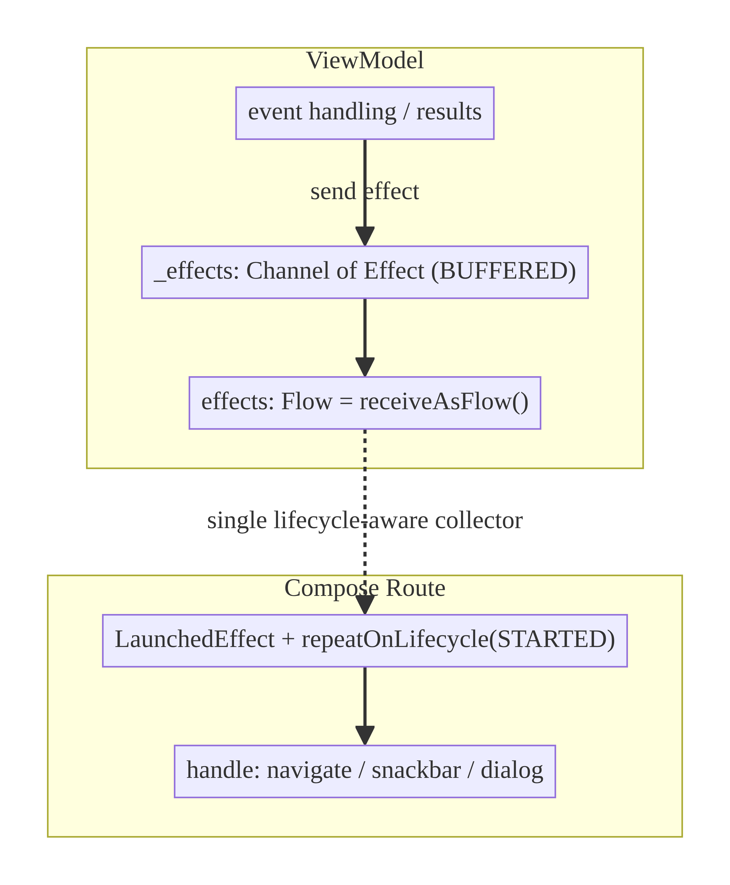
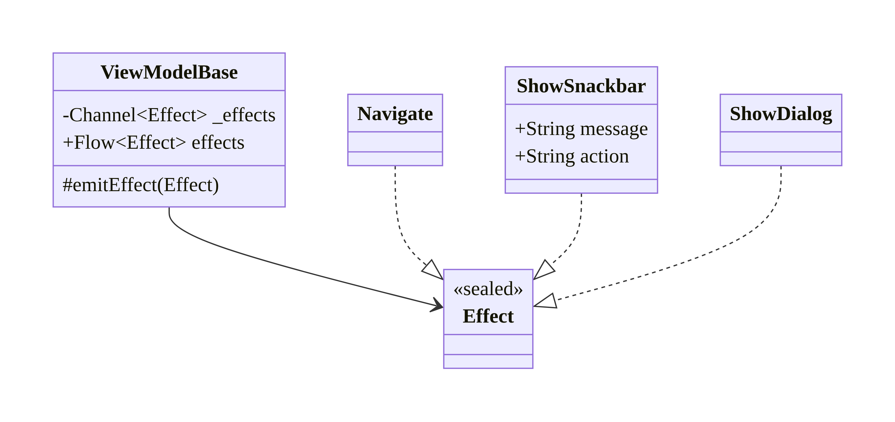
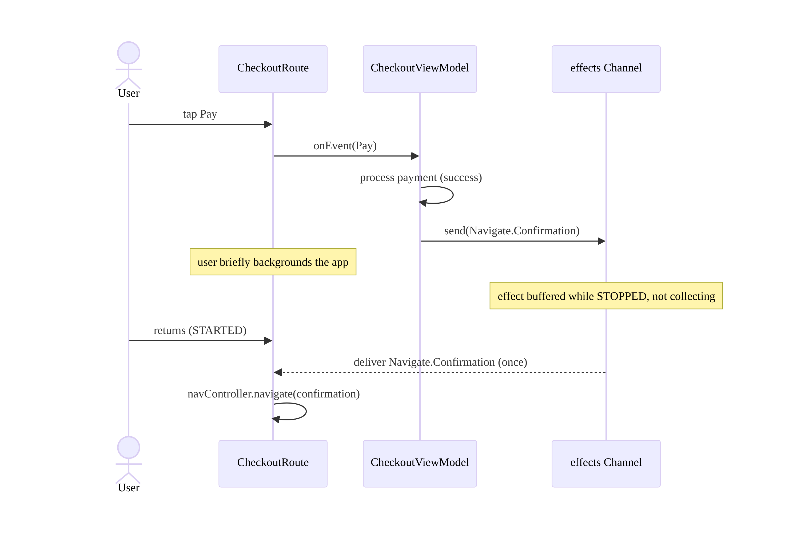
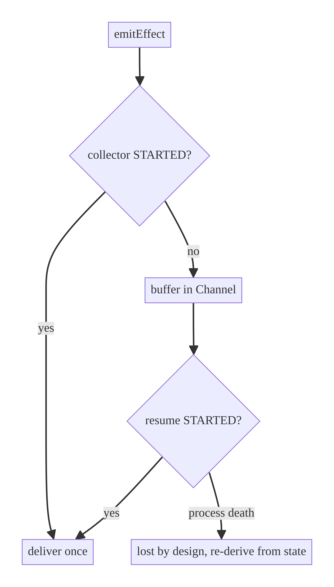

# Chapter 7 — One-Time Events & Side Effects

> **Part I — Core Infrastructure** · Complexity: **Standard** (≥25 interview questions)
>
> **Prerequisites:** Ch 6 (UI State & UDF — `UiState`, `onEvent`, the `effects`
> `Channel`). This chapter deepens the **effect** half of UDF: how to deliver
> navigation, snackbars, dialogs, and toasts exactly once, lifecycle-safely.
> Reused by every feature and by Ch 9 (search retry), Ch 53 (navigation).
>
> **Reference surface in StreamCart:** the effect pipelines of Cart, Checkout,
> and Auth (navigate-on-success, show-error-snackbar).

---

## 7.1 Problem Definition and Real-World Context

In UDF, durable conditions are **state**; things that should happen **once** —
navigate to checkout, show a snackbar, pop a dialog, fire a toast — are
**effects**. Modeling effects wrong is one of the most common Android bugs:

- **Effect-as-state double-fire.** If "navigate to checkout" is a boolean in
  `UiState`, rotation re-reads the state and navigates *again*; a snackbar stored
  in state reappears every recomposition/rotation.
- **Lost effects.** If you emit an effect while the UI is backgrounded and the
  stream has no buffer, the snackbar/navigation is dropped — the user taps "pay,"
  backgrounds briefly, and never sees the result screen.
- **Multiple-collector duplication.** With the wrong hot stream, two collectors
  (e.g., re-subscription on config change) each consume the effect, double-firing.
- **Leaky manual solutions.** The old `SingleLiveEvent` / "consume" boolean
  patterns are error-prone and don't compose with coroutines.

The correct model: a dedicated **effect stream** separate from state, delivered
**exactly once** to a **single lifecycle-aware collector**. The main design
decision is **`Channel` vs `SharedFlow`**, and getting it right (plus
lifecycle-aware collection) is the whole chapter.

### Three practical use cases

1. **E-commerce checkout (StreamCart).** "Payment succeeded → navigate to
   confirmation" must fire once, survive a brief backgrounding, and never
   re-navigate on rotation.
2. **Auth (Account).** "Invalid credentials → show snackbar" once per attempt,
   not again when the user rotates the login screen.
3. **OTT downloads (Watch).** "Download failed → show a retry dialog" delivered
   once even if emitted while the app is in the background.

### Why this is architectural

Effect delivery semantics (exactly-once, lifecycle-aware, buffered) determine
whether navigation and user feedback are correct across the Android lifecycle —
a cross-cutting concern that every screen depends on.

---

## 7.2 Requirements Engineering

### Functional requirements

| ID | Requirement |
|----|-------------|
| F1 | Deliver one-time effects (nav, snackbar, dialog, toast) separately from state. |
| F2 | Each effect is handled **exactly once**. |
| F3 | Effects emitted while the UI is not collecting are **not lost** (buffered). |
| F4 | Collection is lifecycle-aware (paused when STOPPED, resumed later). |
| F5 | Rotation/recomposition must not replay past effects. |
| F6 | Support a single consumer (the screen) per effect stream. |

### Non-functional requirements

| Attribute | Policy |
|-----------|--------|
| **Correctness** | Exactly-once; no double navigation; no dropped feedback. |
| **Lifecycle-safety** | No work/delivery while destroyed; no leaks. |
| **Simplicity** | Prefer the simplest primitive that meets semantics. |
| **Testability** | Effects observable in tests (Turbine). |

### Scope

- **In scope:** `Channel`-based effects, `SharedFlow` alternatives, lifecycle-aware
  collection, buffering, exactly-once semantics, when to use each.
- **Out of scope:** navigation framework specifics (Ch 53), the state half of UDF
  (Ch 6), process-death (effects are transient and not persisted — Ch 8).

### Assumptions & constraints

- Compose + coroutines; `lifecycle-runtime-compose`. Effects are **transient** —
  deliberately *not* persisted across process death (a pending navigation after
  process death is usually wrong; re-derive from restored state instead).

---

## 7.3 System Design Fundamentals

- **State vs effect.** State = "what the screen *is*" (re-rendered any time).
  Effect = "what should *happen* once" (consumed, not re-rendered).
- **`Channel` (rendezvous/buffered).** A hot, *consumed-once* stream. Each element
  goes to exactly one receiver; if no one is collecting, a buffered channel holds
  it until someone does. This is the natural fit for one-time effects with a
  single consumer.
- **`SharedFlow`.** A hot broadcast stream; `replay=0` means late collectors miss
  past emissions, and multiple collectors each receive every emission. Good for
  fan-out, risky for exactly-once (re-subscription can re-deliver recent items if
  `replay>0`, and multiple collectors duplicate).
- **Lifecycle-aware collection.** Collect effects inside `repeatOnLifecycle
  (STARTED)` / `flowWithLifecycle` so delivery pauses when the screen isn't
  visible and resumes on return — buffered effects are delivered then.
- **Exactly-once.** Achieved by (a) a single collector and (b) a consumed-once
  stream (`Channel.receiveAsFlow()`), or by a careful `SharedFlow` discipline.

Core insight: **a `Channel` exposed as `receiveAsFlow()`, collected by a single
lifecycle-aware collector, gives buffered exactly-once delivery** — the correct
default for UI effects. Reach for `SharedFlow` only when you genuinely need
fan-out.

---

## 7.4 High-Level Architecture



**Components & ownership**

- **ViewModel** owns a private `Channel<Effect>` and exposes it as a read-only
  `Flow` via `receiveAsFlow()`.
- **The Route composable** is the single collector; it collects lifecycle-aware
  and dispatches each effect to the right handler (NavController, snackbar host,
  dialog state).

**Direction:** effects flow ViewModel → UI, consumed once. Distinct from the
state `StateFlow` (Ch 6), which is re-rendered.

---

## 7.5 Detailed Component Design



| Element | Responsibility | Semantics |
|---------|----------------|-----------|
| `Channel<Effect>(BUFFERED)` | hold effects until consumed | exactly-once, single consumer, buffered |
| `receiveAsFlow()` | expose channel as `Flow` | each item to one collector |
| single lifecycle-aware collector | deliver on STARTED | no loss, no replay-on-rotation |

**Why `Channel.BUFFERED` (not rendezvous):** a rendezvous channel (`send`
suspends until a receiver exists) would stall the ViewModel coroutine if emitted
while backgrounded, and risks dropping under cancellation. A buffered channel
accepts the effect immediately and delivers when the collector resumes.

---

## 7.6 End-to-End Data Flow



> The effect is emitted while backgrounded, **buffered**, and delivered exactly
> once on return — no loss, no double navigation.

---

## 7.7 Complete Kotlin Implementation

Package: `com.streamcart.core.ui.effect` and feature presentation packages.

### 7.7.1 Reusable effect-emitting base

```kotlin
abstract class EffectViewModel<E> : ViewModel() {
    private val _effects = Channel<E>(Channel.BUFFERED)
    val effects: Flow<E> = _effects.receiveAsFlow()

    protected fun emitEffect(effect: E) {
        // trySend is non-suspending; BUFFERED capacity accepts immediately.
        _effects.trySend(effect)
    }
}
```

### 7.7.2 A feature using it

```kotlin
sealed interface CheckoutEffect {
    data object NavigateToConfirmation : CheckoutEffect
    data class ShowSnackbar(val message: String) : CheckoutEffect
}

@HiltViewModel
class CheckoutViewModel @Inject constructor(
    private val placeOrder: PlaceOrderUseCase,
) : EffectViewModel<CheckoutEffect>() {

    // ... uiState: StateFlow<CheckoutUiState> as in Ch 6

    fun onEvent(event: CheckoutUiEvent) {
        when (event) {
            CheckoutUiEvent.Pay -> viewModelScope.launch {
                when (placeOrder()) {
                    is Outcome.Success -> emitEffect(CheckoutEffect.NavigateToConfirmation)
                    is Outcome.Failure -> emitEffect(CheckoutEffect.ShowSnackbar("Payment failed"))
                }
            }
            else -> Unit
        }
    }
}
```

### 7.7.3 Lifecycle-aware single collection (Compose)

```kotlin
@Composable
fun CheckoutRoute(
    viewModel: CheckoutViewModel = hiltViewModel(),
    navController: NavController,
    snackbarHostState: SnackbarHostState,
) {
    val state by viewModel.uiState.collectAsStateWithLifecycle()
    val lifecycleOwner = LocalLifecycleOwner.current

    // Single, lifecycle-aware collector; delivers buffered effects on STARTED.
    LaunchedEffect(viewModel, lifecycleOwner) {
        lifecycleOwner.repeatOnLifecycle(Lifecycle.State.STARTED) {
            viewModel.effects.collect { effect ->
                when (effect) {
                    CheckoutEffect.NavigateToConfirmation ->
                        navController.navigate(Routes.Confirmation) {
                            popUpTo(Routes.Checkout) { inclusive = true }
                        }
                    is CheckoutEffect.ShowSnackbar ->
                        snackbarHostState.showSnackbar(effect.message)
                }
            }
        }
    }

    CheckoutScreen(state = state, onEvent = viewModel::onEvent)
}
```

### 7.7.4 The `SharedFlow` alternative (when fan-out is needed)

```kotlin
// Use when MULTIPLE independent collectors must each see the event
// (e.g., an app-wide event bus). replay = 0, extraBufferCapacity to avoid drops.
private val _events = MutableSharedFlow<AppEvent>(
    replay = 0,
    extraBufferCapacity = 16,
    onBufferOverflow = BufferOverflow.DROP_OLDEST,
)
val events: SharedFlow<AppEvent> = _events.asSharedFlow()
fun post(e: AppEvent) { _events.tryEmit(e) }
```

> With `SharedFlow(replay=0)`, a collector that re-subscribes (rotation) does
> **not** receive past events — good for no-replay, but **multiple** simultaneous
> collectors each receive every event (fan-out). For a single-consumer one-time
> UI effect, `Channel` is simpler and safer.

### 7.7.5 Module structure

```
:core:ui/effect  EffectViewModel
:feature:checkout/presentation  CheckoutEffect, CheckoutViewModel
:feature:checkout/ui            CheckoutRoute (single lifecycle-aware collector)
```

---

## 7.8 Concurrency and Race Conditions

| Scenario | Risk | Handling |
|----------|------|----------|
| Effect emitted while STOPPED | Lost effect | `Channel.BUFFERED` holds it; delivered on STARTED |
| Rotation re-subscribes collector | Replay/double-fire | `Channel` consumed-once; nothing replays |
| Two collectors (bug) | Each gets some effects (split) | Keep a single collector; `Channel` splits, doesn't duplicate |
| Rendezvous channel + backgrounded | ViewModel coroutine stalls | Use `BUFFERED`, `trySend` |
| Rapid effects | Overflow | Buffer capacity; `SharedFlow` overflow policy if used |
| `send` after scope cancel | Exception | `trySend` returns failure silently; or guard |

- **`Channel` delivers each element to exactly one receiver.** With one collector
  that's exactly-once; with two collectors the effects are *split* between them
  (a reason to keep a single collector) — unlike `SharedFlow`, which *duplicates*
  to all collectors.
- **Lifecycle-aware collection via `repeatOnLifecycle`** cancels the collector in
  STOPPED and restarts in STARTED; the buffered channel replays nothing but
  delivers anything buffered meanwhile.

---

## 7.9 Failure Scenarios and Recovery

| Failure | Detection | Response | UX |
|---------|-----------|----------|----|
| Effect emitted while backgrounded | lifecycle STOPPED | buffered, delivered on resume | feedback appears on return |
| Process death before delivery | process gone | effect lost by design; re-derive from restored state (Ch 8) | correct screen via state |
| Collector double-registered | two LaunchedEffects | split/duplicate effects | ensure one collector per stream |
| Effect storm (overflow) | buffer full | drop policy (SharedFlow) or bounded channel | newest kept |
| Navigation effect to invalid route | nav throws | validate route/args; backend authorizes (Ch 52) | safe fallback |



> **Deliberate non-persistence:** effects are *not* saved across process death.
> A navigation that was pending should be re-derived from restored state (e.g.,
> "order placed" is state → the confirmation screen is reached from state, not a
> stale effect). Persisting effects causes wrong double-navigations.

---

## 7.10 Scaling the Implementation

- **Level 1.** A single `Channel<Effect>` per ViewModel + one lifecycle-aware
  collector.
- **Level 2.** A reusable `EffectViewModel<E>` base; sealed `Effect` per feature.
- **Level 3 — production.** Consistent effect handling across features; navigation
  effects integrated with the nav graph (Ch 53); snackbar host hoisted at the app
  scaffold.
- **Level 4 — large.** A shared effect contract + testing harness; typed effect
  handlers; analytics on effect delivery.
- **Level 5 — enterprise.** An app-wide event bus (`SharedFlow`) for cross-feature
  signals (e.g., "session expired → everyone logs out") alongside per-screen
  `Channel` effects, with clear rules on which to use.

**Avoid overengineering:** most screens need just a `Channel` and one collector.
Don't build an event-bus framework for a single snackbar.

---

## 7.11 Alternative Approaches and Trade-offs

| Approach | Semantics | Pros | Cons | Use when |
|----------|-----------|------|------|----------|
| **`Channel` + `receiveAsFlow`** | single-consumer, consumed-once, buffered | exactly-once, no loss, simple | one collector only | **default** for UI effects |
| `SharedFlow(replay=0)` | multi-consumer broadcast, no replay | fan-out | multiple collectors duplicate; late collectors miss; re-subscribe nuances | app-wide event bus / multiple listeners |
| `StateFlow` + consume flag | state-based | simple to reason | easy to double-fire; boilerplate to "consume" | avoid for effects |
| `SingleLiveEvent` (legacy) | single consumer | familiar in View code | fragile, not coroutine-native | legacy LiveData only |
| Effect in `UiState` | state | none for effects | re-fires on rotation | never for one-time effects |

**`Channel` vs `SharedFlow` (the core trade-off):** `Channel` is *consumed-once*
and point-to-point — ideal for a single screen reacting once. `SharedFlow` is
*broadcast* — if two collectors exist they both react (duplication for effects,
desired for a bus). For one-time UI effects with a single screen collector, use a
`Channel`. For a genuine one-to-many signal, use `SharedFlow`.

---

## 7.12 Security Considerations

- **Don't carry secrets/PII in effects** (e.g., a full token in a "navigate"
  payload); pass ids and resolve securely (Ch 20); effects can be logged.
- **Navigation effects are not authorization** — validate deep links and
  privileged destinations server-side (Ch 52); a client effect can be triggered
  by a tampered client.
- **Redact effect contents in analytics/logs** (Ch 28); log the effect *type*.
- Client vs backend: an effect reflects a client decision; the backend must
  enforce the actual action (e.g., the order is authoritative server-side).

---

## 7.13 Performance and Resource Optimization

- **Lifecycle-aware collection** avoids doing effect work while the screen is
  invisible, saving CPU/battery and preventing crashes (navigating a destroyed
  controller).
- **Bounded buffers:** a small `Channel` buffer or `SharedFlow` overflow policy
  prevents unbounded memory under effect storms.
- **One collector:** multiple collectors waste work and cause duplication/splitting
  bugs.
- **Avoid heavy work in the collector:** dispatch to handlers; keep the collector
  thin.
- **Profiling:** watch for leaked collectors (a `LaunchedEffect` not keyed to the
  lifecycle), and for navigation crashes in Crashlytics indicating lifecycle
  misuse.

---

## 7.14 Testing Strategy

Effects are observable flows — test with Turbine; no UI needed.

```kotlin
@OptIn(ExperimentalCoroutinesApi::class)
class CheckoutEffectsTest {
    private val dispatcher = StandardTestDispatcher()
    @Before fun setUp() { Dispatchers.setMain(dispatcher) }
    @After fun tearDown() { Dispatchers.resetMain() }

    @Test fun `successful pay emits navigation exactly once`() = runTest(dispatcher) {
        val vm = CheckoutViewModel(FakePlaceOrder(success = true))
        vm.effects.test {
            vm.onEvent(CheckoutUiEvent.Pay)
            assertEquals(CheckoutEffect.NavigateToConfirmation, awaitItem())
            expectNoEvents()                 // exactly once
        }
    }

    @Test fun `failed pay emits snackbar not navigation`() = runTest(dispatcher) {
        val vm = CheckoutViewModel(FakePlaceOrder(success = false))
        vm.effects.test {
            vm.onEvent(CheckoutUiEvent.Pay)
            assertTrue(awaitItem() is CheckoutEffect.ShowSnackbar)
        }
    }

    @Test fun `effect emitted before collection is buffered, not lost`() = runTest(dispatcher) {
        val vm = CheckoutViewModel(FakePlaceOrder(success = true))
        vm.onEvent(CheckoutUiEvent.Pay)      // emit before collecting
        vm.effects.test {
            assertEquals(CheckoutEffect.NavigateToConfirmation, awaitItem())  // buffered
        }
    }
}
```

Also: an instrumentation test that rotates the screen and asserts a snackbar is
shown once (not twice). Fake the use cases; assert on the effect flow.

---

## 7.15 Production Observability

- **Metrics:** effect delivery count by type, navigation-effect failures,
  double-navigation incidents (should be 0), dropped-effect rate.
- **Logs:** `effect{type, screen}` (no payload PII), `nav{from,to}`.
- **Crash signals:** navigating a destroyed `NavController` (lifecycle misuse) →
  shows up as IllegalStateException; a reappearing snackbar on rotation → effect
  modeled as state.
- **Debugging:** "double navigation" → effect stored as state or two collectors;
  "snackbar never shows after backgrounding" → rendezvous channel or no buffer or
  collecting without lifecycle awareness.

---

## 7.16 System Design Interview Preparation

> ≥25 questions.

**Fundamentals**

1. *State vs effect?* State = re-rendered condition; effect = one-time occurrence
   (nav/snackbar).
2. *Why not model navigation as state?* Re-fires on rotation (double navigation).
3. *What delivers exactly-once?* A single collector over a consumed-once stream
   (`Channel`).
4. *Why buffer effects?* So an effect emitted while backgrounded isn't lost.
5. *Why lifecycle-aware collection?* Pause when invisible; resume + deliver
   buffered on return; avoid crashes.

**Channel vs SharedFlow**

6. *`Channel` semantics?* Each element to exactly one receiver; buffered; consumed
   once.
7. *`SharedFlow` semantics?* Broadcast to all collectors; `replay` controls
   history.
8. *Which for a one-time UI effect?* `Channel` (single consumer, exactly-once).
9. *Which for an app-wide bus?* `SharedFlow` (fan-out).
10. *Two collectors on a `Channel`?* Effects are *split* between them (bug) — keep
    one collector.
11. *Two collectors on a `SharedFlow`?* Both receive every emission (fan-out).
12. *`replay=1` SharedFlow for effects — risk?* Re-subscription re-delivers the
    last effect (double-fire).

**Kotlin/Compose**

13. *How collect effects in Compose?* `LaunchedEffect` + `repeatOnLifecycle
    (STARTED)` (or `flowWithLifecycle`).
14. *`trySend` vs `send`?* `trySend` is non-suspending (use with BUFFERED);
    `send` suspends until capacity.
15. *Why `receiveAsFlow()`?* Expose the channel read-only as a `Flow`.

**Lifecycle**

16. *Effect emitted in STOPPED — what happens?* Buffered; delivered on STARTED.
17. *Rotation — do effects replay?* No (Channel consumed-once).
18. *Process death + pending effect?* Lost by design; re-derive from restored
    state.

**Correctness**

19. *How prevent double navigation?* Effect (not state) + single collector +
    consumed-once.
20. *Rendezvous channel pitfall?* `send` stalls if no collector; use BUFFERED.

**Scalability**

21. *Cross-feature "session expired" signal?* `SharedFlow` event bus.
22. *Standardize effects?* `EffectViewModel<E>` base + lifecycle-aware collector.

**Security**

23. *Secrets in effect payloads?* No; pass ids; effects may be logged.
24. *Is a nav effect authorization?* No; backend authorizes.

**Testing**

25. *How test effects?* Turbine on the effects flow; assert type + exactly-once +
    buffered.
26. *How test no-double-fire on rotation?* Instrumentation rotate test; assert
    single snackbar.

**Production debugging**

27. *Snackbar repeats on rotation — cause/fix?* Effect-as-state; move to Channel.
28. *Navigation lost after backgrounding — cause/fix?* No buffer / rendezvous /
    non-lifecycle collection.

### Design-change challenges
1. **Add an app-wide "logged out everywhere" signal.** `SharedFlow` bus consumed
   by a top-level collector (Ch 22/42).
2. **Snackbar with an action (Undo).** Effect carries an action lambda id;
   handler wires `SnackbarResult`.
3. **Effect must survive process death (rare).** Don't — re-derive from persisted
   state (Ch 8).
4. **Many effects, risk of overflow.** Bounded buffer + drop policy; coalesce.
5. **Two screens listening to one ViewModel's effects.** Switch to `SharedFlow`
   or give each its own stream.

### Mock walkthrough (abridged)
Clarify (one-time? single consumer? survive backgrounding?) → choose `Channel` +
`receiveAsFlow` → single lifecycle-aware collector → show buffering guarantees →
contrast with `SharedFlow` for fan-out → process-death non-persistence → testing.

---

## 7.17 Practical Exercises

1. **Beginner.** Add a `Channel<Effect>` to a ViewModel and collect it
   lifecycle-aware; fire a snackbar once. *Eval:* single delivery; no rotation
   replay.
2. **Intermediate.** Prove buffering: emit an effect before collection starts and
   assert it's delivered. *Eval:* not lost.
3. **Advanced.** Build an `EffectViewModel<E>` base and use it in two features;
   add navigation with `popUpTo`. *Eval:* reused; correct back stack.
4. **Production debugging.** Fix a screen that double-navigates on rotation
   (effect-as-state) and one that drops a snackbar after backgrounding
   (rendezvous/no buffer). *Eval:* exactly-once + no loss.
5. **System design challenge.** Add an app-wide `SharedFlow` "session expired"
   bus that logs out all screens, coexisting with per-screen `Channel` effects.
   *Eval:* fan-out works; no duplication of per-screen effects.

*(Solutions withheld unless requested.)*

---

## 7.18 Chapter Summary & Reference Sheet

**Key decisions:** effects are separate from state; default to a
`Channel<Effect>` exposed via `receiveAsFlow()`, collected by a **single
lifecycle-aware** collector → buffered exactly-once delivery; use `SharedFlow`
only for genuine fan-out (event bus); **never** model one-time effects as state;
**don't** persist effects across process death (re-derive from state).

**Concepts:** state vs effect, exactly-once, consumed-once vs broadcast,
buffering, `repeatOnLifecycle`, Channel vs SharedFlow.

**Common mistakes:** effect-as-state (double-fire); `SharedFlow(replay≥1)` for
effects; multiple collectors; rendezvous channel (lost/stalled); collecting
without lifecycle awareness; persisting effects.

**Checklist:**

- [ ] effects separate from `UiState`
- [ ] `Channel.BUFFERED` + `receiveAsFlow`
- [ ] single collector
- [ ] `repeatOnLifecycle(STARTED)`
- [ ] `trySend`
- [ ] no secrets in payload
- [ ] not persisted
- [ ] `SharedFlow` only for fan-out.

**Key APIs:** `Channel`, `trySend`/`send`, `receiveAsFlow`,
`MutableSharedFlow`/`asSharedFlow`, `BufferOverflow`, `repeatOnLifecycle`,
`flowWithLifecycle`, `LaunchedEffect`, Turbine.

**References:**
- UI events (one-off events): https://developer.android.com/topic/architecture/ui-layer/events
- Channels: https://kotlinlang.org/docs/channels.html
- SharedFlow/StateFlow: https://developer.android.com/kotlin/flow/stateflow-and-sharedflow
- `repeatOnLifecycle`: https://developer.android.com/topic/libraries/architecture/coroutines#restart
- A safer way to collect flows: https://medium.com/androiddevelopers/a-safer-way-to-collect-flows-from-android-uis-23080b1f8bda

### Chapter review (Phase 4)
- **Completeness:** all 18 sections; architecture/class/sequence/failure diagrams;
  `EffectViewModel` + Channel + lifecycle collection + SharedFlow alternative;
  concurrency (split vs duplicate); non-persistence rationale; 5 levels;
  Channel-vs-SharedFlow trade-offs; security; perf; Turbine tests; observability;
  28 Q&A + 5 challenges. ✅
- **Expand later:** navigation architecture (Ch 53), session-expired bus (Ch 22/
  42), snackbar-with-action patterns.
- **Interview coverage:** exceeds ≥25 bar.
