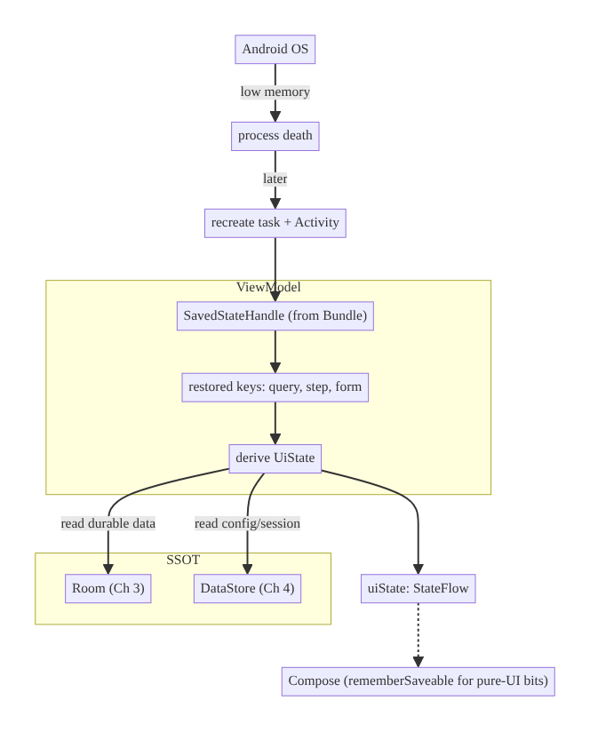
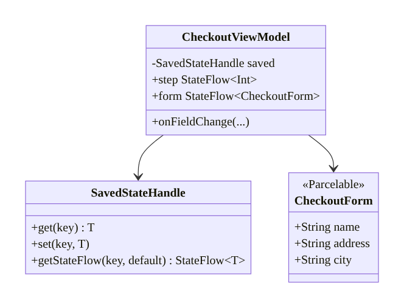
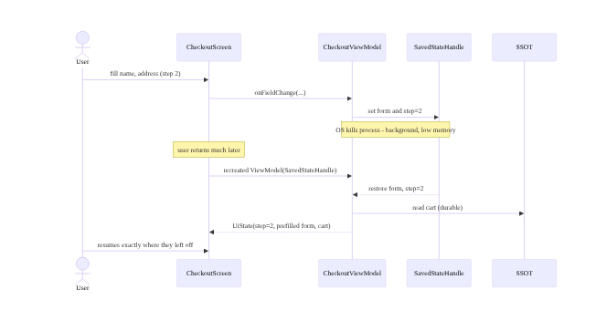
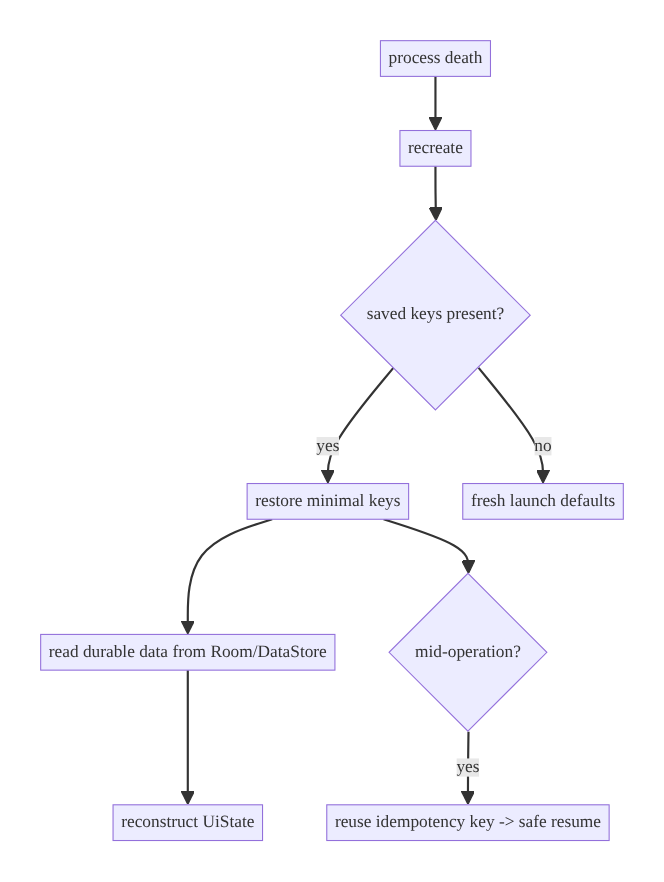

# Chapter 8 — Process Death & State Restoration

> **Part I — Core Infrastructure** · Complexity: **Standard** (≥25 interview questions)
>
> **Prerequisites:** Ch 3 (SSOT/Room — the durable store), Ch 4 (DataStore —
> durable config), Ch 6 (UI state & ViewModel). This chapter completes Part I by
> making screens survive **process death**, not just rotation. Applied in Ch 9
> (restore query), Ch 38 (cart), Ch 75 (checkout draft).
>
> **Reference surface in StreamCart:** restoring the search query, a
> half-filled checkout form, and scroll/selection after the OS kills the app.

---

## 8.1 Problem Definition and Real-World Context

Android can **kill your app's process at any time** when it's in the background —
to reclaim memory for the foreground app. When the user returns, the system
recreates the Activity/task, but **all in-memory state is gone**: ViewModel
fields, composable state, in-flight coroutines. If you only handle *rotation*
(which `ViewModel` survives) and forget *process death*, users lose their work:

- **Lost input.** A user types a long review or fills a checkout form, gets a
  call, returns ten minutes later — the form is blank. This is a top complaint in
  reviews and a conversion killer in commerce/fintech.
- **Wrong screen on return.** Without saved navigation/selection, the app reopens
  at the start instead of where the user was.
- **"Works on my machine."** Rotation testing passes; process death only shows up
  under memory pressure, so the bug reaches production.

The distinction is critical: **`ViewModel` survives configuration changes but
NOT process death.** Surviving process death requires explicitly saving a small
amount of state via **`SavedStateHandle`** (backed by the saved-instance-state
`Bundle`) and recovering the rest from the **SSOT** (Room/DataStore, Ch 3/4).
Deciding *what* to save where is the architectural work.

### Three practical use cases

1. **E-commerce checkout (StreamCart).** A half-filled shipping/payment form and
   the current step are restored so the user resumes exactly where they left off.
2. **Social compose (Social).** A draft post/comment survives process death
   (ideally persisted to Room for long drafts — Ch 37), so nothing is lost.
3. **OTT browse (Watch).** The selected category, search query, and scroll
   position are restored so returning feels seamless.

### Why this is architectural

It defines **what state is transient vs durable**, **where each kind lives**
(Bundle via `SavedStateHandle` vs Room/DataStore vs re-fetch), and **how the app
reconstructs itself** after the OS reclaims it — a system-level contract, not a
per-screen afterthought.

---

## 8.2 Requirements Engineering

### Functional requirements

| ID | Requirement |
|----|-------------|
| F1 | Key UI input (query, form fields, selection, step) survives process death. |
| F2 | Durable data is recovered from the SSOT (Room/DataStore), not the Bundle. |
| F3 | Restoration is automatic on recreation — no user action. |
| F4 | Saved state is small (Bundle has a hard size limit). |
| F5 | In-flight operations are re-derived or resumed safely, not duplicated. |
| F6 | Distinguish first launch from a restored launch. |

### Non-functional requirements

| Attribute | Policy |
|-----------|--------|
| **Reliability** | No lost user input; correct screen on return. |
| **Performance** | Save only tiny state; restore without blocking startup. |
| **Correctness** | No duplicated side effects on restore (idempotency, Ch 15). |
| **Memory** | Bundle ≪ ~1 MB (TransactionTooLarge risk); keep it bytes/KB. |
| **Security** | No secrets/PII in the Bundle (written to disk unencrypted). |

### Scope

- **In scope:** `SavedStateHandle`, `rememberSaveable`, what to save vs re-derive,
  Bundle limits, restored-vs-fresh detection, interplay with SSOT, re-deriving
  in-flight work.
- **Out of scope:** durable draft persistence to Room (Ch 37), background work
  continuation (WorkManager, Ch 30), navigation state framework (Ch 53), auth
  session restore (Ch 22).

### Assumptions & constraints

- `@HiltViewModel` + `SavedStateHandle`; Compose `rememberSaveable`. Test process
  death via *Don't keep activities* / `adb shell am kill` / background + low
  memory. `minSdk 24`.

---

## 8.3 System Design Fundamentals

- **Process death vs config change.** Config change (rotation) recreates the
  Activity but keeps the `ViewModel`. Process death destroys *everything*; the
  system later recreates the task from saved instance state.
- **`SavedStateHandle`.** A key-value map, injected into ViewModels, backed by the
  saved-instance-state `Bundle`. Values put here survive process death and are
  restored into the new ViewModel. It also exposes `getStateFlow()` for reactive,
  saved state.
- **The Bundle is tiny and serialized to disk.** Only small, Parcelable/primitive
  state belongs here (ids, query text, form fields, scroll key) — never lists,
  bitmaps, or secrets.
- **SSOT recovers the rest.** Large/durable data isn't saved in the Bundle; it's
  re-read from Room/DataStore (Ch 3/4) or re-fetched. The Bundle holds *just
  enough* to re-derive the UI.
- **`rememberSaveable`.** The Compose counterpart for purely-UI state (expanded
  sections, text field with cursor) via the `SaveableStateRegistry`.
- **Idempotent restore.** Re-deriving must not replay side effects (don't
  re-submit an order because a "paying" flag restored); use idempotency (Ch 15)
  and derive from authoritative state.

Core insight: **save the minimal key(s) needed to reconstruct the screen in
`SavedStateHandle`, and rebuild everything else from the SSOT.** The Bundle is a
pointer, not a cache.

---

## 8.4 High-Level Architecture



**Components & ownership**

- **`SavedStateHandle`** holds the minimal transient keys (query, form fields,
  current step) — survives process death.
- **SSOT (Room/DataStore)** holds durable data, recovered on restore.
- **ViewModel** derives `UiState` from both; Compose `rememberSaveable` handles
  purely-visual state (expanded/collapsed, cursor).

**Direction:** Bundle → `SavedStateHandle` → ViewModel; SSOT → ViewModel; both →
`UiState` → UI.

---

## 8.5 Detailed Component Design



| What | Where to save | Why |
|------|---------------|-----|
| Search query, form fields, current step, selected id | `SavedStateHandle` | small, transient, must survive process death |
| Expanded/collapsed, text cursor, tab | `rememberSaveable` | pure UI, per-composable |
| Catalog, cart, history | Room (SSOT) | durable, large, re-read on restore |
| Theme, session metadata, onboarding flag | DataStore | durable config |
| Long draft (e.g., review) | Room (+ debounce save) | too big/important for Bundle (Ch 37) |
| Tokens/secrets | Keystore (never Bundle) | security |

---

## 8.6 End-to-End Data Flow



---

## 8.7 Complete Kotlin Implementation

Package: `com.streamcart.checkout`.

### 8.7.1 Saving/restoring via `SavedStateHandle`

```kotlin
@Parcelize
data class CheckoutForm(
    val name: String = "",
    val address: String = "",
    val city: String = "",
) : Parcelable

@HiltViewModel
class CheckoutViewModel @Inject constructor(
    private val savedState: SavedStateHandle,
    observeCart: ObserveCartUseCase,
    private val placeOrder: PlaceOrderUseCase,
) : ViewModel() {

    // Reactive, process-death-surviving state.
    val step: StateFlow<Int> = savedState.getStateFlow(KEY_STEP, 1)
    val form: StateFlow<CheckoutForm> = savedState.getStateFlow(KEY_FORM, CheckoutForm())

    // Durable data recovered from the SSOT (not the Bundle).
    val cart: StateFlow<CartSummary?> = observeCart()
        .map { it.dataOrNull()?.summary }
        .stateIn(viewModelScope, SharingStarted.WhileSubscribed(5_000), null)

    fun onFieldChange(update: (CheckoutForm) -> CheckoutForm) {
        savedState[KEY_FORM] = update(form.value)     // persisted into the Bundle
    }
    fun goToStep(s: Int) { savedState[KEY_STEP] = s }

    fun submit() = viewModelScope.launch {
        // Idempotency key prevents a duplicate order if we restore mid-submit (Ch 15).
        val key = savedState[KEY_IDEMPOTENCY] ?: UUID.randomUUID().toString().also {
            savedState[KEY_IDEMPOTENCY] = it
        }
        when (placeOrder(form.value, idempotencyKey = key)) { /* ... */ }
    }

    private companion object {
        const val KEY_STEP = "checkout_step"
        const val KEY_FORM = "checkout_form"
        const val KEY_IDEMPOTENCY = "checkout_idem_key"
    }
}
```

### 8.7.2 Compose purely-UI state with `rememberSaveable`

```kotlin
@Composable
fun CheckoutScreen(viewModel: CheckoutViewModel = hiltViewModel()) {
    val step by viewModel.step.collectAsStateWithLifecycle()
    val form by viewModel.form.collectAsStateWithLifecycle()

    // Pure-UI state that should survive process death but isn't business state.
    var expandedSummary by rememberSaveable { mutableStateOf(false) }
    val scrollState = rememberScrollState()   // position restored via Saver

    // ... text fields bound to `form`, updating via viewModel.onFieldChange { it.copy(...) }
}
```

### 8.7.3 Custom `Saver` for a non-Parcelable UI type

```kotlin
val FilterSaver: Saver<Filter, List<String>> = Saver(
    save = { listOf(it.category, it.sort) },
    restore = { Filter(category = it[0], sort = it[1]) },
)
// usage: var filter by rememberSaveable(stateSaver = FilterSaver) { mutableStateOf(Filter()) }
```

### 8.7.4 Detecting restored vs fresh launch

```kotlin
val isRestored: Boolean = savedState.contains(KEY_STEP)   // key present ⇒ recreated
```

### 8.7.5 Module structure

```
:feature:checkout/presentation  CheckoutViewModel (SavedStateHandle), CheckoutForm(@Parcelize)
:feature:checkout/ui            CheckoutScreen (rememberSaveable, Savers)
:data:cart                      ObserveCartUseCase (SSOT recovery, Ch 3)
```

---

## 8.8 Concurrency and Race Conditions

| Scenario | Risk | Handling |
|----------|------|----------|
| Process death mid-submit | Duplicate order on resume | Persist idempotency key in `SavedStateHandle`; backend dedupes (Ch 15) |
| Restore triggers refetch + stale write | Overwrite newer data | Read SSOT (authoritative) on restore; don't replay the old network write |
| `getStateFlow` collected before restore | Default then real value | Default value provided; restored value emitted; use `distinctUntilChanged` |
| Large object into Bundle | `TransactionTooLargeException` | Save ids/small fields; keep big data in Room |
| In-flight coroutine lost on death | Operation never completes | Move durable work to WorkManager (Ch 30); re-derive UI from state |

- **Idempotency is the key race-safety tool:** a persisted idempotency key means
  a resumed submit after process death won't double-charge/double-order.
- **Re-derive, don't replay:** on restore, rebuild the UI from authoritative state
  (SSOT) rather than re-running the side effect that was interrupted.

---

## 8.9 Failure Scenarios and Recovery

| Failure | Detection | Response | UX |
|---------|-----------|----------|----|
| Background process death | recreate with `SavedStateHandle` | restore keys + read SSOT | seamless resume |
| Bundle too large | `TransactionTooLargeException` | move big state to Room; save ids only | no crash |
| Secret saved in Bundle | security review | never save secrets; use Keystore | no leak |
| Mid-operation death | idempotency key present | safe resume; backend dedupe | no duplicate |
| Draft lost (too big for Bundle) | — | persist drafts to Room with debounce (Ch 37) | draft survives |
| Restored state inconsistent with SSOT | compare keys vs data | prefer SSOT; reconcile | correct data |



> **Test it or it's broken:** enable *Developer options → Don't keep activities*,
> or `adb shell am kill com.streamcart`, to force process death. Rotation testing
> does **not** exercise this path.

---

## 8.10 Scaling the Implementation

- **Level 1.** Save a single value (query/selected id) in `SavedStateHandle`.
- **Level 2.** Save form fields/step; recover durable data from the SSOT;
  `rememberSaveable` for UI bits.
- **Level 3 — production.** Idempotency keys for in-flight mutations; `@Parcelize`
  state; restored-vs-fresh detection; long drafts persisted to Room (Ch 37).
- **Level 4 — large.** A consistent "restorable state" contract across features;
  navigation/back-stack restoration (Ch 53); scroll/selection restoration in
  Paging (Ch 13).
- **Level 5 — enterprise.** Formalized session/journey restoration spanning
  multiple screens; crash+restore analytics; policy on what each feature persists
  where (Bundle vs Room vs DataStore).

**Avoid overengineering:** don't persist everything — most durable data belongs
in the SSOT already; `SavedStateHandle` holds only the few transient keys needed
to re-derive the current view.

---

## 8.11 Alternative Approaches and Trade-offs

| State kind | Store | Survives process death? | Notes |
|------------|-------|--------------------------|-------|
| Transient UI input (query, form, step) | `SavedStateHandle` | ✅ | small, Parcelable/primitive |
| Pure-UI composable state | `rememberSaveable` | ✅ | per-composable; Saver for custom types |
| In-memory only | ViewModel field / `remember` | ❌ (survives rotation only) | ephemeral, recomputable |
| Durable app data | Room (Ch 3) | ✅ | large/relational; authoritative |
| Durable config/session meta | DataStore (Ch 4) | ✅ | key-value |
| Long/important drafts | Room (+ debounce) | ✅ | too big for Bundle (Ch 37) |
| Secrets | Keystore (Ch 20) | ✅ (encrypted) | never Bundle |

**`SavedStateHandle` vs Room for restoration:** use the Bundle for tiny transient
UI keys that only matter to the current journey; use Room when the data is large,
relational, must be queryable, or must persist beyond a single task (e.g., a
draft you want available on a new device after sync). Many screens use both: Room
for data, `SavedStateHandle` for "where in the flow am I."

---

## 8.12 Security Considerations

- **The saved-instance `Bundle` is written to disk unencrypted** (and historically
  readable in some OS versions/backups). **Never store tokens, passwords, card
  numbers, or PII** in `SavedStateHandle`/`rememberSaveable`. Save a reference
  (id) and resolve the sensitive value from Keystore/encrypted storage (Ch 20).
- **Drafts with PII** (addresses, messages): if persisted to Room, encrypt
  sensitive tables (Ch 24) and exclude from auto-backup (Ch 37).
- **Idempotency keys** are not secrets but shouldn't be guessable; a UUID is fine.
- Client vs backend: restored client state is a convenience; the backend remains
  authoritative and must re-validate on any resumed privileged action.

---

## 8.13 Performance and Resource Optimization

- **Keep the Bundle tiny.** `onSaveInstanceState` runs on the main thread and the
  Bundle crosses a Binder transaction (~1 MB limit shared per transaction);
  large saves cause jank or `TransactionTooLargeException`.
- **Don't block startup on restore.** Reading the SSOT on restore is async
  (`Flow`); show restored UI keys immediately, hydrate data as it arrives.
- **Save on change, not continuously.** `SavedStateHandle.set` is cheap; debounce
  only if you're persisting drafts to Room.
- **Profiling:** test under *Don't keep activities*; watch for
  `TransactionTooLargeException` in logs; measure resume time.

---

## 8.14 Testing Strategy

`SavedStateHandle` is directly constructible in tests — simulate restore by
seeding it with values.

```kotlin
class CheckoutRestoreTest {
    @Test fun `restores form and step from SavedStateHandle`() = runTest {
        val saved = SavedStateHandle(
            mapOf(
                "checkout_step" to 2,
                "checkout_form" to CheckoutForm(name = "Ada", address = "1 St"),
            )
        )
        val vm = CheckoutViewModel(saved, FakeObserveCart(), FakePlaceOrder())
        assertEquals(2, vm.step.value)
        assertEquals("Ada", vm.form.value.name)         // survived "process death"
    }

    @Test fun `field change is written to SavedStateHandle`() = runTest {
        val saved = SavedStateHandle()
        val vm = CheckoutViewModel(saved, FakeObserveCart(), FakePlaceOrder())
        vm.onFieldChange { it.copy(city = "Paris") }
        assertEquals("Paris", saved.get<CheckoutForm>("checkout_form")?.city)
    }

    @Test fun `resumed submit reuses idempotency key`() = runTest {
        val saved = SavedStateHandle(mapOf("checkout_idem_key" to "k-123"))
        val placeOrder = RecordingPlaceOrder()
        val vm = CheckoutViewModel(saved, FakeObserveCart(), placeOrder)
        vm.submit()
        assertEquals("k-123", placeOrder.lastKey)        // no new key ⇒ no duplicate
    }
}
```

Also: an instrumentation test using `ActivityScenario.recreate()` (config change)
plus a manual process-death pass (*Don't keep activities*) to verify end-to-end
restoration; `rememberSaveable` state restoration via `StateRestorationTester`.

---

## 8.15 Production Observability

- **Metrics:** restore-after-death rate (how often users hit it), lost-input
  incidents (ideally 0), `TransactionTooLargeException` count, resume time.
- **Logs:** `restore{screen, restored=true/false}` (no field contents — PII),
  `bundle_too_large{screen, bytes}`.
- **Crash signals:** `TransactionTooLargeException` → something big in the Bundle;
  duplicate orders after resume → missing idempotency key.
- **Debugging:** "users lose the form" → not using `SavedStateHandle` (only
  ViewModel); "duplicate order after returning" → re-submitting on restore
  without idempotency; "slow resume" → blocking on SSOT read.
- **Privacy:** never log saved state values; they often contain user input.

---

## 8.16 System Design Interview Preparation

> ≥25 questions.

**Fundamentals**
1. *Config change vs process death?* ViewModel survives config change, not process
   death; the latter destroys all memory and recreates from saved state.
2. *What survives process death?* `SavedStateHandle`/`rememberSaveable` (Bundle) +
   anything in Room/DataStore/files.
3. *What's `SavedStateHandle`?* A Bundle-backed key-value map injected into
   ViewModels; also exposes `getStateFlow`.
4. *Why not save everything in the Bundle?* Tiny size limit
   (`TransactionTooLargeException`); it's serialized on the main thread.
5. *Where does durable data come from on restore?* The SSOT (Room/DataStore) or a
   re-fetch — not the Bundle.

**Architecture**
6. *What belongs in `SavedStateHandle` vs Room?* Small transient journey keys vs
   large/durable/relational data.
7. *How re-derive the screen after death?* Restore minimal keys, read SSOT,
   rebuild `UiState`.
8. *Pure-UI state across death?* `rememberSaveable` (+ custom `Saver`).

**Kotlin/Android**
9. *How is `SavedStateHandle` provided?* By Hilt/`SavedStateViewModelFactory`;
   `@Parcelize` for custom types.
10. *`remember` vs `rememberSaveable`?* `remember` survives recomposition only;
    `rememberSaveable` survives config change + process death.
11. *Custom type in `rememberSaveable`?* Provide a `Saver`.

**Concurrency/correctness**
12. *Duplicate side effect on resume?* Persist an idempotency key (Ch 15);
    re-derive, don't replay.
13. *In-flight coroutine on death?* Lost; use WorkManager for durable work
    (Ch 30); UI re-derives from state.
14. *Restore vs newer SSOT data conflict?* Prefer the SSOT (authoritative).

**Limits**
15. *Bundle size limit?* ~1 MB per Binder transaction; keep saves to bytes/KB.
16. *What triggers `TransactionTooLargeException`?* Oversized saved state (lists,
    bitmaps).

**Security**
17. *Secrets in the Bundle?* Never — unencrypted on disk; use Keystore (Ch 20).
18. *PII drafts?* Persist to encrypted Room (Ch 24), excluded from backup (Ch 37).

**Scalability**
19. *Multi-screen journey restoration?* A restorable-state contract + nav back
    stack restoration (Ch 53).
20. *Scroll position in huge lists?* Paging + saved key; `rememberLazyListState`
    saver.

**Testing**
21. *How test restoration?* Seed `SavedStateHandle` in a unit test; assert derived
    state.
22. *How force process death?* *Don't keep activities* / `adb shell am kill`.
23. *Why isn't rotation enough?* Rotation keeps the ViewModel; it doesn't exercise
    Bundle restore.

**Production debugging**
24. *Users lose form input — cause?* State only in ViewModel/composable, not
    `SavedStateHandle`.
25. *Duplicate order after returning — cause?* Re-submit on restore without an
    idempotency key.
26. *`TransactionTooLargeException` — cause?* Saving too much in the Bundle.

### Design-change challenges
1. **Long draft must never be lost.** Persist to Room with a debounced save
   (Ch 37); keep only a draft id in the Bundle.
2. **Multi-step wizard must resume at the right step.** Save `step` + per-step form
   in `SavedStateHandle`.
3. **Payment interrupted by process death.** Idempotency key persisted; backend
   dedupe; re-derive status from the SSOT/backend.
4. **Restore scroll + selection in an infinite list.** Paging + saved anchor key +
   list-state saver.
5. **Restore the whole navigation journey.** Nav back-stack state restoration
   (Ch 53) + per-destination `SavedStateHandle`.

### Mock walkthrough (abridged)
Clarify (what must survive? how big? any in-flight mutation?) → split state into
Bundle (tiny keys) vs SSOT (durable) → `SavedStateHandle` + `rememberSaveable` →
idempotency for in-flight → size limits/security → test via *Don't keep
activities*.

---

## 8.17 Practical Exercises

1. **Beginner.** Save and restore a search query with `SavedStateHandle.getStateFlow`;
   verify via a seeded handle. *Eval:* query survives simulated death.
2. **Intermediate.** Restore a multi-field form + current step with `@Parcelize`;
   add `rememberSaveable` for an expanded section. *Eval:* full resume.
3. **Advanced.** Make an order submission safe across process death with a
   persisted idempotency key; prove no duplicate on resume. *Eval:* same key
   reused; backend dedupes.
4. **Production debugging.** Fix a screen that loses input on process death (state
   only in ViewModel) and one that throws `TransactionTooLargeException` (list in
   Bundle). *Eval:* Bundle holds ids; data from SSOT.
5. **System design challenge.** Persist a long draft to Room with debounced saves,
   keeping only a draft id in the Bundle; restore seamlessly. *Eval:* draft
   survives; Bundle tiny.

*(Solutions withheld unless requested.)*

---

## 8.18 Chapter Summary & Reference Sheet

**Key decisions:** `ViewModel` survives rotation but **not** process death; save
the **minimal transient keys** in `SavedStateHandle`/`rememberSaveable` and
**recover durable data from the SSOT**; keep the Bundle tiny (hard size limit);
use **idempotency keys** so resumed mutations don't duplicate; **never** store
secrets/PII in the Bundle; persist long drafts to Room, not the Bundle.

**Concepts:** process death vs config change, saved instance state, Bundle size
limit, `SavedStateHandle`/`getStateFlow`, `rememberSaveable`/`Saver`, re-derive
vs replay, idempotent restore.

**Common mistakes:** only testing rotation; state only in the ViewModel (lost on
death); big objects in the Bundle (`TransactionTooLargeException`); secrets in the
Bundle; re-submitting operations on restore (duplicates); persisting one-time
effects (Ch 7).

**Checklist:** ☐ transient keys in `SavedStateHandle` ☐ durable data from SSOT
☐ Bundle tiny ☐ `@Parcelize`/`Saver` for custom types ☐ idempotency key for
in-flight mutations ☐ no secrets/PII in Bundle ☐ long drafts → Room ☐ tested via
*Don't keep activities*.

**Key APIs:** `SavedStateHandle` (`get`/`set`/`getStateFlow`/`contains`),
`@Parcelize`, `rememberSaveable`, `Saver`/`mapSaver`/`listSaver`,
`rememberLazyListState`, `ActivityScenario.recreate`, `StateRestorationTester`.

**References:**
- SavedStateHandle / ViewModel: https://developer.android.com/topic/libraries/architecture/viewmodel/viewmodel-savedstate
- Saving UI state: https://developer.android.com/topic/libraries/architecture/saving-states
- Compose state saving (`rememberSaveable`): https://developer.android.com/develop/ui/compose/state#restore-ui-state
- Processes and app lifecycle: https://developer.android.com/guide/components/activities/process-lifecycle

### Chapter review (Phase 4)
- **Completeness:** all 18 sections; architecture/class/sequence/failure diagrams;
  `SavedStateHandle` + `rememberSaveable` + Saver + idempotent restore code;
  concurrency; failure matrix; 5 levels; store-selection trade-offs; security
  (Bundle on disk); perf/limits; seeded-handle + restoration tests; observability;
  26 Q&A + 5 challenges. ✅
- **Expand later:** durable drafts (Ch 37), nav back-stack restoration (Ch 53),
  WorkManager continuation (Ch 30).
- **Interview coverage:** exceeds ≥25 bar. **Part I is now complete (Ch 1–8).**
