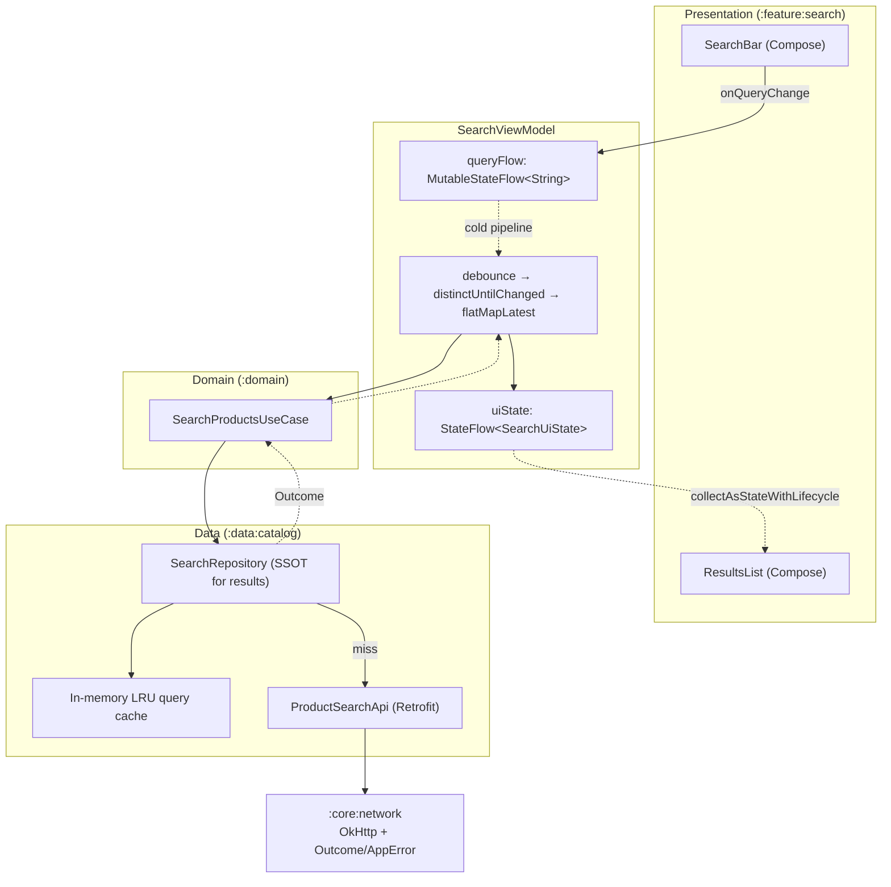
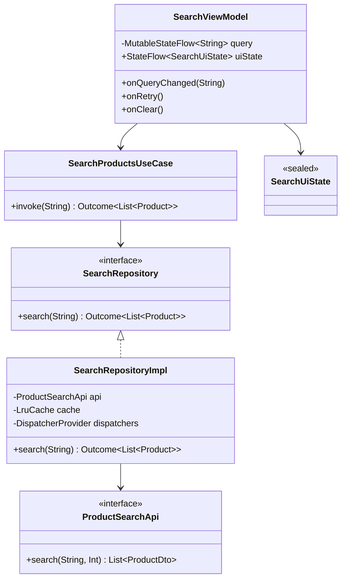
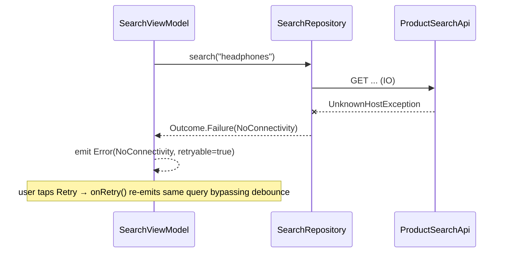
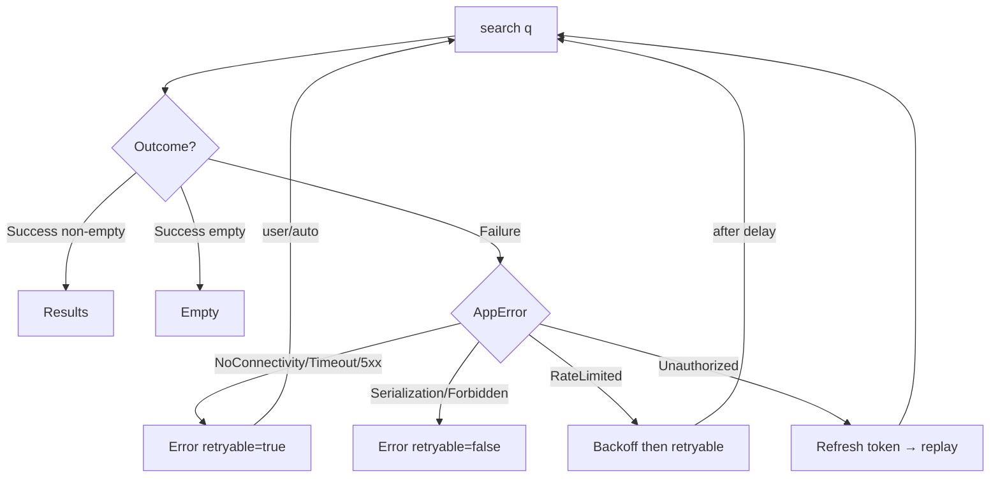

# Chapter 9 — Debounced Network Search

> **Part II — Networking Patterns** · Complexity: **Complex** (≥40 interview questions)
>
> **Prerequisites:** Ch 1 (Networking Core — `ApiService`, `Outcome`/`AppError`),
> Ch 2 (Network Reliability — retry/backoff), Ch 6 (UI State & UDF —
> `StateFlow`, `UiState`), Ch 7 (One-time events). This chapter extends the
> StreamCart networking core rather than inventing a new client.
>
> **Reference surface in StreamCart:** the **Shop search bar** (product
> catalog) and the **Watch search bar** (video catalog). We use product search
> as the running example and note where video search differs.

---

## 9.1 Problem Definition and Real-World Context

A search box that queries the server looks trivial — bind a text field, call
the API on every keystroke, render results. That naive version is one of the
most common performance and correctness failures shipped to production.

Consider a user typing **"wireless headphones"** (18 characters). Keystroke-per-
request issues ~18 network calls in under two seconds. The problems compound:

- **Wasted work.** Seventeen of those responses are thrown away the instant the
  next keystroke arrives. The device burned radio, battery, CPU (JSON parsing),
  and the backend served 18× the necessary load — multiplied across millions of
  users this is a real infrastructure cost.
- **Out-of-order responses (the classic race).** The request for `"wireles"`
  may complete *after* the request for `"wireless"` because of network jitter.
  Without ordering guarantees the UI renders results for a stale query — the
  user sees headphone results flicker back to a partial query's results. This is
  the single most important correctness bug in search.
- **UI jank.** Each response triggers a list diff and recomposition. Firing
  them at keystroke speed causes dropped frames on the main thread.
- **Rate limiting.** Aggressive clients trip server-side 429s, degrading the
  experience for the very user who is typing fastest.

The fix is **debouncing** (wait for the user to pause before querying),
combined with **cancellation of superseded requests**, **deduplication**, and
**single-source-of-truth state**. What seems like a UI detail is in fact a
concurrency and data-flow problem — which is exactly why it is an architectural
topic and a staple interview question.

### Why this is an *architectural* concern, not a coding task

The correctness of search depends on how events flow through the system
(keystrokes → debounce → cancellation → request → ordered state update), how
concurrency is bounded, and how failures (empty, offline, 429) are modeled as
state. Those are design decisions, not syntax.

### Three practical use cases

1. **E-commerce product search (StreamCart Shop).** Debounced autocomplete over
   a large catalog, with recent-search history, category scoping, and
   suggestions. Latency and relevance drive conversion, so the client must
   never show stale results.
2. **OTT title search (StreamCart Watch / Netflix-style).** Search across a
   smaller, cacheable catalog where instant local prefix matching can precede
   the network call; results include mixed types (titles, people, collections).
3. **Social user/@mention search (Instagram/Twitter-style).** Very high
   keystroke frequency, strong need to cancel stale queries, and a "no results"
   state that must be distinguished from "still typing" and "error."

Other domains: fintech (payee/beneficiary lookup with strict input validation),
travel (airport/city autocomplete with offline fallback lists), productivity
(document/contact search with local + remote merge).

---

## 9.2 Requirements Engineering

### Functional requirements

| ID | Requirement |
|----|-------------|
| F1 | As the user types, show matching results from the server. |
| F2 | Do not query on every keystroke; wait for a short typing pause (debounce). |
| F3 | Only the **latest** query's results are ever shown (no out-of-order rendering). |
| F4 | Identical consecutive queries (e.g., type then delete back to same text) must not refetch. |
| F5 | Blank/whitespace query clears results and cancels in-flight work. |
| F6 | Show distinct states: idle, typing/loading, results, empty, error. |
| F7 | Minimum query length (e.g., ≥2 chars) before hitting the network. |
| F8 | Survive configuration changes and process death (query text is restored). |
| F9 | Allow retry on error without re-typing. |

### Non-functional requirements

| Attribute | Target / Policy |
|-----------|-----------------|
| **Performance** | Debounce 300 ms; ≤1 in-flight request at a time; no main-thread I/O or parsing. |
| **Scalability** | Request volume grows sub-linearly with keystrokes; backend load bounded by debounce + dedup. |
| **Reliability** | Transient failures retried (per Ch 2); stale responses never win. |
| **Consistency** | UI state always corresponds to the most recently submitted query. |
| **Battery/Network** | Cancel superseded requests immediately to free the radio; respect metered networks. |
| **Memory** | No leaked coroutines/collectors; bounded result list. |
| **Security** | Query strings may be PII (names) — redact in logs (Ch 28). |
| **Accessibility** | Announce result count / loading via Compose semantics. |

### Scope

- **In scope:** debounce, cancellation, dedup, ordered state, error/empty
  handling, process-death restoration, basic result caching for repeated
  queries.
- **Out of scope (deferred to other chapters):** full Paging 3 pagination of
  results (Ch 13), ranking/relevance (backend), local FTS pre-filtering (Ch 35),
  search *suggestions/autocomplete* UI as a separate concern (Ch 10).

### Assumptions & constraints

- A REST endpoint `GET /search/products?q=&limit=` exists (StreamCart backend).
- Server-side ranking is authoritative; the client does not re-rank.
- `minSdk 24`, Kotlin + Coroutines + Flow + Compose, Hilt DI.
- Debounce window and min length are **configurable** (feature flag / remote
  config, Ch 41) — defaults 300 ms / 2 chars.

### Expected behavior (acceptance)

> Typing `headphones` then pausing issues exactly **one** network request for
> `headphones`; the result list corresponds to `headphones`; deleting to
> `headphone` and retyping `s` within the debounce window issues no extra call;
> an offline attempt shows an error state with a working Retry.

---

## 9.3 System Design Fundamentals

The solution rests on a small set of concepts, each chosen deliberately:

- **Hot state vs. cold stream.** The query text is *state* (`StateFlow`), the
  search results are a *reaction* to that state. Modeling the query as a flow
  lets us apply stream operators (`debounce`, `distinctUntilChanged`,
  `flatMapLatest`) declaratively.
- **Debounce.** Emit a value only after a quiescent period. `Flow.debounce(ms)`
  drops intermediate emissions and emits the last one after no new emission for
  `ms`. This directly implements F2.
- **`flatMapLatest` = cancellation of superseded work.** When a new query
  arrives, the previous inner flow (the in-flight request) is **cancelled**.
  This is the operator-level solution to the out-of-order race (F3) and to
  wasted work.
- **`distinctUntilChanged` = deduplication.** Prevents refetching identical
  consecutive queries (F4).
- **Structured concurrency.** All work runs in `viewModelScope`, so rotation/
  navigation away cancels it deterministically — no leaks (NFR memory).
- **Single Source of Truth.** The `StateFlow<SearchUiState>` is the only thing
  the UI reads; the repository owns data retrieval and (optional) caching.
- **Backpressure/conflation.** `StateFlow` conflates — the UI always sees the
  latest state, never a backlog of intermediate loading states.

The elegant insight: **`debounce` + `distinctUntilChanged` + `flatMapLatest`**
solve F2, F3, and F4 together in a few declarative lines, and
`flatMapLatest`'s cancellation semantics make the out-of-order race
*structurally impossible* rather than something we patch with sequence numbers.
(We still discuss the manual sequence-number approach in §9.8 for the
callback/imperative alternative.)

---

## 9.4 High-Level Architecture



**Component responsibilities & ownership**

- **`SearchBar`** emits raw text changes; holds no business logic.
- **`SearchViewModel`** owns the `queryFlow` (input state) and derives
  `uiState` (output state) through the debounce pipeline. It is the **state
  owner** and the orchestrator of the UDF loop.
- **`SearchProductsUseCase`** encapsulates the single operation "search
  products for query → `Outcome<List<Product>>`," keeping the ViewModel free of
  data concerns and making the rule reusable/testable.
- **`SearchRepository`** is the **SSOT** for search results: it checks the
  in-memory cache, calls the remote source on a miss, maps DTOs to domain
  models, and returns a typed `Outcome`.
- **`:core:network`** provides the shared OkHttp/Retrofit stack and the
  `Outcome`/`AppError` model from Ch 1.

**Dependency direction:** UI → ViewModel → UseCase → Repository → core.
Nothing flows upward except data via suspend/Flow returns. The debounce logic
lives in the ViewModel because it is a *presentation timing* concern, not a
data concern — the repository must remain a plain request/response boundary so
it is reusable by non-debounced callers (e.g., a "search" button, voice search).

---

## 9.5 Detailed Component Design



| Component | Input | Output | State | Lifecycle | Errors |
|-----------|-------|--------|-------|-----------|--------|
| `SearchViewModel` | query text, retry/clear events | `StateFlow<SearchUiState>` | `query`, derived `uiState` | `viewModelScope` | maps `AppError` → error state |
| `SearchProductsUseCase` | query string | `Outcome<List<Product>>` | stateless | caller's coroutine | passes `Outcome` through |
| `SearchRepositoryImpl` | query string | `Outcome<List<Product>>` | LRU cache | singleton (DI) | wraps exceptions to `AppError` |
| `ProductSearchApi` | query, limit | `List<ProductDto>` | none | — | throws → caught by repo |

**Concurrency requirements:** the ViewModel pipeline guarantees at most one
active inner flow (`flatMapLatest`). The repository must be safe to call from
the single active request; its cache access is guarded (see §9.8).

---

## 9.6 End-to-End Data Flow

### Success path

```mermaid
sequenceDiagram
    actor User
    participant UI as SearchBar
    participant VM as SearchViewModel
    participant UC as SearchProductsUseCase
    participant Repo as SearchRepository
    participant API as ProductSearchApi

    User->>UI: types "head"
    UI->>VM: onQueryChanged("head")
    Note over VM: query emits; debounce(300ms) waiting
    User->>UI: types "phones" (within 300ms)
    UI->>VM: onQueryChanged("headphones")
    Note over VM: debounce resets; only "headphones" survives
    Note over VM: distinctUntilChanged passes; flatMapLatest cancels any prior inner flow
    VM->>VM: emit Loading
    VM->>UC: invoke("headphones")
    UC->>Repo: search("headphones")
    Repo->>API: GET /search/products?q=headphones (IO)
    API-->>Repo: List<ProductDto>
    Repo-->>UC: Outcome.Success(List<Product>)
    UC-->>VM: Outcome.Success
    VM-->>UI: emit Results(list) / Empty
    UI-->>User: renders results
```

### Failure path (offline, then retry)



---

## 9.7 Complete Kotlin Implementation

Package: `com.streamcart.search`. Snippets reuse `Outcome`/`AppError` and
`DispatcherProvider` from the blueprint conventions (§9 of `BLUEPRINT.md`).

### 9.7.1 Domain & data models

```kotlin
// :domain — domain model consumed by UI
data class Product(
    val id: String,
    val title: String,
    val priceCents: Long,
    val thumbnailUrl: String?,
)

// :data:catalog/remote — network DTO
@Serializable
data class ProductDto(
    @SerialName("id") val id: String,
    @SerialName("title") val title: String,
    @SerialName("price_cents") val priceCents: Long,
    @SerialName("thumbnail_url") val thumbnailUrl: String? = null,
)

fun ProductDto.toDomain() = Product(id, title, priceCents, thumbnailUrl)
```

### 9.7.2 Remote source (Retrofit)

```kotlin
// :data:catalog/remote
interface ProductSearchApi {
    @GET("search/products")
    suspend fun search(
        @Query("q") query: String,
        @Query("limit") limit: Int = 20,
    ): List<ProductDto>
}
```

### 9.7.3 Repository (SSOT for results + cache)

```kotlin
// :data:catalog/repository
interface SearchRepository {
    suspend fun search(query: String): Outcome<List<Product>>
}

@Singleton
class SearchRepositoryImpl @Inject constructor(
    private val api: ProductSearchApi,
    private val dispatchers: DispatcherProvider,
) : SearchRepository {

    // Small LRU cache keyed by normalized query. Guarded by a Mutex because
    // although flatMapLatest serializes the pipeline, other callers
    // (voice search, search button) may hit the same singleton concurrently.
    private val cache = object : LinkedHashMap<String, List<Product>>(
        /* initialCapacity = */ 16, /* loadFactor = */ 0.75f, /* accessOrder = */ true,
    ) {
        override fun removeEldestEntry(eldest: Map.Entry<String, List<Product>>) = size > MAX_ENTRIES
    }
    private val cacheMutex = Mutex()

    override suspend fun search(query: String): Outcome<List<Product>> {
        val key = query.trim().lowercase()

        cacheMutex.withLock { cache[key] }?.let { return Outcome.Success(it) }

        return withContext(dispatchers.io) {
            runCatching { api.search(key) }
                .fold(
                    onSuccess = { dtos ->
                        val products = dtos.map { it.toDomain() }
                        cacheMutex.withLock { cache[key] = products }
                        Outcome.Success(products)
                    },
                    onFailure = { Outcome.Failure(it.toAppError()) },
                )
        }
    }

    private companion object { const val MAX_ENTRIES = 50 }
}
```

> `toAppError()` is the shared mapper from Ch 1 (maps `UnknownHostException →
> NoConnectivity`, `SocketTimeoutException → Timeout`, `HttpException(429) →
> RateLimited`, etc.).

### 9.7.4 Use case

```kotlin
// :domain/usecase
class SearchProductsUseCase @Inject constructor(
    private val repository: SearchRepository,
) {
    suspend operator fun invoke(query: String): Outcome<List<Product>> =
        repository.search(query)
}
```

### 9.7.5 UI state & events

```kotlin
// :feature:search/ui
sealed interface SearchUiState {
    data object Idle : SearchUiState                       // below min length / blank
    data object Loading : SearchUiState
    data class Results(val products: List<Product>) : SearchUiState
    data class Empty(val query: String) : SearchUiState    // query ok, zero results
    data class Error(val error: AppError, val retryable: Boolean) : SearchUiState
}
```

### 9.7.6 ViewModel — the debounce pipeline (the heart of the chapter)

```kotlin
// :feature:search/presentation
@HiltViewModel
class SearchViewModel @Inject constructor(
    private val searchProducts: SearchProductsUseCase,
    private val savedState: SavedStateHandle,
) : ViewModel() {

    // Input state. Backed by SavedStateHandle so it survives process death (F8).
    private val query = MutableStateFlow(savedState[KEY_QUERY] ?: "")

    // Manual retrigger channel: lets Retry re-run WITHOUT changing the query
    // (distinctUntilChanged would otherwise swallow a repeat of the same text).
    private val retrigger = MutableSharedFlow<Unit>(extraBufferCapacity = 1)

    @OptIn(ExperimentalCoroutinesApi::class, FlowPreview::class)
    val uiState: StateFlow<SearchUiState> =
        combine(query, retrigger.onStart { emit(Unit) }) { q, _ -> q }
            .debounce { q -> if (q.isBlank()) 0L else DEBOUNCE_MS }   // F2, instant clear on blank
            .distinctUntilChanged()                                   // F4
            .flatMapLatest { raw ->                                   // F3: cancels superseded request
                val q = raw.trim()
                when {
                    q.length < MIN_LENGTH -> flowOf(SearchUiState.Idle)  // F5, F7
                    else -> flow {
                        emit(SearchUiState.Loading)
                        emit(searchProducts(q).toUiState(q))
                    }
                }
            }
            .stateIn(
                scope = viewModelScope,
                started = SharingStarted.WhileSubscribed(5_000),
                initialValue = SearchUiState.Idle,
            )

    fun onQueryChanged(text: String) {
        query.value = text
        savedState[KEY_QUERY] = text
    }

    fun onRetry() { retrigger.tryEmit(Unit) }

    fun onClear() { onQueryChanged("") }

    private fun Outcome<List<Product>>.toUiState(q: String): SearchUiState = when (this) {
        is Outcome.Success -> if (data.isEmpty()) SearchUiState.Empty(q) else SearchUiState.Results(data)
        is Outcome.Failure -> SearchUiState.Error(error, retryable = error.isRetryable())
    }

    private companion object {
        const val DEBOUNCE_MS = 300L
        const val MIN_LENGTH = 2
        const val KEY_QUERY = "search_query"
    }
}
```

Key decisions, made explicit:

- **`debounce { if blank 0 else 300 }`** — blank input clears instantly (F5)
  while typed input waits. A fixed `debounce(300)` would delay the "clear"
  by 300 ms, which feels laggy.
- **`flatMapLatest`** — the previous inner `flow { … }` (including its suspended
  `searchProducts(q)` call) is cancelled when a new query arrives, giving us
  cancellation + ordering for free (F3). The `Loading` emit then the result emit
  model the two UI states of one request.
- **`retrigger` SharedFlow** — Retry must re-issue the *same* query, which
  `distinctUntilChanged` would otherwise block. Combining a retrigger signal is
  the idiomatic fix. `onStart { emit(Unit) }` seeds the combine so the pipeline
  runs on first collection.
- **`WhileSubscribed(5_000)`** — the pipeline stops 5 s after the UI stops
  collecting (rotation grace window) and restarts when it returns, without
  re-running a finished request because `StateFlow` replays the last state.
- **`SavedStateHandle`** — restores the query text after process death (F8); the
  pipeline re-derives results on restore.

### 9.7.7 Compose UI

```kotlin
// :feature:search/ui
@Composable
fun SearchScreen(viewModel: SearchViewModel = hiltViewModel()) {
    val state by viewModel.uiState.collectAsStateWithLifecycle()
    val query by viewModel.queryText.collectAsStateWithLifecycle()  // expose query as StateFlow too

    Column(Modifier.fillMaxSize()) {
        SearchBar(
            query = query,
            onQueryChange = viewModel::onQueryChanged,
            onClear = viewModel::onClear,
        )
        when (val s = state) {
            SearchUiState.Idle -> IdleHint()
            SearchUiState.Loading -> LoadingIndicator(Modifier.semantics { contentDescription = "Searching" })
            is SearchUiState.Results -> ResultsList(s.products)
            is SearchUiState.Empty -> EmptyState(s.query)
            is SearchUiState.Error -> ErrorState(
                error = s.error,
                showRetry = s.retryable,
                onRetry = viewModel::onRetry,
            )
        }
    }
}
```

> `collectAsStateWithLifecycle()` (from `lifecycle-runtime-compose`) stops
> collection in `STOPPED` and is the correct default over `collectAsState()` for
> lifecycle safety.

### 9.7.8 Dependency injection (Hilt)

```kotlin
// :data:catalog/di
@Module @InstallIn(SingletonComponent::class)
abstract class SearchDataModule {
    @Binds abstract fun bindSearchRepository(impl: SearchRepositoryImpl): SearchRepository

    companion object {
        @Provides fun provideProductSearchApi(retrofit: Retrofit): ProductSearchApi =
            retrofit.create(ProductSearchApi::class.java)   // Retrofit from :core:network
    }
}
```

### 9.7.9 Module structure

```
:feature:search
  ui/           SearchScreen, SearchBar, ResultsList, EmptyState, ErrorState
  presentation/ SearchViewModel, SearchUiState
:domain
  usecase/      SearchProductsUseCase
:data:catalog
  repository/   SearchRepository, SearchRepositoryImpl
  remote/       ProductSearchApi, ProductDto
  mapper/       ProductDto.toDomain()
  di/           SearchDataModule
:core:network   Retrofit/OkHttp, Outcome, AppError, toAppError()
```

---

## 9.8 Concurrency and Race Conditions

| Scenario | Risk | Handling |
|----------|------|----------|
| Rapid keystrokes | Request per key; stale wins | `debounce` + `flatMapLatest` (cancel superseded) |
| Out-of-order responses | Old query renders over new | `flatMapLatest` cancels the old inner flow before starting the new one — the old response cannot emit into the pipeline |
| Duplicate query (type/delete) | Redundant fetch | `distinctUntilChanged` + repo LRU cache |
| Rotation during request | Leaked coroutine / double work | `viewModelScope` + `WhileSubscribed`; result replayed, not refetched |
| Concurrent repo callers (voice + text) | Cache corruption | `Mutex`-guarded `LinkedHashMap` (LRU) |
| Process death mid-request | Lost state | `SavedStateHandle` restores query; pipeline re-derives |

**The out-of-order race, precisely.** With `flatMapLatest`, when query *B*
supersedes *A*, the operator cancels *A*'s collector. Even if *A*'s HTTP
response is already in flight, its continuation resumes into a **cancelled**
coroutine and never reaches `emit`. The pipeline is therefore *structurally*
single-latest — we do not need sequence numbers.

**The imperative alternative (callbacks / RxJava `switchMap` / manual).** If you
cannot use `flatMapLatest` (e.g., legacy callback API), you implement ordering
with a monotonically increasing token:

```kotlin
private val seq = AtomicLong(0)

fun onQueryChanged(q: String) {
    val token = seq.incrementAndGet()
    api.searchAsync(q) { result ->
        if (token == seq.get()) render(result)  // drop stale
    }
}
```

This works but is error-prone and does not *cancel* the stale request (wasted
network). `flatMapLatest` is strictly better where available. RxJava's
`switchMapSingle` is the direct equivalent.

**Why not `Mutex` on the pipeline itself?** A mutex would serialize requests but
*not* cancel stale ones — you would still pay for and possibly render superseded
work. Cancellation (`flatMapLatest`) is the right primitive here; `Mutex` is
reserved for the shared cache.

---

## 9.9 Failure Scenarios and Recovery

For each failure: *how it happens → detection → architectural response → user
experience → retry? → recovery → telemetry.*

| Failure | Detection | Response | UX | Retry? | Telemetry |
|---------|-----------|----------|----|--------|-----------|
| **No internet** | `UnknownHostException` → `NoConnectivity` | `Error(retryable=true)` | "You're offline" + Retry | Yes (manual + auto on reconnect) | `search_error{type=offline}` |
| **Slow network** | still within timeout | stay `Loading` | spinner; keep last results if desired | n/a | `search_latency_ms` |
| **Timeout** | `SocketTimeoutException` → `Timeout` | `Error(retryable=true)` | "Taking too long" + Retry | Yes | `search_error{type=timeout}` |
| **HTTP 401** | interceptor → token refresh (Ch 19) | transparent refresh then replay | invisible | automatic | `auth_refresh` |
| **HTTP 403** | `Http(403)` | `Error(retryable=false)` | "Not available in your region" | No | `search_error{type=forbidden}` |
| **HTTP 429** | `RateLimited` | backoff (Ch 2); optionally raise debounce | brief wait, then Retry | delayed | `search_error{type=rate_limited}` |
| **HTTP 500** | `Http(5xx)` | `Error(retryable=true)` + capped retry | "Something went wrong" | Yes | `search_error{type=server}` |
| **Malformed response** | `SerializationException` → `Serialization` | `Error(retryable=false)`; log sample | generic error | No | `search_error{type=parse}` + schema version |
| **Empty results** | success, empty list | `Empty(query)` | "No matches for X" + suggestions | n/a | `search_zero_results{q_len}` |
| **Process death** | n/a | `SavedStateHandle` restore | seamless | n/a | — |



> **Design note — "keep last results on error?"** For search, showing a toast/
> inline error while *retaining* the last good results often beats blanking the
> screen. Model this by having the ViewModel hold `lastResults` and emit an
> `Error` variant that carries them. This is a product decision; we flag it as a
> trade-off rather than mandating it.

---

## 9.10 Scaling the Implementation

- **Level 1 — single screen.** Exactly §9.7: one ViewModel, debounce pipeline,
  no cache. Correct for an MVP.
- **Level 2 — multi-screen.** Shop and Watch both search. Extract
  `SearchRepository<T>` or a generic `Searcher` and reuse the pipeline via a
  shared `DebouncedSearchDelegate` so each feature ViewModel composes it.
- **Level 3 — production.** Add LRU result cache (shown), recent-search history
  (DataStore, Ch 4), min-length + remote-config debounce (Ch 41), retry/backoff
  (Ch 2), "keep last results" UX, analytics (Ch 82).
- **Level 4 — large-scale.** Local **FTS** pre-filter (Ch 35) to show instant
  offline matches before the network responds (merge local + remote), Paging 3
  for long result sets (Ch 13), request prioritization (Ch 14), prefetch of
  likely next queries.
- **Level 5 — enterprise.** A unified **search platform module** serving many
  feature teams: pluggable sources (products, videos, people), typed result
  facets, instrumentation baked in, A/B-tested debounce/min-length, and a
  contract that tolerates backend schema evolution (Ch 16). Governance: one
  owning team, versioned APIs, backward compatibility across app versions.

**Avoid overengineering:** a Level-1/2 app does not need FTS or a search
platform. Add a layer only when a concrete requirement (offline search, result
pagination, multiple teams) demands it.

---

## 9.11 Alternative Approaches and Trade-offs

| Dimension | Option A | Option B | When to pick |
|-----------|----------|----------|--------------|
| Pipeline operator | `flatMapLatest` (cancel) | `flatMapMerge`/`flatMapConcat` | Always `flatMapLatest` for search; merge/concat only if every query's results matter |
| Debounce location | ViewModel (Flow) | UI timer / `LaunchedEffect` | ViewModel — testable, survives recomposition |
| State holder | `StateFlow` | `LiveData` | `StateFlow` (operators, multiplatform, conflation); LiveData only in legacy |
| Ordering guarantee | `flatMapLatest` | sequence token | Operator for coroutines; token for callbacks |
| Result source | Remote only | Local FTS + remote merge | Merge when offline search / instant feel required |
| Cache | In-memory LRU | Room-backed | LRU for ephemeral search; Room if results must persist/offline |
| Debounce value | 300 ms | 150 ms / 500 ms | 300 is a good default; tune via analytics + A/B (shorter feels snappier but costs calls) |
| Retrigger for retry | `SharedFlow` combine | re-set query to "" then back | SharedFlow — clean, no UI flicker |

**Debounce vs throttle.** Debounce waits for a pause (ideal for "user finished
typing"); throttle caps rate (ideal for continuous streams like scroll). Search
is a debounce problem.

---

## 9.12 Security Considerations

- **Query strings are often PII** (names, emails for people search). Redact
  query text in logs/analytics or hash it; never log full queries at INFO (Ch 28).
- **Transport:** HTTPS + certificate pinning (Ch 23); query params are in the
  URL, so they appear in server access logs — prefer not to send secrets as
  query strings.
- **Injection:** the client passes `q` verbatim; the **backend** must treat it
  as untrusted (no SQL/command injection). This is a *backend* guarantee — the
  client cannot enforce it. State this explicitly in interviews.
- **Autocomplete leakage:** suggestions can reveal other users' data if the
  backend is careless; the client should not cache another account's suggestions
  across account switches (Ch 42).
- **Rate-limit abuse:** client debounce reduces load but is **not** a security
  control — a malicious client bypasses it, so the backend must rate-limit
  independently.

**Client vs backend split:** client = debounce, dedup, transport security, log
redaction. Backend = authz, injection safety, rate limiting, result filtering
by entitlement.

---

## 9.13 Performance and Resource Optimization

- **Main thread:** all I/O and JSON parsing on `dispatchers.io`; only state
  emission reaches Main. Verify with StrictMode (`detectNetwork()`).
- **Network/battery:** `flatMapLatest` cancels superseded requests, freeing the
  radio promptly; debounce bounds request count. On metered networks consider a
  longer debounce (Ch 91).
- **Recomposition:** emit *distinct* states; use stable `Product` (data class),
  `key`-ed `LazyColumn` items, and avoid passing unstable lambdas. Conflated
  `StateFlow` prevents loading/stale thrash.
- **Memory:** bounded LRU (50 entries); `viewModelScope` cancellation prevents
  collector leaks; `WhileSubscribed` stops idle pipelines.
- **Profiling:** Android Studio Network Inspector (count requests per typed
  word — expect 1), `systrace`/Perfetto for jank, Layout Inspector recomposition
  counts, `adb shell dumpsys gfxinfo` for frame times.

---

## 9.14 Testing Strategy

What to fake vs. real: **fake** the repository/API (deterministic latency &
errors); use **real** Flow operators and a `TestDispatcher` with virtual time so
`debounce` is tested without real delays.

### ViewModel debounce + cancellation (virtual time)

```kotlin
@OptIn(ExperimentalCoroutinesApi::class)
class SearchViewModelTest {

    private val dispatcher = StandardTestDispatcher()
    private lateinit var useCase: FakeSearchUseCase

    @Before fun setUp() { Dispatchers.setMain(dispatcher) }
    @After fun tearDown() { Dispatchers.resetMain() }

    @Test
    fun `debounces rapid input to a single search`() = runTest(dispatcher) {
        useCase = FakeSearchUseCase(latencyMs = 0)
        val vm = SearchViewModel(useCase, SavedStateHandle())

        vm.uiState.test {   // Turbine
            assertEquals(SearchUiState.Idle, awaitItem())

            vm.onQueryChanged("h")
            vm.onQueryChanged("he")
            vm.onQueryChanged("headphones")   // all within debounce window
            advanceTimeBy(299); expectNoEvents()
            advanceTimeBy(1)                  // cross 300ms

            assertEquals(SearchUiState.Loading, awaitItem())
            val results = awaitItem() as SearchUiState.Results
            assertEquals(1, useCase.callCount)                 // F2: one call
            assertEquals("headphones", useCase.lastQuery)      // F3: latest wins
        }
    }

    @Test
    fun `stale response never overrides latest query`() = runTest(dispatcher) {
        // slow "abc", fast "xyz": flatMapLatest must drop "abc"
        useCase = FakeSearchUseCase(latencyFor = mapOf("abc" to 1000L, "xyz" to 10L))
        val vm = SearchViewModel(useCase, SavedStateHandle())
        vm.uiState.test {
            awaitItem() // Idle
            vm.onQueryChanged("abc"); advanceTimeBy(300)
            awaitItem() // Loading(abc)
            vm.onQueryChanged("xyz"); advanceTimeBy(300)
            awaitItem() // Loading(xyz)
            val r = awaitItem() as SearchUiState.Results
            assertEquals("xyz", r.products.first().title)  // abc's 1000ms result dropped
            cancelAndIgnoreRemainingEvents()
        }
    }
}
```

### Repository (MockWebServer) + dedup/cache

```kotlin
@Test fun `identical query served from cache without second request`() = runTest {
    server.enqueue(MockResponse().setBody(productsJson))
    val repo = SearchRepositoryImpl(api, TestDispatchers(dispatcher))
    repo.search("shoes"); repo.search("shoes")
    assertEquals(1, server.requestCount)      // F4
}

@Test fun `offline maps to NoConnectivity`() = runTest {
    val repo = SearchRepositoryImpl(throwingApi(UnknownHostException()), ...)
    val out = repo.search("shoes")
    assertEquals(AppError.NoConnectivity, (out as Outcome.Failure).error)
}
```

Also cover: min-length (no call below 2 chars), blank clears instantly, Retry
re-issues same query, empty list → `Empty`, 429 → backoff path, and a Compose UI
test asserting Loading→Results and Retry button visibility on error.

---

## 9.15 Production Observability

- **Structured logs** (`:core:analytics`): `search_submitted{q_len, source}`,
  `search_result{q_len, count, latency_ms, cache_hit}`,
  `search_error{type, http_code, correlation_id}`. **Never** log raw query text
  at default levels (PII); log length/hash only.
- **Metrics/KPIs:** p50/p95 search latency, zero-result rate (relevance health),
  error rate by type, cache hit ratio, avg requests per search session (should
  be ≈1 after debounce — a spike means debounce regressed), 429 rate.
- **Tracing:** a `correlationId` per submitted query (Ch 84) threaded from the
  ViewModel through OkHttp header to the backend; crash/ANR breadcrumbs include
  the current `SearchUiState` type.
- **Debugging in production:** a rising "requests per session" metric is the
  canary for a broken debounce (e.g., someone recreated the Flow per
  recomposition); a rising zero-result rate signals an indexing/relevance
  regression upstream; correlate client latency with backend traces via the ID.
- **Privacy:** honor consent; drop query analytics for users who opt out; never
  ship raw queries to third-party analytics.

---

## 9.16 System Design Interview Preparation

> Debounced search is a favorite because it compresses concurrency, lifecycle,
> state modeling, and failure handling into one approachable feature. Below:
> 40+ categorized questions with substantive answers, follow-ups, design
> curveballs, and a mock walkthrough.

### A. Questions & answers

**Fundamentals**
1. *Why debounce instead of search-on-submit?* Submit is simplest and cheapest
   but loses the instant-feedback UX users expect; debounce balances
   responsiveness against load. For very large/expensive queries, submit (or a
   longer debounce) can be correct.
2. *What debounce value and why 300 ms?* ~300 ms is below the perceptual
   "laggy" threshold yet long enough to coalesce typing bursts. Tune with
   analytics/A-B; shorter feels snappier but costs calls.
3. *Difference between debounce and throttle?* Debounce emits after a quiet
   period (good for "done typing"); throttle emits at a max rate (good for
   continuous streams).
4. *What is the single biggest correctness bug in naive search?* Out-of-order
   responses rendering a stale query's results.
5. *Why model query as a `StateFlow`?* It's conflated hot state; lets us apply
   `debounce`/`distinctUntilChanged`/`flatMapLatest` declaratively and survives
   recomposition.

**Architecture**
6. *Where does the debounce belong — UI, ViewModel, or repository?* ViewModel.
   It's a presentation-timing concern; the repository stays a plain
   request/response boundary reusable by non-debounced callers.
7. *Why keep a UseCase for a one-line call?* Reuse (button/voice search),
   testability, and keeping the ViewModel free of data concerns; it's optional
   in a tiny app (a trade-off, not dogma).
8. *What is the SSOT here?* The `StateFlow<SearchUiState>` for the UI;
   `SearchRepository` for the result data/cache.
9. *How do Shop and Watch share this?* Extract a generic debounced-search
   delegate; each feature provides its own repository/result type.

**Kotlin / Flow internals**
10. *How does `flatMapLatest` prevent the race?* It cancels the previous inner
    flow's collector when a new upstream value arrives, so the stale request's
    continuation resumes into a cancelled coroutine and never emits.
11. *Why `distinctUntilChanged`?* Dedup identical consecutive queries (type then
    delete back).
12. *Why does Retry need a separate signal?* `distinctUntilChanged` would drop a
    repeat of the same query; a `SharedFlow` retrigger re-runs it.
13. *`SharingStarted.WhileSubscribed(5000)` — why?* Stops the pipeline shortly
    after the UI stops collecting (survives rotation) and restarts without
    refetching, since `StateFlow` replays the last value.
14. *`collectAsState` vs `collectAsStateWithLifecycle`?* The latter stops
    collection in STOPPED — correct default to avoid work/leaks while backgrounded.
15. *Why `debounce { if blank 0 }`?* Clear results instantly on blank instead of
    waiting 300 ms.
16. *Cold vs hot flow in this pipeline?* `query` is hot (StateFlow); the inner
    `flow { emit(Loading); emit(result) }` is cold, recreated per query.

**Concurrency**
17. *How many requests are in flight at once?* At most one (flatMapLatest).
18. *Do you need sequence numbers?* Not with `flatMapLatest`; yes with
    callbacks/imperative APIs.
19. *Is the repository cache thread-safe?* It's guarded by a `Mutex` because
    multiple callers (text, voice) may hit the singleton concurrently.
20. *Why not a `Mutex` instead of `flatMapLatest`?* Mutex serializes but doesn't
    cancel stale work; you'd still pay for/possibly render superseded responses.
21. *RxJava equivalent?* `debounce` + `switchMap` (+ `distinctUntilChanged`).

**Lifecycle**
22. *What cancels in-flight work on navigation away?* `viewModelScope`
    cancellation.
23. *Process death — what's lost and how restored?* In-memory results lost;
    `SavedStateHandle` restores query text and the pipeline re-derives results.
24. *Rotation — refetch or not?* No; `WhileSubscribed` + `StateFlow` replay the
    last state (or you persist results if needed).

**Persistence / caching**
25. *Where would you cache results and why?* In-memory LRU for ephemeral speed;
    Room if results must persist/offline. Keyed by normalized query.
26. *Cache invalidation?* Time-based TTL and/or on catalog change events;
    clear on account switch.
27. *Recent searches?* DataStore list, capped, deduped, cleared on logout.

**Networking**
28. *How is the networking core reused?* Same OkHttp/Retrofit + `Outcome`/
    `AppError` from Ch 1; search adds only an endpoint.
29. *Handling 429?* Backoff (Ch 2), optionally raise debounce; backend must
    rate-limit independently.
30. *401 during search?* Transparent token refresh (Ch 19) then replay.

**Scalability**
31. *10M users — what changes on the client?* Little on the client; debounce +
    dedup already bound load. The scaling is backend (index, autocomplete
    service); client may add FTS pre-filter and A/B-tuned debounce.
32. *How to reduce backend load further?* Longer debounce, min-length,
    client caching, prefix caching, local FTS, CDN-cached popular queries.

**Security**
33. *Is query text sensitive?* Often PII; redact/hash in logs; prefer not to
    send secrets as query params.
34. *Can client debounce be a rate-limit control?* No — trivially bypassed;
    backend must enforce.
35. *Injection responsibility?* Backend; client sends `q` untrusted.

**Performance**
36. *How do you keep it off the main thread?* IO dispatcher for calls/parsing;
    StrictMode to verify.
37. *Recomposition hotspots?* Emit distinct states; stable models; keyed lazy
    lists.
38. *How verify debounce in prod?* "Requests per search session" metric ≈ 1.

**Testing**
39. *How test debounce without real delays?* `StandardTestDispatcher` +
    `advanceTimeBy`; Turbine for emissions.
40. *How test the out-of-order race?* Fake variable latency; assert the slow
    earlier query's result is dropped (test in §9.14).

**Production debugging**
41. *Users report "flicker to old results" — diagnose.* Out-of-order race →
    verify `flatMapLatest` (not `flatMapMerge`) and that the Flow isn't
    recreated per recomposition.
42. *Backend sees request spikes from one user — cause?* Debounce regressed:
    Flow rebuilt on each recomposition, or debounce moved to UI with a new timer
    per keystroke.

### C. Deeper follow-ups a Staff/Principal would ask
- "You said `flatMapLatest` cancels the request — does OkHttp actually cancel
  the socket, or just stop collecting?" (Coroutine cancellation propagates to
  the suspended Retrofit call, which cancels the OkHttp `Call`; confirm with
  `Call.isCanceled()` behavior.)
- "If results must be paginated, where does debounce sit relative to Paging 3?"
  (Debounce the query, then feed it into a `Pager` recreated per query via
  `flatMapLatest` on the `PagingData` flow.)
- "How would you merge instant local FTS results with slower remote results
  without flicker?" (Emit local immediately as a partial state, then reconcile
  with remote; model a `Results(partial=true)` variant.)

### D. Design-change challenges (≥5)
1. **"Make it work offline."** Add local FTS (Ch 35); emit local results first,
   mark remote unavailable; sync index in background (Ch 30).
2. **"Support 10M users / cut backend cost 50%."** Longer/adaptive debounce,
   min-length, client + edge caching of popular prefixes, local pre-filter.
3. **"Two result sources (products + videos) in one bar."** Generalize to a
   multi-source searcher; merge with typed facets; each source cancels
   independently but shares the debounce.
4. **"Backend changed the response schema."** Version the DTO, tolerant parsing
   with defaults (Ch 16); feature-flag the new path; keep old app versions
   working.
5. **"Process killed while typing a long query."** `SavedStateHandle` restores
   text; re-derive; optionally cache last results in Room for instant restore.
6. **"Results must stay visible during errors."** Carry `lastResults` in the
   error state; show inline banner + Retry instead of blanking.

### E. Mock interview walkthrough (30–45 min, abridged)
1. **Clarify (0–5m):** platform, catalog size, offline needed?, result types,
   latency budget, who owns ranking. → "Remote REST, large catalog, online-first
   v1, products only, p95 < 400 ms, backend ranks."
2. **Requirements (5–10m):** state F1–F9 and NFRs; call out the out-of-order
   race as the key risk.
3. **Architecture (10–20m):** draw UI → VM(debounce pipeline) → UseCase → Repo →
   core; name SSOT and dependency direction; justify debounce in the ViewModel.
4. **Deep dive (20–30m):** the Flow pipeline; explain `flatMapLatest`
   cancellation solving ordering; cache + dedup; Retry retrigger; process death.
5. **Failure & scale (30–40m):** failure matrix; "keep last results" trade-off;
   scale to FTS/Paging/multi-source; 10M-users answer (client vs backend split).
6. **Trade-offs & defense (40–45m):** debounce value, LiveData vs StateFlow,
   StateFlow vs callbacks; respond to objection "why not just search on submit?"
   with the UX/load trade-off and when submit is actually right.

---

## 9.17 Practical Exercises

1. **Beginner.** Implement the debounce pipeline for a single screen; assert via
   Network Inspector that typing a 10-char word fires exactly one request.
   *Evaluation:* one request, correct final query, no main-thread I/O.
2. **Intermediate.** Add min-length, instant-clear on blank, and Retry via a
   retrigger `SharedFlow`. Write a Turbine test proving Retry re-issues the same
   query. *Evaluation:* tests green; no flicker on retry.
3. **Advanced.** Add an in-memory LRU cache + recent-search history (DataStore);
   prove dedup with MockWebServer `requestCount`. Then generalize the pipeline
   into a reusable `DebouncedSearchDelegate<T>` used by two ViewModels.
   *Evaluation:* zero duplicate requests, delegate reused, no leaks.
4. **Production debugging.** Given a repo where the Flow is rebuilt on every
   recomposition (requests-per-session ≈ keystrokes), find and fix the bug.
   *Evaluation:* identifies Flow recreation / wrong collection site; metric
   returns to ≈1.
5. **System design challenge.** Design offline + online search merging local
   FTS with remote results without flicker, surviving process death and schema
   change. *Evaluation:* partial-results state model, cancellation correctness,
   versioned DTO, background index sync.

*(Solutions withheld unless requested.)*

---

## 9.18 Chapter Summary & Reference Sheet

**Key architectural decisions**
- Debounce + dedup + cancellation live in the **ViewModel Flow pipeline**; the
  repository stays a plain request/response SSOT.
- `flatMapLatest` makes the out-of-order race **structurally impossible** — no
  sequence numbers needed.
- Model search as **exhaustive states** (Idle/Loading/Results/Empty/Error), not
  booleans.

**Important concepts:** debounce vs throttle, `flatMapLatest` cancellation,
`distinctUntilChanged` dedup, `StateFlow` conflation, `WhileSubscribed`,
`SavedStateHandle` restoration, retrigger for retry.

**Common mistakes:** per-keystroke requests; `flatMapMerge`/`flatMapConcat`
instead of `flatMapLatest`; rebuilding the Flow on each recomposition (silent
debounce defeat); fixed `debounce` delaying blank-clear; booleans instead of a
sealed state; logging raw query text; treating client debounce as a rate-limit
control.

**Design checklist:** ☐ debounce (configurable) ☐ min-length ☐ instant clear
☐ `flatMapLatest` ☐ `distinctUntilChanged` ☐ exhaustive states ☐ Retry
retrigger ☐ `SavedStateHandle` ☐ IO off main ☐ bounded cache w/ mutex
☐ redacted logs + correlation ID ☐ requests-per-session metric.

**Key Kotlin/Flow APIs:** `MutableStateFlow`, `debounce`, `distinctUntilChanged`,
`flatMapLatest`, `combine`, `stateIn`, `SharingStarted.WhileSubscribed`,
`MutableSharedFlow.tryEmit`, `collectAsStateWithLifecycle`, `SavedStateHandle`,
`Mutex.withLock`, `StandardTestDispatcher`/`advanceTimeBy`, Turbine `test {}`.

**Android/Jetpack:** ViewModel, Hilt, Retrofit `@Query`, OkHttp cancellation,
DataStore (recent searches), StrictMode (verification).

**Official references:**
- Kotlin Flow: https://kotlinlang.org/docs/flow.html
- `debounce`/`flatMapLatest` API: https://kotlinlang.org/api/kotlinx.coroutines/kotlinx-coroutines-core/kotlinx.coroutines.flow/
- StateFlow/SharedFlow: https://developer.android.com/kotlin/flow/stateflow-and-sharedflow
- Collect flows safely: https://developer.android.com/topic/architecture/ui-layer#consume-ui-state
- ViewModel + SavedState: https://developer.android.com/topic/libraries/architecture/viewmodel/viewmodel-savedstate
- Testing coroutines: https://developer.android.com/kotlin/coroutines/test

---

### Chapter review (Phase 4)

- **Technical completeness checklist:** all 18 mandatory sections present;
  success + failure sequence diagrams; architecture + class diagrams; full
  Kotlin (models→DI); concurrency race analysis with both operator and
  imperative solutions; full failure matrix; 5 scaling levels; trade-off
  tables; security client/backend split; performance + profiling tools;
  unit/repo/concurrency tests; observability KPIs; 42 interview Q&A + follow-ups
  + 6 design challenges + mock; 5 exercises; reference sheet. ✅
- **Possible missing scenarios to expand later:** multi-source search internals
  (deferred to a dedicated treatment), voice-search integration, deep Paging 3
  integration (Ch 13 cross-ref), accessibility deep dive.
- **Interview coverage:** exceeds the ≥40 bar for a Complex topic.
- **Code review considerations:** expose `queryText` as a `StateFlow` on the
  ViewModel (referenced by the Compose sample); confirm `toAppError()` from
  Ch 1 covers 429/401; `FakeSearchUseCase` lives in `:core:testing`.
- **Improvement suggestions:** add a runnable `reference-app/` module later; add
  an adaptive-debounce (network-aware) variant tied to Ch 91.
