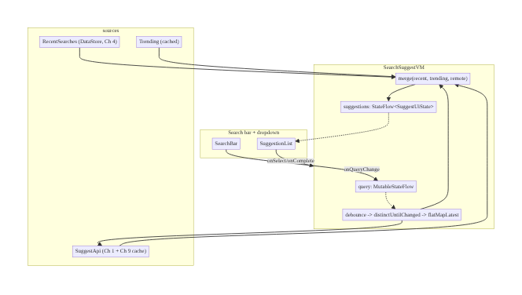
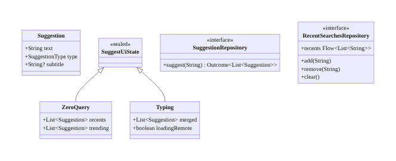
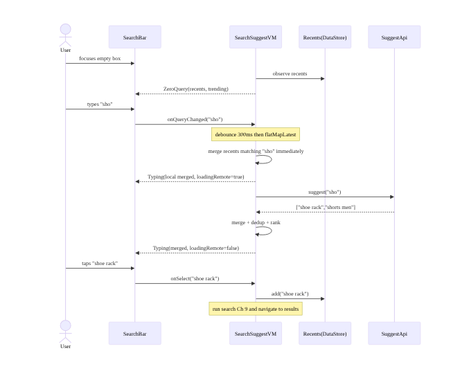
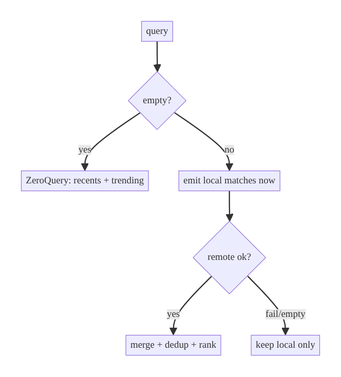

# Chapter 10 — Search Suggestions & Autocomplete

> **Part II — Networking Patterns** · Complexity: **Standard** (≥25 interview questions)
>
> **Prerequisites:** Ch 9 (Debounced Network Search — the debounce pipeline,
> `flatMapLatest`, cancellation), Ch 3 (SSOT/Room), Ch 4 (DataStore — recent
> searches). This chapter **extends** Ch 9: instead of results, we render
> *suggestions* as the user types, merging recent, trending, and remote
> autocomplete.
>
> **Reference surface in StreamCart:** the suggestion dropdown under the Shop and
> Watch search bars (recent searches, trending, remote title/product
> suggestions).

---

## 10.1 Problem Definition and Real-World Context

Autocomplete is the layer *above* search results: as the user types, the app
shows **suggestions** (completions, recent queries, trending terms, matching
entities) to help them reach intent faster. It shares Ch 9's machinery
(debounce, cancel-stale, dedup) but adds new concerns:

- **Multiple sources, one list.** Suggestions come from recent searches (local,
  instant), trending (cached), and a remote autocomplete endpoint (network).
  Merging them without flicker or jank is the core problem.
- **Latency expectations are even tighter.** Suggestions must feel instantaneous;
  local sources should render immediately while the network catches up.
- **Zero-query state.** Before the user types, the dropdown shows recent/trending
  — a distinct state Ch 9 didn't need.
- **Selection semantics.** Tapping a suggestion runs a search and records history;
  an inline "complete" arrow fills the box without searching.
- **Privacy.** Queries and history are often PII; recents must clear on logout and
  never leak across accounts.

Naive autocomplete that only hits the network per keystroke is slow and wasteful
(Ch 9's problems) *and* ignores the instant local sources users expect. The
architecture is a small multi-source merge over the debounced input.

### Three practical use cases

1. **E-commerce (StreamCart Shop).** Type "sho" → instantly show recent
   ["shoes", "shorts"] + trending, then remote completions ["shoe rack",
   "shower gel"] merge in. Tap one → search + save to recents.
2. **OTT (StreamCart Watch).** Mixed suggestion types: titles, people, genres,
   with icons; local recents first, remote title matches after.
3. **Social/@mention.** As the user types "@ad", show recent contacts instantly,
   then remote user matches; cancel stale queries aggressively.

### Why this is architectural

It defines **source composition** (local + cached + remote), **merge/ranking
policy**, **state for zero-query vs typing**, and **privacy of history** — a
composition problem layered on Ch 9's pipeline.

---

## 10.2 Requirements Engineering

### Functional requirements

| ID | Requirement |
|----|-------------|
| F1 | Debounced remote suggestions as the user types (reuse Ch 9 pipeline). |
| F2 | Show recent searches (local) instantly, including at zero query. |
| F3 | Show trending/popular suggestions (cached) at zero query. |
| F4 | Merge sources into one ranked list without flicker. |
| F5 | Tapping a suggestion runs a search and saves it to recents. |
| F6 | "Complete" action fills the input without searching. |
| F7 | Clear/remove individual recents; clear all on logout. |
| F8 | Min length / zero-query handling distinct from Ch 9. |

### Non-functional requirements

| Attribute | Policy |
|-----------|--------|
| **Latency** | Local suggestions render immediately (<16 ms); remote merges in <300 ms. |
| **Performance** | ≤1 in-flight suggestion request (cancel stale); cap list size. |
| **Consistency** | Only the latest query's remote suggestions shown (Ch 9 ordering). |
| **Privacy** | Recents are PII; per-account; cleared on logout; redacted in logs. |
| **Battery/Network** | Debounce + dedup + suggestion cache; respect data-saver. |
| **Accessibility** | Dropdown announced; keyboard/IME search action supported. |

### Scope

- **In scope:** multi-source suggestions (recent + trending + remote), merge/
  dedup/rank, zero-query state, selection semantics, recents persistence,
  privacy.
- **Out of scope:** the results screen itself (Ch 9), result pagination (Ch 13),
  server-side ranking/relevance (backend), local FTS of the catalog (Ch 35).

### Assumptions & constraints

- Remote `GET /suggest?q=` returns ranked `Suggestion`s. Recents in DataStore
  (Ch 4) or Room (Ch 3). Reuses Ch 9's debounce/`flatMapLatest`. `minSdk 24`.

---

## 10.3 System Design Fundamentals

- **Reuse the debounced pipeline (Ch 9).** The query → `debounce` →
  `distinctUntilChanged` → `flatMapLatest` chain already gives cancellation and
  ordering; we swap "fetch results" for "fetch suggestions."
- **Local-first composition.** Recent/trending are available with no network and
  must render immediately; the remote source augments them. This is a *merge*, not
  a replace — show local now, reconcile remote when it arrives.
- **Merge + dedup + rank.** Combine sources into one list, dedup by normalized
  text, and order by a simple policy (recents matching the prefix first, then
  remote completions, then trending) — the backend ranks within the remote set.
- **Zero-query state.** With an empty box, show recents + trending (no network).
  This is a first-class state, unlike Ch 9's `Idle`.
- **Suggestion caching.** Cache remote suggestions per prefix (small LRU) to make
  backtracking instant and cut requests (reuse Ch 9's cache idea).
- **Selection vs completion.** Two actions: *run* (search + record history) and
  *complete* (fill the box, keep typing) — common in real search UIs.

Core insight: **autocomplete = Ch 9's debounced pipeline + a local-first
multi-source merge + a zero-query state.** Local sources make it feel instant;
the pipeline keeps remote correct and cheap.

---

## 10.4 High-Level Architecture



**Components & ownership**

- **`SearchSuggestViewModel`** owns the query and the merged suggestion state; it
  reuses the Ch 9 debounce pipeline for the remote source and `combine`s in local
  sources.
- **`RecentSearchesRepository`** (DataStore/Room) stores per-account recents.
- **`SuggestionRepository`** fetches remote suggestions (reusing Ch 1 networking +
  a per-prefix LRU cache from Ch 9).
- **`Trending`** is a cached list refreshed periodically.

**Direction:** query down the pipeline; sources merged; one state up to the UI.

---

## 10.5 Detailed Component Design



| Component | Responsibility | Source | Notes |
|-----------|----------------|--------|-------|
| `RecentSearchesRepository` | per-account history | DataStore/Room | instant, PII, clear on logout |
| Trending provider | popular terms | cached remote | refreshed periodically |
| `SuggestionRepository` | remote completions | network + LRU | cancelled on new query |
| merge function | combine + dedup + rank | pure | recents-matching first, then remote, then trending |

```kotlin
enum class SuggestionType { Recent, Trending, Completion, Entity }
data class Suggestion(val text: String, val type: SuggestionType, val subtitle: String? = null)
```

---

## 10.6 End-to-End Data Flow



---

## 10.7 Complete Kotlin Implementation

Package: `com.streamcart.search.suggest`.

### 10.7.1 Recent searches (DataStore, per-account)

```kotlin
class RecentSearchesRepository @Inject constructor(
    private val store: DataStore<Preferences>,
) {
    private val key = stringSetPreferencesKey("recent_searches")   // scoped per account elsewhere

    val recents: Flow<List<String>> = store.data
        .map { (it[key] ?: emptySet()).toList() }
        .catch { emit(emptyList()) }

    suspend fun add(query: String) {
        val q = query.trim()
        if (q.isEmpty()) return
        store.edit { prefs ->
            val current = (prefs[key] ?: emptySet()).toMutableList()
            current.remove(q); current.add(0, q)                   // most-recent-first, dedup
            prefs[key] = current.take(MAX_RECENTS).toSet()
        }
    }
    suspend fun remove(query: String) = store.edit { it[key] = (it[key] ?: emptySet()) - query }
    suspend fun clear() = store.edit { it.remove(key) }            // on logout (Ch 42)

    private companion object { const val MAX_RECENTS = 8 }
}
```

### 10.7.2 Remote suggestions (reuses Ch 1 networking + Ch 9 cache)

```kotlin
interface SuggestApi {
    @GET("suggest") suspend fun suggest(@Query("q") q: String): List<SuggestionDto>
}

class SuggestionRepositoryImpl @Inject constructor(
    private val api: SuggestApi,
    private val dispatchers: DispatcherProvider,
) : SuggestionRepository {
    private val cache = LruCache<String, List<Suggestion>>(50)

    override suspend fun suggest(query: String): Outcome<List<Suggestion>> {
        val key = query.trim().lowercase()
        cache.get(key)?.let { return Outcome.Success(it) }
        return safeApiCall(dispatchers.io) {
            api.suggest(key).map { Suggestion(it.text, SuggestionType.Completion, it.subtitle) }
                .also { cache.put(key, it) }
        }
    }
}
```

### 10.7.3 ViewModel — debounced pipeline + local-first merge

```kotlin
@HiltViewModel
class SearchSuggestViewModel @Inject constructor(
    private val suggestions: SuggestionRepository,
    private val recents: RecentSearchesRepository,
    private val trending: TrendingProvider,
    private val runSearch: RunSearchUseCase,
    private val savedState: SavedStateHandle,
) : EffectViewModel<SuggestEffect>() {            // effects from Ch 7

    private val query = MutableStateFlow(savedState["q"] ?: "")

    @OptIn(ExperimentalCoroutinesApi::class, FlowPreview::class)
    val uiState: StateFlow<SuggestUiState> =
        combine(
            query.debounce { if (it.isBlank()) 0 else DEBOUNCE_MS }.distinctUntilChanged(),
            recents.recents,
        ) { q, recentList -> q to recentList }
            .flatMapLatest { (q, recentList) ->
                val trimmed = q.trim()
                if (trimmed.isEmpty()) {
                    flowOf(SuggestUiState.ZeroQuery(
                        recents = recentList.map { Suggestion(it, SuggestionType.Recent) },
                        trending = trending.current(),
                    ))
                } else flow {
                    // local-first: recents matching the prefix render instantly
                    val localMatches = recentList.filter { it.startsWith(trimmed, ignoreCase = true) }
                        .map { Suggestion(it, SuggestionType.Recent) }
                    emit(SuggestUiState.Typing(localMatches, loadingRemote = true))
                    val remote = when (val r = suggestions.suggest(trimmed)) {
                        is Outcome.Success -> r.data
                        is Outcome.Failure -> emptyList()      // degrade silently to local
                    }
                    emit(SuggestUiState.Typing(merge(localMatches, remote), loadingRemote = false))
                }
            }
            .stateIn(viewModelScope, SharingStarted.WhileSubscribed(5_000),
                SuggestUiState.ZeroQuery(emptyList(), emptyList()))

    fun onQueryChanged(text: String) { query.value = text; savedState["q"] = text }

    fun onSelect(suggestion: Suggestion) = viewModelScope.launch {
        recents.add(suggestion.text)
        runSearch(suggestion.text)
        emitEffect(SuggestEffect.NavigateToResults(suggestion.text))
    }
    fun onComplete(suggestion: Suggestion) { onQueryChanged(suggestion.text) }   // fill box, keep typing
    fun onRemoveRecent(text: String) = viewModelScope.launch { recents.remove(text) }

    private fun merge(local: List<Suggestion>, remote: List<Suggestion>): List<Suggestion> {
        val seen = HashSet<String>()
        return (local + remote)
            .filter { seen.add(it.text.lowercase()) }        // dedup by normalized text
            .take(MAX_SUGGESTIONS)
    }
    private companion object { const val DEBOUNCE_MS = 300L; const val MAX_SUGGESTIONS = 10 }
}
```

### 10.7.4 UI state

```kotlin
sealed interface SuggestUiState {
    data class ZeroQuery(val recents: List<Suggestion>, val trending: List<Suggestion>) : SuggestUiState
    data class Typing(val merged: List<Suggestion>, val loadingRemote: Boolean) : SuggestUiState
}
```

### 10.7.5 Module structure

```
:feature:search/suggest
  presentation/ SearchSuggestViewModel, SuggestUiState, SuggestEffect
  ui/           SuggestionList, SuggestionRow (icons per type, complete arrow)
:data:search
  RecentSearchesRepository, SuggestionRepository(Impl), SuggestApi, TrendingProvider
```

---

## 10.8 Concurrency and Race Conditions

| Scenario | Risk | Handling |
|----------|------|----------|
| Rapid typing | per-key requests, stale wins | debounce + `flatMapLatest` (Ch 9) |
| Out-of-order remote suggestions | stale dropdown | `flatMapLatest` cancels prior (Ch 9) |
| Recents updated during a search | inconsistent list | `combine` recents as a flow; re-emits merged |
| Dedup across sources | duplicates shown | normalize + `HashSet` dedup |
| Concurrent `add` to recents | lost update | DataStore atomic `edit` (Ch 4) |
| Remote failure | empty dropdown | degrade to local matches silently |

- **Inherits Ch 9's correctness**: at most one in-flight suggestion request;
  stale responses cannot render because `flatMapLatest` cancels them.
- **Recents as a flow** via `combine` means adding/removing a recent updates the
  zero-query and prefix-matched lists reactively.

---

## 10.9 Failure Scenarios and Recovery

| Failure | Detection | Response | UX |
|---------|-----------|----------|----|
| Remote suggest offline/timeout | `Outcome.Failure` | show local (recents) only | still useful; no error noise |
| Empty remote result | success, empty | local + trending only | graceful |
| Recents corrupt (DataStore) | read error | empty recents (Ch 4 handler) | no crash |
| Account switch | session change | clear recents; reset dropdown | no cross-account leak |
| Suggestion storm (fast typing) | — | debounce + cancel | bounded requests |
| Selected suggestion fails to search | search error | surface via results screen (Ch 9) | retry on results |



> **Design principle:** suggestion failures should be *silent* — never block or
> error the dropdown; always fall back to local sources so typing never stalls.

---

## 10.10 Scaling the Implementation

- **Level 1.** Remote-only autocomplete reusing the Ch 9 pipeline.
- **Level 2.** Add recent searches (DataStore) rendered instantly + zero-query
  state.
- **Level 3 — production.** Trending (cached), merge/dedup/rank, per-prefix
  suggestion cache, per-account recents cleared on logout, accessibility.
- **Level 4 — large.** Local FTS prefix matching of the catalog (Ch 35) merged
  with remote; typed/sectioned suggestions (titles/people/genres); prefetch likely
  next prefixes.
- **Level 5 — enterprise.** A unified suggestion platform: pluggable providers,
  server-personalized ranking, A/B-tested debounce/sources, privacy-compliant
  history sync (Ch 43), analytics-driven ranking.

**Avoid overengineering:** a small app may need only recents + remote. Don't build
a provider framework for two sources.

---

## 10.11 Alternative Approaches and Trade-offs

| Dimension | Option A | Option B | When |
|-----------|----------|----------|------|
| Sources | Remote-only | Local + cached + remote merge | Merge for instant feel; remote-only for simplicity |
| Recents store | DataStore (set/list) | Room (table, queryable, timestamps) | DataStore for a short list; Room for rich history/FTS |
| Merge strategy | Local-first then reconcile | Wait for all, then show | Local-first for latency; wait-all only if flicker is unacceptable |
| Suggestion cache | Per-prefix LRU | None | Cache to cut requests + instant backtrack |
| Ranking | Client merge order | Server-personalized | Server ranking for relevance at scale |
| Complete vs run | Two actions | Tap = run only | Two actions match user expectation (arrow to refine) |

**Local-first vs wait-all:** showing local matches immediately then merging remote
feels fastest but can cause a brief list change when remote arrives; waiting for
all sources avoids the shift but delays everything to network speed. Local-first
with stable ordering (recents pinned on top) minimizes perceived shift.

---

## 10.12 Security Considerations

- **Search history is PII.** Store recents **per account**; **clear on logout/
  account switch** (Ch 42); never show account A's recents to account B. Redact
  query text in logs (Ch 28).
- **Suggestions can leak data.** A careless backend might suggest other users'
  private content; the client must not cache suggestions across accounts.
- **Sensitive-context suppression:** in some apps (health/fintech), disable
  history/suggestions or offer incognito search.
- Client vs backend: the backend must authorize and filter suggestions by
  entitlement; the client merely displays and must not reveal cached data post-
  logout.

---

## 10.13 Performance and Resource Optimization

- **Local-first rendering** keeps perceived latency near zero; remote augments.
- **Debounce + dedup + per-prefix cache** bound requests (reuse Ch 9); respect
  data-saver (longer debounce / skip remote on metered, Ch 91).
- **Cap list size** (≤10) and use keyed `LazyColumn` rows to limit recomposition.
- **Stable suggestion types** (data class) and method-ref callbacks reduce
  recomposition.
- **Profiling:** Network Inspector (≈1 request per typed word after debounce),
  recomposition counts on the dropdown.

---

## 10.14 Testing Strategy

Reuse Ch 9's virtual-time approach; fake sources; assert merge/dedup and
zero-query.

```kotlin
@OptIn(ExperimentalCoroutinesApi::class)
class SearchSuggestViewModelTest {
    private val dispatcher = StandardTestDispatcher()
    @Before fun setUp() { Dispatchers.setMain(dispatcher) }
    @After fun tearDown() { Dispatchers.resetMain() }

    @Test fun `zero query shows recents and trending`() = runTest(dispatcher) {
        val vm = vm(recents = listOf("shoes"), trending = listOf("sale"))
        vm.uiState.test {
            val s = awaitItem() as SuggestUiState.ZeroQuery
            assertEquals(listOf("shoes"), s.recents.map { it.text })
            cancelAndIgnoreRemainingEvents()
        }
    }

    @Test fun `typing shows local matches then merges remote, deduped`() = runTest(dispatcher) {
        val vm = vm(recents = listOf("shoes"), remote = listOf("shoes", "shoe rack"))
        vm.uiState.test {
            awaitItem()                                   // ZeroQuery
            vm.onQueryChanged("sho"); advanceTimeBy(300)
            val local = awaitItem() as SuggestUiState.Typing
            assertTrue(local.loadingRemote)
            assertEquals(listOf("shoes"), local.merged.map { it.text })   // local first
            val merged = awaitItem() as SuggestUiState.Typing
            assertEquals(listOf("shoes", "shoe rack"), merged.merged.map { it.text }) // deduped
            cancelAndIgnoreRemainingEvents()
        }
    }

    @Test fun `remote failure keeps local suggestions`() = runTest(dispatcher) {
        val vm = vm(recents = listOf("shorts"), remoteFails = true)
        vm.uiState.test {
            awaitItem(); vm.onQueryChanged("sho"); advanceTimeBy(300)
            awaitItem()                                   // loading local
            val after = awaitItem() as SuggestUiState.Typing
            assertEquals(listOf("shorts"), after.merged.map { it.text })  // graceful
            cancelAndIgnoreRemainingEvents()
        }
    }

    @Test fun `select saves recent and navigates`() = runTest(dispatcher) {
        val recents = FakeRecents(); val vm = vm(recentsRepo = recents)
        vm.effects.test {
            vm.onSelect(Suggestion("boots", SuggestionType.Completion))
            assertTrue(awaitItem() is SuggestEffect.NavigateToResults)
            assertTrue("boots" in recents.saved)
        }
    }
}
```

Also: dedup across sources, account-switch clears recents, `onComplete` fills
without searching.

---

## 10.15 Production Observability

- **Metrics:** suggestion CTR (click-through), zero-result suggestion rate,
  suggestion latency (local vs remote), requests-per-session (≈1/word),
  recent-vs-remote selection split, suggestion error rate.
- **Logs:** `suggest{q_len, source, count, latency_ms}` (never raw query at INFO —
  PII), `suggest_select{type}`.
- **Debugging:** low CTR → poor ranking/relevance; dropdown flicker → merge order
  unstable (reorder on remote arrival); request spikes → debounce defeated (Flow
  rebuilt, Ch 9); cross-account recents → missing clear-on-logout.
- **Privacy:** honor consent; drop suggestion analytics for opted-out users; never
  send raw history to third parties.

---

## 10.16 System Design Interview Preparation

> ≥25 questions.

**Fundamentals**
1. *Autocomplete vs search results?* Suggestions help form the query; results
   answer it. Autocomplete sits above Ch 9.
2. *What does it reuse from Ch 9?* Debounce, `distinctUntilChanged`,
   `flatMapLatest` (cancel/ordering), per-prefix cache.
3. *Why local-first?* Recents/trending need no network and must feel instant;
   remote augments.
4. *Zero-query state?* Empty box shows recents + trending (no network) — a
   first-class state.
5. *Run vs complete?* Run = search + save history; complete = fill box, keep
   typing.

**Architecture**
6. *How merge multiple sources?* Combine via `combine`/within `flatMapLatest`,
   dedup by normalized text, rank (recents-match first, then remote, then
   trending).
7. *Where do recents live?* DataStore (short list) or Room (rich history),
   per-account.
8. *How keep remote correct?* Ch 9 pipeline — one in-flight request, stale
   cancelled.

**Kotlin/Flow**
9. *How render local then remote?* Emit local immediately inside the inner flow,
   then emit merged after the suggestion call.
10. *Why dedup by normalized text?* Sources overlap (recent "shoes" + remote
    "shoes").
11. *How do recents update reactively?* `combine(query, recents.recents)`.

**Concurrency**
12. *Out-of-order suggestions?* Prevented by `flatMapLatest` (Ch 9).
13. *Concurrent recents writes?* DataStore atomic `edit`.

**Networking**
14. *Reduce suggestion requests?* Debounce, dedup, per-prefix LRU cache, min
    length.
15. *Handle remote failure?* Silently degrade to local; never error the dropdown.

**Privacy/security**
16. *Is history PII?* Yes — per-account, clear on logout, redact logs.
17. *Cross-account leak risk?* Don't cache suggestions/recents across accounts.
18. *Incognito search?* Suppress history/suggestions in sensitive contexts.

**Performance**
19. *Keep it instant?* Local-first + cap list + keyed rows + stable types.
20. *Data-saver?* Longer debounce / skip remote on metered (Ch 91).

**Scalability**
21. *Add catalog prefix matching offline?* Local FTS (Ch 35) merged with remote.
22. *Personalized ranking?* Server-side ranking; client just displays.

**Testing**
23. *How test merge/dedup?* Virtual time + fakes; assert ordered deduped list.
24. *How test graceful degradation?* Fake remote failure; assert local-only.

**Production debugging**
25. *Dropdown flicker on remote arrival?* Unstable merge order; pin local on top.
26. *Request spikes?* Debounce defeated (Flow rebuilt per recomposition, Ch 9).
27. *Recents from previous user shown?* Missing clear-on-logout.

### Design-change challenges
1. **Work offline.** Local FTS prefix matches (Ch 35) + recents; remote optional.
2. **Mixed suggestion types with sections.** Typed `Suggestion` + sectioned list;
   per-type ranking.
3. **Personalize ranking for 10M users.** Server personalization; client caches
   per prefix.
4. **Incognito mode.** Flag to disable history read/write + suggestion analytics.
5. **Sync recents across devices.** Preference/history sync + conflict resolution
   (Ch 43).

### Mock walkthrough (abridged)
Clarify (sources? offline? privacy?) → reuse Ch 9 pipeline for remote → add
local-first merge + zero-query state → recents persistence per-account → failure
degradation → privacy (clear on logout) → testing.

---

## 10.17 Practical Exercises

1. **Beginner.** Add recent searches (DataStore) shown at zero query and saved on
   selection. *Eval:* instant; most-recent-first; capped.
2. **Intermediate.** Merge recents + remote with dedup and local-first rendering;
   prove dedup. *Eval:* no duplicates; local shows before remote.
3. **Advanced.** Add per-prefix suggestion caching and graceful degradation on
   remote failure; clear recents on logout. *Eval:* cache hits; local-only on
   failure; no cross-account leak.
4. **Production debugging.** Fix a dropdown that flickers when remote arrives
   (reorders) and one that leaks previous user's recents. *Eval:* stable order;
   cleared on logout.
5. **System design challenge.** Add offline catalog prefix matching via FTS
   (Ch 35) merged with remote and recents. *Eval:* works offline; merged ranking.

*(Solutions withheld unless requested.)*

---

## 10.18 Chapter Summary & Reference Sheet

**Key decisions:** reuse Ch 9's debounced `flatMapLatest` pipeline for the remote
source; render **local-first** (recents/trending instant), merge remote with
**dedup + stable ranking**; model a distinct **zero-query** state; persist
recents **per-account** and **clear on logout**; degrade **silently** to local on
remote failure; two selection actions (run vs complete).

**Concepts:** multi-source merge, local-first composition, zero-query state,
dedup/ranking, suggestion caching, history privacy.

**Common mistakes:** network-only (slow, Ch 9 problems); unstable merge order
(flicker); not clearing recents on logout (cross-account leak); erroring the
dropdown on remote failure; logging raw queries; rebuilding the Flow per
recomposition (debounce defeated).

**Checklist:** ☐ reuse Ch 9 pipeline ☐ recents (per-account, capped) ☐ zero-query
state ☐ local-first emit ☐ merge+dedup+rank ☐ silent remote degradation
☐ per-prefix cache ☐ clear on logout ☐ redacted logs ☐ run vs complete actions.

**Key APIs:** `combine`, `debounce`, `flatMapLatest`, `distinctUntilChanged`,
`stateIn`, DataStore `stringSetPreferencesKey`/`edit`, `LruCache`,
`SavedStateHandle`, Turbine.

**References:**
- (builds on) Ch 9 Debounced Network Search
- DataStore: https://developer.android.com/topic/libraries/architecture/datastore
- Flow operators: https://kotlinlang.org/api/kotlinx.coroutines/kotlinx-coroutines-core/kotlinx.coroutines.flow/
- Material search / SearchBar: https://developer.android.com/develop/ui/compose/components/search-bar
- Guide to app architecture: https://developer.android.com/topic/architecture

### Chapter review (Phase 4)
- **Completeness:** all 18 sections; architecture/class/sequence/failure diagrams;
  recents + remote + merge + ViewModel + state; concurrency (reuses Ch 9);
  failure degradation; 5 levels; local-first vs wait-all trade-offs; privacy
  (history/PII); perf; virtual-time + merge/dedup tests; observability; 27 Q&A + 5
  challenges. ✅
- **Expand later:** offline FTS suggestions (Ch 35), personalized ranking,
  history sync (Ch 43).
- **Interview coverage:** exceeds ≥25 bar.
