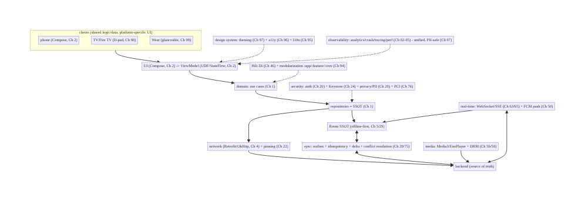
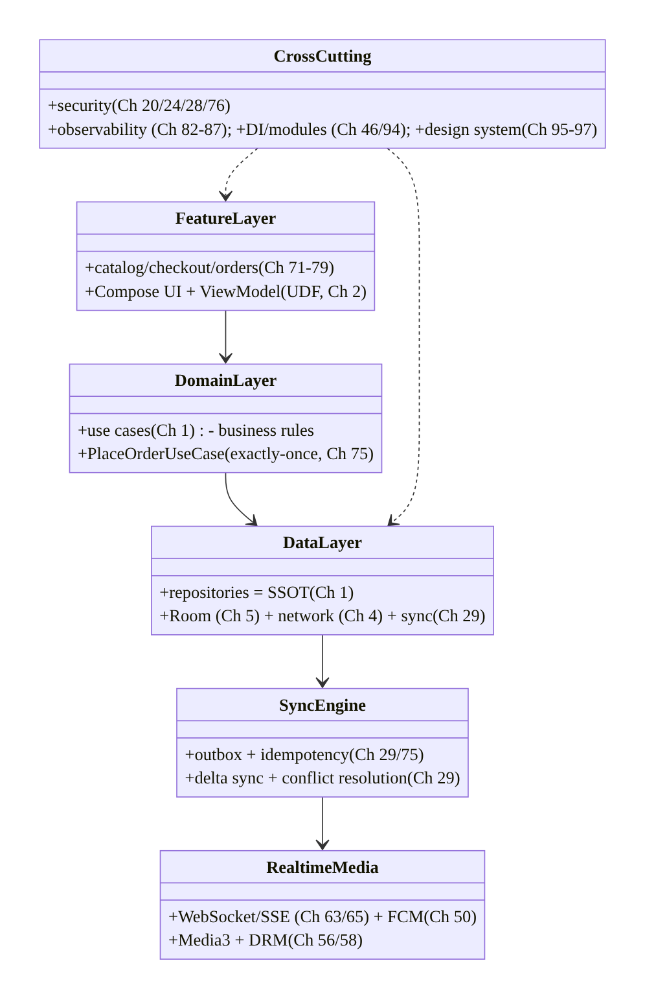
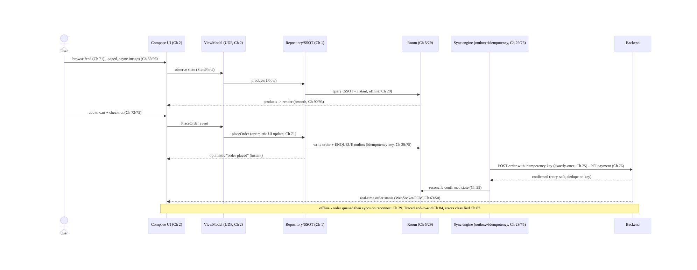
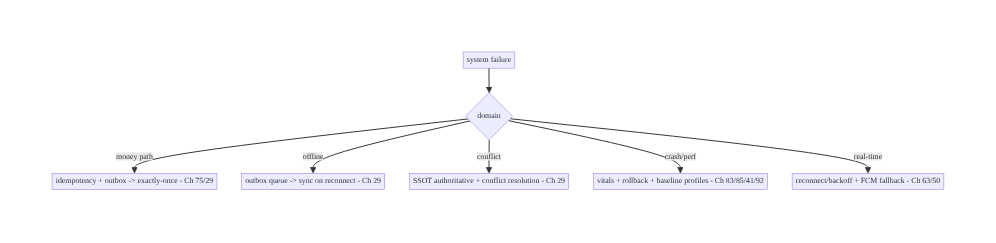

# Chapter 100 — Capstone: StreamCart End-to-End System Design

> **Part XI — Reach, Scale & Platform Breadth** · Complexity: **Complex** (≥40 interview questions)
>
> **Prerequisites:** the whole book. This chapter **synthesizes** Ch 1–99 into one coherent,
> end-to-end Android system design, and is also the **template for a full mock interview**.
>
> **Reference surface:** **StreamCart** itself — the fictional e-commerce + streaming app used
> throughout — designed **end to end**: architecture and layering, offline-first data, real-time
> features, media/OTT, feature flows (catalog → checkout → payments → orders), security,
> performance/observability, and platform breadth (phone/TV/Wear). This is the chapter that shows
> how the pieces **compose** into a system, and how to **drive a senior Android system-design
> interview** from requirements to trade-offs.

---

## 100.1 Problem Definition and Real-World Context

Every prior chapter solved **one** problem in depth. A real app — and a real **senior system-design
interview** — requires **composing** them: making the **architecture**, **data**, **real-time**,
**media**, **feature**, **security**, **performance**, and **platform** decisions **fit together**
into a coherent whole, with the **trade-offs** that connect them made explicit. **StreamCart** is an
**e-commerce + streaming** app: users **browse a catalog**, **watch** product videos / streamed
content (OTT), **add to cart**, **check out** and **pay**, **track orders**, get **real-time**
updates (order status, live events), and use it across **phone, TV, and watch**, **online and
offline**, **globally**, **accessibly**, and at **scale**. This capstone designs StreamCart **end to
end**, showing how the book's chapters **compose** — and doubles as the **structure of a full mock
interview**: clarify requirements → high-level architecture → data model → deep-dive the hard parts
→ cross-cutting concerns → trade-offs → scale → wrap-up.

The capstone answers the questions a senior interview (or a real tech-lead decision) demands:

- **How do the layers fit (Ch 1)?** UI (Compose, Ch 2) → ViewModel/UDF (Ch 2) → domain (use cases,
  Ch 1) → data (repositories, Ch 1) → sources (network Ch 4, DB Ch 5), wired by DI (Ch 46), across
  **modules** (Ch 94). One **architecture** spans every feature.
- **How is data kept correct offline (Part IV)?** **Offline-first**: Room as **SSOT** (Ch 5/29),
  **sync** with the backend (delta sync, Ch 29), the **outbox pattern** + **idempotency** for
  writes (Ch 29/75), **conflict resolution** (Ch 29), and **optimistic updates** (Ch 71). Data is
  the spine.
- **How do real-time + media work (Parts VII–VIII)?** **WebSocket/SSE** for live updates (Ch 63/
  65), **FCM** push (Ch 50), **presence** (Ch 66); **Media3/ExoPlayer** for playback (Ch 56),
  **DRM** for premium OTT (Ch 58). Streaming is a first-class capability.
- **How does the money flow safely (Part IX)?** **Checkout** with **exactly-once** semantics
  (idempotency keys, Ch 75), **Play Billing** / **payments** with **PCI/tokenization** (Ch 76/77),
  **order tracking** (Ch 78). Correctness + security where it matters most.
- **How is it secure, fast, observable, and broad (Parts III, X, XI)?** **Auth** (Ch 20), **crypto/
  keystore** (Ch 24), **privacy** (Ch 28); **startup/jank/memory** performance (Ch 88/90/89),
  **analytics/crash/tracing** observability (Ch 82/83/84); **modularization** (Ch 94),
  **localization/accessibility/theming** (Ch 95/96/97), **TV/Wear** (Ch 98/99). The cross-cutting
  concerns.

This chapter **integrates** all of it, then models how to **present** it in an interview.

### The StreamCart product (the system to design)

- **Catalog & discovery:** browse/search products (Ch 9), **infinite feed** (Ch 71),
  **recommendations** (Ch 72), **images** (Ch 59).
- **Streaming/OTT:** watch product videos and streamed content with **Media3** (Ch 56), **offline
  downloads + DRM** (Ch 58).
- **Commerce:** **cart** + **wishlist** (Ch 73/74), **checkout** (Ch 75), **payments/billing**
  (Ch 76/77), **order tracking** (Ch 78), **reviews** (Ch 79).
- **Real-time:** order-status updates, live events, **presence/notifications** (Ch 50/63/66).
- **Cross-cutting:** offline-first (Ch 29), auth/security/privacy (Ch 20/24/28), performance/
  observability (Part X), platform breadth — phone/TV/Wear (Ch 98/99), global reach (Ch 95/96/97).

### Why this is architectural (and interview-critical)

Senior system design is **not** solving one problem — it's **composing** solutions with coherent
**trade-offs** under **requirements** and **constraints**. The capstone shows how StreamCart's
architecture (Ch 1/94), data (Ch 29), real-time (Ch 63), media (Ch 56/58), features (Part IX),
security (Part III), performance/observability (Part X), and platform breadth (Part XI) **fit
together**, and how to **drive the interview** that evaluates exactly this skill.

---

## 100.2 Requirements Engineering (the interview's first move)

> In a system-design interview, **start here** — clarify **functional** scope, **non-functional**
> targets, **scale**, and **constraints** before designing. Don't jump to a solution.

### Functional requirements (what StreamCart does)

| ID | Requirement | Chapters |
|----|-------------|----------|
| F1 | Browse/search catalog, infinite feed, recommendations | Ch 9, 71, 72 |
| F2 | Stream product/OTT video; offline downloads + DRM | Ch 56, 58 |
| F3 | Cart, wishlist, checkout (exactly-once), payments | Ch 73, 74, 75, 76, 77 |
| F4 | Order tracking + real-time status; reviews | Ch 78, 79, 63 |
| F5 | Auth + accounts; notifications | Ch 20, 50 |
| F6 | Offline-first; works on phone, TV, watch; global | Ch 29, 98, 99, 95 |

### Non-functional requirements (the targets)

| Attribute | Target | Chapters |
|-----------|--------|----------|
| **Offline** | Fully usable offline; syncs/reconciles | Ch 29 |
| **Correctness** | Exactly-once checkout/payment; consistent data | Ch 75, 76, 29 |
| **Performance** | Fast cold start, smooth scroll, no OOM | Ch 88, 90, 89 |
| **Security/Privacy** | Auth, encrypted secrets, PII-safe, PCI | Ch 20, 24, 28, 76 |
| **Observability** | Analytics, crash, tracing, perf | Ch 82, 83, 84, 85 |
| **Reach** | Localized, accessible, themeable, multi-device | Ch 95, 96, 97, 98, 99 |

### Scale & constraints (clarify explicitly)

- **Scale:** millions of users, large catalog, high read (browse) vs lower write (checkout) ratio,
  global, device range from flagship to low-RAM STB/watch.
- **Constraints:** mobile network (flaky/offline, Ch 67/68), battery (Ch 91), device memory (Ch 89),
  Play policies, regional legal/PCI (Ch 28/76), multi-platform (Ch 98/99).
- **What to clarify in the interview:** which features are in scope (don't design everything);
  offline requirements; consistency needs (exactly-once?); platform targets; scale numbers.

### Scope (this capstone)

- **In scope:** end-to-end composition — architecture/layers/modules, offline-first data + sync,
  real-time + media, the checkout/payment critical path, cross-cutting security/performance/
  observability, platform breadth, and the **interview method**.
- **Out of scope:** re-deriving each subsystem (covered in its chapter); backend internals (this is
  the **Android** system design, with backend **contracts**).

---

## 100.3 System Design Fundamentals (how the pieces compose)

- **One layered architecture across every feature (Ch 1/2/46/94).** Every StreamCart feature —
  catalog, checkout, orders — uses the **same** layering: **UI** (Compose, declarative, Ch 2) →
  **ViewModel** (UDF: state down, events up, `StateFlow`, Ch 2) → **domain** (use cases, business
  rules, Ch 1) → **data** (repositories = single source of truth, Ch 1) → **sources** (network,
  Ch 4; Room, Ch 5), wired by **Hilt DI** (Ch 46) and organized into **Gradle modules** (`:app` +
  `:feature:*` + `:core:*`, Ch 94). **Consistency of architecture** is what lets many teams build
  many features coherently. The architecture is the **frame** into which everything else fits.
- **Offline-first data is the spine (Part IV: Ch 29–37).** StreamCart is **offline-first**: **Room
  is the single source of truth** (Ch 5/29); the UI reads from the **DB** (Flow), and **sync**
  reconciles with the backend. **Reads** come from the local DB (instant, offline-capable); **writes**
  go through the **outbox pattern** (Ch 29) — write locally + enqueue, sync when online, with
  **idempotency keys** (Ch 29/75) so retries don't duplicate, and **conflict resolution** (Ch 29)
  for concurrent edits. **Delta sync** (Ch 29) keeps it efficient (Ch 91). **Optimistic updates**
  (Ch 71) make the UI feel instant. This data architecture underpins **every** feature's
  correctness and offline behavior.
- **Real-time + push layer (Part VIII: Ch 63–70).** Live features — **order status**, **live
  events**, **presence** — use **WebSocket** (Ch 63) or **SSE/long-poll** (Ch 65) for a live
  channel, **FCM** (Ch 50) for push when the app is backgrounded, with **reconnection/backoff**
  (Ch 63), **network-state awareness** (Ch 68), and **battery discipline** (push over poll, Ch 91).
  Real-time updates flow into the **same SSOT** (Ch 29) so the UI stays consistent.
- **Media / OTT (Part VII: Ch 56–62).** Streaming uses **Media3/ExoPlayer** (Ch 56) with
  **adaptive streaming**, a **media session** (background/lock-screen/voice), **offline downloads
  + DRM** (Widevine, Ch 58) for premium content, and **efficient image loading** (Coil, Ch 59) for
  catalog art. Media is a **first-class** subsystem, central on **TV** (Ch 98).
- **The commerce critical path (Part IX: Ch 71–81) — correctness where it counts.** **Browse**
  (infinite feed Ch 71 + recommendations Ch 72 + search Ch 9) → **cart/wishlist** (Ch 73/74) →
  **checkout** with **exactly-once** semantics (idempotency keys + outbox, Ch 75) → **payment**
  (Play Billing Ch 77 / card tokenization + PCI, Ch 76) → **order tracking** (Ch 78, real-time,
  Ch 63) → **reviews** (Ch 79). The **money path** demands the **strongest** correctness
  (exactly-once, idempotency) and **security** (PCI, tokenization) — this is where the architecture's
  guarantees matter most.
- **Cross-cutting security (Part III: Ch 19–28).** **Auth** (token-based, refresh, Ch 20) gates the
  app; **crypto/Keystore** (Ch 24) protects secrets at rest; **certificate pinning** (Ch 22)
  secures transport; **privacy** (consent, PII minimization/redaction, per-account isolation, Ch 28)
  governs all data; **payments** add **PCI/tokenization** (Ch 76). Security is **woven through
  every layer**, not a feature.
- **Cross-cutting performance & observability (Part X: Ch 82–93).** **Performance**: fast **cold
  start** (App Startup + lazy graph + baseline profiles, Ch 88/92), smooth **scrolling** (lazy
  lists + stable keys + async images, Ch 90/93), no **OOM/leaks** (lifecycle scoping + bounded
  caches, Ch 89), battery efficiency (Ch 91). **Observability**: **analytics** (Ch 82), **crash/
  ANR** (Ch 83), **distributed tracing** (Ch 84), **field perf** (Ch 85), **error classification**
  (Ch 87) — a **unified, PII-safe, consented** telemetry pipeline. You **operate** StreamCart from
  this signal.
- **Cross-cutting reach & platform breadth (Part XI: Ch 94–99).** **Modularization** (Ch 94) scales
  the codebase/teams; **localization/RTL/regionalization** (Ch 95), **accessibility** (Ch 96), and
  **theming** (Ch 97) make it correct for **every** user; **TV/STB/Fire TV** (Ch 98) and **Wear**
  (Ch 99) extend it across the **device ecosystem** — sharing **business logic/data** (Ch 1/94/29)
  while building **platform-specific UI**.
- **How the trade-offs connect (the senior skill).** The decisions **interact**: **offline-first**
  (Ch 29) enables **optimistic UI** (Ch 71) but demands **conflict resolution** (Ch 29) and
  **idempotency** (Ch 75); **exactly-once checkout** (Ch 75) requires the **outbox + idempotency +
  backend contract** (Ch 29); **real-time** (Ch 63) and **battery** (Ch 91) trade off (push vs
  poll, Ch 50); **performance** (Ch 88/90) and **features** trade off (defer non-critical, Ch 88);
  **reach** (Ch 95/96/97) is a cross-cutting tax paid by the **design system** (Ch 97/94). Senior
  system design is **naming these trade-offs** and **choosing** coherently under the requirements.

Core insight: **a real Android app — and a senior system-design answer — is the coherent composition
of the whole book: one consistent layered architecture (UI → ViewModel/UDF → domain → data →
sources, DI-wired, modularized, Ch 1/2/46/94) into which every feature fits; an offline-first data
spine where Room is the single source of truth and sync reconciles with the backend using the outbox
pattern, idempotency keys, delta sync, and conflict resolution (Ch 5/29) so every feature is correct
offline and optimistic online (Ch 71); a real-time layer (WebSocket/SSE + FCM, Ch 63/65/50) and a
media/OTT subsystem (Media3 + DRM, Ch 56/58) as first-class capabilities feeding the same SSOT; a
commerce critical path that demands the strongest correctness and security — exactly-once checkout
via idempotency and the outbox (Ch 75), payments with PCI tokenization (Ch 76/77), real-time order
tracking (Ch 78); security woven through every layer (auth, Keystore, pinning, privacy/consent/PII,
Ch 20/24/22/28); performance and observability as cross-cutting disciplines (fast startup, smooth
scroll, no OOM — Ch 88/90/89 — measured and operated via a unified PII-safe telemetry pipeline,
Ch 82/83/84/85/87); and reach across the ecosystem (modularization for teams, localization/
accessibility/theming for every user, TV/Wear for every device — Ch 94/95/96/97/98/99, sharing
business logic while building platform-specific UI) — with the senior skill being to name how these
decisions interact and trade off (offline-first enables optimistic UI but demands conflict
resolution and idempotency; real-time trades against battery; performance trades against features;
reach is a design-system tax) and to choose coherently under explicit requirements, scale, and
constraints — which is exactly what the system-design interview evaluates, structured as clarify →
architecture → data → deep-dive the hard parts → cross-cutting concerns → trade-offs → scale.**

---

## 100.4 High-Level Architecture (the whiteboard diagram)



**Components & ownership (the whole system)**

- **Clients** (phone/TV/Wear, Ch 2/98/99) share **domain + data** (Ch 1/29), build platform UI.
- **Layered core:** UI → ViewModel (UDF) → domain → repositories (SSOT) → Room + network (Ch 1/2/
  4/5).
- **Offline-first sync** (outbox + idempotency + delta + conflict, Ch 29/75) ↔ backend;
  **real-time** (Ch 63/50) + **media** (Ch 56/58).
- **Cross-cutting:** security (Ch 20/24/28/76), observability (Ch 82–87), DI + modularization
  (Ch 46/94), design system (Ch 95/96/97).

**Direction:** platform UI → shared layered core (UDF → domain → SSOT repositories → Room + network)
↔ offline-first sync + real-time + media ↔ backend; security, observability, DI/modules, and design
system woven through.

---

## 100.5 Detailed Component Design (the subsystems, integrated)



| Subsystem | Responsibility | Chapters |
|-----------|----------------|----------|
| Feature layer | per-feature UI + ViewModel (UDF) | Ch 2, 71–79, 94 |
| Domain layer | use cases / business rules (exactly-once checkout) | Ch 1, 75 |
| Data layer | repositories (SSOT) + Room + network | Ch 1, 4, 5 |
| Sync engine | outbox + idempotency + delta + conflict | Ch 29, 75 |
| Real-time/media | WebSocket/SSE + FCM; Media3 + DRM | Ch 63, 65, 50, 56, 58 |
| Cross-cutting | security, observability, DI/modules, design system | Ch 20–28, 82–87, 46, 94–97 |

---

## 100.6 End-to-End Data Flow (a full user journey: browse → checkout)



This single flow composes: **feed** (Ch 71) + **paging/images** (Ch 93/59) + **rendering** (Ch 90),
**SSOT reads** (Ch 29), **optimistic UI** (Ch 71), **outbox + idempotency** (Ch 29/75), **exactly-
once checkout** (Ch 75), **PCI payment** (Ch 76), **sync reconciliation** (Ch 29), **real-time
status** (Ch 63/50), **offline tolerance** (Ch 29), **tracing** (Ch 84), and **error
classification** (Ch 87) — **the whole book in one journey**.

---

## 100.7 Implementation (the integration seams)

> The capstone doesn't re-implement subsystems (each chapter did). It shows the **seams** where they
> connect. Package: `com.streamcart`.

### 100.7.1 The layered seam: UI → ViewModel → use case → repository (Ch 1/2)

```kotlin
// UI (Ch 2) observes ViewModel state; ViewModel calls a use case; use case uses a repository (SSOT).
@HiltViewModel
class CheckoutViewModel @Inject constructor(private val placeOrder: PlaceOrderUseCase) : ViewModel() {
    val state: StateFlow<CheckoutState> = /* ... */ MutableStateFlow(CheckoutState.Idle)
    fun onPlaceOrder(cart: Cart) = viewModelScope.launch {
        _state.value = CheckoutState.Placing                       // optimistic (Ch 71)
        placeOrder(cart).fold(                                      // use case (Ch 1) -> Result (Ch 23)
            onSuccess = { _state.value = CheckoutState.Placed(it) },
            onFailure = { _state.value = CheckoutState.Error(it) }) // classified downstream (Ch 87)
    }
}
```

### 100.7.2 The correctness seam: exactly-once checkout (outbox + idempotency, Ch 29/75)

```kotlin
class PlaceOrderUseCase @Inject constructor(private val orders: OrderRepository) {
    suspend operator fun invoke(cart: Cart): Result<Order> = runCatching {
        val idempotencyKey = UUID.randomUUID().toString()          // exactly-once key (Ch 75)
        orders.placeLocallyAndEnqueue(cart, idempotencyKey)         // write SSOT + outbox (Ch 29) - survives offline
        // Sync engine POSTs with the key; backend dedupes -> exactly-once even on retry (Ch 75).
    }
}
```

### 100.7.3 The sync seam: outbox drained by WorkManager, reconciled to SSOT (Ch 29/48)

```kotlin
class OutboxSyncWorker @Inject constructor(/* ... */) : CoroutineWorker(/* ... */) {   // Ch 48
    override suspend fun doWork(): Result {
        outbox.pending().forEach { op ->
            val resp = api.execute(op, idempotencyKey = op.key)     // idempotent (Ch 75) - retry-safe
            room.reconcile(resp)                                    // SSOT reflects confirmed state (Ch 29)
            outbox.markDone(op)
        }
        return Result.success()                                     // retries with backoff on failure (Ch 29/91)
    }
}
```

### 100.7.4 The cross-cutting seam: security + observability + DI (Ch 20/84/46)

```kotlin
// One OkHttp stack wires auth (Ch 20), pinning (Ch 22), tracing (Ch 84) - injected everywhere (Ch 46)
@Provides @Singleton
fun okHttp(auth: AuthInterceptor, pinner: CertificatePinner, tracing: TracingInterceptor): OkHttpClient =
    OkHttpClient.Builder()
        .addInterceptor(auth)            // token auth + refresh (Ch 20)
        .certificatePinner(pinner)       // pinning (Ch 22)
        .addInterceptor(tracing)         // correlation/trace propagation (Ch 84)
        .build()
// Analytics/crash/perf (Ch 82/83/85) flow through one PII-safe pipeline (Ch 87/28); DI aggregates at :app (Ch 94).
```

### 100.7.5 The platform seam: shared core, platform UI (Ch 94/98/99)

```kotlin
// :core:data, :core:domain, :core:sync are SHARED across phone/TV/Wear (Ch 94);
// only :feature:* UI differs per platform:
//   phone  -> Compose touch UI (Ch 2)
//   tv     -> D-pad focus UI (Ch 98)
//   wear   -> glanceable tiles/Compose (Ch 99)
// All three read the SAME repositories/SSOT + sync (Ch 1/29) -> consistent state across devices (Ch 99).
```

### 100.7.6 Module structure (the whole app)

```
:app (+ :tv:app, :wear:app)  composition roots per platform (Ch 94/98/99)
:feature:catalog/checkout/orders/account/...  per-feature UI+VM (Ch 71-79)
:core:domain (use cases, Ch 1), :core:data (repositories/SSOT, Ch 1), :core:sync (outbox/idempotency, Ch 29)
:core:network (Ch 4) + :core:database (Ch 5) + :core:designsystem (Ch 95/96/97)
:core:common/model, build-logic (Ch 94)
# Security (Ch 20/24/28/76), observability (Ch 82-87), real-time (Ch 63/50), media (Ch 56/58) as core modules.
```

---

## 100.8 Concurrency and Race Conditions (the system-level ones)

| Scenario | Risk | Handling | Ch |
|----------|------|----------|----|
| Double checkout (retry/offline) | duplicate order/charge | idempotency key + outbox (exactly-once) | 75, 29 |
| Concurrent edits (devices) | conflict | versioned sync + conflict resolution | 29, 99 |
| Optimistic update diverges | wrong UI | reconcile to SSOT on sync | 29, 71 |
| Real-time + sync race | inconsistent state | both write the single SSOT | 29, 63 |
| Token refresh storm | thundering herd | single-flight refresh | 20 |
| Background work on main | jank/ANR | off-main, WorkManager | 3, 48 |
| Cross-device state | divergence | backend source of truth + sync | 29, 99 |

- **The single source of truth (Ch 29) is the system-wide race-resolver:** real-time updates (Ch 63),
  sync reconciliation (Ch 29), and optimistic writes (Ch 71) **all** funnel through the **one SSOT**
  (Room), so the UI is always consistent regardless of which path updated it.
- **Idempotency is the money-path guarantee (Ch 75):** the **idempotency key** + **outbox** make
  checkout **exactly-once** even across retries, offline queueing, and process death — the single
  most important correctness property, composed from sync (Ch 29) and checkout (Ch 75).
- **Cross-device consistency (Ch 99) extends the same model:** phone/TV/Wear all reconcile against
  the **backend source of truth** (Ch 29), so a change on one device propagates consistently.

---

## 100.9 Failure Scenarios and Recovery (system-level resilience)

| Failure | Detection | Response | Ch |
|---------|-----------|----------|----|
| Offline during checkout | connectivity | outbox queues; syncs on reconnect; exactly-once | 29, 75 |
| Payment retry | idempotency | key dedupes — no double charge | 75, 76 |
| Sync conflict | version mismatch | conflict resolution; SSOT authoritative | 29 |
| Crash/ANR | vitals (Ch 83) | crash pipeline + rollback (Ch 41) | 83, 41 |
| Perf regression | field p95 (Ch 85) | gate/rollback; baseline profiles | 85, 88, 92 |
| Real-time disconnect | heartbeat | reconnect/backoff; fall back to poll/FCM | 63, 50 |
| Low-RAM OOM (TV/low-end) | field OOM (Ch 89) | bounded memory; device-tiered | 89, 98 |



> **The system is resilient because its parts compose correctly.** Offline-first + outbox +
> idempotency (Ch 29/75) make the money path exactly-once and offline-tolerant; the SSOT (Ch 29)
> resolves races across sync, real-time, and optimistic UI; observability + rollback (Ch 83/85/41)
> let you operate and recover; device-tiering (Ch 89/98/99) handles the hardware range. Senior
> design is ensuring the **composition** is resilient, not just each part.

---

## 100.10 Scaling the Implementation (how StreamCart grows)

- **Level 1 (MVP).** Core layered architecture (Ch 1/2), Room SSOT + basic sync (Ch 5/29), catalog +
  cart + checkout (Ch 71/73/75), auth (Ch 20), one platform (phone).
- **Level 2 (product).** Offline-first (outbox/idempotency/conflict, Ch 29/75), payments (Ch 76/77),
  real-time order status (Ch 63/50), media (Ch 56), analytics/crash (Ch 82/83).
- **Level 3 (scale).** Modularization (Ch 94), full observability (tracing/perf/error, Ch 84/85/87),
  performance (startup/jank/memory, Ch 88/90/89), DRM/OTT (Ch 58), recommendations (Ch 72).
- **Level 4 (reach).** Localization/accessibility/theming (Ch 95/96/97), TV + Wear (Ch 98/99),
  experimentation (Ch 86), baseline profiles (Ch 92), battery (Ch 91), staged rollout (Ch 41).
- **Level 5 (enterprise).** Multi-team modular platform, SLOs/error budgets (Ch 85/87), global
  regionalization/compliance (Ch 95/28), device-matrix testing, cross-device ecosystem (phone/TV/
  Wear consistency, Ch 99), continuous experimentation + governance.

**Avoid overengineering:** build the **architecture + SSOT + the critical path (checkout) correctly**
first; add real-time, media, platforms, and reach **as the product demands**. Don't build for scale
you don't have; **do** get the **money path's correctness** (Ch 75) and the **data spine** (Ch 29)
right from the start — they're the hardest to retrofit.

---

## 100.11 Alternative Approaches and Trade-offs (the senior conversation)

| Decision | Option A | Option B | StreamCart choice & why |
|----------|----------|----------|-------------------------|
| Data | Offline-first (SSOT, Ch 29) | network-driven | **Offline-first** — usable offline, resilient, optimistic UI (Ch 71) |
| Writes | Outbox + idempotency (Ch 29/75) | direct fire-and-forget | **Outbox** — exactly-once, offline-tolerant |
| Real-time | WebSocket + FCM (Ch 63/50) | poll | **WebSocket + push** — live + battery-efficient (Ch 91) |
| Architecture | Modular (Ch 94) | monolith | **Modular** — teams + build speed + enforcement |
| UI | Compose (Ch 2) | Views | **Compose** — declarative, UDF, multiplatform-ish |
| Consistency | SSOT + conflict resolution (Ch 29) | last-write-wins | **SSOT + conflict** — correctness |
| Platforms | Shared core + platform UI (Ch 94/98/99) | separate apps | **Shared core** — consistency + reuse |

**The trade-offs interact (the point of the capstone):**
- **Offline-first (Ch 29) ⇄ complexity:** it enables **optimistic UI** (Ch 71) and resilience but
  **requires** conflict resolution (Ch 29) and idempotency (Ch 75). StreamCart pays this cost
  because **offline usability + correctness** are core requirements.
- **Real-time (Ch 63) ⇄ battery (Ch 91):** a live socket drains battery; **push (FCM, Ch 50)** +
  **efficient reconnection** balance **freshness vs power**. Choose per feature.
- **Performance (Ch 88/90) ⇄ features:** every SDK/init costs **startup** (Ch 88); **defer non-
  critical** and **baseline-profile** the critical path (Ch 92). Features earn their startup cost.
- **Reach (Ch 95/96/97) ⇄ effort:** localization/accessibility/theming are a **cross-cutting tax**
  paid efficiently by a **design system** (Ch 97) + **modularization** (Ch 94) — architect it in,
  don't retrofit.
- **Exactly-once (Ch 75) ⇄ simplicity:** idempotency + outbox + backend contract is **more work**
  than fire-and-forget, but the **money path** demands it. Correctness **where it counts**.

Senior system design is **making these trade-offs explicit** and **choosing coherently** under the
stated requirements — not reaching for the most complex option everywhere.

---

## 100.12 Security & Privacy Considerations (woven through, summarized)

- **Auth gates everything (Ch 20):** token-based auth with refresh, secure token storage (Keystore,
  Ch 24), single-flight refresh; the money path requires a **valid session** (Ch 20).
- **Secrets at rest (Ch 24):** keys/tokens in the **Android Keystore**; no secrets in code/logs
  (Ch 28); R8 obfuscation raises the bar (Ch 92) but isn't secret-hiding.
- **Transport security (Ch 22):** TLS + **certificate pinning** for sensitive endpoints (auth,
  payment); the single OkHttp stack enforces it everywhere (Ch 4).
- **Payments = PCI (Ch 76/77):** **never** handle raw card data — **tokenize** via the payment SDK/
  Play Billing; the app orchestrates, the processor holds card data; idempotency prevents double
  charges (Ch 75).
- **Privacy (Ch 28):** **consent** gates analytics/telemetry (Ch 82/85); **PII minimization +
  redaction** in all telemetry (Ch 87); **per-account isolation** (clear on sign-out); **regional
  compliance** (GDPR, Ch 95/28); sensitive surfaces use `FLAG_SECURE` (Ch 76).
- **Cross-device security (Ch 98/99):** DRM for premium OTT (Ch 58), profile isolation on shared
  TVs (Ch 28/98), QR/device-code sign-in on TV/Wear (Ch 98/99), standalone-watch auth (Ch 20/99).
- **Security is a cross-cutting layer, not a feature** — it's in the **network stack**, **storage**,
  **the money path**, **telemetry**, and **every platform**. Design it in from the start.

---

## 100.13 Performance and Resource Optimization (the cross-cutting discipline)

- **Startup (Ch 88/92):** trim `Application.onCreate`, App Startup + lazy DI graph (Ch 46), skeleton
  at TTID → TTFD, **Baseline Profiles + R8** (Ch 92) — fast first launch across the device range.
- **Scrolling (Ch 90/93):** lazy lists + stable keys + light/skippable items + async images (Coil,
  Ch 59) + paging (Ch 71) — smooth catalog/feed on low-end + TV (Ch 98).
- **Memory (Ch 89):** lifecycle-scoped references, bounded caches, downsampled images, no leaks —
  critical on low-RAM TV/STB/Wear (Ch 98/99).
- **Battery/network (Ch 91):** push over poll (Ch 50), batch/defer (WorkManager, Ch 48), delta sync
  (Ch 29), metered-aware — strictest on Wear (Ch 99).
- **Measured, operated, gated (Ch 85/92):** field perf percentiles (Ch 85), Macrobenchmark CI gates
  (Ch 92), regression rollback (Ch 41) — performance is **continuously defended**.
- **Device-tiered:** flagship → low-RAM STB → watch — budgets and behavior adapt per tier (Ch 89/98/
  99).
- **Profiling:** the full toolkit — startup (Ch 88), frames (Ch 90), memory (Ch 89), battery (Ch 91),
  field vitals (Ch 85) — across the device matrix.

---

## 100.14 Testing Strategy (the whole pyramid)

StreamCart's testing composes every chapter's strategy into a coherent **pyramid**:

```kotlin
// UNIT (most): use cases (Ch 1), repositories (fakes), ViewModels (UDF, Ch 2), sync/idempotency (Ch 29/75),
//   formatters/plurals (Ch 95), classification (Ch 87), focus logic (Ch 98) - fast, isolated, per-module (Ch 94).
class PlaceOrderUseCaseTest {
    @Test fun `checkout is exactly-once on retry`() = runTest {
        placeOrder(cart); placeOrder(cart)                      // same idempotency key path
        assertEquals(1, backend.orderCount())                  // exactly-once (Ch 75/29) - the critical test
    }
}

// INTEGRATION: repository + Room + fake network (Ch 5/4); sync reconciliation (Ch 29); real-time -> SSOT (Ch 63).
// UI: Compose tests (Ch 2) + accessibility (semantics, Ch 96) + screenshot across themes (Ch 97) + pseudolocale (Ch 95).
// E2E/DEVICE: offline checkout -> reconnect -> exactly-once (Ch 29/75); DRM playback (Ch 58);
//   real low-RAM TV (Ch 89/98) + real watch battery/sync (Ch 91/99); Macrobenchmark startup/frames CI gate (Ch 88/90/92).
```

What to test (system-level): **exactly-once checkout** (the critical correctness test, Ch 75/29);
offline → reconnect reconciliation (Ch 29); sync conflict resolution (Ch 29); real-time → SSOT
consistency (Ch 63); payment tokenization/PCI path (Ch 76); accessibility + localization + theming
(Ch 95/96/97); performance gates (Macrobenchmark, Ch 88/90/92); cross-device sync (Ch 99); DRM
(Ch 58). **Unit-heavy pyramid, per-module (Ch 94)**, with **real-device** E2E for the hard parts.

---

## 100.15 Production Observability (operating StreamCart)

- **The unified telemetry pipeline (Ch 82–87):** **analytics** (funnels: browse→cart→checkout,
  Ch 82), **crash/ANR** (vitals, Ch 83), **distributed tracing** (end-to-end request correlation,
  Ch 84), **field performance** (startup/jank/memory percentiles, Ch 85), **error classification**
  (fingerprinted/severity-routed, Ch 87) — **unified, correlated, PII-safe, consented** (Ch 28).
- **The business + health metrics:** checkout **conversion** + **exactly-once** integrity (no double
  charges, Ch 75/76), **sync** success/conflict rate (Ch 29), **real-time** delivery (Ch 63),
  **playback QoE** (Ch 56/58), **crash-free rate** (Ch 83), **startup/jank** percentiles by device
  (Ch 85), **battery** (Ch 91), by **platform** (phone/TV/Wear, Ch 98/99).
- **Debugging (end-to-end):** a failed checkout → **trace** (Ch 84) → which service/step → **error
  classification** (Ch 87) → correlated **crash** (Ch 83) or **perf** (Ch 85) — the unified pipeline
  lets you follow one request across the system.
- **Alerting + gating (Ch 41/83/85):** crash/ANR regression, perf regression (p95), exactly-once
  violations, sync failures, playback errors → **alert + staged-rollout gate/rollback** (Ch 41).
- **Dashboards:** conversion funnel, sync/real-time health, playback QoE, crash-free + perf
  percentiles by device/platform/release, battery — **operate the whole system from one place**.

---

## 100.16 System Design Interview Preparation (the capstone method)

> ≥40 questions. This section is **how to drive a senior Android system-design interview** — the
> capstone's dual purpose.

**The interview structure (what to do, in order):**

1. **Clarify requirements (§100.2) — don't skip.** Functional scope, non-functional targets, scale,
   constraints. Ask: offline? consistency (exactly-once)? platforms? scale numbers? Narrow scope.
2. **High-level architecture (§100.4).** Draw the layered diagram (UI→VM→domain→data→sources, Ch 1),
   name offline-first SSOT (Ch 29), real-time/media, backend contract.
3. **Data model + flow (§100.5–6).** SSOT (Room, Ch 29), sync (outbox/idempotency/conflict, Ch 29/
   75), a key flow (checkout).
4. **Deep-dive the hard part.** Usually **exactly-once checkout** (Ch 75) or **offline sync** (Ch 29)
   or **real-time** (Ch 63) — go deep where the interviewer probes.
5. **Cross-cutting concerns.** Security (Ch 20/24/28/76), performance (Ch 88/90/89), observability
   (Ch 82–87) — show you operate it.
6. **Trade-offs (§100.11).** Name the interacting trade-offs; justify choices under requirements.
7. **Scale + wrap-up (§100.10).** How it grows; what you'd do next.

**Core Q&A (composing the book):**

*Architecture/data*
1. *Layers?* UI→VM(UDF)→domain→data(SSOT)→sources; DI; modular (Ch 1/2/46/94).
2. *Offline-first?* Room SSOT; UI reads DB; sync reconciles (Ch 29).
3. *Writes offline?* Outbox + idempotency; sync on reconnect (Ch 29/75).
4. *Exactly-once checkout?* Idempotency key + outbox + backend dedupe (Ch 75).
5. *Conflicts?* Versioning + conflict resolution; SSOT authoritative (Ch 29).
6. *Optimistic UI?* Update SSOT optimistically; reconcile on sync (Ch 71/29).

*Real-time/media*
7. *Live updates?* WebSocket/SSE + FCM; into SSOT (Ch 63/50/29).
8. *Real-time vs battery?* Push over poll; efficient reconnect (Ch 50/91).
9. *Streaming?* Media3 + adaptive + media session (Ch 56).
10. *Premium content?* DRM (Widevine); offline downloads (Ch 58).

*Commerce/security*
11. *Payment?* Tokenize (PCI); Play Billing / processor SDK (Ch 76/77).
12. *No double charge?* Idempotency (Ch 75).
13. *Auth?* Token + refresh; Keystore storage (Ch 20/24).
14. *Transport?* TLS + pinning (Ch 22).
15. *Privacy?* Consent + PII redaction + per-account isolation (Ch 28).

*Performance/observability*
16. *Fast startup?* Trim onCreate + lazy graph + baseline profiles (Ch 88/92).
17. *Smooth scroll?* Lazy lists + stable keys + async images + paging (Ch 90/93/59/71).
18. *No OOM?* Lifecycle scoping + bounded caches (Ch 89).
19. *Observe?* Analytics + crash + tracing + perf, unified/PII-safe (Ch 82–87).
20. *Operate/recover?* Vitals + rollback + staged rollout (Ch 83/85/41).

*Reach/platform*
21. *Scale the codebase?* Modularization (Ch 94).
22. *Global?* Localization/RTL/regionalization (Ch 95).
23. *Accessible?* Semantics tree + targets + contrast (Ch 96).
24. *Theming?* Design tokens + Material 3 + dynamic color (Ch 97).
25. *TV?* D-pad focus + 10-foot + media-centric (Ch 98).
26. *Watch?* Glanceable + cross-device sync + efficiency (Ch 99).
27. *Multi-device consistency?* Shared SSOT + backend source of truth (Ch 29/99).

*Trade-offs/method*
28. *Offline-first cost?* Conflict resolution + idempotency complexity (Ch 29/75).
29. *Real-time vs battery?* Socket vs push trade-off (Ch 63/91).
30. *Performance vs features?* Defer non-critical init (Ch 88).
31. *Reach cost?* Design-system tax (Ch 97/94).
32. *Where exactly-once?* Money path only (Ch 75).
33. *Monolith vs modular?* Modular at scale (Ch 94).
34. *Compose vs Views?* Compose (declarative/UDF, Ch 2).
35. *First interview move?* Clarify requirements (§100.2).
36. *Deep-dive what?* The hard part (checkout/sync/real-time).
37. *How to show seniority?* Name interacting trade-offs; choose coherently.
38. *Scale strategy?* Levels 1–5 (§100.10).
39. *What to get right first?* Architecture + SSOT + money-path correctness.
40. *Hardest to retrofit?* The data spine (Ch 29) + exactly-once (Ch 75).
41. *How to handle unknown scale?* Ask; design for the stated scale, note where it'd change.
42. *Wrap-up?* Summary + what's next + risks.

### Design-change challenges (full mock prompts)
1. **Design StreamCart's checkout end-to-end.** Offline-first + outbox + idempotency + PCI payment +
   real-time status (Ch 29/75/76/63).
2. **Make StreamCart work fully offline.** SSOT + sync + conflict resolution + optimistic UI (Ch 29/
   71).
3. **Extend StreamCart to TV + Wear.** Shared core + platform-specific UI + cross-device sync (Ch 94/
   98/99).
4. **Make StreamCart fast on a low-RAM device.** Startup + memory + rendering + baseline profiles
   (Ch 88/89/90/92).
5. **Operate StreamCart in production.** Unified observability + gating + rollback (Ch 82–87/41).

### Full mock walkthrough (the whole method)
Clarify requirements (scope/offline/consistency/platforms/scale, §100.2) → high-level layered
architecture (UI→VM→domain→SSOT→sources, modular, Ch 1/94) → data model + offline-first sync (Room
SSOT + outbox + idempotency + conflict, Ch 29/75) → key flow (browse→checkout, §100.6) → deep-dive
the hard part (exactly-once checkout / sync / real-time) → real-time + media (Ch 63/56/58) →
cross-cutting security (Ch 20/24/28/76) + performance (Ch 88/90/89) + observability (Ch 82–87) →
platform breadth (Ch 94–99) → trade-offs (name interactions, §100.11) → scale (levels, §100.10) →
wrap-up (summary, next, risks). **This is the whole book, delivered as one coherent design.**

---

## 100.17 Practical Exercises (capstone projects)

1. **Beginner.** Build StreamCart's core slice: layered architecture (Ch 1/2) + Room SSOT (Ch 5/29) +
   catalog browse (Ch 71) + cart (Ch 73), offline-capable. *Eval:* clean layers; reads offline.
2. **Intermediate.** Add exactly-once checkout (outbox + idempotency, Ch 75/29) + payment
   tokenization (Ch 76) + real-time order status (Ch 63/50). *Eval:* no double orders; live status.
3. **Advanced.** Add offline sync with conflict resolution (Ch 29), optimistic UI (Ch 71),
   observability (analytics/crash/tracing, Ch 82/83/84), and performance (startup/jank, Ch 88/90).
   *Eval:* consistent offline; operable; fast.
4. **Platform.** Extend to TV (D-pad/media, Ch 98) + Wear (glanceable/sync, Ch 99) sharing the core
   (Ch 94); add localization + accessibility + theming (Ch 95/96/97). *Eval:* multi-device
   consistent; globally correct; accessible.
5. **Full capstone / mock interview.** Design all of StreamCart end-to-end on a whiteboard in 45
   minutes using §100.16's method; then implement one vertical slice production-quality. *Eval:*
   coherent architecture; justified trade-offs; the money path correct; operable and reachable.

*(Solutions withheld unless requested — but every subsystem's chapter has the detailed design.)*

---

## 100.18 Chapter Summary & Reference Sheet

**Key decisions (the whole system):** StreamCart composes the entire book into one coherent design —
**one consistent layered architecture** (UI → ViewModel/UDF → domain use cases → repositories/SSOT →
Room + network, DI-wired and modularized into `:app`/`:feature:*`/`:core:*`, Ch 1/2/46/94) into which
**every feature fits**; an **offline-first data spine** where **Room is the single source of truth**
and **sync** reconciles with the backend using the **outbox pattern, idempotency keys, delta sync,
and conflict resolution** (Ch 5/29) so every feature is **correct offline and optimistic online**
(Ch 71); a **real-time layer** (WebSocket/SSE + FCM, Ch 63/65/50) and a **media/OTT subsystem**
(Media3 + DRM, Ch 56/58) as first-class capabilities feeding the **same SSOT**; a **commerce
critical path** demanding the **strongest correctness and security** — **exactly-once checkout** via
idempotency + outbox (Ch 75), **payments** with **PCI tokenization** (Ch 76/77), **real-time order
tracking** (Ch 78); **security woven through every layer** (auth Ch 20, Keystore Ch 24, pinning
Ch 22, privacy/consent/PII Ch 28, PCI Ch 76); **performance and observability** as cross-cutting
disciplines (fast startup, smooth scroll, no OOM — Ch 88/90/89 — **measured and operated** via a
**unified, correlated, PII-safe** telemetry pipeline, Ch 82/83/84/85/87, with **gating/rollback**,
Ch 41); and **reach across the ecosystem** (modularization for teams Ch 94; localization/
accessibility/theming for every user Ch 95/96/97; TV/Wear for every device Ch 98/99 — **sharing
business logic/data while building platform-specific UI**) — with the **senior skill** being to
**name how these decisions interact and trade off** (offline-first enables optimistic UI but demands
conflict resolution and idempotency; real-time trades against battery; performance trades against
features; reach is a design-system tax) and to **choose coherently under explicit requirements,
scale, and constraints** — delivered in an interview as **clarify → architecture → data → deep-dive
→ cross-cutting → trade-offs → scale**.

**Concepts (the book, integrated):** layered architecture + UDF + DI + modularization (Ch 1/2/46/94);
offline-first SSOT + sync + outbox + idempotency + conflict + optimistic UI (Ch 29/71/75); real-time
+ push (Ch 63/65/50); media + DRM (Ch 56/58); commerce critical path (Ch 71–79); security
(auth/Keystore/pinning/privacy/PCI, Ch 20/22/24/28/76); performance (startup/jank/memory/battery/
baseline profiles, Ch 88/89/90/91/92); observability (analytics/crash/tracing/perf/error, unified +
PII-safe, Ch 82–87); reach (l10n/a11y/theming/TV/Wear, Ch 95–99); the interview method (clarify →
architecture → data → deep-dive → cross-cutting → trade-offs → scale).

**Common mistakes (system-level):** jumping to a solution without clarifying requirements;
network-driven (not offline-first) data; fire-and-forget writes (not exactly-once) on the money path;
treating security/observability/reach as features instead of cross-cutting layers; building for
unneeded scale while getting the data spine/money path wrong; separate apps per platform instead of
shared core; not naming trade-offs; designing every subsystem at max complexity instead of per
requirements.

**Checklist (designing a full Android system):**

- [ ] clarify requirements/scale/constraints first
- [ ] one layered architecture + UDF + DI + modules (Ch 1/2/46/94)
- [ ] offline-first SSOT + sync (outbox/idempotency/delta/conflict, Ch 29/75)
- [ ] optimistic UI reconciled to SSOT (Ch 71/29)
- [ ] real-time (WebSocket/FCM) + media (Media3/DRM) into SSOT (Ch 63/50/56/58)
- [ ] exactly-once money path + PCI tokenization (Ch 75/76/77)
- [ ] security woven through (auth/Keystore/pinning/privacy, Ch 20/22/24/28)
- [ ] performance (startup/jank/memory/battery/baseline profiles, Ch 88–92)
- [ ] unified PII-safe observability + gating/rollback (Ch 82–87/41)
- [ ] reach (l10n/a11y/theming/TV/Wear, Ch 95–99)
- [ ] name the interacting trade-offs and choose per requirements.

**The book, in one sentence:** *a production Android app is the coherent composition of a consistent
layered, modular architecture; an offline-first single-source-of-truth data spine with exactly-once
writes; real-time and media subsystems; a correctness- and security-critical commerce path; security,
performance, and observability woven through every layer; and reach across the device ecosystem — and
senior system design is choosing how these compose and trade off under real requirements.*

**References:**
- Guide to app architecture: https://developer.android.com/topic/architecture
- Now in Android (reference app composing these patterns): https://github.com/android/nowinandroid
- Android app architecture samples: https://github.com/android/architecture-samples
- (composes) **the entire book, Ch 1–99** — this capstone is their synthesis.

### Chapter review (Phase 4)
- **Completeness:** all 18 sections; system-level architecture/class/sequence/failure diagrams
  composing the book; integration-seam code (layered/exactly-once/sync/cross-cutting/platform);
  system-level concurrency (SSOT race-resolver, idempotency money-path, cross-device); system
  resilience (composition correctness); 5 scale levels (MVP→enterprise); the interacting-trade-offs
  conversation; security/performance/observability woven summaries; whole-pyramid testing (exactly-
  once as the critical test); unified observability (operate from one place); the **interview method**
  as §100.16 (clarify→architecture→data→deep-dive→cross-cutting→trade-offs→scale) + 42 Q&A + 5 mock
  prompts + full walkthrough. ✅
- **Role:** capstone/synthesis — integrates Ch 1–99 and doubles as the senior-interview template.
- **Interview coverage:** 42 Q&A + full mock method — exceeds the ≥40 Complex bar.

---

> **This completes the book — all 100 chapters of *Designing Android at Scale*.** From the
> foundations (Part I) through data, offline-first, state, lifecycle, media, real-time, feature
> architectures, performance/observability, and platform breadth — to this capstone that composes
> them into one coherent, production-grade, interview-ready Android system design. **StreamCart**
> was the thread; the **architecture** is the lesson.
