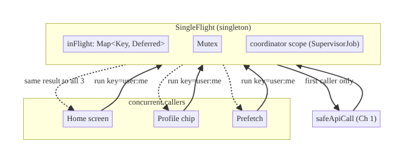
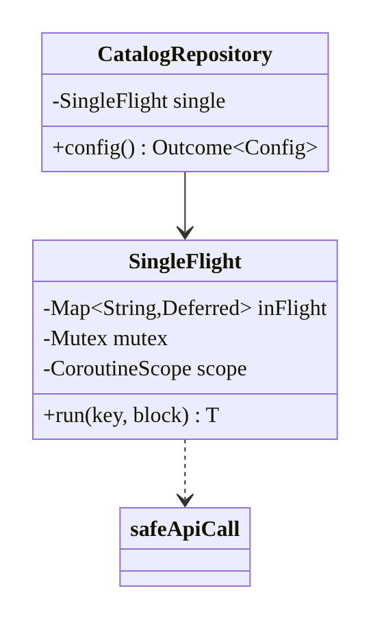
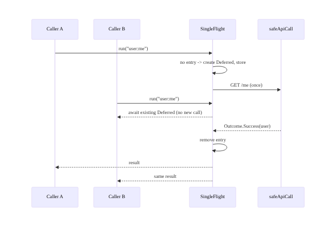
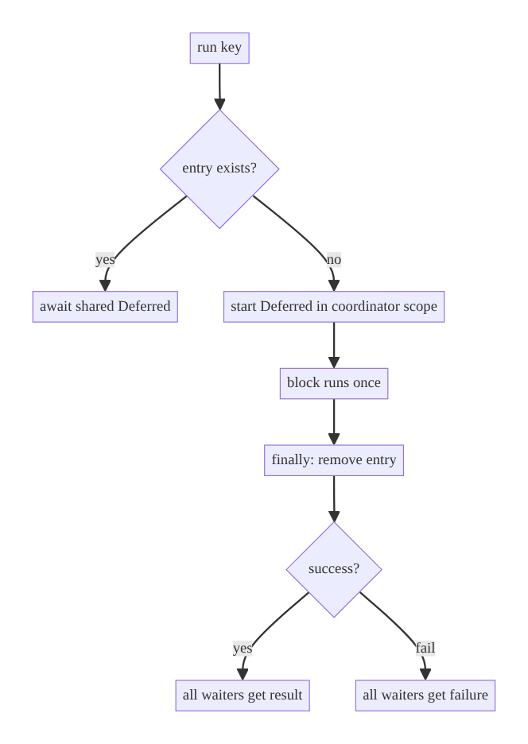

# Chapter 11 — Request Deduplication & Single-Flight

> **Part II — Networking Patterns** · Complexity: **Standard** (≥25 interview questions)
>
> **Prerequisites:** Ch 1 (Networking Core — `safeApiCall`, `Outcome`), Ch 5
> (Hilt singletons), Ch 6 (concurrency context). The **single-flight** primitive
> defined here is reused by Ch 12 (cache stampede), Ch 19 (token refresh), Ch 13
> (paging), Ch 59 (media manifest).
>
> **Reference surface in StreamCart:** collapsing duplicate profile/catalog/config
> fetches issued by multiple screens at once into one in-flight request.

---

## 11.1 Problem Definition and Real-World Context

The same request is frequently triggered multiple times, concurrently, for the
same data. Without coordination, each trigger becomes a separate network call:

- **Multiple screens, same data.** The home screen, the profile chip, and a
  background prefetch all request `GET /me` within the same second → three
  identical calls, three parses, triple backend load.
- **Rapid user actions.** Pull-to-refresh tapped twice, or a button double-tapped,
  fires two identical mutations/fetches.
- **Cache stampede (thundering herd).** A cached value expires and twenty
  collectors miss simultaneously; all twenty hit the network for the same key.
- **Token refresh storm.** Fifty queued requests all get 401 at once; naive code
  triggers fifty refreshes (Ch 19) — the canonical single-flight problem.

**Single-flight** (a.k.a. request coalescing / de-duplication) ensures that for a
given key, **at most one request is in flight**, and all concurrent callers share
its single result. It's a small, reusable concurrency primitive with outsized
impact on backend load, battery, and correctness.

### Three practical use cases

1. **E-commerce config/profile (StreamCart).** Many components need `/me` or
   `/config` on launch; single-flight collapses them into one call whose result
   fans out to all.
2. **OTT playback (Watch).** Several UI elements request the same playback
   manifest/license when a title opens; coalesce to one (Ch 59).
3. **Fintech refresh (Wallet).** A balance refresh triggered by screen-resume and
   a pull-to-refresh at the same time should hit the backend once.

### Why this is architectural

It defines a **coordination primitive** (keyed, concurrency-safe, result-sharing)
that multiple features and other infrastructure (caching, auth) build on. Where
it lives, how keys are defined, and its cancellation semantics are system-level
decisions.

---

## 11.2 Requirements Engineering

### Functional requirements

| ID | Requirement |
|----|-------------|
| F1 | Concurrent calls with the same key share one in-flight request and result. |
| F2 | Calls with different keys run independently. |
| F3 | After completion, the in-flight entry is cleared (next call re-fetches). |
| F4 | A failure is shared by all current waiters (they don't each retry blindly). |
| F5 | Cancellation of one caller must not cancel the shared work for others. |
| F6 | Thread-safe under high concurrency. |

### Non-functional requirements

| Attribute | Policy |
|-----------|--------|
| **Correctness** | Exactly one in-flight call per key; shared result. |
| **Performance** | O(1) map ops; negligible overhead; big backend-load reduction. |
| **Reliability** | Failures don't leave stale in-flight entries (no permanent wedging). |
| **Memory** | In-flight map cleared on completion; bounded. |
| **Concurrency** | Safe under many coroutines; no lost updates. |

### Scope

- **In scope:** the single-flight primitive (keyed `Deferred` sharing), failure
  sharing, cancellation safety, integration with repositories.
- **Out of scope:** result caching/TTL (Ch 12 — single-flight ≠ cache),
  retry/backoff (Ch 2), token refresh application (Ch 19), debounce (Ch 9).

### Assumptions & constraints

- Coroutines; a Hilt `@Singleton` coordinator; keys are stable strings.
  Single-flight de-dupes *concurrent* calls only; it is **not** a cache (it does
  not remember results after completion — that's Ch 12).

---

## 11.3 System Design Fundamentals

- **Single-flight vs cache.** Single-flight coalesces *concurrent* identical
  work; a cache remembers results *across time*. They compose: single-flight
  prevents the stampede when a cache entry expires. Confusing the two is a common
  interview error.
- **Shared `Deferred`.** The primitive stores an in-flight `Deferred<T>` per key
  in a map; concurrent callers `await()` the same `Deferred`. One execution, many
  awaiters.
- **Scope ownership.** The work runs in a **coordinator-owned scope**, not any one
  caller's scope — so if a single caller cancels, the shared work (and other
  waiters) survive (F5). The coordinator uses `async` in its own
  `SupervisorScope`.
- **Keying.** The key identifies "the same request" (e.g., `"user:me"`,
  `"product:123"`); choosing keys is a design decision (too coarse → wrong sharing;
  too fine → no dedup).
- **Cleanup.** On completion (success or failure), remove the entry so the next
  call re-fetches fresh data. Leaving it would turn single-flight into an
  accidental permanent cache of a stale/failed value.
- **Failure sharing.** All current waiters receive the same failure; they may then
  retry per policy (Ch 2) — but the single-flight itself doesn't retry.

Core insight: **store one in-flight `Deferred<T>` per key in a mutex-guarded map,
run it in the coordinator's own scope, and remove it on completion** — concurrent
duplicates collapse to one call while independent keys stay parallel.

---

## 11.4 High-Level Architecture



**Components & ownership**

- **`SingleFlight`** (Hilt `@Singleton`) owns an `inFlight` map keyed by request
  key, a `Mutex` guarding it, and a coordinator `CoroutineScope` with a
  `SupervisorJob`.
- **Callers** invoke `singleFlight.run(key) { safeApiCall { ... } }`; the first
  caller starts the work, the rest await the shared `Deferred`.
- **Networking** (`safeApiCall`, Ch 1) does the actual call once.

**Direction:** callers → coordinator → one network call → shared result fans out.

---

## 11.5 Detailed Component Design



| Element | Responsibility | Semantics |
|---------|----------------|-----------|
| `inFlight: Map<Key, Deferred<T>>` | track active work per key | one per key |
| `Mutex` | guard map read-modify-write | no lost entries |
| coordinator `scope` (`SupervisorJob`) | run shared work | survives individual caller cancellation |
| `run(key, block)` | coalesce + await + cleanup | exactly-once per concurrent burst |

**Caller-cancellation safety:** callers `await()` the shared `Deferred`; if a
caller's own coroutine is cancelled, its `await()` throws `CancellationException`
*for that caller only* — the `Deferred` (owned by the coordinator scope) keeps
running for the others. This is the key correctness property.

---

## 11.6 End-to-End Data Flow



---

## 11.7 Complete Kotlin Implementation

Package: `com.streamcart.core.network.singleflight`.

### 11.7.1 The single-flight primitive

```kotlin
@Singleton
class SingleFlight @Inject constructor(
    @ApplicationScope private val scope: CoroutineScope,   // SupervisorJob-backed, app-lifetime
) {
    private val inFlight = HashMap<String, Deferred<Any?>>()
    private val mutex = Mutex()

    @Suppress("UNCHECKED_CAST")
    suspend fun <T> run(key: String, block: suspend () -> T): T {
        val deferred: Deferred<T> = mutex.withLock {
            // Existing in-flight work for this key? Share it.
            (inFlight[key] as Deferred<T>?) ?: scope.async {
                try { block() } finally { mutex.withLock { inFlight.remove(key) } }  // cleanup (F3)
            }.also { inFlight[key] = it as Deferred<Any?> }
        }
        return deferred.await()   // caller-scoped await; cancelling A doesn't cancel the Deferred
    }
}
```

> **Why `scope.async` (coordinator scope), not `async` in the caller's scope?** If
> the work ran in the first caller's scope, cancelling that caller would cancel
> the shared work for everyone (F5 violated). Running in the app-scoped
> `SupervisorJob` decouples the shared work's lifetime from any single caller.

### 11.7.2 Providing the application scope (Hilt)

```kotlin
@Qualifier annotation class ApplicationScope

@Module @InstallIn(SingletonComponent::class)
object CoroutineScopeModule {
    @Provides @Singleton @ApplicationScope
    fun provideAppScope(@DefaultDispatcher dispatcher: CoroutineDispatcher): CoroutineScope =
        CoroutineScope(SupervisorJob() + dispatcher)
}
```

### 11.7.3 Repository usage

```kotlin
class ProfileRepositoryImpl @Inject constructor(
    private val api: ProfileApi,
    private val single: SingleFlight,
    private val dispatchers: DispatcherProvider,
) : ProfileRepository {

    // Many screens may call this concurrently; only one GET /me goes out.
    override suspend fun me(): Outcome<User> =
        single.run("user:me") {
            safeApiCall(dispatchers.io) { api.me().toDomain() }
        }
}
```

### 11.7.4 Guarding a non-idempotent mutation against double-tap

```kotlin
// Double-tap "Apply coupon" should not send two requests concurrently.
suspend fun applyCoupon(code: String): Outcome<Cart> =
    single.run("apply-coupon:$code") {       // coalesces concurrent identical taps
        safeApiCall(dispatchers.io) { api.applyCoupon(code) }
    }
// NOTE: this only de-dupes CONCURRENT taps. For retries/resumes across time,
// use an idempotency key (Ch 15); single-flight is not a substitute.
```

### 11.7.5 Module structure

```
:core:network/singleflight  SingleFlight, CoroutineScopeModule, ApplicationScope
:data:profile               ProfileRepositoryImpl (uses SingleFlight)
```

---

## 11.8 Concurrency and Race Conditions

| Scenario | Risk | Handling |
|----------|------|----------|
| Two callers create entries simultaneously | Two calls for one key | `Mutex` guards check-then-insert (atomic) |
| Caller A cancels mid-flight | Shared work cancelled for B | Work runs in coordinator scope, not A's |
| Completion vs new caller race | New caller joins finished work | Entry removed in `finally`; new caller re-fetches |
| Failure leaves stale entry | Key permanently wedged | `finally { remove }` runs on failure too |
| Key too coarse | Wrong data shared | Include all distinguishing params in the key |
| Map grows unbounded | Memory | Entries removed on completion; bounded by concurrent keys |

- **The check-then-insert must be atomic** (under one `mutex.withLock`); otherwise
  two coroutines both see "no entry" and both start work. This is the whole
  correctness crux.
- **Caller cancellation isolation** is why the work lives in the coordinator
  scope; test it explicitly (§11.14).

---

## 11.9 Failure Scenarios and Recovery

| Failure | Detection | Response | Effect on waiters |
|---------|-----------|----------|-------------------|
| Network failure | `Outcome.Failure` from block | shared to all waiters; entry removed | all get the same failure; may retry (Ch 2) |
| Exception in block | `Deferred` completes exceptionally | `await` throws for waiters; entry removed in `finally` | no permanent wedge |
| Caller cancelled | that `await` throws | only that caller stops | others continue |
| Coordinator scope cancelled (app shutdown) | all deferreds cancel | app teardown | acceptable |
| Key collision (too coarse) | wrong result shared | fix key design | correctness bug |
| Slow call blocks waiters | long await | waiters share the latency (acceptable) | add timeout in block (Ch 1 `callTimeout`) |



> **Don't cache failures:** removing the entry in `finally` ensures a failed
> single-flight doesn't pin a broken result; the next call tries again.

---

## 11.10 Scaling the Implementation

- **Level 1.** Use it for a couple of hot reads (`/me`, `/config`).
- **Level 2.** A shared `SingleFlight` singleton used across repositories.
- **Level 3 — production.** Combine with caching (Ch 12): check cache → on miss,
  single-flight the fetch → populate cache (prevents stampede); add per-call
  timeouts.
- **Level 4 — large.** Keyed by rich parameters; integrate with token refresh
  (Ch 19 is a specialized single-flight); metrics on coalesce ratio.
- **Level 5 — enterprise.** A generic request coordinator layer (coalesce +
  cache + retry + breaker) applied uniformly; per-endpoint coalescing policies.

**Avoid overengineering:** not every request needs single-flight — apply it to
hot, frequently-duplicated reads and to refresh/stampede-prone paths, not to
every call.

---

## 11.11 Alternative Approaches and Trade-offs

| Dimension | Option A | Option B | When |
|-----------|----------|----------|------|
| Dedup scope | Single-flight (concurrent) | Cache (across time) | Use both; they solve different problems |
| Primitive | Shared `Deferred` in a map | `Mutex` per key (serialize) | Deferred shares one result; per-key mutex serializes but still makes N calls |
| Scope | Coordinator (SupervisorJob) | First caller's scope | Coordinator so caller cancellation doesn't kill shared work |
| Result sharing | `async`/`await` | `SharedFlow(replay=1)` | async for request/response; SharedFlow for streams |
| Mutations | Single-flight (concurrent dedup) | Idempotency key (across time) | Idempotency key for retries/resume; single-flight for double-tap |
| Library | Hand-rolled | Store/Room's built-ins | Hand-rolled is tiny; libraries (e.g., Store) bundle cache+single-flight |

**Single-flight vs per-key mutex:** a per-key `Mutex` *serializes* duplicate
calls — the second waits, then makes its *own* call (so you still do N backend
requests, just not in parallel). Single-flight makes the second *share* the
first's result — **one** backend request. For dedup you want single-flight.

**Single-flight vs cache:** single-flight does not remember results; two calls
one second apart (non-overlapping) each hit the network. Add a cache (Ch 12) for
across-time reuse.

---

## 11.12 Security Considerations

- **Key isolation across accounts:** include the account/user id in the key
  (`"user:me:$accountId"`) so account A's in-flight result never fans out to
  account B after a fast account switch (Ch 42).
- **Don't key on secrets:** keys may appear in logs/metrics; use ids, not tokens.
- **Shared-failure caution:** a single-flight that shares an auth failure must not
  mask per-caller authorization differences; keep authz server-side (not keyed
  client-side).
- Client vs backend: coalescing is a client optimization; the backend still
  authorizes and rate-limits each logical request independently.

---

## 11.13 Performance and Resource Optimization

- **Backend-load reduction:** the headline win — N concurrent duplicates become 1
  call; measure the *coalesce ratio* (duplicates saved).
- **Battery/data:** fewer radio activations and parses.
- **Overhead:** a map lookup under a short mutex — negligible; uncontended in
  practice.
- **Latency:** waiters share the single call's latency (same as a normal fetch);
  add a per-call timeout (Ch 1 `callTimeout`) so a hung call doesn't block waiters
  forever.
- **Profiling:** count backend calls vs call sites (Network Inspector) to confirm
  coalescing; watch the in-flight map size.

---

## 11.14 Testing Strategy

Test with controllable suspension to force the concurrent window.

```kotlin
@OptIn(ExperimentalCoroutinesApi::class)
class SingleFlightTest {
    private val scope = TestScope()

    @Test fun `concurrent calls for same key execute block once`() = runTest {
        val sf = SingleFlight(backgroundScope)
        val calls = AtomicInteger(0)
        val gate = CompletableDeferred<Unit>()
        val block: suspend () -> String = { calls.incrementAndGet(); gate.await(); "ok" }

        val a = async { sf.run("k", block) }
        val b = async { sf.run("k", block) }
        runCurrent()                     // both enter run("k")
        gate.complete(Unit)
        assertEquals("ok", a.await()); assertEquals("ok", b.await())
        assertEquals(1, calls.get())     // executed ONCE
    }

    @Test fun `different keys run independently`() = runTest {
        val sf = SingleFlight(backgroundScope); val calls = AtomicInteger(0)
        awaitAll(async { sf.run("a") { calls.incrementAndGet(); "x" } },
                 async { sf.run("b") { calls.incrementAndGet(); "y" } })
        assertEquals(2, calls.get())
    }

    @Test fun `cancelling one caller does not cancel shared work`() = runTest {
        val sf = SingleFlight(backgroundScope); val done = CompletableDeferred<String>()
        val a = async { sf.run("k") { done.await() } }
        val b = async { sf.run("k") { done.await() } }
        runCurrent()
        a.cancel()                        // caller A bails
        done.complete("ok")
        assertEquals("ok", b.await())     // B still gets the result
    }

    @Test fun `entry cleared after completion so next call refetches`() = runTest {
        val sf = SingleFlight(backgroundScope); val calls = AtomicInteger(0)
        sf.run("k") { calls.incrementAndGet(); "a" }
        sf.run("k") { calls.incrementAndGet(); "b" }   // sequential, not concurrent
        assertEquals(2, calls.get())      // not cached across time
    }
}
```

Also: failure is shared and entry removed (next call retries); high-concurrency
stress (100 coroutines, assert 1 call).

---

## 11.15 Production Observability

- **Metrics:** coalesce ratio (requests coalesced / total), in-flight map size,
  single-flight failure rate, time-to-share.
- **Logs:** `single_flight{key_type, coalesced_count}` (key *type*, not raw key if
  it can carry PII), `single_flight_error{key_type}`.
- **Debugging:** backend sees N identical concurrent calls → single-flight not
  applied or key too fine; wrong user's data shown → key missing account id;
  "stuck loading" → entry not removed on failure (missing `finally`).
- **Privacy:** never log raw keys that embed PII; log key categories.

---

## 11.16 System Design Interview Preparation

> ≥25 questions.

**Fundamentals**
1. *What is single-flight?* Coalescing concurrent identical requests into one
   in-flight call whose result is shared.
2. *Single-flight vs cache?* Single-flight de-dupes *concurrent* work; cache
   remembers *across time*. Different problems; compose them.
3. *What's a cache stampede and how does single-flight help?* Many simultaneous
   cache misses for one key → single-flight makes them share one fetch.
4. *Why not just a per-key mutex?* It serializes but still makes N calls;
   single-flight shares one result.
5. *What primitive shares the result?* A single `Deferred<T>` per key that all
   callers `await`.

**Architecture**
6. *Where does the shared work run?* A coordinator-owned `SupervisorJob` scope,
   not any caller's scope.
7. *Why?* So one caller's cancellation doesn't cancel the shared work for others.
8. *How is the key chosen?* It identifies "the same request" — include all
   distinguishing params (and account id).
9. *Is it a singleton?* Yes — shared across repositories.

**Kotlin/concurrency**
10. *Why must check-then-insert be atomic?* Otherwise two coroutines both see "no
    entry" and both start work (mutex guards it).
11. *How is the entry cleaned up?* `finally { remove(key) }` — on success *and*
    failure.
12. *What happens to waiters on failure?* They share the failure; entry removed so
    the next call retries.
13. *Caller cancels — what do others see?* Nothing changes; only the cancelled
    caller's `await` throws.

**Correctness**
14. *Does single-flight cache results?* No — non-overlapping calls each fetch.
15. *Can it dedupe a double-tapped mutation?* Concurrent taps yes; retries across
    time need an idempotency key (Ch 15).
16. *Stale in-flight entry risk?* Prevented by `finally` cleanup.

**Integration**
17. *How does it relate to token refresh?* Refresh is a specialized single-flight
    (one refresh for many 401s, Ch 19).
18. *How does it combine with a cache?* Cache check → miss → single-flight fetch →
    populate cache (anti-stampede).

**Security**
19. *Cross-account leakage?* Include account id in the key; clear on switch.
20. *Keys and secrets?* Don't key on tokens; keys may be logged.

**Performance**
21. *Main benefit?* Fewer backend calls/parses/radio activations.
22. *Overhead?* A map op under a short mutex — negligible.
23. *How measure effectiveness?* Coalesce ratio; backend calls vs call sites.

**Testing**
24. *How test one-execution?* Gate the block; launch concurrent callers; assert
    one invocation.
25. *How test caller-cancellation isolation?* Cancel one; assert the other still
    completes.
26. *How test no-cache-across-time?* Two sequential calls → two executions.

### Design-change challenges
1. **Cache + single-flight to kill a stampede.** Combine as above (Ch 12).
2. **Per-account correctness.** Key includes account id; clear on switch (Ch 42).
3. **Specialize for token refresh.** One refresh for all 401s; version tokens
   (Ch 19).
4. **Add a timeout so a hung call doesn't block waiters.** `callTimeout` (Ch 1) /
   `withTimeout` in the block.
5. **Coalesce across process via WorkManager?** Unique work (Ch 30) for background
   dedup.

### Mock walkthrough (abridged)
Clarify (concurrent dup problem? cache too?) → shared `Deferred` map + mutex →
coordinator scope for cancellation safety → cleanup on completion → keys +
account isolation → combine with cache → testing concurrency.

---

## 11.17 Practical Exercises

1. **Beginner.** Implement `SingleFlight.run(key, block)`; prove 100 concurrent
   same-key calls execute the block once. *Eval:* 1 execution; shared result.
2. **Intermediate.** Prove caller-cancellation isolation and post-completion
   cleanup. *Eval:* survivor completes; next call refetches.
3. **Advanced.** Combine with an LRU cache to prevent a stampede on expiry; add a
   per-call timeout. *Eval:* 1 fetch on mass miss; no hang.
4. **Production debugging.** Fix a repo issuing N identical `/me` calls on launch
   (no single-flight) and one leaking account A's result to B (key missing id).
   *Eval:* 1 call; correct per-account.
5. **System design challenge.** Turn token refresh into a single-flight so 50
   simultaneous 401s trigger one refresh (Ch 19). *Eval:* one refresh; all retry
   with the new token.

*(Solutions withheld unless requested.)*

---

## 11.18 Chapter Summary & Reference Sheet

**Key decisions:** store one in-flight `Deferred<T>` per key in a **mutex-guarded
map**; run the work in a **coordinator `SupervisorJob` scope** (so caller
cancellation doesn't kill shared work); **remove the entry on completion** (no
across-time caching, no stale/failed wedging); **key includes account id**;
single-flight **is not a cache** (combine with Ch 12) and **not** an idempotency
substitute (Ch 15).

**Concepts:** request coalescing, shared `Deferred`, cache stampede/thundering
herd, coordinator scope, caller-cancellation isolation, key design.

**Common mistakes:** non-atomic check-then-insert (two calls); running in the
caller's scope (cancellation kills shared work); not removing the entry (stale
cache / wedge); treating single-flight as a cache or as idempotency; keys missing
account id.

**Checklist:** ☐ mutex-guarded map ☐ coordinator SupervisorJob scope ☐ shared
`Deferred.await` ☐ `finally` cleanup ☐ account id in key ☐ per-call timeout
☐ combine with cache for stampede ☐ no PII in keys/logs.

**Key APIs:** `CoroutineScope(SupervisorJob())`, `async`/`await`, `Mutex.withLock`,
`Deferred`, `CompletableDeferred` (tests), `TestScope`/`backgroundScope`,
`runCurrent`.

**References:**
- Coroutines, async/await: https://kotlinlang.org/docs/composing-suspending-functions.html
- Shared mutable state & Mutex: https://kotlinlang.org/docs/shared-mutable-state-and-concurrency.html
- CoroutineScope / SupervisorJob: https://kotlinlang.org/docs/coroutine-context-and-dispatchers.html
- (concept) Go `singleflight`: https://pkg.go.dev/golang.org/x/sync/singleflight
- Store (cache + single-flight): https://github.com/MobileNativeFoundation/Store

### Chapter review (Phase 4)
- **Completeness:** all 18 sections; architecture/class/sequence/failure diagrams;
  full primitive + DI + usage + mutation-guard; concurrency (atomic insert, caller
  isolation); failure/cleanup; 5 levels; single-flight-vs-cache-vs-mutex
  trade-offs; security (account keying); perf (coalesce ratio); concurrency tests;
  observability; 26 Q&A + 5 challenges. ✅
- **Expand later:** cache integration (Ch 12), token refresh (Ch 19), idempotency
  (Ch 15), Store library.
- **Shared primitive introduced:** `SingleFlight` — reused by Ch 12/19.
