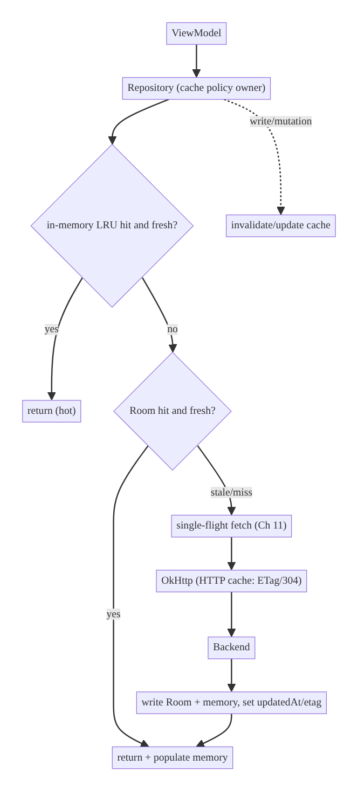
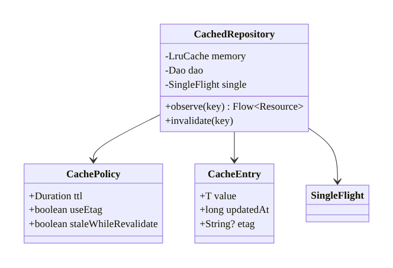
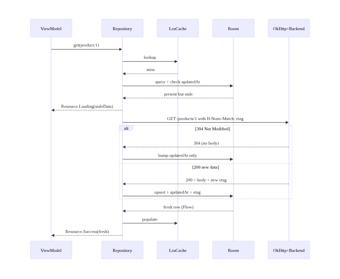
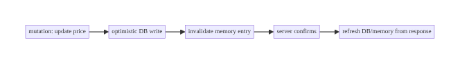
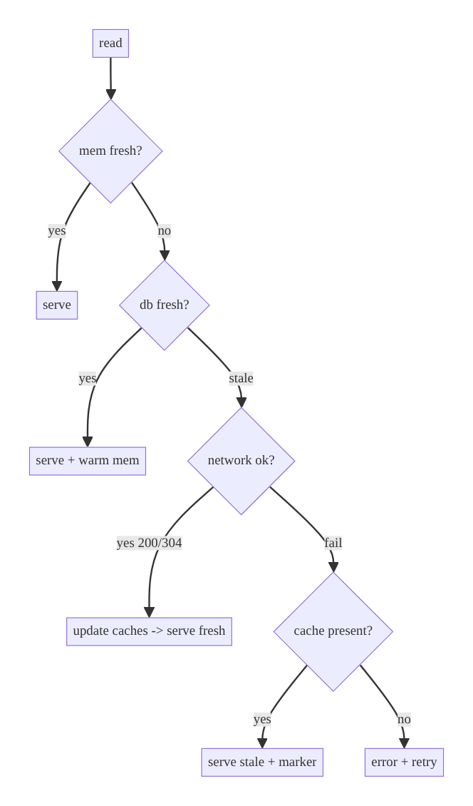

# Chapter 12 — Caching Strategies: HTTP, In-Memory, Disk

> **Part II — Networking Patterns** · Complexity: **Complex** (≥40 interview questions)
>
> **Prerequisites:** Ch 1 (Networking Core — OkHttp `Cache`), Ch 3 (SSOT/Room —
> the DB *is* a cache), Ch 11 (single-flight — anti-stampede). Caching policy
> here is reused by Ch 9/10 (search), Ch 13 (paging), Ch 29 (offline-first), Ch 56
> (images).
>
> **Reference surface in StreamCart:** the catalog/config/image caches — choosing
> between HTTP cache, an in-memory LRU, Room, and disk for each.

---

## 12.1 Problem Definition and Real-World Context

Caching trades freshness and memory/disk for speed, offline capability, and
reduced load. Done well it's the single biggest perceived-performance lever on
mobile; done badly it's the source of the hardest bugs ("why is the app showing a
price from yesterday?"). The core difficulty isn't storing data — it's **knowing
when a cached value is still valid and when to evict it** ("there are only two
hard things in CS: cache invalidation and naming things").

Naive approaches fail:

- **No cache.** Every screen refetches; slow cold starts, high data usage, useless
  offline.
- **Cache everything forever.** Users see stale prices/stock; no invalidation
  strategy.
- **One cache layer only.** An in-memory cache alone is lost on process death; a
  disk cache alone is slow for hot reads; an HTTP cache alone can't be queried or
  shaped for the UI.
- **Stampede on expiry.** Many readers miss at once and all hit the network
  (Ch 11).

Real apps use **layered caching**: an HTTP cache (honoring server headers), an
in-memory LRU (hot, fast), and a disk/DB cache (durable, offline, queryable —
usually Room, Ch 3). The architecture is about **which layer owns what, the
validity/TTL policy, invalidation, and eviction** — not a single data structure.

### Three practical use cases

1. **E-commerce catalog (StreamCart Shop).** Product metadata cached in Room
   (durable, queryable, offline) with TTL + ETag revalidation; images in a
   memory+disk cache (Ch 56).
2. **OTT config/manifests (Watch).** Short-TTL config via HTTP cache; playback
   manifests cached briefly in memory; single-flight on expiry (Ch 11).
3. **Fintech balance (Wallet).** Deliberately *low* cache (freshness critical):
   show cached-with-timestamp, revalidate immediately; never serve a stale balance
   as current.

### Why this is architectural

Caching defines **data freshness guarantees**, **memory/disk budgets**,
**invalidation triggers**, and **layer ownership** — cross-cutting system
properties that shape UX, cost, and correctness.

---

## 12.2 Requirements Engineering

### Functional requirements

| ID | Requirement |
|----|-------------|
| F1 | Serve cached data fast for hot reads (in-memory). |
| F2 | Persist cache across process death (disk/DB). |
| F3 | Revalidate staleness via TTL and/or ETag/Last-Modified. |
| F4 | Invalidate on writes/events (not only by time). |
| F5 | Evict under memory/disk pressure (LRU/size bounds). |
| F6 | Prevent stampede on expiry (single-flight, Ch 11). |
| F7 | Serve stale-while-revalidate where acceptable; never for critical freshness. |

### Non-functional requirements

| Attribute | Policy |
|-----------|--------|
| **Performance** | Hot reads from memory (<1 ms); cold from disk/DB; network only on miss/stale. |
| **Freshness** | Per-data-class TTL; critical data (balance) near-zero TTL. |
| **Memory** | Bounded LRU; evict under pressure; avoid OOM. |
| **Disk** | Bounded size; evictable; survives restart. |
| **Consistency** | Writes invalidate/refresh the cache (no read-after-write skew). |
| **Battery/Network** | Fewer calls; conditional GETs (304) save bytes. |

### Scope

- **In scope:** the three layers (HTTP/memory/disk-DB), TTL vs validators (ETag),
  invalidation (time/event/write), eviction (LRU/size), stale-while-revalidate,
  stampede prevention, layer selection.
- **Out of scope:** the SSOT read pattern details (Ch 3 — Room as cache), paging
  cache (Ch 13), image cache internals (Ch 56), offline sync (Ch 29).

### Assumptions & constraints

- OkHttp `Cache`, `LruCache`, Room; backend may send `Cache-Control`/`ETag`.
  `minSdk 24`.

---

## 12.3 System Design Fundamentals

- **The three layers.**
  - **HTTP cache (OkHttp `Cache`).** Transparent, honors server
    `Cache-Control`/`ETag`/`Last-Modified`; great for GETs the server marks
    cacheable; not queryable or UI-shaped.
  - **In-memory cache (`LruCache`).** Fastest; lost on process death; bounded by
    size; for hot, ephemeral reads.
  - **Disk/DB cache (Room).** Durable, queryable, offline; the SSOT (Ch 3);
    slower than memory.
- **Freshness policy: TTL vs validators.** *TTL* (time-to-live) marks data stale
  after a duration. *Validators* (`ETag`, `Last-Modified`) let the client send a
  conditional GET; the server replies `304 Not Modified` (cheap) or new data. Use
  TTL for "good enough for N minutes"; validators to confirm freshness without
  re-downloading.
- **Invalidation triggers.** Time (TTL), **write-through/after-write** (a mutation
  invalidates or updates the cache), and **events** (server push / version bump /
  pull-to-refresh). Time alone causes read-after-write skew.
- **Eviction.** LRU by entry count/size (memory) and max bytes (disk); evict
  under pressure to avoid OOM/disk-full.
- **Stale-while-revalidate (SWR).** Serve stale immediately, refresh in the
  background, update when it arrives — great UX for non-critical data; **never**
  for balances/security-sensitive data.
- **Stampede prevention.** On mass expiry, coalesce the refetch with single-flight
  (Ch 11).

Core insight: **pick a cache layer per data class by its freshness, durability,
and query needs, and pair a TTL with a validator and a write-time invalidation.**
Layering + explicit invalidation is the design; the data structure is trivial.

---

## 12.4 High-Level Architecture



**Layer ownership**

- **Repository** owns the cache *policy* (which layer, TTL, invalidation) — the
  single place that decides freshness.
- **In-memory `LruCache`** — hot reads.
- **Room** — durable SSOT (Ch 3), queryable, offline.
- **OkHttp `Cache`** — transparent HTTP-level caching + conditional GETs.
- **Single-flight** (Ch 11) wraps the network fetch to prevent stampede.

**Direction:** read checks memory → DB → network (populating upward); writes
invalidate/update downward.

---

## 12.5 Detailed Component Design



| Layer | Store | Lifetime | Query? | Use for |
|-------|-------|----------|--------|---------|
| HTTP | OkHttp `Cache` (disk) | server headers | no | cacheable GETs, 304 revalidation |
| Memory | `LruCache` | process | by key | hot reads |
| Disk/DB | Room | durable | yes (SQL) | SSOT, offline, lists |

`updatedAt` drives TTL; `etag` drives conditional revalidation. The repository
reads memory → DB → network and writes results back up.

---

## 12.6 End-to-End Data Flow

### Read with layered cache + revalidation



### Write invalidation



---

## 12.7 Complete Kotlin Implementation

Package: `com.streamcart.core.cache` and feature repositories.

### 12.7.1 HTTP cache (OkHttp) + conditional GET

```kotlin
// From Ch 1 NetworkModule — the HTTP cache honors Cache-Control / ETag automatically.
OkHttpClient.Builder()
    .cache(Cache(File(context.cacheDir, "http"), maxSize = 20L * 1024 * 1024))
    // Optional: force a short cache for an endpoint the server under-marks.
    .addNetworkInterceptor { chain ->
        val response = chain.proceed(chain.request())
        if (chain.request().url.encodedPath.startsWith("/config")) {
            response.newBuilder()
                .header("Cache-Control", "public, max-age=60")   // override weak server header
                .build()
        } else response
    }
    .build()
```

### 12.7.2 In-memory LRU with TTL

```kotlin
class MemoryCache<K : Any, V : Any>(
    maxEntries: Int,
    private val ttlMs: Long,
    private val clock: () -> Long = SystemClock::elapsedRealtime,
) {
    private data class Stamped<V>(val value: V, val at: Long)
    private val lru = object : LinkedHashMap<K, Stamped<V>>(16, 0.75f, true) {
        override fun removeEldestEntry(e: Map.Entry<K, Stamped<V>>) = size > maxEntries
    }
    private val mutex = Mutex()

    suspend fun get(key: K): V? = mutex.withLock {
        val s = lru[key] ?: return null
        if (clock() - s.at > ttlMs) { lru.remove(key); null } else s.value   // TTL eviction
    }
    suspend fun put(key: K, value: V) = mutex.withLock { lru[key] = Stamped(value, clock()) }
    suspend fun invalidate(key: K) = mutex.withLock { lru.remove(key) }
    suspend fun clear() = mutex.withLock { lru.clear() }
}
```

### 12.7.3 Room entity carrying cache metadata (TTL + ETag)

```kotlin
@Entity(tableName = "products")
data class ProductEntity(
    @PrimaryKey val id: String,
    val title: String,
    val priceCents: Long,
    val updatedAt: Long,          // TTL source
    val etag: String? = null,     // conditional revalidation
)
```

### 12.7.4 Layered repository (memory → DB → single-flight network)

```kotlin
class ProductRepositoryImpl @Inject constructor(
    private val dao: ProductDao,
    private val api: ProductApi,
    private val single: SingleFlight,                 // Ch 11
    private val memory: MemoryCache<String, Product>,
    private val dispatchers: DispatcherProvider,
    private val clock: Clock,
) : ProductRepository {

    private val ttlMs = 5 * 60_000L

    override fun observe(id: String): Flow<Resource<Product>> = flow {
        memory.get(id)?.let { emit(Resource.Success(it)) }           // hot path

        val cached = dao.observeById(id).first()
        val stale = cached == null || clock.now() - cached.updatedAt > ttlMs
        if (cached != null) emit(Resource.Loading(cached.toDomain()))

        if (stale) {
            // single-flight prevents a stampede when many observers miss at once
            val result = single.run("product:$id") {
                safeApiCall(dispatchers.io) {
                    api.getProduct(id, ifNoneMatch = cached?.etag)   // conditional GET
                }
            }
            when (result) {
                is Outcome.Success -> {
                    val entity = result.data.toEntity(clock.now())
                    dao.upsert(entity)
                    memory.put(id, entity.toDomain())
                }
                is Outcome.Failure ->
                    emit(Resource.Error(result.error, cached?.toDomain()))  // keep stale on error
            }
        }
        emitAll(dao.observeById(id).filterNotNull().map { Resource.Success(it.toDomain()) })
    }.flowOn(dispatchers.io)

    // Write-through invalidation keeps read-after-write correct.
    override suspend fun updatePrice(id: String, priceCents: Long): Outcome<Unit> {
        memory.invalidate(id)                                        // drop stale hot copy
        return when (val r = safeApiCall(dispatchers.io) { api.updatePrice(id, priceCents) }) {
            is Outcome.Success -> { dao.upsert(r.data.toEntity(clock.now())); memory.put(id, r.data.toDomain()); Outcome.Success(Unit) }
            is Outcome.Failure -> Outcome.Failure(r.error)
        }
    }
}
```

### 12.7.5 Module structure

```
:core:cache     MemoryCache, CachePolicy
:core:network   OkHttp Cache (Ch 1)
:core:database  ProductEntity (updatedAt, etag), ProductDao (Ch 3)
:data:catalog   ProductRepositoryImpl (layered policy + single-flight)
```

---

## 12.8 Concurrency and Race Conditions

| Scenario | Risk | Handling |
|----------|------|----------|
| Mass expiry stampede | N concurrent fetches | single-flight per key (Ch 11) |
| Concurrent memory put/get | torn LRU | `Mutex`-guarded `LruCache` |
| Read-after-write skew | stale read after mutation | invalidate/update cache on write |
| Revalidate + concurrent write | overwrite newer with 304-bumped old | write wins; compare `updatedAt`/version (Ch 33) |
| Two layers disagree | memory newer/older than DB | DB is SSOT; memory derived from it; invalidate memory on DB write |
| Eviction during read | missing entry | re-read lower layer (DB/network) |

- **Single source of truth resolves layer conflicts:** memory is a *derived*
  cache of the DB; on any DB write, invalidate the corresponding memory entry so
  they can't diverge.
- **Single-flight** is the stampede guard; without it, expiry turns one logical
  read into a herd.

---

## 12.9 Failure Scenarios and Recovery

| Failure | Detection | Response | UX |
|---------|-----------|----------|----|
| Network down, cache present | fetch fails | serve cached (+stale marker) | works offline; "updated 5m ago" |
| Network down, no cache | miss + fail | error + Retry | offline empty state |
| Disk full (HTTP/DB) | `IOException`/`SQLiteFull` | evict + degrade to memory-only | no crash |
| Stale served as fresh (critical) | policy bug | critical data uses ~0 TTL + no SWR | never show stale balance |
| 304 but local missing body | edge | treat as miss; full GET | correct |
| Cache poisoning (bad write) | validation | validate before caching; version bump | evict and refetch |
| Memory pressure (OOM risk) | `onTrimMemory` | shrink/clear memory cache | stability |



> **Freshness classification is a product decision:** tag each data class as
> *cacheable-long* (catalog), *cacheable-short* (config), or *never-stale*
> (balance, auth). The last must bypass SWR and use near-zero TTL.

---

## 12.10 Scaling the Implementation

- **Level 1.** OkHttp HTTP cache only (free, transparent) for cacheable GETs.
- **Level 2.** Add Room as the durable SSOT with TTL via `updatedAt` (Ch 3).
- **Level 3 — production.** Add an in-memory LRU for hot reads; ETag
  revalidation; single-flight anti-stampede; write-through invalidation;
  per-data-class TTLs.
- **Level 4 — large.** `onTrimMemory`-aware eviction; disk size budgets; SWR for
  non-critical; cache versioning (bump on schema/release); image cache (Ch 56).
- **Level 5 — enterprise.** A unified cache layer (policy per endpoint from remote
  config, Ch 41), server-driven invalidation (push/version), cross-module cache
  governance, cache hit-rate SLOs.

**Avoid overengineering:** many apps need only the HTTP cache + Room. Add an
in-memory layer and ETag revalidation when profiling shows hot-read latency or
redundant downloads.

---

## 12.11 Alternative Approaches and Trade-offs

| Dimension | Option A | Option B | When |
|-----------|----------|----------|------|
| Layer | In-memory `LruCache` | Disk/DB (Room) | Memory for hot/ephemeral; DB for durable/queryable/offline |
| HTTP cache | OkHttp `Cache` | App-level only | HTTP cache for transparent cacheable GETs + 304; app cache for UI-shaped/queryable |
| Freshness | TTL | ETag/Last-Modified | TTL for "good for N min"; validators to confirm without re-download (304) |
| Update UX | Stale-while-revalidate | Block-until-fresh | SWR for non-critical; block for balances/security |
| Invalidation | Time (TTL) | Event/write-through | Write-through to avoid read-after-write skew; events for server-driven freshness |
| Eviction | LRU count | LRU bytes / `onTrimMemory` | Bytes/pressure-aware for images/large values |
| Stampede | Single-flight (Ch 11) | per-key lock | Single-flight shares one fetch |

**TTL vs ETag:** TTL avoids any network when fresh but can serve stale within the
window; ETag always makes a (cheap, often 304) request to confirm. Combine: TTL to
skip the network while fresh, ETag to revalidate cheaply when stale.

**HTTP cache vs Room:** the HTTP cache is transparent and free but opaque (can't
query, can't shape, invalidation is header-driven). Room is queryable, offline,
and the SSOT but you manage freshness yourself. Most apps use both: HTTP cache for
raw responses, Room for the UI's source of truth.

---

## 12.12 Security Considerations

- **Don't cache sensitive responses on disk unencrypted.** Mark them
  `Cache-Control: no-store` server-side, or exclude from the HTTP cache; encrypt
  sensitive Room tables (Ch 24).
- **Per-account cache isolation.** Key caches by account; **clear all caches on
  logout/account switch** (Ch 42) so account B never sees account A's cached data.
- **Cache poisoning:** validate/parse responses before caching; a bad/forged
  response must not persist.
- **Stale auth/entitlement:** never serve cached authorization decisions; the
  backend re-validates. A cached "premium=true" must not unlock features offline
  beyond policy.
- Client vs backend: the cache is a convenience copy; the backend remains
  authoritative for freshness-critical and security-relevant data.

---

## 12.13 Performance and Resource Optimization

- **Hot-read latency:** memory LRU serves in microseconds vs DB (ms) vs network
  (100s ms). Profile to size the memory layer.
- **Bytes saved:** ETag/304 and gzip (Ch 1) cut data usage dramatically;
  measure 304 rate.
- **Cold start:** serve from Room immediately, revalidate in background (Ch 88);
  don't block UI on the network.
- **Memory pressure:** respond to `onTrimMemory`/`ComponentCallbacks2` by
  trimming/clearing the memory cache to avoid OOM.
- **Disk budget:** bound HTTP cache and image cache sizes; evict LRU.
- **Profiling:** cache hit-rate (per layer), 304 rate, memory cache size, Database
  Inspector, Network Inspector.

---

## 12.14 Testing Strategy

Test freshness/invalidation logic with a fake clock; real Room + MockWebServer for
integration.

```kotlin
class MemoryCacheTest {
    private var now = 0L
    private val cache = MemoryCache<String, String>(maxEntries = 2, ttlMs = 1000) { now }

    @Test fun `returns value within ttl, null after`() = runTest {
        cache.put("k", "v"); assertEquals("v", cache.get("k"))
        now += 1500
        assertNull(cache.get("k"))                    // TTL expiry
    }
    @Test fun `evicts least-recently-used beyond capacity`() = runTest {
        cache.put("a", "1"); cache.put("b", "2"); cache.get("a"); cache.put("c", "3")
        assertNull(cache.get("b"))                    // b was LRU
        assertEquals("1", cache.get("a"))
    }
}

class ProductRepositoryCacheTest {
    @Test fun `serves cache and skips network when fresh`() = runTest {
        dao.upsert(product("1", updatedAt = clock.now()))        // fresh
        val calls = CountingApi()
        val repo = repo(api = calls)
        repo.observe("1").first { it is Resource.Success }
        assertEquals(0, calls.count)                  // no network
    }
    @Test fun `revalidates with ETag and handles 304`() = runTest {
        server.enqueue(MockResponse().setResponseCode(304))      // not modified
        dao.upsert(product("1", updatedAt = clock.now() - 10.minutes, etag = "e1"))
        val repo = repo()
        repo.observe("1").first { it is Resource.Success }
        assertEquals("e1", server.takeRequest().getHeader("If-None-Match"))
    }
    @Test fun `offline keeps stale and reports error`() = runTest {
        dao.upsert(product("1", updatedAt = clock.now() - 10.minutes))
        val repo = repo(api = FailingApi)
        val states = repo.observe("1").take(3).toList()
        assertTrue(states.any { it is Resource.Error && it.data != null })
    }
    @Test fun `mass miss triggers single fetch (anti-stampede)`() = runTest {
        val calls = CountingApi(); val repo = repo(api = calls)
        (1..20).map { async { repo.observe("1").first { s -> s is Resource.Success } } }.awaitAll()
        assertEquals(1, calls.count)                  // single-flight
    }
}
```

Also: write-through invalidation prevents stale read-after-write; `onTrimMemory`
clears memory; per-account clear on logout.

---

## 12.15 Production Observability

- **Metrics:** cache hit-rate per layer (memory/DB/HTTP), 304 rate, stale-serve
  rate, eviction rate, stampede incidents (should be ~0), cache size (bytes),
  cold-start cache-serve rate.
- **Logs:** `cache{layer, key_type, hit/miss/stale}`, `revalidate{304/200}`,
  `cache_invalidate{reason}` (no PII values).
- **Debugging:** stale prices → missing write-through invalidation; data spikes →
  no ETag/low 304 rate; OOM → unbounded memory cache / no `onTrimMemory`; backend
  load spikes on expiry → missing single-flight; cross-account data → missing
  clear-on-logout.
- **Privacy:** never log cached values; log key categories and layer stats.

---

## 12.16 System Design Interview Preparation

> 40+ questions.

**Fundamentals**
1. *Why cache?* Speed, offline, reduced load/battery/data; trade freshness and
   memory/disk.
2. *Three layers?* HTTP (OkHttp), in-memory (LRU), disk/DB (Room). Each has
   distinct lifetime/query/durability.
3. *Hardest part of caching?* Invalidation — knowing when a cached value is
   invalid.
4. *TTL vs ETag/Last-Modified?* TTL = time-based staleness; validators = confirm
   freshness via conditional GET (304).
5. *Stale-while-revalidate?* Serve stale now, refresh in background; never for
   critical data.

**Architecture**
6. *Who owns cache policy?* The repository — one place decides freshness/layer.
7. *How do layers relate?* Memory derived from DB (SSOT); DB from network; read
   up, write/invalidate down.
8. *HTTP cache vs Room?* Transparent/opaque GET cache vs queryable/offline SSOT;
   use both.
9. *Where does single-flight fit?* Wraps the fetch to prevent stampede on expiry
   (Ch 11).

**Invalidation**
10. *Why isn't TTL enough?* Read-after-write skew — a mutation must invalidate/
    update the cache.
11. *Invalidation triggers?* Time, write-through, events (push/version/refresh).
12. *Write-through vs write-around?* Write-through updates the cache on write;
    write-around invalidates and lets the next read repopulate.
13. *Server-driven invalidation?* Version bump / push / `Cache-Control` /
    `must-revalidate`.

**Eviction**
14. *Memory eviction policy?* LRU by count/bytes; evict under `onTrimMemory`.
15. *Disk eviction?* Bounded size, LRU; handle disk-full.
16. *Avoiding OOM?* Bound the memory cache; respond to memory callbacks.

**Freshness policy**
17. *How decide TTL?* By data class — catalog long, config short, balance ~0.
18. *When never cache?* Security/auth decisions, freshness-critical values.
19. *304 flow?* Send `If-None-Match`/`If-Modified-Since`; 304 → bump TTL, reuse
    body; 200 → replace.

**Concurrency**
20. *Stampede — what and fix?* Mass simultaneous miss → single-flight coalesces.
21. *Memory/DB divergence?* DB is SSOT; invalidate memory on DB write.
22. *Revalidate vs concurrent write?* Prefer newer (`updatedAt`/version);
    conflict policy (Ch 33).

**Networking**
23. *OkHttp cache behavior?* Honors `Cache-Control`/`ETag`; stores responses on
    disk; serves 304s transparently.
24. *Override weak server headers?* Network interceptor adds `Cache-Control`
    (carefully).

**Security**
25. *Sensitive responses?* `no-store`/exclude from disk cache; encrypt sensitive
    DB (Ch 24).
26. *Per-account?* Key by account; clear on logout/switch (Ch 42).
27. *Cached entitlements?* Don't trust for access; backend re-validates.

**Performance**
28. *Biggest perceived-perf lever?* Serving cache on cold start; revalidate in
    background.
29. *How measure?* Hit-rate per layer, 304 rate, cache-serve-on-cold-start.

**Scalability**
30. *10M users — cache concerns?* Backend cache/CDN scale; client needs TTL/ETag
    discipline + size budgets.
31. *Remote-tune TTLs?* Policy from remote config (Ch 41).

**Testing**
32. *How test TTL/eviction?* Fake clock; assert expiry/LRU.
33. *How test 304?* MockWebServer 304; assert conditional header + reuse.
34. *How test anti-stampede?* 20 concurrent misses → assert 1 fetch.

**Production debugging**
35. *Stale prices on one screen?* Missing write-through invalidation.
36. *High data usage?* No ETag/low 304; caching disabled.
37. *OOM crashes?* Unbounded memory cache.
38. *Backend spikes on expiry?* No single-flight.
39. *Cross-account leak?* No clear-on-logout.
40. *Offline shows nothing?* Not persisting to Room (only memory cache).

### Staff follow-ups
- "How do you keep a local optimistic edit through a background revalidation?"
  (version/`updatedAt` compare; upsert specific columns; Ch 72.)
- "Design cache versioning across app releases." (bump a cache version key;
  invalidate on mismatch; migrate — Ch 36.)

### Design-change challenges
1. **Balance must never be stale.** ~0 TTL, no SWR, show timestamp, revalidate on
   resume.
2. **Cut data usage 40%.** ETag revalidation + gzip + longer TTL for stable data.
3. **Offline browsing.** Room SSOT + image disk cache (Ch 56); SWR on reconnect.
4. **Kill expiry stampede.** Single-flight around the fetch (Ch 11).
5. **Server-driven freshness.** Push/version invalidation instead of pure TTL.

### Mock walkthrough (abridged)
Clarify (freshness needs per data, offline, size budget) → classify data →
choose layers (HTTP + Room + memory) → TTL + ETag + write-through invalidation →
single-flight anti-stampede → eviction/pressure → security (per-account, no-store)
→ metrics (hit-rate/304).

---

## 12.17 Practical Exercises

1. **Beginner.** Add OkHttp HTTP caching and prove 304s via MockWebServer. *Eval:*
   conditional header sent; bytes saved.
2. **Intermediate.** Build a TTL+LRU `MemoryCache`; test expiry and eviction with
   a fake clock. *Eval:* correct TTL + LRU.
3. **Advanced.** Layer memory→Room→network with ETag revalidation and
   write-through invalidation; prove read-after-write correctness. *Eval:* no
   stale after write.
4. **Production debugging.** Fix an app with OOM (unbounded memory cache), stale
   prices (no invalidation), and expiry stampede (no single-flight). *Eval:*
   bounded cache; fresh after write; 1 fetch on mass miss.
5. **System design challenge.** Add per-account isolation + clear-on-logout and a
   cache version bumped on release. *Eval:* no cross-account leak; invalidate on
   version change.

*(Solutions withheld unless requested.)*

---

## 12.18 Chapter Summary & Reference Sheet

**Key decisions:** cache in **layers** (HTTP for transparent GETs, in-memory LRU
for hot reads, Room for durable/queryable/offline SSOT); the **repository owns the
policy**; pair **TTL with validators (ETag/304)**; invalidate on **write-through**
and events, not time alone; **bound and evict** (LRU + `onTrimMemory`); **single-
flight** the fetch to prevent stampede; classify data freshness and **never SWR
critical data**; **per-account isolation + clear on logout**.

**Concepts:** layered caching, TTL vs validators, conditional GET/304,
stale-while-revalidate, write-through vs write-around invalidation, LRU eviction,
cache stampede, memory derived from SSOT.

**Common mistakes:** TTL-only (read-after-write skew); unbounded memory cache
(OOM); no single-flight (stampede); caching sensitive data on disk; no
clear-on-logout (cross-account leak); serving stale critical data; treating the
HTTP cache as queryable.

**Checklist:** ☐ layer per data class ☐ repository owns policy ☐ TTL + ETag
☐ write-through invalidation ☐ LRU + `onTrimMemory` bounds ☐ single-flight fetch
☐ memory invalidated on DB write ☐ per-account + clear on logout ☐ no-store for
sensitive ☐ hit-rate/304 metrics.

**Key APIs:** OkHttp `Cache`, `Cache-Control`/`ETag`/`If-None-Match`, `LruCache`/
`LinkedHashMap(accessOrder)`, Room `updatedAt`/`etag`, `onTrimMemory`/
`ComponentCallbacks2`, `SingleFlight` (Ch 11), `flowOn`.

**References:**
- OkHttp caching: https://square.github.io/okhttp/features/caching/
- HTTP caching (MDN): https://developer.mozilla.org/docs/Web/HTTP/Caching
- `LruCache`: https://developer.android.com/reference/android/util/LruCache
- Offline-first (data layer): https://developer.android.com/topic/architecture/data-layer/offline-first
- `onTrimMemory`: https://developer.android.com/topic/performance/memory

### Chapter review (Phase 4)
- **Completeness:** all 18 sections; architecture/class/sequence/failure diagrams;
  HTTP + memory LRU + Room layered repo with ETag + single-flight + write-through;
  concurrency (stampede, divergence); failure matrix; 5 levels; TTL-vs-ETag and
  HTTP-vs-Room trade-offs; security (per-account, no-store); perf (hit-rate/304);
  clock/Room/MockWebServer tests; observability; 40 Q&A + follow-ups + 5
  challenges. ✅
- **Expand later:** image cache (Ch 56), paging cache (Ch 13), server-driven
  invalidation, cache versioning (Ch 36).
- **Interview coverage:** exceeds ≥40 bar.
