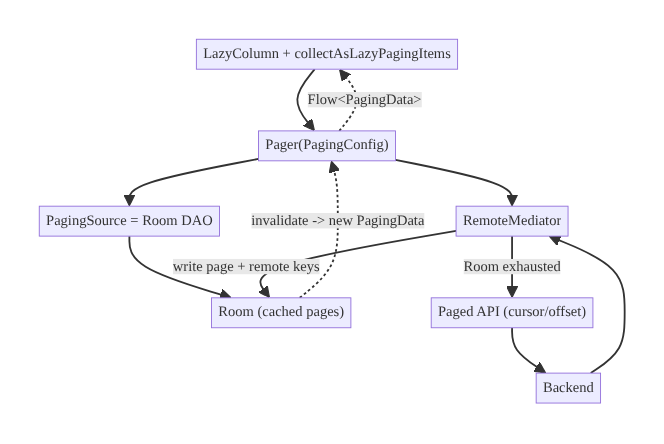
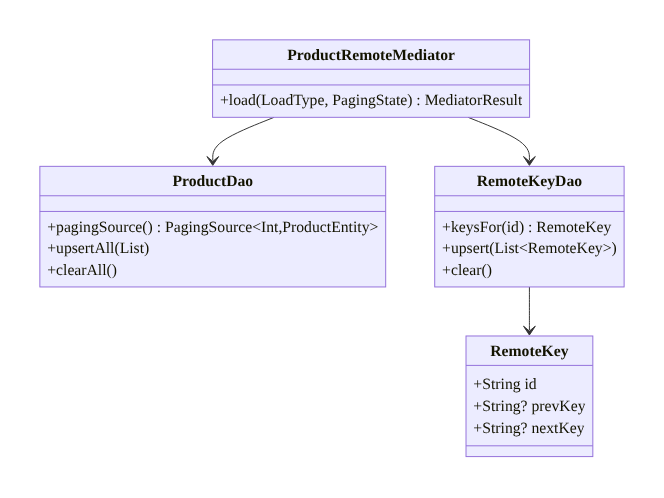
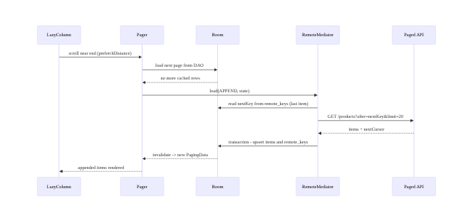
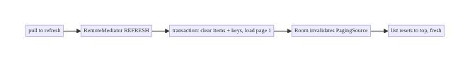
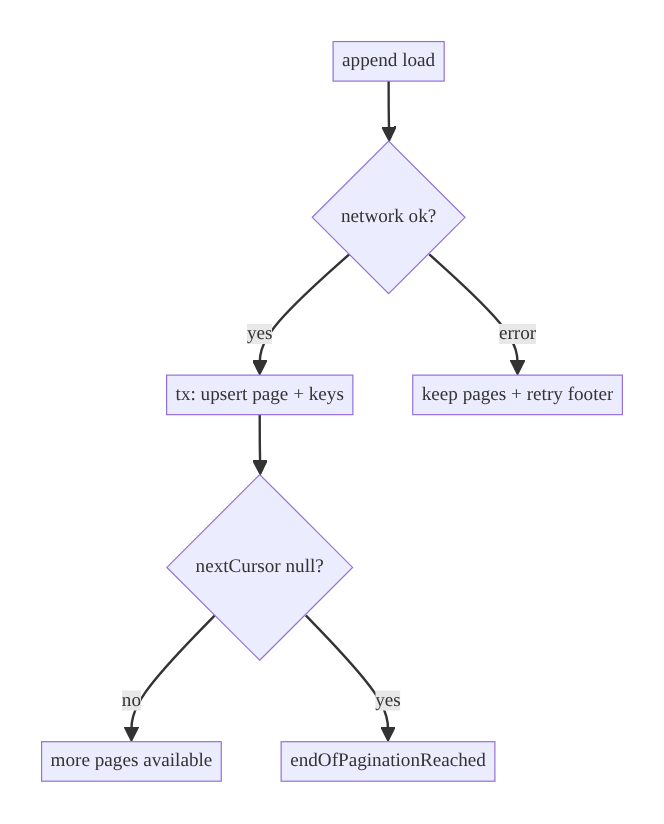

# Chapter 13 — Pagination & Caching with Paging 3

> **Part II — Networking Patterns** · Complexity: **Complex** (≥40 interview questions)
>
> **Prerequisites:** Ch 1 (Networking Core), Ch 3 (Room/SSOT), Ch 6 (UI state),
> Ch 12 (caching). Paging underpins Ch 71 (social feed), Ch 73 (recommendations),
> and any long list in StreamCart.
>
> **Reference surface in StreamCart:** the infinite product grid (Shop), the Watch
> catalog rows, and the social feed — all large, server-backed, offline-capable
> lists.

---

## 13.1 Problem Definition and Real-World Context

Lists that can be arbitrarily large — a catalog of a million products, an endless
social feed — cannot be loaded in one request or held entirely in memory. You
must **page**: load a window at a time, append as the user scrolls, and cache so
scrolling back is instant and the list survives offline. Naive approaches fail:

- **Load everything.** OOM, slow cold start, huge payloads; impossible at scale.
- **Manual "load more" with flags.** Hand-rolled `isLoading`/`endReached`/`page`
  state is bug-prone: double-loads at the scroll boundary, lost position on
  rotation, no retry, duplicated items, flicker.
- **Offset pagination over mutating data.** If items are inserted/deleted between
  page loads, offset-based paging shows **duplicates or skips** (the classic
  "page 2 repeats an item from page 1" bug on a live feed).
- **No cache.** Scrolling back refetches; nothing works offline; jank.

**Paging 3** (Jetpack) solves the mechanics: it loads pages on demand, exposes
them as a `Flow<PagingData<T>>`, handles load states (refresh/append/prepend,
error, retry), diffs into the list, and — via `RemoteMediator` — coordinates a
**network + Room cache** so the list is offline-first. The architecture decisions
are **offset vs cursor pagination**, **cache coordination**, and **placeholders/
load-state UX**.

### Three practical use cases

1. **E-commerce catalog (StreamCart Shop).** Million-item grid, cached in Room,
   offline browsing, filter/sort re-triggers paging.
2. **Social feed (Social).** Live, frequently-mutating feed → **cursor**
   pagination to avoid duplicates/skips; prepend for new items.
3. **OTT catalog (Watch).** Paged rows per category; images lazy-loaded (Ch 56);
   restore scroll position across process death (Ch 8).

### Why this is architectural

Pagination defines **data windowing**, **cache/network coordination**, **the
consistency model** (offset vs cursor), **load-state UX**, and **memory bounds** —
system properties that determine whether a long list is correct, fast, and
offline-capable.

---

## 13.2 Requirements Engineering

### Functional requirements

| ID | Requirement |
|----|-------------|
| F1 | Load a page at a time; append as the user nears the end. |
| F2 | Cache loaded pages (Room) so scroll-back is instant and works offline. |
| F3 | Expose load states (refresh/append/prepend, loading/error) + retry. |
| F4 | Avoid duplicates/skips when the underlying data mutates (cursor). |
| F5 | Survive rotation and (ideally) process death with position. |
| F6 | Re-page on query/filter/sort change. |
| F7 | Support pull-to-refresh (invalidate + reload page 1). |

### Non-functional requirements

| Attribute | Policy |
|-----------|--------|
| **Performance** | Load window only; bound in-memory pages; no main-thread I/O; smooth 60fps scroll. |
| **Memory** | `PagingConfig` bounds retained pages; images lazy (Ch 56). |
| **Consistency** | Cursor pagination for mutating data; offset only for stable/random-access. |
| **Reliability** | Retry failed pages; keep loaded pages on append error. |
| **Offline** | Cached pages browsable offline (RemoteMediator + Room). |
| **Network** | Prefetch distance tuned; dedup via single-flight if needed (Ch 11). |

### Scope

- **In scope:** Paging 3 (`PagingSource`, `RemoteMediator`, `PagingData`,
  `PagingConfig`, load states), offset vs cursor, Room-backed caching, UI
  (`collectAsLazyPagingItems`), refresh/retry, placeholders.
- **Out of scope:** the generic cache policy (Ch 12), image loading (Ch 56),
  search debounce feeding the pager (Ch 9), conflict resolution (Ch 33).

### Assumptions & constraints

- Paging 3.2+, Room, Compose. Backend supports either offset (`?page=&size=`) or
  cursor (`?after=<cursor>&limit=`) pagination. `minSdk 24`.

---

## 13.3 System Design Fundamentals

- **Windowed loading.** Keep a bounded window of pages in memory; load
  ahead (`prefetchDistance`) before the user reaches the edge; drop far pages if
  `maxSize` is set.
- **Offset vs cursor.**
  - **Offset** (`page`/`limit` or `offset`): simple, supports random access
    ("jump to page 50"), but **breaks on mutation** — inserts/deletes shift
    offsets → duplicates/skips; also slow on huge tables server-side.
  - **Cursor** (opaque token pointing at the last item, e.g. an id/timestamp):
    stable under mutation (no dup/skip), efficient server-side, but **no random
    access** and requires server support. **Default to cursor for feeds/mutating
    data.**
- **`PagingSource` vs `RemoteMediator`.** `PagingSource` is the page loader (from
  network *or* from Room). `RemoteMediator` sits between them: Paging reads pages
  from **Room** (`PagingSource` on the DAO), and the mediator fetches from the
  **network** when Room runs out, writing results into Room — this is the
  **offline-first paged cache**.
- **`PagingData` + diffing.** A stream of list changes the UI collects; Paging
  diffs and animates; you never hold the whole list.
- **Load states.** `LoadState` for refresh/append/prepend (Loading/NotLoading/
  Error) drives spinners, error footers, retry, and empty states.
- **Invalidation.** A DB change or `pagingSource.invalidate()` triggers a refresh;
  pull-to-refresh invalidates the mediator (clears + reloads page 1).

Core insight: **let Paging own the windowing/diffing/load-state machinery, back it
with Room via `RemoteMediator` for an offline-first cache, and choose cursor
pagination for mutating data.** The hard parts (boundary double-loads, dedup,
retry, position) are handled by the framework when wired correctly.

---

## 13.4 High-Level Architecture



**Components & ownership**

- **`Pager`** (config + source) produces `Flow<PagingData<T>>`.
- **`PagingSource`** reads pages from **Room** (the SSOT) via a DAO query.
- **`RemoteMediator`** fetches from the network when Room is exhausted and writes
  pages + **remote keys** (next/prev cursors) into Room transactionally.
- **Room** caches pages + a `remote_keys` table; it's the offline source.
- **UI** collects `LazyPagingItems`, renders items + load-state footers.

**Direction:** UI pulls from Pager → Room; mediator fills Room from network; Room
invalidation pushes new `PagingData` up.

---

## 13.5 Detailed Component Design



| Component | Responsibility | Notes |
|-----------|----------------|-------|
| `PagingConfig` | pageSize, prefetchDistance, maxSize, placeholders | tune for scroll + memory |
| `PagingSource` (DAO) | load pages from Room | invalidated on DB change |
| `RemoteMediator` | fetch network on `REFRESH/PREPEND/APPEND`, persist | returns `Success(endOfPaginationReached)`/`Error` |
| `RemoteKey` table | store prev/next cursors per item/page | how the mediator knows what to fetch next |
| `LoadState` | refresh/append/prepend states | drives UI footers/retry |

**`LoadType` semantics:** `REFRESH` (initial or pull-to-refresh → clear + load
first), `APPEND` (load after the last item using `nextKey`), `PREPEND` (load
before the first using `prevKey`, e.g., new feed items).

---

## 13.6 End-to-End Data Flow

### Append (scroll to end) with cursor + Room cache



### Pull-to-refresh



---

## 13.7 Complete Kotlin Implementation

Package: `com.streamcart.data.catalog.paging`.

### 13.7.1 DAO (PagingSource) + remote keys

```kotlin
@Dao
interface ProductDao {
    @Query("SELECT * FROM products ORDER BY sortIndex ASC")
    fun pagingSource(): PagingSource<Int, ProductEntity>
    @Upsert suspend fun upsertAll(items: List<ProductEntity>)
    @Query("DELETE FROM products") suspend fun clearAll()
}

@Entity(tableName = "remote_keys")
data class RemoteKey(@PrimaryKey val id: String, val prevKey: String?, val nextKey: String?)

@Dao
interface RemoteKeyDao {
    @Query("SELECT * FROM remote_keys WHERE id = :id") suspend fun keysFor(id: String): RemoteKey?
    @Upsert suspend fun upsertAll(keys: List<RemoteKey>)
    @Query("DELETE FROM remote_keys") suspend fun clearAll()
}
```

### 13.7.2 RemoteMediator (cursor-based, offline-first cache)

```kotlin
@OptIn(ExperimentalPagingApi::class)
class ProductRemoteMediator @Inject constructor(
    private val api: ProductApi,
    private val db: StreamCartDatabase,
    private val productDao: ProductDao,
    private val keyDao: RemoteKeyDao,
) : RemoteMediator<Int, ProductEntity>() {

    override suspend fun initialize(): InitializeAction =
        InitializeAction.LAUNCH_INITIAL_REFRESH    // or SKIP if cache still fresh (Ch 12 TTL)

    override suspend fun load(loadType: LoadType, state: PagingState<Int, ProductEntity>): MediatorResult {
        return try {
            val cursor: String? = when (loadType) {
                LoadType.REFRESH -> null
                LoadType.PREPEND -> return MediatorResult.Success(endOfPaginationReached = true)
                LoadType.APPEND -> {
                    val lastItem = state.lastItemOrNull()
                        ?: return MediatorResult.Success(endOfPaginationReached = true)
                    keyDao.keysFor(lastItem.id)?.nextKey
                        ?: return MediatorResult.Success(endOfPaginationReached = true)
                }
            }

            val response = api.products(after = cursor, limit = state.config.pageSize)
            val items = response.items.map { it.toEntity() }

            db.withTransaction {                         // atomic cache write (Ch 3)
                if (loadType == LoadType.REFRESH) { productDao.clearAll(); keyDao.clearAll() }
                productDao.upsertAll(items)
                keyDao.upsertAll(items.map { RemoteKey(it.id, prevKey = null, nextKey = response.nextCursor) })
            }
            MediatorResult.Success(endOfPaginationReached = response.nextCursor == null)
        } catch (e: IOException) { MediatorResult.Error(e) }
          catch (e: HttpException) { MediatorResult.Error(e) }
    }
}
```

### 13.7.3 Pager assembly (repository)

```kotlin
@OptIn(ExperimentalPagingApi::class)
class CatalogPagingRepository @Inject constructor(
    private val db: StreamCartDatabase,
    private val mediatorFactory: ProductRemoteMediator,   // or AssistedInject for query params
    private val dao: ProductDao,
) {
    fun pagedProducts(): Flow<PagingData<Product>> = Pager(
        config = PagingConfig(
            pageSize = 20,
            prefetchDistance = 10,       // fetch ahead to hide latency
            initialLoadSize = 40,
            maxSize = 200,               // bound retained pages (memory)
            enablePlaceholders = false,
        ),
        remoteMediator = mediatorFactory,
        pagingSourceFactory = { dao.pagingSource() },
    ).flow.map { pagingData -> pagingData.map { it.toDomain() } }
}
```

### 13.7.4 ViewModel + Compose UI with load states

```kotlin
@HiltViewModel
class CatalogViewModel @Inject constructor(repo: CatalogPagingRepository) : ViewModel() {
    val products: Flow<PagingData<Product>> = repo.pagedProducts().cachedIn(viewModelScope)
}

@Composable
fun CatalogScreen(viewModel: CatalogViewModel = hiltViewModel()) {
    val items = viewModel.products.collectAsLazyPagingItems()
    LazyColumn {
        items(count = items.itemCount, key = items.itemKey { it.id }) { index ->
            items[index]?.let { ProductRow(it) }     // null = placeholder (if enabled)
        }
        when (val append = items.loadState.append) {
            is LoadState.Loading -> item { FooterSpinner() }
            is LoadState.Error -> item { RetryFooter(onRetry = { items.retry() }) }
            else -> Unit
        }
    }
    // Refresh state (full-screen spinner / error / empty)
    when (val refresh = items.loadState.refresh) {
        is LoadState.Loading -> FullScreenSpinner()
        is LoadState.Error -> ErrorScreen(onRetry = { items.refresh() })
        is LoadState.NotLoading -> if (items.itemCount == 0) EmptyState()
    }
}
```

### 13.7.5 Feeding a (debounced) query into the pager

```kotlin
// Re-page when the query changes (reuses Ch 9 debounce); flatMapLatest swaps the Pager.
val results: Flow<PagingData<Product>> = query
    .debounce(300).distinctUntilChanged()
    .flatMapLatest { q -> repo.searchPaged(q) }
    .cachedIn(viewModelScope)
```

### 13.7.6 Module structure

```
:data:catalog/paging  ProductRemoteMediator, CatalogPagingRepository
:core:database        ProductDao(pagingSource), RemoteKey(Dao)
:feature:catalog      CatalogViewModel, CatalogScreen (LazyPagingItems, load states)
```

---

## 13.8 Concurrency and Race Conditions

| Scenario | Risk | Handling |
|----------|------|----------|
| Boundary double-load | two appends at the edge | Paging serializes load requests per type |
| Mutation during paging (offset) | duplicates/skips | use **cursor** pagination |
| Refresh vs append overlap | inconsistent cache | REFRESH clears in a transaction; mediator serializes |
| Cache write not atomic | partial page visible | `db.withTransaction { clear; upsert; keys }` |
| Config change re-collects | duplicate network loads | `cachedIn(viewModelScope)` caches the stream |
| Query change mid-load | stale pager | `flatMapLatest` cancels old Pager (Ch 9) |
| Concurrent mediators (dedup) | double fetch | single-flight the page fetch if needed (Ch 11) |

- **`cachedIn(viewModelScope)`** is essential: it multicasts and caches
  `PagingData` so rotation/re-collection doesn't re-trigger network loads.
- **Cursor pagination** is the structural fix for the mutation race; offset
  cannot be made correct on a live list.
- **Transactional cache writes** (clear+upsert+keys) prevent observers from seeing
  a half-updated list (Ch 3).

---

## 13.9 Failure Scenarios and Recovery

| Failure | Detection | Response | UX |
|---------|-----------|----------|----|
| Append network error | `MediatorResult.Error` | keep loaded pages; show retry footer | list stays; "Retry" |
| Refresh error, cache present | refresh `LoadState.Error` | show cached list + error banner | offline browsing |
| Refresh error, no cache | error + empty | full-screen error + Retry | retry |
| Offline | IOException | serve cached pages (RemoteMediator not run / returns cache) | works offline |
| Duplicate/skipped items | offset + mutation | switch to cursor; stable keys | correct list |
| End of pagination | `nextCursor == null` | `endOfPaginationReached = true` | no more spinner |
| Process death | — | Room cache persists; restore scroll key (Ch 8) | resume near position |
| Invalid cursor (server changed) | 4xx | REFRESH (clear + reload) | recover |



> **Keep what you have:** an append failure must never clear the already-loaded
> list — Paging keeps loaded pages and surfaces an append-error state with retry.

---

## 13.10 Scaling the Implementation

- **Level 1.** In-memory `PagingSource` straight from the network (no cache) —
  fine for small/ephemeral lists.
- **Level 2.** Add Room + `RemoteMediator` for an offline-first paged cache.
- **Level 3 — production.** Cursor pagination; load-state UX (retry/empty/footer);
  pull-to-refresh; `cachedIn`; tuned `PagingConfig`; filter/sort re-paging.
- **Level 4 — large.** `maxSize` to bound memory; placeholders; prefetch tuning;
  image lazy-load (Ch 56); scroll restoration (Ch 8); separators/headers.
- **Level 5 — enterprise.** TTL/freshness on the paged cache (Ch 12
  `InitializeAction.SKIP_INITIAL_REFRESH` when fresh); server-driven invalidation;
  multi-source feeds; A/B-tested page sizes; analytics on scroll depth.

**Avoid overengineering:** a short, bounded list (e.g., ≤50 items) doesn't need
Paging — load it once. Reach for Paging when the list is large, remote, and
scrolled.

---

## 13.11 Alternative Approaches and Trade-offs

| Dimension | Option A | Option B | When |
|-----------|----------|----------|------|
| Strategy | **Offset** (`page`/`offset`) | **Cursor** (opaque token) | Offset for stable data + random access (jump to page); **cursor for feeds/mutating data** (no dup/skip) |
| Loader | `PagingSource` (network only) | `RemoteMediator` + Room | Mediator for offline-first cache; network-only for ephemeral |
| Library | Paging 3 | manual load-more | Paging for correctness (states/dedup/retry/diff); manual only for trivial lists |
| Placeholders | enabled | disabled | Enabled for scrollbar/known count; disabled for unknown count/variable size |
| Memory | `maxSize` set | unbounded | `maxSize` for very long lists; unbounded for modest |
| Refresh | invalidate + reload | SWR | invalidate for pull-to-refresh; SWR for background freshness (Ch 12) |

**Offset vs cursor (the headline trade-off):** offset is trivial and supports
"jump to page N," but on data that mutates between loads it yields duplicates
(insert) or skips (delete), and large offsets are slow server-side. Cursor is
stable under mutation and efficient, but needs server support and forgoes random
access. **For feeds and any live list, use cursor.**

**Paging 3 vs manual:** manual load-more re-implements (badly) boundary
detection, dedup, retry, load states, diffing, and config-change caching. Paging
3 provides all of these; the cost is its learning curve and some API rigidity.

---

## 13.12 Security Considerations

- **Per-account paged cache:** the `products`/`remote_keys` tables must be scoped
  per account and **cleared on logout/switch** (Ch 42) — never page account A's
  cached feed for account B.
- **Cursor opacity:** treat cursors as opaque; don't construct/trust them
  client-side (a tampered cursor must be rejected server-side).
- **Sensitive lists:** encrypt sensitive paged tables (Ch 24); exclude from backup
  (Ch 37).
- **Authorization per page:** each page request is authorized server-side; the
  client can't assume access persists (entitlements can change mid-scroll).
- Client vs backend: the backend enforces what items a user may see and page
  boundaries; the client caches and renders.

---

## 13.13 Performance and Resource Optimization

- **`prefetchDistance`** hides network latency by loading ahead; tune to avoid
  both edge stalls and over-fetching.
- **`maxSize`** bounds retained pages → bounded memory on infinite lists (drops
  far pages, reloaded from Room on scroll-back).
- **Stable keys** (`items.itemKey { it.id }`) + lazy images (Ch 56) keep scrolling
  at 60fps and minimize recomposition.
- **Transactional, indexed Room writes** (Ch 3) keep cache updates fast.
- **`cachedIn`** avoids re-fetching on config change.
- **Profiling:** Layout Inspector/recomposition, frame timing (`gfxinfo`),
  Network Inspector (page requests), Database Inspector (query plans).

---

## 13.14 Testing Strategy

Test the `RemoteMediator` (cache + cursor logic) directly; test paging flows with
`AsyncPagingDataDiffer`/`asSnapshot`.

```kotlin
@OptIn(ExperimentalPagingApi::class)
class ProductRemoteMediatorTest {
    @Test fun `refresh clears cache and loads first page`() = runTest {
        val api = FakeApi(pages = listOf(page(cursor = "c1", items = 20)))
        val mediator = ProductRemoteMediator(api, db, productDao, keyDao)
        val state = PagingState<Int, ProductEntity>(emptyList(), null, PagingConfig(20), 0)
        val result = mediator.load(LoadType.REFRESH, state)
        assertTrue(result is RemoteMediator.MediatorResult.Success)
        assertEquals(20, productDao.count())
    }

    @Test fun `append uses nextKey cursor`() = runTest {
        // seed page 1 + remote key; assert append requests after=c1
        val api = RecordingApi()
        val mediator = ProductRemoteMediator(api, db, productDao, keyDao)
        mediator.load(LoadType.APPEND, stateWithLastItem(nextKey = "c1"))
        assertEquals("c1", api.lastAfter)
    }

    @Test fun `end of pagination when nextCursor null`() = runTest {
        val api = FakeApi(pages = listOf(page(cursor = null, items = 5)))
        val result = ProductRemoteMediator(api, db, productDao, keyDao)
            .load(LoadType.REFRESH, emptyState())
        assertTrue((result as RemoteMediator.MediatorResult.Success).endOfPaginationReached)
    }

    @Test fun `network error surfaces as MediatorResult Error`() = runTest {
        val result = ProductRemoteMediator(FailingApi, db, productDao, keyDao)
            .load(LoadType.REFRESH, emptyState())
        assertTrue(result is RemoteMediator.MediatorResult.Error)
    }
}

// Paging flow snapshot (no UI)
@Test fun `paged flow emits items from cache`() = runTest {
    val snapshot = repo.pagedProducts().asSnapshot { scrollTo(index = 30) }
    assertEquals(31, snapshot.size)
}
```

Also: a Compose paging UI test (load-state footer + retry), offset-vs-cursor
dedup under a simulated insert, and scroll restoration.

---

## 13.15 Production Observability

- **Metrics:** page load latency (append/refresh), append error rate, scroll depth
  (pages consumed), empty-result rate, offline-paging rate, duplicate-item rate
  (should be ~0 with cursor).
- **Logs:** `page_load{type, cursor_present, count, latency_ms}`,
  `page_error{type, code}`, `refresh{reason}`.
- **Debugging:** duplicates/skips → offset on mutating data (switch to cursor);
  double network loads on rotation → missing `cachedIn`; list clears on append
  error → mishandled error (don't clear); endless spinner → `endOfPaginationReached`
  never set; OOM on long scroll → no `maxSize`.
- **Privacy:** don't log item contents; log counts/types/cursor presence.

---

## 13.16 System Design Interview Preparation

> 40+ questions.

**Fundamentals**
1. *Why paginate?* Large lists can't be loaded/held at once — OOM, slow, huge
   payloads.
2. *Offset vs cursor?* Offset = page/limit, random access, **breaks on mutation**;
   cursor = opaque token, stable under mutation, no random access.
3. *When cursor?* Feeds and any list that mutates between loads.
4. *What does Paging 3 give you?* Windowing, load states, retry, diffing,
   config-change caching, RemoteMediator cache coordination.
5. *`PagingSource` vs `RemoteMediator`?* Source loads pages (from Room or
   network); mediator fetches network when Room is exhausted and persists.

**Architecture**
6. *How is offline-first paging built?* `PagingSource` on Room DAO +
   `RemoteMediator` filling Room from network.
7. *What are remote keys?* Stored prev/next cursors telling the mediator what to
   fetch next.
8. *How does a DB change update the list?* Room invalidates the `PagingSource` →
   new `PagingData`.
9. *Why `cachedIn(viewModelScope)`?* Multicast/cache the stream so rotation
   doesn't re-fetch.

**Kotlin/Paging**
10. *`LoadType` meanings?* REFRESH (initial/pull-to-refresh), APPEND (end),
    PREPEND (start).
11. *How is append error handled?* Keep loaded pages; expose append `LoadState.
    Error`; `retry()`.
12. *How re-page on query change?* `flatMapLatest` the query into a new Pager;
    `cachedIn`.
13. *Placeholders — when?* Enabled when total count is known and rows are
    fixed-size; else disabled.

**Consistency**
14. *Why does offset duplicate/skip?* Inserts/deletes shift offsets between page
    loads.
15. *How does cursor avoid it?* The token points at a stable item, not a numeric
    position.
16. *Prepend for new feed items?* Load before the first using `prevKey`.

**Concurrency**
17. *Boundary double-load?* Paging serializes loads per type.
18. *Atomic cache write?* `db.withTransaction { clear; upsert; keys }`.
19. *Dedup concurrent page fetches?* Single-flight (Ch 11) if needed.

**Caching**
20. *How add freshness/TTL to the paged cache?* `InitializeAction.SKIP_INITIAL_REFRESH`
    when cache fresh (Ch 12); else LAUNCH.
21. *Pull-to-refresh?* REFRESH clears + reloads page 1 transactionally.

**Memory/perf**
22. *Bound memory on infinite lists?* `maxSize` drops far pages.
23. *Hide latency?* `prefetchDistance`.
24. *Smooth scroll?* Stable keys + lazy images + bounded work per row.

**Security**
25. *Per-account cache?* Scope + clear on logout; cursors opaque/server-validated.
26. *Authorization per page?* Server authorizes each page.

**Scalability**
27. *10M-item catalog?* Cursor + server indexing + Room cache + `maxSize`.
28. *Multi-source feed?* Separate pagers or a server-merged feed.

**Testing**
29. *How test RemoteMediator?* Call `load()` with crafted `PagingState`; assert
    DB + cursor + result.
30. *How test paging flow?* `asSnapshot { scrollTo(...) }`.
31. *How test dedup?* Simulate insert; assert no duplicates with cursor.

**Production debugging**
32. *Duplicates in feed?* Offset on mutating data → cursor.
33. *Double loads on rotation?* Missing `cachedIn`.
34. *List clears on append error?* Error mishandled (must keep pages).
35. *Endless spinner at end?* `endOfPaginationReached` not set.
36. *OOM on long scroll?* No `maxSize`.

**Trade-offs**
37. *Paging vs manual load-more?* Paging handles the hard parts; manual is
    bug-prone.
38. *Placeholders pros/cons?* Scrollbar accuracy vs needing known count/fixed size.
39. *When NOT to paginate?* Small bounded lists.
40. *Offset's one advantage?* Random access ("jump to page N").

### Design-change challenges
1. **Feed started duplicating items.** Offset→cursor; stable keys.
2. **Must browse offline.** `RemoteMediator` + Room.
3. **Infinite scroll OOMs.** `maxSize` + lazy images.
4. **Add search filter.** `flatMapLatest` query → Pager; `cachedIn`.
5. **Freshness/TTL on cache.** `InitializeAction.SKIP_INITIAL_REFRESH` when fresh.

### Mock walkthrough (abridged)
Clarify (size, mutating?, offline?, random access?) → cursor vs offset → Paging 3
+ Room `RemoteMediator` → remote keys + transactional writes → load-state UX +
retry → `cachedIn` + `maxSize` → security (per-account) → testing.

---

## 13.17 Practical Exercises

1. **Beginner.** Page a network list with a `PagingSource` (no cache); show
   load-state footer + retry. *Eval:* append works; retry recovers.
2. **Intermediate.** Add Room + `RemoteMediator` (offline-first) with remote keys;
   browse offline. *Eval:* cached pages scroll offline.
3. **Advanced.** Switch offset→cursor; simulate an insert and prove no duplicates;
   add pull-to-refresh. *Eval:* no dup/skip; refresh resets to top.
4. **Production debugging.** Fix double loads on rotation (`cachedIn`), OOM
   (`maxSize`), and a list that clears on append error. *Eval:* stable, bounded,
   pages retained.
5. **System design challenge.** Add TTL freshness (skip refresh when cache fresh)
   and per-account cache clearing on logout. *Eval:* no needless refresh; no
   cross-account leak.

*(Solutions withheld unless requested.)*

---

## 13.18 Chapter Summary & Reference Sheet

**Key decisions:** use **Paging 3** for large remote lists; back it with **Room +
`RemoteMediator`** for an offline-first paged cache; choose **cursor** pagination
for feeds/mutating data (offset only for stable + random-access); write cache
updates **transactionally** with a **remote_keys** table; drive UI from
**`LoadState`** with retry and keep loaded pages on append error;
**`cachedIn`** + **`maxSize`** for config-change safety and bounded memory;
**per-account cache cleared on logout**.

**Concepts:** windowed loading, offset vs cursor, `PagingSource`/`RemoteMediator`,
remote keys, `LoadState`/`LoadType`, placeholders, `cachedIn`, `prefetchDistance`/
`maxSize`.

**Common mistakes:** offset on mutating data (dup/skip); missing `cachedIn`
(double loads); clearing the list on append error; non-transactional cache writes;
no `maxSize` (OOM); endless spinner (no `endOfPaginationReached`); per-account leak
(no clear on logout); manual load-more reinventing Paging badly.

**Checklist:** ☐ cursor for feeds ☐ Room + `RemoteMediator` ☐ remote_keys ☐
transactional writes ☐ `LoadState` footers + retry ☐ keep pages on append error
☐ `cachedIn` ☐ `maxSize` + `prefetchDistance` ☐ stable keys + lazy images ☐
per-account clear on logout.

**Key APIs:** `Pager`, `PagingConfig`, `PagingSource`, `RemoteMediator`,
`MediatorResult`, `LoadType`/`LoadState`, `PagingData.map`, `cachedIn`,
`collectAsLazyPagingItems`, `itemKey`, `asSnapshot`, `db.withTransaction`.

**References:**
- Paging 3: https://developer.android.com/topic/libraries/architecture/paging/v3-overview
- Paging + network + database: https://developer.android.com/topic/libraries/architecture/paging/v3-network-db
- Paging in Compose: https://developer.android.com/develop/ui/compose/pagination
- Testing Paging: https://developer.android.com/topic/libraries/architecture/paging/test

### Chapter review (Phase 4)
- **Completeness:** all 18 sections; architecture/class/sequence/failure diagrams;
  DAO + remote keys + `RemoteMediator` + Pager + Compose load states + query feed;
  concurrency (dup/skip, `cachedIn`, transactions); failure matrix; 5 levels;
  offset-vs-cursor + Paging-vs-manual trade-offs; security (per-account, opaque
  cursors); perf (`maxSize`/prefetch); mediator + snapshot tests; observability;
  40 Q&A + 5 challenges. ✅
- **Expand later:** image loading (Ch 56), social feed specifics (Ch 71),
  recommendations (Ch 73), conflict resolution (Ch 33).
- **Interview coverage:** exceeds ≥40 bar.
