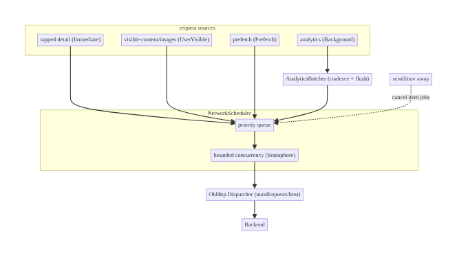
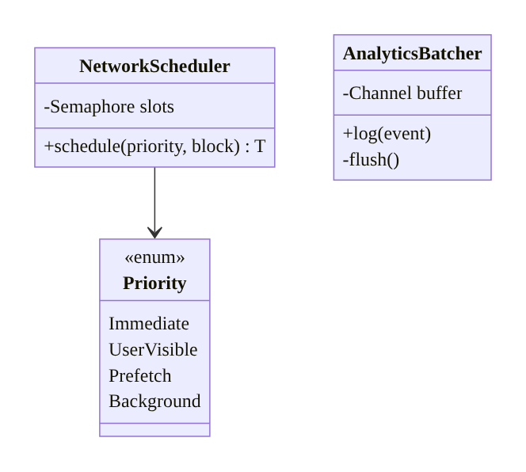
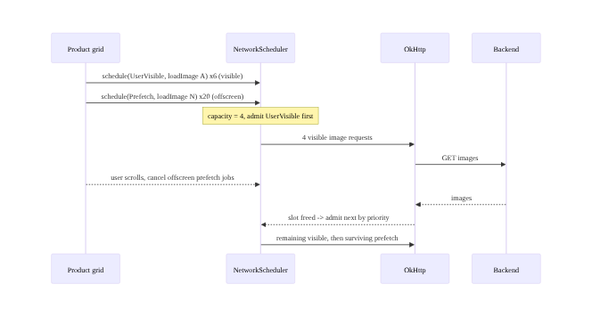
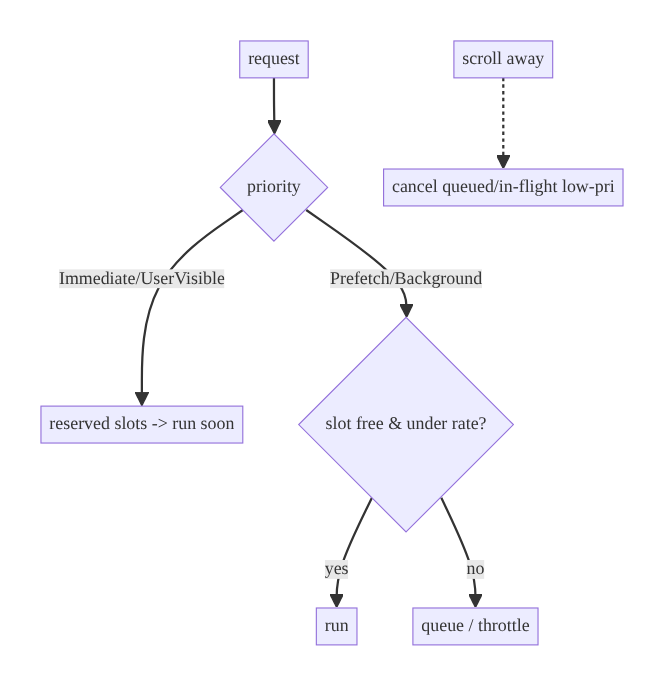

# Chapter 14 — Request Prioritization, Queueing & Client-Side Rate Limiting

> **Part II — Networking Patterns** · Complexity: **Standard** (≥25 interview questions)
>
> **Prerequisites:** Ch 1 (Networking Core — OkHttp `Dispatcher`), Ch 2
> (reliability/backoff), Ch 11 (single-flight). Closes Part II's networking
> patterns. Applied in Ch 56 (image priority), Ch 58/59 (media), Ch 30
> (background work).
>
> **Reference surface in StreamCart:** making the visible product grid's images
> and the current screen's data load before off-screen prefetch and analytics.

---

## 14.1 Problem Definition and Real-World Context

A mobile app issues many concurrent requests — UI-critical reads, images,
prefetch, analytics, uploads — over **one** constrained, high-latency radio link.
Treating them all equally hurts the experience:

- **Head-of-line blocking.** A burst of low-priority prefetch/analytics requests
  saturates the connection pool, so the data the user is *waiting on* queues
  behind work they don't care about.
- **Wasted bandwidth on stale work.** The user scrolls past a row, but its image
  requests still run; they should be **cancelled/deprioritized**.
- **Self-inflicted rate limiting.** Firing unbounded concurrent requests trips
  server 429s and wastes battery/radio.
- **Thundering analytics/telemetry.** Hundreds of small events sent individually
  thrash the radio (keeping it awake costs battery); they should be **batched**.

The solution is a small **scheduling policy** over the networking core:
**prioritize** (user-visible > prefetch > background), **bound concurrency**
(limit in-flight requests, per host), **queue** by priority, **cancel** work that
no longer matters, and **rate-limit/batch** low-value traffic. These are policy
decisions layered on Ch 1's client.

### Three practical use cases

1. **E-commerce grid (StreamCart Shop).** Visible-cell images load first;
   off-screen prefetch yields; scrolled-away image requests are cancelled (Ch 56).
2. **OTT home (Watch).** The current row's artwork and the selected title's
   metadata outrank background prefetch of other rows.
3. **Analytics/telemetry (all).** Events are batched and flushed on a timer / size
   threshold / lifecycle, not sent one-by-one (Ch 82).

### Why this is architectural

It defines **how a scarce shared resource (the network) is allocated** across
competing needs — priority ordering, concurrency bounds, cancellation, and
batching — a cross-cutting policy that shapes perceived performance and battery.

---

## 14.2 Requirements Engineering

### Functional requirements

| ID | Requirement |
|----|-------------|
| F1 | Assign priorities (e.g., Immediate / UserVisible / Prefetch / Background). |
| F2 | Higher-priority requests start before lower ones when capacity is limited. |
| F3 | Bound total and per-host in-flight concurrency. |
| F4 | Cancel requests that are no longer needed (scrolled away, screen left). |
| F5 | Rate-limit / throttle low-value traffic to avoid 429s and battery drain. |
| F6 | Batch high-frequency small requests (analytics) instead of sending each. |

### Non-functional requirements

| Attribute | Policy |
|-----------|--------|
| **Latency** | User-visible requests not blocked by background work. |
| **Battery** | Fewer radio wakeups; batch; coalesce; respect Doze (Ch 47). |
| **Network** | Bounded concurrency; respect `Retry-After`/429 (Ch 2). |
| **Reliability** | Dropped/deprioritized work doesn't break correctness. |
| **Fairness** | Avoid starving low priority forever (aging, optional). |

### Scope

- **In scope:** priority model, bounded-concurrency scheduler/semaphore, OkHttp
  dispatcher tuning, cancellation on scroll/navigation, client rate limiting,
  analytics batching.
- **Out of scope:** retry/backoff (Ch 2), single-flight dedup (Ch 11), background
  deferrable work (WorkManager, Ch 30), image pipeline specifics (Ch 56).

### Assumptions & constraints

- Coroutines; OkHttp `Dispatcher`; priorities are a small enum. Client rate
  limiting is **not** a security control (backend enforces, Ch 2). `minSdk 24`.

---

## 14.3 System Design Fundamentals

- **Priority classes.** A small ordered set: `Immediate` (blocking the user, e.g.
  tapped detail), `UserVisible` (on-screen content/images), `Prefetch`
  (likely-next, off-screen), `Background` (analytics, cleanup). Ordering, not
  fine-grained numbers, is enough.
- **Bounded concurrency.** The radio and connection pool are finite; cap in-flight
  requests (a `Semaphore` or the OkHttp `Dispatcher`'s `maxRequests`/
  `maxRequestsPerHost`). Unbounded concurrency causes contention and 429s.
- **Priority scheduling.** When capacity is full, pick the highest-priority queued
  request next (a priority queue / per-class semaphores). Optionally **age**
  long-waiting low-priority items to avoid starvation.
- **Cancellation as scheduling.** The cheapest way to free capacity is to cancel
  work that no longer matters (scrolled-off images, left screen). Structured
  concurrency (`viewModelScope`, item-scoped jobs) makes this automatic.
- **Client rate limiting (token/leaky bucket).** Throttle a class of requests to
  N/sec to protect the backend and battery; honor server `429`/`Retry-After`
  (Ch 2).
- **Batching/coalescing.** Accumulate high-frequency small events and flush on
  size/time/lifecycle — turning hundreds of radio wakeups into a few.

Core insight: **treat the network as a scarce shared resource and schedule it —
prioritize, bound concurrency, cancel aggressively, and batch low-value traffic.**
Most of the win comes from priority + cancellation + batching, not a complex
queue.

---

## 14.4 High-Level Architecture



**Components & ownership**

- **`NetworkScheduler`** — admits requests by priority under a concurrency bound.
- **OkHttp `Dispatcher`** — the transport-level cap (`maxRequests`,
  `maxRequestsPerHost`); the scheduler sits above it for app-level priority.
- **`AnalyticsBatcher`** — coalesces background events and flushes periodically.
- **Cancellation** — item/screen-scoped jobs cancel on scroll/navigation.

**Direction:** sources → scheduler (priority + bound) → OkHttp → network; scroll/
nav cancels queued/in-flight low-priority work.

---

## 14.5 Detailed Component Design



| Component | Responsibility | Mechanism |
|-----------|----------------|-----------|
| `Priority` | ordered classes | enum (compareTo) |
| `NetworkScheduler` | admit by priority under a cap | priority-aware `Semaphore`/queue |
| OkHttp `Dispatcher` | transport concurrency cap | `maxRequests`/`maxRequestsPerHost` |
| `AnalyticsBatcher` | coalesce + flush low-value events | buffered `Channel` + timer/size |
| item-scoped jobs | cancel stale work | structured concurrency |

**Simplest effective design:** a weighted/priority `Semaphore` (or per-class
semaphores with reserved slots for `Immediate`/`UserVisible`) plus aggressive
cancellation and analytics batching. A full priority queue is only needed when
contention is high.

---

## 14.6 End-to-End Data Flow



---

## 14.7 Complete Kotlin Implementation

Package: `com.streamcart.core.network.schedule`.

### 14.7.1 Priority + bounded-concurrency scheduler

```kotlin
enum class Priority { Immediate, UserVisible, Prefetch, Background }   // natural order = priority

@Singleton
class NetworkScheduler @Inject constructor() {
    // Reserve capacity so low-priority floods can't starve user-visible work.
    private val semaphores = mapOf(
        Priority.Immediate to Semaphore(permits = 6),
        Priority.UserVisible to Semaphore(permits = 4),
        Priority.Prefetch to Semaphore(permits = 2),
        Priority.Background to Semaphore(permits = 1),
    )

    suspend fun <T> schedule(priority: Priority, block: suspend () -> T): T {
        val sem = semaphores.getValue(priority)
        return sem.withPermit { block() }     // suspends until a slot of this class is free
    }
}
```

> This per-class reservation is the pragmatic 80/20: user-visible and immediate
> work always have dedicated slots, so a prefetch/analytics burst can't block
> them. A single global priority queue is an option when you need strict global
> ordering (shown in §14.11).

### 14.7.2 OkHttp dispatcher tuning (transport cap)

```kotlin
// From Ch 1 NetworkModule — cap transport-level concurrency.
OkHttpClient.Builder()
    .dispatcher(Dispatcher().apply {
        maxRequests = 12            // total in-flight
        maxRequestsPerHost = 6      // per host (avoid hammering one backend)
    })
    .build()
```

### 14.7.3 Cancellation on scroll (item-scoped work)

```kotlin
// Each list item owns its load; leaving composition cancels it (structured concurrency).
@Composable
fun ProductCell(product: Product, scheduler: NetworkScheduler) {
    // Coil/image library already cancels on dispose; for custom loads:
    LaunchedEffect(product.id) {
        scheduler.schedule(Priority.UserVisible) { loadDetails(product.id) }
    }  // cancelled automatically when the cell leaves the viewport
}
```

### 14.7.4 Client-side rate limiting (token bucket)

```kotlin
class RateLimiter(private val permitsPerSec: Int, private val clock: () -> Long = System::nanoTime) {
    private val mutex = Mutex()
    private var tokens = permitsPerSec.toDouble()
    private var last = clock()

    suspend fun acquire() = mutex.withLock {
        val now = clock()
        tokens = (tokens + (now - last) / 1e9 * permitsPerSec).coerceAtMost(permitsPerSec.toDouble())
        last = now
        if (tokens < 1) {
            val waitSec = (1 - tokens) / permitsPerSec
            delay((waitSec * 1000).toLong())     // throttle; cancellable
            tokens = 0.0
        } else tokens -= 1
    }
}
```

### 14.7.5 Analytics batching (coalesce + flush)

```kotlin
@Singleton
class AnalyticsBatcher @Inject constructor(
    @ApplicationScope private val scope: CoroutineScope,
    private val api: AnalyticsApi,
) {
    private val buffer = Channel<Event>(capacity = Channel.UNLIMITED)

    init {
        scope.launch {
            val batch = ArrayList<Event>(MAX_BATCH)
            while (true) {
                batch += buffer.receive()                       // wait for first event
                withTimeoutOrNull(FLUSH_MS) {                   // then accumulate briefly
                    while (batch.size < MAX_BATCH) batch += buffer.receive()
                }
                runCatching { api.send(batch.toList()) }        // one request for many events
                batch.clear()
            }
        }
    }
    fun log(event: Event) { buffer.trySend(event) }             // flush also on app background (Ch 44)
    private companion object { const val MAX_BATCH = 50; const val FLUSH_MS = 5_000L }
}
```

### 14.7.6 Module structure

```
:core:network/schedule  NetworkScheduler, Priority, RateLimiter
:core:analytics         AnalyticsBatcher (Ch 82)
:core:network           OkHttp Dispatcher tuning (Ch 1)
```

---

## 14.8 Concurrency and Race Conditions

| Scenario | Risk | Handling |
|----------|------|----------|
| Low-priority flood blocks UI | starvation of user-visible | per-class reserved permits |
| Scroll leaves stale loads running | wasted bandwidth | item-scoped cancellation (structured concurrency) |
| Rate limiter token math races | over/under-throttle | `Mutex`-guarded token bucket |
| Batch flush vs new events | lost/duplicated events | single consumer coroutine; `Channel` buffer |
| Cancellation vs in-flight | half-done work | coroutine cancellation propagates to OkHttp `Call` (Ch 1) |
| Priority inversion (low holds a slot) | high waits | reserve slots per class; optional aging |

- **Structured concurrency makes cancellation the primary scheduling tool:**
  leaving a screen/cell cancels its jobs, freeing capacity for what's now visible
  — no manual queue surgery.
- **Per-class semaphores** prevent priority inversion/starvation simply; a global
  priority queue needs explicit aging to be fair.

---

## 14.9 Failure Scenarios and Recovery

| Failure | Detection | Response | UX |
|---------|-----------|----------|----|
| 429 (client too aggressive) | `RateLimited` | back off (Ch 2); lower concurrency; honor `Retry-After` | brief slowdown |
| Prefetch failure | error | ignore/retry later (low value) | invisible |
| User-visible request starved | latency | reserved permits prevent it | fast |
| Analytics flush fails | send error | retry batch / persist to disk (outbox, Ch 31) | no data loss |
| Cancellation storm (fast scroll) | many cancels | cheap; frees capacity | smooth |
| Background work in Doze | can't run | defer to WorkManager (Ch 30/47) | runs when allowed |



> **Deprioritize, don't fail:** prefetch/analytics that can't run now should wait
> or be dropped silently — never surface an error for work the user didn't ask
> for.

---

## 14.10 Scaling the Implementation

- **Level 1.** Just tune OkHttp `Dispatcher` caps + cancel on scroll (image libs
  do this already).
- **Level 2.** Add priority classes with per-class reserved permits; batch
  analytics.
- **Level 3 — production.** Client rate limiting for background classes; honor
  429/`Retry-After`; lifecycle-aware flush; prefetch within budget.
- **Level 4 — large.** Adaptive concurrency (shrink on 429/poor network, grow on
  good); network-quality-aware prefetch (Ch 68/91); image priority tied to
  viewport (Ch 56).
- **Level 5 — enterprise.** A unified request scheduler with remote-configurable
  policies (Ch 41), per-endpoint budgets, server-coordinated client limits, and
  observability on queue depth/priority latency.

**Avoid overengineering:** most apps need only dispatcher caps + cancel-on-scroll
+ analytics batching. A full priority queue with aging is justified only under
heavy contention.

---

## 14.11 Alternative Approaches and Trade-offs

| Dimension | Option A | Option B | When |
|-----------|----------|----------|------|
| Priority | Per-class reserved semaphores | Global priority queue | Per-class is simple, no starvation; global queue for strict ordering (needs aging) |
| Concurrency cap | OkHttp `Dispatcher` | App-level `Semaphore` | Dispatcher for transport; semaphore for app-level priority on top |
| Stale work | Cancel (structured concurrency) | Deprioritize/keep | Cancel for truly unneeded (scrolled off); deprioritize if result may still be used |
| Rate limiting | Token bucket | Leaky bucket / fixed window | Token bucket allows bursts; leaky smooths; fixed window simplest |
| Analytics | Batch + flush | Send per event | Batch for battery/network; per-event only for rare critical events |
| Background | In-app scheduler | WorkManager (Ch 30) | In-app for foreground prioritization; WorkManager for deferrable/guaranteed |

**Global priority queue vs per-class semaphores:** a single global queue gives
exact priority ordering but can **starve** low priority and needs aging to be
fair; per-class reserved semaphores are simpler, prevent starvation of the
important classes, and are usually enough. Start with per-class.

**Cancel vs deprioritize:** if a result is now useless (off-screen image),
**cancel** to free capacity and bandwidth. If it may still be used soon, lower its
priority instead so it resumes when capacity frees.

---

## 14.12 Security Considerations

- **Client rate limiting is not a security control.** A tampered client bypasses
  it; the **backend must rate-limit and authorize** independently (Ch 2). Client
  limiting is purely for UX/battery/politeness.
- **Analytics batching and PII:** batched events may carry PII; redact (Ch 28),
  honor consent, and don't persist sensitive events unencrypted in the batch
  buffer/outbox (Ch 24/31).
- **Prioritization must not leak timing:** avoid priority schemes that reveal
  sensitive state via request timing to a network observer.
- Client vs backend: the client schedules for UX; the backend enforces limits and
  access.

---

## 14.13 Performance and Resource Optimization

- **Perceived performance:** reserving slots for user-visible work is the biggest
  win — the content the user is looking at loads first.
- **Battery:** batching analytics and bounding concurrency cut **radio wakeups**
  (the radio's high-power tail state is a major drain); align background flushes
  with other traffic / lifecycle.
- **Cancellation** reclaims bandwidth from scrolled-away work instantly.
- **Adaptive concurrency:** reduce in-flight on `429`/poor network; increase on
  good — avoids both under-use and overload.
- **Profiling:** Network Inspector (concurrency, timing), battery historian /
  Network traffic stats, frame timing while scrolling, 429 rate.

---

## 14.14 Testing Strategy

Use virtual time and controllable blocks to assert ordering/throttling.

```kotlin
@OptIn(ExperimentalCoroutinesApi::class)
class NetworkSchedulerTest {
    @Test fun `user-visible is not blocked by background flood`() = runTest {
        val sched = NetworkScheduler()
        val order = Collections.synchronizedList(mutableListOf<String>())
        val gate = CompletableDeferred<Unit>()
        repeat(10) { launch { sched.schedule(Priority.Background) { gate.await(); order += "bg" } } }
        launch { sched.schedule(Priority.UserVisible) { order += "vis" } }   // reserved slot
        runCurrent()
        assertTrue("vis" in order)          // ran despite background flood
        gate.complete(Unit)
    }
}

class RateLimiterTest {
    @Test fun `throttles beyond permits per second`() = runTest {
        var now = 0L
        val rl = RateLimiter(permitsPerSec = 2) { now }
        rl.acquire(); rl.acquire()           // 2 immediate
        val before = currentTime
        rl.acquire()                         // 3rd must wait ~0.5s
        assertTrue(currentTime - before >= 400)
    }
}

class AnalyticsBatcherTest {
    @Test fun `coalesces events into one request`() = runTest {
        val api = RecordingAnalyticsApi()
        val b = AnalyticsBatcher(backgroundScope, api)
        repeat(10) { b.log(Event("tap$it")) }
        advanceTimeBy(5_000)
        assertEquals(1, api.sendCount)       // one batch
        assertEquals(10, api.lastBatch.size)
    }
}
```

Also: cancellation frees a slot (a cancelled job releases its permit); 429 lowers
concurrency; flush-on-background.

---

## 14.15 Production Observability

- **Metrics:** per-priority queue wait time and latency, in-flight concurrency,
  429 rate, prefetch hit-rate (prefetched items actually viewed), analytics batch
  size, radio-active time.
- **Logs:** `net_schedule{priority, wait_ms}`, `rate_limited{class}`,
  `analytics_flush{count, latency_ms}`.
- **Debugging:** user-visible latency high under load → no reserved slots /
  unbounded background; 429 spikes → concurrency too high / no client limiting;
  battery drain → analytics not batched / radio thrash; wasted data → no cancel on
  scroll.
- **Privacy:** no PII in scheduling logs; redact batched analytics (Ch 28).

---

## 14.16 System Design Interview Preparation

> ≥25 questions.

**Fundamentals**
1. *Why prioritize requests?* One constrained radio; user-visible work must not
   queue behind prefetch/analytics.
2. *Priority classes?* Immediate / UserVisible / Prefetch / Background (ordering,
   not fine numbers).
3. *Why bound concurrency?* Finite radio/pool; unbounded causes contention + 429s.
4. *Cheapest way to free capacity?* Cancel work that no longer matters.
5. *Why batch analytics?* Fewer radio wakeups → battery + fewer requests.

**Architecture**
6. *Where does scheduling sit?* Above OkHttp — app-level priority over the
   transport `Dispatcher` cap.
7. *Per-class semaphores vs global queue?* Per-class simple + no starvation;
   global exact-order but needs aging.
8. *How tune OkHttp?* `maxRequests`/`maxRequestsPerHost` on the `Dispatcher`.

**Kotlin/concurrency**
9. *How cancel stale work?* Structured concurrency — item/screen-scoped jobs
   cancel on dispose/nav.
10. *How does cancellation reach the socket?* Coroutine cancel → OkHttp `Call`
    cancel (Ch 1).
11. *How throttle without blocking?* Token bucket + cancellable `delay`.

**Rate limiting**
12. *Token vs leaky bucket?* Token allows bursts; leaky smooths output.
13. *Is client rate limiting a security control?* No — backend must enforce.
14. *Handle 429?* Back off + honor `Retry-After` (Ch 2); lower concurrency.

**Prioritization**
15. *Prevent starvation?* Reserved per-class permits; optional aging.
16. *Cancel vs deprioritize?* Cancel if useless; deprioritize if maybe-used.
17. *Priority inversion?* Reserve slots for high-priority classes.

**Battery/perf**
18. *Why does batching save battery?* Avoids repeated radio high-power tail
    wakeups.
19. *Adaptive concurrency?* Shrink on 429/poor network, grow on good.
20. *Biggest perceived-perf win?* Reserved slots for user-visible content.

**Scalability**
21. *Remote-tune policies?* From remote config (Ch 41); per-endpoint budgets.
22. *Background deferrable work?* WorkManager (Ch 30), not the in-app scheduler.

**Testing**
23. *How test priority?* Flood background; assert user-visible still runs.
24. *How test rate limiting?* Fake clock; assert throttle delay.
25. *How test batching?* Log N events; assert one flush of N.

**Production debugging**
26. *User-visible slow under load?* No reserved slots/unbounded background.
27. *429 spikes?* Concurrency too high / no client limiting.
28. *Battery drain?* Analytics not batched; radio thrash.

### Design-change challenges
1. **Image grid janky under prefetch.** Reserve visible slots; cancel off-screen;
   tie priority to viewport (Ch 56).
2. **Backend 429s under load.** Client rate limiting + adaptive concurrency +
   honor `Retry-After`.
3. **Analytics draining battery.** Batch + flush on timer/size/background.
4. **Prefetch wasting data on cellular.** Network-aware prefetch (Ch 68/91);
   disable on metered.
5. **Guaranteed background upload.** Move to WorkManager (Ch 30).

### Mock walkthrough (abridged)
Clarify (contention? battery? priorities?) → define priority classes → per-class
reserved semaphores + OkHttp caps → cancel-on-scroll → client rate limit +
batching → handle 429/adaptive → testing.

---

## 14.17 Practical Exercises

1. **Beginner.** Tune OkHttp `maxRequests`/`maxRequestsPerHost` and cancel image
   loads on scroll. *Eval:* bounded concurrency; stale loads cancelled.
2. **Intermediate.** Add a per-class `NetworkScheduler`; prove user-visible runs
   under a background flood. *Eval:* no starvation.
3. **Advanced.** Add a token-bucket rate limiter + analytics batcher; prove
   throttling and coalescing. *Eval:* N events → 1 flush; throttle delay correct.
4. **Production debugging.** Fix a grid where prefetch blocks visible images and
   analytics drains battery. *Eval:* visible-first; batched analytics.
5. **System design challenge.** Add adaptive concurrency that shrinks on 429/poor
   network and grows on good. *Eval:* fewer 429s; good throughput when healthy.

*(Solutions withheld unless requested.)*

---

## 14.18 Chapter Summary & Reference Sheet

**Key decisions:** treat the network as a **scarce shared resource** and schedule
it; use a few **priority classes** with **per-class reserved permits** (no
starvation); **bound concurrency** at the OkHttp `Dispatcher` and app level;
**cancel** scrolled-away/left-screen work via structured concurrency; **rate-limit
and batch** low-value traffic (analytics) for battery and to avoid 429s; honor
server `429`/`Retry-After`; client limiting is **not** security (backend
enforces).

**Concepts:** priority scheduling, bounded concurrency, head-of-line blocking,
cancellation-as-scheduling, token/leaky bucket, batching/coalescing, radio
wakeups, adaptive concurrency.

**Common mistakes:** unbounded concurrency (contention/429); no reserved slots
(user-visible starved); not cancelling stale loads (wasted data); per-event
analytics (battery drain); treating client rate limiting as security; a global
priority queue without aging (starvation).

**Checklist:** ☐ priority classes ☐ per-class reserved permits ☐ OkHttp caps
☐ cancel on scroll/nav ☐ client rate limiter ☐ analytics batching + lifecycle
flush ☐ honor 429/`Retry-After` ☐ adaptive concurrency ☐ no PII in batches
☐ defer guaranteed work to WorkManager.

**Key APIs:** OkHttp `Dispatcher` (`maxRequests`/`maxRequestsPerHost`),
`Semaphore.withPermit`, `Mutex`, `Channel`/`trySend`, `withTimeoutOrNull`,
`delay`, structured concurrency/`viewModelScope`, coroutine cancellation.

**References:**
- OkHttp `Dispatcher`: https://square.github.io/okhttp/4.x/okhttp/okhttp3/-dispatcher/
- Coroutines: shared state & Semaphore/Mutex: https://kotlinlang.org/docs/shared-mutable-state-and-concurrency.html
- Optimize network/battery: https://developer.android.com/training/efficient-downloads
- WorkManager (deferrable work): https://developer.android.com/topic/libraries/architecture/workmanager
- Reduce network battery drain: https://developer.android.com/topic/performance/power/network

### Chapter review (Phase 4)
- **Completeness:** all 18 sections; architecture/class/sequence/failure diagrams;
  scheduler + rate limiter + batcher + OkHttp tuning + cancellation; concurrency
  (starvation/inversion); failure (deprioritize-not-fail); 5 levels; per-class-vs-
  global and cancel-vs-deprioritize trade-offs; security (not-a-control); perf
  (radio wakeups); virtual-time tests; observability; 28 Q&A + 5 challenges. ✅
- **Expand later:** image viewport priority (Ch 56), network-aware prefetch (Ch
  68/91), WorkManager (Ch 30), analytics pipeline (Ch 82).
- **Interview coverage:** exceeds ≥25 bar. **Part II (networking patterns)
  core is well-covered (Ch 9–14).**
