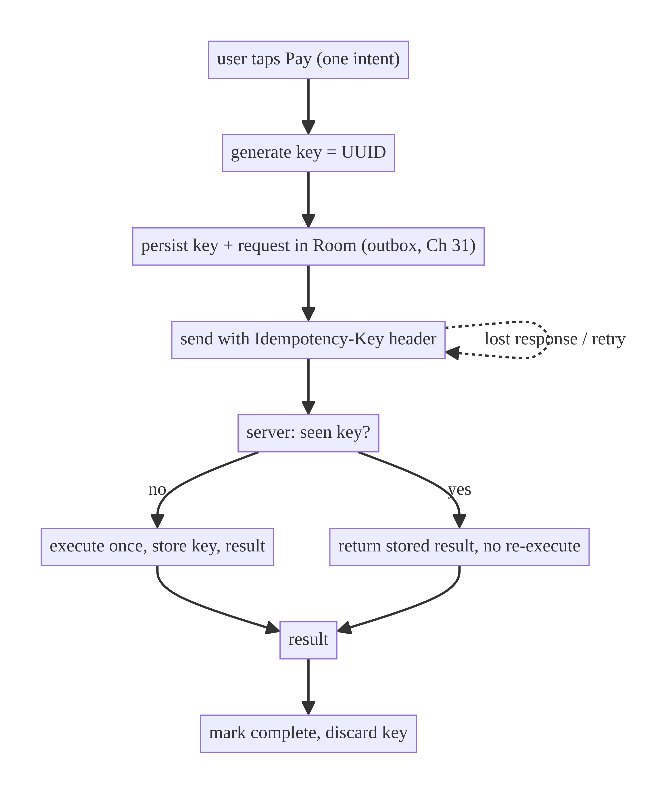
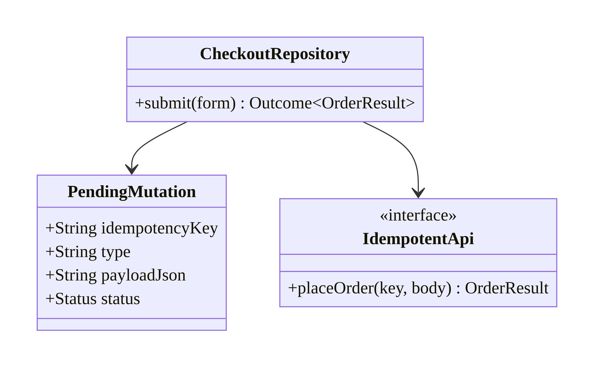
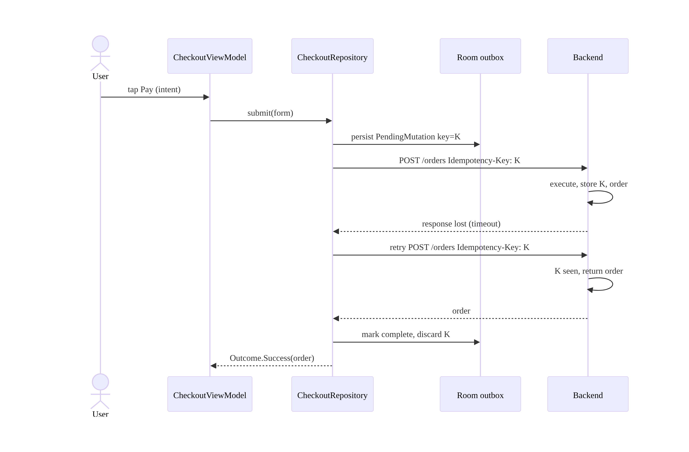
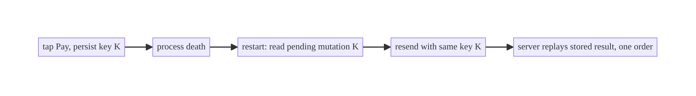
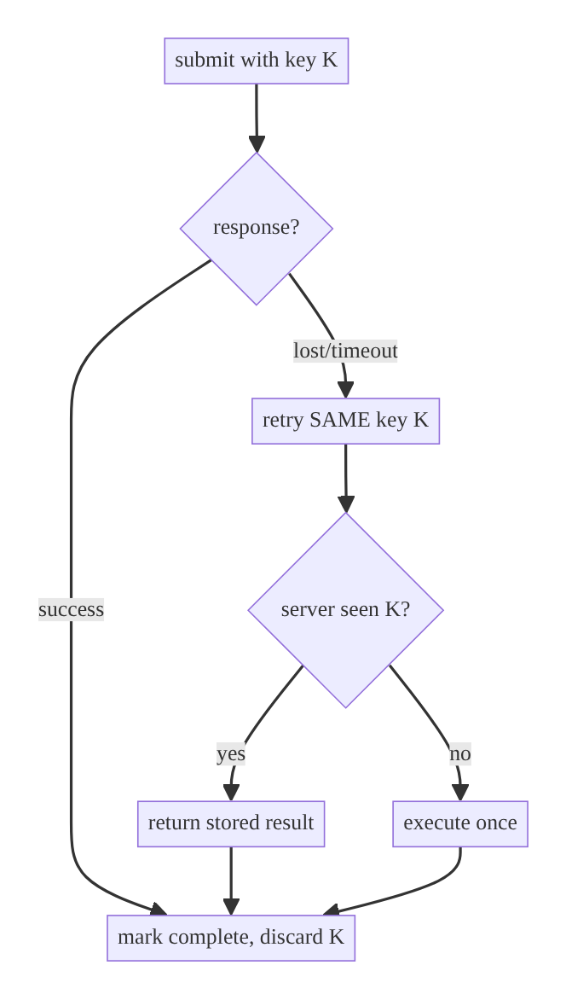

# Chapter 15 — Idempotency for Mutations

> **Part II — Networking Patterns** · Complexity: **Standard** (≥25 interview questions)
>
> **Prerequisites:** Ch 2 (reliability/retry — *why* we retry), Ch 8 (process
> death — resumed operations), Ch 11 (single-flight — concurrent dedup), Ch 3
> (SSOT). Idempotency is what makes retries (Ch 2), outbox replay (Ch 31), and
> resumed submits (Ch 8) **safe**.
>
> **Reference surface in StreamCart:** placing an order, charging a payment,
> adding to cart, submitting a review — any mutation that must not be applied
> twice.

---

## 15.1 Problem Definition and Real-World Context

Reads are safe to repeat; **mutations are not**. The moment you add retries
(Ch 2), background replay (Ch 31), or process-death resume (Ch 8), the same
write can reach the server **more than once**. On mobile this is the norm, not
the exception:

- **The ambiguous failure.** The client sends `POST /orders`, the server
  processes it and charges the card, but the **response is lost** (timeout,
  network drop, app killed). The client can't tell "it failed" from "it
  succeeded but I didn't hear back." If it retries, it double-charges; if it
  doesn't, it may drop a real order.
- **Double-tap / double-submit.** The user taps "Pay" twice, or a recomposition
  re-fires the action → two charges.
- **At-least-once delivery.** Any reliable delivery mechanism (retry, outbox,
  WorkManager) is fundamentally *at-least-once*; without idempotency you get
  duplicates.

The fix is **idempotency keys**: the client attaches a unique key to a mutation;
the server records "I already processed key X → here's the result" and returns
that same result on any replay, performing the side effect **exactly once**.
This turns at-least-once delivery into **effectively-once** processing. It is a
client+backend contract, and the client's job is to **generate, persist, and
reuse** the key correctly.

### Three practical use cases

1. **Fintech payment (StreamCart Wallet).** A charge must happen once even if the
   client retries after a lost response — an idempotency key makes the retry a
   no-op that returns the original result.
2. **E-commerce checkout (Shop).** Placing an order survives process death
   (Ch 8): the resumed submit reuses the persisted key → one order.
3. **Social action (Social).** "Post comment" retried over a flaky network
   doesn't create duplicate comments.

### Why this is architectural

Idempotency defines the **correctness contract for writes under unreliable
delivery** — key generation/lifetime, persistence across process death, scope
(per-operation), and the client/backend split. It's the backbone of safe
retries, offline writes (Ch 31), and sync (Ch 33).

---

## 15.2 Requirements Engineering

### Functional requirements

| ID | Requirement |
|----|-------------|
| F1 | Each logical mutation carries a unique, stable idempotency key. |
| F2 | A retry of the *same* operation reuses the *same* key (not a new one). |
| F3 | The key survives process death / app restart (persisted). |
| F4 | The server performs the side effect once and returns the same result for replays. |
| F5 | A new, distinct user action uses a new key. |
| F6 | Keys have a defined lifetime/scope (per operation, expired after success). |

### Non-functional requirements

| Attribute | Policy |
|-----------|--------|
| **Correctness** | Exactly-once effect under at-least-once delivery. |
| **Reliability** | Safe retries (Ch 2), outbox replay (Ch 31), resume (Ch 8). |
| **Consistency** | Client and server agree on the result for a key. |
| **Security** | Keys unguessable (UUID); not a secret but not predictable. |
| **Storage** | Keys small; persisted durably until confirmed. |

### Scope

- **In scope:** client key generation/persistence/reuse, the `Idempotency-Key`
  header contract, retry/resume integration, scope/lifetime, client vs backend
  responsibilities.
- **Out of scope:** server-side dedup storage internals (backend), retry policy
  (Ch 2), outbox mechanics (Ch 31), conflict resolution for concurrent edits
  (Ch 33).

### Assumptions & constraints

- Backend supports idempotency keys (e.g., `Idempotency-Key` header, Stripe-style
  semantics). Client persists keys in Room/DataStore. `minSdk 24`.

---

## 15.3 System Design Fundamentals

- **Idempotent operation.** Applying it N times equals applying it once. GET, PUT
  (full replace), DELETE are naturally idempotent; **POST generally is not** —
  which is exactly why POSTs need an idempotency key.
- **Delivery vs processing semantics.** Networks give **at-least-once** delivery
  (you may send twice). Idempotent processing on the server yields
  **effectively-once** (the effect happens once). True exactly-*once delivery* is
  impossible over an unreliable network; effectively-once is the achievable goal.
- **Idempotency key.** A client-generated unique token (UUID) identifying one
  logical operation. The server stores `key → result`; the first request executes
  and records; replays return the stored result **without re-executing** the side
  effect.
- **Key stability is the crux.** The key must be **generated once per user intent
  and reused for every retry/resume of that intent** — persisted so it survives
  process death. Generating a new key per HTTP attempt defeats the entire
  mechanism.
- **Scope & lifetime.** One key per logical mutation; the server may expire keys
  after a window (e.g., 24h). The client discards the key once the operation is
  confirmed complete.
- **Relationship to single-flight (Ch 11).** Single-flight de-dupes *concurrent*
  identical in-flight calls (one process, one moment). Idempotency de-dupes
  *across time and processes* (retries, restarts, different sessions). You often
  need both.

Core insight: **generate the idempotency key once at the moment of user intent,
persist it, and reuse it for every delivery attempt**, so the server can collapse
all those attempts into a single effect.

---

## 15.4 High-Level Architecture



**Components & ownership**

- **Client** generates the key at intent time, **persists** it (so a retry/resume
  uses the same key), and sends it on every attempt.
- **Backend** is the authority: it records `key → result`, executes once, and
  replays the stored result for duplicates.
- **Outbox (Ch 31)** stores the pending mutation + key durably until confirmed.

**Direction:** intent → key → persist → send (with key) → server dedup → result →
confirm/discard.

---

## 15.5 Detailed Component Design



| Element | Responsibility | Notes |
|---------|----------------|-------|
| idempotency key | identify one logical mutation | UUID, generated once at intent |
| `PendingMutation` (Room) | persist key + payload until confirmed | survives process death |
| `Idempotency-Key` header | carry the key to the server | per-request, same value on retries |
| server `key → result` store | execute once, replay result | backend responsibility |

**Where the key is generated:** at the UI/ViewModel boundary when the user
commits the intent (taps Pay), **not** inside the retry loop or the HTTP layer —
those run multiple times.

---

## 15.6 End-to-End Data Flow

### Lost response → safe retry



### Process death mid-submit



---

## 15.7 Complete Kotlin Implementation

Package: `com.streamcart.data.checkout`.

### 15.7.1 Persisted pending mutation (outbox row, Ch 31)

```kotlin
@Entity(tableName = "pending_mutations")
data class PendingMutation(
    @PrimaryKey val idempotencyKey: String,   // generated once, reused on every attempt
    val type: String,                         // "place_order"
    val payloadJson: String,
    val status: String = "PENDING",           // PENDING -> COMPLETE
    val createdAt: Long,
)
```

### 15.7.2 API with the idempotency header

```kotlin
interface OrderApi {
    @POST("orders")
    suspend fun placeOrder(
        @Header("Idempotency-Key") key: String,
        @Body body: PlaceOrderRequest,
    ): OrderResult
}
```

### 15.7.3 Repository: generate once, persist, reuse on retry

```kotlin
class CheckoutRepositoryImpl @Inject constructor(
    private val api: OrderApi,
    private val dao: PendingMutationDao,
    private val dispatchers: DispatcherProvider,
    private val json: Json,
    private val clock: Clock,
) : CheckoutRepository {

    override suspend fun submit(form: CheckoutForm): Outcome<OrderResult> {
        // 1) One key per logical intent, persisted so retries/resume reuse it.
        val pending = dao.findPendingFor("place_order", form.hash())
            ?: PendingMutation(
                idempotencyKey = UUID.randomUUID().toString(),
                type = "place_order",
                payloadJson = json.encodeToString(form.toRequest()),
                createdAt = clock.now(),
            ).also { dao.upsert(it) }

        // 2) Retry is safe because the SAME key is reused (Ch 2 reliability wraps this).
        return reliableCall(idempotent = true) {                    // Ch 2
            safeApiCall(dispatchers.io) {
                api.placeOrder(pending.idempotencyKey, pending.payloadJson.toRequest(json))
            }
        }.also { result ->
            if (result is Outcome.Success) dao.markComplete(pending.idempotencyKey)  // discard key
        }
    }
}
```

> The key is created **once** (and found again if a pending row already exists for
> this intent), then handed to a retrying call. Every HTTP attempt — including one
> after process death that re-reads the `PendingMutation` — carries the *same*
> key.

### 15.7.4 Resume after process death / app start (Ch 8, Ch 31)

```kotlin
// On app start or via WorkManager (Ch 30/31): replay any pending mutations.
suspend fun replayPending() {
    dao.allPending().forEach { pending ->
        when (val r = safeApiCall(dispatchers.io) {
            api.placeOrder(pending.idempotencyKey, pending.payloadJson.toRequest(json))
        }) {
            is Outcome.Success -> dao.markComplete(pending.idempotencyKey)  // server deduped if already done
            is Outcome.Failure -> if (!r.error.isRetryable()) dao.markComplete(pending.idempotencyKey)
        }
    }
}
```

### 15.7.5 Also attach keys centrally (optional interceptor)

```kotlin
// For simple cases, an interceptor can require callers to pass the key via a tag,
// ensuring EVERY mutation carries one. (Repository-level control above is preferred
// because the key must be persisted and reused, not minted per-request.)
```

### 15.7.6 Module structure

```
:data:checkout  CheckoutRepositoryImpl, PendingMutation(Dao), OrderApi
:core:database  pending_mutations table (outbox, Ch 31)
:core:network   reliableCall (Ch 2), safeApiCall (Ch 1)
```

---

## 15.8 Concurrency and Race Conditions

| Scenario | Risk | Handling |
|----------|------|----------|
| Double-tap Pay (concurrent) | two submissions | single-flight by key (Ch 11) + same persisted key |
| Retry after lost response | double effect | same key → server replays (effectively-once) |
| Process death mid-submit | duplicate on resume | persisted key reused on replay |
| New key minted per HTTP attempt | dedup defeated | generate once at intent, persist |
| Concurrent replay + user re-submit | two keys for one intent | find existing pending row by intent hash |
| Key reused for a *different* intent | wrong result returned | new intent → new key |

- **Single-flight (Ch 11) + idempotency key (this chapter) together** cover both
  axes: single-flight stops *concurrent* duplicates in one process; the key stops
  duplicates *across time/processes*. Payments want both.
- **The “generate once, persist, reuse” rule** is the entire correctness
  property; most idempotency bugs are a new key per attempt.

---

## 15.9 Failure Scenarios and Recovery

| Failure | Detection | Response | Result |
|---------|-----------|----------|--------|
| Lost response after success | timeout/no reply | retry with same key | server replays stored result; one effect |
| Timeout before server processed | timeout | retry with same key | server executes once (first to arrive) |
| Process death mid-submit | pending row on restart | replay with same key | one effect |
| Duplicate tap | concurrent calls | single-flight + same key | one effect |
| Server key expired (late retry) | 4xx "key expired" | treat as new intent or reconcile | surface/confirm status |
| Partial success (charged, order not created) | server-side | server idempotency spans the whole op | atomic on backend |
| Client lost the key before confirm | missing pending row | query server by business id to reconcile | avoid blind re-submit |



> **Never blindly re-submit without the key.** If the client lost the key before
> confirmation, reconcile by querying the server for the operation's status (by a
> business identifier) rather than risking a duplicate.

---

## 15.10 Scaling the Implementation

- **Level 1.** Attach a UUID `Idempotency-Key` to a single critical POST
  (payment).
- **Level 2.** Persist the key in Room so retries/resume reuse it; mark complete
  on success.
- **Level 3 — production.** All non-idempotent mutations carry keys; integrate
  with retry (Ch 2) and resume (Ch 8); reconcile lost keys by business id.
- **Level 4 — large.** Keys drive the **outbox** (Ch 31) for offline writes; a
  uniform mutation framework (generate/persist/send/confirm) across features.
- **Level 5 — enterprise.** End-to-end effectively-once pipeline: outbox + keys +
  server dedup + conflict resolution (Ch 33); key lifetime policy coordinated with
  backend; observability on duplicate-prevention.

**Avoid overengineering:** idempotent GETs/PUTs don't need keys. Apply keys to
non-idempotent, side-effectful mutations (payments, orders, posts), not every
request.

---

## 15.11 Alternative Approaches and Trade-offs

| Dimension | Option A | Option B | When |
|-----------|----------|----------|------|
| Dedup axis | Idempotency key (across time/process) | Single-flight (concurrent) | Use both for payments; key is the durable one |
| Key generation | Client UUID | Server-issued token (pre-request) | Client UUID is simplest; server token adds a round trip but server controls format |
| Natural idempotency | PUT (full replace) | POST + key | PUT when the operation is a replace by id; POST+key for create/charge |
| Key persistence | Room (outbox) | In-memory only | Room to survive process death; in-memory only for trivial double-tap |
| Reconciliation | Query by business id | Blind retry | Query when the key is lost; never blind-retry a charge |
| Scope | Per logical operation | Per screen/session | Per operation — a new intent gets a new key |

**PUT vs POST+key:** if the operation is naturally a replace addressed by a
client-known id (e.g., `PUT /cart/items/{sku}` setting quantity), it's idempotent
by design — repeating it is safe, no key needed. Create/charge operations
(`POST /orders`, `POST /charges`) aren't addressable beforehand, so they need an
idempotency key. Prefer PUT-by-id where the domain allows it.

---

## 15.12 Security Considerations

- **Keys must be unguessable** (UUIDv4), so an attacker can't probe or replay
  another user's operation by guessing keys; the server also scopes keys to the
  authenticated user.
- **Keys are not authorization.** The server still authenticates and authorizes
  every request; a valid key doesn't grant access.
- **Replay protection is the server's job.** The client's idempotency key prevents
  *accidental* duplicates; the backend must prevent *malicious* replay (nonces,
  auth, key scoping) — don't conflate the two.
- **Don't log full keys with payment context** that could aid correlation; treat
  as sensitive-ish (Ch 28).
- Client vs backend: the client supplies the key and persists intent; the
  **backend owns the dedup store and the exactly-once guarantee**. The client
  alone cannot guarantee it.

---

## 15.13 Performance and Resource Optimization

- **Negligible overhead:** a UUID + one small persisted row per mutation; the win
  (no double-charge, no duplicate order) is enormous.
- **Storage:** mark complete and prune confirmed keys; don't retain forever.
- **Fewer support costs:** duplicate charges are expensive operationally; keys
  remove a whole class of incidents.
- **Battery/network:** keys enable *safe* retries, which (with backoff, Ch 2)
  reduce wasted blind re-submits.
- **Profiling:** track duplicate-prevention rate (replays served), pending-mutation
  backlog size.

---

## 15.14 Testing Strategy

Test the "generate once, reuse on retry, survive restart" invariants.

```kotlin
class IdempotencyTest {
    @Test fun `retry reuses the same key`() = runTest {
        val api = RecordingOrderApi(failFirst = true)      // first call "loses" response
        val repo = repo(api)
        repo.submit(form)                                   // retries internally (Ch 2)
        assertEquals(1, api.distinctKeys.size)              // SAME key on both attempts
    }

    @Test fun `resume after process death reuses persisted key`() = runTest {
        val key = "K-1"
        dao.upsert(PendingMutation(key, "place_order", payload, createdAt = 0))
        val api = RecordingOrderApi()
        repo(api).replayPending()
        assertEquals(key, api.lastKey)                      // persisted key reused
    }

    @Test fun `new intent gets a new key`() = runTest {
        val api = RecordingOrderApi()
        val repo = repo(api)
        repo.submit(formA); repo.submit(formB)
        assertEquals(2, api.distinctKeys.size)
    }

    @Test fun `success marks mutation complete and discards key`() = runTest {
        val repo = repo(RecordingOrderApi())
        repo.submit(form)
        assertNull(dao.findPendingFor("place_order", form.hash()))
    }

    @Test fun `concurrent double-submit results in one effect`() = runTest {
        val api = CountingOrderApi()                        // server dedups by key
        val repo = repo(api, singleFlight = true)
        awaitAll(async { repo.submit(form) }, async { repo.submit(form) })
        assertEquals(1, api.executed)                       // single-flight + same key
    }
}
```

Also: lost-key reconciliation queries by business id; integration with
MockWebServer returning the same result for a repeated key.

---

## 15.15 Production Observability

- **Metrics:** duplicate-prevention rate (server replays served), pending-mutation
  backlog, submit retry count, double-submit incidents (should be ~0),
  key-expired rate.
- **Logs:** `mutation{type, key_hash, attempt, result}` (hash the key; don't log
  raw with payment context), `idempotent_replay{type}`.
- **Debugging:** duplicate orders/charges → new key per attempt (not persisted/
  reused) or key missing; "stuck pending" → never marked complete; mismatched
  results → key reused across different intents.
- **Privacy:** treat keys + payment metadata as sensitive; redact (Ch 28).

---

## 15.16 System Design Interview Preparation

> ≥25 questions.

**Fundamentals**

1. *What is an idempotency key?* A client-generated unique token so the server
   performs a mutation's effect once across retries.
2. *Why are mutations unsafe to retry?* The response can be lost after the effect
   happened → retry double-applies.
3. *At-least-once vs exactly-once?* Delivery is at-least-once; idempotent
   processing yields effectively-once (true exactly-once delivery is impossible).
4. *Which HTTP methods are idempotent?* GET/PUT/DELETE typically; POST usually not
   → needs a key.
5. *The one rule?* Generate the key once per intent and reuse it on every attempt
   (persist it).

**Architecture**

6. *Where is the key generated?* At user-intent time (ViewModel/repository), not
   in the retry loop or HTTP layer.
7. *Who guarantees exactly-once?* The backend (dedup store); the client supplies
   and persists the key.
8. *How does it survive process death?* Persist the key (Room/outbox); resume
   reuses it (Ch 8/31).

**Correctness**

9. *The ambiguous-failure problem?* Lost response can't distinguish success from
   failure; the key makes retry safe either way.
10. *Single-flight vs idempotency?* Single-flight = concurrent dedup (one
    process); key = across time/process. Payments need both.
11. *PUT vs POST+key?* PUT-by-id is naturally idempotent; POST create/charge needs
    a key.

**Lifetime/scope**

12. *One key per what?* Per logical operation; new intent → new key.
13. *Key lifetime?* Server expires after a window; client discards on confirm.
14. *Lost the key before confirm?* Reconcile by querying business id; never blind
    re-submit a charge.

**Security**

15. *Must keys be unguessable?* Yes (UUID) and scoped to the user, to prevent
    probing/replay.
16. *Is a key authorization?* No — server still authn/authz.
17. *Who prevents malicious replay?* The backend (nonces/auth/scoping); the key
    handles accidental duplicates.

**Integration**

18. *How does retry (Ch 2) use it?* Retries reuse the same key → safe.
19. *How does the outbox (Ch 31) use it?* Each pending mutation stores its key;
    replay reuses it.
20. *Partial success (charged, no order)?* Server idempotency must span the whole
    operation atomically.

**Testing**

21. *How test key reuse on retry?* Record keys; assert one distinct key across
    attempts.
22. *How test resume?* Seed a pending mutation; assert the same key is resent.
23. *How test new-intent?* Two submits → two keys.

**Production debugging**

24. *Duplicate charges — cause?* New key per attempt / key not persisted / missing
    key.
25. *Stuck pending mutations?* Never marked complete after success.
26. *Different result for a “retry”?* Key reused across different intents.

### Design-change challenges
1. **Payments must never double-charge.** UUID key, persisted, reused; server
   dedup; single-flight for taps.
2. **Offline order submission.** Outbox (Ch 31) stores key+payload; replay reuses
   key.
3. **Resume submit after process death.** Persisted key; reconcile by business id
   if lost (Ch 8).
4. **Backend doesn't support keys yet.** Use PUT-by-id where possible; else
   server must add dedup — client can't guarantee alone.
5. **Keys expiring before a late retry.** Shorten retry window / reconcile by
   status; coordinate lifetime with backend.

### Mock walkthrough (abridged)
Clarify (which ops are side-effectful? retries/offline? backend support?) →
idempotency key generated once at intent, persisted → reused on retry/resume →
server dedup store (effectively-once) → single-flight for concurrent taps →
reconciliation for lost keys → security (unguessable, not authz) → testing.

---

## 15.17 Practical Exercises

1. **Beginner.** Attach a UUID `Idempotency-Key` to `POST /orders`; prove a retry
   reuses the same key. *Eval:* one distinct key across attempts.
2. **Intermediate.** Persist the key (Room) and mark complete on success; prove
   resume after a simulated restart reuses it. *Eval:* same key resent; one effect.
3. **Advanced.** Combine single-flight (concurrent taps) + persisted key (retry/
   resume); prove one effect under double-tap + retry. *Eval:* server executes
   once.
4. **Production debugging.** Fix code that mints a new key per HTTP attempt
   (double charges). *Eval:* key generated once at intent; reused.
5. **System design challenge.** Build an outbox-driven mutation (Ch 31) where
   each pending op carries a key and replay is safe. *Eval:* offline submit
   replays effectively-once.

*(Solutions withheld unless requested.)*

---

## 15.18 Chapter Summary & Reference Sheet

**Key decisions:** attach a **client-generated UUID idempotency key** to every
non-idempotent mutation; **generate it once at user intent and persist it**, then
**reuse it on every retry/resume** so delivery is at-least-once but the effect is
**effectively-once**; mark complete and **discard on confirmation**; combine with
**single-flight** (concurrent taps) and the **outbox** (offline/resume); prefer
**PUT-by-id** where the domain is a replace; the **backend owns the exactly-once
guarantee** — the client cannot guarantee it alone.

**Concepts:** idempotency, at-least-once vs effectively-once, the ambiguous
failure, key stability (generate-once/reuse), key scope/lifetime, single-flight
vs idempotency, reconciliation.

**Common mistakes:** minting a new key per HTTP attempt (defeats dedup); not
persisting the key (process death → duplicate); treating the key as authorization;
blind re-submit after losing the key; applying keys to already-idempotent
requests; keys that are guessable/not user-scoped.

**Checklist:**

- [ ] UUID key per intent
- [ ] generated once, persisted
- [ ] reused on all retries/resume
- [ ] `Idempotency-Key` header
- [ ] mark complete + discard
- [ ] single- flight for concurrent taps
- [ ] reconcile lost keys by business id
- [ ] backend dedup store
- [ ] keys unguessable + user-scoped
- [ ] redacted logs.

**Key APIs:** `UUID.randomUUID()`, `@Header("Idempotency-Key")`, Room
`PendingMutation` (outbox), `reliableCall` (Ch 2), `SingleFlight` (Ch 11),
`SavedStateHandle` (resume, Ch 8).

**References:**
- Stripe idempotent requests: https://docs.stripe.com/api/idempotent_requests
- IETF `Idempotency-Key` header draft: https://datatracker.ietf.org/doc/draft-ietf-httpapi-idempotency-key-header/
- HTTP method idempotency (MDN): https://developer.mozilla.org/docs/Glossary/Idempotent
- (builds on) Ch 2 Reliability, Ch 11 Single-Flight, Ch 31 Outbox

### Chapter review (Phase 4)
- **Completeness:** all 18 sections; architecture/class/sequence/failure diagrams;
  persisted key + API + repository + resume + tests; concurrency (two dedup axes);
  failure (ambiguous failure, reconciliation); 5 levels; PUT-vs-POST and
  key-vs-single-flight trade-offs; security (unguessable, not authz); perf; key-
  reuse/resume tests; observability; 26 Q&A + 5 challenges. ✅
- **Expand later:** outbox mechanics (Ch 31), conflict resolution (Ch 33),
  server-issued keys.
- **Interview coverage:** exceeds ≥25 bar.
