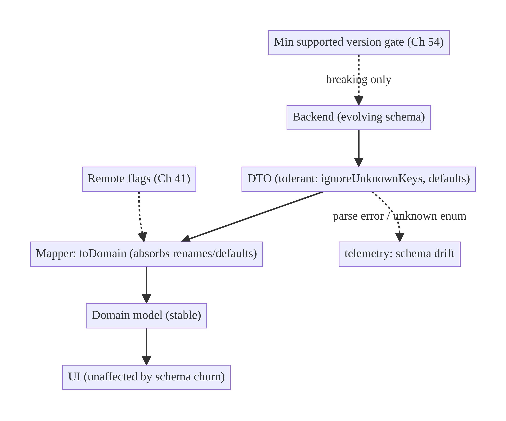
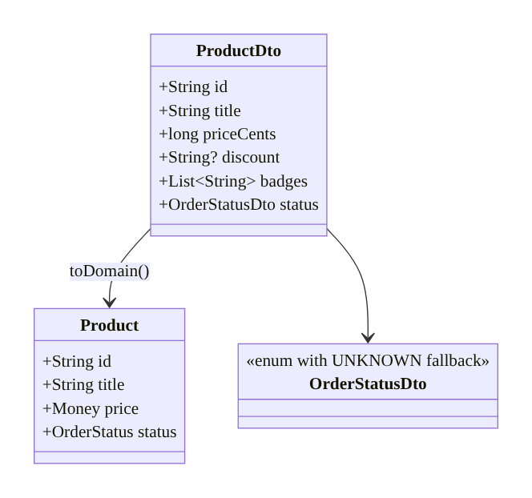
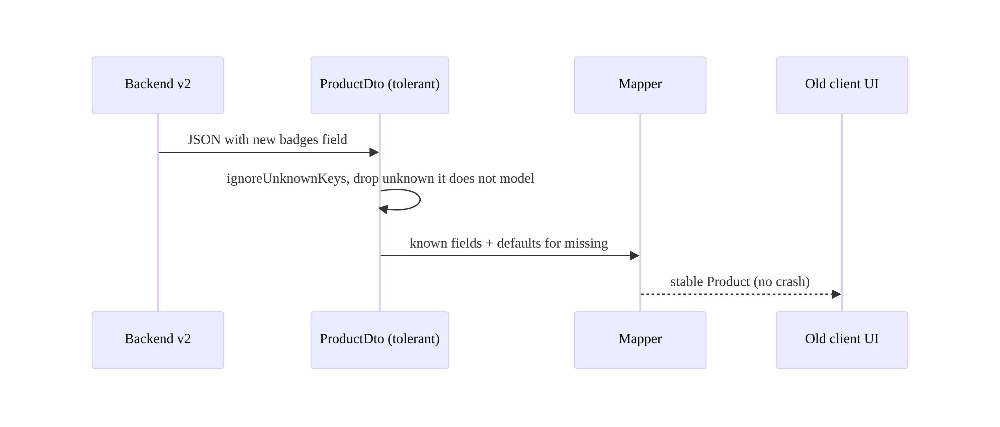
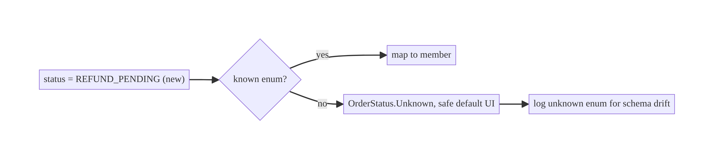
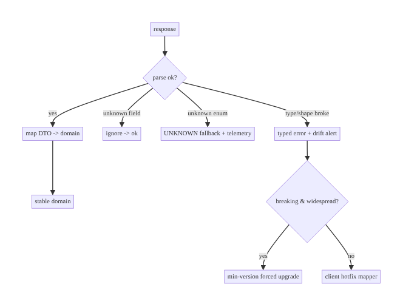

# Chapter 16 — API Schema Evolution & Backward Compatibility

> **Part II — Networking Patterns** · Complexity: **Standard** (≥25 interview questions)
>
> **Prerequisites:** Ch 1 (Networking Core — serialization, DTOs), Ch 3 (DTO/
> entity/domain separation), Ch 41 (feature flags — rollout). Schema discipline
> here protects every networked feature and is reused by Ch 36 (DB migrations —
> the storage analogue).
>
> **Reference surface in StreamCart:** the product/order/profile DTOs whose
> backend schema changes over time while **old app versions are still installed**.

---

## 16.1 Problem Definition and Real-World Context

Mobile is uniquely hostile to API changes: **you cannot force users to update**.
At any moment, many app versions — some months old — are all calling the same
backend. The backend evolves (new fields, renamed fields, new enum values,
restructured responses), and **every one of those old clients must keep working**.
Naive clients break:

- **Strict parsing crashes on new fields.** A client that fails on unknown JSON
  keys crashes the instant the backend adds a field — a self-inflicted outage
  triggered by a backend deploy the client never requested.
- **Unknown enum values crash.** The backend adds `OrderStatus.REFUND_PENDING`;
  an old client that does `valueOf()` throws.
- **Breaking renames/removals.** The backend renames `price` → `price_cents`;
  old clients silently read null/zero, showing wrong prices.
- **Tight coupling of DTO to UI.** When the network model *is* the UI model, every
  schema wobble ripples into screens.

The discipline is **tolerant reading** (ignore unknown, default missing, handle
unknown enums), **additive, backward-compatible change** (never break the
contract old clients rely on), **DTO/domain separation** (Ch 3), and a **rollout/
versioning strategy** (feature flags, API versioning, forced-upgrade as a last
resort, Ch 54). This is an architectural contract, not a parsing detail.

### Three practical use cases

1. **E-commerce (StreamCart Shop).** Backend adds `discount` and `badges` to
   products; v1.0 clients must ignore them and keep working while v2.0 uses them.
2. **OTT (Watch).** A new `PlaybackCapability` enum value ships for new devices;
   old clients must treat unknown values as a safe default, not crash.
3. **Fintech (Wallet).** A transaction response is restructured; old clients
   continue via tolerant mapping and, for a truly breaking change, a **minimum
   supported version** forces upgrade (Ch 54).

### Why this is architectural

It defines the **client/server contract under independent deploy cadences**: what
changes are safe, how clients tolerate the unknown, how new fields roll out, and
when a breaking change requires forced upgrade — properties that determine
whether a backend deploy can crash the installed base.

---

## 16.2 Requirements Engineering

### Functional requirements

| ID | Requirement |
|----|-------------|
| F1 | Unknown JSON fields are ignored, never fatal. |
| F2 | Missing fields get sensible defaults (don't crash on absence). |
| F3 | Unknown enum values map to a safe fallback, not an exception. |
| F4 | DTOs are decoupled from domain/UI models (Ch 3). |
| F5 | New fields roll out behind flags; old clients unaffected. |
| F6 | Truly breaking changes are versioned or gated by a minimum supported version. |

### Non-functional requirements

| Attribute | Policy |
|-----------|--------|
| **Compatibility** | Old clients survive additive backend changes indefinitely. |
| **Reliability** | A backend deploy never crashes installed clients. |
| **Maintainability** | DTO/domain separation localizes schema change. |
| **Observability** | Detect schema drift (parse errors, unknown enums) in telemetry. |
| **Security** | Don't trust new/optional fields for access decisions. |

### Scope

- **In scope:** tolerant deserialization (kotlinx/Moshi), defaults, unknown-enum
  handling, DTO↔domain mapping, additive change rules, API versioning strategies,
  forced-upgrade as last resort, rollout flags.
- **Out of scope:** DB schema migration (Ch 36 — the storage analogue), feature
  flag mechanics (Ch 41), forced-upgrade UX (Ch 54), GraphQL specifics.

### Assumptions & constraints

- JSON over REST; kotlinx.serialization (or Moshi). Backend and app deploy
  independently; many app versions coexist. `minSdk 24`.

---

## 16.3 System Design Fundamentals

- **The tolerant reader pattern** (a.k.a. Postel's law, "be conservative in what
  you send, liberal in what you accept"): parse only what you need, ignore the
  rest, default what's missing. This is the single most important rule for mobile
  clients.
- **Additive, backward-compatible change.** Safe: adding optional fields, adding
  enum values (with client fallback), adding endpoints. Breaking: removing/renaming
  fields, changing types, changing semantics, making optional required.
- **DTO ↔ domain separation (Ch 3).** The network DTO absorbs schema churn; a
  mapper converts to a stable domain model. Screens depend on the domain model, so
  a field rename changes only the DTO + mapper, not the UI.
- **Unknown-enum safety.** Deserialize enums as strings or with a default/`UNKNOWN`
  member so a new server value doesn't crash old clients; map unknown to a safe
  behavior.
- **Versioning strategies.** URL/header API versions (`/v2/...`), content
  negotiation, or field-level versioning. For mobile, additive evolution on a
  single version is usually preferable to proliferating versions.
- **Rollout & kill switches.** New fields/behaviors ship behind remote flags
  (Ch 41) so they can be enabled gradually and disabled if they misbehave.
- **Forced upgrade as last resort.** When a change truly can't be made
  backward-compatible, a **minimum supported version** gate (Ch 54) retires old
  clients — used sparingly because it's user-hostile.

Core insight: **make the client tolerant and the backend additive**, keep DTOs
separate from domain models, and reserve versioning/forced-upgrade for genuinely
breaking changes. Then a backend deploy is safe for every installed client.

---

## 16.4 High-Level Architecture



**Components & ownership**

- **DTO layer** — tolerant deserialization (ignore unknown, defaults, unknown-enum
  fallback); the shock absorber for schema change.
- **Mapper** — converts DTO → stable domain model; handles renames/defaults; reads
  flags for new fields.
- **Domain/UI** — depend only on the stable model; insulated from the backend.
- **Telemetry** — surfaces parse errors / unknown enums as schema-drift signals.
- **Version gate (Ch 54)** — only for genuinely breaking changes.

**Direction:** backend → tolerant DTO → mapper → stable domain → UI; schema issues
flow to telemetry.

---

## 16.5 Detailed Component Design



| Element | Responsibility | Compatibility technique |
|---------|----------------|-------------------------|
| DTO fields | mirror wire format | nullable + default for new/optional |
| unknown keys | tolerate additions | `ignoreUnknownKeys = true` |
| enums | tolerate new values | `UNKNOWN` fallback / `coerceInputValues` |
| mapper | DTO → stable domain | absorb renames, apply defaults, read flags |
| telemetry | detect drift | count parse errors / unknown enums |

---

## 16.6 End-to-End Data Flow

### Backend adds a field; old client unaffected



### Unknown enum value handling



---

## 16.7 Complete Kotlin Implementation

Package: `com.streamcart.data.catalog`.

### 16.7.1 Tolerant serializer config (from Ch 1)

```kotlin
val json = Json {
    ignoreUnknownKeys = true      // F1: new backend fields never crash old clients
    explicitNulls = false
    coerceInputValues = true      // F2/F3: use default on null/invalid (incl. unknown enum with default)
}
```

### 16.7.2 DTO with defaults + unknown-enum fallback

```kotlin
@Serializable
data class ProductDto(
    val id: String,
    val title: String,
    @SerialName("price_cents") val priceCents: Long = 0,        // default if absent
    val discount: DiscountDto? = null,                          // new optional field
    val badges: List<String> = emptyList(),                    // new optional list (safe default)
    val status: OrderStatusDto = OrderStatusDto.UNKNOWN,        // unknown-enum safety
)

@Serializable
enum class OrderStatusDto {
    @SerialName("placed") PLACED,
    @SerialName("shipped") SHIPPED,
    @SerialName("delivered") DELIVERED,
    @SerialName("cancelled") CANCELLED,
    UNKNOWN;                                                     // fallback via coerceInputValues
    // With coerceInputValues=true and UNKNOWN as default, any unmodeled value -> UNKNOWN.
}
```

> `coerceInputValues = true` + an `UNKNOWN` default member is the idiomatic
> kotlinx way to make enums forward-compatible: a brand-new server value decodes
> to `UNKNOWN` instead of throwing. (Moshi: a `@Json(name=...)` adapter with a
> fallback, or `EnumJsonAdapter.withUnknownFallback(...)`.)

### 16.7.3 Mapper: absorb renames, defaults, and flags

```kotlin
fun ProductDto.toDomain(flags: FeatureFlags): Product = Product(
    id = id,
    title = title,
    price = Money(priceCents),                                  // domain model is stable
    status = status.toDomain(),
    // New field consumed only when the flag is on; old data (null) is fine.
    badges = if (flags.isEnabled("product_badges")) badges else emptyList(),
)

fun OrderStatusDto.toDomain(): OrderStatus = when (this) {
    OrderStatusDto.PLACED -> OrderStatus.Placed
    OrderStatusDto.SHIPPED -> OrderStatus.Shipped
    OrderStatusDto.DELIVERED -> OrderStatus.Delivered
    OrderStatusDto.CANCELLED -> OrderStatus.Cancelled
    OrderStatusDto.UNKNOWN -> OrderStatus.Unknown               // safe default UI (e.g., "Processing")
}
```

### 16.7.4 Handling a rename across versions (dual-read)

```kotlin
@Serializable
data class ProfileDto(
    // Backend is migrating "name" -> "full_name". Read BOTH during the transition.
    @SerialName("full_name") val fullName: String? = null,
    val name: String? = null,
) {
    val displayName: String get() = fullName ?: name ?: ""      // tolerant of either
}
```

### 16.7.5 Minimum supported version gate (breaking change, Ch 54)

```kotlin
// Only when a change truly can't be backward-compatible.
suspend fun checkMinVersion(remote: RemoteConfig): UpgradeState {
    val min = remote.minSupportedVersionCode()
    return if (BuildConfig.VERSION_CODE < min) UpgradeState.ForceUpgrade
    else UpgradeState.Ok
}
```

### 16.7.6 Module structure

```
:data:catalog/remote   ProductDto, OrderStatusDto (tolerant)
:data:catalog/mapper   toDomain (renames/defaults/flags)
:core:network          Json config (Ch 1)
:core:config           FeatureFlags (Ch 41), min-version gate (Ch 54)
```

---

## 16.8 Concurrency and Race Conditions

Schema evolution is mostly a *compatibility* concern, but a few runtime races
matter:

| Scenario | Risk | Handling |
|----------|------|----------|
| Mixed-version responses (A/B rollout) | one session sees old + new shapes | tolerant DTOs handle both; flags gate consumption |
| Cached old-shape data + new code | mapper expects new field | defaults + null-tolerance; cache versioning (Ch 12/36) |
| New enum during a session | unknown value mid-stream | `UNKNOWN` fallback (no crash) |
| Flag flip mid-session | inconsistent rendering | read flag at map time; recompute on change (Ch 41) |

- **Tolerant DTOs are inherently concurrency-safe for schema drift:** any response
  shape (old or new) decodes without throwing, so interleaved old/new responses
  during a rollout never crash.

---

## 16.9 Failure Scenarios and Recovery

| Failure | Detection | Response | Outcome |
|---------|-----------|----------|---------|
| Backend adds a field | — | ignored by `ignoreUnknownKeys` | no effect |
| Field removed/renamed | null/default appears | dual-read / default; log drift | graceful; fix mapper |
| Unknown enum value | decodes to `UNKNOWN` | safe default UI + telemetry | no crash |
| Type change (breaking) | parse error spike | version gate / hotfix mapper | contain blast radius |
| Required field missing | default or parse error | default where safe; else error state | degrade, not crash |
| Truly breaking change | planned | min supported version → forced upgrade (Ch 54) | retire old clients |
| Malformed response | `SerializationException` (Ch 1) | typed error; sample for debugging | contained |



> **A backend deploy must never crash installed clients.** If it does, the client
> wasn't tolerant — that's a client bug exposed by a (possibly legitimate) server
> change.

---

## 16.10 Scaling the Implementation

- **Level 1.** `ignoreUnknownKeys = true` + nullable/default DTO fields.
- **Level 2.** DTO/domain separation + mappers; unknown-enum fallback.
- **Level 3 — production.** Flags for new fields (Ch 41); dual-read for renames;
  schema-drift telemetry; cache versioning (Ch 12/36).
- **Level 4 — large.** Contract tests (client DTO vs backend schema/OpenAPI);
  consumer-driven contracts; generated DTOs from a shared schema; canary rollout.
- **Level 5 — enterprise.** Formal API versioning + deprecation policy; backward-
  compat CI gates on the backend; coordinated min-version policy across app
  versions; schema registry.

**Avoid overengineering:** most apps need tolerant parsing + DTO separation +
flags. Full API versioning and schema registries are for large multi-team
platforms.

---

## 16.11 Alternative Approaches and Trade-offs

| Dimension | Option A | Option B | When |
|-----------|----------|----------|------|
| Change style | Additive (tolerant reader) | Versioned endpoints (`/v2`) | Additive for most mobile changes; versioned for genuinely breaking contracts |
| Parsing | `ignoreUnknownKeys` tolerant | strict | Tolerant always for mobile (can't force updates) |
| New field rollout | Feature flag (Ch 41) | Ship + rely on tolerant old clients | Flag for staged/kill-switchable rollout; plain additive for low-risk |
| Breaking change | Min-version forced upgrade (Ch 54) | Dual-support both shapes | Dual-support to avoid user friction; forced upgrade as last resort |
| Serialization | kotlinx.serialization | Moshi | kotlinx for Kotlin/KMP; Moshi for Java interop + rich adapters (both support fallbacks) |
| Enum handling | `UNKNOWN` default | sealed/string | `UNKNOWN` default is simplest forward-compat; sealed for richer modeling |

**Additive vs versioned:** additive evolution on one version keeps a single
codepath and avoids version sprawl, but constrains the backend to compatible
changes. Explicit versions free the backend to break cleanly but multiply
maintenance and still leave old clients on the old version. For mobile, **prefer
additive**, reserve versions for unavoidable breaks.

**Forced upgrade:** guarantees everyone is on a compatible client but is
user-hostile (churn, bad reviews) and risky (users with old OSes can't update).
Use only when a change is impossible to make compatible and the old behavior is
unsafe.

---

## 16.12 Security Considerations

- **Don't trust new/optional fields for access decisions.** A new `isPremium`
  field could be absent (old backend) or spoofed; **entitlements must be
  server-validated** per request, not inferred from an optional field.
- **Tolerant parsing ≠ trusting input.** Still validate ranges/values; ignoring
  unknown keys doesn't mean accepting malformed known fields.
- **Version gates can be bypassed** by a tampered client; the **backend must
  reject unsupported clients** too (don't rely on the client's min-version check
  alone).
- **Schema drift as an attack signal:** a surge of unexpected shapes could
  indicate a MITM or a malicious endpoint; TLS + pinning (Ch 23) plus drift
  telemetry.
- Client vs backend: tolerant mapping is a client robustness measure; the backend
  owns the contract, validation, and the authoritative meaning of fields.

---

## 16.13 Performance and Resource Optimization

- **Tolerant parsing is essentially free** (kotlinx/Moshi skip unknown keys
  efficiently); the cost of *not* being tolerant is crashes.
- **Avoid over-fetching:** `fields`/sparse responses or GraphQL reduce payloads as
  the schema grows (Ch 1); map only what you need.
- **Cache versioning:** bump a cache/schema version on incompatible DTO changes so
  stale cached JSON doesn't mis-map (Ch 12/36).
- **Profiling:** monitor parse-error and unknown-enum rates (drift), payload sizes
  over time.

---

## 16.14 Testing Strategy

Golden-JSON tests pin compatibility: decode old and new payloads, assert no crash
and correct mapping.

```kotlin
class SchemaCompatibilityTest {
    private val json = Json { ignoreUnknownKeys = true; coerceInputValues = true }

    @Test fun `tolerates unknown fields from a newer backend`() {
        val newer = """{"id":"1","title":"Shoe","price_cents":1999,"badges":["new"],"loyalty_points":50}"""
        val dto = json.decodeFromString<ProductDto>(newer)   // loyalty_points unknown -> ignored
        assertEquals(1999, dto.priceCents)
    }

    @Test fun `defaults missing optional fields`() {
        val older = """{"id":"1","title":"Shoe"}"""           // no price_cents/badges
        val dto = json.decodeFromString<ProductDto>(older)
        assertEquals(0, dto.priceCents); assertTrue(dto.badges.isEmpty())
    }

    @Test fun `unknown enum maps to UNKNOWN, not crash`() {
        val payload = """{"id":"1","title":"x","status":"refund_pending"}"""
        val dto = json.decodeFromString<ProductDto>(payload)
        assertEquals(OrderStatusDto.UNKNOWN, dto.status)
        assertEquals(OrderStatus.Unknown, dto.toDomain(FlagsOff))
    }

    @Test fun `dual-read handles a rename`() {
        assertEquals("Ada", json.decodeFromString<ProfileDto>("""{"name":"Ada"}""").displayName)
        assertEquals("Ada", json.decodeFromString<ProfileDto>("""{"full_name":"Ada"}""").displayName)
    }

    @Test fun `new field gated by flag`() {
        val dto = ProductDto(id="1", title="x", badges=listOf("hot"))
        assertTrue(dto.toDomain(FlagsOff).badges.isEmpty())   // off
        assertEquals(listOf("hot"), dto.toDomain(FlagsOn).badges)
    }
}
```

Also: a contract test comparing DTOs against the backend's OpenAPI/sample
payloads (catch breaking changes in CI); round-trip for request DTOs.

---

## 16.15 Production Observability

- **Metrics:** parse-error rate (per endpoint), unknown-enum rate (per enum),
  unknown-field frequency, min-version-gate trigger rate, crash-free rate around
  backend deploys.
- **Logs:** `schema_drift{endpoint, kind=unknown_enum|parse_error, value_hash}`,
  `dto_default_applied{field}` (sampled; no PII).
- **Debugging:** crash spike after a backend deploy → non-tolerant parsing / a
  breaking change; rising unknown-enum rate → new server value not yet mapped;
  wrong values post-deploy → a rename not dual-read.
- **Alerting:** parse-error or unknown-enum surge → page the backend/mobile team
  (possible breaking change in the wild).
- **Privacy:** hash/redact field values in drift logs (Ch 28).

---

## 16.16 System Design Interview Preparation

> ≥25 questions.

**Fundamentals**

1. *Why is schema evolution harder on mobile?* You can't force updates; many app
   versions call one backend simultaneously.
2. *Tolerant reader pattern?* Parse what you need, ignore unknown, default
   missing — be liberal in what you accept.
3. *Additive vs breaking change?* Additive = add optional fields/enum values/
   endpoints (safe); breaking = remove/rename/retype/change-semantics.
4. *Why ignore unknown keys?* So a backend-added field doesn't crash old clients.
5. *How handle unknown enum values?* Fallback member (`UNKNOWN`) +
   `coerceInputValues`; map to a safe default.

**Architecture**

6. *Why DTO/domain separation?* DTO absorbs churn; a mapper keeps the domain/UI
   stable (Ch 3).
7. *Where do renames get handled?* In the mapper (dual-read both names during
   transition).
8. *How do new fields roll out safely?* Behind remote flags (Ch 41); old clients
   ignore them.

**Compatibility**

9. *Safe backend changes?* Add optional field, add enum value (with client
   fallback), add endpoint.
10. *Unsafe changes?* Remove/rename/retype a field, make optional required, change
    meaning.
11. *How support a rename without breaking old clients?* Backend keeps both fields
    during the transition; clients dual-read.
12. *When is forced upgrade needed?* Only for truly breaking, unsafe changes; a
    min-version gate (Ch 54).

**Kotlin/serialization**

13. *kotlinx config for tolerance?* `ignoreUnknownKeys`, `coerceInputValues`,
    `explicitNulls=false`, defaults on fields.
14. *Moshi equivalent?* `@Json` adapters; `EnumJsonAdapter.withUnknownFallback`.
15. *Nullable + default?* Model new/optional fields as nullable with a default.

**Rollout/versioning**

16. *URL vs header versioning?* Both work; prefer additive single-version for
    mobile to avoid sprawl.
17. *Canary/gradual rollout?* Flags + percentage; watch drift telemetry.
18. *Mixed-version responses during A/B?* Tolerant DTOs decode both shapes.

**Security**

19. *Trust a new `isPremium` field?* No — server-validate entitlements; field may
    be absent/spoofed.
20. *Can clients enforce min version alone?* No — backend must also reject old
    clients.

**Testing**

21. *How test compatibility?* Golden-JSON (old + new payloads) decode without
    crash; contract tests vs OpenAPI.
22. *How catch breaking changes in CI?* Consumer-driven/contract tests against
    the schema.

**Production debugging**

23. *Crash spike after backend deploy?* Non-tolerant parsing or a breaking change.
24. *Wrong values post-deploy?* A rename not dual-read.
25. *Rising unknown-enum rate?* New server value not yet mapped (add it).

### Design-change challenges
1. **Backend renames a core field.** Dual-read both; migrate mapper; remove old
   after old clients age out.
2. **New enum value crashes old clients.** `UNKNOWN` fallback + ship fix; backend
   can delay sending new value to old versions.
3. **A genuinely breaking restructure.** Version the endpoint or force upgrade
   (Ch 54); dual-support during transition.
4. **Detect drift in the wild.** Schema-drift telemetry + alerts.
5. **Shared schema across teams.** Contract tests + schema registry + deprecation
   policy.

### Mock walkthrough (abridged)
Clarify (can't force updates; many versions live) → tolerant DTOs
(ignore-unknown, defaults, unknown-enum fallback) → DTO/domain separation + mapper
→ additive change rules → flags for rollout → drift telemetry → forced upgrade only
for breaking → testing (golden JSON, contract).

---

## 16.17 Practical Exercises

1. **Beginner.** Configure tolerant parsing; prove an unknown field and a missing
   optional field both decode without crashing. *Eval:* no exception; defaults
   applied.
2. **Intermediate.** Add an `UNKNOWN` enum fallback; prove a new server value maps
   safely and is logged as drift. *Eval:* no crash; telemetry emitted.
3. **Advanced.** Handle a field rename via dual-read + a flag-gated new field;
   prove both old and new payloads map correctly. *Eval:* correct `displayName`;
   flag gating works.
4. **Production debugging.** Fix a client that crashes when the backend adds a
   field (strict parsing) and shows wrong prices after a rename. *Eval:* tolerant
   + dual-read.
5. **System design challenge.** Add a contract test comparing DTOs to a backend
   OpenAPI sample and a min-version gate for one breaking change. *Eval:* CI
   catches breaks; old clients forced to upgrade only when necessary.

*(Solutions withheld unless requested.)*

---

## 16.18 Chapter Summary & Reference Sheet

**Key decisions:** be a **tolerant reader** (`ignoreUnknownKeys`, defaults,
unknown-enum fallback) so a backend deploy never crashes old clients; keep
**DTOs separate from stable domain models** and absorb renames/defaults in the
**mapper** (dual-read during transitions); roll new fields out behind **flags**
(Ch 41); prefer **additive** evolution over versioning; reserve **min-version
forced upgrade** (Ch 54) for genuinely breaking changes; **never trust optional
fields for access** (server validates); emit **schema-drift telemetry**.

**Concepts:** tolerant reader/Postel's law, additive vs breaking change, DTO/
domain separation, unknown-enum fallback, dual-read renames, API versioning,
forced upgrade, schema drift.

**Common mistakes:** strict parsing (crashes on new fields); `enum.valueOf` on
server values (crashes on new values); coupling DTO to UI; trusting optional
fields for access; relying on the client's min-version check alone; no drift
telemetry.

**Checklist:**

- [ ] `ignoreUnknownKeys` + `coerceInputValues`
- [ ] nullable+default new fields
- [ ] `UNKNOWN` enum fallback
- [ ] DTO/domain separation + mapper
- [ ] dual-read renames
- [ ] flags for new fields
- [ ] additive by default
- [ ] min-version gate for breaking (server-enforced too)
- [ ] drift telemetry.

**Key APIs:** `Json { ignoreUnknownKeys; coerceInputValues; explicitNulls=false }`,
`@SerialName`, default parameters, Moshi `EnumJsonAdapter.withUnknownFallback`,
`BuildConfig.VERSION_CODE`, FeatureFlags (Ch 41).

**References:**
- kotlinx.serialization (JSON config): https://github.com/Kotlin/kotlinx.serialization/blob/master/docs/json.md
- Moshi enums/fallback: https://github.com/square/moshi#enums
- API evolution / robustness (Postel's law): https://en.wikipedia.org/wiki/Robustness_principle
- Android in-app updates (forced upgrade, Ch 54): https://developer.android.com/guide/playcore/in-app-updates

### Chapter review (Phase 4)
- **Completeness:** all 18 sections; architecture/class/sequence/failure diagrams;
  tolerant DTOs + unknown-enum + dual-read + flag gating + min-version; concurrency
  (mixed-version rollout); failure matrix; 5 levels; additive-vs-versioned and
  forced-upgrade trade-offs; security (don't trust optional fields); perf (free
  tolerance); golden-JSON + contract tests; drift observability; 25 Q&A + 5
  challenges. ✅
- **Expand later:** DB migration analogue (Ch 36), forced-upgrade UX (Ch 54),
  GraphQL, schema registry/contract testing.
- **Interview coverage:** meets ≥25 bar.
