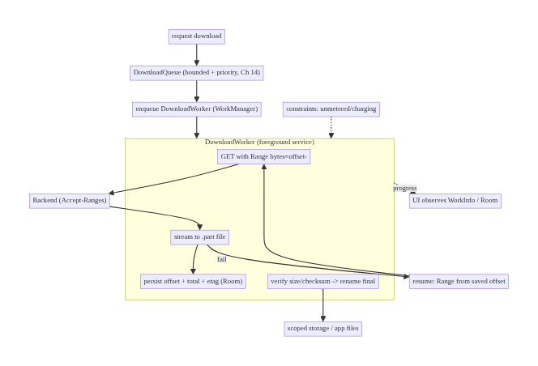
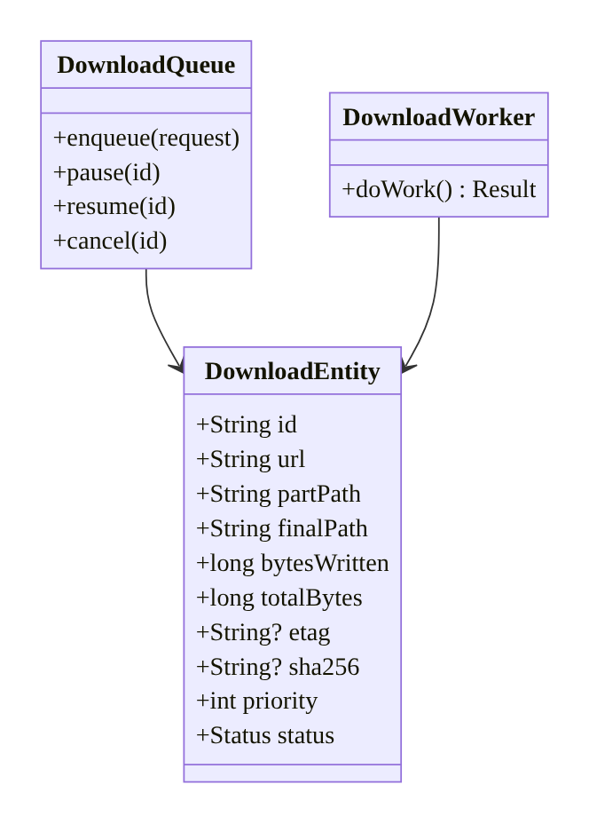
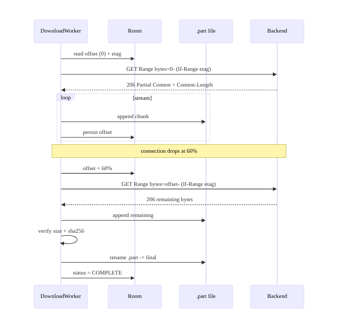
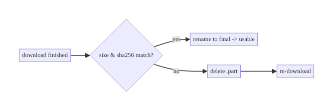
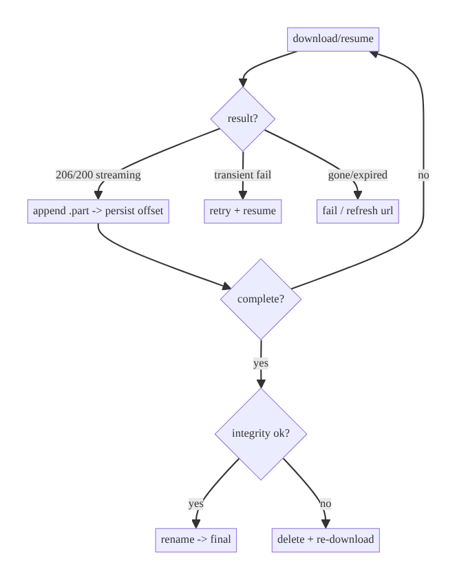

# Chapter 18 — File Download Manager

> **Part II — Networking Patterns** · Complexity: **Standard** (≥25 interview questions)
>
> **Prerequisites:** Ch 1 (Networking), Ch 2 (retry/backoff), Ch 3 (Room — track
> downloads), Ch 17 (uploads — the symmetric problem), Ch 30 (WorkManager —
> previewed). The pattern here is the backbone of Ch 59 (offline media downloads).
>
> **Reference surface in StreamCart:** downloading an invoice PDF, a product
> manual, and (as a preview of Ch 59) an episode for offline viewing — with
> progress, pause/resume, and background continuation.

---

## 18.1 Problem Definition and Real-World Context

Downloading is the mirror image of uploading (Ch 17) and shares the same mobile
hazards — large files, flaky networks, backgrounding/process death, storage
limits — plus its own: **where to store the file**, **integrity**, **pause/
resume**, and **concurrent download management**. Naive downloads fail:

- **Restart on every drop.** A 1 GB episode download fails at 80% and restarts
  from 0 — on a metered connection, repeatedly, never finishing.
- **Download dies with the screen/process.** UI-scoped downloads stop when the
  user navigates away or the OS kills the app.
- **OOM / blocking.** Reading the whole response into memory, or writing on the
  main thread.
- **Corrupt/partial files surfaced as complete.** A truncated download is shown as
  a valid file; no integrity check.
- **Storage chaos.** Writing to the wrong location, ignoring scoped storage, no
  cleanup → disk fills.

A download manager solves these: **resumable downloads** via HTTP **Range**
requests (resume from the last saved byte), **background execution** (WorkManager
foreground worker, or the system `DownloadManager` for simple cases), **durable
progress**, **pause/resume/cancel**, a **queue** with concurrency limits and
priorities (Ch 14), **integrity verification** (checksum/size), correct
**scoped-storage** placement, and **network constraints**.

### Three practical use cases

1. **Document (StreamCart Wallet/Shop).** Download an invoice/manual → simple,
   small; show progress; store in app files or share via SAF (Ch 62).
2. **Offline media (Watch).** Download an episode for offline viewing → large,
   resumable, background, constrained to Wi-Fi, integrity-checked, with a
   downloads queue (the core of Ch 59).
3. **App asset bundles.** Download on-demand content packs → resumable, verified,
   versioned, evictable.

### Why this is architectural

A download manager defines **where work runs** (background-safe), **the resume
protocol** (HTTP Range + durable offset), **storage policy** (scoped storage,
integrity, eviction), and **queue/priority/constraints** — properties that
determine whether large downloads complete and whether the device stays healthy.

---

## 18.2 Requirements Engineering

### Functional requirements

| ID | Requirement |
|----|-------------|
| F1 | Download files with live progress (%). |
| F2 | Resume interrupted downloads from the last byte (HTTP Range), not restart. |
| F3 | Continue across navigation and process death (WorkManager/foreground service). |
| F4 | Pause, resume, cancel, and retry individual downloads. |
| F5 | Manage a queue with bounded concurrency and priority (Ch 14). |
| F6 | Verify integrity (expected size/checksum) before marking complete. |
| F7 | Store correctly (scoped storage / app-internal), evictable; honor constraints. |

### Non-functional requirements

| Attribute | Policy |
|-----------|--------|
| **Reliability** | Large downloads complete over flaky networks (resume). |
| **Memory** | Stream to disk; never buffer whole file. |
| **Durability** | Progress/partial file persist; survive process death. |
| **Battery/Network** | Constraints (unmetered/charging); bounded concurrency. |
| **Integrity** | No corrupt/partial file surfaced as complete. |
| **Storage** | Scoped storage; bounded; eviction policy. |

### Scope

- **In scope:** resumable HTTP Range downloads, streaming to disk, WorkManager
  background + foreground, progress/pause/resume/cancel, download queue +
  concurrency/priority, integrity, storage/scoped-storage, constraints,
  `DownloadManager` alternative.
- **Out of scope:** WorkManager internals (Ch 30), foreground-service details
  (Ch 46), SAF (Ch 62), DRM/secure media (Ch 59), the generic cache (Ch 12).

### Assumptions & constraints

- Server supports `Range`/`Accept-Ranges` and sends `Content-Length`/`ETag`.
  WorkManager for background; Room to track downloads. `minSdk 24`.

---

## 18.3 System Design Fundamentals

- **Resumable download via HTTP Range.** The client requests `Range: bytes=offset-`
  to continue from where it stopped; the server replies `206 Partial Content` with
  the remaining bytes. A validator (`ETag`/`Last-Modified`) ensures the file
  hasn't changed since the partial download (else restart). This is the download
  analogue of Ch 17's resumable upload.
- **Stream to disk.** Write the response stream to a **partial file** (`.part`)
  chunk-by-chunk (O(chunk) memory); on completion, verify and rename to the final
  path.
- **Background execution.** Downloads must outlive the UI. Options: **WorkManager**
  (custom control, constraints, works with your networking stack) or the system
  **`DownloadManager`** (simple, system-managed, less control). Long/visible
  downloads use a **foreground service** (Ch 46).
- **Durable progress/offset.** Persist downloadId + bytes-written + total + ETag in
  Room so a restart resumes from the partial file.
- **Queue + concurrency + priority.** Many downloads shouldn't run at once
  (bandwidth/battery); a queue bounds concurrency and prioritizes (Ch 14) — e.g.,
  the currently-watched episode before background prefetch.
- **Integrity.** Verify the completed file's **size** and ideally a **checksum**
  (SHA-256) before marking it usable; a size/hash mismatch means re-download.
- **Storage & scoped storage.** Internal app files for private data; `MediaStore`/
  SAF for user-visible files; respect scoped storage; evict under pressure.

Core insight: **stream to a durable partial file and resume via HTTP Range from a
persisted offset, run it in a background worker that survives the UI, verify
integrity before completion, and manage a bounded, prioritized queue.** Resume +
integrity + background are what make downloads reliable on mobile.

---

## 18.4 High-Level Architecture



**Components & ownership**

- **`DownloadQueue`** bounds concurrency + prioritizes (Ch 14).
- **`DownloadWorker`** (WorkManager, foreground) streams to a `.part` file,
  persists offset, resumes via Range, verifies, and finalizes.
- **Room `DownloadEntity`** tracks state (offset/total/etag/status) durably.
- **Backend** supports Range; provides size/checksum.
- **UI** observes progress; never runs the transfer.

**Direction:** request → queue → worker (Range stream → persist offset → verify →
finalize) → storage; UI observes.

---

## 18.5 Detailed Component Design



| Component | Responsibility | Notes |
|-----------|----------------|-------|
| `DownloadEntity` (Room) | durable per-download state | offset/total/etag/checksum/priority/status |
| `DownloadWorker` | stream + resume + verify | foreground; `Result.retry()` on transient fail |
| `DownloadQueue` | concurrency + priority + controls | pause/resume/cancel (Ch 14) |
| integrity check | size + SHA-256 | prevents corrupt files |
| storage policy | scoped storage + eviction | MediaStore/SAF or app files |

**Status machine:** `QUEUED → RUNNING → (PAUSED) → VERIFYING → COMPLETE` or
`FAILED` (retryable) — persisted so the UI and resume are consistent.

---

## 18.6 End-to-End Data Flow

### Resumable download with an interruption



### Integrity failure



---

## 18.7 Complete Kotlin Implementation

Package: `com.streamcart.download`.

### 18.7.1 Download entity + DAO

```kotlin
@Entity(tableName = "downloads")
data class DownloadEntity(
    @PrimaryKey val id: String,
    val url: String,
    val partPath: String,
    val finalPath: String,
    val bytesWritten: Long = 0,
    val totalBytes: Long = -1,
    val etag: String? = null,
    val sha256: String? = null,     // expected checksum (from backend)
    val priority: Int = 0,
    val status: String = "QUEUED",
)
```

### 18.7.2 Streaming, resumable download (Range → .part file)

```kotlin
class Downloader @Inject constructor(
    private val client: OkHttpClient,
    private val dao: DownloadDao,
) {
    /** Returns true when complete; updates offset as it streams. */
    suspend fun download(entity: DownloadEntity, onProgress: (Long, Long) -> Unit): Result<Unit> =
        withContext(Dispatchers.IO) {
            val partFile = File(entity.partPath)
            val existing = if (partFile.exists()) partFile.length() else 0L   // resume offset

            val request = Request.Builder()
                .url(entity.url)
                .apply {
                    if (existing > 0) {
                        header("Range", "bytes=$existing-")                    // resume (F2)
                        entity.etag?.let { header("If-Range", it) }            // ensure same file
                    }
                }
                .build()

            client.newCall(request).execute().use { response ->
                if (response.code == 200 && existing > 0) partFile.delete()     // file changed -> restart
                if (!response.isSuccessful && response.code != 206) return@withContext Result.failure(IOException("HTTP ${response.code}"))

                val total = contentTotal(response, existing)
                val body = response.body ?: return@withContext Result.failure(IOException("empty"))
                val append = response.code == 206

                body.byteStream().use { input ->
                    FileOutputStream(partFile, /* append = */ append).use { output ->
                        val buffer = ByteArray(DEFAULT_BUFFER_SIZE)             // O(chunk) memory
                        var written = if (append) existing else 0L
                        while (true) {
                            val read = input.read(buffer)
                            if (read == -1) break
                            output.write(buffer, 0, read)
                            written += read
                            dao.updateProgress(entity.id, written)             // durable offset
                            onProgress(written, total)
                        }
                    }
                }
            }

            // Integrity (F6): verify size + checksum before finalizing.
            if (entity.totalBytes > 0 && partFile.length() != entity.totalBytes) {
                partFile.delete(); return@withContext Result.failure(IOException("size mismatch"))
            }
            entity.sha256?.let { expected ->
                if (sha256(partFile) != expected) { partFile.delete(); return@withContext Result.failure(IOException("checksum mismatch")) }
            }
            File(entity.partPath).renameTo(File(entity.finalPath))             // atomic finalize
            Result.success(Unit)
        }
}
```

### 18.7.3 DownloadWorker (background, foreground, retry)

```kotlin
@HiltWorker
class DownloadWorker @AssistedInject constructor(
    @Assisted ctx: Context, @Assisted params: WorkerParameters,
    private val downloader: Downloader, private val dao: DownloadDao,
) : CoroutineWorker(ctx, params) {

    override suspend fun getForegroundInfo() = ForegroundInfo(id.hashCode(), buildNotification(0))

    override suspend fun doWork(): Result {
        val entity = dao.get(inputData.getString("id")!!) ?: return Result.failure()
        setForeground(getForegroundInfo())
        dao.setStatus(entity.id, "RUNNING")
        return downloader.download(entity) { written, total ->
            val pct = if (total > 0) (written * 100 / total).toInt() else 0
            setProgressAsync(workDataOf("progress" to pct))
        }.fold(
            onSuccess = { dao.setStatus(entity.id, "COMPLETE"); Result.success() },
            onFailure = { e ->
                dao.setStatus(entity.id, "FAILED")
                if (e is IOException) Result.retry() else Result.failure()      // transient -> backoff
            },
        )
    }
}
```

### 18.7.4 Queue: bounded concurrency, priority, constraints (Ch 14)

```kotlin
fun enqueueDownload(ctx: Context, id: String, priority: Int, requireUnmetered: Boolean) {
    val request = OneTimeWorkRequestBuilder<DownloadWorker>()
        .setInputData(workDataOf("id" to id))
        .setConstraints(Constraints.Builder()
            .setRequiredNetworkType(if (requireUnmetered) NetworkType.UNMETERED else NetworkType.CONNECTED)
            .build())
        .setBackoffCriteria(BackoffPolicy.EXPONENTIAL, 15, TimeUnit.SECONDS)
        .build()
    // Unique per download; WorkManager bounds concurrency via its executor / a named chain.
    WorkManager.getInstance(ctx).enqueueUniqueWork("download-$id", ExistingWorkPolicy.KEEP, request)
}

fun pause(ctx: Context, id: String) = WorkManager.getInstance(ctx).cancelUniqueWork("download-$id")
// resume = enqueue again; Downloader resumes from the .part file length.
```

### 18.7.5 System DownloadManager (simple alternative)

```kotlin
// For simple, user-visible downloads (into Downloads), the OS manager handles
// resume/notification/retry for you — at the cost of control/integration.
fun systemDownload(ctx: Context, url: String, title: String): Long {
    val req = DownloadManager.Request(Uri.parse(url))
        .setTitle(title)
        .setNotificationVisibility(DownloadManager.Request.VISIBILITY_VISIBLE)
        .setAllowedOverMetered(false)
        .setDestinationInExternalPublicDir(Environment.DIRECTORY_DOWNLOADS, "$title.pdf")
    return (ctx.getSystemService(Context.DOWNLOAD_SERVICE) as DownloadManager).enqueue(req)
}
```

### 18.7.6 Module structure

```
:feature:downloads   DownloadWorker, DownloadQueue, enqueue, progress UI
:data:download       DownloadEntity(Dao), Downloader (Range streaming + integrity)
:core:notifications  download notification (Ch 46/49)
```

---

## 18.8 Concurrency and Race Conditions

| Scenario | Risk | Handling |
|----------|------|----------|
| Duplicate download enqueued | two transfers | `enqueueUniqueWork(KEEP)` |
| Resume vs changed remote file | corrupt merge | `If-Range` validator → restart if changed |
| Process death mid-stream | lost progress | `.part` file length + persisted offset = resume point |
| Too many concurrent downloads | bandwidth/battery | bounded queue + priority (Ch 14) |
| Partial file read as complete | corrupt file surfaced | verify size + checksum, rename only on success |
| Pause/cancel vs in-flight write | half-written file | cancel the worker; `.part` preserved for resume (or deleted on cancel) |

- **The `.part` file + `If-Range` is the resume correctness core:** resume only
  when the server confirms the file is unchanged; otherwise restart to avoid a
  corrupt concatenation.
- **Atomic finalize** (write `.part`, verify, rename) ensures a half-download is
  never visible as the final file.

---

## 18.9 Failure Scenarios and Recovery

| Failure | Detection | Response | UX |
|---------|-----------|----------|----|
| Connection drop | `IOException`/non-2xx | `Result.retry()`; resume from `.part` | progress holds, resumes |
| Process death | worker rescheduled | resume from `.part` + offset | continues |
| Remote file changed | `If-Range` → 200 not 206 | delete `.part`, restart | fresh file |
| Size/checksum mismatch | post-download verify | delete, re-download | integrity guaranteed |
| Disk full | `IOException`/no space | pause; surface "free space"; evict (Ch 12) | actionable |
| Metered when unmetered required | constraint | wait for Wi-Fi | deferred |
| 404/410 (gone) | non-retryable | fail; surface; refresh URL | error |
| Expired signed URL | 403 | refresh URL + resume | transparent |



> **Verify before you trust:** a download isn't "done" until its size and checksum
> match; only then rename `.part` to the final path.

---

## 18.10 Scaling the Implementation

- **Level 1.** System `DownloadManager` for a simple one-off file (free resume/
  notification).
- **Level 2.** Custom WorkManager download for control + integration with your
  stack; progress + retry + constraints.
- **Level 3 — production.** Resumable Range + `.part` + durable offset + integrity;
  foreground service; pause/resume/cancel; queue with concurrency limits.
- **Level 4 — large (offline media, Ch 59).** Priority queue (currently-watched
  first, Ch 14); eviction policy under storage pressure (Ch 12); batch/bundle
  downloads; adaptive concurrency by network (Ch 91).
- **Level 5 — enterprise.** DRM-protected media (Ch 59), segmented/parallel
  downloads, CDN failover, download SLAs, cross-device download state (Ch 99).

**Avoid overengineering:** a small PDF can use `DownloadManager`. Build the custom
resumable manager when you need large files, integration, integrity, or a managed
queue (offline media).

---

## 18.11 Alternative Approaches and Trade-offs

| Dimension | Option A | Option B | When |
|-----------|----------|----------|------|
| Engine | Custom (OkHttp + WorkManager) | System `DownloadManager` | Custom for control/integration/integrity; system for simple user-visible files |
| Resume | HTTP Range + `.part` | restart | Range always for large files |
| Background | WorkManager foreground | UI coroutine | WorkManager for survive-nav/process-death |
| Integrity | size + SHA-256 | size only / none | Checksum for media/assets where corruption matters |
| Storage | app-internal | MediaStore/SAF | Internal for private app data; MediaStore/SAF for user-visible files (scoped storage) |
| Concurrency | bounded queue + priority | unbounded | Bounded to protect bandwidth/battery (Ch 14) |
| Media | this + ExoPlayer offline | DownloadManager | ExoPlayer's download manager for adaptive/DRM media (Ch 59) |

**Custom vs `DownloadManager`:** the system manager is effortless (handles resume,
notifications, retries) but opaque — limited control over concurrency/priority,
hard to integrate with your auth/headers/integrity, and stores to public
Downloads. A custom WorkManager-based manager gives full control (auth, queue,
integrity, private storage) at the cost of building it. Use the system one for
simple cases; build custom for offline media and managed queues.

---

## 18.12 Security Considerations

- **Authenticate downloads** (Ch 19); use **short-lived signed URLs** for private
  content; refresh on 403.
- **Verify integrity** (checksum) to detect corruption **and** tampering (a MITM
  serving a modified file) — combine with TLS + pinning (Ch 23).
- **Store securely:** private content in app-internal storage (not public
  Downloads); **encrypt sensitive downloads at rest** (Ch 24); honor scoped
  storage.
- **Don't execute downloaded content** or trust its declared type; validate.
- **Eviction/cleanup:** delete partials on cancel; purge on logout for
  account-scoped content (Ch 42).
- Client vs backend: the backend authorizes and serves content + checksums; the
  client verifies and stores. A tampered client must not access another user's
  files.

---

## 18.13 Performance and Resource Optimization

- **Stream to disk:** O(chunk) memory; never buffer the whole file.
- **Resume saves bandwidth/battery:** no restart-from-0 on drops (huge on metered
  media).
- **Bounded concurrency + priority** (Ch 14): don't saturate the link; prioritize
  what the user needs now.
- **Constraints:** unmetered/charging for large downloads (Ch 30/47).
- **Throttle progress updates** (IPC/recomposition).
- **Storage hygiene:** evict LRU under pressure; cap total download size (Ch 12).
- **Profiling:** download success rate by network, resume rate, bytes re-downloaded
  (low = good), battery/data stats.

---

## 18.14 Testing Strategy

MockWebServer scripts Range/206 and interruptions; worker tested with WorkManager
test utilities.

```kotlin
class DownloaderTest {
    private val server = MockWebServer()

    @Test fun `resumes with Range after interruption`() = runTest {
        // First response: 206 for bytes=0- but truncated (simulate drop); .part = 60%.
        // Second: 206 for bytes=60%- with remainder.
        server.enqueue(partialThenClose(bytes = 600_000))
        server.enqueue(MockResponse().setResponseCode(206).setBody(remainder(from = 600_000, total = 1_000_000)))
        val result = downloader.download(entity(total = 1_000_000, sha = expectedHash)) { _, _ -> }
        val range = server.takeRequest(); server.takeRequest()
        assertTrue(result.isSuccess)
        // second request carried Range: bytes=600000-
    }

    @Test fun `restarts when remote file changed (If-Range mismatch)`() = runTest {
        partFile.writeBytes(ByteArray(500))                 // existing partial
        server.enqueue(MockResponse().setResponseCode(200).setBody(fullBody))  // 200 => changed
        downloader.download(entity(etag = "old")) { _, _ -> }
        // assert .part was discarded and rewritten from 0
    }

    @Test fun `checksum mismatch deletes file and fails`() = runTest {
        server.enqueue(MockResponse().setBody("corrupt"))
        val result = downloader.download(entity(sha = "expected-good-hash")) { _, _ -> }
        assertTrue(result.isFailure)
        assertFalse(File(entity.finalPath).exists())
    }

    @Test fun `unique work prevents duplicate downloads`() {
        enqueueDownload(ctx, "d1", 0, false); enqueueDownload(ctx, "d1", 0, false)
        assertEquals(1, WorkManager.getInstance(ctx).getWorkInfosForUniqueWork("download-d1").get().size)
    }
}
```

Also: `TestListenableWorkerBuilder` for the worker; progress emission; pause→
resume continues from offset; constraint gating; disk-full handling.

---

## 18.15 Production Observability

- **Metrics:** download success rate (by size/network), resume rate, bytes
  re-downloaded (should be low), integrity-failure rate, median/p95 duration,
  queue wait time, foreground-completion rate.
- **Logs:** `download{id, size, network, offset, result}`, `download_resume{from}`,
  `integrity_fail{id, reason}`.
- **Debugging:** never completes on flaky networks → not using Range/resume;
  corrupt files → no integrity check; dies on navigation → UI-scoped not
  WorkManager; disk fills → no eviction/cleanup; duplicates → no unique work.
- **Privacy:** don't log URLs/paths revealing PII; log sizes/types/outcomes.

---

## 18.16 System Design Interview Preparation

> ≥25 questions.

**Fundamentals**
1. *How do you make a download resumable?* HTTP `Range: bytes=offset-` → `206
   Partial Content`, continuing from a persisted offset / `.part` file.
2. *How ensure resume is safe?* `If-Range` with a validator (ETag) → restart if
   the file changed (avoid corrupt concatenation).
3. *Why stream to disk?* O(chunk) memory; buffering the whole file OOMs.
4. *Why WorkManager?* Survive navigation/process death; constraints + backoff.
5. *When is a download "done"?* Only after size + checksum verify, then rename
   `.part` → final.

**Architecture**
6. *Where does the transfer run?* A WorkManager foreground worker; UI observes.
7. *What's persisted?* downloadId + offset + total + etag + checksum + status
   (Room).
8. *How to manage many downloads?* A bounded, prioritized queue (Ch 14).

**Protocol/resume**
9. *206 vs 200?* 206 = partial (resume accepted); 200 = full (file changed/no
   range) → restart.
10. *How track the resume point?* `.part` file length + persisted offset.
11. *Integrity check?* Size + SHA-256; delete and re-download on mismatch.

**Background/lifecycle**
12. *Foreground service — why?* Long, visible downloads need it to run reliably +
    show a notification (Ch 46).
13. *Process death?* WorkManager reschedules; resume from `.part`.
14. *Pause/resume?* Cancel worker (keep `.part`); re-enqueue resumes from offset.

**Storage**
15. *Where to store?* App-internal for private; MediaStore/SAF for user-visible
    (scoped storage).
16. *Eviction?* LRU under pressure; cap total; cleanup partials/on logout.
17. *Atomic finalize?* Write `.part`, verify, rename — never surface a partial.

**Alternatives**
18. *System `DownloadManager` vs custom?* System is simple but opaque; custom gives
    control/integration/integrity.
19. *Offline media?* ExoPlayer/Media3 download manager for adaptive/DRM (Ch 59).

**Resource**
20. *Bound concurrency?* Queue limit + priority (Ch 14).
21. *Constraints?* Unmetered/charging for large (Ch 30/47).

**Security**
22. *Private content?* Signed URLs + auth; verify integrity; encrypt at rest
    (Ch 24).
23. *Tampering?* Checksum + TLS/pinning.

**Testing**
24. *How test resume?* MockWebServer 206 + interruption; assert Range header +
    continuation.
25. *How test integrity?* Serve corrupt body; assert failure + file deleted.
26. *How test the worker?* `TestListenableWorkerBuilder`.

**Production debugging**
27. *Never completes on flaky networks?* No Range/resume.
28. *Corrupt files?* No integrity verification.
29. *Dies on navigation?* UI-scoped not WorkManager.

### Design-change challenges
1. **1 GB episode on flaky Wi-Fi.** Range resume + WorkManager foreground +
   integrity + Wi-Fi constraint (foundation of Ch 59).
2. **Download survives app kill.** WorkManager; resume from `.part`.
3. **Manage 50 queued downloads.** Bounded priority queue (Ch 14); currently-needed
   first.
4. **Detect/recover corruption.** Checksum verify; delete + re-download.
5. **Free space under pressure.** Eviction policy (Ch 12); pause on disk-full.

### Mock walkthrough (abridged)
Clarify (size, reliability, background, integrity, storage) → Range resume +
`.part` + durable offset → WorkManager foreground + constraints + backoff →
queue/priority → integrity verify → atomic finalize → storage (scoped) + eviction
→ security (signed URLs, checksum) → testing.

---

## 18.17 Practical Exercises

1. **Beginner.** Download a file streaming to disk with progress (no whole-file
   buffer). *Eval:* bounded memory; progress.
2. **Intermediate.** Add Range-based resume with a `.part` file + `If-Range`;
   prove an interrupted download resumes (not restarts). *Eval:* low bytes
   re-downloaded; restart on changed file.
3. **Advanced.** Run it in a WorkManager foreground worker with retry/constraints;
   add size + SHA-256 integrity and atomic finalize. *Eval:* survives navigation;
   corrupt → re-download.
4. **Production debugging.** Fix a download that OOMs (buffering), restarts on
   every drop (no Range), and surfaces corrupt files (no verify). *Eval:* streamed,
   resumable, verified.
5. **System design challenge.** Add a bounded priority queue (Ch 14) and an LRU
   eviction policy under storage pressure. *Eval:* concurrency bounded; evicts
   least-recently-used.

*(Solutions withheld unless requested.)*

---

## 18.18 Chapter Summary & Reference Sheet

**Key decisions:** make downloads **resumable via HTTP `Range`** from a durable
offset/`.part` file (restart only if `If-Range` shows the file changed); **stream
to disk** (O(chunk) memory); run in a **WorkManager foreground worker** so they
survive navigation/process death, with **constraints** and **backoff**; **verify
integrity** (size + checksum) and **atomically finalize** (`.part` → rename);
manage a **bounded, prioritized queue** (Ch 14); store with **scoped storage** and
an **eviction** policy; use the system **`DownloadManager`** only for simple
user-visible files.

**Concepts:** HTTP Range/206 resume, `If-Range` validation, stream-to-disk,
durable offset/`.part`, integrity (size/checksum), atomic finalize, download queue/
priority, scoped storage/eviction, WorkManager vs DownloadManager.

**Common mistakes:** restart-on-drop (no Range); buffering the whole file (OOM);
UI-scoped downloads (die on navigation); surfacing partial/corrupt files (no
verify/finalize); unbounded concurrency; wrong storage location (ignoring scoped
storage); no eviction (disk fills); no unique work (duplicates).

**Checklist:** ☐ Range resume + `.part` ☐ `If-Range` validator ☐ stream to disk
☐ WorkManager foreground ☐ constraints + backoff ☐ integrity (size+checksum)
☐ atomic finalize ☐ bounded priority queue ☐ scoped storage + eviction ☐ unique
work ☐ no PII in logs.

**Key APIs:** OkHttp `Range`/`If-Range`, `206 Partial Content`, `FileOutputStream`
(append), `File.renameTo`, `MessageDigest` (SHA-256), `CoroutineWorker`/
`@HiltWorker`, `setForeground`/`ForegroundInfo`, `Constraints`/`NetworkType`,
`enqueueUniqueWork`, `WorkInfo`/`setProgress`, system `DownloadManager`,
`MediaStore`/SAF.

**References:**
- HTTP Range requests (MDN): https://developer.mozilla.org/docs/Web/HTTP/Range_requests
- WorkManager: https://developer.android.com/topic/libraries/architecture/workmanager
- System `DownloadManager`: https://developer.android.com/reference/android/app/DownloadManager
- Scoped storage / MediaStore: https://developer.android.com/training/data-storage/shared/media
- ExoPlayer/Media3 downloading (Ch 59): https://developer.android.com/media/media3/exoplayer/downloading-media

### Chapter review (Phase 4)
- **Completeness:** all 18 sections; architecture/class/sequence/failure diagrams;
  Range-resume streamer + worker + queue + integrity + DownloadManager alt;
  concurrency (`.part`/`If-Range`, atomic finalize); failure matrix; 5 levels;
  custom-vs-system and storage trade-offs; security (signed URLs, checksum,
  scoped storage); perf (resume, bounded concurrency); MockWebServer + worker
  tests; observability; 29 Q&A + 5 challenges. ✅
- **Expand later:** offline media/DRM (Ch 59), WorkManager depth (Ch 30),
  foreground services (Ch 46), scoped storage/SAF (Ch 62), eviction (Ch 12).
- **Interview coverage:** exceeds ≥25 bar. **Part II (Networking Patterns) is now
  complete (Ch 9–18).**
