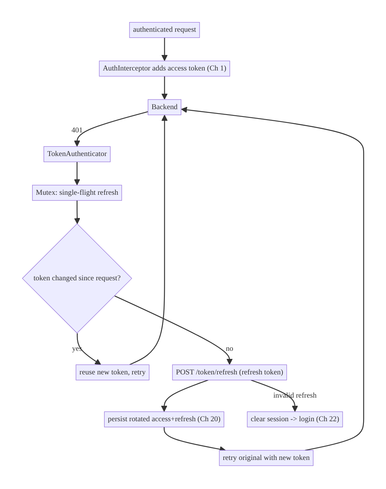
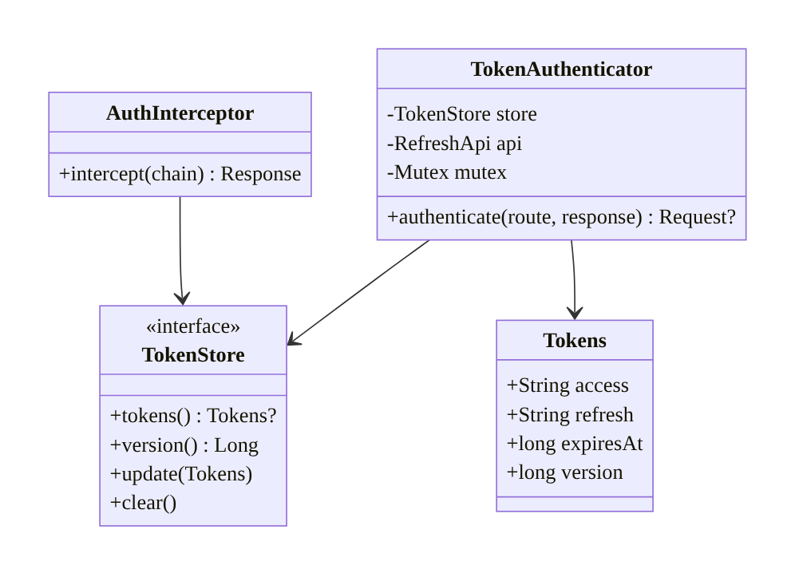
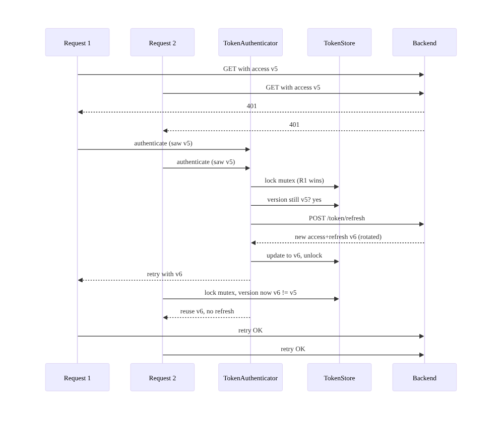
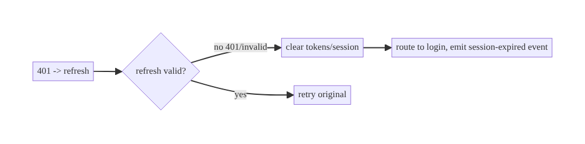
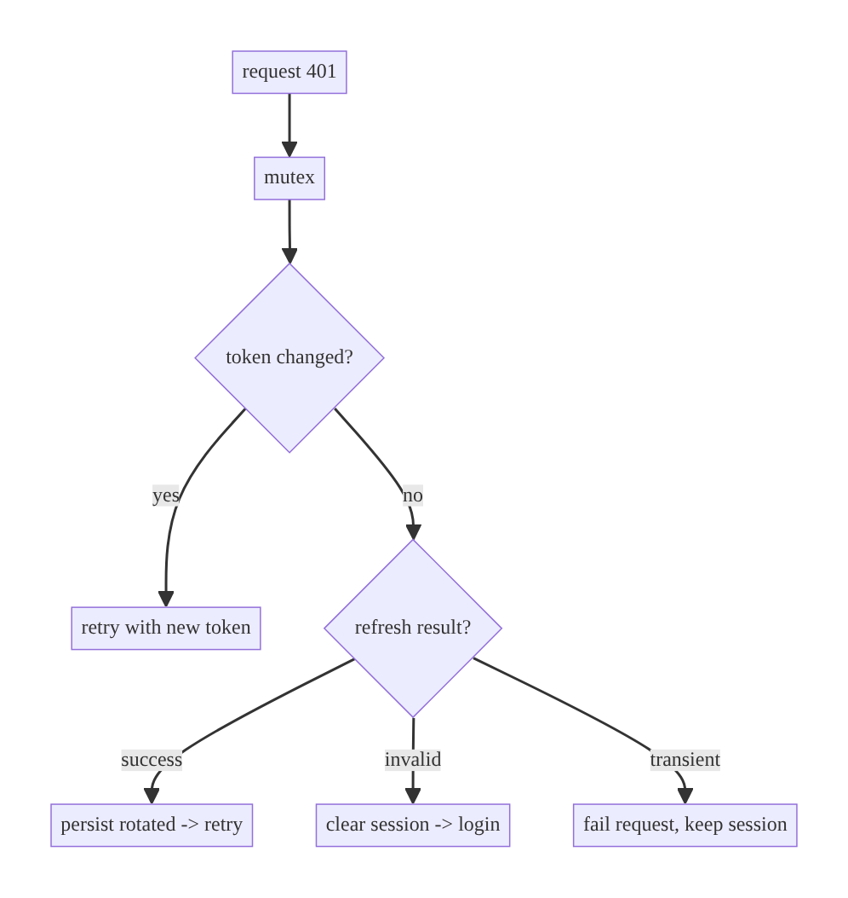

# Chapter 19 — Authentication & Token Refresh

> **Part III — Authentication & Security** · Complexity: **Complex** (≥40 interview questions)
>
> **Prerequisites:** Ch 1 (Networking Core — `AuthInterceptor`, `TokenProvider`
> port), Ch 2 (reliability), Ch 11 (single-flight — refresh is a specialized
> single-flight), Ch 20 (token storage — where tokens live). Reused by every
> authenticated request and by Ch 22 (session/logout), Ch 42 (multi-account).
>
> **Reference surface in StreamCart:** keeping the user signed in across the Shop,
> Watch, and Wallet APIs with access + refresh tokens, refreshing transparently
> on expiry without logging the user out.

---

## 19.1 Problem Definition and Real-World Context

Authentication keeps a user signed in securely across sessions, app restarts, and
token expiry — **without** making them re-enter credentials and **without**
leaking tokens. The hard part isn't the login screen; it's the **token lifecycle**
under concurrency and failure:

- **Access tokens expire (by design, minutes–hours).** When a request gets `401`,
  the client must silently **refresh** using a long-lived **refresh token** and
  retry — invisible to the user. Done wrong, the user gets logged out randomly.
- **The refresh stampede (thundering herd).** The token expires while **50
  concurrent requests** are in flight; all 50 get `401` and all 50 try to refresh
  → 50 refresh calls, rotated/invalidated refresh tokens, and a cascade of
  failures/logouts. Exactly **one** refresh must happen; the other 49 must wait
  for it and retry with the new token. This is the canonical single-flight problem
  (Ch 11) and the thing interviewers probe.
- **Refresh-token rotation.** Secure backends rotate the refresh token on each use
  and invalidate the old one; a race that uses a stale refresh token invalidates
  the session → forced logout.
- **Storage & security.** Tokens must be stored securely (Keystore, Ch 20), never
  logged (Ch 28), and cleared on logout everywhere (Ch 22).

The architecture: an OkHttp **`Authenticator`** that reacts to `401`, a
**single-flight, mutex-guarded refresh** with **token versioning** to avoid
duplicate refreshes, secure **storage**, and clean **session invalidation**.

### Three practical use cases

1. **E-commerce (StreamCart Shop).** A browsing session spanning hours refreshes
   silently; the user never re-logs-in mid-shop.
2. **OTT (Watch).** Many parallel calls (manifest, license, catalog) share one
   refresh when the token expires mid-playback — no stampede, no playback drop.
3. **Fintech (Wallet).** Short-lived access tokens + rotating refresh tokens +
   step-up (biometric, Ch 21) for sensitive actions; strict logout-everywhere
   (Ch 22).

### Why this is architectural

Token refresh defines the **concurrency contract** for authenticated networking
(single-flight refresh, versioning), the **security contract** (storage, rotation,
no leakage), and the **session lifecycle** (expiry, invalidation, logout) — a
cross-cutting system property every networked feature depends on.

---

## 19.2 Requirements Engineering

### Functional requirements

| ID | Requirement |
|----|-------------|
| F1 | Attach the access token to authenticated requests (Ch 1 `AuthInterceptor`). |
| F2 | On `401`, refresh the access token and retry the original request transparently. |
| F3 | Concurrent `401`s trigger exactly **one** refresh; others wait and reuse it. |
| F4 | Support refresh-token rotation (use the latest; don't reuse a consumed one). |
| F5 | On refresh failure (invalid refresh token), log out and route to login. |
| F6 | Store tokens securely (Ch 20); never log them (Ch 28). |
| F7 | Clear tokens/session on logout (Ch 22) and account switch (Ch 42). |

### Non-functional requirements

| Attribute | Policy |
|-----------|--------|
| **Correctness** | Exactly-one refresh under concurrency; no duplicate/rotation races. |
| **Security** | Tokens in Keystore-backed storage; TLS + pinning (Ch 23); no logging. |
| **Reliability** | Transparent refresh; no spurious logouts. |
| **Performance** | Refresh rarely; proactive refresh optional to avoid 401 round-trips. |
| **UX** | Silent refresh; forced re-login only when truly unauthenticated. |

### Scope

- **In scope:** access/refresh token model, `Authenticator`-based reactive
  refresh, single-flight + token versioning, rotation handling, proactive refresh,
  logout/invalidation hooks, the `TokenProvider`/`TokenStore` contract.
- **Out of scope:** the login UI/credential flows (OAuth/OIDC specifics), secure
  storage internals (Ch 20), biometrics (Ch 21), logout-everywhere/session mgmt
  (Ch 22), pinning (Ch 23).

### Assumptions & constraints

- OAuth2/JWT-style: short-lived access token + longer-lived refresh token; backend
  `/token/refresh`. OkHttp `Authenticator`. Tokens persisted via a Keystore-backed
  `TokenStore` (Ch 20). `minSdk 24`.

---

## 19.3 System Design Fundamentals

- **Access vs refresh token.** The **access token** is short-lived and sent on
  every request; the **refresh token** is long-lived, stored securely, and used
  only to obtain a new access token. Separating them limits exposure: a leaked
  access token expires soon; the refresh token never travels on normal requests.
- **Reactive refresh via `Authenticator`.** OkHttp's `Authenticator` is called
  **only** when a response is `401`; it computes new credentials and returns a
  retried request (or null to give up). This is the idiomatic refresh hook —
  cleaner than an interceptor because OkHttp handles the retry and avoids infinite
  loops via `responseCount`.
- **Single-flight refresh (Ch 11).** When many requests `401` at once, they must
  **share one refresh**. A `Mutex` + **token version** does this: a waiter that
  acquires the mutex checks whether the token already changed (someone else
  refreshed) and, if so, uses the new token instead of refreshing again.
- **Token versioning / compare-and-refresh.** Each stored token has a version (or
  the token value itself is compared). The `Authenticator` captures the token
  version used by the failed request; under the mutex it only refreshes if the
  current version still matches — otherwise another thread already refreshed.
- **Refresh-token rotation.** Secure servers return a **new** refresh token on
  each refresh and invalidate the old. The client must atomically persist the new
  pair; a race reusing the old refresh token triggers invalidation → logout.
- **Proactive vs reactive.** *Reactive* (on 401) is simplest and always needed.
  *Proactive* (refresh shortly before expiry, using the token's `exp`) avoids the
  extra 401 round-trip for latency-sensitive flows but adds complexity and clock-
  skew considerations.

Core insight: **treat refresh as a single-flight, version-guarded operation behind
a `Mutex`, triggered by an `Authenticator`** — so N concurrent 401s collapse into
exactly one refresh, and rotation stays consistent.

---

## 19.4 High-Level Architecture



**Components & ownership**

- **`AuthInterceptor`** (Ch 1) attaches the current access token to every request.
- **`TokenAuthenticator`** (OkHttp `Authenticator`) reacts to `401`, performs the
  single-flight refresh, and retries.
- **`TokenStore`** (Ch 20) securely persists the access/refresh pair + version;
  the single source of truth for tokens.
- **Backend** issues/rotates tokens.
- **Session/logout** (Ch 22) is invoked when refresh fails.

**Direction:** request → interceptor (token) → 401 → authenticator (single-flight
refresh) → retry; refresh failure → logout.

---

## 19.5 Detailed Component Design



| Component | Responsibility | Concurrency |
|-----------|----------------|-------------|
| `AuthInterceptor` | add access token | reads current token (atomic) |
| `TokenAuthenticator` | 401 → single-flight refresh → retry | `Mutex` + version check |
| `TokenStore` | secure persist + version | atomic update (Ch 20) |
| `RefreshApi` | call `/token/refresh` | uses a **no-auth** client to avoid recursion |

**Avoiding recursion:** the refresh call must **not** go through the
`Authenticator`/`AuthInterceptor` (else a failing refresh would recurse). Use a
separate, bare OkHttp client or tag the refresh request to bypass auth.

---

## 19.6 End-to-End Data Flow

### Concurrent 401s → single refresh (the stampede, solved)



### Refresh fails → logout



---

## 19.7 Complete Kotlin Implementation

Package: `com.streamcart.data.auth`.

### 19.7.1 Token model + secure store (Ch 20)

```kotlin
data class Tokens(val access: String, val refresh: String, val expiresAt: Long, val version: Long)

interface TokenStore {               // implemented over Keystore-backed storage (Ch 20)
    fun current(): Tokens?
    fun update(newAccess: String, newRefresh: String, expiresAt: Long)  // bumps version atomically
    fun clear()
}
```

### 19.7.2 Auth interceptor (attaches current token)

```kotlin
class AuthInterceptor @Inject constructor(private val store: TokenStore) : Interceptor {
    override fun intercept(chain: Interceptor.Chain): Response {
        val req = chain.request()
        if (req.header("No-Auth") != null) return chain.proceed(req)   // refresh/login bypass
        val token = store.current()?.access
        val authed = if (token != null)
            req.newBuilder().header("Authorization", "Bearer $token").build()
        else req
        return chain.proceed(authed)
    }
}
```

### 19.7.3 TokenAuthenticator — single-flight, version-guarded refresh

```kotlin
class TokenAuthenticator @Inject constructor(
    private val store: TokenStore,
    private val refreshApi: RefreshApi,     // uses a NO-AUTH client (see 19.7.4)
) : Authenticator {

    private val mutex = Mutex()

    override fun authenticate(route: Route?, response: Response): Request? {
        // Give up after a couple of attempts to avoid infinite 401 loops.
        if (responseCount(response) >= 3) return null

        // The access token this failed request used (to detect "already refreshed").
        val failedToken = response.request.header("Authorization")?.removePrefix("Bearer ")

        // Authenticator is called off the main thread; bridge to the suspend refresh.
        val newAccess = runBlocking {
            mutex.withLock {
                val current = store.current() ?: return@withLock null
                // Someone else already refreshed while we waited -> reuse.
                if (current.access != failedToken) return@withLock current.access

                when (val result = doRefresh(current.refresh)) {        // the ONE refresh
                    is RefreshResult.Success -> {
                        store.update(result.access, result.refresh, result.expiresAt) // rotation persisted
                        result.access
                    }
                    RefreshResult.Invalid -> { store.clear(); null }    // -> logout (Ch 22)
                    RefreshResult.Transient -> null                     // let caller retry later
                }
            }
        } ?: return null

        return response.request.newBuilder()
            .header("Authorization", "Bearer $newAccess")
            .build()
    }

    private suspend fun doRefresh(refresh: String): RefreshResult = try {
        val r = refreshApi.refresh(RefreshRequest(refresh))
        RefreshResult.Success(r.access, r.refresh, r.expiresAt)
    } catch (e: HttpException) {
        if (e.code() in listOf(400, 401, 403)) RefreshResult.Invalid else RefreshResult.Transient
    } catch (e: IOException) { RefreshResult.Transient }

    private fun responseCount(response: Response): Int {
        var r: Response? = response; var count = 1
        while (r?.priorResponse != null) { count++; r = r.priorResponse }
        return count
    }
}
```

### 19.7.4 Wiring: Authenticator + a no-auth refresh client (Ch 1)

```kotlin
@Module @InstallIn(SingletonComponent::class)
object AuthNetworkModule {
    @Provides @Singleton
    fun okHttp(auth: AuthInterceptor, authenticator: TokenAuthenticator): OkHttpClient =
        OkHttpClient.Builder()
            .addInterceptor(auth)
            .authenticator(authenticator)     // OkHttp calls it on 401
            .build()

    // Separate bare client so /token/refresh never recurses through the Authenticator.
    @Provides @Singleton @NoAuth
    fun refreshClient(): OkHttpClient = OkHttpClient.Builder().build()

    @Provides @Singleton
    fun refreshApi(@NoAuth client: OkHttpClient, json: Json): RefreshApi =
        Retrofit.Builder().baseUrl(BuildConfig.API_BASE_URL).client(client)
            .addConverterFactory(json.asConverterFactory(/*...*/)).build().create(RefreshApi::class.java)
}
```

### 19.7.5 Proactive refresh (optional — avoid the 401 round-trip)

```kotlin
// Refresh slightly before expiry on a critical path (e.g., before playback license).
suspend fun ensureFreshToken(store: TokenStore, authenticator: TokenAuthenticator, skewMs: Long = 30_000) {
    val t = store.current() ?: return
    if (System.currentTimeMillis() >= t.expiresAt - skewMs) {
        // Reuse the same single-flight path so it coalesces with reactive refreshes.
        authenticator.refreshNow()      // internally mutex + version guarded
    }
}
```

### 19.7.6 Module structure

```
:data:auth   TokenAuthenticator, AuthInterceptor (Ch 1), RefreshApi, TokenStore impl (Ch 20)
:core:network  OkHttp wiring (interceptor + authenticator + no-auth client)
:feature:auth  login flow, session-expired handling (Ch 22)
```

---

## 19.8 Concurrency and Race Conditions

| Scenario | Risk | Handling |
|----------|------|----------|
| N concurrent 401s | N refreshes, rotation chaos, logout | `Mutex` + version check → exactly one refresh |
| Waiter refreshes again after winner | double refresh, invalidate rotated token | compare `current.access != failedToken` → reuse |
| Refresh call itself 401s | infinite recursion | no-auth client + `responseCount` cap |
| Rotation race (two use old refresh) | server invalidates session | single-flight serializes; atomic store update |
| Proactive + reactive overlap | two refreshes | both route through the same mutex/version path |
| Account switch mid-refresh | wrong account's token | key store by account; clear on switch (Ch 42) |
| `runBlocking` on OkHttp thread | blocks a dispatcher thread briefly | acceptable (Authenticator is sync); keep refresh fast |

- **The version/compare-and-refresh under a `Mutex` is the whole correctness
  property.** Without the "has the token already changed?" check, every waiter
  refreshes in turn → rotation stampede → logout. This is the #1 interview answer.
- **Atomic store update** (new access + new refresh together) prevents a half-
  rotated state.

---

## 19.9 Failure Scenarios and Recovery

| Failure | Detection | Response | UX |
|---------|-----------|----------|----|
| Access token expired | 401 | single-flight refresh + retry | invisible |
| Concurrent 401 burst | many 401 | one refresh, others reuse | invisible, no stampede |
| Refresh token expired/invalid | refresh 400/401/403 | clear session → login; emit session-expired event (Ch 22) | re-login |
| Refresh transient (network) | IOException/5xx | don't log out; fail request; retry later (Ch 2) | transient error |
| Rotation race | stale refresh reused | single-flight prevents; if it happens, logout + re-login | re-login |
| Clock skew (proactive) | refresh too early/late | skew margin; fall back to reactive | invisible |
| Token leaked in logs | security review | never log tokens; redact (Ch 28) | n/a |
| Process death mid-flow | — | tokens persisted in store; resume normally | invisible |



> **Distinguish invalid from transient:** only an *invalid* refresh token (auth
> error) should log the user out. A network blip must **not** — logging out on a
> transient failure is a classic, infuriating bug.

---

## 19.10 Scaling the Implementation

- **Level 1.** `AuthInterceptor` adds token; `Authenticator` refreshes on 401
   (single request).
- **Level 2.** Single-flight + version guard for concurrent 401s; rotation
  handling.
- **Level 3 — production.** Secure storage (Ch 20); distinguish invalid vs
  transient; session-expired event + logout (Ch 22); no-auth refresh client.
- **Level 4 — large.** Proactive refresh for latency-critical paths; per-account
  tokens (Ch 42); step-up auth (biometric, Ch 21) for sensitive actions; metrics
  on refresh/stampede.
- **Level 5 — enterprise.** OIDC/PKCE flows, device-bound tokens (DPoP/mTLS),
  token binding, remote session revocation, coordinated multi-app SSO, anomaly
  detection on refresh patterns.

**Avoid overengineering:** most apps need reactive single-flight refresh + secure
storage. Proactive refresh and device binding are for latency- or
security-critical apps.

---

## 19.11 Alternative Approaches and Trade-offs

| Dimension | Option A | Option B | When |
|-----------|----------|----------|------|
| Refresh trigger | `Authenticator` (reactive, on 401) | Interceptor-based refresh | Authenticator (built-in retry, loop-safe) is idiomatic; interceptor is error-prone |
| Timing | Reactive only | Proactive (pre-expiry) | Reactive always; add proactive for latency-critical paths |
| Dedup | Mutex + version (single-flight) | per-request refresh | Single-flight always for concurrency |
| Token type | Opaque | JWT | JWT lets the client read `exp` (proactive) but don't trust claims for authz; opaque is simpler/safer |
| Rotation | Rotating refresh token | Static refresh token | Rotation is more secure (detects theft) but needs careful single-flight; static is simpler/less secure |
| Storage | Keystore-backed (Ch 20) | plain prefs | Keystore always for refresh tokens |
| Step-up | Biometric re-auth (Ch 21) | none | Step-up for sensitive actions (payments) |

**Authenticator vs interceptor refresh:** OkHttp's `Authenticator` is purpose-built
for 401 → re-auth: it's invoked only on 401, OkHttp performs the retry, and
`priorResponse` chaining prevents infinite loops. Rolling refresh into an
interceptor means manually detecting 401, refreshing, re-issuing, and guarding
against loops — more code, more bugs. Prefer the Authenticator.

**Rotating vs static refresh token:** rotation invalidates the old token on each
use, so a stolen refresh token is detectable (both client and thief can't both
succeed). It demands correct single-flight (a race double-uses the old token).
Static tokens avoid that race but can be replayed indefinitely if stolen. Secure
apps rotate.

---

## 19.12 Security Considerations

- **Store the refresh token in Keystore-backed storage** (Ch 20); never in plain
  prefs/DataStore or the Bundle (Ch 8). Access tokens are short-lived but also
  kept out of plaintext where feasible.
- **Never log tokens** (Ch 28); `redactHeader("Authorization")` (Ch 1); scrub from
  crash reports.
- **TLS + certificate pinning** (Ch 23) so tokens can't be intercepted.
- **Rotation + reuse detection:** a reused (old) refresh token should invalidate
  the whole session server-side — treat an unexpected rotation failure as a
  possible theft and force re-login.
- **Short access-token lifetime** limits the blast radius of a leak.
- **Step-up auth** (biometric, Ch 21) for sensitive operations even within a valid
  session.
- **Logout must revoke server-side** (Ch 22), not just clear locally — a cleared-
  but-not-revoked refresh token is still valid if exfiltrated.
- Client vs backend: the client stores/refreshes/attaches tokens; the **backend
  owns issuance, rotation, revocation, and authorization**. The client must never
  trust its own JWT claims for access decisions (re-validated server-side).

---

## 19.13 Performance and Resource Optimization

- **Refresh is rare** (only near expiry/401); single-flight ensures one call even
  under bursts — negligible overhead, huge correctness/UX win.
- **Proactive refresh** removes a 401 round-trip on critical paths at the cost of
  occasional unnecessary refreshes; use `exp` + skew.
- **Keep `runBlocking` refresh fast** (it briefly holds an OkHttp thread); a slow
  refresh endpoint stalls waiters — set a tight timeout on the refresh call.
- **Fewer spurious logouts** = fewer full re-auth flows (which are expensive and
  annoying).
- **Profiling:** refresh rate, refresh-coalesce ratio (401s per refresh — should
  be high under bursts), spurious-logout rate, refresh latency.

---

## 19.14 Testing Strategy

Test the single-flight/version logic with controllable concurrency; MockWebServer
for 401→refresh→retry.

```kotlin
class TokenAuthenticatorTest {
    @Test fun `concurrent 401s trigger exactly one refresh`() = runTest {
        val refreshApi = CountingRefreshApi(newAccess = "v6")
        val store = FakeTokenStore(access = "v5", refresh = "r5")
        val auth = TokenAuthenticator(store, refreshApi)
        // simulate N requests that saw v5 getting 401 concurrently
        val requests = (1..20).map { response401(withToken = "v5") }
        requests.map { async { auth.authenticate(null, it) } }.awaitAll()
        assertEquals(1, refreshApi.callCount)            // ONE refresh
        assertEquals("v6", store.current()!!.access)
    }

    @Test fun `waiter reuses refreshed token without refreshing`() = runTest {
        // first caller refreshes v5 -> v6; second caller (saw v5) must reuse v6
        val refreshApi = CountingRefreshApi(newAccess = "v6")
        val auth = TokenAuthenticator(FakeTokenStore("v5", "r5"), refreshApi)
        auth.authenticate(null, response401("v5"))
        auth.authenticate(null, response401("v5"))       // still saw v5
        assertEquals(1, refreshApi.callCount)
    }

    @Test fun `invalid refresh token clears session`() = runTest {
        val store = FakeTokenStore("v5", "r5")
        val auth = TokenAuthenticator(store, FailingRefreshApi(code = 401))
        val retried = auth.authenticate(null, response401("v5"))
        assertNull(retried)
        assertNull(store.current())                      // logged out
    }

    @Test fun `transient refresh failure does NOT log out`() = runTest {
        val store = FakeTokenStore("v5", "r5")
        val auth = TokenAuthenticator(store, FailingRefreshApi(ioException = true))
        auth.authenticate(null, response401("v5"))
        assertNotNull(store.current())                   // session preserved
    }

    @Test fun `gives up after too many attempts (no infinite loop)`() = runTest {
        val auth = TokenAuthenticator(FakeTokenStore("v5", "r5"), CountingRefreshApi("v6"))
        val looped = response401("v5", priorCount = 3)
        assertNull(auth.authenticate(null, looped))
    }
}
```

Also: MockWebServer integration (401 then success with new token), rotation
persistence, proactive refresh, no token logging (assert redaction).

---

## 19.15 Production Observability

- **Metrics:** refresh rate, refresh-coalesce ratio (401s per refresh under
  bursts), spurious-logout rate (logouts not caused by invalid refresh — should be
  ~0), refresh latency, refresh failure rate (invalid vs transient).
- **Logs:** `auth_refresh{result, coalesced}`, `session_expired{reason}` — **never**
  token values (log a hash/length only, Ch 28).
- **Debugging:** random logouts → refreshing on transient failures, or stampede
  invalidating rotated tokens (no single-flight); playback/requests dropping on
  expiry → no transparent refresh; refresh storms → version check missing.
- **Alerting:** spike in `session_expired{invalid}` → possible token-theft/rotation
  incident or backend issue.
- **Privacy:** tokens are secrets; redact everywhere.

---

## 19.16 System Design Interview Preparation

> 40+ questions.

**Fundamentals**
1. *Access vs refresh token?* Access = short-lived, sent per request; refresh =
   long-lived, stored securely, used only to get a new access token.
2. *Why separate them?* Limit exposure — a leaked access token expires soon; the
   refresh token never travels on normal requests.
3. *What triggers refresh?* A `401` (reactive) and/or near-expiry (proactive).
4. *Why `Authenticator` not an interceptor?* Called only on 401, OkHttp handles
   retry, `priorResponse` prevents loops.
5. *The hardest concurrency problem?* The refresh stampede — N concurrent 401s;
   must collapse to one refresh.

**The stampede (core)**
6. *How do you ensure exactly one refresh?* `Mutex` + token version: a waiter that
   gets the lock checks whether the token already changed and reuses it.
7. *What's "token versioning / compare-and-refresh"?* Capture the token the failed
   request used; refresh only if it still matches the current token.
8. *What happens to the other 49 requests?* They wait on the mutex, see the new
   token, and retry without refreshing.
9. *Why is this a single-flight problem (Ch 11)?* One in-flight operation (refresh)
   shared by many waiters.

**Rotation**
10. *What is refresh-token rotation?* Server returns a new refresh token each time
    and invalidates the old.
11. *Why does rotation need single-flight?* Two concurrent refreshes would both use
    the old token → server invalidates → logout.
12. *How persist a rotated pair?* Atomically (new access + new refresh together).
13. *Reuse detection?* A reused old refresh token should invalidate the session
    (theft signal).

**Failure handling**
14. *Invalid vs transient refresh failure?* Invalid (auth error) → logout;
    transient (network) → keep session, retry later.
15. *Classic bug?* Logging out on a transient failure.
16. *Infinite 401 loop — prevention?* `responseCount`/`priorResponse` cap;
    Authenticator returns null to give up.
17. *Why a no-auth client for refresh?* So the refresh call doesn't recurse through
    the Authenticator.

**Proactive vs reactive**
18. *Proactive refresh?* Refresh before expiry using `exp` + skew to avoid the 401
    round-trip.
19. *Trade-off?* Fewer 401s on critical paths vs extra complexity + occasional
    unnecessary refreshes + clock skew.
20. *Do both share a path?* Yes — route through the same mutex/version single-flight.

**Storage/security**
21. *Where is the refresh token stored?* Keystore-backed storage (Ch 20), never
    plaintext/Bundle.
22. *Logging tokens?* Never — redact `Authorization` (Ch 1/28).
23. *Trust JWT claims for authz client-side?* No — server re-validates.
24. *Step-up auth?* Biometric re-auth for sensitive actions within a session
    (Ch 21).
25. *Logout?* Clear locally **and** revoke server-side (Ch 22).

**Lifecycle**
26. *Process death?* Tokens persist in the store; resume normally.
27. *Account switch mid-refresh?* Per-account tokens; clear on switch (Ch 42).

**Scalability**
28. *10M users — client concerns?* Little; refresh is per-user. Backend scales
    token service; client needs single-flight + secure storage.
29. *Reduce refresh load?* Longer access-token TTL (trade-off), proactive refresh
    batching, server-side token caching.

**Performance**
30. *Overhead of single-flight?* Negligible; one mutex + a rare network call.
31. *`runBlocking` in Authenticator — concern?* Briefly holds an OkHttp thread;
    keep refresh fast with a tight timeout.

**Testing**
32. *Test one-refresh-under-concurrency?* Fire N concurrent authenticate calls;
    assert one refresh call.
33. *Test invalid vs transient?* Script 401 vs IOException; assert logout vs
    session kept.
34. *Test loop protection?* Prior-response count ≥ limit → null.

**Production debugging**
35. *Random logouts?* Transient-failure logout or stampede invalidating rotation.
36. *Requests dropping at token expiry?* No transparent refresh.
37. *Refresh storms in logs?* Missing version check (single-flight).
38. *Session-expired spike?* Token theft / rotation incident / backend issue.

**Trade-offs**
39. *Opaque vs JWT?* JWT enables proactive refresh (read `exp`) but don't trust
    claims for authz; opaque is simpler.
40. *Rotating vs static refresh token?* Rotation = more secure, needs single-flight;
    static = simpler, replayable if stolen.

### Design-change challenges
1. **Playback drops when the token expires mid-stream.** Proactive refresh before
   license calls; single-flight so parallel calls share it.
2. **Users randomly logged out.** Distinguish transient vs invalid; add single-
   flight + version.
3. **Refresh-token theft.** Rotation + reuse detection → revoke session; step-up
   (Ch 21).
4. **Sensitive actions need extra assurance.** Biometric step-up within the session
   (Ch 21).
5. **Multi-account.** Per-account token stores; switch clears/loads correctly
   (Ch 42).

### Mock walkthrough (abridged)
Clarify (token model, rotation, concurrency, sensitivity) → `AuthInterceptor` +
`Authenticator` → single-flight refresh with `Mutex` + version (the stampede) →
rotation persistence → invalid-vs-transient logout → secure storage (Ch 20) + no
logging → proactive option → testing concurrency.

---

## 19.17 Practical Exercises

1. **Beginner.** Add an `AuthInterceptor` + `Authenticator` that refreshes on 401
   and retries (single request). *Eval:* transparent retry; no loop.
2. **Intermediate.** Add single-flight refresh with token versioning; prove N
   concurrent 401s cause one refresh. *Eval:* one refresh; others reuse.
3. **Advanced.** Handle rotation (persist new pair atomically) and distinguish
   invalid (logout) vs transient (keep session). *Eval:* no spurious logout; no
   rotation race.
4. **Production debugging.** Fix an app that logs users out on network blips and
   storms the refresh endpoint under bursts. *Eval:* transient kept; one refresh.
5. **System design challenge.** Add proactive refresh (pre-expiry) sharing the
   same single-flight path, plus biometric step-up (Ch 21) for payments. *Eval:*
   no 401 on critical path; step-up gates sensitive actions.

*(Solutions withheld unless requested.)*

---

## 19.18 Chapter Summary & Reference Sheet

**Key decisions:** short-lived **access** + securely-stored **refresh** token;
refresh **reactively via an OkHttp `Authenticator`** (loop-safe) and optionally
**proactively** before expiry; make refresh a **single-flight, `Mutex`- and
version-guarded** operation so N concurrent 401s collapse to **one** refresh;
handle **refresh-token rotation** by persisting the new pair atomically;
**distinguish invalid (logout) from transient (keep session)** failures; store
tokens in **Keystore-backed storage** (Ch 20) and **never log** them (Ch 28);
**logout revokes server-side** (Ch 22); the **backend owns** issuance/rotation/
authorization.

**Concepts:** access/refresh tokens, reactive vs proactive refresh, `Authenticator`
vs interceptor, refresh stampede/thundering herd, single-flight + token versioning
(compare-and-refresh), rotation + reuse detection, invalid vs transient, step-up
auth.

**Common mistakes:** per-request refresh (stampede → rotation invalidation →
logout); logging out on transient failures; refreshing through the Authenticator
(recursion); no loop cap; storing tokens in plaintext/Bundle; logging tokens;
trusting JWT claims for client-side authz; clearing tokens locally without
server revocation.

**Checklist:** ☐ `Authenticator` on 401 ☐ single-flight refresh (`Mutex` +
version) ☐ reuse when token already changed ☐ rotation persisted atomically
☐ invalid→logout, transient→keep ☐ no-auth refresh client ☐ loop cap ☐ Keystore
storage ☐ no token logging ☐ server-side revoke on logout ☐ proactive (optional).

**Key APIs:** OkHttp `Authenticator`/`authenticate`, `Response.priorResponse`,
`Mutex.withLock`, `runBlocking` (Authenticator bridge), `TokenStore` (Ch 20),
`@Header("Authorization")`, `HttpLoggingInterceptor.redactHeader`.

**References:**
- OkHttp Authenticator: https://square.github.io/okhttp/recipes/#handling-authentication-kt-java
- OAuth 2.0 (RFC 6749): https://datatracker.ietf.org/doc/html/rfc6749
- Refresh token rotation (Auth0): https://auth0.com/docs/secure/tokens/refresh-tokens/refresh-token-rotation
- Android Keystore (Ch 20): https://developer.android.com/privacy-and-security/keystore
- (builds on) Ch 11 Single-Flight, Ch 20 Token Storage, Ch 22 Session Management

### Chapter review (Phase 4)
- **Completeness:** all 18 sections; architecture/class/sequence/failure diagrams;
  interceptor + Authenticator + single-flight/version + rotation + no-auth client
  + proactive; concurrency (the stampede, compare-and-refresh); failure (invalid
  vs transient); 5 levels; Authenticator-vs-interceptor and rotation trade-offs;
  security (storage, revocation, no logging); perf (coalesce ratio); concurrency
  tests; observability; 40 Q&A + 5 challenges. ✅
- **Expand later:** token storage internals (Ch 20), biometric step-up (Ch 21),
  logout/session (Ch 22), pinning (Ch 23), OIDC/PKCE, device binding.
- **Interview coverage:** exceeds ≥40 bar.
