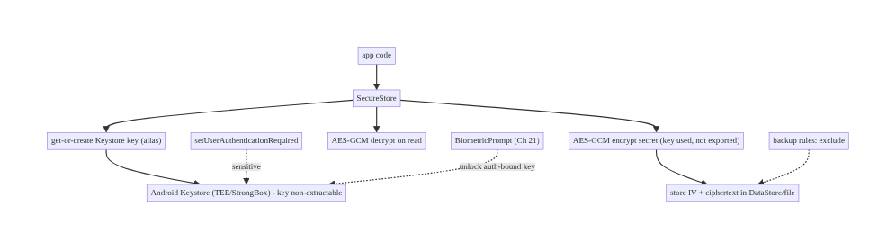
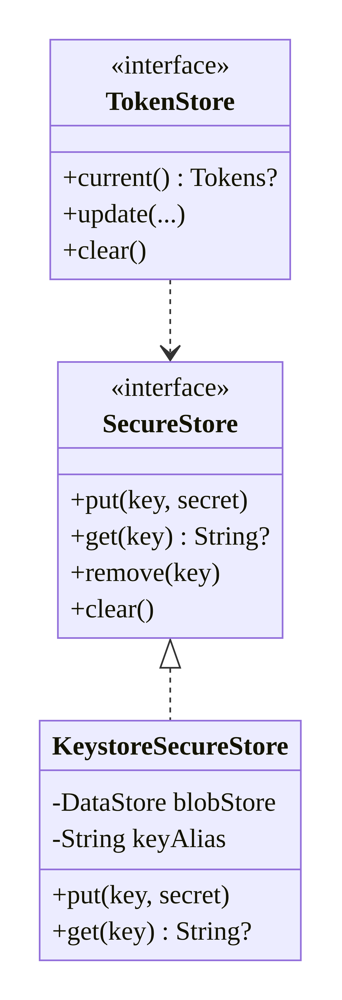
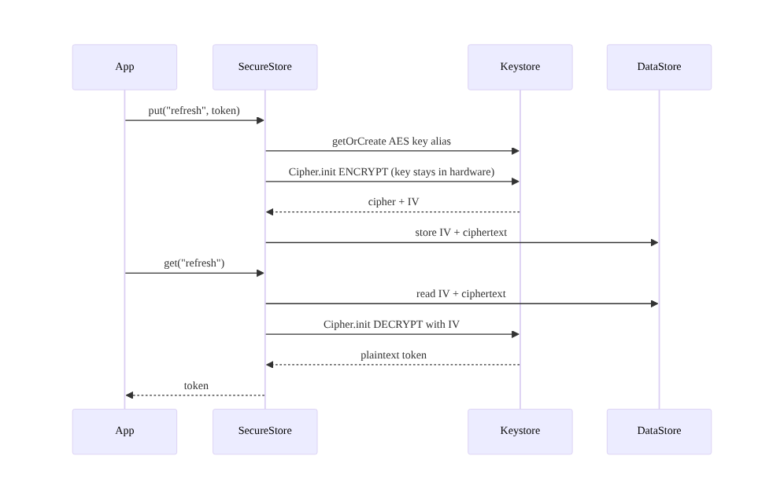
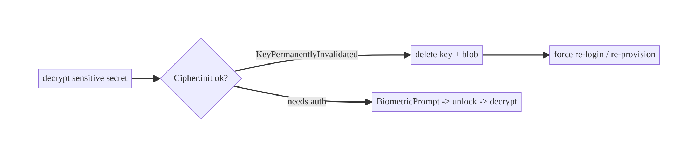
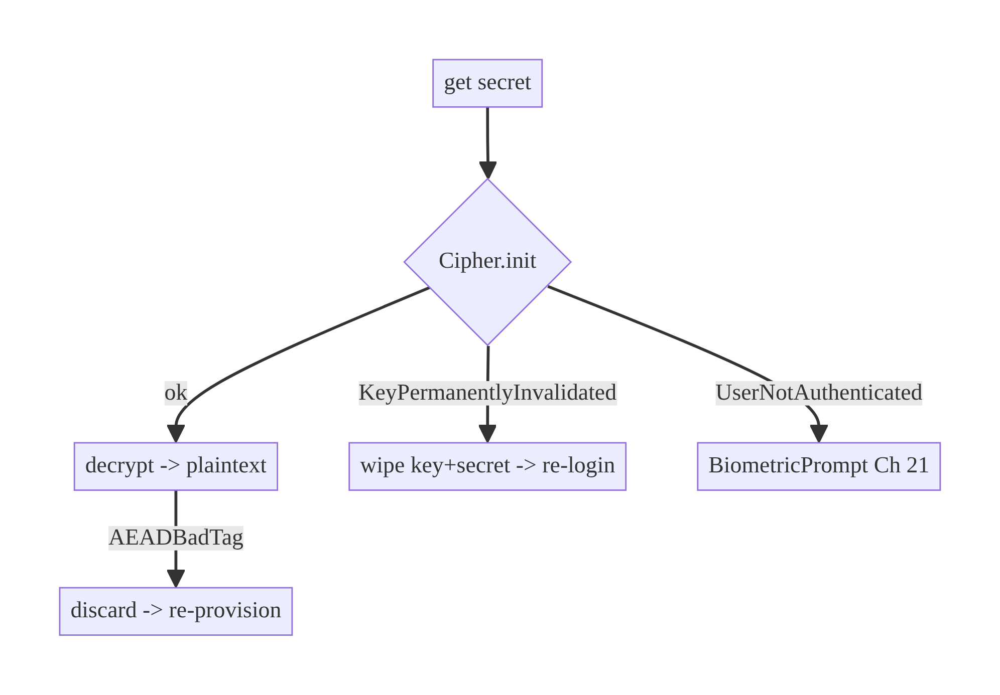

# Chapter 20 — Credential & Token Storage (Android Keystore)

> **Part III — Authentication & Security** · Complexity: **Complex** (≥40 interview questions)
>
> **Prerequisites:** Ch 4 (DataStore — where *non-secret* config lives), Ch 19
> (token refresh — what we're storing), Ch 21 (biometrics — auth-bound keys).
> This chapter **defines** the `TokenStore`/secret-storage contract that Ch 19,
> Ch 22 (logout), and Ch 42 (multi-account) depend on.
>
> **Reference surface in StreamCart:** storing the refresh token, a Wallet PIN
> hash, and an encryption key for the offline media/DB — safely, on a device the
> user may have rooted.

---

## 20.1 Problem Definition and Real-World Context

Apps must persist secrets — refresh tokens (Ch 19), encryption keys, PINs — on a
device that is **not fully trusted**: it may be rooted, backed up to the cloud,
shared, or stolen. Storing secrets naively is one of the most common,
highest-severity mobile vulnerabilities:

- **Plaintext in SharedPreferences/DataStore/SQLite.** On a rooted device (or via
  `adb backup`, or a backup to the cloud) these files are trivially readable. A
  refresh token in plaintext = full account takeover.
- **Hardcoded keys in the APK.** Decompiling an APK exposes any key baked into
  code/resources; "encryption" with an embedded key is not encryption.
- **Keys recoverable from the app process.** If the encryption key lives in memory
  as a plain byte array that's persisted, extracting it defeats the scheme.
- **Secrets surviving logout / leaking across accounts.** Not clearing on logout
  (Ch 22) leaves a valid token behind; not scoping per account (Ch 42) leaks.

The **Android Keystore** solves the core problem: it generates and stores
cryptographic keys in a **hardware-backed, isolated** container (TEE/StrongBox)
where the **key material never enters the app process** — the app can *use* the
key to encrypt/decrypt but cannot *extract* it. The pattern is **envelope
encryption**: a Keystore key encrypts the secret; the ciphertext goes in ordinary
storage. Optionally, keys are **bound to user authentication** (biometric/PIN,
Ch 21). Understanding exactly **what the Keystore does and does not protect** is
the architectural crux.

### Three practical use cases

1. **Refresh token (StreamCart Account).** Encrypt with a Keystore-backed key;
   store ciphertext in DataStore; decrypt on demand for refresh (Ch 19); clear on
   logout.
2. **Wallet secret (Fintech).** A biometric-bound Keystore key gates decrypting a
   payment token — the secret is unusable without a fresh biometric (Ch 21).
3. **Offline DB/media key (OTT).** A Keystore key encrypts the SQLCipher/media key
   (Ch 24) so downloaded content can't be read off a stolen device.

### Why this is architectural

Secret storage defines the app's **trust boundary** (what the hardware protects vs
what the OS/app can), the **threat model** (rooted device, backup, theft), and the
**key lifecycle** (generation, auth-binding, invalidation, rotation, clearing) —
properties that determine whether a compromised device means a compromised account.

---

## 20.2 Requirements Engineering

### Functional requirements

| ID | Requirement |
|----|-------------|
| F1 | Store secrets (tokens, keys, PIN hashes) encrypted at rest. |
| F2 | Encryption keys live in the Android Keystore (never extractable). |
| F3 | Prefer hardware-backed/StrongBox keys where available. |
| F4 | Optionally bind key use to user authentication (biometric/PIN, Ch 21). |
| F5 | Exclude secrets from backups. |
| F6 | Clear secrets on logout (Ch 22) and scope per account (Ch 42). |
| F7 | Handle key invalidation (new biometric enrolled, lock removed, key lost). |

### Non-functional requirements

| Attribute | Policy |
|-----------|--------|
| **Security** | Keys non-extractable; hardware-backed; auth-bound for sensitive. |
| **Reliability** | Graceful handling of key invalidation / `KeyPermanentlyInvalidatedException`. |
| **Compatibility** | Works across API levels and devices (StrongBox optional). |
| **Performance** | Crypto ops cheap; avoid per-request key gen. |
| **Maintainability** | A single secret-storage abstraction (`SecureStore`). |

### Scope

- **In scope:** Android Keystore key generation (AES/GCM), envelope encryption of
  secrets, StrongBox, auth-bound keys (intro; depth in Ch 21), backup exclusion,
  invalidation handling, clearing/rotation, the `SecureStore`/`TokenStore`
  contract.
- **Out of scope:** biometric prompt flow (Ch 21), DB/file encryption specifics
  (Ch 24), network security (Ch 23), the refresh logic (Ch 19), root detection
  (Ch 26).

### Assumptions & constraints

- `minSdk 24`; `AndroidKeyStore` provider; AES-256-GCM. Note:
  `androidx.security:security-crypto` (EncryptedSharedPreferences) is
  **deprecated** — this chapter uses **Keystore directly** (and mentions Tink).

---

## 20.3 System Design Fundamentals

- **Android Keystore.** A system-provided `KeyStore` (`"AndroidKeyStore"` provider)
  that generates/holds keys in a container isolated from the app. On most modern
  devices this is **hardware-backed** (TEE — Trusted Execution Environment) or
  **StrongBox** (a dedicated secure element). The app references keys by alias and
  uses them via `Cipher`/`Signature`; **the raw key never leaves the secure
  hardware**.
- **Non-extractable keys = the core guarantee.** Even a rooted device / memory dump
  can't recover a hardware-backed Keystore key. (It *can* potentially *use* the key
  while the app runs, unless the key is auth-bound — see threat model.)
- **Envelope encryption.** Keystore AES keys can't be exported, so the pattern is:
  keep a Keystore AES-GCM key per secret-class; use it to encrypt the secret;
  store the resulting IV + ciphertext in ordinary storage (DataStore/file). To
  read, decrypt with the Keystore key.
- **AES-GCM.** Authenticated encryption (confidentiality + integrity); requires a
  unique IV per encryption (never reuse an IV with the same key).
- **Auth-bound keys (`setUserAuthenticationRequired`).** A key can require the user
  to have authenticated (biometric/device credential) within a time window (or
  per-use) before `Cipher.init` succeeds — tying secret access to user presence
  (Ch 21). This is what protects secrets even against someone who has the unlocked
  running app vs a stolen device.
- **StrongBox (`setIsStrongBoxBacked`).** A separate tamper-resistant secure
  element; stronger than TEE but not on all devices — request with a fallback.
- **Key attestation.** The Keystore can produce a certificate chain attesting a key
  is hardware-backed (for server-side verification) — used in high-assurance apps.
- **Key invalidation.** `setInvalidatedByBiometricEnrollment(true)` invalidates an
  auth-bound key when biometrics change (anti-tamper). Removing the lock screen can
  also invalidate keys. The app must handle `KeyPermanentlyInvalidatedException` by
  re-authenticating / re-provisioning.

Core insight: **generate a non-extractable, hardware-backed Keystore key and use
it to envelope-encrypt secrets stored in ordinary storage; bind the key to user
auth for sensitive secrets.** The Keystore moves the *key* out of reach; your code
moves the *secret* out of plaintext.

---

## 20.4 High-Level Architecture



**Components & ownership**

- **`SecureStore`** — the one abstraction: get-or-create a Keystore key, encrypt/
  decrypt secrets, store ciphertext, clear.
- **Android Keystore** — holds the non-extractable key (TEE/StrongBox).
- **Ordinary storage** (DataStore/file) — holds IV + ciphertext (safe, since the
  key is in hardware).
- **BiometricPrompt** (Ch 21) — unlocks auth-bound keys for sensitive secrets.
- **Backup rules** — exclude secret blobs.

**Direction:** app → `SecureStore` → Keystore key (use) + ciphertext storage.

---

## 20.5 Detailed Component Design



| Element | Responsibility | Security property |
|---------|----------------|-------------------|
| Keystore AES key (alias) | encrypt/decrypt secrets | non-extractable, hardware-backed |
| `SecureStore` | envelope encrypt + persist | plaintext never stored |
| IV + ciphertext blob | durable storage | useless without the Keystore key |
| auth-bound key (optional) | gate sensitive secrets | requires user auth (Ch 21) |
| backup exclusion | prevent off-device copy | not in cloud/`adb backup` |

`TokenStore` (Ch 19) is implemented on top of `SecureStore` — the refresh token is
just a secret.

---

## 20.6 End-to-End Data Flow

### Store and read a secret



### Auth-bound key invalidated (new biometric enrolled)



---

## 20.7 Complete Kotlin Implementation

Package: `com.streamcart.core.security`.

### 20.7.1 Keystore key generation (AES-GCM, hardware-backed, StrongBox fallback)

```kotlin
object KeystoreKeys {
    private const val PROVIDER = "AndroidKeyStore"
    const val TOKEN_KEY = "streamcart.token.key"

    fun getOrCreate(alias: String, requireUserAuth: Boolean = false): SecretKey {
        val ks = KeyStore.getInstance(PROVIDER).apply { load(null) }
        (ks.getEntry(alias, null) as? KeyStore.SecretKeyEntry)?.let { return it.secretKey }

        val spec = KeyGenParameterSpec.Builder(
            alias, KeyProperties.PURPOSE_ENCRYPT or KeyProperties.PURPOSE_DECRYPT
        )
            .setBlockModes(KeyProperties.BLOCK_MODE_GCM)
            .setEncryptionPaddings(KeyProperties.ENCRYPTION_PADDING_NONE)
            .setKeySize(256)
            .apply {
                if (requireUserAuth) {
                    setUserAuthenticationRequired(true)                 // auth-bound (Ch 21)
                    setInvalidatedByBiometricEnrollment(true)           // invalidate on new biometric
                    if (Build.VERSION.SDK_INT >= 30)
                        setUserAuthenticationParameters(0, KeyProperties.AUTH_BIOMETRIC_STRONG)
                }
                if (Build.VERSION.SDK_INT >= 28) setIsStrongBoxBacked(true)   // try StrongBox
            }
            .build()

        return try {
            generate(spec)
        } catch (e: StrongBoxUnavailableException) {               // fallback: TEE
            generate(KeyGenParameterSpec.Builder(alias, /* same, */ spec.purposes)
                .setBlockModes(KeyProperties.BLOCK_MODE_GCM)
                .setEncryptionPaddings(KeyProperties.ENCRYPTION_PADDING_NONE)
                .setKeySize(256).build())
        }
    }

    private fun generate(spec: KeyGenParameterSpec): SecretKey =
        KeyGenerator.getInstance(KeyProperties.KEY_ALGORITHM_AES, PROVIDER)
            .apply { init(spec) }.generateKey()
}
```

### 20.7.2 Envelope encryption (AES-GCM, unique IV)

```kotlin
class Crypto @Inject constructor() {
    private val transform = "AES/GCM/NoPadding"

    fun encrypt(key: SecretKey, plaintext: ByteArray): ByteArray {
        val cipher = Cipher.getInstance(transform).apply { init(Cipher.ENCRYPT_MODE, key) }
        val iv = cipher.iv                                      // GCM: random IV per encryption
        val ct = cipher.doFinal(plaintext)
        return iv + ct                                         // prepend 12-byte IV
    }

    fun decrypt(key: SecretKey, blob: ByteArray): ByteArray {
        val iv = blob.copyOfRange(0, 12)
        val ct = blob.copyOfRange(12, blob.size)
        val cipher = Cipher.getInstance(transform).apply {
            init(Cipher.DECRYPT_MODE, key, GCMParameterSpec(128, iv))   // may throw if auth-bound (Ch 21)
        }
        return cipher.doFinal(ct)                              // throws AEADBadTagException if tampered
    }
}
```

### 20.7.3 SecureStore (envelope encrypt → DataStore)

```kotlin
class KeystoreSecureStore @Inject constructor(
    private val crypto: Crypto,
    private val store: DataStore<Preferences>,     // holds IV+ciphertext (safe)
) : SecureStore {

    override suspend fun put(name: String, secret: String) {
        val key = KeystoreKeys.getOrCreate(KeystoreKeys.TOKEN_KEY)
        val blob = crypto.encrypt(key, secret.toByteArray())
        store.edit { it[stringPreferencesKey(name)] = Base64.encodeToString(blob, Base64.NO_WRAP) }
    }

    override suspend fun get(name: String): String? {
        val b64 = store.data.first()[stringPreferencesKey(name)] ?: return null
        val key = KeystoreKeys.getOrCreate(KeystoreKeys.TOKEN_KEY)
        return try {
            String(crypto.decrypt(key, Base64.decode(b64, Base64.NO_WRAP)))
        } catch (e: KeyPermanentlyInvalidatedException) {      // biometric changed / lock removed
            remove(name); deleteKey(); null                    // force re-provision (Ch 19/22)
        } catch (e: AEADBadTagException) { remove(name); null } // tampered/corrupt
    }

    override suspend fun remove(name: String) = store.edit { it.remove(stringPreferencesKey(name)) }
    override suspend fun clear() {                             // logout (Ch 22) / account switch (Ch 42)
        store.edit { it.clear() }; deleteKey()
    }
    private fun deleteKey() =
        KeyStore.getInstance("AndroidKeyStore").apply { load(null) }.deleteEntry(KeystoreKeys.TOKEN_KEY)
}
```

### 20.7.4 TokenStore (Ch 19) on top of SecureStore

```kotlin
class SecureTokenStore @Inject constructor(private val secure: SecureStore) : TokenStore {
    override suspend fun current(): Tokens? {
        val access = secure.get("access") ?: return null
        val refresh = secure.get("refresh") ?: return null
        return Tokens(access, refresh, /* expiresAt */ 0, /* version */ 0)
    }
    override suspend fun update(access: String, refresh: String, expiresAt: Long) {
        secure.put("access", access); secure.put("refresh", refresh)
    }
    override suspend fun clear() = secure.clear()
}
```

### 20.7.5 Backup exclusion (res/xml)

```xml
<!-- android:dataExtractionRules (API 31+) / android:fullBackupContent -->
<data-extraction-rules>
  <cloud-backup><exclude domain="file" path="datastore/secure.preferences_pb"/></cloud-backup>
  <device-transfer><exclude domain="file" path="datastore/secure.preferences_pb"/></device-transfer>
</data-extraction-rules>
```

### 20.7.6 Module structure

```
:core:security  KeystoreKeys, Crypto, SecureStore(KeystoreSecureStore)
:data:auth      SecureTokenStore (implements TokenStore, Ch 19)
res/xml         data_extraction_rules.xml (backup exclusion)
```

---

## 20.8 Concurrency and Race Conditions

| Scenario | Risk | Handling |
|----------|------|----------|
| Concurrent encrypt with same key | IV reuse (catastrophic for GCM) | GCM generates a fresh random IV per `Cipher.init`; never hand-set a reused IV |
| Concurrent get-or-create key | two key generations | Keystore `getEntry` is idempotent by alias; guard with a mutex if needed |
| Read during key deletion (logout) | decrypt of orphaned blob | `clear()` removes blob + key together; handle missing key gracefully |
| Multi-process access | inconsistent state | DataStore single-process; keep secret access in one process |
| Auth-bound decrypt races prompt | `UserNotAuthenticated` | serialize sensitive decrypts behind the BiometricPrompt (Ch 21) |

- **IV uniqueness is a correctness/security invariant:** reusing an IV with the
  same GCM key breaks confidentiality. Always use the cipher-generated IV; store it
  with the ciphertext; never reuse.

---

## 20.9 Failure Scenarios and Recovery

| Failure | Detection | Response | UX |
|---------|-----------|----------|----|
| Biometric re-enrolled (auth-bound key) | `KeyPermanentlyInvalidatedException` | delete key+secret; force re-login/re-provision | re-auth |
| Lock screen removed | key invalidated | same as above | re-auth |
| Ciphertext tampered/corrupt | `AEADBadTagException` | discard; re-fetch/re-login | re-auth |
| StrongBox unavailable | `StrongBoxUnavailableException` | fall back to TEE | invisible |
| Keystore unavailable (rare OEM bug) | exception on init | degrade (in-memory session only) / error | sign-in required |
| Secret missing after update | app update/key loss | treat as logged out | re-login |
| Rooted device | — | Keystore still protects key (hardware); add attestation/root detection (Ch 26) for high assurance | depends |



> **Key invalidation is normal, not exceptional:** users change fingerprints and
> remove PINs. Treat `KeyPermanentlyInvalidatedException` as "re-authenticate,"
> never as a crash — wipe and recover gracefully.

---

## 20.10 Scaling the Implementation

- **Level 1.** One Keystore AES key + envelope-encrypt the refresh token into
  DataStore; exclude from backup.
- **Level 2.** A `SecureStore` abstraction for all secrets; clear on logout.
- **Level 3 — production.** StrongBox with TEE fallback; invalidation handling;
  per-account scoping (Ch 42); auth-bound keys for sensitive secrets (Ch 21).
- **Level 4 — large.** Key attestation (server verifies hardware-backing);
  key rotation policy; separate keys per secret-class; DB/media key wrapping
  (Ch 24).
- **Level 5 — enterprise.** Device-bound tokens (DPoP/mTLS, Ch 19), remote wipe,
  anomaly/root detection (Ch 26), compliance (PCI/health), HSM-backed server side.

**Avoid overengineering:** most apps need one Keystore key + envelope encryption +
backup exclusion. Attestation, StrongBox, and auth-bound keys are for high-value
secrets (payments, health).

---

## 20.11 Alternative Approaches and Trade-offs

| Dimension | Option A | Option B | When |
|-----------|----------|----------|------|
| Secret storage | Keystore + envelope encryption (manual) | `EncryptedSharedPreferences` (Jetpack Security) | Jetpack Security is **deprecated** — prefer Keystore-direct or Tink |
| Crypto lib | Keystore + `Cipher` (AES-GCM) | Google **Tink** | Tink for higher-level, misuse-resistant crypto; raw Cipher for control |
| Key backing | StrongBox | TEE | StrongBox stronger but not universal — request with fallback |
| Auth binding | `setUserAuthenticationRequired` | unbound | Auth-bound for sensitive secrets (Ch 21); unbound for convenience (silent refresh) |
| Non-secret config | DataStore plaintext (Ch 4) | SecureStore | Don't encrypt non-secrets; reserve crypto for secrets |
| Assurance | Key attestation | none | Attestation for high-value/anti-fraud |

**EncryptedSharedPreferences is deprecated** (androidx.security:security-crypto, as
of 2024): it's convenient but no longer recommended. Build on the **Keystore
directly** (envelope encryption, shown here) or use **Tink** (Google's
misuse-resistant crypto library) which also uses the Keystore to protect its
master key. Don't reach for the deprecated API in new code.

**Auth-bound vs unbound keys:** auth-bound keys require user presence to *use* the
key (protecting against a stolen-but-unlocked device targeting a specific secret),
but break **silent** background refresh (Ch 19) — you can't decrypt the refresh
token without a prompt. The common split: refresh token with an **unbound** key
(silent refresh), high-value secrets (payment token) with an **auth-bound** key
(biometric gate).

---

## 20.12 Security Considerations

- **Threat model clarity.** Keystore keys are **non-extractable** (hardware). On a
  **rooted device with the app unlocked and running**, an attacker may still get
  the app to *use* an unbound key (decrypt the secret) — this is why sensitive
  secrets use **auth-bound** keys (require a fresh biometric) and why root
  detection/attestation (Ch 26) matters for high assurance. Be precise about what
  the hardware does and doesn't stop.
- **Never hardcode keys** in the APK; never derive a key from a static secret.
- **Exclude secrets from backup** (`dataExtractionRules`/`fullBackupContent`) so
  they don't leave the device.
- **AES-GCM with unique IVs**; authenticated encryption detects tampering
  (`AEADBadTagException`).
- **Clear on logout and scope per account** (Ch 22/42) — a lingering valid token is
  an exposure.
- **No secrets in logs/crash reports** (Ch 28).
- Client vs backend: the Keystore protects secrets **on the device**; the backend
  must still assume a token can leak (short lifetimes, rotation, revocation —
  Ch 19). Device storage reduces risk; it doesn't eliminate the need for
  server-side defenses.

---

## 20.13 Performance and Resource Optimization

- **Crypto is cheap** (AES-GCM is fast, often hardware-accelerated); but **cache
  the `SecretKey` reference** (get-or-create once) rather than reloading per
  operation.
- **Avoid per-request decrypt** of the token on hot paths — decrypt once, keep in
  memory for the session (balance against sensitivity).
- **StrongBox is slower** than TEE for key ops; fine for infrequent secret access,
  avoid for high-frequency operations.
- **Auth-bound keys add a prompt** — don't put them on hot paths (silent refresh).
- **Profiling:** measure key-gen (one-time) and encrypt/decrypt latency; watch for
  accidental per-call key generation.

---

## 20.14 Testing Strategy

Keystore is hard to unit-test on JVM (needs a device/emulator). Abstract behind
`SecureStore` and test (a) the contract with a fake, (b) crypto round-trips on
device (instrumentation), (c) invalidation handling.

```kotlin
// JVM: test consumers against a fake SecureStore (Keystore not available off-device).
class SecureTokenStoreTest {
    private val secure = FakeSecureStore()
    private val store = SecureTokenStore(secure)
    @Test fun `stores and reads tokens`() = runTest {
        store.update("a", "r", 0)
        assertEquals("r", store.current()!!.refresh)
    }
    @Test fun `clear wipes secrets`() = runTest {
        store.update("a", "r", 0); store.clear()
        assertNull(store.current())
    }
}

// Instrumentation (device): real Keystore round-trip + invalidation.
@RunWith(AndroidJUnit4::class)
class KeystoreCryptoTest {
    @Test fun encrypt_decrypt_roundtrip() {
        val key = KeystoreKeys.getOrCreate("test.key")
        val crypto = Crypto()
        val blob = crypto.encrypt(key, "secret".toByteArray())
        assertEquals("secret", String(crypto.decrypt(key, blob)))
    }
    @Test fun tampered_ciphertext_throws() {
        val key = KeystoreKeys.getOrCreate("test.key"); val c = Crypto()
        val blob = c.encrypt(key, "x".toByteArray()).also { it[it.size - 1]++ }  // tamper
        assertThrows(AEADBadTagException::class.java) { c.decrypt(key, blob) }
    }
}
```

What to test on device: hardware-backing (`KeyInfo.isInsideSecureHardware`),
StrongBox fallback, `KeyPermanentlyInvalidatedException` recovery (hard to
simulate — document manual test), backup exclusion.

---

## 20.15 Production Observability

- **Metrics:** key-invalidation rate (biometric re-enroll / lock removed), decrypt-
  failure rate (`AEADBadTag`), StrongBox-availability rate, secret-access latency,
  forced-reauth-from-invalidation rate.
- **Logs:** `secure_store{op, result}` — **never** secret values or key material;
  `key_invalidated{reason}`, `crypto_error{type}`.
- **Debugging:** sudden re-login spikes → key invalidation (biometric/lock change)
  not handled gracefully; "can't decrypt token" → key deleted/rotated without
  wiping blob; secrets in a cloud backup → missing backup exclusion.
- **Alerting:** decrypt-failure spike could indicate tampering or a device/OS
  issue.
- **Privacy:** secrets and key aliases tied to users are sensitive — minimal,
  redacted logging (Ch 28).

---

## 20.16 System Design Interview Preparation

> 40+ questions.

**Fundamentals**

1. *What is the Android Keystore?* A system key container that generates/holds keys
   in hardware-isolated storage; keys are non-extractable.
2. *Why not store a token in SharedPreferences?* Plaintext; readable on rooted
   devices / backups → account takeover.
3. *Why can't you store a raw AES key in the app?* Decompiling/memory-dumping
   recovers it; "encryption" with a recoverable key is none.
4. *Envelope encryption?* A Keystore key (non-exportable) encrypts the secret;
   store IV+ciphertext in ordinary storage.
5. *Why AES-GCM?* Authenticated encryption — confidentiality + tamper detection;
   needs a unique IV.

**Keystore internals**

6. *TEE vs StrongBox?* TEE = trusted execution environment (common); StrongBox = a
   dedicated secure element (stronger, not universal) — request with fallback.
7. *What does "non-extractable" guarantee?* The app can *use* the key but can't
   *read* it, even when rooted.
8. *What does it NOT guarantee?* On a rooted, unlocked, running app, an unbound key
   can still be *used* to decrypt — hence auth-bound keys + attestation for high
   value.
9. *Key attestation?* A cert chain proving a key is hardware-backed, verifiable
   server-side.

**Auth-bound keys**

10. *`setUserAuthenticationRequired`?* `Cipher.init` requires recent user auth
    (biometric/credential) → ties secret use to presence (Ch 21).
11. *Per-use vs time-bound auth?* Per-use requires a prompt each time; time-bound
    allows a window.
12. *`setInvalidatedByBiometricEnrollment`?* Invalidates the key when biometrics
    change (anti-tamper).
13. *Trade-off of auth-bound keys?* Secure but breaks silent refresh — can't
    decrypt without a prompt.

**Pattern**

14. *Where do IV + ciphertext go?* Ordinary storage (DataStore/file) — safe
    because the key is in hardware.
15. *IV reuse danger?* Reusing an IV with the same GCM key breaks confidentiality;
    always use a fresh IV.
16. *Store refresh token how?* Unbound Keystore key (silent refresh) + backup
    exclusion.
17. *Store payment token how?* Auth-bound key (biometric gate, Ch 21).

**Invalidation/failure**

18. *`KeyPermanentlyInvalidatedException`?* Key invalidated (biometric re-enroll/
    lock removed); wipe + re-provision.
19. *How recover?* Delete key+secret; force re-login; don't crash.
20. *`AEADBadTagException`?* Tampered/corrupt ciphertext; discard + re-fetch.
21. *StrongBox unavailable?* `StrongBoxUnavailableException` → fall back to TEE.

**Backup/scope**

22. *Why exclude from backup?* Secrets shouldn't go to cloud/`adb backup`.
23. *Per-account?* Scope keys/blobs per account; clear on switch (Ch 42).
24. *Logout?* Delete key + ciphertext (and revoke server-side, Ch 19/22).

**Deprecation**

25. *EncryptedSharedPreferences?* Deprecated (Jetpack Security Crypto) — use
    Keystore-direct or Tink.
26. *Tink?* Google's misuse-resistant crypto lib; uses Keystore for its master
    key.

**Security model**

27. *Does Keystore defeat a rooted device?* It protects the *key material*; it
    doesn't stop a rooted app from *using* an unbound key while running → add
    auth-binding/attestation/root detection (Ch 26).
28. *Hardcoded keys?* Never — decompilable.
29. *Client vs backend responsibility?* Device storage reduces leak risk; backend
    still needs short tokens/rotation/revocation.

**Performance**

30. *Is crypto a bottleneck?* No (hardware-accelerated); but cache the key
    reference, don't regenerate per op.
31. *StrongBox perf?* Slower key ops; fine for infrequent access.

**Testing**

32. *Why hard to unit-test?* Keystore needs a device/emulator; abstract behind
    `SecureStore` and test consumers with a fake.
33. *How test crypto?* Instrumentation round-trip + tamper → `AEADBadTag`.
34. *How test invalidation?* Document manual (re-enroll biometric); assert wipe
    path.

**Production debugging**

35. *Re-login spikes?* Unhandled key invalidation.
36. *Can't decrypt token?* Key rotated/deleted without wiping blob.
37. *Secrets in backup?* Missing exclusion rules.

**Design**

38. *Which keys auth-bound?* High-value (payments); not the refresh token.
39. *Rotate keys?* Re-encrypt secrets under a new key; handle old-key decrypt
    during migration.
40. *Attestation when?* High-assurance/anti-fraud flows.

### Design-change challenges
1. **Payment token must require biometric to use.** Auth-bound Keystore key +
   BiometricPrompt (Ch 21).
2. **Encrypt the offline DB.** Wrap the SQLCipher key with a Keystore key (Ch 24).
3. **Detect compromised devices.** Key attestation + root detection (Ch 26).
4. **Rotate the storage key.** Re-encrypt under a new alias; migrate; delete old.
5. **Multi-account secrets.** Per-account aliases/blobs; clear on switch (Ch 42).

### Mock walkthrough (abridged)
Clarify (what secrets, threat model, silent vs gated) → Keystore key
(non-extractable, StrongBox/TEE) → envelope-encrypt into ordinary storage →
auth-bind sensitive secrets (Ch 21) → backup exclusion + per-account + clear on
logout → invalidation handling → be precise on what hardware does/doesn't protect
→ testing.

---

## 20.17 Practical Exercises

1. **Beginner.** Generate a Keystore AES-GCM key and envelope-encrypt a token into
   DataStore; exclude it from backup. *Eval:* no plaintext; key non-extractable
   (`isInsideSecureHardware`).
2. **Intermediate.** Build a `SecureStore` + `SecureTokenStore` (Ch 19); clear on
   logout (key + blob). *Eval:* logout wipes everything.
3. **Advanced.** Add an auth-bound key for a "payment token" requiring biometric
   (Ch 21) and handle `KeyPermanentlyInvalidatedException`. *Eval:* gated access;
   graceful invalidation recovery.
4. **Production debugging.** Fix an app storing a refresh token in plaintext prefs
   and backing it up to the cloud. *Eval:* encrypted + excluded from backup.
5. **System design challenge.** Rotate the storage key without losing data
   (re-encrypt under a new alias). *Eval:* secrets survive rotation; old key
   deleted.

*(Solutions withheld unless requested.)*

---

## 20.18 Chapter Summary & Reference Sheet

**Key decisions:** store secrets via **envelope encryption** with a
**non-extractable Android Keystore** AES-GCM key (StrongBox with TEE fallback);
keep **IV + ciphertext in ordinary storage**; **auth-bind** keys for high-value
secrets (Ch 21) but keep the refresh token on an **unbound** key for silent
refresh; **exclude secrets from backup**; **clear on logout** and **scope per
account**; handle **key invalidation** (`KeyPermanentlyInvalidatedException`)
gracefully; **never hardcode keys or log secrets**; **don't use the deprecated
`EncryptedSharedPreferences`** — Keystore-direct or Tink.

**Concepts:** Android Keystore, TEE/StrongBox, non-extractable keys, envelope
encryption, AES-GCM + unique IV, auth-bound keys, key attestation, key
invalidation, backup exclusion.

**Common mistakes:** plaintext secrets; hardcoded/derived-from-static keys; IV
reuse; auth-binding the refresh token (breaks silent refresh); not excluding from
backup; not clearing on logout; crashing on key invalidation; using the deprecated
EncryptedSharedPreferences; over-claiming what the Keystore protects on a rooted
device.

**Checklist:**

- [ ] Keystore AES-GCM key
- [ ] StrongBox + TEE fallback
- [ ] envelope encrypt (IV+ciphertext)
- [ ] unique IV
- [ ] auth-bind sensitive secrets
- [ ] backup exclusion
- [ ] clear on logout + per-account
- [ ] handle `KeyPermanentlyInvalidated`
- [ ] no hardcoded keys
- [ ] no secret logging.

**Key APIs:** `KeyStore("AndroidKeyStore")`, `KeyGenParameterSpec`,
`setIsStrongBoxBacked`, `setUserAuthenticationRequired`/`Parameters`,
`setInvalidatedByBiometricEnrollment`, `KeyGenerator`, `Cipher("AES/GCM/
NoPadding")`, `GCMParameterSpec`, `KeyPermanentlyInvalidatedException`,
`AEADBadTagException`, `KeyInfo.isInsideSecureHardware`, `dataExtractionRules`.

**References:**
- Android Keystore: https://developer.android.com/privacy-and-security/keystore
- KeyGenParameterSpec: https://developer.android.com/reference/android/security/keystore/KeyGenParameterSpec
- Key attestation: https://developer.android.com/privacy-and-security/security-key-attestation
- Jetpack Security (deprecation note): https://developer.android.com/jetpack/androidx/releases/security
- Tink: https://developers.google.com/tink

### Chapter review (Phase 4)
- **Completeness:** all 18 sections; architecture/class/sequence/failure diagrams;
  Keystore key-gen + envelope crypto + SecureStore + TokenStore + backup rules;
  concurrency (IV uniqueness); invalidation failure matrix; 5 levels; Keystore-vs-
  deprecated-API and auth-bound-vs-unbound trade-offs; precise threat model;
  perf (cache key); device + JVM tests; observability; 40 Q&A + 5 challenges. ✅
- **Expand later:** biometric prompt flow (Ch 21), DB/media encryption (Ch 24),
  root detection/attestation (Ch 26), key rotation.
- **Interview coverage:** exceeds ≥40 bar. **Defines the `SecureStore`/`TokenStore`
  contract used by Ch 19/22/42.**
