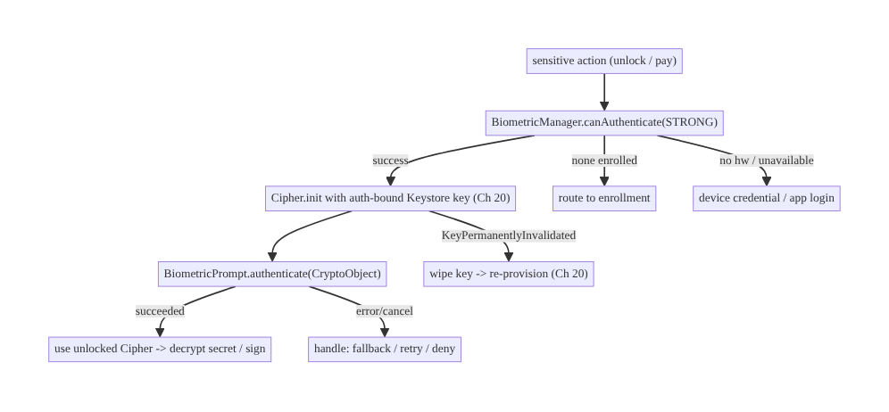
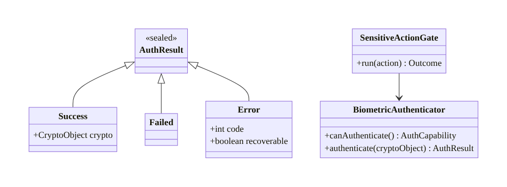
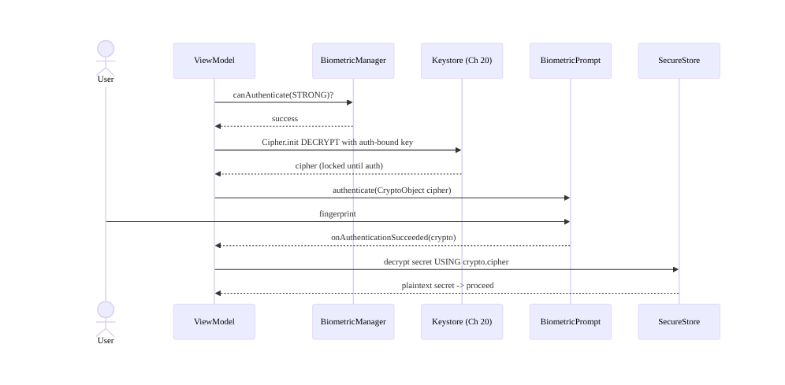
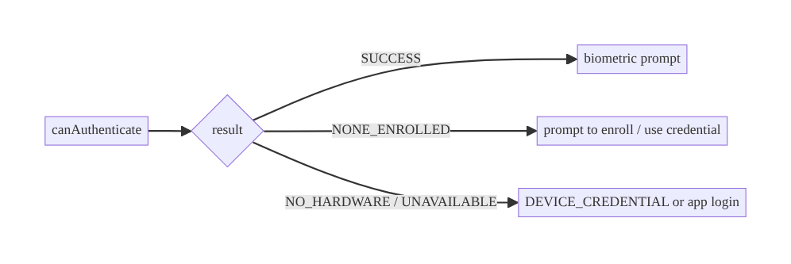
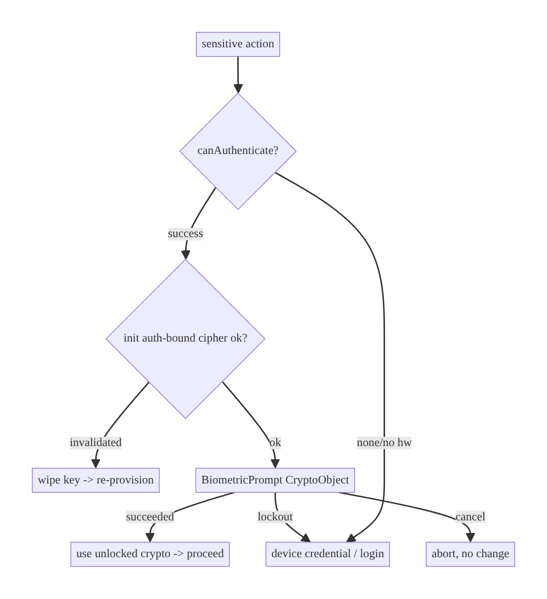

# Chapter 21 — Biometric Authentication

> **Part III — Authentication & Security** · Complexity: **Standard** (≥25 interview questions)
>
> **Prerequisites:** Ch 20 (Keystore — auth-bound keys, `setUserAuthenticationRequired`),
> Ch 19 (token refresh — step-up), Ch 6 (UI state). Reused by Ch 22 (session),
> Ch 75/77 (checkout/wallet step-up).
>
> **Reference surface in StreamCart:** unlocking the app / Wallet with a
> fingerprint or face, and requiring biometric confirmation before a payment.

---

## 21.1 Problem Definition and Real-World Context

Biometrics (fingerprint, face) let users authenticate quickly without typing a
password, and let apps **gate sensitive actions** on *user presence*. But
biometrics are easy to implement **insecurely** — in a way that looks like it
works but provides no real protection:

- **"Decorative" biometrics.** A naive flow shows `BiometricPrompt`, and on
  `onAuthenticationSucceeded` just sets `isUnlocked = true`. On a rooted device,
  an attacker skips the prompt and flips the boolean — **the biometric protected
  nothing**. Real security requires tying biometric success to a **cryptographic
  operation** (unlocking a Keystore key, Ch 20), not a flag.
- **Enrollment-change attacks.** If an attacker enrolls their own fingerprint,
  they shouldn't gain access to secrets protected before — keys must be
  invalidated on biometric enrollment (Ch 20).
- **Authenticator-strength confusion.** Treating `BIOMETRIC_WEAK` (e.g., some face
  unlock) like `BIOMETRIC_STRONG` for payments is a security hole — only STRONG can
  back a Keystore `CryptoObject`.
- **No graceful fallback.** Not every device has biometrics; the user may have none
  enrolled, or the sensor may be unavailable — flows must fall back to device
  credential (PIN/pattern/password) or app login.

The architecture: use **`BiometricPrompt`** with a **`CryptoObject`** wrapping an
**auth-bound Keystore key** (Ch 20), choose the right **authenticator strength**,
handle **enrollment invalidation**, and provide **fallbacks** and **step-up** for
sensitive actions.

### Three practical use cases

1. **App/Wallet unlock (StreamCart).** Biometric unlocks a Keystore key that
   decrypts the session/refresh token (Ch 19/20) — no boolean flag.
2. **Payment step-up (Fintech).** Within a valid session, a payment requires a
   fresh `BIOMETRIC_STRONG` confirmation bound to a Keystore signing/decryption key.
3. **Sensitive data reveal (Account).** Showing saved cards / personal data
   requires biometric; falls back to device credential.

### Why this is architectural

Biometric auth defines **how user presence gates cryptographic access** (not
flags), the **strength/assurance model**, **key invalidation on enrollment
change**, and **fallback/step-up** — security properties that determine whether a
stolen or rooted device can bypass "protection."

---

## 21.2 Requirements Engineering

### Functional requirements

| ID | Requirement |
|----|-------------|
| F1 | Authenticate the user via fingerprint/face/device credential. |
| F2 | Tie biometric success to a cryptographic op (unlock a Keystore key), not a flag. |
| F3 | Choose authenticator strength (STRONG for crypto/payments). |
| F4 | Fall back to device credential (PIN/pattern/password) or app login. |
| F5 | Invalidate keys on new biometric enrollment (Ch 20). |
| F6 | Support step-up (re-auth) for sensitive actions within a session. |
| F7 | Handle all states: no hardware, none enrolled, locked out, user cancel. |

### Non-functional requirements

| Attribute | Policy |
|-----------|--------|
| **Security** | Crypto-bound auth; STRONG for sensitive; enrollment invalidation. |
| **Usability** | Fast; clear fallback; accessible. |
| **Reliability** | Handle lockout/cancel/unavailable gracefully. |
| **Compatibility** | AndroidX Biometric across API levels/devices. |
| **Privacy** | Biometric data never leaves the device/TEE; the app never sees it. |

### Scope

- **In scope:** `BiometricPrompt` + `CryptoObject`, authenticator strengths,
  Keystore auth-bound keys (applied from Ch 20), enrollment invalidation,
  fallback/step-up, state handling.
- **Out of scope:** Keystore key mechanics (Ch 20), token refresh (Ch 19),
  session/logout (Ch 22), root detection (Ch 26).

### Assumptions & constraints

- `androidx.biometric:biometric`; `minSdk 24`. Biometric data is handled entirely
  by the system/TEE — the app only gets success/failure + a `CryptoObject`.

---

## 21.3 System Design Fundamentals

- **`BiometricPrompt` (AndroidX).** The unified API presenting the system biometric
  dialog across versions/sensors; the app never touches raw biometric data (it
  stays in the TEE).
- **`CryptoObject` = real security.** Passing a `CryptoObject` (wrapping a `Cipher`/
  `Signature`/`Mac` initialized with an **auth-bound Keystore key**, Ch 20) means
  authentication **unlocks the key**: on success you get a usable crypto object; on
  bypass you get nothing. This converts "the user authenticated" from a claim into
  a cryptographic fact. **Without a `CryptoObject`, the result is just a boolean an
  attacker can forge.**
- **Authenticator strengths.**
  - `BIOMETRIC_STRONG` (Class 3): spoof-resistant; **can back a `CryptoObject`**
    (Keystore). Required for payments/crypto.
  - `BIOMETRIC_WEAK` (Class 2): convenience unlock; **cannot** back a Keystore
    `CryptoObject`.
  - `DEVICE_CREDENTIAL`: PIN/pattern/password; a fallback and can also authorize
    device-credential-bound keys.
- **Auth-bound keys (Ch 20).** `setUserAuthenticationRequired(true)` +
  `setUserAuthenticationParameters(timeout, AUTH_BIOMETRIC_STRONG)`. Timeout 0 =
  per-use (prompt each time); >0 = valid for a window after any device unlock.
- **Enrollment invalidation.** `setInvalidatedByBiometricEnrollment(true)`
  invalidates the key if biometrics are added/removed — defeating the "attacker
  enrolls their finger" attack (handle `KeyPermanentlyInvalidatedException`).
- **`canAuthenticate()` states.** Before prompting, check `BiometricManager`:
  success, `NO_HARDWARE`, `HW_UNAVAILABLE`, `NONE_ENROLLED` (offer enrollment),
  `SECURITY_UPDATE_REQUIRED` — drive fallback.
- **Step-up auth.** Even within a valid session (Ch 19), re-prompt for sensitive
  actions (payment, reveal card) — assurance of *current* presence.

Core insight: **bind biometric success to a Keystore `CryptoObject`, use
`BIOMETRIC_STRONG` for anything that matters, and invalidate keys on enrollment
change.** The prompt is UX; the Keystore key is the security.

---

## 21.4 High-Level Architecture



**Components & ownership**

- **`BiometricManager`** reports capability/enrollment state.
- **`BiometricPrompt`** shows the system dialog and returns a `CryptoObject` on
  success.
- **Keystore auth-bound key** (Ch 20) is what the `CryptoObject` unlocks.
- **`SecureStore`/`TokenStore`** (Ch 20/19) hold the secret the unlocked cipher
  decrypts.
- **Fallback/step-up policy** decides device-credential vs app-login.

**Direction:** action → capability check → init cipher with auth-bound key →
prompt → unlocked crypto → use secret.

---

## 21.5 Detailed Component Design



| Component | Responsibility | Notes |
|-----------|----------------|-------|
| `BiometricManager.canAuthenticate` | capability/enrollment check | drive fallback |
| `BiometricPrompt` | system dialog + `CryptoObject` | lifecycle-aware (Activity/Fragment) |
| auth-bound Keystore key (Ch 20) | the real gate | STRONG; invalidate on enrollment |
| `SensitiveActionGate` | require (fresh) auth before an action | step-up |
| result model | success(crypto)/failed/error | handle cancel/lockout |

---

## 21.6 End-to-End Data Flow

### Biometric-gated secret decryption



### Capability-driven fallback



---

## 21.7 Complete Kotlin Implementation

Package: `com.streamcart.feature.auth.biometric`.

### 21.7.1 Capability check

```kotlin
sealed interface AuthCapability {
    data object Available : AuthCapability
    data object NoneEnrolled : AuthCapability      // offer enrollment
    data object NoHardware : AuthCapability          // fall back
    data object Unavailable : AuthCapability         // transient; fall back
}

fun biometricCapability(context: Context): AuthCapability {
    val manager = BiometricManager.from(context)
    return when (manager.canAuthenticate(BIOMETRIC_STRONG)) {
        BiometricManager.BIOMETRIC_SUCCESS -> AuthCapability.Available
        BiometricManager.BIOMETRIC_ERROR_NONE_ENROLLED -> AuthCapability.NoneEnrolled
        BiometricManager.BIOMETRIC_ERROR_NO_HARDWARE -> AuthCapability.NoHardware
        else -> AuthCapability.Unavailable
    }
}
```

### 21.7.2 Prompt with a CryptoObject (the secure path)

```kotlin
suspend fun authenticateForDecryption(
    activity: FragmentActivity,
    cipher: Cipher,                        // initialized with an auth-bound Keystore key (Ch 20)
): AuthResult = suspendCancellableCoroutine { cont ->
    val executor = ContextCompat.getMainExecutor(activity)
    val prompt = BiometricPrompt(activity, executor, object : BiometricPrompt.AuthenticationCallback() {
        override fun onAuthenticationSucceeded(result: BiometricPrompt.AuthenticationResult) {
            cont.resume(AuthResult.Success(result.cryptoObject!!))   // UNLOCKED cipher
        }
        override fun onAuthenticationError(code: Int, msg: CharSequence) {
            val recoverable = code !in listOf(
                BiometricPrompt.ERROR_LOCKOUT_PERMANENT,
                BiometricPrompt.ERROR_NO_BIOMETRICS,
                BiometricPrompt.ERROR_HW_NOT_PRESENT,
            )
            cont.resume(AuthResult.Error(code, recoverable))
        }
        override fun onAuthenticationFailed() { /* one bad read; prompt stays up */ }
    })
    val info = BiometricPrompt.PromptInfo.Builder()
        .setTitle("Confirm it's you")
        .setSubtitle("Authenticate to continue")
        .setAllowedAuthenticators(BIOMETRIC_STRONG)        // STRONG for CryptoObject
        .setNegativeButtonText("Cancel")                    // required when no device credential
        .build()
    prompt.authenticate(info, BiometricPrompt.CryptoObject(cipher))
    cont.invokeOnCancellation { prompt.cancelAuthentication() }
}
```

### 21.7.3 Unlocking a secret (ties to Ch 20)

```kotlin
class BiometricSecureStore @Inject constructor(private val crypto: Crypto) {
    // Decrypt a secret only after a fresh biometric unlock.
    suspend fun reveal(activity: FragmentActivity, name: String, blob: ByteArray): Outcome<String> {
        val key = KeystoreKeys.getOrCreate("streamcart.payment.key", requireUserAuth = true)  // auth-bound
        val iv = blob.copyOfRange(0, 12)
        val cipher = try {
            Cipher.getInstance("AES/GCM/NoPadding").apply {
                init(Cipher.DECRYPT_MODE, key, GCMParameterSpec(128, iv))   // locked until BiometricPrompt
            }
        } catch (e: KeyPermanentlyInvalidatedException) {
            return Outcome.Failure(AppError.Unauthorized)    // enrollment changed -> re-provision (Ch 20)
        }
        return when (val r = authenticateForDecryption(activity, cipher)) {
            is AuthResult.Success -> Outcome.Success(
                String(r.crypto.cipher!!.doFinal(blob.copyOfRange(12, blob.size)))   // use UNLOCKED cipher
            )
            is AuthResult.Error -> Outcome.Failure(AppError.Unauthorized)
            AuthResult.Failed -> Outcome.Failure(AppError.Unauthorized)
        }
    }
}
```

### 21.7.4 Step-up gate for sensitive actions + credential fallback

```kotlin
// Require a fresh biometric (or device credential) before a payment.
suspend fun requireStepUp(activity: FragmentActivity): Boolean {
    val info = BiometricPrompt.PromptInfo.Builder()
        .setTitle("Confirm payment")
        .setAllowedAuthenticators(BIOMETRIC_STRONG or DEVICE_CREDENTIAL)   // allow PIN fallback
        .build()   // no negative button needed when DEVICE_CREDENTIAL is allowed
    // (prompt without CryptoObject is acceptable ONLY for presence; back a crypto op where possible)
    return promptForPresence(activity, info)
}
```

### 21.7.5 Module structure

```
:feature:auth/biometric  BiometricAuthenticator, AuthResult, BiometricSecureStore, step-up gate
:core:security           KeystoreKeys (auth-bound, Ch 20), Crypto (Ch 20)
```

---

## 21.8 Concurrency and Race Conditions

| Scenario | Risk | Handling |
|----------|------|----------|
| Prompt shown twice | duplicate dialogs | single in-flight prompt; cancel previous |
| Config change during prompt | callback lost/leak | host on Activity/Fragment; use lifecycle-aware coroutine; re-init on recreate |
| Concurrent sensitive actions | two unlocks | serialize behind the gate |
| Key invalidated mid-flow | decrypt fails | catch `KeyPermanentlyInvalidatedException` → re-provision |
| User cancels vs error | ambiguous | distinguish `ERROR_USER_CANCELED`/`NEGATIVE_BUTTON` from hard errors |
| Lockout during retries | repeated failures | respect `ERROR_LOCKOUT`/`LOCKOUT_PERMANENT`; back off / fall back |

- **Host the prompt on the Activity/Fragment lifecycle** and bridge via a
  cancellable coroutine; a rotation mid-prompt must not leak the callback or lose
  the result (re-create and re-prompt if needed).

---

## 21.9 Failure Scenarios and Recovery

| Failure | Detection | Response | UX |
|---------|-----------|----------|----|
| No hardware | `canAuthenticate` NO_HARDWARE | fall back to credential/app login | seamless |
| None enrolled | NONE_ENROLLED | offer enrollment or credential | guided |
| Temporary lockout | `ERROR_LOCKOUT` | wait/back off; offer credential | wait |
| Permanent lockout | `ERROR_LOCKOUT_PERMANENT` | require device credential/login | fallback |
| User cancel | `ERROR_USER_CANCELED`/negative | abort action, no penalty | return |
| Key invalidated (enrollment changed) | `KeyPermanentlyInvalidatedException` | wipe key+secret; re-provision (Ch 20) | re-login |
| Sensor failure/dirty | `onAuthenticationFailed` | prompt stays; retry; offer credential | retry |
| Rooted/spoof attempt | — | `CryptoObject` + STRONG + attestation (Ch 20/26) | blocked |



> **Never grant access on a boolean.** Every "success" path must *use* the unlocked
> `CryptoObject` to do real work (decrypt/sign); a flow that just sets
> `unlocked=true` is bypassable and provides no security.

---

## 21.10 Scaling the Implementation

- **Level 1.** `BiometricPrompt` to unlock the app, backed by a Keystore
  `CryptoObject` (not a flag).
- **Level 2.** Capability checks + device-credential fallback; handle all states.
- **Level 3 — production.** STRONG for sensitive; enrollment invalidation handling;
  step-up for payments; decrypt the session token via biometric (Ch 19/20).
- **Level 4 — large.** Per-action assurance policy (which actions need step-up);
  remote-config of policy (Ch 41); accessibility; analytics on auth success.
- **Level 5 — enterprise.** Key attestation (Ch 20) verified server-side; passkeys/
  FIDO2 (`CredentialManager`) for passwordless; adaptive/risk-based step-up; remote
  revocation.

**Avoid overengineering:** a content app may only need a simple biometric unlock.
Crypto-bound keys + STRONG + step-up are essential for payments/sensitive data, not
for a reading app's "lock."

---

## 21.11 Alternative Approaches and Trade-offs

| Dimension | Option A | Option B | When |
|-----------|----------|----------|------|
| Binding | `CryptoObject` (Keystore) | boolean flag | **Always** CryptoObject for security; flag is worthless |
| Strength | `BIOMETRIC_STRONG` | `BIOMETRIC_WEAK` | STRONG for crypto/payments (required for CryptoObject); WEAK only for low-value convenience |
| Fallback | DEVICE_CREDENTIAL in prompt | app password/login | Credential for seamless fallback; app login when no device lock |
| Key timeout | per-use (timeout 0) | time-bound window | Per-use for high value (prompt each time); window for convenience |
| Passwordless | passkeys/FIDO2 (CredentialManager) | biometric-local only | Passkeys for cross-device passwordless auth; local biometric for app unlock/step-up |
| Prompt host | AndroidX Biometric | legacy FingerprintManager | AndroidX always (unified, maintained); FingerprintManager is deprecated |

**CryptoObject vs flag (the critical trade-off):** a `CryptoObject` makes the
biometric success *do* something cryptographic (unlock a key), so bypassing the
prompt yields no usable key. A boolean "unlocked" flag is trivially forged on a
compromised device. There is no good reason to use the flag approach for anything
sensitive.

**Biometric vs passkeys:** local biometrics gate *this device/app*; passkeys
(FIDO2 via `CredentialManager`) provide phishing-resistant, cross-device
authentication to the backend. For login, passkeys are the modern direction; for
app-unlock/step-up, local biometric + Keystore is appropriate. They compose.

---

## 21.12 Security Considerations

- **Bind to crypto, not flags** (the #1 rule) — `CryptoObject` + auth-bound
  Keystore key (Ch 20).
- **Use `BIOMETRIC_STRONG`** for anything that unlocks keys or authorizes payments;
  WEAK can't back a `CryptoObject` and is spoofable.
- **Invalidate on enrollment change** (`setInvalidatedByBiometricEnrollment`) so an
  attacker adding a biometric can't access pre-existing secrets.
- **Biometric data never leaves the TEE** — the app only gets success + a crypto
  object; never attempt to capture/transmit biometric data.
- **Biometrics are not identity to the backend.** A local biometric proves
  *presence on this device*, not *who*; the backend authenticates via tokens
  (Ch 19)/passkeys. Don't send "biometric passed" to the server as auth.
- **Step-up for sensitive actions** even within a valid session.
- **Rooted devices:** combine with attestation/root detection (Ch 20/26) for high
  assurance; a `CryptoObject` still prevents key use without auth.
- Client vs backend: biometrics gate *local* secret access/presence; the backend
  owns actual authentication/authorization and must not trust a client "biometric
  ok" claim.

---

## 21.13 Performance and Resource Optimization

- **Prompt is instant**; the cost is a key/cipher init (cheap, Ch 20).
- **Per-use auth-bound keys** add a prompt each time — reserve for high-value
  actions; use time-bound windows for frequent convenience unlocks.
- **Don't block startup** on biometric — show content/login, prompt on demand.
- **Avoid re-prompting** unnecessarily (respect a reasonable session/window) to not
  annoy users.
- **Profiling:** auth success/failure/cancel rates, lockout rate, time-to-auth,
  fallback-usage rate.

---

## 21.14 Testing Strategy

`BiometricPrompt` needs instrumentation; unit-test the policy/state logic by
abstracting behind an interface.

```kotlin
// Unit: capability-driven policy with a fake authenticator.
class SensitiveActionGateTest {
    @Test fun `falls back to credential when no hardware`() = runTest {
        val gate = SensitiveActionGate(FakeAuth(capability = AuthCapability.NoHardware))
        assertEquals(FallbackUsed.DeviceCredential, gate.resolve())
    }
    @Test fun `routes to enrollment when none enrolled`() = runTest {
        val gate = SensitiveActionGate(FakeAuth(capability = AuthCapability.NoneEnrolled))
        assertEquals(FallbackUsed.Enroll, gate.resolve())
    }
    @Test fun `invalidated key triggers re-provision`() = runTest {
        val store = BiometricSecureStore(ThrowingCrypto(KeyPermanentlyInvalidatedException()))
        assertTrue(store.reveal(activityStub, "payment", blob) is Outcome.Failure)
    }
}

// Instrumentation (device/emulator with enrolled biometric):
@RunWith(AndroidJUnit4::class)
class BiometricPromptTest {
    // Use `adb -e emu finger touch` or test fixtures to simulate a fingerprint.
    @Test fun successful_auth_returns_crypto_object() { /* assert CryptoObject non-null */ }
    @Test fun cancel_returns_error_user_canceled() { /* ... */ }
}
```

What to test: capability branches, fallback routing, invalidation handling,
cancel-vs-error, and (device) that success yields a usable `CryptoObject`.

---

## 21.15 Production Observability

- **Metrics:** biometric success/failure/cancel rate, lockout rate, fallback-usage
  rate, key-invalidation (enrollment-change) rate, step-up completion rate,
  time-to-auth.
- **Logs:** `biometric{action, result, authenticator}` (no biometric data ever),
  `key_invalidated{reason}` (Ch 20).
- **Debugging:** security review flags a boolean unlock → migrate to `CryptoObject`;
  high fallback usage → device fragmentation (handle WEAK/none gracefully); re-login
  spikes → enrollment invalidation not handled (Ch 20).
- **Privacy:** never log/transmit biometric data; it's a system/TEE concern only.

---

## 21.16 System Design Interview Preparation

> ≥25 questions.

**Fundamentals**
1. *Why is a boolean `isUnlocked` after biometric insecure?* A rooted attacker
   skips the prompt and sets the flag — no protection.
2. *What makes biometric auth actually secure?* Tying success to a `CryptoObject`
   that unlocks an auth-bound Keystore key (Ch 20).
3. *What is a `CryptoObject`?* A wrapper over a `Cipher`/`Signature`/`Mac` init'd
   with an auth-required key; auth unlocks it.
4. *Authenticator strengths?* STRONG (Class 3, can back CryptoObject), WEAK (Class
   2, cannot), DEVICE_CREDENTIAL (PIN/pattern/password).
5. *Which strength for payments?* STRONG (required for Keystore CryptoObject).

**Keystore binding (ties to Ch 20)**
6. *How bind a key to biometric?* `setUserAuthenticationRequired(true)` +
   `setUserAuthenticationParameters(timeout, AUTH_BIOMETRIC_STRONG)`.
7. *Per-use vs time-bound?* Timeout 0 = prompt each use; >0 = valid for a window.
8. *Enrollment invalidation?* `setInvalidatedByBiometricEnrollment(true)` — defeats
   attacker-enrolls-finger; handle `KeyPermanentlyInvalidatedException`.

**Flow/states**
9. *Check capability?* `BiometricManager.canAuthenticate(STRONG)` → SUCCESS/
   NONE_ENROLLED/NO_HARDWARE/HW_UNAVAILABLE.
10. *Fallbacks?* DEVICE_CREDENTIAL in the prompt, or app login.
11. *Negative button rule?* Required unless DEVICE_CREDENTIAL is an allowed
    authenticator.
12. *Cancel vs error?* Distinguish `ERROR_USER_CANCELED`/negative from hard errors/
    lockout.

**Lifecycle/concurrency**
13. *Host the prompt where?* Activity/Fragment; lifecycle-aware; handle rotation.
14. *Rotation during prompt?* Re-create; don't leak the callback.
15. *Lockout?* Respect `ERROR_LOCKOUT`/`LOCKOUT_PERMANENT`; back off / fall back.

**Security**
16. *Does biometric authenticate to the backend?* No — proves local presence; the
    server authenticates via tokens (Ch 19)/passkeys.
17. *Where does biometric data live?* In the TEE; the app never sees it.
18. *Rooted device?* CryptoObject still prevents key use without auth; add
    attestation/root detection (Ch 20/26).
19. *Step-up?* Re-prompt for sensitive actions within a valid session.

**Alternatives**
20. *Biometric vs passkeys?* Local presence/unlock vs phishing-resistant cross-
    device auth (FIDO2/CredentialManager).
21. *AndroidX Biometric vs FingerprintManager?* AndroidX (unified, maintained);
    FingerprintManager deprecated.

**UX/compat**
22. *Device without biometrics?* Capability check → credential/login fallback.
23. *Don't annoy users?* Reasonable window; don't re-prompt needlessly; don't
    block startup.

**Testing**
24. *How unit-test?* Abstract behind an interface; test capability/fallback/
    invalidation branches.
25. *How test the prompt?* Instrumentation with an enrolled/simulated biometric.

**Production debugging**
26. *Security review flags a flag-based unlock?* Migrate to CryptoObject.
27. *Re-login spikes?* Enrollment invalidation not handled (Ch 20).
28. *High fallback usage?* Device fragmentation; ensure graceful WEAK/none handling.

### Design-change challenges
1. **Payments need biometric confirmation.** STRONG + per-use auth-bound key +
   step-up gate.
2. **Attacker enrolls their fingerprint.** `setInvalidatedByBiometricEnrollment` +
   handle invalidation (Ch 20).
3. **Device has no biometric.** Device-credential/app-login fallback.
4. **Go passwordless.** Passkeys via `CredentialManager` (FIDO2) for login; keep
   local biometric for step-up.
5. **High-assurance (anti-fraud).** Key attestation (Ch 20) verified server-side +
   risk-based step-up.

### Mock walkthrough (abridged)
Clarify (what's gated, sensitivity, assurance) → `BiometricPrompt` + `CryptoObject`
+ auth-bound Keystore key (Ch 20) → STRONG for sensitive → capability check +
fallback → enrollment invalidation → step-up → stress that it binds to crypto not
flags, and biometric ≠ backend auth → testing.

---

## 21.17 Practical Exercises

1. **Beginner.** Show `BiometricPrompt` to unlock the app, backed by a Keystore
   `CryptoObject` (not a flag). *Eval:* success yields a usable cipher.
2. **Intermediate.** Add capability checks + device-credential fallback + all state
   handling (none enrolled, lockout, cancel). *Eval:* graceful on every device.
3. **Advanced.** Decrypt the session/refresh token (Ch 19/20) only after STRONG
   biometric; handle `KeyPermanentlyInvalidatedException`. *Eval:* crypto-bound;
   recovers on enrollment change.
4. **Production debugging.** Fix a flow that unlocks on a boolean (bypassable) and
   uses WEAK for payments. *Eval:* CryptoObject + STRONG.
5. **System design challenge.** Add per-action step-up policy (payment requires
   fresh biometric) with attestation verified server-side. *Eval:* step-up gates
   sensitive actions; server verifies hardware-backing.

*(Solutions withheld unless requested.)*

---

## 21.18 Chapter Summary & Reference Sheet

**Key decisions:** authenticate with **`BiometricPrompt` + a `CryptoObject`**
wrapping an **auth-bound Keystore key** (Ch 20) — **never a boolean flag**; use
**`BIOMETRIC_STRONG`** for crypto/payments; **invalidate keys on enrollment
change**; provide **device-credential/app-login fallback** and handle every
capability/error state; **step up** for sensitive actions; biometrics prove
**local presence**, not backend identity (the server still authenticates via
tokens/passkeys).

**Concepts:** `BiometricPrompt`/`BiometricManager`, `CryptoObject`, authenticator
strengths (STRONG/WEAK/DEVICE_CREDENTIAL), auth-bound keys, enrollment
invalidation, step-up auth, passkeys/FIDO2.

**Common mistakes:** boolean-flag "unlock" (bypassable); WEAK for sensitive;
missing enrollment invalidation; no fallback/state handling; treating biometric as
backend auth; blocking startup; using deprecated `FingerprintManager`.

**Checklist:** ☐ `CryptoObject` not a flag ☐ STRONG for sensitive ☐ auth-bound
Keystore key (Ch 20) ☐ `setInvalidatedByBiometricEnrollment` + handle invalidation
☐ capability check + fallback ☐ step-up for sensitive ☐ lifecycle-safe prompt
☐ no biometric data logged/sent ☐ biometric ≠ backend auth.

**Key APIs:** `BiometricManager.canAuthenticate`, `BiometricPrompt`/`PromptInfo`,
`setAllowedAuthenticators`, `BiometricPrompt.CryptoObject`, `AuthenticationResult.
cryptoObject`, Keystore `setUserAuthenticationRequired`/`Parameters` (Ch 20),
`KeyPermanentlyInvalidatedException`, `CredentialManager` (passkeys).

**References:**
- Biometric auth: https://developer.android.com/identity/sign-in/biometric-auth
- AndroidX Biometric: https://developer.android.com/jetpack/androidx/releases/biometric
- CryptoObject + Keystore: https://developer.android.com/identity/sign-in/biometric-auth#crypto
- Authenticator types/strengths: https://source.android.com/docs/security/features/biometric
- Passkeys / Credential Manager: https://developer.android.com/identity/sign-in/credential-manager

### Chapter review (Phase 4)
- **Completeness:** all 18 sections; architecture/class/sequence/failure diagrams;
  capability + CryptoObject prompt + auth-bound decrypt + step-up + fallback;
  concurrency (lifecycle, lockout); failure matrix; 5 levels; CryptoObject-vs-flag
  and biometric-vs-passkey trade-offs; security (local presence ≠ backend auth);
  perf; unit + instrumentation tests; observability; 28 Q&A + 5 challenges. ✅
- **Expand later:** Keystore depth (Ch 20), session/logout (Ch 22), root detection/
  attestation (Ch 26), passkeys/FIDO2.
- **Interview coverage:** exceeds ≥25 bar.
