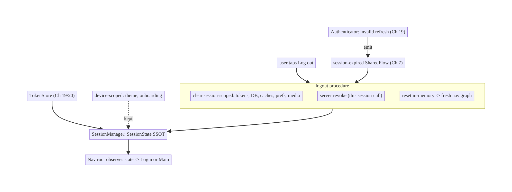
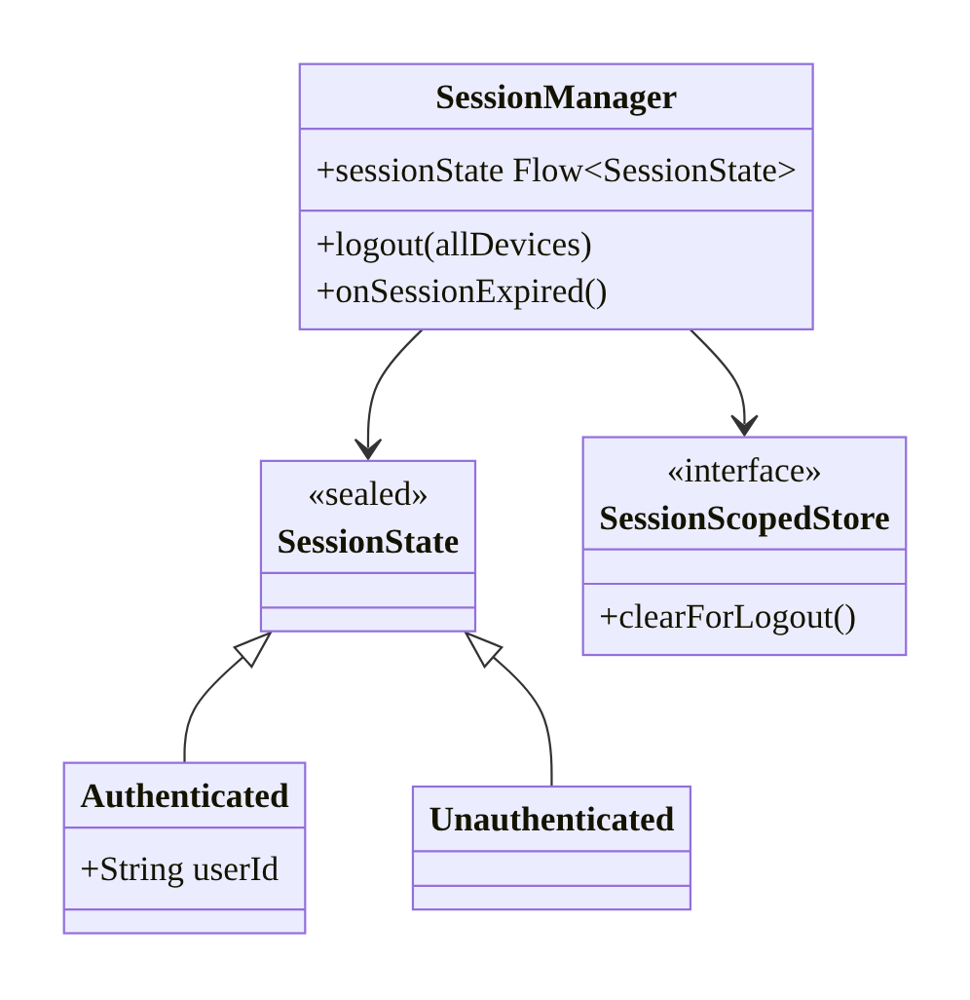
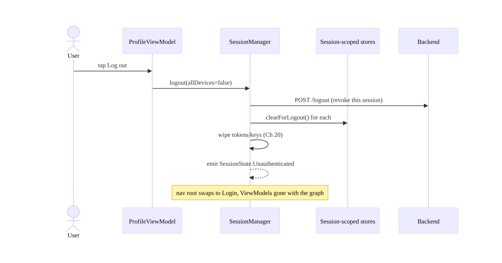
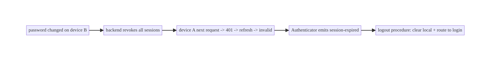
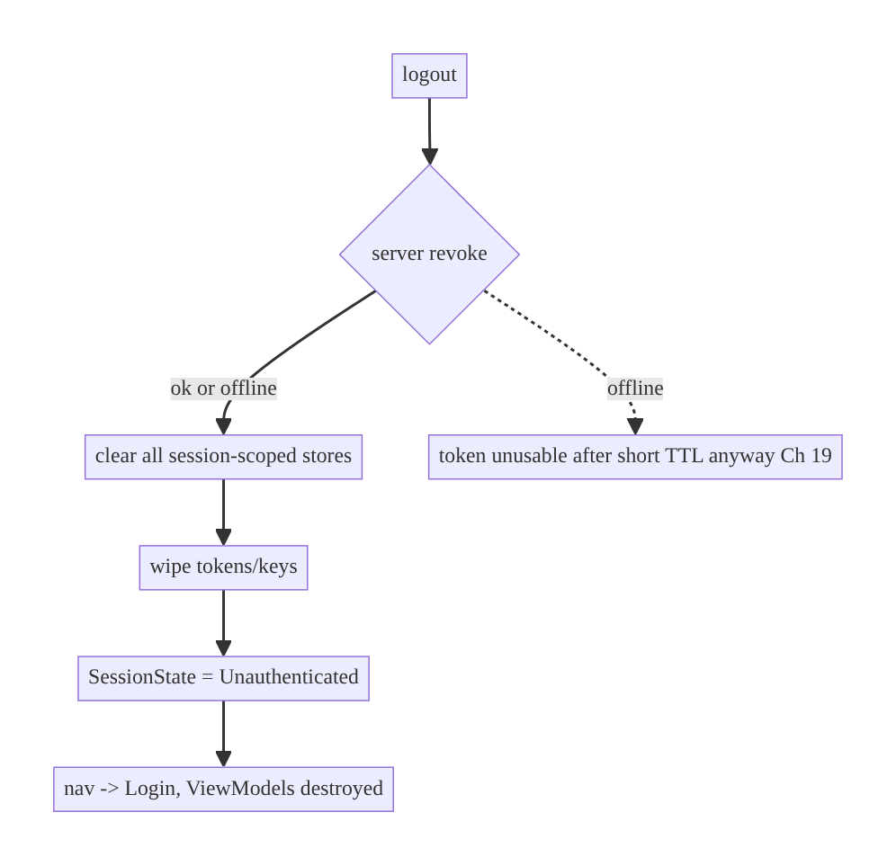

# Chapter 22 — Session Management & Logout-Everywhere

> **Part III — Authentication & Security** · Complexity: **Standard** (≥25 interview questions)
>
> **Prerequisites:** Ch 19 (token refresh — session-expired signal), Ch 20 (secure
> storage — clearing secrets), Ch 7 (one-time events — app-wide signals), Ch 3
> (SSOT — clearing cached data). Reused by Ch 42 (multi-account).
>
> **Reference surface in StreamCart:** keeping one coherent "logged-in" state
> across all modules, logging out cleanly (local + server), and "log out all
> devices" after a password change.

---

## 22.1 Problem Definition and Real-World Context

A session is the span during which a user is authenticated. Managing it sounds
simple but is a cross-cutting lifecycle problem that touches **every** module and
is a frequent source of security bugs and confusing UX:

- **Incomplete logout.** "Logout" clears the token but leaves cached orders,
  wishlist, draft messages, downloaded media, and in-memory ViewModels — the next
  user (or a thief) sees the previous user's data. A refresh token left behind is
  **still valid** if exfiltrated.
- **Logout isn't global.** Clearing locally doesn't **revoke** the session
  server-side; a stolen refresh token keeps working. "Log out everywhere" (after
  a password change / suspected compromise) must invalidate **all** devices.
- **Reactive logout is uncoordinated.** When the refresh token finally fails
  (Ch 19) or the server revokes the session, **every screen** must react at once —
  stop in-flight work, clear state, and route to login. Without an app-wide
  signal, screens show stale data or crash.
- **Session scope ambiguity.** When exactly is the user "logged in"? Which data is
  session-scoped vs device-scoped? Getting this wrong leaks data across users
  (Ch 42).

The architecture: a single **session state** (authenticated/unauthenticated) as an
app-wide source of truth, a **logout procedure** that clears *all* session-scoped
state and revokes server-side, an **app-wide session-expired signal** that every
module reacts to, and clear **data-scope ownership**.

### Three practical use cases

1. **E-commerce (StreamCart).** Logout clears cart, orders cache, wishlist, and
   recents; revokes the token server-side; routes to login — nothing of the
   previous user remains.
2. **Fintech (Wallet).** A password change triggers **logout-everywhere**: the
   backend revokes all sessions; other devices get logged out on their next call.
3. **OTT (Watch).** "Sign out of all devices" (shared-account abuse / device
   limit) invalidates sessions; downloaded media keys are wiped (Ch 20/59).

### Why this is architectural

Session management defines the app's **authentication lifecycle** (login →
active → expired/logout), the **data-scope contract** (what's session- vs
device-scoped), the **app-wide reaction** to session end, and the **local+server
invalidation** model — properties that determine whether logout actually protects
the user.

---

## 22.2 Requirements Engineering

### Functional requirements

| ID | Requirement |
|----|-------------|
| F1 | Expose a single app-wide session state (authenticated/unauthenticated). |
| F2 | On logout, clear **all** session-scoped state (tokens, DB, caches, prefs, in-memory). |
| F3 | Revoke the session server-side on logout (not just local clear). |
| F4 | Support "log out everywhere" (invalidate all devices). |
| F5 | Emit an app-wide session-expired signal; every module reacts (stop work, route to login). |
| F6 | Distinguish session-scoped from device-scoped data. |
| F7 | Reactively log out when the server revokes / refresh fails (Ch 19). |

### Non-functional requirements

| Attribute | Policy |
|-----------|--------|
| **Security** | No residual session data; server-side revocation; secrets wiped (Ch 20). |
| **Consistency** | One session source of truth; all modules agree. |
| **Reliability** | Logout completes even offline (local now, server revoke later). |
| **UX** | Instant, coherent logout; no stale screens; graceful session-expired. |
| **Privacy** | Previous user's data never visible to the next. |

### Scope

- **In scope:** session state SSOT, logout procedure (clear + revoke), app-wide
  session-expired signal, data-scope ownership, reactive logout, logout-everywhere.
- **Out of scope:** token refresh mechanics (Ch 19), secret storage (Ch 20),
  multi-account switching (Ch 42), the login UI/flows.

### Assumptions & constraints

- Backend supports session revocation + "revoke all" (e.g., bump a token version /
  session id server-side). Session state derived from token presence (Ch 19/20).
  `minSdk 24`.

---

## 22.3 System Design Fundamentals

- **Session state as SSOT.** A single `Flow<SessionState>` (Authenticated /
  Unauthenticated), derived from secure token storage (Ch 19/20), observed
  app-wide — the navigation root, interceptors, and features all read it. This is
  the UDF/SSOT pattern (Ch 3/6) applied to auth.
- **Logout = clear + revoke.**
  - **Local clear:** wipe tokens/keys (Ch 20), session-scoped Room tables and
    caches (Ch 3/12), session prefs (Ch 4), and reset in-memory state (ViewModels
    cleared by navigating to a fresh graph).
  - **Server revoke:** call a logout/revoke endpoint so the refresh token can't be
    reused; "revoke all" for logout-everywhere.
- **App-wide session-expired signal.** A hot `SharedFlow` (Ch 7) that any module
  can emit to (e.g., the `Authenticator` on invalid refresh, Ch 19) and a top-level
  collector reacts to — clearing state and routing to login. This decouples "who
  detected expiry" from "how the app responds."
- **Data-scope ownership.** Classify each data store: **session-scoped** (cart,
  orders, tokens — cleared on logout) vs **device-scoped** (theme, onboarding
  flags — kept). Per-account scoping (Ch 42) is a further axis.
- **Reactive vs explicit logout.** *Explicit:* the user taps "Log out." *Reactive:*
  refresh fails / server revokes → forced logout. Both converge on the same
  procedure + signal.
- **Server-side revocation models.** Token version/epoch (bump to invalidate all),
  per-session records (revoke one or all), short access-token TTL (limits the
  window a revoked session stays usable, Ch 19).

Core insight: **model session as one app-wide state, make logout a complete clear
+ server revoke, and broadcast a session-expired signal every module reacts to.**
Partial logout is a security bug; uncoordinated reaction is a UX bug.

---

## 22.4 High-Level Architecture



**Components & ownership**

- **`SessionManager`** owns the `SessionState` SSOT (derived from token presence)
  and the logout procedure.
- **Session-expired `SharedFlow`** (Ch 7) is the app-wide signal; the
  `Authenticator` (Ch 19) and server-revocation detection emit to it.
- **Each store** declares session- vs device-scope; logout clears session-scoped
  only.
- **Nav root** observes `SessionState` and swaps between Login and Main graphs.

**Direction:** token presence → session state → nav; logout/expiry → clear +
revoke → unauthenticated.

---

## 22.5 Detailed Component Design



| Component | Responsibility | Notes |
|-----------|----------------|-------|
| `SessionManager` | session SSOT + logout procedure | emits state; orchestrates clear+revoke |
| `SessionState` | authenticated/unauthenticated | observed app-wide |
| `SessionScopedStore` | a store that must clear on logout | each session-scoped store implements it |
| session-expired `SharedFlow` | app-wide signal (Ch 7) | emit on reactive logout |
| nav root | react to state | Login vs Main graph |

**The `SessionScopedStore` registry:** every session-scoped store (token store,
cart repo, orders cache, recents, media downloads) implements `clearForLogout()`
and is registered; `SessionManager.logout()` iterates them — so adding a new
session-scoped feature can't *forget* to clear (a common leak source).

---

## 22.6 End-to-End Data Flow

### Explicit logout (clear + revoke)



### Reactive logout (server revoked / refresh failed) — logout everywhere



---

## 22.7 Complete Kotlin Implementation

Package: `com.streamcart.core.session`.

### 22.7.1 Session state SSOT

```kotlin
sealed interface SessionState {
    data class Authenticated(val userId: String) : SessionState
    data object Unauthenticated : SessionState
}

interface SessionScopedStore { suspend fun clearForLogout() }   // each session store implements

@Singleton
class SessionManager @Inject constructor(
    private val tokenStore: TokenStore,                     // Ch 19/20
    private val sessionStores: Set<@JvmSuppressWildcards SessionScopedStore>,  // Hilt multibinding
    private val authApi: AuthApi,
    @ApplicationScope private val scope: CoroutineScope,
    private val dispatchers: DispatcherProvider,
) {
    private val _sessionExpired = MutableSharedFlow<Unit>(extraBufferCapacity = 1)  // Ch 7

    // SSOT: derived from token presence; observed by the nav root.
    val sessionState: Flow<SessionState> =
        tokenStore.observe()                                // Flow<Tokens?>
            .map { tokens -> if (tokens != null) SessionState.Authenticated(tokens.userId) else SessionState.Unauthenticated }
            .distinctUntilChanged()

    suspend fun logout(allDevices: Boolean = false) = withContext(dispatchers.io) {
        // 1) Revoke server-side (best-effort; local clear proceeds regardless).
        runCatching { if (allDevices) authApi.revokeAll() else authApi.logout() }
        // 2) Clear ALL session-scoped state (registry ensures nothing is forgotten).
        sessionStores.forEach { runCatching { it.clearForLogout() } }
        // 3) Wipe tokens/keys last -> flips SessionState to Unauthenticated (nav reacts).
        tokenStore.clear()
    }

    // Called reactively (Authenticator invalid refresh, or server-revocation detection).
    fun onSessionExpired() { _sessionExpired.tryEmit(Unit) }

    init {
        scope.launch {
            _sessionExpired.collect { logout(allDevices = false) }   // reactive logout
        }
    }
}
```

### 22.7.2 Hilt multibinding of session-scoped stores

```kotlin
@Module @InstallIn(SingletonComponent::class)
abstract class SessionScopeModule {
    @Binds @IntoSet abstract fun cart(impl: CartRepositoryImpl): SessionScopedStore
    @Binds @IntoSet abstract fun orders(impl: OrdersCache): SessionScopedStore
    @Binds @IntoSet abstract fun recents(impl: RecentSearchesRepository): SessionScopedStore
    @Binds @IntoSet abstract fun downloads(impl: DownloadManagerStore): SessionScopedStore
    // Adding a new session-scoped feature = add one @IntoSet binding; logout covers it.
}
```

### 22.7.3 Example session-scoped store

```kotlin
class CartRepositoryImpl @Inject constructor(
    private val dao: CartDao, private val memory: MemoryCache<*, *>,
) : CartRepository, SessionScopedStore {
    override suspend fun clearForLogout() { dao.clearAll(); memory.clear() }   // DB + cache
}
// Device-scoped stores (theme, onboarding) do NOT implement SessionScopedStore -> kept.
```

### 22.7.4 Navigation root reacts to session state

```kotlin
@Composable
fun StreamCartApp(session: SessionManager = /* injected */) {
    val state by session.sessionState.collectAsStateWithLifecycle(initialValue = SessionState.Unauthenticated)
    when (state) {
        is SessionState.Authenticated -> MainGraph()     // fresh ViewModels; previous ones gone
        SessionState.Unauthenticated -> LoginGraph()
    }
}
```

### 22.7.5 Reactive hook from the Authenticator (Ch 19)

```kotlin
// In TokenAuthenticator (Ch 19), on an invalid refresh:
RefreshResult.Invalid -> { store.clear(); sessionManager.onSessionExpired(); null }
```

### 22.7.6 Module structure

```
:core:session  SessionManager, SessionState, SessionScopedStore, SessionScopeModule
:data:auth     TokenStore (Ch 19/20), AuthApi (logout/revokeAll)
:app           nav root observing sessionState
```

---

## 22.8 Concurrency and Race Conditions

| Scenario | Risk | Handling |
|----------|------|----------|
| Logout while requests in flight | stale responses write after clear | clearing tokens → requests 401/cancel; stores cleared; new graph ignores old results |
| Concurrent explicit + reactive logout | double logout | idempotent `logout()`; `distinctUntilChanged` state |
| Session-expired emitted many times | repeated logouts | buffered `SharedFlow` + idempotent procedure |
| Clear vs new login race | half-cleared then re-auth | serialize logout; complete clear before new session |
| In-memory ViewModel survives logout | stale data shown | swap nav graph → ViewModels destroyed |
| Store clear partially fails | residual data | `runCatching` per store + log; retry on next login |

- **Swapping the nav graph is the clean in-memory reset:** navigating from Main to
  Login destroys the Main graph's ViewModels, so no stale in-memory state survives
  — simpler and safer than manually resetting each ViewModel.
- **Idempotent logout** tolerates explicit+reactive overlap.

---

## 22.9 Failure Scenarios and Recovery

| Failure | Detection | Response | UX |
|---------|-----------|----------|----|
| Server revoke call fails (offline) | logout API error | clear locally anyway; token already unusable server-side soon | logged out locally |
| Partial store clear | exception per store | log; clear rest; sweep on next login | mostly clean; retry |
| Refresh invalid (Ch 19) | Authenticator | reactive logout + session-expired | routed to login |
| "Revoke all" after password change | other devices 401 | next call → refresh invalid → logout | all devices logged out |
| Residual data after logout (bug) | QA/security review | registry (`SessionScopedStore`) ensures coverage | none |
| Logout during payment | in-flight mutation | idempotency (Ch 15) + revoke; reconcile on re-login | safe |
| Downloaded media after logout | files remain | wipe media + keys (Ch 20/59) | no offline access |



> **Logout must succeed locally even if the server call fails.** Clear and route
> immediately; the short access-token TTL + eventual revoke close the server-side
> window. Never block logout on network.

---

## 22.10 Scaling the Implementation

- **Level 1.** Session state from token presence; logout clears the token + routes
  to login.
- **Level 2.** `SessionScopedStore` registry so all session data clears; swap nav
  graph for in-memory reset.
- **Level 3 — production.** Server revoke + "revoke all"; reactive logout via
  session-expired signal (Ch 7/19); wipe secrets (Ch 20) + media (Ch 59).
- **Level 4 — large.** Multi-account (Ch 42) with per-account scoping; device
  management UI ("your devices", revoke one); idle/absolute session timeouts.
- **Level 5 — enterprise.** Centralized session service with remote revocation
  push, risk-based re-auth, compliance audit logs, SSO/single-logout across apps.

**Avoid overengineering:** a simple app needs session state + a thorough clear.
Device management, idle timeouts, and SSO are for security-sensitive/enterprise
apps.

---

## 22.11 Alternative Approaches and Trade-offs

| Dimension | Option A | Option B | When |
|-----------|----------|----------|------|
| Session source | Token presence (derived) | Explicit session object | Derived is simplest (one SSOT); explicit if session has rich metadata |
| Clear strategy | Registry (`SessionScopedStore`) | Manual per-feature | Registry prevents "forgot to clear" leaks; manual is error-prone |
| In-memory reset | Swap nav graph | Reset each ViewModel | Graph swap is clean/complete; manual reset misses state |
| Revocation | Server revoke + short TTL | Local clear only | Server revoke for real security (stolen token); local-only is insufficient |
| Logout-all | Token version/epoch bump | Per-session records | Version bump is simple global invalidation; per-session enables selective device revoke |
| Expiry signal | App-wide `SharedFlow` (Ch 7) | Per-screen checks | App-wide signal for coordinated reaction |

**Local clear vs server revoke:** clearing locally logs *this app* out but leaves
the refresh token valid if it was exfiltrated. Server revocation (plus short
access-token TTL, Ch 19) actually invalidates the session everywhere. Secure apps
do both; "logout" that only clears locally is a security gap.

**Token-version bump vs per-session records:** bumping a server-side token
version/epoch invalidates *all* sessions at once (simple "revoke all"), but can't
revoke a single device. Per-session records allow selective revocation (device
management) at more storage/complexity. Choose by whether you need per-device
control.

---

## 22.12 Security Considerations

- **Complete clear is a security requirement**, not UX polish: residual tokens,
  cached PII, drafts, or downloaded media let the next user/thief access the
  previous user's data. Use the registry to guarantee coverage.
- **Always revoke server-side** on logout (and support "revoke all" after password
  change / suspected compromise); local clear alone doesn't stop a stolen refresh
  token.
- **Short access-token TTL** (Ch 19) bounds how long a revoked session stays usable
  before the next refresh fails.
- **Wipe secrets and media keys** (Ch 20/59) on logout so offline content is
  inaccessible.
- **Per-account isolation** (Ch 42): switching accounts must not leak data; treat
  it like logout+login for scoped data.
- **Idle/absolute timeouts** for sensitive apps (auto-logout after inactivity).
- Client vs backend: the client clears local state and requests revocation; the
  **backend owns authoritative revocation** (a client can't be trusted to have
  actually logged out).

---

## 22.13 Performance and Resource Optimization

- **Logout is infrequent** and cheap (clear DB/prefs/memory, one network call);
  run it off the main thread; don't block the UI — route to login immediately and
  clear in the background if large (e.g., deleting downloaded media).
- **Graph swap** is instant and frees ViewModel memory.
- **Don't retain** large session caches after logout (memory).
- **Session state observation** is a conflated `Flow` — negligible cost.
- **Profiling:** logout completion time (esp. with media wipe), residual-data
  checks, memory after logout.

---

## 22.14 Testing Strategy

Test the logout procedure (all stores cleared + revoke) and reactive logout.

```kotlin
class SessionManagerTest {
    @Test fun `logout clears every session-scoped store and token`() = runTest {
        val cart = RecordingStore(); val orders = RecordingStore()
        val token = FakeTokenStore(userId = "u1")
        val sm = SessionManager(token, setOf(cart, orders), FakeAuthApi(), bgScope, testDispatchers)
        sm.logout()
        assertTrue(cart.cleared && orders.cleared)        // registry covers all
        assertNull(token.current())                        // token wiped
    }

    @Test fun `logout clears locally even if server revoke fails`() = runTest {
        val token = FakeTokenStore("u1")
        val sm = SessionManager(token, setOf(RecordingStore()), FailingAuthApi, bgScope, testDispatchers)
        sm.logout()
        assertNull(token.current())                        // local clear regardless
    }

    @Test fun `session-expired signal triggers logout`() = runTest {
        val token = FakeTokenStore("u1"); val cart = RecordingStore()
        val sm = SessionManager(token, setOf(cart), FakeAuthApi(), bgScope, testDispatchers)
        sm.onSessionExpired(); runCurrent()
        assertNull(token.current()); assertTrue(cart.cleared)
    }

    @Test fun `session state reflects token presence`() = runTest {
        val token = FakeTokenStore("u1")
        val sm = SessionManager(token, emptySet(), FakeAuthApi(), bgScope, testDispatchers)
        sm.sessionState.test {
            assertTrue(awaitItem() is SessionState.Authenticated)
            token.clear()
            assertEquals(SessionState.Unauthenticated, awaitItem())
        }
    }

    @Test fun `revoke all is called for logout everywhere`() = runTest {
        val api = RecordingAuthApi()
        SessionManager(FakeTokenStore("u1"), emptySet(), api, bgScope, testDispatchers).logout(allDevices = true)
        assertTrue(api.revokeAllCalled)
    }
}
```

Also: a "no residual data" integration test (seed session data, logout, assert all
session-scoped stores empty, device-scoped kept); reactive logout from the
Authenticator (Ch 19).

---

## 22.15 Production Observability

- **Metrics:** logout count (explicit vs reactive), logout-everywhere count,
  server-revoke success rate, session-expired rate, residual-data incidents (should
  be 0), time-to-logout.
- **Logs:** `session{event=login|logout|expired, reason, all_devices}` (no tokens/
  PII), `revoke{scope=session|all, result}`.
- **Debugging:** previous user's data visible → a store not registered as
  `SessionScopedStore`; stale screens after expiry → nav root not observing state /
  no app-wide signal; session persists after "logout everywhere" → server not
  revoking / long access-token TTL (Ch 19).
- **Alerting:** spike in reactive logouts/`session-expired{invalid}` → possible
  token-theft or backend revocation event.
- **Privacy:** session events are sensitive; log reasons/counts, not identities.

---

## 22.16 System Design Interview Preparation

> ≥25 questions.

**Fundamentals**

1. *What is session management?* Owning the authenticated-lifecycle: login →
   active → expiry/logout, as app-wide state.
2. *Why is "clear the token" insufficient logout?* Leaves cached PII/drafts/media
   and a possibly-valid refresh token; server session still active.
3. *Local clear vs server revoke?* Local logs this app out; server revoke actually
   invalidates the session (stolen token).
4. *Session state SSOT?* A single `Flow<SessionState>` derived from token presence,
   observed app-wide.
5. *Session-scoped vs device-scoped data?* Session (cart/tokens — clear on logout)
   vs device (theme/onboarding — keep).

**Logout procedure**

6. *What must logout clear?* Tokens/keys (Ch 20), session Room tables + caches,
   session prefs, downloaded media/keys, in-memory state.
7. *How ensure nothing is forgotten?* A `SessionScopedStore` registry (Hilt
   multibinding) iterated on logout.
8. *How reset in-memory state?* Swap the nav graph → ViewModels destroyed.
9. *Logout offline?* Clear locally immediately; revoke server-side when possible;
   short TTL closes the window.

**Logout everywhere**

10. *How "log out all devices"?* Backend revokes all sessions (token version bump /
    per-session records); other devices log out on next call.
11. *Version bump vs per-session?* Bump = global invalidation (simple); per-session
    = selective device revoke.
12. *When triggered?* Password change, suspected compromise, device-limit.

**Reactive logout**

13. *App-wide session-expired signal?* A `SharedFlow` (Ch 7) emitted on invalid
    refresh (Ch 19)/server revoke; a top-level collector runs logout.
14. *Why decouple detection from reaction?* Many detectors (Authenticator, push),
    one coordinated response.
15. *Stale screens on expiry — fix?* Nav root observes `SessionState`; app-wide
    signal.

**Concurrency**

16. *Logout with requests in flight?* Tokens cleared → 401/cancel; stores cleared;
    new graph ignores old results.
17. *Explicit + reactive logout race?* Idempotent logout + `distinctUntilChanged`.

**Security**

18. *Residual data risk?* Next user sees previous user's data — registry ensures
    full clear.
19. *Short access-token TTL role?* Bounds how long a revoked session stays usable
    (Ch 19).
20. *Downloaded media after logout?* Wipe media + keys (Ch 20/59).
21. *Per-account isolation?* Treat switch like logout+login for scoped data
    (Ch 42).

**Scalability**

22. *Device management ("your devices")?* Per-session records + revoke-one UI.
23. *Idle timeout?* Auto-logout after inactivity for sensitive apps.

**Testing**

24. *How test complete logout?* Registry cleared + token wiped + device-scoped
    kept; "no residual data" integration test.
25. *How test reactive logout?* Emit session-expired; assert logout.
26. *How test logout-everywhere?* Assert `revokeAll` called.

**Production debugging**

27. *Previous user's data shows?* A store not registered/cleared.
28. *Session survives "logout everywhere"?* Server not revoking / long TTL.

### Design-change challenges
1. **Add "log out all devices" after password change.** Backend revoke-all; other
   devices log out on next refresh (Ch 19).
2. **New feature leaks data after logout.** Implement `SessionScopedStore`; add to
   the registry.
3. **Auto-logout after inactivity.** Idle/absolute timeout → session-expired.
4. **Offline logout.** Clear locally; queue revoke; short TTL.
5. **Multi-account.** Per-account scoping; switch = scoped logout+login (Ch 42).

### Mock walkthrough (abridged)
Clarify (what's session- vs device-scoped, revoke-all needed, offline) →
`SessionState` SSOT from token presence → logout = registry clear + server revoke +
graph swap → app-wide session-expired signal (reactive) → logout-everywhere model →
security (complete clear, TTL) → testing.

---

## 22.17 Practical Exercises

1. **Beginner.** Derive `SessionState` from token presence and swap Login/Main
   graphs. *Eval:* nav reacts to login/logout.
2. **Intermediate.** Build a `SessionScopedStore` registry; prove logout clears all
   session data and keeps device-scoped. *Eval:* no residual; theme kept.
3. **Advanced.** Add an app-wide session-expired signal from the Authenticator
   (Ch 19) + server revoke + "revoke all". *Eval:* reactive logout; all-devices
   invalidation.
4. **Production debugging.** Fix logout that leaves the refresh token + cached
   orders behind and shows stale screens on expiry. *Eval:* full clear + revoke;
   coordinated reaction.
5. **System design challenge.** Add device management (list/revoke sessions) +
   idle-timeout auto-logout. *Eval:* selective revoke; auto-logout works.

*(Solutions withheld unless requested.)*

---

## 22.18 Chapter Summary & Reference Sheet

**Key decisions:** model session as **one app-wide `SessionState` SSOT** derived
from token presence; make **logout a complete clear + server revoke** using a
**`SessionScopedStore` registry** (so nothing is forgotten) and a **nav-graph swap**
(to reset in-memory state); broadcast an **app-wide session-expired signal** (Ch 7)
that the Authenticator (Ch 19) and server-revocation emit to and a top-level
collector reacts to; support **logout-everywhere** (server revoke-all); clear
**secrets and media** (Ch 20/59); logout **succeeds locally even offline**;
distinguish **session- vs device-scoped** data.

**Concepts:** session SSOT, clear vs revoke, logout-everywhere, app-wide
session-expired signal, data-scope ownership, reactive vs explicit logout,
token-version vs per-session revocation.

**Common mistakes:** clearing only the token (residual data/valid refresh token);
no server revocation; uncoordinated reaction (stale screens); forgetting to clear a
new session store; not wiping secrets/media; blocking logout on the network;
leaking data across accounts.

**Checklist:**

- [ ] session SSOT from token
- [ ] `SessionScopedStore` registry
- [ ] clear DB/caches/prefs/secrets/media
- [ ] nav-graph swap (in-memory reset)
- [ ] server revoke + revoke-all
- [ ] app-wide session-expired signal
- [ ] reactive logout (Ch 19)
- [ ] logout works offline
- [ ] device- vs session-scope
- [ ] per-account isolation (Ch 42).

**Key APIs:** `StateFlow`/`SharedFlow` (Ch 6/7), Hilt `@IntoSet` multibinding,
`distinctUntilChanged`, `TokenStore.clear` (Ch 19/20), nav graph swap,
`collectAsStateWithLifecycle`.

**References:**
- App architecture (UDF/SSOT): https://developer.android.com/topic/architecture
- Token revocation (OAuth RFC 7009): https://datatracker.ietf.org/doc/html/rfc7009
- (builds on) Ch 19 Token Refresh, Ch 20 Keystore, Ch 7 One-Time Events, Ch 42 Multi-Account

### Chapter review (Phase 4)
- **Completeness:** all 18 sections; architecture/class/sequence/failure diagrams;
  SessionManager + registry + nav swap + revoke + reactive signal; concurrency
  (in-flight logout, idempotency); failure (offline logout, partial clear); 5
  levels; local-vs-revoke and version-vs-per-session trade-offs; security (complete
  clear, TTL, media); perf; registry + reactive tests; observability; 28 Q&A + 5
  challenges. ✅
- **Expand later:** multi-account (Ch 42), device management, idle timeouts, SSO/
  single-logout.
- **Interview coverage:** exceeds ≥25 bar.
