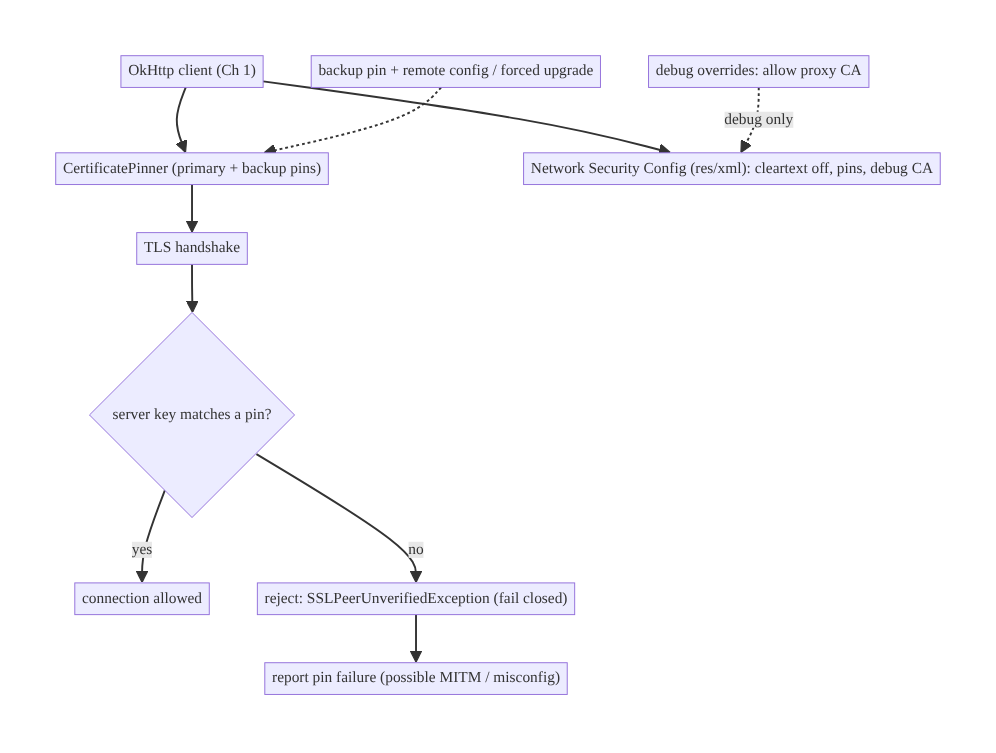
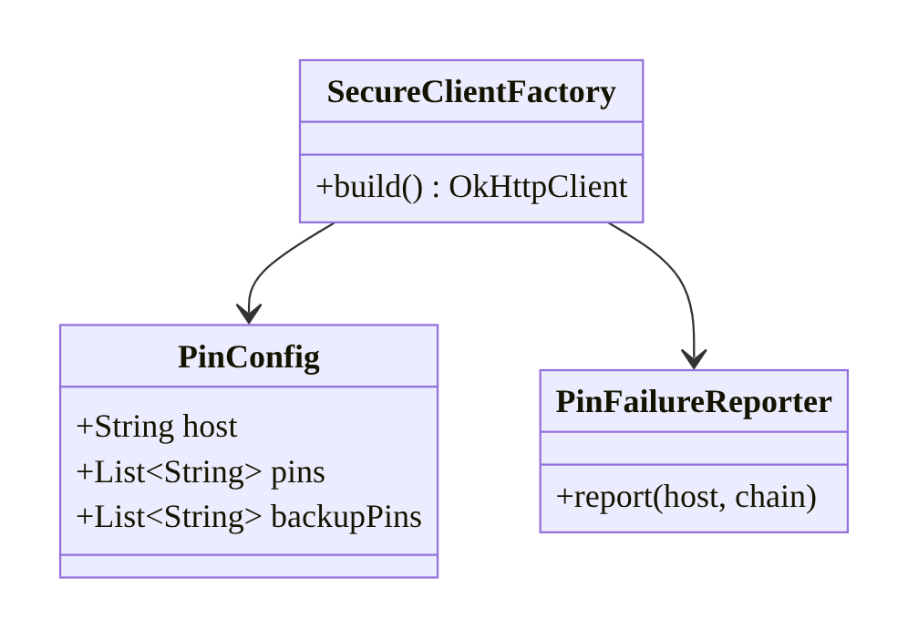
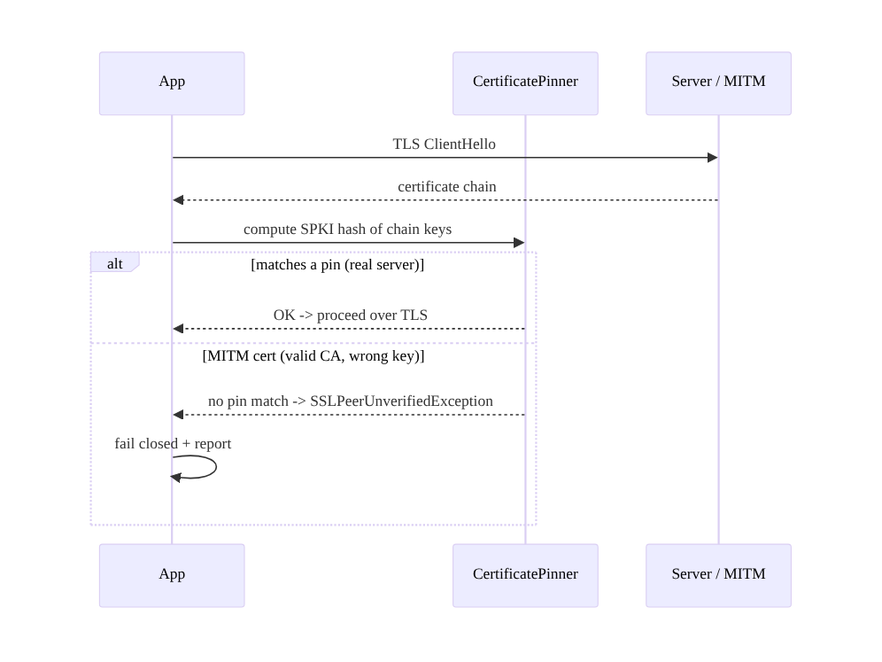
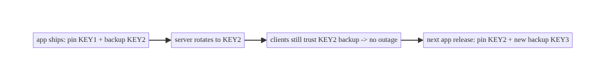
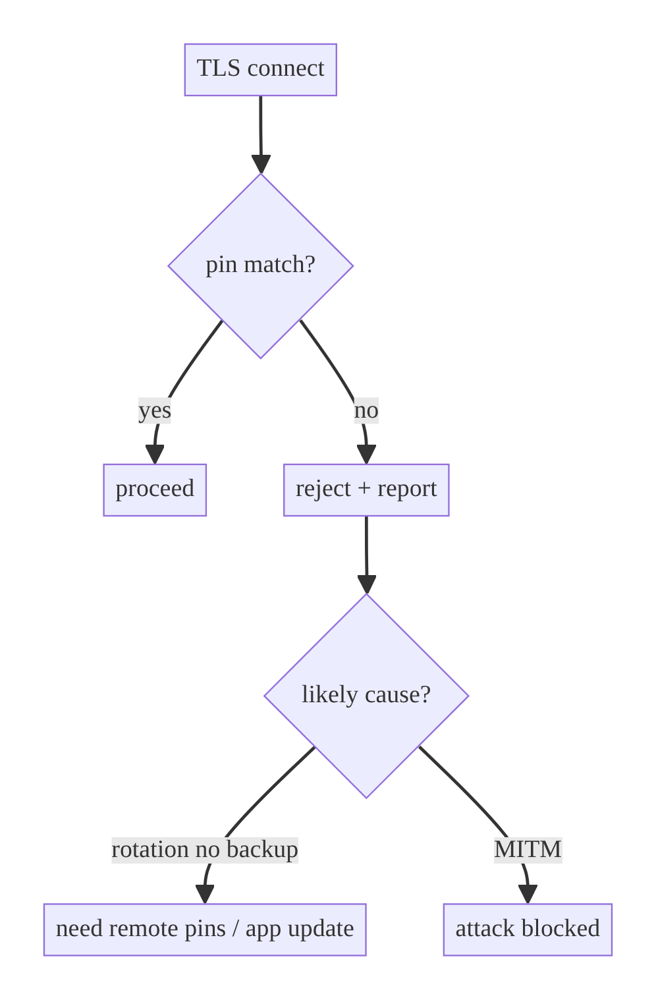

# Chapter 23 — Secure Network Communication & Certificate Pinning

> **Part III — Authentication & Security** · Complexity: **Standard** (≥25 interview questions)
>
> **Prerequisites:** Ch 1 (Networking Core — OkHttp client), Ch 19 (tokens — what
> we're protecting in transit), Ch 16 (schema drift as a MITM signal). Completes
> Part III's network-security surface.
>
> **Reference surface in StreamCart:** protecting tokens, payments, and user data
> in transit against interception/MITM across Shop, Wallet, and Watch APIs.

---

## 23.1 Problem Definition and Real-World Context

Every authenticated request carries secrets (tokens, Ch 19) and user data over a
network the user doesn't control — café Wi-Fi, carrier networks, corporate
proxies. TLS/HTTPS protects confidentiality and integrity **only if** the client
validates the server's certificate correctly. The threats:

- **Man-in-the-middle (MITM).** An attacker on the network (or a malicious proxy)
  presents a certificate that chains to a CA the device trusts — e.g., a
  user-installed or compromised CA — and decrypts/modifies traffic. Standard TLS
  trusts the device's CA store, which **includes CAs the user or an attacker can
  add**.
- **Cleartext fallback.** Any accidental `http://` endpoint sends data in the
  clear.
- **Weak validation.** Disabling certificate checks "to make it work" (a shockingly
  common bug) removes all protection.
- **Interception for analysis.** On rooted/debug devices, tools like mitmproxy can
  intercept traffic unless the app pins.

**Certificate pinning** narrows trust from "any CA the device trusts" to "**this
specific server's** certificate/public key." The client embeds a pin (a hash of
the server's public key); a connection is allowed only if the server's chain
contains a matching pin — so even a valid-but-wrong certificate (attacker's CA) is
rejected. The architecture is about **what to pin** (public key, not leaf cert),
**pin rotation/backup pins** (to avoid bricking the app when the cert rotates), and
**failure handling** — pinning done naively is a reliability time-bomb.

### Three practical use cases

1. **Fintech (StreamCart Wallet).** Pin the payment/API hosts so a MITM can't read
   or tamper with transactions, even on a compromised network.
2. **Auth (Account).** Pin the auth host so tokens (Ch 19) can't be intercepted.
3. **OTT license (Watch).** Pin the DRM license server to prevent tampering with
   entitlement checks.

### Why this is architectural

Secure transport defines the app's **trust model** (device CA store vs pinned
keys), its **MITM resistance**, and the **operational risk** of pinning (rotation
bricking). These are system/security decisions with real reliability consequences,
not a checkbox.

---

## 23.2 Requirements Engineering

### Functional requirements

| ID | Requirement |
|----|-------------|
| F1 | All traffic over TLS/HTTPS; no cleartext. |
| F2 | Validate the server certificate correctly (never disable checks). |
| F3 | Pin sensitive hosts to specific public keys (narrow trust). |
| F4 | Include backup pins so planned cert rotation doesn't brick the app. |
| F5 | Handle pin-validation failure safely (fail closed; report). |
| F6 | Support debug interception without weakening release builds. |

### Non-functional requirements

| Attribute | Policy |
|-----------|--------|
| **Security** | MITM-resistant; no user-CA trust for pinned hosts; no cleartext. |
| **Reliability** | Pin rotation won't lock users out (backup pins + remote config/forced-upgrade). |
| **Maintainability** | Pins managed/rotated with the backend; debug vs release separated. |
| **Observability** | Pin failures reported (possible attack or misconfig). |
| **Compatibility** | Network Security Config across API levels. |

### Scope

- **In scope:** TLS basics, OkHttp `CertificatePinner`, Network Security Config,
  public-key pinning, backup pins + rotation strategy, failure handling, debug
  interception, the pinning threat model.
- **Out of scope:** the Keystore/token storage (Ch 20), auth flows (Ch 19), root/
  integrity detection (Ch 26), backend TLS config, mTLS/DPoP (noted, not deep).

### Assumptions & constraints

- HTTPS backend; OkHttp (Ch 1). Pins are SPKI SHA-256 hashes of the server's public
  key. `minSdk 24`. Pinning is **client-side hardening**, not a substitute for
  backend security.

---

## 23.3 System Design Fundamentals

- **TLS trust, by default, is the device CA store.** The system trusts ~100+ CAs;
  a certificate that chains to **any** of them validates. The problem: users can
  install CAs (and malware/enterprise MDM can), and a CA compromise is catastrophic
  — so "valid TLS" doesn't mean "talking to *your* server."
- **Certificate pinning** restricts acceptable certificates to a known set. The
  client stores **pins** (SPKI SHA-256 hashes) and requires the server's chain to
  include a matching pin — rejecting an attacker's valid-but-different cert.
- **Pin the public key (SPKI), not the leaf certificate.** Certificates are
  reissued often (short Let's Encrypt lifetimes, renewals) but the **key** can be
  kept across renewals; pinning the key survives cert reissuance. Pinning the leaf
  cert hash breaks on every renewal.
- **Backup pins are mandatory.** Pin **at least two** keys: the current key and a
  **backup** (next rotation's key, kept offline). If the primary key must be
  replaced (compromise), the backup lets the app keep working without an app
  update. **Pinning a single key = a self-inflicted outage waiting to happen.**
- **Pin to intermediate or leaf?** Pinning the **leaf/your own key** is strictest
  but needs the most rotation care; pinning an **intermediate CA** key is more
  robust to leaf rotation but widens trust slightly. A common safe choice: pin your
  leaf key + a backup leaf key (and optionally an intermediate as a fallback).
- **Network Security Config (NSC).** A declarative XML (`res/xml`) to enforce
  cleartext-off, configure trust anchors, pin domains, and allow user/debug CAs
  **only in debug** — the recommended, auditable mechanism alongside or instead of
  code.
- **Fail closed.** A pin mismatch must **reject** the connection (OkHttp throws
  `SSLPeerUnverifiedException`); never fall back to unpinned. Report it (possible
  MITM).
- **Rotation strategy.** Pins are baked into the app binary, so rotation must be
  planned: ship the next key as a backup pin **before** rotating; optionally
  deliver pins via (authenticated) remote config for faster rotation; keep a
  forced-upgrade path (Ch 54) as a safety net.

Core insight: **pin the server's public key (with a backup), enforce via Network
Security Config, fail closed, and plan rotation with backup pins** — pinning adds
strong MITM resistance but trades reliability, which backup pins + rotation
discipline manage.

---

## 23.4 High-Level Architecture



**Components & ownership**

- **`CertificatePinner`** (OkHttp) holds the pins per host; the TLS stack enforces
  them.
- **Network Security Config** declares cleartext policy, pins, and debug-only CA
  trust — auditable and release/debug-separated.
- **Rotation mechanism** (backup pins, optional remote-config pins, forced upgrade)
  manages the reliability risk.
- **Failure reporting** surfaces pin mismatches (attack or misconfig).

**Direction:** request → pinned TLS handshake → allow (match) / reject (fail
closed) → report on failure.

---

## 23.5 Detailed Component Design



| Element | Responsibility | Notes |
|---------|----------------|-------|
| pins (SPKI SHA-256) | identify acceptable keys | primary + ≥1 backup |
| `CertificatePinner` | enforce at TLS | per host; fail closed |
| Network Security Config | declarative policy | cleartext off, pins, debug CA |
| rotation mechanism | avoid bricking | backup pins + remote/forced-upgrade |
| `PinFailureReporter` | telemetry on mismatch | possible MITM/misconfig signal |

---

## 23.6 End-to-End Data Flow

### Pinned handshake (legit vs MITM)



### Planned rotation with backup pin



---

## 23.7 Complete Kotlin Implementation

Package: `com.streamcart.core.network.security`.

### 23.7.1 OkHttp CertificatePinner (primary + backup pins)

```kotlin
// Pins are SPKI SHA-256 hashes (base64). Generate with:
//   openssl s_client -connect api.streamcart.com:443 | openssl x509 -pubkey -noout |
//   openssl pkey -pubin -outform der | openssl dgst -sha256 -binary | openssl enc -base64
val certificatePinner = CertificatePinner.Builder()
    .add(
        "api.streamcart.com",
        "sha256/AAAAAAAAAAAAAAAAAAAAAAAAAAAAAAAAAAAAAAAAAAA=",   // current key
        "sha256/BBBBBBBBBBBBBBBBBBBBBBBBBBBBBBBBBBBBBBBBBBB=",   // BACKUP key (next rotation, offline)
    )
    .add("license.streamcart.com", "sha256/CCCC...=", "sha256/DDDD...=")
    .build()

// Wire into the Ch 1 client:
OkHttpClient.Builder()
    .certificatePinner(certificatePinner)
    // ... interceptors, timeouts (Ch 1)
    .build()
```

### 23.7.2 Network Security Config (declarative; preferred/auditable)

```xml
<!-- res/xml/network_security_config.xml ; referenced in AndroidManifest -->
<network-security-config>
    <!-- Enforce no cleartext app-wide. -->
    <base-config cleartextTrafficPermitted="false">
        <trust-anchors><certificates src="system"/></trust-anchors>
    </base-config>

    <!-- Pin sensitive domains. -->
    <domain-config>
        <domain includeSubdomains="true">api.streamcart.com</domain>
        <pin-set expiration="2026-12-31">
            <pin digest="SHA-256">AAAA...=</pin>
            <pin digest="SHA-256">BBBB...=</pin>   <!-- backup -->
        </pin-set>
    </domain-config>
</network-security-config>
```

> **`expiration` is a safety valve, not a feature to rely on:** after it, pinning
> *stops* being enforced for that domain (so an expired pin-set can't brick the
> app) — set it, but the real safeguard is backup pins + timely app updates.

### 23.7.3 Debug-only interception (never weaken release)

```xml
<!-- res/xml/network_security_config.xml for the DEBUG build variant ONLY -->
<network-security-config>
    <debug-overrides>
        <trust-anchors>
            <certificates src="user"/>   <!-- allow mitmproxy/Charles in debug builds only -->
        </trust-anchors>
    </debug-overrides>
</network-security-config>
```

> Put debug overrides in `src/debug/res/xml/` so they **cannot** ship in release.
> Never add `src="user"` or disable pinning in the release config.

### 23.7.4 Fail-closed + reporting

```kotlin
class SecureClientFactory @Inject constructor(
    private val reporter: PinFailureReporter,
) {
    fun build(base: OkHttpClient.Builder): OkHttpClient =
        base.certificatePinner(certificatePinner)
            .addNetworkInterceptor { chain ->
                try { chain.proceed(chain.request()) }
                catch (e: SSLPeerUnverifiedException) {       // pin mismatch = fail closed
                    reporter.report(chain.request().url.host, e)   // possible MITM / misconfig
                    throw e
                }
            }
            .build()
    // NEVER catch-and-retry-unpinned. A mismatch must reject the connection.
}
```

### 23.7.5 Optional: remote-config pins (faster rotation)

```kotlin
// Deliver pins via AUTHENTICATED remote config (Ch 41) over an already-pinned
// channel, so a key compromise can be rotated without an app update.
// Guard against a hostile config: validate signature; keep a baked-in fallback pin.
fun buildPinner(remotePins: Map<String, List<String>>, baked: CertificatePinner): CertificatePinner {
    val b = CertificatePinner.Builder()
    remotePins.forEach { (host, pins) -> pins.forEach { b.add(host, it) } }
    // always include baked-in pins as a floor
    return b.build()  // merge with baked in practice
}
```

### 23.7.6 Module structure

```
:core:network/security  SecureClientFactory, PinConfig, PinFailureReporter, certificatePinner
res/xml                 network_security_config.xml (release)
src/debug/res/xml       network_security_config.xml (debug overrides)
```

---

## 23.8 Concurrency and Race Conditions

Pinning is enforced in the TLS handshake (OkHttp internals), so app-level
concurrency is minimal, but a few operational races matter:

| Scenario | Risk | Handling |
|----------|------|----------|
| Cert rotated without backup pin | all clients bricked at once | always ship ≥1 backup pin ahead |
| Remote-config pins race with baked | inconsistent trust | merge; baked pins are a floor; validate config |
| Pin-set expiration passes | pinning silently disabled | monitor expiration; update before it |
| Concurrent requests during a MITM | all fail closed | correct — reject all; report once (throttle) |
| Debug config leaking to release | weakened security | variant-separated config (`src/debug`) |

- **The real "race" is operational:** backend cert rotation vs the app binary's
  pins. Backup pins + staged rotation is the mitigation; never rotate to a key no
  shipped client pins.

---

## 23.9 Failure Scenarios and Recovery

| Failure | Detection | Response | UX |
|---------|-----------|----------|----|
| MITM / wrong cert | pin mismatch → `SSLPeerUnverifiedException` | reject (fail closed) + report | "Secure connection failed"; no data leaked |
| Cert rotated, no backup pin | all pins fail | **outage** — need app update / remote pins | broken until fix |
| Backup pin present | primary replaced | backup matches → works | seamless |
| Pin-set expired | enforcement off | pinning disabled (fails open by design) → update app | reduced protection |
| User-installed CA (prod) | pinned host rejects it | blocked (good) | corporate proxy can't intercept pinned host |
| Cleartext endpoint | NSC blocks | request fails in dev; fix to HTTPS | caught early |
| Captive portal | TLS to portal | handle connectivity errors; retry after login | transient |
| Debug proxy needed | release build | debug variant only; don't weaken release | dev-only |



> **Pinning fails closed on mismatch, but "fails open" on pin-set expiration** —
> an intentional safety design so a forgotten rotation degrades to normal TLS
> rather than a permanent brick. Know this behavior; don't rely on it.

---

## 23.10 Scaling the Implementation

- **Level 1.** HTTPS + Network Security Config (cleartext off); no pinning.
- **Level 2.** Pin the sensitive hosts (auth, payments) with a **backup pin**;
  fail closed; report failures.
- **Level 3 — production.** NSC-declared pins with expiration; debug-variant
  interception; staged rotation runbook; `includeSubdomains` where appropriate.
- **Level 4 — large.** Remote-config pins (authenticated) for fast rotation +
  baked-in fallback; forced-upgrade safety net (Ch 54); per-host pin policies.
- **Level 5 — enterprise.** mTLS / device-bound tokens (DPoP, Ch 19), CT (Certificate
  Transparency) monitoring, automated pin-rotation pipelines, integrity/attestation
  (Ch 26), coordinated backend+mobile key ceremonies.

**Avoid overengineering:** not every app needs pinning — it's essential for
fintech/auth/high-value data but adds operational risk. A content app may be fine
with HTTPS + NSC (cleartext off). **Never pin without backup pins and a rotation
plan.**

---

## 23.11 Alternative Approaches and Trade-offs

| Dimension | Option A | Option B | When |
|-----------|----------|----------|------|
| Trust | Default CA store (HTTPS) | Certificate pinning | Pinning for sensitive hosts (MITM resistance); default for low-risk (less ops burden) |
| Pin target | Public key (SPKI) | Leaf certificate | **Pin the key** (survives cert renewal); leaf-cert pin breaks on renewal |
| Pin level | Leaf/your key | Intermediate CA | Leaf = strictest (most rotation care); intermediate = robust to leaf rotation (wider trust) |
| Mechanism | Network Security Config (XML) | OkHttp `CertificatePinner` (code) | NSC is declarative/auditable/system-wide; code is flexible/testable — often use both |
| Rotation | Backup pins (baked) | Remote-config pins | Backup pins always; remote pins for faster rotation (needs auth + fallback) |
| Transport auth | TLS + pinning | mTLS / DPoP | Pinning protects the channel; mTLS/DPoP bind the client/token (high assurance) |

**Key pinning vs cert pinning (the critical choice):** pinning the **leaf
certificate** hash breaks every time the cert is renewed (frequent with short-lived
certs) — a reliability nightmare. Pinning the **public key (SPKI)** survives
renewals as long as the key is reused, which is the standard, maintainable
approach. Always pin keys, with a backup key.

**To pin or not:** pinning strongly resists MITM (including user/enterprise CAs)
but shifts operational risk to **key rotation** — a mistake (rotating without a
shipped backup pin) bricks the installed base. Weigh MITM risk vs ops maturity;
for payments/auth it's worth it **with** backup pins + a rotation runbook.

---

## 23.12 Security Considerations

- **Pinning defeats user/enterprise-CA MITM** for pinned hosts (café proxy,
  corporate TLS inspection, user-installed CA) — the main value over plain HTTPS.
- **Fail closed:** a mismatch must reject; **never** catch `SSLPeerUnverifiedException`
  and retry unpinned (that re-opens the hole).
- **Never disable certificate validation** (custom all-trusting `TrustManager`/
  `HostnameVerifier`) — it's the single most dangerous mobile networking bug; Play
  Store rejects it.
- **Debug-only interception:** keep proxy-CA trust in the debug variant; audit that
  release has no `src="user"` and pinning on.
- **Backup pins** aren't optional — a single pin is a ticking outage.
- **Pinning is client hardening, not a complete defense:** it protects the channel;
  the backend still needs auth/authz, and pinning doesn't stop a compromised app on
  a rooted device (combine with attestation/root detection, Ch 26).
- **Short access-token TTL** (Ch 19) limits damage if the channel is somehow
  compromised.
- Client vs backend: the client enforces pins and cleartext policy; the backend owns
  cert/key management and must coordinate rotation with the mobile team.

---

## 23.13 Performance and Resource Optimization

- **Pinning adds negligible overhead** — a hash comparison during the TLS handshake
  the client already does.
- **Connection reuse** (Ch 1 shared client, HTTP/2) amortizes handshakes; pinning
  doesn't change this.
- **Fewer, correct handshakes:** don't create extra clients for pinned vs unpinned;
  configure per-host pins on the one shared client.
- **Battery/latency:** TLS handshake cost is dominated by crypto, not pinning;
  session resumption helps.
- **Profiling:** OkHttp `EventListener` for TLS timing; pin-failure rate; handshake
  latency.

---

## 23.14 Testing Strategy

Test fail-closed behavior and rotation with MockWebServer + controlled certs.

```kotlin
class CertificatePinningTest {
    private val server = MockWebServer()

    @Test fun `rejects server whose key is not pinned (MITM simulation)`() = runTest {
        server.useHttps(wrongCertSslSocketFactory, false)   // cert not in the pin set
        server.enqueue(MockResponse())
        val client = OkHttpClient.Builder()
            .certificatePinner(CertificatePinner.Builder().add(server.hostName, "sha256/EXPECTED=").build())
            .sslSocketFactory(/* trust-all for test transport */).build()
        assertThrows(SSLPeerUnverifiedException::class.java) {
            client.newCall(Request.Builder().url(server.url("/")).build()).execute()
        }
    }

    @Test fun `accepts server matching a backup pin`() {
        // pin set = [KEY1, KEY2]; server presents KEY2 -> allowed
    }

    @Test fun `pin failure is reported`() = runTest {
        val reporter = RecordingReporter()
        // ... trigger mismatch; assert reporter.reported(host)
    }
}
```

What to test: mismatch → `SSLPeerUnverifiedException` (fail closed), backup pin
accepted, failure reporting, and **statically assert** the release NSC has no
user-CA trust / pinning on (lint or a build check). Debug interception is verified
manually with mitmproxy on a debug build.

---

## 23.15 Production Observability

- **Metrics:** pin-failure rate (by host), TLS handshake failure rate, cleartext-
  blocked rate (should be 0 in prod), handshake latency.
- **Logs:** `pin_failure{host}` (no cert/key material beyond a fingerprint),
  `tls_error{host, type}`.
- **Alerting:** a **spike in pin failures** is a red flag — either a MITM campaign
  **or** a botched cert rotation (correlate with your own rotation schedule). This
  is the single most important pinning signal; wire a page.
- **Debugging:** sudden total failure to one host right after a cert change → rotated
  without a shipped backup pin (emergency: remote pins/forced upgrade); scattered
  pin failures on some networks → user/enterprise CA MITM being blocked (working as
  intended).
- **Privacy:** report fingerprints/hosts, not full chains or user data.

---

## 23.16 System Design Interview Preparation

> ≥25 questions.

**Fundamentals**
1. *Why isn't plain HTTPS enough for sensitive apps?* It trusts the whole device CA
   store, including user/enterprise/compromised CAs → MITM possible.
2. *What is certificate pinning?* Restricting accepted certs to a known pin set
   (SPKI hashes) so a valid-but-wrong cert is rejected.
3. *Pin the cert or the key?* The **public key (SPKI)** — survives cert renewals;
   leaf-cert pins break on renewal.
4. *Why backup pins?* So planned/emergency key rotation doesn't brick the installed
   base; pin ≥2 keys.
5. *Fail closed or open?* Fail **closed** on mismatch (reject). (Pin-set
   *expiration* intentionally fails open as a safety valve.)

**Mechanism**
6. *OkHttp pinning?* `CertificatePinner.Builder().add(host, "sha256/...")`.
7. *Network Security Config?* Declarative XML for cleartext policy, pins, trust
   anchors; auditable, system-wide.
8. *NSC vs code?* NSC declarative/auditable; code flexible/testable; often both.
9. *Pin leaf vs intermediate?* Leaf/your key = strictest (more rotation care);
   intermediate = robust to leaf rotation (wider trust).

**Rotation (the hard part)**
10. *How rotate pinned keys safely?* Ship the next key as a backup pin **before**
    rotating; then rotate; next release updates the backup.
11. *Rotated without a shipped backup — consequence?* Outage for the installed base.
12. *Faster rotation?* Authenticated remote-config pins (over a pinned channel) +
    baked-in fallback + forced-upgrade safety net.
13. *Pin-set `expiration`?* After it, pinning stops (fails open) to avoid bricking —
    a safety valve, not a feature to depend on.

**Threat model**
14. *What does pinning stop?* MITM via user/enterprise/compromised CAs on pinned
    hosts; TLS interception tools.
15. *What does it NOT stop?* A compromised app on a rooted device, backend
    vulnerabilities — combine with attestation/root detection (Ch 26) and backend
    authz.
16. *Most dangerous related bug?* Disabling cert validation (all-trusting
    TrustManager) — never do it.

**Security**
17. *Debug interception without weakening release?* Debug-variant NSC with
    `src="user"`; audit release has none + pinning on.
18. *Does pinning replace backend auth?* No — client hardening only.
19. *Token TTL role?* Short access-token TTL (Ch 19) limits damage.

**Operational**
20. *How detect a botched rotation vs an attack?* Pin-failure spike correlated with
    your rotation schedule (botched) vs network-localized (attack).
21. *includeSubdomains?* Pin subdomains too where the key is shared.

**Testing**
22. *How test fail-closed?* MockWebServer with an unpinned cert → assert
    `SSLPeerUnverifiedException`.
23. *How test backup pin?* Present the backup key; assert allowed.
24. *How guard release config?* Static/lint check: no user-CA trust, pinning on.

**Production debugging**
25. *Total failure to one host after a cert change?* Rotated without a shipped
    backup pin.
26. *Scattered pin failures on some Wi-Fi?* User/enterprise CA MITM being blocked
    (good).
27. *Pin-failure alert — what to check first?* Your own cert-rotation log.

### Design-change challenges
1. **Harden the payment host against café-Wi-Fi MITM.** Pin SPKI + backup; fail
   closed; alert on failures.
2. **Rotate the server key without an app update.** Backup pin already shipped (or
   authenticated remote pins) + forced-upgrade fallback.
3. **Need to intercept traffic for debugging.** Debug-variant NSC only.
4. **Enterprise customers use TLS inspection.** Decide per-host: pin blocks it (may
   need an allow-list policy) vs unpinned for non-sensitive hosts.
5. **High assurance (anti-fraud).** mTLS/DPoP + attestation (Ch 26) + CT monitoring.

### Mock walkthrough (abridged)
Clarify (sensitivity, ops maturity, rotation cadence) → HTTPS + NSC (cleartext off)
→ pin SPKI for sensitive hosts **with backup pins** → fail closed + report →
rotation runbook (backup ahead, optional remote pins, forced upgrade) → debug-
variant interception → be explicit on what pinning does/doesn't protect → testing.

---

## 23.17 Practical Exercises

1. **Beginner.** Add a Network Security Config that disables cleartext; prove an
   `http://` call fails. *Eval:* cleartext blocked.
2. **Intermediate.** Pin a host (SPKI) with a backup pin via OkHttp; test that a
   non-matching cert is rejected (`SSLPeerUnverifiedException`). *Eval:* fail
   closed; backup accepted.
3. **Advanced.** Add pin-failure reporting and a debug-variant config that allows a
   proxy CA without weakening release. *Eval:* reports on mismatch; release
   un-weakened.
4. **Production debugging.** Fix an app that disabled certificate validation and
   pins a single leaf cert (breaks on renewal). *Eval:* proper validation; SPKI +
   backup.
5. **System design challenge.** Design a key-rotation process (backup pins +
   authenticated remote pins + forced-upgrade fallback) that rotates without an
   outage. *Eval:* no installed-base brick on rotation.

*(Solutions withheld unless requested.)*

---

## 23.18 Chapter Summary & Reference Sheet

**Key decisions:** enforce **HTTPS + Network Security Config** (cleartext off);
for sensitive hosts, **pin the public key (SPKI)** — not the leaf cert — **with at
least one backup pin**; **fail closed** on mismatch and **report** it; keep
**debug interception in the debug variant only** (never weaken release); **plan key
rotation** (ship the backup pin ahead, optionally authenticated remote-config pins,
forced-upgrade safety net); **never disable certificate validation**; pinning is
**client hardening**, not a replacement for backend auth or device integrity
(Ch 26).

**Concepts:** TLS trust/CA store, MITM, certificate vs public-key (SPKI) pinning,
backup pins, Network Security Config, fail-closed vs expiration-fail-open, pin
rotation, debug overrides.

**Common mistakes:** disabling cert validation (all-trusting TrustManager); pinning
a single leaf cert (breaks on renewal + bricks on rotation); no backup pin; catching
pin failures and retrying unpinned; debug CA trust shipping to release; treating
pinning as a complete security solution; rotating keys with no shipped backup pin.

**Checklist:** ☐ HTTPS + cleartext off (NSC) ☐ pin SPKI (key, not leaf) ☐ ≥1 backup
pin ☐ fail closed + report ☐ debug-only interception (variant) ☐ rotation runbook
(backup ahead / remote pins / forced upgrade) ☐ never disable validation ☐ monitor
pin-failure spikes ☐ combine with attestation/root detection for high assurance.

**Key APIs:** OkHttp `CertificatePinner`, `SSLPeerUnverifiedException`, Network
Security Config (`base-config`/`domain-config`/`pin-set`/`debug-overrides`),
`cleartextTrafficPermitted`, OkHttp `EventListener` (TLS timing).

**References:**
- OkHttp CertificatePinner: https://square.github.io/okhttp/features/https/#certificate-pinning
- Network Security Config: https://developer.android.com/privacy-and-security/security-config
- OWASP certificate pinning: https://owasp.org/www-community/controls/Certificate_and_Public_Key_Pinning
- Android security best practices (networking): https://developer.android.com/privacy-and-security/security-tips#Networking
- (builds on) Ch 1 Networking Core, Ch 19 Tokens, Ch 26 App Integrity

### Chapter review (Phase 4)
- **Completeness:** all 18 sections; architecture/class/sequence/failure diagrams;
  CertificatePinner + NSC + backup pins + fail-closed reporting + debug variant +
  remote pins; concurrency (operational rotation race); failure (rotation brick,
  expiration fail-open); 5 levels; cert-vs-key and to-pin-or-not trade-offs;
  precise threat model; perf (negligible); fail-closed tests + config lint;
  observability (pin-failure spike alert); 27 Q&A + 5 challenges. ✅
- **Expand later:** app integrity/root detection (Ch 26), mTLS/DPoP (Ch 19),
  Certificate Transparency, forced upgrade (Ch 54). **Part III core
  (Ch 19–23) complete.**
- **Interview coverage:** exceeds ≥25 bar.
