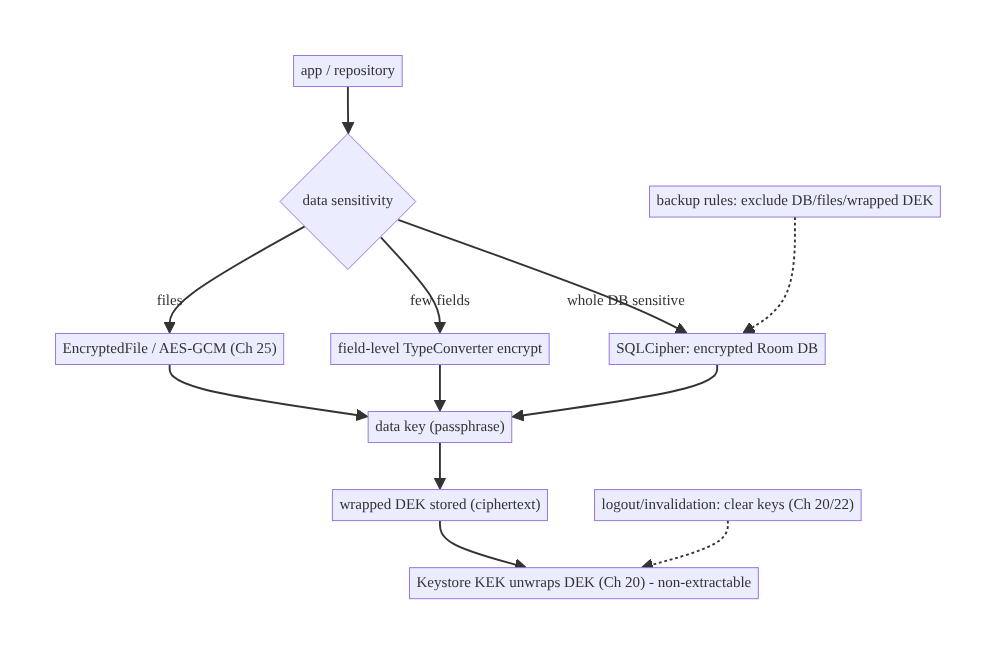
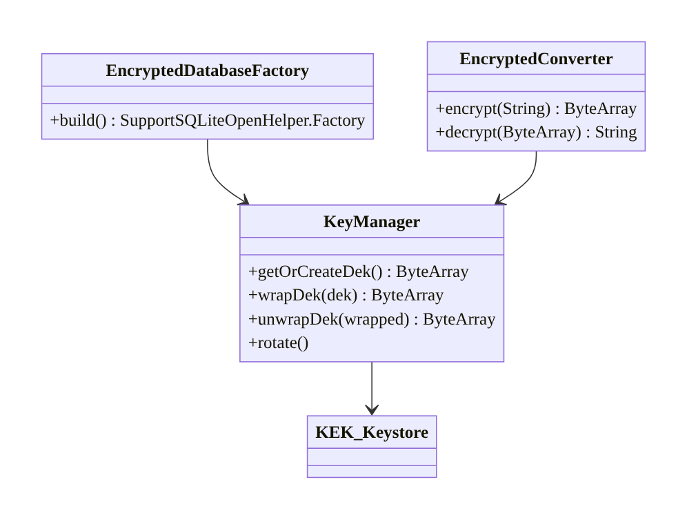
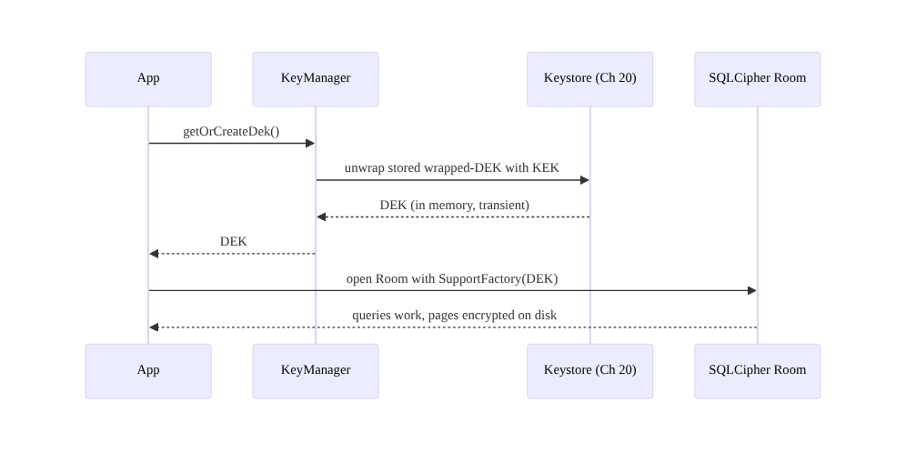
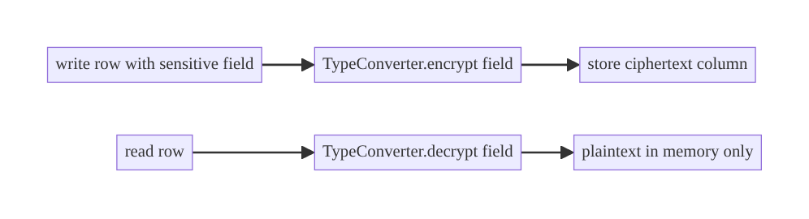
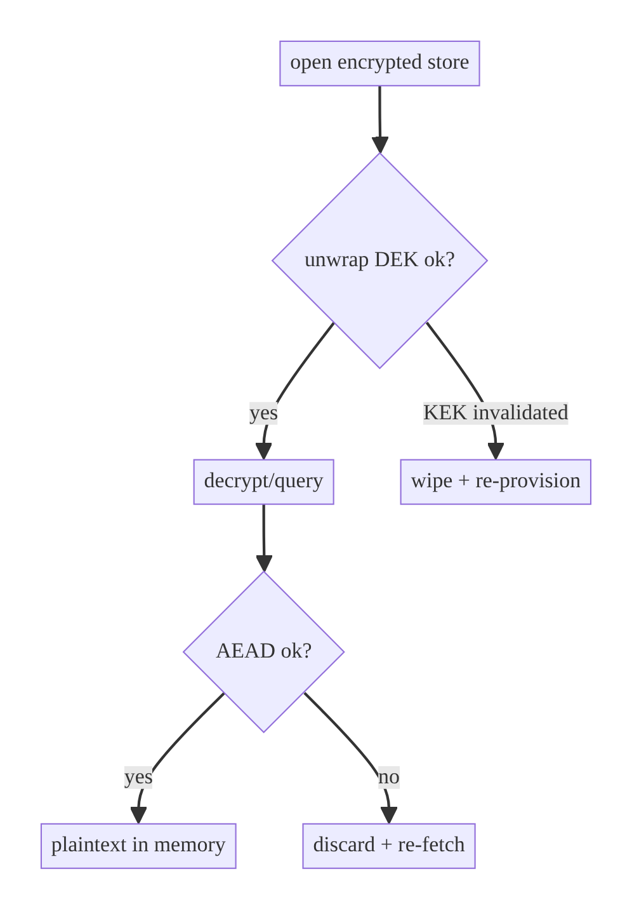

# Chapter 24 — Encryption of Sensitive Data at Rest

> **Part III — Authentication & Security** · Complexity: **Standard** (≥25 interview questions)
>
> **Prerequisites:** Ch 20 (Keystore — the key that protects everything here),
> Ch 3 (Room — the DB we encrypt), Ch 4 (DataStore). Pairs with Ch 25 (secure
> files), Ch 59 (offline media encryption).
>
> **Reference surface in StreamCart:** encrypting the Wallet's payment data and
> the offline-media metadata DB so a stolen/backed-up device can't reveal them.

---

## 24.1 Problem Definition and Real-World Context

Android encrypts app storage at the OS level (file-based encryption since Android
7+), but that protects data only while the device is **locked/off and the key is
evicted** — it does **not** protect against: a **rooted device** where the running
OS can read app files, an **`adb backup`/cloud backup** that copies data off the
device, forensic extraction, or a shared device. For genuinely sensitive data
(payment info, health, PII, decryption keys for offline content), the app must add
its **own** encryption at rest, with keys protected by the **Android Keystore**
(Ch 20). Naive approaches fail:

- **Relying on OS encryption alone.** A rooted device or a backup bypasses it;
  "the OS encrypts it" is not sufficient for high-value secrets.
- **Encrypting with an app-embedded key.** Decompiling the APK recovers the key
  (Ch 20/27) — no real protection.
- **Encrypting everything.** Full-DB encryption has a performance cost and
  complicates search/indexing; encrypting non-sensitive data wastes CPU/battery for
  no gain.
- **Forgetting backups.** Even encrypted data shouldn't leave the device if the key
  is device-bound — a backed-up ciphertext with a device-bound key is useless on
  another device, but non-encrypted copies elsewhere still leak.

The architecture: classify data by sensitivity, choose the right mechanism
(**SQLCipher** for a whole Room DB, **`EncryptedFile`/manual AES-GCM** for files,
**field-level encryption** for a few columns), **wrap the data key with a Keystore
key** (Ch 20), and exclude from backup. This chapter is about **what to encrypt,
how, and where the key lives** — not reinventing crypto.

### Three practical use cases

1. **Fintech (StreamCart Wallet).** Encrypt the DB holding payment tokens/
   transaction PII with SQLCipher; the SQLCipher passphrase (data key) is wrapped
   by a Keystore key (Ch 20).
2. **OTT offline (Watch).** Encrypt downloaded-media metadata and wrap the media
   content key so a stolen device can't play downloads (Ch 59).
3. **Social (Social).** Field-level encrypt draft messages / private notes while
   leaving non-sensitive feed cache in plaintext for performance.

### Why this is architectural

At-rest encryption defines the **data-sensitivity classification**, the
**encryption mechanism per data class**, the **key hierarchy** (Keystore-wrapped
data keys), and the **threat model** (rooted/backup/theft) — properties that
determine whether a compromised device leaks sensitive data.

---

## 24.2 Requirements Engineering

### Functional requirements

| ID | Requirement |
|----|-------------|
| F1 | Encrypt sensitive data at rest (DB, files, or specific fields). |
| F2 | Protect the encryption/data key with the Android Keystore (Ch 20). |
| F3 | Classify data: encrypt sensitive, leave non-sensitive plaintext. |
| F4 | Exclude sensitive (and key) data from backups. |
| F5 | Clear/rotate keys on logout (Ch 22) and key invalidation (Ch 20). |
| F6 | Support offline use of encrypted data without network. |

### Non-functional requirements

| Attribute | Policy |
|-----------|--------|
| **Security** | Keystore-protected keys; authenticated encryption; no app-embedded keys. |
| **Performance** | Encrypt only what's needed; acceptable DB/file overhead. |
| **Reliability** | Key invalidation handled; no data loss on rotation. |
| **Compatibility** | Works across API levels; SQLCipher/EncryptedFile availability. |
| **Maintainability** | A clear encryption boundary; one key-management path. |

### Scope

- **In scope:** SQLCipher (encrypted Room), `EncryptedFile`/manual AES-GCM for
  files, field-level column encryption, key wrapping via Keystore, sensitivity
  classification, backup exclusion, rotation.
- **Out of scope:** Keystore key mechanics (Ch 20), secure file *access/sharing*
  (Ch 25), in-transit security (Ch 23), token storage (Ch 20), media DRM (Ch 59).

### Assumptions & constraints

- Room (Ch 3), SQLCipher (`net.zetetic:android-database-sqlcipher` or the AndroidX
  SQLite SupportFactory), Keystore (Ch 20). `minSdk 24`. Note:
  `androidx.security:security-crypto` (`EncryptedFile`) is **deprecated** — use
  Tink or manual Keystore+AES-GCM for new code.

---

## 24.3 System Design Fundamentals

- **The key hierarchy (envelope / key wrapping).** You don't encrypt data directly
  with a Keystore key everywhere; instead: a **data encryption key (DEK)** (e.g.,
  the SQLCipher passphrase or a file key) encrypts the data, and a **Keystore key
  (KEK)** — non-extractable, hardware-backed (Ch 20) — encrypts (**wraps**) the
  DEK. The wrapped DEK is stored; to use it, the app unwraps it with the Keystore
  key. This gives hardware protection + flexibility (rotate the DEK without
  re-keying the hardware).
- **SQLCipher** transparently encrypts an entire SQLite/Room database with a
  passphrase (the DEK); queries work normally, pages are encrypted on disk. Best
  when *most* of a DB is sensitive.
- **Field-level encryption** encrypts specific columns (via a Room `TypeConverter`
  that encrypts/decrypts) — best when only a few fields are sensitive and you want
  the rest queryable/indexable in plaintext. Trade-off: encrypted columns can't be
  queried/indexed by value.
- **`EncryptedFile`/AES-GCM for files** encrypts file contents (Ch 25) — for
  documents, media keys, exports.
- **Authenticated encryption (AES-GCM)** everywhere — confidentiality + tamper
  detection.
- **Threat model clarity.** At-rest encryption protects against **offline** access
  (stolen device, backup, forensic dump) and, with Keystore-bound keys, a **rooted
  device reading files** can't get the key material — but a rooted device with the
  app *running* can still make the app decrypt (hence auth-bound keys for the most
  sensitive, Ch 20/21). Be precise.
- **Backup exclusion.** Even with device-bound keys, exclude encrypted DBs/files
  (and the wrapped DEK) from backup so nothing sensitive leaves the device.

Core insight: **classify data, encrypt the sensitive parts with a DEK, wrap the DEK
with a non-extractable Keystore KEK, and exclude from backup.** The Keystore moves
the root key out of reach; the mechanism (SQLCipher / field / file) fits the data
shape.

---

## 24.4 High-Level Architecture



**Components & ownership**

- **DEK** (SQLCipher passphrase / file key) encrypts the data.
- **Keystore KEK** (Ch 20) wraps the DEK; non-extractable, hardware-backed.
- **Mechanism** (SQLCipher / field converter / EncryptedFile) chosen by data shape.
- **Backup rules** exclude encrypted data + wrapped DEK.
- **Logout/invalidation** (Ch 20/22) clears keys.

**Direction:** data → DEK-encrypted → stored; DEK wrapped by Keystore KEK →
unwrapped on use.

---

## 24.5 Detailed Component Design



| Component | Responsibility | Notes |
|-----------|----------------|-------|
| `KeyManager` | get/wrap/unwrap/rotate the DEK | DEK wrapped by Keystore KEK (Ch 20) |
| SQLCipher factory | encrypt the whole Room DB | passphrase = DEK |
| field `TypeConverter` | encrypt specific columns | encrypted columns not queryable by value |
| `EncryptedFile`/AES-GCM | encrypt files | Ch 25 |
| backup rules | keep ciphertext on device | exclude DB/files/wrapped DEK |

---

## 24.6 End-to-End Data Flow

### Open an encrypted DB (unwrap DEK → SQLCipher)



### Field-level encrypt on write



---

## 24.7 Complete Kotlin Implementation

Package: `com.streamcart.core.security.crypto`.

### 24.7.1 KeyManager: DEK wrapped by a Keystore KEK (Ch 20)

```kotlin
class KeyManager @Inject constructor(
    private val crypto: Crypto,                 // AES-GCM helper (Ch 20)
    private val store: DataStore<Preferences>,  // holds the WRAPPED dek (safe)
) {
    private val wrappedKey = stringPreferencesKey("wrapped_dek")

    suspend fun getOrCreateDek(): ByteArray {
        val kek = KeystoreKeys.getOrCreate("streamcart.kek")   // non-extractable (Ch 20)
        val existing = store.data.first()[wrappedKey]
        if (existing != null) return crypto.decrypt(kek, Base64.decode(existing, Base64.NO_WRAP))

        val dek = ByteArray(32).also { SecureRandom().nextBytes(it) }   // random 256-bit DEK
        val wrapped = crypto.encrypt(kek, dek)                           // wrap DEK with Keystore KEK
        store.edit { it[wrappedKey] = Base64.encodeToString(wrapped, Base64.NO_WRAP) }
        return dek
    }

    suspend fun clear() { store.edit { it.remove(wrappedKey) } ; /* delete KEK (Ch 20) */ }
}
```

### 24.7.2 SQLCipher-encrypted Room database

```kotlin
@Module @InstallIn(SingletonComponent::class)
object SecureDatabaseModule {
    @Provides @Singleton
    fun secureDb(@ApplicationContext ctx: Context, keyManager: KeyManager): WalletDatabase {
        val dek = runBlocking { keyManager.getOrCreateDek() }           // unwrap once at open
        val factory = SupportOpenHelperFactory(dek)                     // SQLCipher SupportFactory
        return Room.databaseBuilder(ctx, WalletDatabase::class.java, "wallet.db")
            .openHelperFactory(factory)                                 // <-- encrypts the whole DB
            .build()
            .also { dek.fill(0) }                                       // zero the key copy after use
    }
}
```

### 24.7.3 Field-level encryption via Room TypeConverter

```kotlin
// Encrypt only sensitive columns; the rest stay queryable/indexable in plaintext.
class EncryptedStringConverter @Inject constructor(private val crypto: Crypto, private val keyManager: KeyManager) {
    private val dek by lazy { runBlocking { keyManager.getOrCreateDek() } }
    @TypeConverter fun encrypt(value: String?): ByteArray? =
        value?.let { crypto.encrypt(rawKey(dek), it.toByteArray()) }
    @TypeConverter fun decrypt(blob: ByteArray?): String? =
        blob?.let { String(crypto.decrypt(rawKey(dek), it)) }
}

@Entity
data class PaymentEntity(
    @PrimaryKey val id: String,
    val last4: String,                               // plaintext (non-sensitive, displayable)
    @TypeConverters(EncryptedStringConverter::class)
    val panToken: String,                            // encrypted column (sensitive)
)
// NOTE: you cannot `WHERE panToken = ?` on an encrypted column (ciphertext differs per IV).
```

### 24.7.4 Backup exclusion (res/xml)

```xml
<data-extraction-rules>
  <cloud-backup>
    <exclude domain="database" path="wallet.db"/>
    <exclude domain="file" path="datastore/secure.preferences_pb"/>   <!-- wrapped DEK -->
  </cloud-backup>
  <device-transfer>
    <exclude domain="database" path="wallet.db"/>
  </device-transfer>
</data-extraction-rules>
```

### 24.7.5 Rotation

```kotlin
// Rotate the DEK: generate new DEK, re-encrypt data under it, re-wrap, swap.
suspend fun rotateDatabaseKey(db: WalletDatabase, keyManager: KeyManager) {
    val newDek = ByteArray(32).also { SecureRandom().nextBytes(it) }
    db.openHelper.writableDatabase.execSQL("PRAGMA rekey = ?", arrayOf(newDek))  // SQLCipher rekey
    keyManager.storeWrapped(newDek)                                              // re-wrap + persist
    newDek.fill(0)
}
```

### 24.7.6 Module structure

```
:core:security/crypto  KeyManager, Crypto (Ch 20), EncryptedStringConverter
:core:database         SecureDatabaseModule (SQLCipher factory)
res/xml                data_extraction_rules.xml (exclude encrypted stores)
```

---

## 24.8 Concurrency and Race Conditions

| Scenario | Risk | Handling |
|----------|------|----------|
| DEK in memory | lingering key material | zero (`fill(0)`) after use; minimize lifetime |
| Concurrent DB open | double unwrap | open once (singleton); unwrap once |
| Rotation while in use | mid-rekey access | serialize rotation; SQLCipher `rekey` is transactional |
| Key invalidated (Ch 20) | can't unwrap DEK | re-provision; data unreadable → treat as reset/re-login |
| Field converter per-read decrypt | CPU on hot paths | cache DEK; decrypt only displayed rows |
| IV reuse (field encryption) | broken confidentiality | fresh IV per encrypt (Ch 20) |

- **Minimize the DEK's in-memory lifetime** and zero byte arrays after use — a
  memory dump on a rooted device is part of the threat model.
- **SQLCipher `rekey`** re-encrypts pages transactionally; serialize it against DB
  access.

---

## 24.9 Failure Scenarios and Recovery

| Failure | Detection | Response | Outcome |
|---------|-----------|----------|---------|
| Keystore KEK invalidated (Ch 20) | unwrap fails | wipe wrapped DEK + encrypted data; re-provision | data reset; re-sync/re-login |
| Wrong/corrupt DEK | SQLCipher open fails | treat as unreadable; recreate DB; re-sync | no plaintext leak |
| Tampered ciphertext (field) | `AEADBadTagException` | discard field; re-fetch | integrity preserved |
| Backup restored to new device | device-bound KEK differs | wrapped DEK unusable → data inaccessible | protects data off-device |
| Disk full during rekey | IOException | abort rotation; keep old key | consistent |
| Performance regression | profiling | encrypt only sensitive; index plaintext columns | acceptable |
| Logout | — | clear DEK + KEK + encrypted stores (Ch 22) | no residual |



> **Device-bound keys make backups safe but non-portable:** a restored backup on a
> new device can't unwrap the DEK (different Keystore KEK), so the encrypted data is
> inaccessible there — which is the point. Design sync/recovery (re-login →
> re-fetch) rather than expecting encrypted local data to migrate.

---

## 24.10 Scaling the Implementation

- **Level 1.** Field-level encrypt a couple of sensitive columns (Keystore-wrapped
  DEK).
- **Level 2.** SQLCipher for a whole sensitive DB; exclude from backup; clear on
  logout.
- **Level 3 — production.** Key hierarchy (DEK wrapped by Keystore KEK); rotation;
  invalidation handling; auth-bound KEK for the most sensitive (Ch 20/21).
- **Level 4 — large.** Separate DEKs per data class; offline-media key wrapping
  (Ch 59); encrypted exports (Ch 25); per-account keys (Ch 42).
- **Level 5 — enterprise.** Key attestation (Ch 20), compliance (PCI/HIPAA),
  server-assisted key escrow/recovery, remote wipe, FIPS-validated crypto.

**Avoid overengineering:** most apps don't need any at-rest encryption beyond OS
defaults + Keystore for tokens. Add SQLCipher/field encryption for genuinely
sensitive data (payments, health, offline-content keys) — not for a product catalog
cache.

---

## 24.11 Alternative Approaches and Trade-offs

| Dimension | Option A | Option B | When |
|-----------|----------|----------|------|
| Scope | SQLCipher (whole DB) | Field-level columns | Whole DB when most data is sensitive; fields when only a few are (keep rest queryable) |
| Baseline | App encryption (SQLCipher) | OS file encryption only | App encryption for high-value data / rooted-device / backup threat; OS-only for low-risk |
| Key | Keystore-wrapped DEK | Direct Keystore key | Wrapped DEK for rotation/flexibility; direct for simple single-secret |
| Files | `EncryptedFile` (deprecated) / Tink / manual AES-GCM | plaintext | Encrypt sensitive files (Ch 25); plaintext for non-sensitive |
| Queryability | plaintext indexed columns | encrypted columns | Keep searchable fields plaintext; encrypt only the sensitive value |
| KEK binding | unbound (silent) | auth-bound (biometric) | Unbound for background use; auth-bound for highest value (Ch 21) |

**SQLCipher vs field-level:** SQLCipher encrypts everything transparently (simple,
but you lose nothing-to-encrypt performance and all columns are opaque on disk);
field-level lets you index/search non-sensitive columns and encrypt only the
sensitive value, but encrypted columns become non-queryable and you manage the
converter. Choose by how much of the DB is sensitive and whether you need to query
sensitive fields.

**App encryption vs OS encryption:** Android's file-based encryption protects data
when the device is locked/off; it does **not** protect a rooted running device or a
backup. For data where those are real threats (fintech/health/offline content keys),
app-level encryption with Keystore-bound keys is necessary; for ordinary cached
data it's unnecessary overhead.

---

## 24.12 Security Considerations

- **Never embed the key** in the APK/resources/code (Ch 27) — derive/wrap via
  Keystore (Ch 20).
- **Wrap DEKs with a non-extractable Keystore KEK**; the DEK exists in memory only
  transiently (zero it).
- **Authenticated encryption (AES-GCM)** for tamper detection.
- **Exclude encrypted data and the wrapped DEK from backup** so nothing sensitive
  leaves the device.
- **Auth-bind the KEK** (Ch 20/21) for the most sensitive data (payments) so a
  stolen running device still can't decrypt without a biometric.
- **Clear on logout** (Ch 22) and handle key invalidation (Ch 20) by wiping, not
  leaking.
- **Encryption is not a cure-all:** a rooted device with the app running can coerce
  decryption of unbound data; combine with root/integrity detection (Ch 26) and
  server-side controls for high assurance.
- Client vs backend: at-rest encryption protects **local** copies; the backend
  remains the authoritative, access-controlled store — don't treat encrypted local
  data as a security boundary the backend can rely on.

---

## 24.13 Performance and Resource Optimization

- **SQLCipher overhead** is real but usually modest (page encryption); measure on
  low-end devices. Mitigate: encrypt only the sensitive DB, keep others plaintext;
  tune page size/cache.
- **Field-level** encrypts only chosen columns — cheaper if few; but you lose
  indexing on them (full scans if you try to filter).
- **Cache the DEK** (don't unwrap per operation); zero it on logout.
- **Decrypt lazily** — only rows/fields actually displayed.
- **Avoid encrypting large blobs field-by-field** — use file encryption (Ch 25).
- **Profiling:** DB open time (unwrap + SQLCipher init), query latency on encrypted
  vs plaintext, crypto CPU, battery.

---

## 24.14 Testing Strategy

Test crypto round-trips and key handling; SQLCipher needs instrumentation.

```kotlin
class EncryptedConverterTest {               // JVM with a fake DEK
    private val conv = EncryptedStringConverter(Crypto(), FakeKeyManager(dek))
    @Test fun `round-trips a field`() {
        val ct = conv.encrypt("4111111111111111")
        assertEquals("4111111111111111", conv.decrypt(ct))
    }
    @Test fun `tampered ciphertext fails`() {
        val ct = conv.encrypt("secret")!!.also { it[it.size - 1]++ }
        assertThrows(AEADBadTagException::class.java) { conv.decrypt(ct) }
    }
}

@RunWith(AndroidJUnit4::class)
class SqlCipherDbTest {                        // instrumentation
    @Test fun opens_and_reads_with_correct_key() {
        val db = secureDb(ctx, FakeKeyManager(dek)); /* insert + query */
    }
    @Test fun wrong_key_cannot_open() {
        secureDb(ctx, FakeKeyManager(dek))     // create
        assertThrows(SQLiteException::class.java) { secureDb(ctx, FakeKeyManager(otherDek)) }
    }
    @Test fun rekey_preserves_data() { /* rotate; assert rows intact */ }
}
```

Also: KEK-invalidation recovery (wipe path), backup-exclusion static check,
DEK zeroed after use, performance benchmark (Ch 88).

---

## 24.15 Production Observability

- **Metrics:** encrypted-DB open latency, crypto error rate (`AEADBadTag`),
  KEK-invalidation rate, rotation success rate, encrypted-store size, query latency
  delta.
- **Logs:** `crypto{op, store, result}` — **never** plaintext or key material;
  `kek_invalidated{reason}` (Ch 20).
- **Debugging:** sudden "can't open DB" after an OS/biometric change → KEK
  invalidation not handled; slow cold start → DB unwrap/SQLCipher init on the
  critical path (Ch 88); sensitive data in a cloud backup → missing exclusion.
- **Privacy:** encrypted data is sensitive by definition — minimal, redacted logging
  (Ch 28); never log decrypted values.

---

## 24.16 System Design Interview Preparation

> ≥25 questions.

**Fundamentals**
1. *Does Android encrypt app data already?* Yes (file-based encryption), but only
   while locked/off; not against rooted running devices or backups.
2. *When do you add app-level encryption?* For high-value data (payments/health/
   offline keys) where rooted-device/backup/theft are real threats.
3. *Key hierarchy?* A DEK encrypts data; a non-extractable Keystore KEK wraps the
   DEK.
4. *Why wrap the DEK instead of using the Keystore key directly?* Rotation/
   flexibility; Keystore keys can't be exported, so the DEK is the portable,
   rotatable layer.
5. *SQLCipher vs field-level?* Whole-DB transparent encryption vs encrypting
   specific columns (keep others queryable).

**Mechanism**
6. *How encrypt a Room DB?* SQLCipher `SupportOpenHelperFactory` with the DEK as
   passphrase.
7. *Field-level in Room?* A `TypeConverter` that encrypts/decrypts the column.
8. *Downside of field-level?* Encrypted columns can't be queried/indexed by value.
9. *Encrypt files?* `EncryptedFile`/Tink/manual AES-GCM (Ch 25).

**Keys/threat model**
10. *Where does the key live?* Keystore (KEK), non-extractable (Ch 20); DEK in
    memory transiently (zero it).
11. *Rooted device?* Keystore protects key material; a running app can still be
    coerced to decrypt unbound data → auth-bind the KEK (Ch 20/21) + root detection
    (Ch 26).
12. *Backup?* Exclude encrypted data + wrapped DEK; device-bound KEK makes a
    restored backup unreadable elsewhere.
13. *Never embed keys?* Right — decompilable (Ch 27).

**Lifecycle**
14. *Rotation?* New DEK, re-encrypt (SQLCipher `rekey`), re-wrap.
15. *Key invalidation (Ch 20)?* Wipe + re-provision; don't leak/crash.
16. *Logout?* Clear DEK/KEK + encrypted stores (Ch 22).

**Performance**
17. *SQLCipher cost?* Modest page-encryption overhead; encrypt only sensitive DBs;
    measure on low-end.
18. *Keep searchable?* Index plaintext columns; encrypt only the sensitive value.
19. *Cold start?* Don't unwrap/init on the critical path (Ch 88).

**Backup/portability**
20. *Can encrypted local data migrate to a new device?* Not with a device-bound KEK
    — design re-login/re-fetch recovery instead.

**Testing**
21. *How test field encryption?* Round-trip + tamper → `AEADBadTag`.
22. *How test SQLCipher?* Instrumentation: open with correct/wrong key, rekey.
23. *What to statically check?* Backup exclusion; no embedded keys.

**Production debugging**
24. *"Can't open DB" after OS update?* KEK invalidation unhandled.
25. *Sensitive data in backup?* Missing exclusion rules.
26. *Slow start?* Unwrap/SQLCipher init on critical path.

### Design-change challenges
1. **Encrypt the Wallet DB.** SQLCipher + Keystore-wrapped DEK + backup exclusion.
2. **Only a few PII fields are sensitive.** Field-level `TypeConverter`; keep rest
   queryable.
3. **Payments need biometric to decrypt.** Auth-bound KEK (Ch 20/21).
4. **Encrypt offline media.** Wrap the media content key with a Keystore KEK
   (Ch 59).
5. **Rotate keys after a suspected breach.** DEK rotation (`rekey`) + re-wrap;
   server-side revoke (Ch 22).

### Mock walkthrough (abridged)
Clarify (what data, threat model, queryability) → classify sensitive vs not →
SQLCipher (whole) or field-level (few) → DEK wrapped by Keystore KEK (Ch 20) →
backup exclusion + logout clear → rotation + invalidation → auth-bind for highest
value → be precise on rooted-device limits → testing.

---

## 24.17 Practical Exercises

1. **Beginner.** Field-level encrypt one PII column via a Room `TypeConverter` with
   a Keystore-wrapped DEK. *Eval:* ciphertext on disk; round-trips; not queryable.
2. **Intermediate.** Encrypt a whole DB with SQLCipher; exclude from backup; prove a
   wrong key can't open it. *Eval:* opens with correct key only.
3. **Advanced.** Implement DEK wrapping + rotation (`rekey`) + KEK-invalidation
   recovery. *Eval:* data survives rotation; wipes + re-provisions on invalidation.
4. **Production debugging.** Fix an app encrypting with an embedded key and backing
   up the sensitive DB. *Eval:* Keystore-wrapped key; excluded from backup.
5. **System design challenge.** Auth-bind the KEK so payment data requires biometric
   (Ch 21), with graceful invalidation. *Eval:* gated decrypt; recovers on biometric
   change.

*(Solutions withheld unless requested.)*

---

## 24.18 Chapter Summary & Reference Sheet

**Key decisions:** **classify** data and encrypt only the sensitive parts; use
**SQLCipher** for a mostly-sensitive DB and **field-level `TypeConverter`
encryption** when only a few columns are sensitive (keep the rest queryable);
protect data with a **DEK wrapped by a non-extractable Keystore KEK** (Ch 20),
zeroing the DEK after use; **auth-bind the KEK** for the highest-value data
(Ch 20/21); **exclude encrypted data + wrapped DEK from backup**; handle **rotation**
(`rekey`) and **key invalidation** gracefully; **never embed keys** (Ch 27);
at-rest encryption protects **local** copies and has limits on a **rooted running
device** (combine with Ch 26).

**Concepts:** at-rest vs OS encryption, key hierarchy (DEK/KEK, key wrapping),
SQLCipher, field-level encryption, authenticated encryption, backup exclusion,
rotation, device-bound-key non-portability.

**Common mistakes:** relying on OS encryption for high-value data; embedding keys;
encrypting everything (perf); trying to query encrypted columns; not excluding from
backup; not zeroing the DEK; not handling KEK invalidation; expecting encrypted
local data to migrate across devices.

**Checklist:** ☐ classify sensitive data ☐ SQLCipher vs field-level chosen ☐ DEK
wrapped by Keystore KEK ☐ zero DEK after use ☐ AES-GCM (authenticated) ☐ backup
exclusion ☐ rotation path ☐ KEK-invalidation recovery ☐ auth-bind for highest
value ☐ clear on logout.

**Key APIs:** SQLCipher `SupportOpenHelperFactory`, `PRAGMA rekey`, Room
`@TypeConverter`/`openHelperFactory`, Keystore (Ch 20), `Cipher`/`GCMParameterSpec`,
`SecureRandom`, `dataExtractionRules`, Tink (files, Ch 25).

**References:**
- SQLCipher for Android: https://www.zetetic.net/sqlcipher/sqlcipher-for-android/
- Room with SQLCipher (SupportFactory): https://developer.android.com/reference/androidx/sqlite/db/SupportSQLiteOpenHelper
- Android Keystore (Ch 20): https://developer.android.com/privacy-and-security/keystore
- Data backup rules: https://developer.android.com/guide/topics/data/autobackup
- Tink: https://developers.google.com/tink

### Chapter review (Phase 4)
- **Completeness:** all 18 sections; architecture/class/sequence/failure diagrams;
  KeyManager (wrap/unwrap/rotate) + SQLCipher + field converter + backup rules;
  concurrency (DEK lifetime, rekey); failure (invalidation, non-portable backup);
  5 levels; SQLCipher-vs-field and app-vs-OS trade-offs; precise threat model;
  perf (encrypt only sensitive); JVM + instrumentation tests; observability;
  26 Q&A + 5 challenges. ✅
- **Expand later:** secure file access (Ch 25), offline media keys (Ch 59), root
  detection (Ch 26), per-account keys (Ch 42).
- **Interview coverage:** exceeds ≥25 bar.
