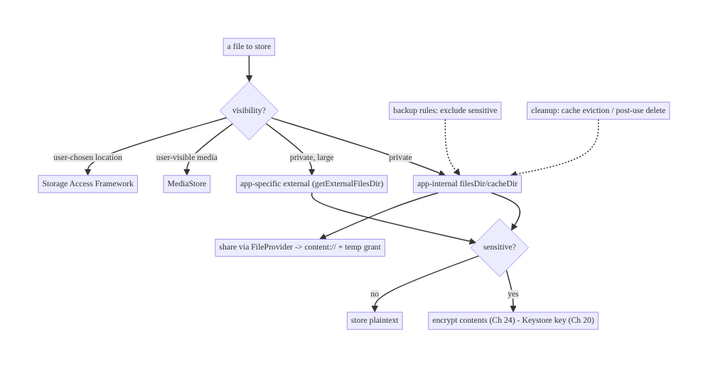
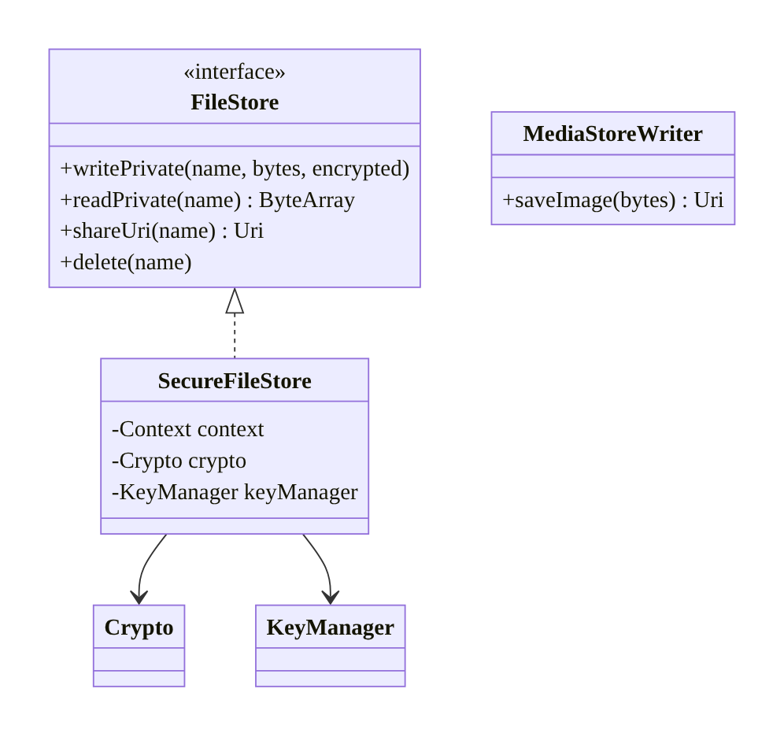
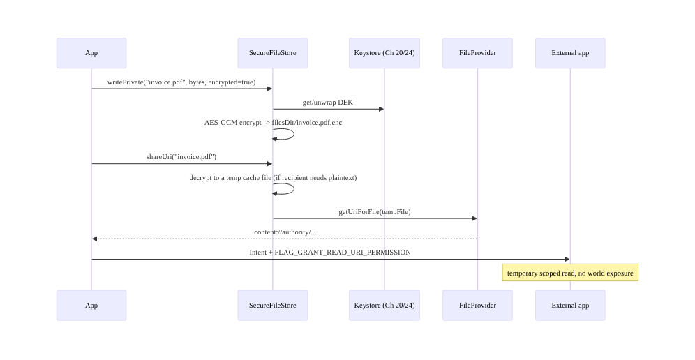
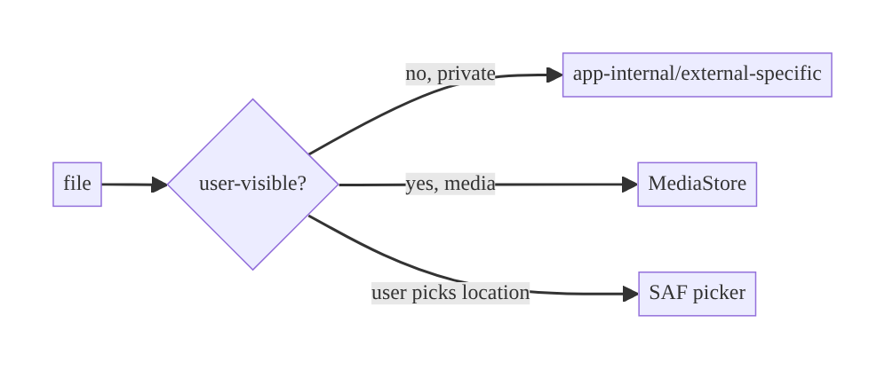
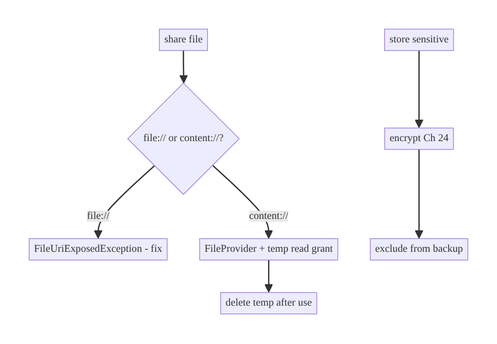

# Chapter 25 — Secure File Storage

> **Part III — Authentication & Security** · Complexity: **Standard** (≥25 interview questions)
>
> **Prerequisites:** Ch 24 (encryption at rest — how we encrypt file contents),
> Ch 20 (Keystore — the keys), Ch 18 (downloads — where files come from). Pairs
> with Ch 62 (content providers / SAF), Ch 59 (offline media).
>
> **Reference surface in StreamCart:** storing downloaded invoices, user-captured
> ID photos (Wallet KYC), and offline media files — in the right location, with
> the right protection, and sharing them safely.

---

## 25.1 Problem Definition and Real-World Context

Where and how an app stores files is a security and correctness minefield on
modern Android (scoped storage, Android 10+). Naive file handling leaks data,
breaks on new OS versions, or crashes:

- **Wrong location = world-readable leaks.** Writing sensitive files to legacy
  external storage (or exposing a `file://` URI) makes them readable by other apps
  / anyone with the device — a classic PII leak.
- **`file://` URIs crash and leak.** Sharing a `file://` URI throws
  `FileUriExposedException` (Android 7+) and, worse, grants unscoped access; the
  correct, permissioned mechanism is a **`content://` URI via `FileProvider`**.
- **Scoped storage violations.** Apps that assume unrestricted external-storage
  paths break on Android 10+; you must use app-specific dirs, `MediaStore`, or SAF.
- **Sensitive files unencrypted.** Even in app-internal storage, a rooted device or
  backup can read files; sensitive content must be **encrypted** (Ch 24) with
  Keystore-protected keys.
- **Backup leaks.** Sensitive files copied to the cloud via auto-backup.

The architecture: choose the **right storage location** by data type (app-internal
for private, `MediaStore`/SAF for user-visible), **encrypt sensitive files**
(Ch 24), **share via `FileProvider`** with scoped, temporary grants, respect
**scoped storage**, and **exclude from backup**. This is about **location,
protection, and controlled sharing** — not just `File.write`.

### Three practical use cases

1. **Invoice PDF (StreamCart Wallet).** Private app-internal file; shared to a
   viewer app via `FileProvider` with a temporary read grant.
2. **KYC ID photo (Wallet).** Highly sensitive: encrypted app-internal file
   (Ch 24), excluded from backup, deleted after upload.
3. **Offline media (Watch).** Large encrypted files in app-specific external
   storage (app-scoped, auto-removed on uninstall), content key wrapped by Keystore
   (Ch 59).

### Why this is architectural

File storage defines **data location & visibility** (private vs shared vs
world-readable), the **protection model** (encryption + backup), **controlled
sharing** (`FileProvider` grants), and **scoped-storage compliance** — properties
that determine whether files leak or the app breaks on new Android versions.

---

## 25.2 Requirements Engineering

### Functional requirements

| ID | Requirement |
|----|-------------|
| F1 | Store files in the correct, scoped-storage-compliant location by type. |
| F2 | Encrypt sensitive file contents (Ch 24) with Keystore-protected keys. |
| F3 | Share files via `content://` (`FileProvider`) with temporary, scoped grants — never `file://`. |
| F4 | Use `MediaStore`/SAF for user-visible files; app-specific dirs for private. |
| F5 | Exclude sensitive files from backup; clean up (cache eviction, post-use delete). |
| F6 | Request only the minimum storage permissions (ideally none). |

### Non-functional requirements

| Attribute | Policy |
|-----------|--------|
| **Security** | Sensitive files encrypted + not world-readable; scoped sharing. |
| **Compatibility** | Scoped storage across API levels; no `file://` exposure. |
| **Reliability** | Correct cache vs files semantics; cleanup; no leaks. |
| **Privacy** | Minimal permissions; strip metadata (EXIF) where relevant. |
| **Storage** | Bounded; evict cache under pressure. |

### Scope

- **In scope:** storage location choice (internal/external/cache/MediaStore/SAF),
  encrypted files (Ch 24), `FileProvider` sharing, scoped storage, backup exclusion,
  permissions, cleanup.
- **Out of scope:** encryption key mechanics (Ch 20/24), download mechanics (Ch 18),
  content providers in depth (Ch 62), media playback/DRM (Ch 59).

### Assumptions & constraints

- `minSdk 24`; scoped storage (targeting Android 10+). `FileProvider` from
  `androidx.core`. Sensitive-file encryption per Ch 24. Note:
  `EncryptedFile` (Jetpack Security) is **deprecated** — use Tink or Keystore+AES-GCM.

---

## 25.3 System Design Fundamentals

- **Storage locations (choose by data type + visibility):**
  - **App-internal** (`filesDir`/`cacheDir`): private to the app, auto-removed on
    uninstall, **not** world-readable. Default for private data. `cacheDir` is
    evictable by the OS under pressure (use for regenerable data).
  - **App-specific external** (`getExternalFilesDir`): app-scoped, no permission
    needed (scoped storage), removed on uninstall; for large files (media) that
    don't need to be user-visible.
  - **`MediaStore`**: shared media (images/video/audio/downloads) the user sees in
    Gallery/Files; no broad permission needed for your own entries on Android 10+.
  - **Storage Access Framework (SAF)**: user-chosen locations via system picker;
    the user grants access to a specific document/tree (Ch 62). Best for
    user-directed save/open.
- **Scoped storage (Android 10+).** Apps can't freely roam external storage;
  broad `READ/WRITE_EXTERNAL_STORAGE` is deprecated/restricted. Use the scoped
  mechanisms above. This is the single biggest file-storage change to design around.
- **`FileProvider` + `content://`.** To share an app-internal file with another
  app (viewer, email), expose it as a `content://` URI via `FileProvider` and grant
  a **temporary** `FLAG_GRANT_READ_URI_PERMISSION` — scoped to the recipient, no
  world exposure, no `FileUriExposedException`.
- **Encryption for sensitive files (Ch 24).** App-internal ≠ secure against a
  rooted device/backup; encrypt sensitive files with a Keystore-wrapped key.
- **Backup & cleanup.** Exclude sensitive files from auto-backup; evict cache;
  delete transient sensitive files after use (e.g., a KYC photo after upload).
- **Permissions minimization.** With scoped storage, most app-private file work
  needs **no permission**; request camera/media permissions only when truly needed.

Core insight: **pick the storage location by whether the file is private vs
user-visible, encrypt sensitive contents with a Keystore-protected key, and share
only via `FileProvider` with temporary scoped grants** — within scoped-storage
rules.

---

## 25.4 High-Level Architecture



**Components & ownership**

- **Location selector** maps data type/visibility to a storage mechanism.
- **Encryption** (Ch 24) protects sensitive file contents.
- **`FileProvider`** mediates controlled sharing via `content://` + temporary
  grants.
- **Backup rules + cleanup** keep sensitive data on-device and bounded.

**Direction:** data → location (by visibility) → encrypt if sensitive → share via
FileProvider → cleanup/backup policy.

---

## 25.5 Detailed Component Design



| Component | Responsibility | Notes |
|-----------|----------------|-------|
| `SecureFileStore` | write/read private files, encrypt sensitive | Keystore-wrapped key (Ch 24) |
| `FileProvider` | expose `content://` for sharing | temporary read grant |
| `MediaStoreWriter` | save user-visible media | scoped-storage compliant |
| SAF handler | user-chosen save/open | persistable URI permission (Ch 62) |
| backup rules + cleanup | retention/hygiene | exclude sensitive; evict cache |

---

## 25.6 End-to-End Data Flow

### Store an encrypted private file, then share it



### Scoped-storage decision



---

## 25.7 Complete Kotlin Implementation

Package: `com.streamcart.core.files`.

### 25.7.1 SecureFileStore (encrypted private files)

```kotlin
class SecureFileStore @Inject constructor(
    @ApplicationContext private val context: Context,
    private val crypto: Crypto,                 // Ch 20
    private val keyManager: KeyManager,         // Ch 24 (Keystore-wrapped DEK)
) {
    private val dir get() = context.filesDir     // app-internal, private, not world-readable

    suspend fun writePrivate(name: String, bytes: ByteArray, encrypted: Boolean) = withContext(Dispatchers.IO) {
        val file = File(dir, if (encrypted) "$name.enc" else name)
        val out = if (encrypted) crypto.encrypt(rawKey(keyManager.getOrCreateDek()), bytes) else bytes
        file.writeBytes(out)
    }

    suspend fun readPrivate(name: String, encrypted: Boolean): ByteArray = withContext(Dispatchers.IO) {
        val file = File(dir, if (encrypted) "$name.enc" else name)
        val raw = file.readBytes()
        if (encrypted) crypto.decrypt(rawKey(keyManager.getOrCreateDek()), raw) else raw
    }

    suspend fun delete(name: String) = withContext(Dispatchers.IO) {
        File(dir, "$name.enc").delete(); File(dir, name).delete()   // post-use cleanup (KYC)
    }
}
```

### 25.7.2 FileProvider sharing (content:// + temporary grant)

```xml
<!-- AndroidManifest.xml -->
<provider
    android:name="androidx.core.content.FileProvider"
    android:authorities="${applicationId}.fileprovider"
    android:exported="false"
    android:grantUriPermissions="true">
    <meta-data android:name="android.support.FILE_PROVIDER_PATHS"
        android:resource="@xml/file_paths"/>
</provider>
```

```xml
<!-- res/xml/file_paths.xml -->
<paths>
    <cache-path name="shared" path="shared/"/>   <!-- share decrypted temp copies from cache -->
</paths>
```

```kotlin
fun shareFile(context: Context, file: File): Intent {
    val uri = FileProvider.getUriForFile(context, "${context.packageName}.fileprovider", file)
    return Intent(Intent.ACTION_VIEW).apply {
        setDataAndType(uri, "application/pdf")
        addFlags(Intent.FLAG_GRANT_READ_URI_PERMISSION)   // temporary, scoped to the recipient
    }
}
// NEVER: Uri.fromFile(file) -> FileUriExposedException + world exposure.
```

### 25.7.3 MediaStore (user-visible media, scoped-storage compliant)

```kotlin
// Save an image the user should see in Gallery, no broad permission on Android 10+.
fun saveImageToGallery(context: Context, bytes: ByteArray, name: String): Uri? {
    val values = ContentValues().apply {
        put(MediaStore.Images.Media.DISPLAY_NAME, "$name.jpg")
        put(MediaStore.Images.Media.MIME_TYPE, "image/jpeg")
        put(MediaStore.Images.Media.RELATIVE_PATH, Environment.DIRECTORY_PICTURES + "/StreamCart")
        put(MediaStore.Images.Media.IS_PENDING, 1)        // hide until written
    }
    val resolver = context.contentResolver
    val uri = resolver.insert(MediaStore.Images.Media.EXTERNAL_CONTENT_URI, values) ?: return null
    resolver.openOutputStream(uri)?.use { it.write(bytes) }
    resolver.update(uri, ContentValues().apply { put(MediaStore.Images.Media.IS_PENDING, 0) }, null, null)
    return uri
}
```

### 25.7.4 SAF (user-chosen save) — see Ch 62 for depth

```kotlin
// Let the user choose where to export; persist access if needed.
val createDoc = registerForActivityResult(ActivityResultContracts.CreateDocument("application/pdf")) { uri ->
    uri?.let { context.contentResolver.openOutputStream(it)?.use { os -> os.write(pdfBytes) } }
}
// createDoc.launch("invoice.pdf")
```

### 25.7.5 Backup exclusion (sensitive files)

```xml
<data-extraction-rules>
  <cloud-backup>
    <exclude domain="file" path="kyc/"/>            <!-- encrypted KYC images -->
    <exclude domain="file" path="invoice.pdf.enc"/>
  </cloud-backup>
</data-extraction-rules>
```

### 25.7.6 Module structure

```
:core:files     SecureFileStore, FileProvider sharing, MediaStoreWriter, SAF helpers
:core:security  Crypto, KeyManager (Ch 20/24)
res/xml         file_paths.xml, data_extraction_rules.xml
```

---

## 25.8 Concurrency and Race Conditions

| Scenario | Risk | Handling |
|----------|------|----------|
| Concurrent write/read same file | partial/corrupt read | write to temp then atomic rename; or synchronize per file |
| Decrypted temp copy for sharing | plaintext lingers | write to cache; delete after share / on cache eviction; short-lived |
| Cache evicted mid-use | missing file | regenerate; don't store non-regenerable data in `cacheDir` |
| MediaStore `IS_PENDING` race | partial file visible | pending flag until fully written |
| SAF URI permission lost | access revoked | re-request; persist with `takePersistableUriPermission` (Ch 62) |
| Delete during read | exception | handle missing file gracefully |

- **For sharing encrypted files that a viewer needs in plaintext, decrypt to a
  short-lived cache temp** (exposed via `FileProvider`) and delete it after — never
  expose the encrypted original or a long-lived plaintext copy.
- **`IS_PENDING`** prevents other apps from seeing a half-written MediaStore entry.

---

## 25.9 Failure Scenarios and Recovery

| Failure | Detection | Response | Outcome |
|---------|-----------|----------|---------|
| `FileUriExposedException` | sharing a `file://` | use `FileProvider` content URI | fixed |
| Scoped-storage denial | `SecurityException` on legacy path | use app-specific/MediaStore/SAF | compliant |
| Disk full | `IOException` | surface; evict cache; abort write | no partial file |
| Decrypt fails (tamper/invalidation) | `AEADBadTag`/invalidation (Ch 24) | discard; re-fetch; re-provision | no leak |
| Cache file evicted | missing | regenerate/redecrypt | transparent |
| Recipient keeps URI after grant | lingering access | grants are temporary; don't persist unnecessarily | scoped |
| Sensitive file in backup | review | exclusion rules | no off-device leak |
| Permission missing (camera/media) | runtime denial | request at point of use; degrade | guided |



> **Never expose `file://`:** it crashes on modern Android and bypasses scoping.
> `FileProvider` + `content://` + a temporary grant is the only correct way to share
> an app file.

---

## 25.10 Scaling the Implementation

- **Level 1.** Private files in `filesDir`; share via `FileProvider`.
- **Level 2.** Encrypt sensitive files (Ch 24); exclude from backup; cleanup.
- **Level 3 — production.** MediaStore for user-visible media; SAF for user-chosen
  save/open; scoped-storage-correct throughout; post-use delete of transient
  sensitive files.
- **Level 4 — large.** Encrypted offline media in app-specific external storage with
  Keystore-wrapped content keys (Ch 59); cache eviction policy (Ch 12);
  EXIF/metadata stripping for shared photos.
- **Level 5 — enterprise.** DLP policies, per-file access logging, remote wipe of
  files, client-side encrypted exports, SAF-tree-based managed storage.

**Avoid overengineering:** most files are non-sensitive and go in `cacheDir`/
`filesDir` plainly. Reserve encryption + strict cleanup for genuinely sensitive
files (KYC, payments, offline-content keys).

---

## 25.11 Alternative Approaches and Trade-offs

| Dimension | Option A | Option B | When |
|-----------|----------|----------|------|
| Location | App-internal (`filesDir`) | App-specific external (`getExternalFilesDir`) | Internal for small private; external-specific for large (media) |
| User-visible | `MediaStore` | SAF | MediaStore for app-managed media; SAF for user-directed save/open |
| Sharing | `FileProvider` (`content://`) | `file://` | **Always** FileProvider; `file://` is broken/insecure |
| Cache vs files | `cacheDir` | `filesDir` | Cache for regenerable (OS-evictable); files for durable |
| Sensitive files | encrypt (Ch 24) | plaintext internal | Encrypt for high-value/rooted/backup threat; plaintext for low-risk |
| Encryption lib | Tink / manual AES-GCM | `EncryptedFile` (deprecated) | Tink/manual for new code |
| Permissions | scoped (none) | legacy `WRITE_EXTERNAL_STORAGE` | Scoped always (Android 10+); legacy is deprecated/restricted |

**App-internal vs MediaStore vs SAF:** internal is private and simplest (no
permission, removed on uninstall) but invisible to the user; MediaStore surfaces
media to the user and other apps (scoped, no broad permission for your own
entries); SAF gives the user control over location (best for "save/export to where
I choose"). Choose by who needs to see the file and who owns its location.

**Encrypt or not:** app-internal storage is private to your app but readable on a
rooted device / in a backup — encrypt (Ch 24) when that matters (KYC, payment
docs, offline-content keys); skip encryption for non-sensitive caches to save
CPU/complexity.

---

## 25.12 Security Considerations

- **Sensitive files must be encrypted** (Ch 24) with Keystore-protected keys —
  app-internal location alone isn't enough against root/backup.
- **Share only via `FileProvider`** with **temporary, scoped** `content://` grants;
  never `file://`, never world-readable locations, never persist grants you don't
  need.
- **Scoped storage** compliance prevents cross-app leakage and keeps the app working
  on new OS versions.
- **Exclude sensitive files from backup**; **delete transient sensitive files**
  after use (KYC photo after upload); evict caches.
- **Strip metadata** (EXIF/GPS) from shared user photos unless intended.
- **Minimize permissions:** with scoped storage, most private file work needs none;
  request camera/media only at point of use.
- **Validate files from other apps** (SAF/incoming content) — treat as untrusted
  input (type, size, content).
- Client vs backend: local files are a convenience copy; the backend owns the
  authoritative, access-controlled store. A shared `content://` grant authorizes a
  *recipient app*, not identity — don't treat it as auth.

---

## 25.13 Performance and Resource Optimization

- **Stream large files** (Ch 18) — don't load whole files into memory.
- **`cacheDir` for regenerable data** so the OS can reclaim space; `filesDir` for
  durable.
- **Encrypt only sensitive files** (Ch 24) — crypto on large media has a cost;
  consider chunked/stream encryption.
- **Bound storage**: eviction policy for caches/downloads (Ch 12); clean temp
  shared copies.
- **Avoid redundant copies**: share by `content://` rather than duplicating.
- **Profiling:** storage usage, file I/O latency, cache hit/evict rate, crypto
  overhead on large files.

---

## 25.14 Testing Strategy

File I/O + FileProvider are instrumentation-friendly; abstract encryption behind a
fake for JVM tests.

```kotlin
@RunWith(AndroidJUnit4::class)
class SecureFileStoreTest {
    @Test fun encrypts_and_round_trips_private_file() = runTest {
        store.writePrivate("doc", "secret".toByteArray(), encrypted = true)
        assertEquals("secret", String(store.readPrivate("doc", encrypted = true)))
        // raw file on disk is NOT plaintext:
        assertFalse(String(File(ctx.filesDir, "doc.enc").readBytes()).contains("secret"))
    }

    @Test fun share_uses_content_uri_not_file_uri() {
        val intent = shareFile(ctx, tempPdf)
        assertEquals("content", intent.data!!.scheme)                 // not "file"
        assertTrue(intent.flags and Intent.FLAG_GRANT_READ_URI_PERMISSION != 0)
    }

    @Test fun delete_removes_sensitive_file() = runTest {
        store.writePrivate("kyc", bytes, true); store.delete("kyc")
        assertFalse(File(ctx.filesDir, "kyc.enc").exists())
    }

    @Test fun mediastore_entry_is_not_pending_after_write() { /* IS_PENDING flipped to 0 */ }
}
```

Also: scoped-storage behavior on API 29+, SAF persistable permission (Ch 62),
backup-exclusion static check, EXIF stripping.

---

## 25.15 Production Observability

- **Metrics:** storage usage by type, file I/O errors (disk full), FileProvider
  share success, scoped-storage denials, crypto errors on files, cache evict rate,
  temp-file cleanup rate.
- **Logs:** `file{op, location, encrypted, result}` — **no** file contents/paths
  that reveal PII; `share{mime, grant}`.
- **Debugging:** `FileUriExposedException` crashes → sharing `file://` (switch to
  FileProvider); breaks on Android 10+ → legacy external-storage assumptions;
  sensitive file in backup → missing exclusion; disk filling → no cache eviction/
  cleanup.
- **Privacy:** never log file contents or user-identifying paths; strip metadata on
  share.

---

## 25.16 System Design Interview Preparation

> ≥25 questions.

**Fundamentals**
1. *Storage locations?* App-internal (`filesDir`/`cacheDir`), app-specific external
   (`getExternalFilesDir`), MediaStore, SAF.
2. *`filesDir` vs `cacheDir`?* Durable vs OS-evictable (regenerable data).
3. *What is scoped storage?* Android 10+ restriction: apps can't roam external
   storage; use scoped mechanisms, not broad permissions.
4. *How share a file with another app?* `FileProvider` → `content://` + temporary
   `FLAG_GRANT_READ_URI_PERMISSION`.
5. *Why not `file://`?* `FileUriExposedException` + unscoped/world access on
   Android 7+.

**Location choice**
6. *Private vs user-visible file?* Internal/app-specific vs MediaStore/SAF.
7. *Large private media?* `getExternalFilesDir` (app-scoped, removed on uninstall,
   no permission).
8. *User chooses location?* SAF picker (Ch 62).

**Security**
9. *Is app-internal secure?* Private to the app, but readable on a rooted device /
   backup → encrypt sensitive files (Ch 24).
10. *How encrypt a file?* AES-GCM with a Keystore-wrapped key (Ch 20/24); Tink.
11. *Backup?* Exclude sensitive files/keys.
12. *Transient sensitive files?* Delete after use (KYC after upload); evict temp
    shared copies.
13. *Sharing encrypted files?* Decrypt to a short-lived cache temp, share via
    FileProvider, delete after.

**Scoped storage/permissions**
14. *Permissions for private files?* None (scoped storage).
15. *MediaStore for your own media?* No broad permission on Android 10+;
    `IS_PENDING` while writing.
16. *Legacy `WRITE_EXTERNAL_STORAGE`?* Deprecated/restricted; avoid.

**Sharing semantics**
17. *Temporary vs persistable grant?* Temporary for one-off share; persistable
    (`takePersistableUriPermission`) for ongoing SAF access (Ch 62).
18. *Does a content grant authorize identity?* No — authorizes a recipient app,
    not a user.

**Privacy**
19. *Shared photos?* Strip EXIF/GPS unless intended.
20. *Untrusted incoming files?* Validate type/size/content.

**Testing**
21. *How verify encryption?* Raw file on disk isn't plaintext; round-trips.
22. *How verify sharing?* Scheme is `content`, grant flag set.
23. *What to check on API 29+?* Scoped-storage behavior.

**Production debugging**
24. *`FileUriExposedException`?* Sharing `file://`.
25. *Breaks on Android 10+?* Legacy external-storage assumptions.
26. *Sensitive file in backup?* Missing exclusion.

### Design-change challenges
1. **Store KYC photos securely.** Encrypted app-internal (Ch 24); exclude backup;
   delete after upload; strip EXIF.
2. **Let users export an invoice to their chosen folder.** SAF `CreateDocument`
   (Ch 62).
3. **Share a PDF to a viewer app.** FileProvider `content://` + temp grant.
4. **Offline media files.** App-specific external + Keystore-wrapped content key
   (Ch 59); eviction (Ch 12).
5. **Target Android 14 / tighten storage.** Scoped storage; remove broad
   permissions; MediaStore/SAF.

### Mock walkthrough (abridged)
Clarify (private vs visible, sensitive?, sharing?) → location by visibility →
encrypt sensitive (Ch 24) → FileProvider for sharing → scoped storage + MediaStore/
SAF → backup exclusion + cleanup → minimal permissions → testing.

---

## 25.17 Practical Exercises

1. **Beginner.** Write a private file to `filesDir` and share it via `FileProvider`
   (`content://` + temp grant). *Eval:* no `file://`; recipient can read.
2. **Intermediate.** Encrypt a sensitive file (Ch 24), exclude from backup, delete
   after use. *Eval:* disk ciphertext; no backup; cleaned up.
3. **Advanced.** Save user-visible media via MediaStore (scoped) with `IS_PENDING`,
   and export via SAF. *Eval:* appears in Gallery; user-chosen export works.
4. **Production debugging.** Fix an app that shares `file://` (crashes) and writes
   sensitive files to legacy external storage (leaks). *Eval:* FileProvider +
   scoped + encrypted.
5. **System design challenge.** Securely share an *encrypted* file with a viewer
   (decrypt to short-lived temp, grant, cleanup). *Eval:* no persistent plaintext;
   scoped grant.

*(Solutions withheld unless requested.)*

---

## 25.18 Chapter Summary & Reference Sheet

**Key decisions:** choose the storage location by **visibility** (app-internal/
app-specific for private, **MediaStore/SAF** for user-visible) within **scoped
storage**; **encrypt sensitive files** (Ch 24) with Keystore-protected keys; share
**only via `FileProvider`** (`content://` + **temporary scoped grant**) — never
`file://`; **exclude sensitive files from backup** and **delete transient ones**
after use; **minimize permissions** (scoped storage needs none for private files);
**strip metadata** and **validate** incoming files.

**Concepts:** scoped storage, internal vs external vs MediaStore vs SAF, cache vs
files, `FileProvider`/`content://`, temporary vs persistable grants, file
encryption, backup exclusion, metadata stripping.

**Common mistakes:** sharing `file://` (`FileUriExposedException`/leak); sensitive
files unencrypted or in world-readable/legacy external storage; assuming
unrestricted external-storage paths (breaks on Android 10+); not excluding from
backup; not cleaning up transient sensitive files; requesting broad storage
permissions; persisting unneeded grants.

**Checklist:** ☐ location by visibility ☐ scoped storage (no broad perms)
☐ encrypt sensitive (Ch 24) ☐ FileProvider `content://` + temp grant ☐ MediaStore/
SAF for user-visible ☐ backup exclusion ☐ delete transient sensitive files ☐ strip
EXIF on share ☐ validate incoming files ☐ cache eviction.

**Key APIs:** `Context.filesDir`/`cacheDir`/`getExternalFilesDir`, `FileProvider.
getUriForFile`, `FLAG_GRANT_READ_URI_PERMISSION`, `MediaStore` + `IS_PENDING`,
`ActivityResultContracts.CreateDocument`/`OpenDocument` (SAF, Ch 62),
`takePersistableUriPermission`, `dataExtractionRules`, Crypto/KeyManager (Ch 20/24).

**References:**
- Storage overview / scoped storage: https://developer.android.com/training/data-storage
- FileProvider: https://developer.android.com/reference/androidx/core/content/FileProvider
- MediaStore: https://developer.android.com/training/data-storage/shared/media
- Storage Access Framework (Ch 62): https://developer.android.com/guide/topics/providers/document-provider
- Share files: https://developer.android.com/training/secure-file-sharing

### Chapter review (Phase 4)
- **Completeness:** all 18 sections; architecture/class/sequence/failure diagrams;
  SecureFileStore + FileProvider + MediaStore + SAF + backup rules; concurrency
  (temp plaintext, IS_PENDING); failure (file://, scoped denial); 5 levels;
  location and encrypt-or-not trade-offs; security (scoped sharing, encryption,
  metadata); perf (stream, cache); instrumentation tests; observability; 26 Q&A +
  5 challenges. ✅
- **Expand later:** content providers/SAF depth (Ch 62), offline media (Ch 59),
  encryption (Ch 24), cache eviction (Ch 12).
- **Interview coverage:** exceeds ≥25 bar.
