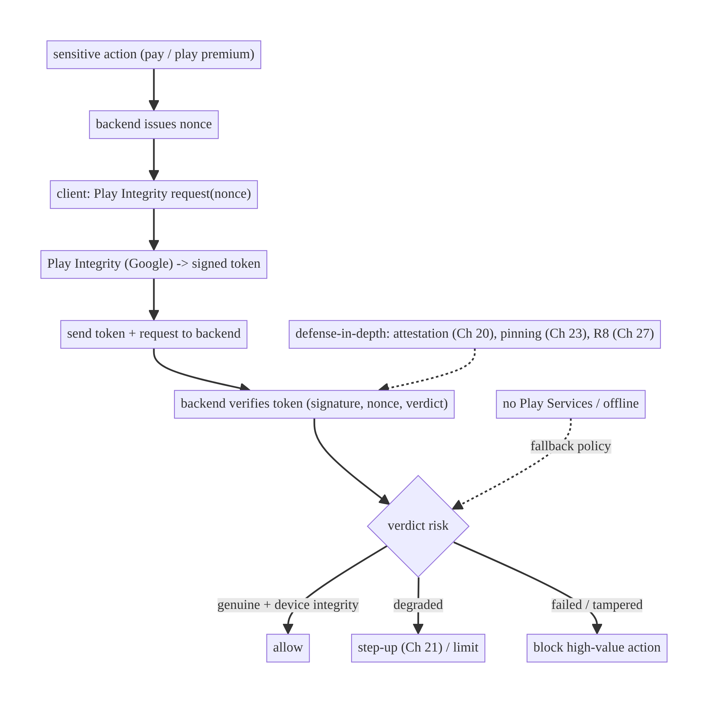
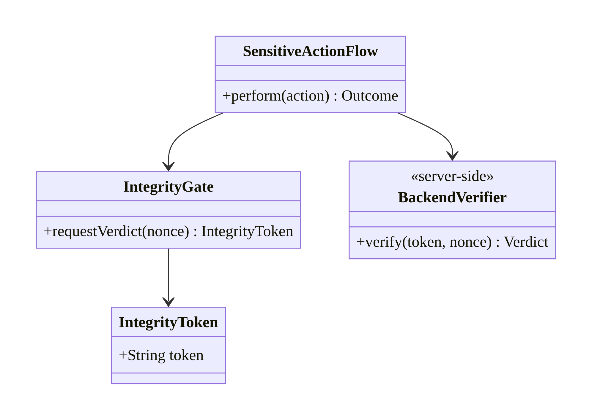
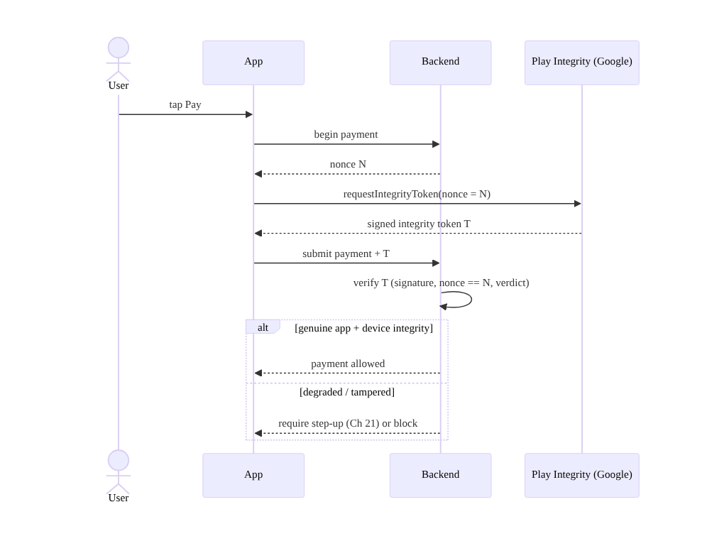
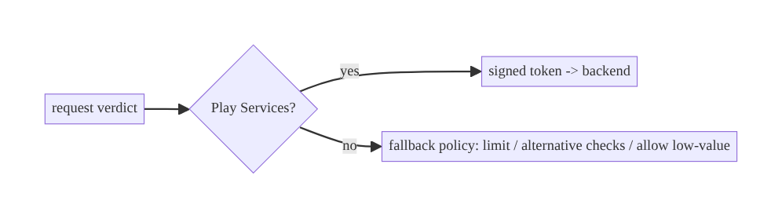
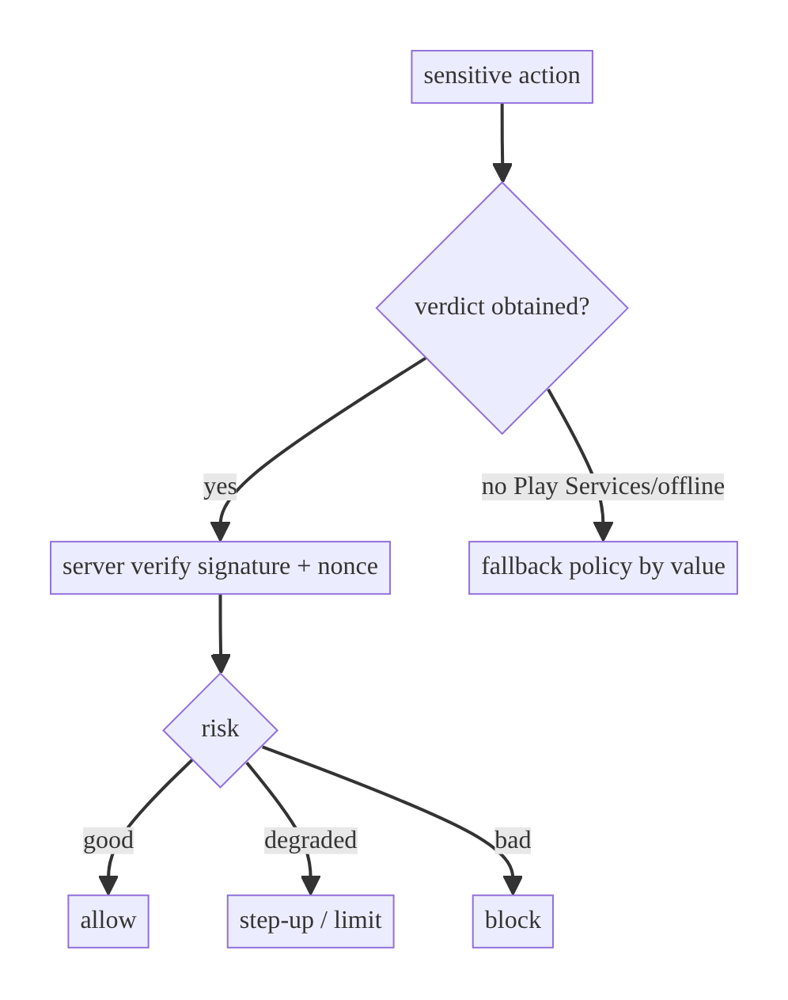

# Chapter 26 — App Integrity, Root & Tamper Detection

> **Part III — Authentication & Security** · Complexity: **Standard** (≥25 interview questions)
>
> **Prerequisites:** Ch 19 (tokens — what we protect), Ch 20 (Keystore/attestation),
> Ch 23 (pinning — the network side). Complements Ch 27 (obfuscation) and Ch 24
> (at-rest). Establishes the *device/app trust* layer.
>
> **Reference surface in StreamCart:** deciding whether to trust that the StreamCart
> app running on a device is genuine, unmodified, and on a non-compromised Android
> before allowing a payment or serving premium content.

---

## 26.1 Problem Definition and Real-World Context

The client runs on hardware the attacker controls. For high-value features
(payments, DRM content, anti-fraud, anti-cheat), the backend wants assurance that
the request comes from a **genuine, unmodified app** on a **non-compromised
device** — not a rooted phone, an emulator, a repackaged/instrumented APK, or a
bot. Naive approaches fail or create false confidence:

- **Client-side-only detection is defeatable.** A root/tamper check that runs in
  the app and returns a boolean can be hooked (Frida), patched out, or spoofed on a
  rooted device. **Any purely local verdict can be bypassed** — relying on it for a
  security decision is a trap.
- **No server verification.** If the client just tells the backend "I'm not rooted,"
  a modified client lies. Integrity signals are worthless unless **verified
  server-side** against a cryptographically-signed verdict.
- **Over-blocking.** Aggressive root/emulator blocking locks out legitimate
  power-users, test devices, and some OEMs — hurting real users while determined
  attackers adapt.
- **Treating integrity as authentication.** Integrity answers "is this a genuine
  app/device?", not "who is this user?" (Ch 19) — conflating them is a design error.

The architecture: use the **Play Integrity API** (Google's attestation) to get a
**server-verifiable, signed verdict** about app/device integrity, **verify it on the
backend** (with a nonce to prevent replay), combine with **defense-in-depth**
(Keystore key attestation Ch 20, pinning Ch 23, obfuscation Ch 27), and apply
**risk-based** responses rather than blunt blocking — all while knowing the honest
**limits** of client integrity.

### Three practical use cases

1. **Fintech (StreamCart Wallet).** Before a high-value payment, the backend
   requires a valid Play Integrity verdict; a failing verdict triggers step-up
   (Ch 21) or blocks the transaction.
2. **OTT (Watch).** Premium/DRM content is gated on integrity to deter content
   piracy via modified clients/emulators.
3. **Anti-fraud/abuse (all).** Account creation, promo redemption, and
   review-posting are rate-limited/blocked when the integrity verdict indicates a
   bot farm/emulator.

### Why this is architectural

App integrity defines the **device/app trust layer**: what assurance the backend
has about the client, how that assurance is **obtained (attestation) and verified
(server-side)**, how it composes with auth/pinning/obfuscation, and the **honest
boundary** of what client-side can prove — properties that determine whether
high-value features can trust the client at all.

---

## 26.2 Requirements Engineering

### Functional requirements

| ID | Requirement |
|----|-------------|
| F1 | Obtain a cryptographically-signed integrity verdict (Play Integrity API). |
| F2 | Bind the verdict to the request (nonce) to prevent replay. |
| F3 | Verify the verdict **server-side** (never trust a client boolean). |
| F4 | Classify the verdict (genuine app, licensed, device integrity) and respond by risk. |
| F5 | Apply defense-in-depth (attestation Ch 20, pinning Ch 23, obfuscation Ch 27). |
| F6 | Gracefully handle integrity-unavailable (no Play Services, offline). |

### Non-functional requirements

| Attribute | Policy |
|-----------|--------|
| **Security** | Server-verified attestation; replay-resistant; not bypassable by client patching. |
| **Reliability** | Degrade gracefully where integrity can't be obtained. |
| **UX** | Risk-based (step-up/limit) over blunt blocking; avoid locking out legit users. |
| **Performance** | Integrity checks are cheap and infrequent (gate sensitive actions, not every call). |
| **Privacy** | No invasive device fingerprinting beyond the attestation. |

### Scope

- **In scope:** Play Integrity API (request + server verification + nonce), verdict
  classification, risk-based response, defense-in-depth composition, limits of
  client-side detection, graceful fallback.
- **Out of scope:** Keystore key attestation internals (Ch 20), pinning (Ch 23),
  obfuscation/R8 (Ch 27), auth (Ch 19), the backend verification service internals.

### Assumptions & constraints

- Play Integrity API (`com.google.android.play:integrity`); a backend that verifies
  verdicts. Google Play distribution (Play Integrity needs Play Services).
  `minSdk 24`. **Client-side-only detection is a signal, not a guarantee.**

---

## 26.3 System Design Fundamentals

- **Attestation vs local detection.** *Local detection* (checking for `su`,
  Magisk, test-keys, emulator props) runs in the app and is **inherently
  bypassable** on a compromised device — useful only as weak, additional signal.
  *Attestation* (Play Integrity) produces a verdict **signed by Google**, generated
  outside the app's control, that the **backend verifies** — this is the real
  assurance.
- **Play Integrity verdicts.** The API returns labels such as: **app recognition**
  (the app is the genuine, Play-signed binary vs modified/unrecognized), **device
  integrity** (`MEETS_DEVICE_INTEGRITY` / `MEETS_BASIC_INTEGRITY` / `MEETS_STRONG_
  INTEGRITY` — the device passes integrity checks vs rooted/emulator/compromised),
  and **account/licensing** (the user obtained the app from Play). These come in a
  signed token.
- **Nonce binding (anti-replay).** The client requests a verdict for a **server-
  issued nonce** (or a hash of the request); the backend checks the nonce matches,
  preventing a captured valid verdict from being replayed by an attacker.
- **Server-side verification is mandatory.** The signed integrity token must be
  decrypted/verified on the **backend** (or via Google's servers), never trusted as
  a client-reported boolean. **This is the whole point** — a modified client can
  fake a boolean but cannot forge Google's signature.
- **Risk-based response.** Rather than hard-blocking any non-perfect verdict
  (locking out legit users on some devices), apply graduated responses: allow,
  **step-up** (Ch 21), **limit** (lower transaction caps / rate limits), or **block**
  only the riskiest actions.
- **Defense-in-depth.** Integrity is one layer: combine with **Keystore key
  attestation** (Ch 20, hardware-backed key proof), **certificate pinning** (Ch 23),
  **obfuscation/R8** (Ch 27, raise the cost of tampering), and **server-side
  anomaly detection**. No single layer is sufficient.
- **Honest limits.** Even attestation isn't absolute (there are bypasses, and it
  depends on Play Services); it **raises the cost** of attacks and gives the backend
  a signal — it doesn't make the client trusted.

Core insight: **obtain a Google-signed integrity verdict bound to a nonce, verify
it server-side, and respond by risk — treating client integrity as a
cost-raising signal in a defense-in-depth stack, never as a client-trusted
boolean.**

---

## 26.4 High-Level Architecture



**Components & ownership**

- **Backend** issues the **nonce**, **verifies** the signed verdict, and decides
  the **risk-based response** — it is the trust authority.
- **Client** requests the verdict and forwards the token; it makes **no** trust
  decision itself.
- **Play Integrity (Google)** produces the signed verdict outside the app's control.
- **Defense-in-depth layers** (Ch 20/23/27) raise attacker cost.

**Direction:** action → backend nonce → client attests → backend verifies → risk
response.

---

## 26.5 Detailed Component Design



| Component | Responsibility | Trust |
|-----------|----------------|-------|
| `IntegrityGate` (client) | request a verdict for a nonce | untrusted courier |
| Play Integrity (Google) | produce signed verdict | trusted producer |
| `BackendVerifier` (server) | verify signature + nonce + classify | trust authority |
| risk policy (server) | allow/step-up/limit/block | decision maker |
| defense-in-depth | attestation/pinning/obfuscation | cost raisers |

> The client is a **courier**, not a decider. Every integrity decision happens on
> the backend after verifying Google's signature.

---

## 26.6 End-to-End Data Flow

### Integrity-gated payment



### Integrity unavailable (no Play Services)



---

## 26.7 Complete Kotlin Implementation

Package: `com.streamcart.core.integrity`.

### 26.7.1 Request an integrity verdict (client = courier)

```kotlin
class IntegrityGate @Inject constructor(@ApplicationContext private val context: Context) {

    // nonce comes from the BACKEND (anti-replay); the client never generates the trust decision.
    suspend fun requestToken(nonce: String): Result<String> = runCatching {
        val manager = IntegrityManagerFactory.create(context)
        val response = manager.requestIntegrityToken(
            IntegrityTokenRequest.builder()
                .setNonce(nonce)                       // bind to the server-issued nonce
                .setCloudProjectNumber(CLOUD_PROJECT)  // your Google Cloud project
                .build()
        ).await()                                      // Play Services task -> coroutine
        response.token()                               // opaque, Google-signed; verified server-side
    }
    private companion object { const val CLOUD_PROJECT = 1234567890L }
}
```

### 26.7.2 Sensitive-action flow (backend decides)

```kotlin
class PaymentFlow @Inject constructor(
    private val api: PaymentApi,
    private val integrity: IntegrityGate,
) {
    suspend fun pay(amount: Money): Outcome<Receipt> {
        val begin = api.beginPayment(amount)                  // backend returns a nonce
        val token = integrity.requestToken(begin.nonce).getOrNull()   // may be null (no Play Services)
        // Forward the token; the BACKEND verifies it and enforces the risk policy.
        return safeApiCall(dispatchers.io) { api.confirmPayment(begin.id, integrityToken = token) }
        // If token == null or verdict is weak, the backend responds with step-up/limit/deny.
    }
}
```

### 26.7.3 Backend verification (pseudocode — the real trust boundary)

```kotlin
// SERVER-SIDE (shown for completeness; not Android code).
fun verify(token: String, expectedNonce: String): Verdict {
    val payload = googlePlayIntegrity.decodeAndVerify(token)   // verify Google's signature
    require(payload.requestDetails.nonce == expectedNonce)     // anti-replay
    require(payload.appIntegrity.appRecognitionVerdict == "PLAY_RECOGNIZED")   // genuine app
    val device = payload.deviceIntegrity.deviceRecognitionVerdict   // MEETS_DEVICE_INTEGRITY, ...
    return classify(device)                                    // -> allow / step-up / limit / block
}
```

### 26.7.4 Weak local signals (defense-in-depth only — never decisive)

```kotlin
// Additional, EASILY-BYPASSED signals. Use only to raise cost / feed server risk scoring.
// NEVER make a security decision on these alone.
fun weakLocalSignals(): Map<String, Boolean> = mapOf(
    "emulator_hint" to (Build.FINGERPRINT.contains("generic") || Build.MODEL.contains("sdk")),
    "test_keys" to Build.TAGS.orEmpty().contains("test-keys"),
    "debuggable" to (context.applicationInfo.flags and ApplicationInfo.FLAG_DEBUGGABLE != 0),
    // su-binary / Magisk checks omitted: trivially defeated on a rooted device.
)
```

### 26.7.5 Module structure

```
:core:integrity   IntegrityGate, weak local signals (optional), IntegrityToken
:feature:wallet   PaymentFlow (gates on backend-verified verdict)
# Backend owns: nonce issuance, token verification, risk policy.
```

---

## 26.8 Concurrency and Race Conditions

| Scenario | Risk | Handling |
|----------|------|----------|
| Concurrent integrity requests | redundant tokens | request per sensitive action; cache a recent token only if the nonce matches |
| Nonce reuse | replay | one nonce per request (server); verify match |
| Token fetched, action delayed | stale token | short validity; re-request if the nonce/request changed |
| Play Services slow | blocks UI | request on IO; show progress; time out gracefully |
| Verdict verification race (server) | TOCTOU | bind verdict to the specific request via nonce; verify atomically with the action |

- **The nonce binds the verdict to one request**, eliminating replay/stale-token
  races — the verdict is only valid for that exact server-issued challenge.

---

## 26.9 Failure Scenarios and Recovery

| Failure | Detection | Response | Outcome |
|---------|-----------|----------|---------|
| Device rooted / failed integrity | verdict fails (server) | step-up/limit/block high-value action | protected; legit basic use may continue |
| Repackaged/modified app | app-recognition fails | block; alert; force official install | tamper blocked |
| Emulator / bot | device integrity weak | rate-limit/block abuse-prone actions | fraud reduced |
| No Play Services (non-GMS device) | request fails | fallback policy (limit / alternate checks / allow low-value) | app still usable for most |
| Offline | can't fetch verdict | defer verdict for online-only sensitive actions | graceful |
| Play Integrity rate limits/quota | API error | cache recent valid verdict (nonce-bound); backoff | resilient |
| Over-blocking legit users | support tickets | risk-based, not blunt; allow-list test devices | fewer false positives |
| Client claims "not rooted" (spoof) | server ignores client booleans | only trust the signed verdict | not bypassable |



> **Never hard-fail the whole app on integrity** — non-GMS devices, some OEMs, and
> power-users will hit it. Gate only **sensitive actions**, respond by **risk**, and
> keep basic functionality working.

---

## 26.10 Scaling the Implementation

- **Level 1.** Request a Play Integrity verdict before the single most sensitive
  action (payment); verify server-side.
- **Level 2.** Nonce binding; risk-based responses (step-up/limit/block);
  fallback for no-Play-Services.
- **Level 3 — production.** Defense-in-depth: Keystore attestation (Ch 20), pinning
  (Ch 23), obfuscation/R8 (Ch 27); server risk scoring combining signals; allow-list
  test devices.
- **Level 4 — large.** Integrity feeding a broader fraud/risk engine; per-action
  policies from remote config (Ch 41); analytics on verdict distribution.
- **Level 5 — enterprise.** Adaptive/risk-based auth, device reputation, anti-cheat/
  anti-abuse platforms, coordinated client+server hardening, SafetyNet→Play
  Integrity migration governance.

**Avoid overengineering:** most apps don't need integrity attestation at all. Add it
for genuine high-value/anti-fraud/DRM needs — and **never** add brittle local
root-detection that annoys users without server verification.

---

## 26.11 Alternative Approaches and Trade-offs

| Dimension | Option A | Option B | When |
|-----------|----------|----------|------|
| Assurance | Play Integrity (server-verified attestation) | local root/emulator checks | Attestation for real assurance; local checks only as weak extra signal |
| Decision | Server-side (signed verdict) | client-side boolean | **Always** server-side; client booleans are forgeable |
| Response | Risk-based (step-up/limit/block) | hard block | Risk-based to avoid false positives; hard block only for the riskiest |
| Key proof | Keystore key attestation (Ch 20) | none | Attestation for hardware-backed key proof (high assurance) |
| Scope | Gate sensitive actions | gate every request | Gate sensitive only (cost/UX); not every call |
| Distribution | Play Integrity (needs GMS) | alternative attestation | Play Integrity on Play; alternatives for non-GMS markets |

**Attestation vs local detection (the key point):** local root/tamper detection
runs *inside* the attacker-controlled app and can always be hooked/patched — it's a
cost-raiser, not a guarantee, and over-reliance creates false confidence and
false positives. Play Integrity produces a **Google-signed verdict** the **backend**
verifies, which a modified client cannot forge. Use attestation for decisions; use
local checks only to feed server-side risk scoring.

**Risk-based vs hard block:** blocking any imperfect verdict maximizes security but
locks out legitimate users (custom ROMs, non-GMS, test devices) and still doesn't
stop determined attackers. Graduated responses (step-up, lower limits) preserve UX
for the many while constraining the risky few — usually the better product/security
balance.

---

## 26.12 Security Considerations

- **Verify server-side, always.** The signed integrity token is only meaningful when
  the **backend** verifies Google's signature and the nonce. A client boolean is
  worthless.
- **Bind to a nonce** to prevent replay of a captured valid verdict.
- **Integrity ≠ authentication.** It proves "genuine app/device," not "who the user
  is" (Ch 19); compose them, don't conflate.
- **Defense-in-depth:** pair with Keystore attestation (Ch 20), pinning (Ch 23),
  obfuscation/R8 (Ch 27), and server anomaly detection — no single layer suffices.
- **Honest limits:** attestation raises cost but isn't unbeatable and depends on
  Play Services; don't assume a passing verdict means the client is fully trusted.
- **Avoid over-blocking / invasive fingerprinting:** respect privacy; risk-based
  responses; allow-list legitimate test/dev devices.
- **Protect the verdict path:** request over a pinned channel (Ch 23); don't let a
  MITM swap verdicts.
- Client vs backend: the client is an untrusted courier; the **backend is the sole
  trust authority** for integrity decisions.

---

## 26.13 Performance and Resource Optimization

- **Integrity checks are infrequent** — gate sensitive actions, not every request;
  the token fetch is a one-off per action.
- **Standard vs classic requests:** Play Integrity's standard request supports
  warming/caching for lower latency on frequent checks; use it where you need
  repeated verdicts.
- **Don't block the UI:** fetch on IO with a timeout; show progress for the gated
  action.
- **Cache a recent nonce-bound verdict** within its validity to avoid redundant
  calls (only if the nonce/request is the same).
- **Profiling:** verdict-fetch latency, failure/quota rate, verdict distribution,
  false-positive (legit-user-blocked) rate.

---

## 26.14 Testing Strategy

The verdict is produced by Google and verified server-side, so client tests focus
on the courier flow + fallback; integration/manual tests cover real verdicts.

```kotlin
class IntegrityGateTest {
    @Test fun `forwards server nonce in the request`() = runTest {
        val gate = IntegrityGate(ctxWithFakeIntegrity(recorder))
        gate.requestToken("nonce-123")
        assertEquals("nonce-123", recorder.lastNonce)
    }
    @Test fun `returns failure gracefully when Play Services unavailable`() = runTest {
        val gate = IntegrityGate(ctxWithNoPlayServices())
        assertTrue(gate.requestToken("n").isFailure)      // -> fallback policy
    }
}

class PaymentFlowTest {
    @Test fun `payment proceeds with null token when integrity unavailable (backend decides)`() = runTest {
        val api = RecordingPaymentApi()
        PaymentFlow(api, FailingIntegrityGate).pay(Money(100))
        assertNull(api.lastIntegrityToken)                // backend applies fallback/limit
    }
    @Test fun `token is attached when available`() = runTest {
        val api = RecordingPaymentApi()
        PaymentFlow(api, FakeIntegrityGate(token = "T")).pay(Money(100))
        assertEquals("T", api.lastIntegrityToken)
    }
}
```

What to test: nonce forwarding, graceful no-Play-Services fallback, token
attachment, and (server-side/integration) verdict verification + risk policy + nonce
anti-replay. Verify **no security decision** is made purely client-side.

---

## 26.15 Production Observability

- **Metrics (mostly backend):** verdict distribution (genuine/degraded/failed),
  integrity-gated action block/step-up/allow rates, verdict-fetch latency/failure,
  no-Play-Services rate, false-positive (legit-blocked) rate, fraud-prevented
  estimate.
- **Logs:** `integrity{action, verdict_class, response}` (server; no device
  fingerprints beyond policy); client: `integrity_fetch{result}` (no verdict
  content client-side).
- **Debugging:** legit users blocked → over-strict policy / non-GMS handling;
  fraud slipping through → relying on client booleans / no server verification;
  verdict-fetch failures spike → Play Services/quota issue.
- **Alerting:** surge in failed/tampered verdicts → possible attack campaign or a
  bad app release (correlate with release).
- **Privacy:** minimize device data; the verdict is the signal — avoid extra
  fingerprinting.

---

## 26.16 System Design Interview Preparation

> ≥25 questions.

**Fundamentals**

1. *Why can't the client prove it's untampered by itself?* Any local check runs in
   the attacker-controlled app and is bypassable (hook/patch).
2. *Attestation vs local detection?* Attestation = Google-signed, server-verified
   verdict; local detection = weak, bypassable signal.
3. *What is Play Integrity?* Google's API returning a signed verdict about app/
   device integrity.
4. *What verdicts does it give?* App recognition (genuine/modified), device
   integrity (basic/device/strong), account/licensing.
5. *Why a nonce?* Anti-replay — bind the verdict to a specific server-issued
   challenge.

**Architecture**

6. *Where is the trust decision made?* The backend — it verifies the signature +
   nonce + verdict.
7. *Role of the client?* An untrusted courier that fetches and forwards the token.
8. *Why not trust a client boolean?* A modified client lies; only Google's signature
   is unforgeable.
9. *Integrity vs authentication?* "Genuine app/device" vs "who the user is" (Ch 19)
   — compose, don't conflate.

**Response policy**

10. *Risk-based vs hard block?* Graduated (step-up/limit/block) avoids false
    positives; hard block only for the riskiest.
11. *Handle no Play Services?* Fallback policy (limit/alternate/allow low-value);
    don't brick the app.
12. *Over-blocking risk?* Locks out custom ROMs/non-GMS/test devices; allow-list +
    risk-based.

**Defense-in-depth**

13. *What else to combine?* Keystore key attestation (Ch 20), pinning (Ch 23),
    obfuscation/R8 (Ch 27), server anomaly detection.
14. *Keystore attestation vs Play Integrity?* Hardware key-backing proof vs app/
    device integrity — complementary.
15. *Why defense-in-depth?* No single layer is sufficient; each raises cost.

**Limits**

16. *Is attestation unbeatable?* No — raises cost, depends on Play Services; a
    passing verdict ≠ fully trusted client.
17. *Should every request be gated?* No — sensitive actions only (cost/UX).

**Operational**

18. *Replay of a valid verdict?* Prevented by nonce binding + server check.
19. *MITM swapping verdicts?* Pinned channel (Ch 23); server verifies signature.
20. *Migration from SafetyNet?* SafetyNet Attestation is deprecated → Play
    Integrity.

**Testing**

21. *What can client tests cover?* Nonce forwarding, fallback, token attachment —
    not the verdict itself.
22. *Where is the real test?* Server-side verification + risk policy + anti-replay.
23. *Key property to assert?* No client-side-only security decision.

**Production debugging**

24. *Legit users blocked?* Over-strict/no non-GMS handling.
25. *Fraud slipping through?* Trusting client booleans / no server verification.
26. *Verdict failures spike?* Play Services/quota, or an attack/bad release.

### Design-change challenges
1. **Gate high-value payments on integrity.** Nonce + Play Integrity + server verify
   + step-up on degraded (Ch 21).
2. **Deter piracy of premium content.** Integrity + DRM + pinning; risk-based.
3. **Support non-GMS devices.** Fallback policy; alternative attestation; limit
   sensitive actions.
4. **Attacker repackages the app.** App-recognition verdict blocks; force official
   install.
5. **Reduce false positives.** Risk-based responses + allow-list + server risk
   scoring.

### Mock walkthrough (abridged)
Clarify (what to protect, threat, GMS?) → attestation (Play Integrity) not local
checks → nonce + server verification (trust authority) → risk-based response →
defense-in-depth (Ch 20/23/27) → fallback for no-GMS → state honest limits → gate
sensitive actions only → testing.

---

## 26.17 Practical Exercises

1. **Beginner.** Request a Play Integrity token for a server-issued nonce and attach
   it to a sensitive request. *Eval:* nonce forwarded; token attached.
2. **Intermediate.** Handle no-Play-Services/offline gracefully with a fallback
   policy; never block basic use. *Eval:* app usable; sensitive action limited.
3. **Advanced.** Design the server verification (signature + nonce + verdict) and a
   risk-based response (allow/step-up/limit/block). *Eval:* no client-side decision;
   anti-replay.
4. **Production debugging.** Fix an app that makes a security decision on a local
   root-check boolean (bypassable) and hard-blocks all rooted devices. *Eval:*
   server-verified verdict; risk-based.
5. **System design challenge.** Compose integrity with Keystore attestation (Ch 20),
   pinning (Ch 23), and server risk scoring for a payment flow. *Eval:* layered;
   degrades gracefully; low false positives.

*(Solutions withheld unless requested.)*

---

## 26.18 Chapter Summary & Reference Sheet

**Key decisions:** obtain a **Google-signed integrity verdict (Play Integrity)**
bound to a **server-issued nonce**; **verify it server-side** (the client is an
untrusted courier — never trust a client boolean); respond **by risk** (allow/
step-up/limit/block) rather than blunt blocking; treat integrity as **one layer**
in defense-in-depth with **Keystore attestation (Ch 20), pinning (Ch 23),
obfuscation/R8 (Ch 27)**; gate **sensitive actions only**; handle **no-Play-Services/
offline** gracefully; keep the **honest limits** in mind (attestation raises cost,
isn't absolute, isn't authentication).

**Concepts:** attestation vs local detection, Play Integrity verdicts (app/device/
account), nonce anti-replay, server-side verification, risk-based response,
defense-in-depth, integrity ≠ auth.

**Common mistakes:** client-side-only root/tamper booleans (bypassable); no
server verification; no nonce (replay); hard-blocking all imperfect verdicts (false
positives / non-GMS lockout); conflating integrity with authentication; relying on a
single layer; invasive fingerprinting.

**Checklist:**

- [ ] Play Integrity verdict
- [ ] server-issued nonce (anti-replay)
- [ ] server-side verification
- [ ] risk-based response (not hard block)
- [ ] gate sensitive actions only
- [ ] defense-in-depth (Ch 20/23/27)
- [ ] no-GMS/offline fallback
- [ ] no client-side security decision
- [ ] allow-list test devices
- [ ] monitor verdict distribution/false positives.

**Key APIs:** `IntegrityManagerFactory`/`IntegrityManager`,
`IntegrityTokenRequest`/`StandardIntegrityManager`, `setNonce`,
`requestIntegrityToken`, Keystore key attestation (Ch 20), `CertificatePinner`
(Ch 23). Verdict verification is **server-side** (Google Play Integrity API /
Google's servers).

**References:**
- Play Integrity API: https://developer.android.com/google/play/integrity
- Verdicts & server verification: https://developer.android.com/google/play/integrity/verdicts
- SafetyNet → Play Integrity migration: https://developer.android.com/google/play/integrity/migrate
- Key attestation (Ch 20): https://developer.android.com/privacy-and-security/security-key-attestation
- (composes with) Ch 20 Keystore, Ch 23 Pinning, Ch 27 Obfuscation

### Chapter review (Phase 4)
- **Completeness:** all 18 sections; architecture/class/sequence/failure diagrams;
  IntegrityGate (courier) + nonce + server-verify pseudocode + weak-signals caveat;
  concurrency (nonce binding); failure (no-GMS, over-block); 5 levels; attestation-
  vs-local and risk-vs-block trade-offs; honest-limits threat model; perf (gate
  sensitive only); courier + fallback tests; observability (verdict distribution);
  26 Q&A + 5 challenges. ✅
- **Expand later:** Keystore attestation (Ch 20), pinning (Ch 23), obfuscation
  (Ch 27), fraud/risk engines.
- **Interview coverage:** exceeds ≥25 bar.
