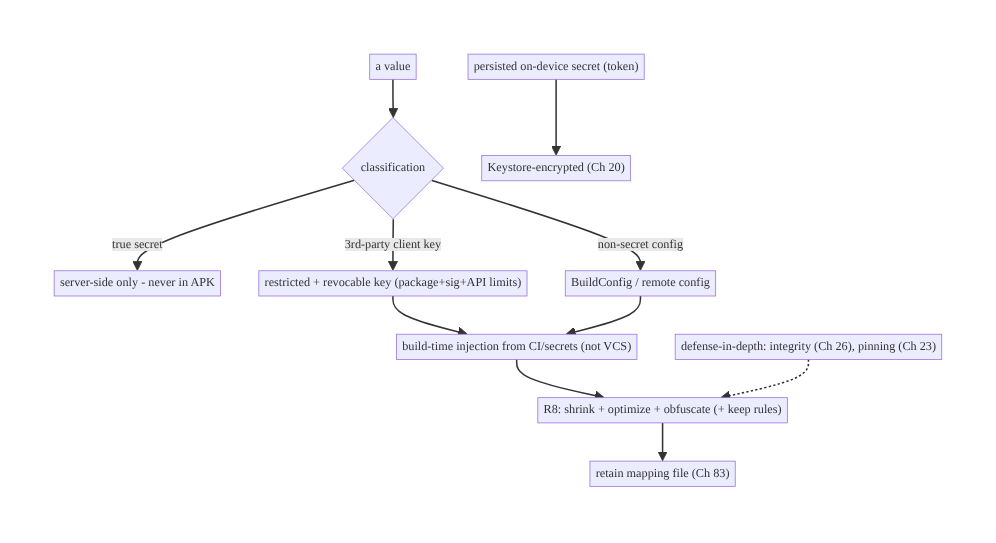
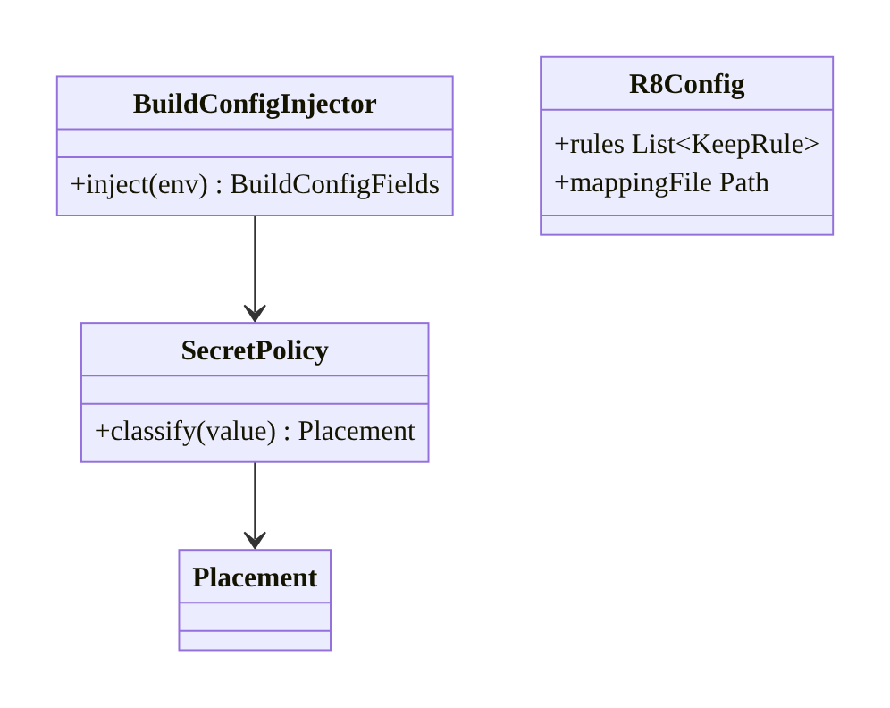
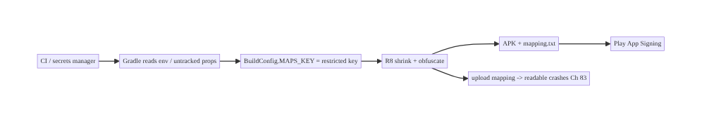
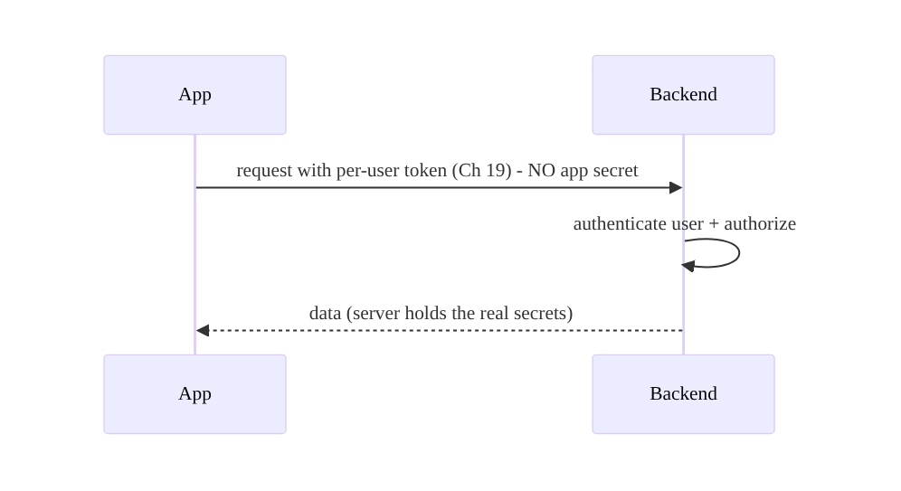
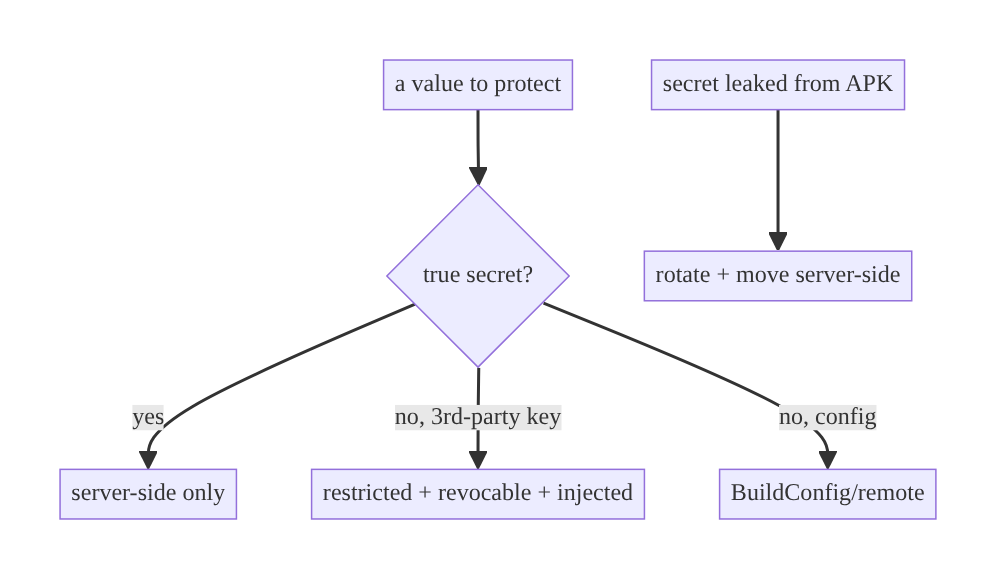

# Chapter 27 — Secrets Management & Obfuscation (R8)

> **Part III — Authentication & Security** · Complexity: **Standard** (≥25 interview questions)
>
> **Prerequisites:** Ch 20 (Keystore — runtime secret protection), Ch 26
> (integrity — what obfuscation complements), Ch 1 (networking — where API keys are
> used). Pairs with Ch 83 (crash reporting — mapping files).
>
> **Reference surface in StreamCart:** keeping API keys, third-party SDK secrets,
> and business logic out of attackers' reach in a decompilable APK — and knowing
> what's actually protectable on the client.

---

## 27.1 Problem Definition and Real-World Context

An APK is **shippable, decompilable code**. Anything baked into it — strings,
classes, logic — can be extracted with standard tools (apktool, jadx) in minutes.
This creates two linked problems: **where do secrets go**, and **how much does
obfuscation actually protect**? Naive assumptions cause real breaches:

- **Hardcoded secrets.** API keys, signing secrets, or third-party credentials in
  code/resources/`BuildConfig` are trivially extracted from the APK — the single
  most common Android secret leak. "Obfuscating" a hardcoded secret doesn't help; a
  determined attacker finds it at runtime.
- **Treating obfuscation as encryption.** R8/ProGuard renames and shrinks code,
  raising the *cost* of reverse engineering — it is **not** encryption and does
  **not** hide secrets or logic from a motivated attacker. Over-trusting it is
  dangerous.
- **Client-side "secret" that must be secret.** Any truly-secret value (a key that
  grants backend access) **cannot** live safely on the client at all — it belongs
  **server-side**; the client should hold only revocable, scoped, low-value tokens
  (Ch 19) and fetch what it needs over authenticated channels.
- **Breaking crash reports / forgetting mapping files.** Enabling R8 without
  retaining the **mapping file** makes stack traces unreadable (Ch 83).

The architecture: **keep true secrets server-side**; for unavoidable client config,
use **build-time injection from secure sources** (not VCS), **revocable/restricted
keys**, **runtime protection via Keystore** (Ch 20) for secrets that must persist,
**R8** for shrinking + raising reverse-engineering cost (not as security), and
**defense-in-depth** (Ch 20/23/26). The core lesson: **you cannot keep a secret in
an APK — so design so the client doesn't need to.**

### Three practical use cases

1. **Third-party API keys (Maps, analytics).** Use **restricted** keys (package +
   signature + API restrictions) so extraction yields a key that only works for your
   app's scope and can be revoked/rotated.
2. **Backend access (StreamCart API).** No static API key in the app; the client
   authenticates per-user (Ch 19) and the backend authorizes — there is no
   "app secret" to steal.
3. **Business logic / anti-abuse (Wallet/Watch).** Obfuscate + move critical checks
   server-side; use integrity (Ch 26) rather than hiding logic in the client.

### Why this is architectural

Secrets management defines **what can and cannot live on the client**, the
**build-time secret pipeline**, the **runtime protection** (Keystore), and the honest
**role of obfuscation** — properties that determine whether shipping the app leaks
your keys and whether reverse engineering is cheap.

---

## 27.2 Requirements Engineering

### Functional requirements

| ID | Requirement |
|----|-------------|
| F1 | No true secrets hardcoded in code/resources/`BuildConfig`/VCS. |
| F2 | Inject necessary client config at build time from secure sources (not committed). |
| F3 | Use restricted, revocable keys for unavoidable third-party client keys. |
| F4 | Protect persisted secrets at runtime via Keystore (Ch 20). |
| F5 | Enable R8 (shrink/optimize/obfuscate) and retain the mapping file (Ch 83). |
| F6 | Move security-critical logic/secrets server-side. |

### Non-functional requirements

| Attribute | Policy |
|-----------|--------|
| **Security** | No extractable high-value secrets; restricted keys; server-side trust. |
| **Maintainability** | Secret pipeline reproducible; rotation possible. |
| **Reliability** | R8 doesn't break the app (keep rules); mapping retained. |
| **Performance** | R8 shrinking reduces size/improves perf. |
| **Honesty** | Obfuscation treated as cost-raiser, not protection. |

### Scope

- **In scope:** secret classification (what can live on client), build-time injection
  (Gradle, env/secrets, not VCS), restricted third-party keys, runtime protection
  (Keystore), R8/ProGuard (shrinking/obfuscation/keep rules/mapping), native/string
  obfuscation caveats, defense-in-depth.
- **Out of scope:** Keystore mechanics (Ch 20), integrity attestation (Ch 26),
  pinning (Ch 23), crash symbolication details (Ch 83), CI/CD secret stores
  (general DevOps).

### Assumptions & constraints

- Gradle build; R8 (default shrinker). Play App Signing. Secrets come from CI/env/
  a secrets manager, **never** committed. `minSdk 24`. **Axiom: an APK cannot keep a
  secret.**

---

## 27.3 System Design Fundamentals

- **An APK cannot keep a secret.** Decompilation + runtime hooking means any value
  present in the app is extractable. The only robust answer for a *true* secret is:
  **don't put it in the app** — keep it server-side and expose functionality via
  authenticated per-user requests (Ch 19).
- **Secret classification.**
  - *True secrets* (grant privileged backend access): **server-side only**.
  - *Restricted keys* (third-party SDKs that require a client key): use provider
    restrictions (app package + signing cert + API/scope limits) so an extracted
    key is **useless outside your app** and **revocable/rotatable**.
  - *Non-secret config* (base URLs, feature flags): fine in the app / remote config.
- **Build-time injection, not VCS.** Inject config via Gradle from **environment/CI
  secrets / a secrets manager / an untracked properties file** — never commit keys.
  `BuildConfig` fields hold the *injected* value but are still extractable, so only
  put **restricted/non-secret** values there.
- **Runtime protection (Keystore, Ch 20).** Secrets that must *persist* on device
  (tokens) are encrypted via Keystore — not stored as plaintext constants.
- **R8 (the modern shrinker/optimizer/obfuscator).** Replaces ProGuard; it
  **shrinks** (removes unused code/resources), **optimizes**, and **obfuscates**
  (renames classes/methods to short names). Benefits: smaller/faster app, raised
  reverse-engineering cost. **It is not encryption** and does not hide strings/logic
  from a determined attacker. **Keep rules** (`-keep`) preserve classes used via
  reflection/serialization; **mapping file** must be retained to de-obfuscate crash
  reports (Ch 83).
- **Native/string obfuscation caveats.** Moving secrets to native (NDK/C++) or
  encrypting strings raises cost but is still reversible (the code must decrypt at
  runtime, where it can be hooked). Treat as **cost-raisers**, not protection.
- **Defense-in-depth.** Obfuscation + integrity (Ch 26) + pinning (Ch 23) + Keystore
  (Ch 20) + server-side enforcement together raise the attacker's cost; none alone is
  sufficient.

Core insight: **classify secrets and keep true ones server-side; for unavoidable
client keys use restricted/revocable ones injected at build time; protect persisted
secrets with Keystore; use R8 to shrink and raise cost — never as a secret-keeping
mechanism.** Design so the client doesn't hold anything whose leak is catastrophic.

---

## 27.4 High-Level Architecture



**Components & ownership**

- **Classification** routes each value: server-side / restricted key / non-secret.
- **Build-time injection** supplies restricted/non-secret values from secure sources
  (never committed).
- **Keystore** (Ch 20) protects persisted secrets at runtime.
- **R8** shrinks/obfuscates and emits a **mapping file** (retained for Ch 83).
- **Defense-in-depth** raises cost around what remains.

**Direction:** value → classify → (server / restricted-injected / config) → R8 →
mapping retained.

---

## 27.5 Detailed Component Design



| Element | Responsibility | Note |
|---------|----------------|------|
| secret classification | decide placement | server / restricted / non-secret |
| Gradle injection | build-time config from secrets | not VCS; per-flavor |
| restricted key config | provider-side restrictions | package+sig+API; revocable |
| Keystore (Ch 20) | runtime secret protection | tokens, DEKs |
| R8 rules + mapping | shrink/obfuscate; symbolicate | `-keep`; retain mapping |

---

## 27.6 End-to-End Data Flow

### Build-time secret injection + R8



### Runtime: no app secret for backend access



---

## 27.7 Complete Kotlin / Gradle Implementation

### 27.7.1 Build-time injection (Gradle KTS) — secrets NOT in VCS

```kotlin
// build.gradle.kts — read from env/CI or an UNTRACKED local.properties (gitignored).
val mapsKey: String = providers.environmentVariable("MAPS_API_KEY").orNull
    ?: localProps.getProperty("MAPS_API_KEY", "")   // local.properties is .gitignored

android {
    defaultConfig {
        // Restricted key only (package+signature+API limited on the provider side).
        buildConfigField("String", "MAPS_API_KEY", "\"$mapsKey\"")
        // Non-secret config is fine here too:
        buildConfigField("String", "API_BASE_URL", "\"https://api.streamcart.com\"")
    }
    buildFeatures { buildConfig = true }
}
// .gitignore: local.properties, *.keystore, secrets/*   <-- never commit secrets
```

### 27.7.2 R8 enabled + keep rules + mapping retention

```kotlin
android {
    buildTypes {
        release {
            isMinifyEnabled = true            // R8 shrink + obfuscate
            isShrinkResources = true          // remove unused resources
            proguardFiles(
                getDefaultProguardFile("proguard-android-optimize.txt"),
                "proguard-rules.pro",
            )
            // mapping.txt is produced in build/outputs/mapping/release/ -> upload to Crashlytics/Play (Ch 83)
        }
    }
}
```

```proguard
# proguard-rules.pro — keep what reflection/serialization needs.
# kotlinx.serialization
-keepattributes *Annotation*, InnerClasses
-keep,includedescriptorclasses class com.streamcart.**$$serializer { *; }
-keepclassmembers class com.streamcart.** { *** Companion; }
# Retrofit/Gson DTOs accessed reflectively
-keep class com.streamcart.data.**.dto.** { *; }
# Keep line numbers for readable crash stacks (still obfuscate names)
-keepattributes SourceFile,LineNumberTable
-renamesourcefileattribute SourceFile
```

### 27.7.3 Runtime secret protection (ties to Ch 20)

```kotlin
// Persisted secrets (tokens) are NEVER constants; they live encrypted via Keystore (Ch 20).
class ThirdPartySecretProvider @Inject constructor(private val secureStore: SecureStore) {
    // A secret the SDK needs at runtime, fetched from the backend over an authed channel and
    // cached encrypted — not baked into the APK.
    suspend fun sdkToken(): String? = secureStore.get("sdk_token")
}
```

### 27.7.4 What NOT to do (anti-patterns)

```kotlin
// ANTI-PATTERN: hardcoded true secret — extractable from the APK in minutes.
// const val BACKEND_SIGNING_SECRET = "sk_live_9f8a..."   // NEVER

// ANTI-PATTERN: "encrypting" a hardcoded string — the key+logic are also in the APK.
// val key = decrypt("U2FsdGVk...", HARDCODED_KEY)         // reversible at runtime
```

### 27.7.5 Module / build structure

```
build.gradle.kts           build-time injection (env/untracked props)
proguard-rules.pro         R8 keep rules
local.properties           secrets (GITIGNORED)
secrets/ , *.keystore      GITIGNORED
build/outputs/mapping/...  mapping.txt (upload for symbolication, Ch 83)
# Backend holds all true secrets.
```

---

## 27.8 Concurrency and Race Conditions

Secrets/obfuscation are largely build-time, but runtime secret handling has the
usual concerns (shared with Ch 20):

| Scenario | Risk | Handling |
|----------|------|----------|
| Secret in memory | lingering plaintext | minimize lifetime; zero byte arrays (Ch 20) |
| Concurrent fetch of a runtime secret | duplicate fetch | single-flight (Ch 11) |
| R8 breaks reflection at runtime | crash/missing class | correct `-keep` rules; test release build |
| Mapping file mismatch | unreadable crashes | retain the exact mapping per build (Ch 83) |

- Most "races" here are **build correctness** (R8 removing something reflection
  needs) — test the **release** build, not just debug, and keep rules precise.

---

## 27.9 Failure Scenarios and Recovery

| Failure | Detection | Response | Outcome |
|---------|-----------|----------|---------|
| Hardcoded secret extracted | security scan / breach | rotate immediately; move server-side; never re-embed | contained if revocable |
| Restricted key abused outside app | provider logs | rely on package+signature+API restrictions; rotate | limited blast radius |
| R8 removed a reflected class | release crash | add `-keep` rule; test release | fixed |
| Mapping file lost | unreadable crashes | retain/upload mapping per release (Ch 83) | symbolicated |
| Obfuscation assumed to hide a secret | breach | redesign: secret server-side; obfuscation ≠ protection | correct model |
| Key committed to VCS | git history scan | rotate the key; purge history; add to `.gitignore` + secret scanning | rotated |
| Over-aggressive optimization bug | runtime error | tune R8 rules; report | stable |



> **If a client secret leaks, the fix is rotation + moving it server-side — not
> "obfuscate harder."** Any client-held secret must be treated as *eventually
> public*; design for revocation.

---

## 27.10 Scaling the Implementation

- **Level 1.** No hardcoded secrets; build-time injection of restricted keys;
  `.gitignore` + secret scanning.
- **Level 2.** R8 enabled with correct keep rules; mapping retained/uploaded
  (Ch 83); Keystore for persisted secrets (Ch 20).
- **Level 3 — production.** True secrets server-side (per-user auth, Ch 19); restricted
  third-party keys with rotation; defense-in-depth (integrity Ch 26, pinning Ch 23).
- **Level 4 — large.** Secrets manager + CI pipeline; automated rotation; per-flavor
  config; string/native obfuscation for high-value logic (as cost-raisers);
  commercial obfuscators/RASP where justified.
- **Level 5 — enterprise.** Formal secret governance, SBOM/supply-chain security,
  key ceremonies, RASP + anti-tamper platforms, continuous reverse-engineering
  monitoring.

**Avoid overengineering:** most apps need "no hardcoded secrets + R8 + restricted
keys + Keystore." Commercial obfuscators/RASP and native string hiding are for
high-value targets (fintech/DRM/anti-cheat) — and still only raise cost.

---

## 27.11 Alternative Approaches and Trade-offs

| Dimension | Option A | Option B | When |
|-----------|----------|----------|------|
| True secret placement | Server-side (no app secret) | In-app (encrypted/obfuscated) | **Always** server-side; in-app is extractable |
| Third-party keys | Restricted + revocable | unrestricted | Restricted always (limit blast radius) |
| Config injection | Build-time from CI/secrets | committed to VCS | CI/secrets; never commit |
| Obfuscation | R8 (free, default) | commercial (DexGuard) / RASP | R8 for most; commercial for high-value targets |
| Hiding logic | Server-side | native/string obfuscation | Server-side for security-critical; native only raises cost |
| Persisted secret | Keystore-encrypted (Ch 20) | plaintext/BuildConfig | Keystore always |

**Obfuscation vs server-side (the key trade-off):** obfuscation (R8/commercial/
native) raises the *cost and time* of reverse engineering — valuable against casual
attackers and for IP protection — but it **never** makes a secret safe, because the
code must run (and thus reveal) on the attacker's device. The only way to keep a
secret secret is to **not ship it**: put it and the logic that uses it **server-
side**. Use obfuscation to slow attackers and shrink the app; use server-side
placement to actually protect secrets.

**R8 vs commercial obfuscators:** R8 is free, integrated, and good for shrinking +
name obfuscation; commercial tools (DexGuard) add string encryption, control-flow
obfuscation, and RASP (runtime anti-tamper) at cost — justified for high-value apps
but still cost-raisers, not guarantees.

---

## 27.12 Security Considerations

- **An APK cannot keep a secret** — the foundational rule. True secrets live
  server-side; the client holds only revocable, scoped, low-value tokens (Ch 19).
- **No hardcoded secrets** anywhere (code/resources/`BuildConfig`/VCS); use **secret
  scanning** (gitleaks, GitHub secret scanning) in CI.
- **Restrict and rotate** any unavoidable third-party client key (package +
  signature + API restrictions).
- **Obfuscation is not encryption** — never rely on R8/string hiding to protect a
  secret or security-critical check; it only raises cost.
- **Protect persisted secrets with Keystore** (Ch 20), not constants.
- **Defense-in-depth:** combine with integrity (Ch 26), pinning (Ch 23),
  server-side enforcement; move critical checks server-side rather than hiding them.
- **Play App Signing** keeps the upload/signing key off your machine; protect the
  signing key.
- **Mapping file is sensitive-ish** (eases reverse engineering) — store it securely,
  but you must retain it for crash symbolication (Ch 83).
- Client vs backend: the client is public code; the **backend is the only place a
  secret or security-critical decision is safe**.

---

## 27.13 Performance and Resource Optimization

- **R8 improves performance**: shrinking removes unused code/resources (smaller APK,
  faster load), optimization inlines/simplifies. Enable it in release regardless of
  the security angle.
- **`isShrinkResources`** trims unused resources (big size wins).
- **Baseline profiles** (Ch 92) compose with R8 for startup gains.
- **Keep rules cost size** — over-broad `-keep` prevents shrinking; keep them
  minimal/precise.
- **Native/commercial obfuscation** can add runtime overhead — measure.
- **Profiling:** APK size (before/after R8), method count, startup time (Ch 88),
  release-build correctness.

---

## 27.14 Testing Strategy

The critical tests are **build correctness** (R8 doesn't break the app) and
**no-secret** verification.

```kotlin
// 1) Release-build smoke/instrumentation tests — catch R8 removing reflected classes.
//    Run the FULL test suite on the minified release build, not just debug.

// 2) Static "no hardcoded secrets" check (CI): fail the build on matches.
//    gitleaks / detekt custom rule / a Gradle task scanning for key patterns.

// 3) Verify BuildConfig holds only restricted/non-secret values.
class BuildConfigTest {
    @Test fun `no true secret in BuildConfig`() {
        assertFalse(BuildConfig.MAPS_API_KEY.startsWith("sk_live"))   // example guard
        // API_BASE_URL is fine (non-secret)
    }
}

// 4) Verify mapping file produced for release (CI check) -> uploaded for symbolication (Ch 83).
// 5) DTO round-trip tests on the minified build (ensures -keep rules correct).
```

What to test: run instrumentation on the **minified release** build; CI secret
scanning; mapping-file presence; serialization/reflection still works post-R8.

---

## 27.15 Production Observability

- **Metrics:** APK size (R8 effect), crash symbolication rate (mapping uploaded?),
  restricted-key abuse (provider dashboards), secret-scan findings in CI.
- **Logs:** never log secrets/keys (Ch 28); CI logs for secret-scan results.
- **Debugging:** unreadable crash stacks → mapping file not uploaded/mismatched
  (Ch 83); release-only crashes → R8 removed a reflected class (missing `-keep`);
  third-party key abused → restrictions missing/rotate; secret found in a breach →
  it was in the APK (rotate + move server-side).
- **Alerting:** CI secret-scan hit → block the merge; provider key-abuse alert →
  rotate.
- **Privacy:** protect the mapping file; never expose it publicly (eases RE).

---

## 27.16 System Design Interview Preparation

> ≥25 questions.

**Fundamentals**
1. *Can you keep a secret in an APK?* No — it's decompilable and hookable; anything
   shipped is extractable.
2. *Where do true secrets go?* Server-side; the client gets revocable, scoped tokens
   (Ch 19).
3. *What is R8?* The default shrinker/optimizer/obfuscator (replaces ProGuard) —
   shrinks, optimizes, renames; **not** encryption.
4. *Does obfuscation protect secrets?* No — it raises reverse-engineering cost;
   secrets/logic still run (and reveal) on-device.
5. *Secret classification?* True secret (server-side), restricted key (injected +
   limited), non-secret config (BuildConfig/remote).

**Keys/config**
6. *Hardcoded API key — problem?* Trivially extracted; rotate + move server-side.
7. *Unavoidable third-party client key?* Restrict (package+signature+API) +
   revocable + rotate.
8. *Where to inject build config?* Gradle from env/CI/untracked props — never VCS.
9. *Is `BuildConfig` secret?* No — extractable; only put restricted/non-secret
   values.

**R8**
10. *What does `isMinifyEnabled` do?* Enables R8 shrink + obfuscate.
11. *Keep rules?* `-keep` preserves classes used via reflection/serialization.
12. *Mapping file?* De-obfuscates crash stacks — must retain/upload (Ch 83).
13. *`isShrinkResources`?* Removes unused resources (size).
14. *R8 performance?* Smaller/faster app; enable regardless of security.

**Runtime protection**
15. *Persisted secrets?* Keystore-encrypted (Ch 20), not constants.
16. *String encryption in the APK?* The decrypt key+logic are also in the APK —
    reversible; cost-raiser only.
17. *Native (NDK) secrets?* Harder but still reversible/hookable.

**Model/limits**
18. *Obfuscation vs server-side?* Obfuscation slows attackers; server-side actually
    protects. Use both.
19. *If a client secret leaks?* Rotate + move server-side — not "obfuscate harder."
20. *Defense-in-depth?* + integrity (Ch 26), pinning (Ch 23), Keystore (Ch 20),
    server enforcement.

**Build/VCS**
21. *How prevent committed secrets?* `.gitignore` + CI secret scanning (gitleaks).
22. *Play App Signing?* Keeps the signing key off your machine; protect it.

**Testing**
23. *Why test the release build?* R8 can remove reflected classes → release-only
    crashes.
24. *CI check for secrets?* Secret scanning fails the build on matches.

**Production debugging**
25. *Unreadable crash stacks?* Mapping file not uploaded/mismatched.
26. *Release-only crash?* Missing `-keep` rule.
27. *Key abused externally?* Restrictions missing; rotate.

### Design-change challenges
1. **Remove a hardcoded backend secret.** Move to server-side auth (Ch 19); rotate;
   the app no longer needs it.
2. **Third-party SDK requires a client key.** Restricted+revocable key injected at
   build time.
3. **Protect business logic from cloning.** Server-side critical logic + integrity
   (Ch 26); obfuscate the rest.
4. **Crashes unreadable after enabling R8.** Retain/upload mapping (Ch 83).
5. **High-value app (fintech/DRM).** R8 + commercial obfuscation/RASP + integrity +
   server-side — as layered cost-raisers.

### Mock walkthrough (abridged)
Clarify (what values, which truly secret) → "APK can't keep a secret" → classify
(server-side / restricted / non-secret) → build-time injection (not VCS) → Keystore
for persisted (Ch 20) → R8 for shrink + cost (keep rules + mapping) → defense-in-
depth (Ch 26/23) → state obfuscation ≠ protection → testing (release build + secret
scan).

---

## 27.17 Practical Exercises

1. **Beginner.** Move a hardcoded key to build-time injection from an untracked
   source; verify it's not in VCS. *Eval:* no key in git; injected at build.
2. **Intermediate.** Enable R8 + `isShrinkResources` with correct keep rules for
   kotlinx.serialization/Retrofit; run the suite on the release build. *Eval:* app
   works minified; mapping produced.
3. **Advanced.** Replace an in-app "app secret" for backend access with per-user
   auth (Ch 19) so no app secret exists; restrict a remaining third-party key.
   *Eval:* no extractable high-value secret; restricted key.
4. **Production debugging.** Fix release-only crashes (missing `-keep`) and
   unreadable stacks (no mapping upload, Ch 83). *Eval:* release stable; crashes
   symbolicated.
5. **System design challenge.** Design a secret pipeline (CI secrets → Gradle
   injection → restricted keys → Keystore runtime) with rotation and secret
   scanning. *Eval:* no committed secrets; rotatable; scanned.

*(Solutions withheld unless requested.)*

---

## 27.18 Chapter Summary & Reference Sheet

**Key decisions:** treat the **APK as public** — **keep true secrets server-side**
and give the client only revocable, scoped tokens (Ch 19); for unavoidable
third-party client keys use **restricted + revocable** keys **injected at build time
from secure sources (never VCS)**; **protect persisted secrets with Keystore**
(Ch 20), not constants; enable **R8** (shrink/optimize/obfuscate) for size/perf and
to **raise reverse-engineering cost**, with precise **keep rules** and a **retained
mapping file** (Ch 83); use **defense-in-depth** (integrity Ch 26, pinning Ch 23) and
**move critical logic server-side**; **obfuscation is a cost-raiser, not
encryption**; if a client secret leaks, **rotate + move server-side**.

**Concepts:** APK is decompilable, secret classification, server-side secrets,
restricted/revocable keys, build-time injection, R8 shrink/obfuscate/keep-rules/
mapping, obfuscation ≠ encryption, defense-in-depth, rotation.

**Common mistakes:** hardcoding secrets (code/resources/BuildConfig/VCS); treating
obfuscation as protection; "encrypting" a hardcoded string; unrestricted third-party
keys; committing secrets; disabling R8 (size/perf loss) or enabling it without keep
rules/mapping; hiding security-critical logic in the client instead of the server.

**Checklist:** ☐ no hardcoded true secrets ☐ server-side true secrets ☐ restricted+
revocable third-party keys ☐ build-time injection (not VCS) + secret scanning
☐ Keystore for persisted secrets ☐ R8 enabled + keep rules ☐ mapping retained/
uploaded ☐ defense-in-depth ☐ rotate on leak ☐ test release build.

**Key APIs/tools:** Gradle `buildConfigField`/env providers, R8 (`isMinifyEnabled`,
`isShrinkResources`, `proguardFiles`, `-keep`), `mapping.txt`, Play App Signing,
Keystore (Ch 20), gitleaks/secret scanning, Firebase Crashlytics mapping upload
(Ch 83), DexGuard/RASP (commercial).

**References:**
- Shrink/obfuscate with R8: https://developer.android.com/build/shrink-code
- Keep rules / ProGuard config: https://developer.android.com/build/shrink-code#keep-code
- Play App Signing: https://developer.android.com/studio/publish/app-signing#app-signing-google-play
- Securing API keys / restrictions: https://developer.android.com/privacy-and-security/security-tips#UserData
- (composes with) Ch 20 Keystore, Ch 23 Pinning, Ch 26 Integrity, Ch 83 Crash Reporting

### Chapter review (Phase 4)
- **Completeness:** all 18 sections; architecture/class/flow/failure diagrams;
  Gradle injection + R8 config + keep rules + runtime provider + anti-patterns;
  concurrency (build correctness); failure (leak→rotate, R8 removal); 5 levels;
  obfuscation-vs-server-side and R8-vs-commercial trade-offs; "APK can't keep a
  secret" model; perf (R8 size/speed); release-build + secret-scan tests;
  observability (symbolication); 27 Q&A + 5 challenges. ✅
- **Expand later:** crash symbolication (Ch 83), baseline profiles (Ch 92),
  integrity (Ch 26), RASP/commercial obfuscation.
- **Interview coverage:** exceeds ≥25 bar.
