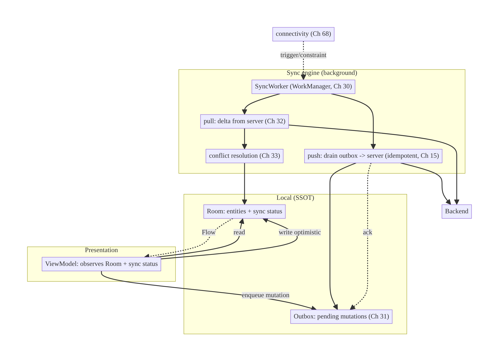
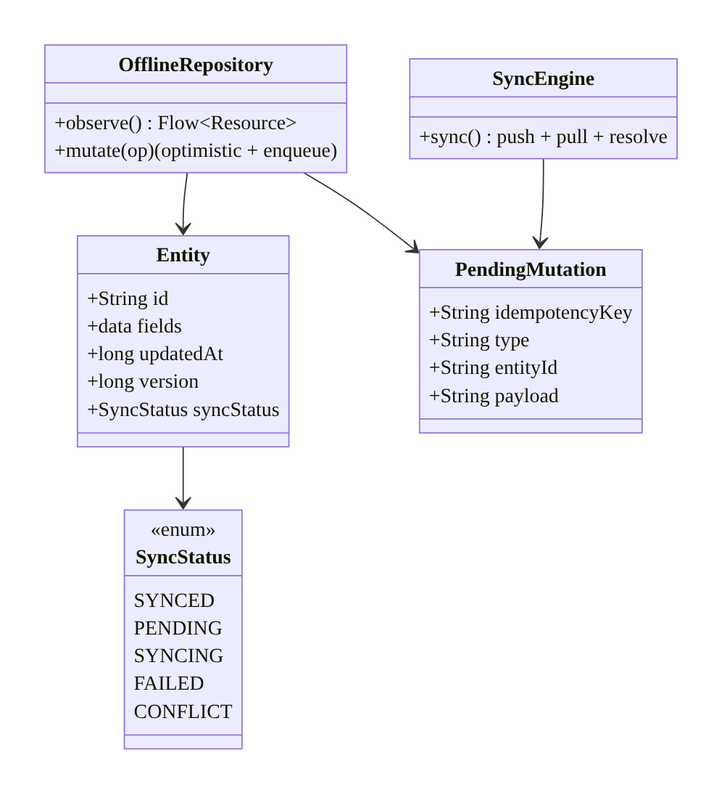
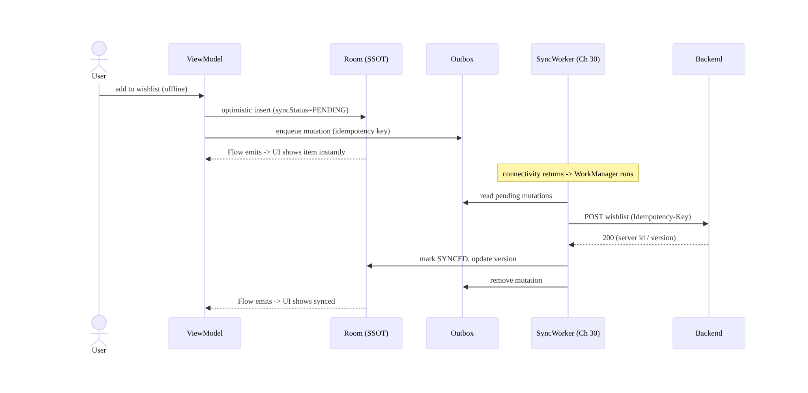
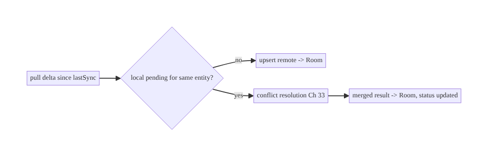
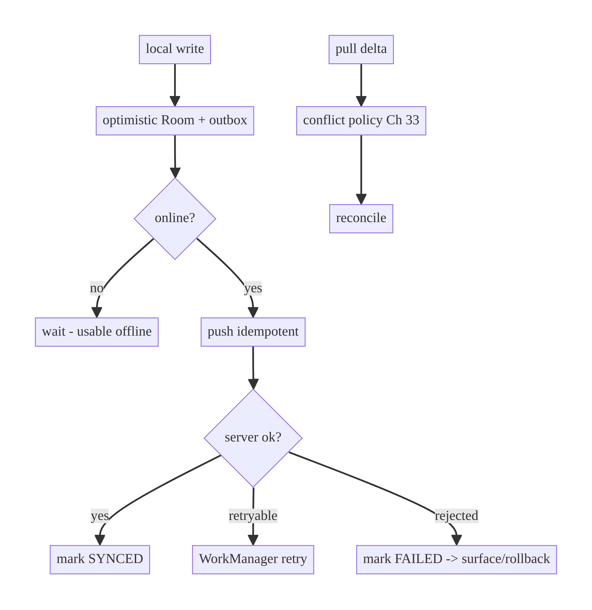

# Chapter 29 — Offline-First Architecture

> **Part IV — Offline-First & Synchronization** · Complexity: **Complex** (≥40 interview questions)
>
> **Prerequisites:** Ch 3 (SSOT / `networkBoundResource` — the read foundation),
> Ch 12 (caching), Ch 15 (idempotency — safe writes), Ch 6 (UI state), Ch 68
> (connectivity, previewed). This chapter is the **umbrella** for Part IV; it
> introduces the write path (outbox, Ch 31), sync (Ch 30/32), and conflicts
> (Ch 33), which the next chapters detail.
>
> **Reference surface in StreamCart:** browsing the catalog, editing the cart,
> and saving wishlist/watch-progress **fully offline**, syncing seamlessly when
> connectivity returns.

---

## 29.1 Problem Definition and Real-World Context

"Offline-first" means the app is **fully usable without a network** and treats the
network as an **enhancement**, not a requirement. The local store is authoritative
for reads and accepts writes immediately; synchronization happens in the
background. This inverts the naive "online-first" model where the UI blocks on the
network and is useless on a train, in an elevator, or on flaky café Wi-Fi. Naive
apps fail because:

- **The network is the source of truth.** Every screen fetches on demand; no
  connectivity = spinners and errors; rotation/process death refetch. (Ch 3
  established the fix: Room as SSOT.)
- **Writes require connectivity.** "Add to cart" / "like" / "save draft" fail or
  hang offline; users lose work. Offline-first demands writes **succeed locally
  immediately** and sync later.
- **No coherent sync model.** Ad-hoc "refresh" buttons, no background sync, no
  queue for offline writes, no conflict handling → data loss and inconsistency.
- **Poor offline UX.** No indication of what's cached/pending/stale; the user can't
  tell if their change "took."

The architecture composes patterns from across the book into a coherent system:
**SSOT reads** (Ch 3), **optimistic local writes** recorded in an **outbox**
(Ch 31), **background sync** via WorkManager (Ch 30) using **idempotent** mutations
(Ch 15) and **delta sync** (Ch 32), with **conflict resolution** (Ch 33) and
**connectivity awareness** (Ch 68). This chapter defines the end-to-end
offline-first design; later Part IV chapters go deep on each piece.

### Three practical use cases

1. **E-commerce (StreamCart Shop).** Browse catalog, edit cart, add to wishlist
   offline; cart/wishlist changes queue and sync on reconnect — no lost actions.
2. **OTT (Watch).** Watch progress, "my list," and downloads work offline;
   progress syncs across devices when back online.
3. **Productivity/Social (Social).** Compose posts/comments/drafts offline; they
   appear immediately (optimistic) and publish on reconnect (outbox), with conflict
   handling if edited elsewhere.

### Why this is architectural

Offline-first defines the app's **fundamental data-flow model** (local-authoritative
reads + queued writes + background sync), the **consistency guarantees** (eventual
consistency, conflict policy), and how **every feature** behaves without a network —
the single most impactful architectural decision for mobile UX and reliability.

---

## 29.2 Requirements Engineering

### Functional requirements

| ID | Requirement |
|----|-------------|
| F1 | Reads serve from the local store (SSOT); work fully offline (Ch 3). |
| F2 | Writes succeed locally immediately (optimistic) and are queued for sync. |
| F3 | Queued writes sync in the background when connectivity returns (Ch 30/31). |
| F4 | Mutations are idempotent so retries/replays don't duplicate (Ch 15). |
| F5 | Remote changes sync down (full or delta) and merge with local (Ch 32). |
| F6 | Conflicts between local and remote are resolved by policy (Ch 33). |
| F7 | The UI communicates sync/pending/stale/offline state. |

### Non-functional requirements

| Attribute | Policy |
|-----------|--------|
| **Availability** | App works offline; network is an enhancement. |
| **Consistency** | Eventual consistency; defined conflict policy; no silent data loss. |
| **Reliability** | No lost writes (durable outbox); survives process death. |
| **UX** | Instant local feedback; clear sync status; no blocking spinners for cached data. |
| **Battery/Network** | Batched, constrained, delta sync; not constant polling. |
| **Scalability** | Works as entities/screens grow; per-entity sync. |

### Scope

- **In scope:** the offline-first *architecture* — read path (SSOT), write path
  (optimistic + outbox), sync orchestration, consistency model, UX of sync state,
  how the pieces compose.
- **Out of scope (deep-dived in Part IV):** WorkManager internals (Ch 30), outbox
  mechanics (Ch 31), delta sync (Ch 32), conflict resolution (Ch 33), connectivity
  monitoring (Ch 68).

### Assumptions & constraints

- Room (Ch 3), WorkManager (Ch 30), idempotency keys (Ch 15). Backend supports
  sync (timestamps/versions, delta endpoints). Eventual consistency is acceptable
  (not a hard real-time/transactional requirement). `minSdk 24`.

---

## 29.3 System Design Fundamentals

- **Local store is authoritative for the UI.** The UI reads only from Room
  (Ch 3); the network updates Room, which re-emits. The user never waits on the
  network to see data.
- **Optimistic writes.** A write updates the local store **immediately** (the UI
  reflects it at once) and records a **pending operation** (outbox). The user
  perceives instant success; the actual server write happens asynchronously.
- **The outbox pattern (Ch 31).** Local writes are durably recorded as pending
  mutations (with idempotency keys, Ch 15) and replayed to the server by a
  background worker until acknowledged. This guarantees **no lost writes** across
  process death / offline periods.
- **Background sync (Ch 30).** A WorkManager job (constrained to connectivity,
  Ch 68) drains the outbox (push local changes) and pulls remote changes (delta,
  Ch 32), reconciling into Room.
- **Idempotency (Ch 15).** Because delivery is at-least-once (retries/replays),
  every mutation carries an idempotency key so the server applies it exactly once.
- **Conflict resolution (Ch 33).** When local and remote diverge (edited on two
  devices), a policy (last-writer-wins, merge, or user-resolved) decides the
  outcome, using versions/timestamps.
- **Eventual consistency.** Offline-first trades strong consistency for
  availability: devices converge over time. The UI must represent **pending/
  syncing/synced/conflict** states honestly.
- **Sync status as first-class state.** Each entity/operation has a sync status
  (synced, pending, syncing, failed/conflict) surfaced to the UI (Ch 6).

Core insight: **make the local store authoritative, accept writes optimistically
into a durable outbox, and reconcile with the server via idempotent background
sync and a conflict policy** — the network becomes an asynchronous enhancement,
and the app is always usable.

---

## 29.4 High-Level Architecture



**Components & ownership**

- **Room (SSOT)** holds entities **and** their sync status; the UI reads only here.
- **Outbox** durably records pending local writes (Ch 31).
- **SyncWorker** (WorkManager, Ch 30) pushes the outbox (idempotent) and pulls
  deltas (Ch 32), resolving conflicts (Ch 33) into Room.
- **Connectivity** (Ch 68) triggers/constrains sync.
- **ViewModel** observes Room + sync status; writes optimistically.

**Direction:** reads/writes go to Room; writes also enqueue to the outbox; the
background sync engine reconciles Room ↔ server.

---

## 29.5 Detailed Component Design



| Component | Responsibility | Ch |
|-----------|----------------|----|
| `Entity` with `syncStatus`/`version`/`updatedAt` | SSOT + sync metadata | 3/33 |
| `OfflineRepository` | SSOT reads + optimistic writes + enqueue | 3/31 |
| `PendingMutation` (outbox) | durable queued write + idempotency key | 31/15 |
| `SyncEngine`/`SyncWorker` | push/pull/reconcile | 30/32 |
| conflict resolver | merge policy | 33 |
| connectivity | trigger/constraint | 68 |

**The three sync phases:** **push** (drain outbox → server, mark synced on ack),
**pull** (fetch remote changes since last sync → merge), **resolve** (when local
pending + remote changed the same entity → conflict policy, Ch 33).

---

## 29.6 End-to-End Data Flow

### Offline write → background sync



### Pull with conflict



---

## 29.7 Complete Kotlin Implementation

Package: `com.streamcart.sync` and feature `:data:*`. (Each sub-pattern is detailed
in Ch 30–33; here is the composed skeleton.)

### 29.7.1 Entity with sync metadata

```kotlin
enum class SyncStatus { SYNCED, PENDING, SYNCING, FAILED, CONFLICT }

@Entity(tableName = "wishlist")
data class WishlistEntity(
    @PrimaryKey val id: String,              // client-generated UUID for offline creates
    val productId: String,
    val updatedAt: Long,
    val version: Long = 0,                   // for conflict detection (Ch 33)
    val syncStatus: SyncStatus = SyncStatus.PENDING,
    val deleted: Boolean = false,            // soft delete so deletes sync too
)
```

### 29.7.2 Offline repository: SSOT read + optimistic write + enqueue

```kotlin
class WishlistRepositoryImpl @Inject constructor(
    private val dao: WishlistDao,
    private val outbox: OutboxDao,                 // Ch 31
    private val syncScheduler: SyncScheduler,      // Ch 30
    private val clock: Clock,
) : WishlistRepository {

    override fun observe(): Flow<List<WishlistItem>> =
        dao.observeActive().map { list -> list.map { it.toDomain() } }   // reads are offline-first (Ch 3)

    override suspend fun add(productId: String) {
        val entity = WishlistEntity(
            id = UUID.randomUUID().toString(),         // client id -> works offline
            productId = productId, updatedAt = clock.now(), syncStatus = SyncStatus.PENDING,
        )
        dao.upsert(entity)                             // 1) optimistic local write (UI updates now)
        outbox.enqueue(PendingMutation(               // 2) durable queued write (Ch 31)
            idempotencyKey = UUID.randomUUID().toString(),   // Ch 15
            type = "wishlist.add", entityId = entity.id, payload = json(entity),
        ))
        syncScheduler.requestSync()                    // 3) nudge background sync (Ch 30)
    }

    override suspend fun remove(id: String) {
        dao.markDeleted(id, clock.now())               // soft delete, PENDING
        outbox.enqueue(PendingMutation(UUID.randomUUID().toString(), "wishlist.remove", id, ""))
        syncScheduler.requestSync()
    }
}
```

### 29.7.3 Sync engine (push → pull → resolve) — orchestration

```kotlin
class SyncEngine @Inject constructor(
    private val outbox: OutboxDao,
    private val api: SyncApi,
    private val dao: WishlistDao,
    private val resolver: ConflictResolver,          // Ch 33
    private val syncState: SyncStateStore,           // lastSyncToken (Ch 32)
) {
    suspend fun sync(): Result<Unit> = runCatching {
        push()     // drain outbox (idempotent, Ch 15)
        pull()     // delta (Ch 32) + resolve conflicts (Ch 33)
    }

    private suspend fun push() {
        outbox.pending().forEach { m ->
            dao.setStatus(m.entityId, SyncStatus.SYNCING)
            when (val r = api.apply(m.type, m.idempotencyKey, m.payload)) {   // server dedups by key
                is Outcome.Success -> { dao.applyServerAck(m.entityId, r.data); outbox.remove(m.idempotencyKey) }
                is Outcome.Failure -> if (!r.error.isRetryable()) { dao.setStatus(m.entityId, SyncStatus.FAILED); outbox.remove(m.idempotencyKey) }
                                      // retryable -> leave in outbox; WorkManager retries (Ch 30)
            }
        }
    }

    private suspend fun pull() {
        val since = syncState.lastToken()
        val delta = api.changesSince(since)                     // Ch 32
        delta.items.forEach { remote ->
            val local = dao.findById(remote.id)
            val merged = resolver.resolve(local, remote)        // Ch 33
            dao.upsert(merged)
        }
        syncState.setLastToken(delta.nextToken)
    }
}
```

### 29.7.4 ViewModel exposes data + sync status (Ch 6)

```kotlin
data class WishlistUiState(
    val items: List<WishlistItem>,
    val isOffline: Boolean,
    val pendingCount: Int,          // "2 changes will sync"
    val isSyncing: Boolean,
)
// combine(dao.observeActive(), connectivity.state, outbox.pendingCount(), syncState.isSyncing) -> UiState
```

### 29.7.5 Module structure

```
:data:wishlist   WishlistRepositoryImpl (optimistic + enqueue)
:core:database   WishlistEntity (+syncStatus/version), OutboxDao (Ch 31)
:sync            SyncEngine, SyncWorker (Ch 30), SyncScheduler, SyncStateStore (Ch 32)
:core:connectivity  connectivity state (Ch 68)
# ConflictResolver -> Ch 33
```

---

## 29.8 Concurrency and Race Conditions

| Scenario | Risk | Handling |
|----------|------|----------|
| Local write during an in-flight push | lost/overwritten change | version/`updatedAt` + enqueue new mutation; server dedups (Ch 15) |
| Push and pull overlap | inconsistent merge | sync in a single transaction/phase order (push then pull); or per-entity locking |
| Two writes to same entity offline | ordering | outbox is ordered (FIFO per entity); apply in order |
| Remote + local change same entity | conflict | detect via version; resolve (Ch 33) |
| Process death mid-sync | partial sync | durable outbox + `lastSyncToken`; resume idempotently (Ch 15/31) |
| Duplicate sync runs | double apply | idempotent mutations + `enqueueUniqueWork` (Ch 30) |
| Optimistic UI vs server rejection | stale UI | on non-retryable failure, mark FAILED/rollback; surface to user |

- **Idempotency (Ch 15) + a durable ordered outbox (Ch 31) + versioned entities
  (Ch 33) together make sync safe** under process death, retries, and concurrent
  edits — the three pillars of correct offline-first.
- **Phase ordering (push before pull)** reduces conflicts: send your pending
  changes first, then reconcile what came back.

---

## 29.9 Failure Scenarios and Recovery

| Failure | Detection | Response | UX |
|---------|-----------|----------|----|
| Offline | connectivity (Ch 68) | reads from Room; writes queue | fully usable; "will sync" |
| Reconnect | connectivity | WorkManager drains outbox + pulls | silent sync; status updates |
| Push rejected (validation) | non-retryable error | mark FAILED; rollback or flag; notify | "couldn't save X" |
| Conflict (edited elsewhere) | version mismatch | resolve by policy (Ch 33) | merged / user prompted |
| Process death mid-sync | durable state | resume from outbox + token (idempotent) | seamless |
| Partial sync | per-item results | retry failed items; keep succeeded | eventual convergence |
| Duplicate on retry | idempotency key | server dedups (Ch 15) | one effect |
| Stale local data | pull delta | reconcile; show "updated" | fresh |
| Outbox grows (long offline) | backlog | bounded; batch sync; compact redundant ops | drains on reconnect |



> **No silent data loss:** a write that can't sync is kept (outbox) and retried;
> a permanent rejection is surfaced to the user, never dropped. Offline-first's
> promise is that the user's work is safe.

---

## 29.10 Scaling the Implementation

- **Level 1.** Offline reads only: Room as SSOT + `networkBoundResource` (Ch 3).
- **Level 2.** Add optimistic writes + a durable outbox (Ch 31) + WorkManager sync
  (Ch 30) with idempotency (Ch 15).
- **Level 3 — production.** Delta sync (Ch 32); conflict resolution (Ch 33);
  connectivity-aware sync (Ch 68); sync-status UX; soft deletes; per-entity sync.
- **Level 4 — large.** Partial/selective sync (only what's needed), paging offline
  data (Ch 13), background periodic + event-driven sync, backpressure on large
  outboxes, encrypted offline data (Ch 24).
- **Level 5 — enterprise.** CRDTs or operational transforms for real-time
  collaborative merge, multi-device convergence guarantees, offline analytics,
  sync observability/SLAs, conflict audit trails.

**Avoid overengineering:** not every app needs full offline writes. Many only need
offline *reads* (Ch 3). Add the write path (outbox/sync/conflicts) when users must
act offline (cart, drafts, field apps) — it's significant complexity.

---

## 29.11 Alternative Approaches and Trade-offs

| Dimension | Option A | Option B | When |
|-----------|----------|----------|------|
| Model | Offline-first (local authoritative) | Online-first (network authoritative) | Offline-first for usability/unreliable networks; online-first for always-connected/strongly-consistent needs |
| Reads | SSOT (Room) | fetch-on-demand | SSOT for offline/consistency; fetch for purely-remote non-cached |
| Writes | Optimistic + outbox | pessimistic (block on server) | Optimistic for UX/offline; pessimistic when the user must see server confirmation (payments — but use idempotency + status) |
| Sync trigger | Event + periodic + on-connect | manual refresh only | Automatic for seamlessness; manual for user-controlled/costly sync |
| Consistency | Eventual | strong | Eventual for offline-first; strong needs connectivity/transactions |
| Conflict | LWW / merge / user (Ch 33) | server-wins always | Depends on data; user-resolved for important edits |
| Sync scope | Delta (Ch 32) | full refresh | Delta at scale; full for small datasets |

**Offline-first vs online-first:** offline-first maximizes availability and UX on
mobile but requires the whole sync/outbox/conflict machinery and accepts eventual
consistency. Online-first is simpler and strongly consistent but unusable without a
network. For consumer mobile, offline-first (at least for reads, often for writes)
is usually the right default; strongly-consistent flows (a bank transfer) still use
confirmation + idempotency rather than optimistic silence.

**Optimistic vs pessimistic writes:** optimistic gives instant UX and offline
capability but must handle rollback/conflict; pessimistic avoids divergence but
blocks on the network (bad offline/UX). Most actions are optimistic; truly critical
ones show explicit "processing" with idempotent server confirmation (Ch 15/19).

---

## 29.12 Security Considerations

- **Encrypt sensitive offline data** (Ch 24) — offline-first means more data lives
  on-device longer; a stolen device exposes it unless encrypted (Keystore-wrapped).
- **Clear offline data + outbox on logout** (Ch 22) and scope per account (Ch 42) —
  pending mutations and cached entities are user data.
- **Idempotency keys** (Ch 15) prevent duplicate side effects from replayed
  mutations — critical for financial actions synced from the outbox.
- **Server authorizes every synced mutation** — a tampered client could enqueue
  anything; the backend re-validates authz on each applied operation. Offline-first
  does not move trust to the client.
- **Conflict resolution must not leak/overwrite** other users' data (Ch 33);
  server-side checks on merges.
- **Bound offline storage** to avoid filling the device; evict old cached data
  (Ch 12).
- Client vs backend: the local store is a convenience replica; the backend remains
  the authoritative, access-controlled source and the arbiter of applied mutations.

---

## 29.13 Performance and Resource Optimization

- **Instant reads/writes** (local) = excellent perceived performance; no network on
  the critical path.
- **Batch + constrain sync** (Ch 30): sync on connectivity/charging, batch outbox
  pushes, use delta (Ch 32) — not constant polling (battery).
- **Bound the outbox** and **compact** redundant ops (e.g., multiple edits to one
  field → latest) before pushing.
- **Page offline data** (Ch 13) for large datasets; don't load everything into
  memory.
- **Avoid sync storms** on reconnect: `enqueueUniqueWork`, backoff (Ch 2/30).
- **Profiling:** sync duration/frequency, outbox size, battery/network from sync,
  conflict rate, read/write latency.

---

## 29.14 Testing Strategy

Test offline behavior, optimistic writes, outbox durability, and sync reconciliation
with fakes + in-memory Room.

```kotlin
class OfflineWishlistTest {
    @Test fun `add works offline and queues a mutation`() = runTest {
        val repo = repo(online = false)
        repo.add("p1")
        assertEquals(1, dao.observeActive().first().size)       // UI shows it (optimistic)
        assertEquals(1, outbox.pending().size)                  // queued
        assertEquals(SyncStatus.PENDING, dao.findByProduct("p1")!!.syncStatus)
    }

    @Test fun `sync drains outbox and marks synced`() = runTest {
        repo(online = false).add("p1")
        val engine = SyncEngine(outbox, FakeSyncApi(success = true), dao, resolver, syncState)
        engine.sync()
        assertTrue(outbox.pending().isEmpty())
        assertEquals(SyncStatus.SYNCED, dao.findByProduct("p1")!!.syncStatus)
    }

    @Test fun `retryable failure keeps mutation for later`() = runTest {
        repo(online = false).add("p1")
        SyncEngine(outbox, FakeSyncApi(ioError = true), dao, resolver, syncState).sync()
        assertEquals(1, outbox.pending().size)                  // retried next run
    }

    @Test fun `duplicate sync does not double-apply (idempotent)`() = runTest {
        repo(online = false).add("p1")
        val api = CountingSyncApi()
        val engine = SyncEngine(outbox, api, dao, resolver, syncState)
        engine.sync(); engine.sync()
        assertEquals(1, api.appliedKeys.size)                   // server dedups by key (Ch 15)
    }

    @Test fun `pull reconciles remote changes`() = runTest {
        val engine = SyncEngine(outbox, FakeSyncApi(delta = listOf(remote("p2"))), dao, resolver, syncState)
        engine.sync()
        assertNotNull(dao.findByProduct("p2"))
    }
}
```

Also: conflict scenario (Ch 33), process-death resume (outbox persists), soft-delete
sync, connectivity-triggered sync (Ch 30/68), and a full offline→online integration
test.

---

## 29.15 Production Observability

- **Metrics:** sync success/failure rate, sync latency/frequency, outbox size &
  drain time, pending-mutation age (how long writes stay unsynced), conflict rate &
  resolution outcomes, offline-usage rate, write-loss incidents (should be 0).
- **Logs:** `sync{phase, pushed, pulled, conflicts, duration, result}`,
  `mutation{type, status}` (ids/types, no PII, Ch 28), correlation IDs (Ch 1/84).
- **Debugging:** writes "disappear" → outbox not durable / not retried; duplicates →
  missing idempotency (Ch 15); data not updating → pull/delta broken (Ch 32);
  battery drain → over-frequent/unconstrained sync (Ch 30); stuck pending →
  non-retryable error not surfaced.
- **Alerting:** rising pending-mutation age or sync-failure rate → backend/sync
  incident.
- **Privacy:** offline data + outbox are user data; redact logs (Ch 28), honor
  deletion.

---

## 29.16 System Design Interview Preparation

> 40+ questions.

**Fundamentals**

1. *What is offline-first?* The app is fully usable offline; local store is
   authoritative; network is an enhancement; sync happens in the background.
2. *vs online-first?* Online-first blocks on the network (useless offline);
   offline-first serves local and syncs later.
3. *Read path?* SSOT — UI reads Room; network updates Room (Ch 3).
4. *Write path?* Optimistic local write + durable outbox (Ch 31) + background sync
   (Ch 30).
5. *Consistency model?* Eventual consistency with a conflict policy (Ch 33).

**Write path / outbox**

6. *What's the outbox?* A durable queue of pending local mutations replayed to the
   server until acked (Ch 31).
7. *Why durable?* Survive process death / long offline; no lost writes.
8. *Why idempotency keys?* At-least-once delivery (retries/replays) → exactly-once
   effect (Ch 15).
9. *Client-generated ids?* So creates work offline before the server assigns an id.
10. *Soft deletes?* So deletes sync (a hard-deleted row can't be pushed).

**Sync engine**

11. *Sync phases?* Push (drain outbox), pull (delta), resolve (conflicts).
12. *Why push before pull?* Send local changes first, then reconcile — fewer
    conflicts.
13. *What triggers sync?* Connectivity return (Ch 68), periodic, and on write
    (Ch 30).
14. *Delta vs full sync?* Delta (changes since a token) scales; full for small data
    (Ch 32).

**Conflicts**

15. *When do conflicts happen?* Local pending + remote changed the same entity.
16. *How detect?* Version/`updatedAt` mismatch (Ch 33).
17. *Resolution strategies?* LWW, field merge, user-resolved (Ch 33).

**Concurrency/reliability**

18. *Process death mid-sync?* Durable outbox + last-sync token; resume idempotently.
19. *Duplicate sync runs?* Idempotent mutations + `enqueueUniqueWork` (Ch 30).
20. *Two offline edits same entity?* Ordered outbox; apply in order.
21. *No lost writes guarantee?* Durable outbox + retry + surface permanent failures.

**UX**

22. *Sync status?* Per-entity status (synced/pending/syncing/failed/conflict)
    surfaced to UI (Ch 6).
23. *Optimistic rollback?* On non-retryable rejection, revert + notify.
24. *Offline indication?* Connectivity state + pending count (Ch 68).

**Security**

25. *Sensitive offline data?* Encrypt (Ch 24); clear on logout (Ch 22); per-account
    (Ch 42).
26. *Does offline-first trust the client?* No — server authorizes every applied
    mutation.
27. *Financial actions offline?* Idempotent + explicit status; not silent
    optimistic.

**Performance/scale**

28. *Battery?* Constrained/batched/delta sync (Ch 30/32), not polling.
29. *Large offline datasets?* Paging (Ch 13), selective sync, eviction (Ch 12).
30. *Outbox backlog after long offline?* Bound + compact redundant ops.

**Testing**

31. *How test offline writes?* Fake offline; assert optimistic + queued.
32. *How test sync?* Fake API; assert drain + status; idempotent double-sync.
33. *How test process-death resume?* Persist outbox; re-run; no dup.

**Production debugging**

34. *Writes disappear?* Non-durable/non-retried outbox.
35. *Duplicates?* Missing idempotency.
36. *Data not updating?* Broken pull/delta.
37. *Battery drain?* Over-frequent/unconstrained sync.
38. *Stuck pending?* Non-retryable error not surfaced.

**Design**

39. *When NOT offline-first (writes)?* Always-connected/strong-consistency flows;
    then offline *reads* only.
40. *CRDTs?* For real-time collaborative merge (advanced, Ch 33).

### Design-change challenges
1. **Make the cart editable offline.** Optimistic writes + outbox + idempotent sync.
2. **Support two-device editing.** Versioning + conflict resolution (Ch 33).
3. **Handle week-long offline.** Bounded/compacted outbox; delta sync on reconnect.
4. **Payments offline.** Idempotency + explicit status, not silent optimism (Ch 15).
5. **Real-time collaboration.** CRDT/OT merge; push via WebSocket (Ch 63).

### Mock walkthrough (abridged)
Clarify (offline reads only or writes too? consistency? conflicts?) → SSOT reads
(Ch 3) → optimistic writes + durable outbox (Ch 31) + idempotency (Ch 15) →
WorkManager sync push/pull (Ch 30) + delta (Ch 32) → conflict policy (Ch 33) →
sync-status UX → security (encrypt/clear) → eventual consistency trade-offs →
testing.

---

## 29.17 Practical Exercises

1. **Beginner.** Make a list read offline-first (Room SSOT + `networkBoundResource`,
   Ch 3). *Eval:* works with no network; refreshes online.
2. **Intermediate.** Add optimistic create/delete with a durable outbox + idempotency
   key; drain it on reconnect. *Eval:* instant UI; queued; synced; no dup on
   double-sync.
3. **Advanced.** Add delta pull (Ch 32) + LWW conflict resolution (Ch 33) + sync-
   status UX. *Eval:* remote changes merge; conflicts resolved; status shown.
4. **Production debugging.** Fix an app that loses offline writes (non-durable
   outbox) and duplicates on retry (no idempotency). *Eval:* durable + idempotent.
5. **System design challenge.** Design offline-first for a collaborative doc with
   two-device edits (versioning + conflict policy; consider CRDT). *Eval:* converges;
   no lost edits.

*(Solutions withheld unless requested.)*

---

## 29.18 Chapter Summary & Reference Sheet

**Key decisions:** make the **local store authoritative** (SSOT reads, Ch 3);
accept **optimistic writes** into a **durable outbox** (Ch 31) with **idempotency
keys** (Ch 15); reconcile via **background sync** (WorkManager, Ch 30) that
**pushes then pulls** (delta, Ch 32) and **resolves conflicts** (Ch 33); model
**eventual consistency** and surface **per-entity sync status** (Ch 6); use
**client-generated ids** + **soft deletes** so creates/deletes work offline;
**encrypt + clear** offline data (Ch 24/22); the **backend still authorizes** every
applied mutation. **No silent data loss** — the user's work is always safe.

**Concepts:** offline-first vs online-first, SSOT reads, optimistic writes, outbox,
idempotency, background sync, delta sync, conflict resolution, eventual consistency,
sync status.

**Common mistakes:** network as source of truth; blocking writes on the network;
non-durable outbox (lost writes); no idempotency (duplicates); no conflict policy
(lost edits); hard deletes (can't sync); unconstrained sync (battery); no sync-status
UX; unencrypted offline data; trusting the client for authz.

**Checklist:**

- [ ] SSOT reads (Ch 3)
- [ ] optimistic writes
- [ ] durable outbox (Ch 31)
- [ ] idempotency keys (Ch 15)
- [ ] WorkManager sync push→pull (Ch 30)
- [ ] delta sync (Ch 32)
- [ ] conflict policy (Ch 33)
- [ ] client ids + soft deletes
- [ ] sync-status UX
- [ ] encrypt + clear offline data
- [ ] server authorizes mutations.

**Key APIs/patterns:** Room (SSOT, Ch 3), `networkBoundResource`, `Outbox`/
`PendingMutation` (Ch 31), WorkManager (Ch 30), idempotency keys (Ch 15), delta
tokens (Ch 32), `ConflictResolver` (Ch 33), `SyncStatus`, connectivity (Ch 68).

**References:**
- Offline-first (data layer): https://developer.android.com/topic/architecture/data-layer/offline-first
- Guide to app architecture: https://developer.android.com/topic/architecture
- WorkManager (Ch 30): https://developer.android.com/topic/libraries/architecture/workmanager
- (composes) Ch 3 SSOT, Ch 15 Idempotency, Ch 30 WorkManager, Ch 31 Outbox, Ch 32 Delta Sync, Ch 33 Conflicts

### Chapter review (Phase 4)
- **Completeness:** all 18 sections; architecture/class/sequence/failure diagrams;
  composed offline-first skeleton (entity + optimistic repo + sync engine + UI
  status); concurrency (3 pillars: idempotency/outbox/versioning); failure (no
  silent loss); 5 levels; offline-vs-online and optimistic-vs-pessimistic trade-offs;
  security (encrypt/clear/authz); perf (batch/delta/bound); offline + sync tests;
  observability (pending age); 40 Q&A + 5 challenges. ✅
- **Expand later:** this is the umbrella — WorkManager (Ch 30), outbox (Ch 31),
  delta sync (Ch 32), conflict resolution (Ch 33) go deep next; CRDTs, real-time
  (Ch 63).
- **Interview coverage:** exceeds ≥40 bar. **Opens Part IV.**
