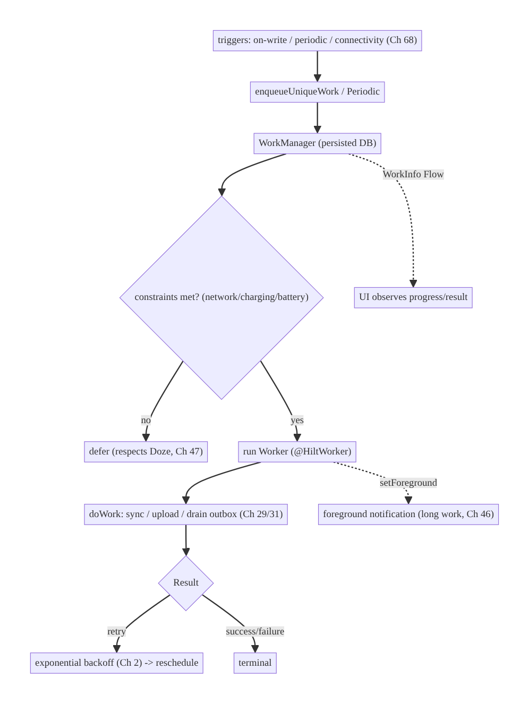
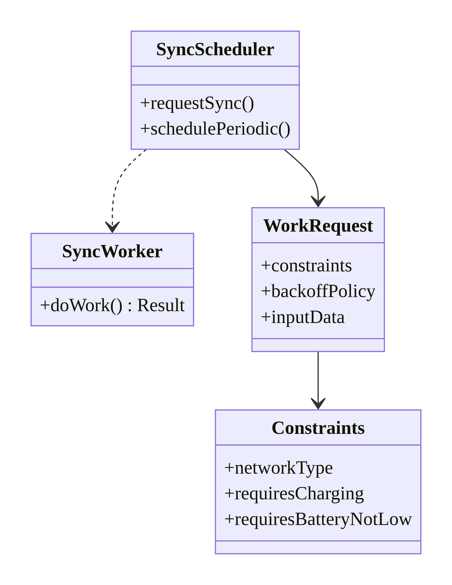
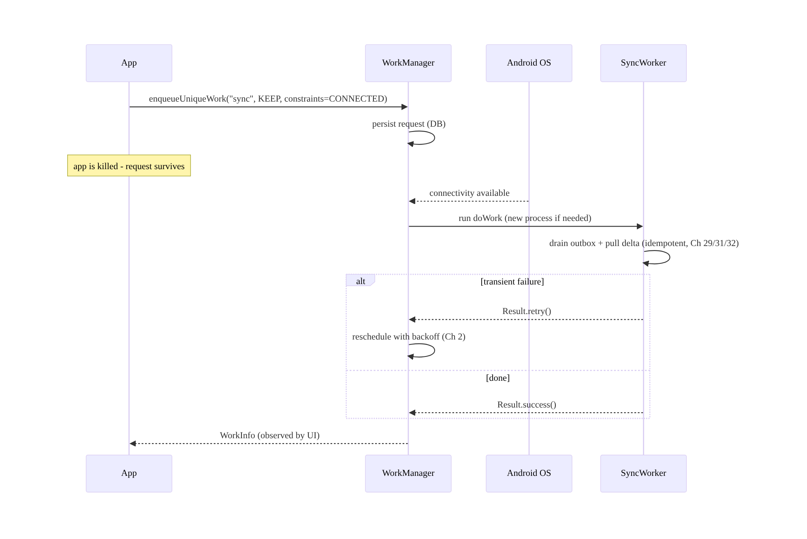
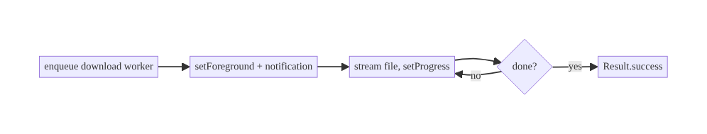
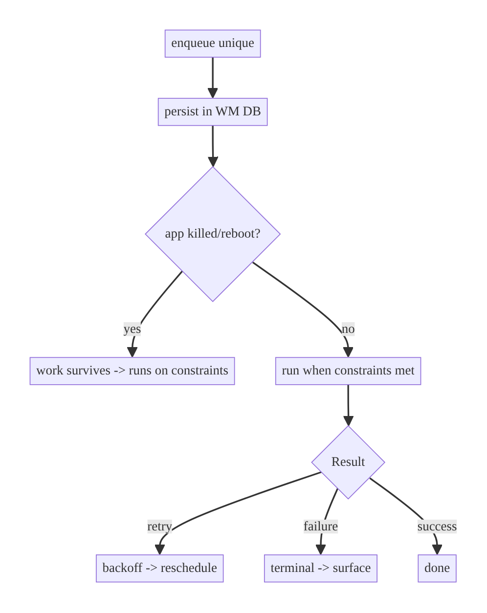

# Chapter 30 — Background Synchronization with WorkManager

> **Part IV — Offline-First & Synchronization** · Complexity: **Complex** (≥40 interview questions)
>
> **Prerequisites:** Ch 29 (offline-first — why we sync), Ch 2 (retry/backoff),
> Ch 15 (idempotency), Ch 5 (Hilt — `@HiltWorker`), Ch 47 (Doze/background limits,
> previewed). Powers Ch 17/18 (up/downloads), Ch 31 (outbox drain), Ch 32 (delta
> sync), Ch 49 (notifications).
>
> **Reference surface in StreamCart:** reliably running catalog sync, outbox
> drain, media downloads, and analytics flush in the background — surviving app
> kills, reboots, and Doze.

---

## 30.1 Problem Definition and Real-World Context

Mobile apps must do work that **outlives the UI** and must run **reliably** even
when the app is backgrounded or killed: syncing data (Ch 29), uploading/downloading
(Ch 17/18), flushing analytics (Ch 14), refreshing tokens on a schedule. Android
aggressively restricts background execution to save battery (Doze, App Standby,
background-service limits, Ch 47), so naive approaches break:

- **Doing it in the UI scope.** A `viewModelScope` coroutine dies the moment the
  user navigates away or the process is killed — the sync/upload never completes.
- **Plain services / `AlarmManager` + wakelocks.** Modern Android kills background
  services and defers alarms in Doze; hand-rolled wakelock schedulers drain battery
  and fight the OS.
- **No guarantee across reboot/kill.** Work scheduled in memory is lost on process
  death or device restart.
- **Ignoring constraints.** Syncing on a metered connection or low battery wastes
  the user's data/power; naive code doesn't wait for Wi-Fi/charging.
- **Duplicate/overlapping work.** Triggering sync from multiple places spawns
  concurrent, conflicting jobs.

**WorkManager** is the Jetpack solution for **deferrable, guaranteed** background
work: it persists work in a database, runs it respecting **constraints** (network,
charging, battery), **retries with backoff**, survives **process death and reboot**,
and integrates with **Doze**/background limits (Ch 47) using the right under-the-
hood mechanism per API level. The architecture is about **what work goes to
WorkManager vs elsewhere**, **constraints/uniqueness/backoff**, **expedited and
long-running (foreground) work**, and **observing results** — getting background
work to actually complete without draining the battery.

### Three practical use cases

1. **Data sync (StreamCart).** A periodic + event-triggered `SyncWorker` drains the
   outbox (Ch 31) and pulls deltas (Ch 32) on connectivity, surviving kills/reboots.
2. **Media download (Watch).** A long-running foreground worker downloads an episode
   with a progress notification, constrained to unmetered/charging (Ch 18).
3. **Analytics flush / token prefetch (all).** Deferrable periodic work batched to
   save battery (Ch 14), expedited work for time-sensitive tasks.

### Why this is architectural

Background execution defines **what work runs reliably off the UI**, how it
**respects battery/network constraints and Doze**, how it **survives process death/
reboot**, and how results flow back — properties that determine whether sync,
uploads, and downloads actually complete on real devices.

---

## 30.2 Requirements Engineering

### Functional requirements

| ID | Requirement |
|----|-------------|
| F1 | Run deferrable work that survives app kill and device reboot. |
| F2 | Respect constraints (network type, charging, battery not low, idle). |
| F3 | Retry failures with exponential backoff (Ch 2). |
| F4 | Deduplicate/uniquely name work to avoid overlap. |
| F5 | Support periodic and one-time work; event-triggered sync. |
| F6 | Support expedited (time-sensitive) and long-running (foreground) work. |
| F7 | Observe progress/result from the UI; chain dependent work. |

### Non-functional requirements

| Attribute | Policy |
|-----------|--------|
| **Reliability** | Guaranteed execution (persisted); resumes after kill/reboot. |
| **Battery/Network** | Constraints + batching; respect Doze/limits (Ch 47); not polling. |
| **Correctness** | Idempotent work (Ch 15); no duplicate effects on retry. |
| **Testability** | Workers testable in isolation; DI via Hilt. |
| **UX** | Progress/result observable; foreground notification for long work. |

### Scope

- **In scope:** WorkManager fundamentals (Worker/CoroutineWorker, constraints,
  backoff, unique work, periodic/one-time, expedited, foreground/long-running,
  chaining, observing, `@HiltWorker`), when to use WorkManager vs alternatives,
  Doze interaction, testing.
- **Out of scope:** the sync *logic* (Ch 29/32), outbox (Ch 31), up/download
  mechanics (Ch 17/18), Doze/background-limits depth (Ch 47), foreground-service
  depth (Ch 46), notifications (Ch 49).

### Assumptions & constraints

- WorkManager 2.9+, Hilt (`@HiltWorker` + `HiltWorkerFactory`). Idempotent work
  (Ch 15). `minSdk 24`. WorkManager is for **deferrable, guaranteed** work — not
  immediate foreground tasks nor exact-time alarms.

---

## 30.3 System Design Fundamentals

- **WorkManager = deferrable + guaranteed.** It persists work requests in a local
  DB and executes them via the best available mechanism per API level (JobScheduler,
  etc.), so work **survives process death and reboot** and runs when constraints are
  met. It is the recommended API for background work that must *eventually* run but
  not *immediately*.
- **When NOT to use it.** Immediate work tied to a visible task → a coroutine/
  foreground service; exact-time triggers (alarms, calendar) → `AlarmManager`
  (Ch 48); in-process immediate reactions → just a coroutine. WorkManager trades
  immediacy for guarantees.
- **Constraints.** Declare requirements (network type, charging, battery-not-low,
  storage-not-low, device-idle); WorkManager defers until met — the key battery/
  data lever.
- **Backoff & retry.** A worker returns `Result.retry()` to be rescheduled with
  **exponential or linear backoff** (Ch 2); `success`/`failure` are terminal.
- **Unique work.** `enqueueUniqueWork`/`enqueueUniquePeriodicWork` with a name +
  policy (`KEEP`/`REPLACE`/`APPEND`) prevents duplicate/overlapping jobs — essential
  for sync.
- **One-time vs periodic.** One-time for event-driven (sync-on-write, upload);
  periodic for recurring (min interval 15 min) — note periodic work can't be
  expedited and has a minimum interval.
- **Expedited work.** For time-sensitive, user-initiated work that should run ASAP
  (quota-limited); may require a foreground notification on some versions.
- **Long-running / foreground work.** `setForeground`/`getForegroundInfo` runs the
  worker as a foreground service with a notification (Ch 46) — for long tasks
  (large downloads, Ch 18) that need to keep running and show progress.
- **Chaining.** `beginWith(...).then(...)` builds dependency graphs (e.g., compress
  → upload); combine results with `WorkContinuation`.
- **Observing & DI.** `getWorkInfo*Flow` exposes state/progress to the UI; Hilt's
  `@HiltWorker` + `HiltWorkerFactory` injects dependencies (Ch 5) into workers.
- **Idempotency (Ch 15).** Because WorkManager may retry/re-run, the work must be
  idempotent (e.g., outbox mutations with keys) so re-execution is safe.

Core insight: **put deferrable, must-eventually-run work in WorkManager with the
right constraints, unique naming, and backoff; make it idempotent; use foreground/
expedited for the exceptions; and observe results via `WorkInfo`.** Let the OS
decide *when*, within your constraints, to maximize reliability and battery life.

---

## 30.4 High-Level Architecture



**Components & ownership**

- **WorkManager** persists and schedules work, enforcing constraints + backoff,
  surviving kill/reboot.
- **Workers** (`CoroutineWorker`, `@HiltWorker`) do the actual (idempotent) work.
- **Triggers** (write events, periodic, connectivity Ch 68) enqueue unique work.
- **Foreground** (Ch 46) for long work; **WorkInfo** flows for observation.

**Direction:** trigger → enqueue (unique) → WorkManager (constrained, persisted) →
Worker runs → Result (retry/terminal); UI observes `WorkInfo`.

---

## 30.5 Detailed Component Design



| Component | Responsibility | Notes |
|-----------|----------------|-------|
| `CoroutineWorker` (`@HiltWorker`) | idempotent background work | `doWork(): Result` |
| `Constraints` | when work may run | network/charging/battery/idle |
| `WorkRequest` | work config | one-time/periodic, backoff, input/tags |
| `enqueueUniqueWork` | dedup/naming | `KEEP`/`REPLACE`/`APPEND` |
| `setForeground` | long work | notification (Ch 46) |
| `WorkInfo` flow | observe | state/progress/output |

**`Result` semantics:** `Result.success(data)` (done, optional output),
`Result.retry()` (reschedule with backoff), `Result.failure(data)` (terminal
failure). Choose retry only for transient failures (Ch 2).

---

## 30.6 End-to-End Data Flow

### Connectivity-triggered sync that survives a kill



### Long-running download (foreground)



---

## 30.7 Complete Kotlin Implementation

Package: `com.streamcart.sync`.

### 30.7.1 CoroutineWorker with Hilt injection (idempotent)

```kotlin
@HiltWorker
class SyncWorker @AssistedInject constructor(
    @Assisted appContext: Context,
    @Assisted params: WorkerParameters,
    private val syncEngine: SyncEngine,              // Ch 29/32
) : CoroutineWorker(appContext, params) {

    override suspend fun doWork(): Result = try {
        when (syncEngine.sync()) {                   // idempotent (Ch 15/31)
            is SyncResult.Success -> Result.success()
            is SyncResult.Retryable -> Result.retry()        // transient -> backoff
            is SyncResult.Permanent -> Result.failure()
        }
    } catch (e: Exception) {
        if (runAttemptCount < MAX_ATTEMPTS) Result.retry() else Result.failure()
    }
    private companion object { const val MAX_ATTEMPTS = 5 }
}
```

### 30.7.2 Hilt WorkerFactory wiring

```kotlin
// Application implements Configuration.Provider so WorkManager uses HiltWorkerFactory.
@HiltAndroidApp
class StreamCartApp : Application(), Configuration.Provider {
    @Inject lateinit var workerFactory: HiltWorkerFactory
    override val workManagerConfiguration: Configuration
        get() = Configuration.Builder().setWorkerFactory(workerFactory).build()
}
// (and remove the default WorkManagerInitializer in the manifest)
```

### 30.7.3 Scheduler: unique one-time (event) + periodic, with constraints + backoff

```kotlin
class SyncScheduler @Inject constructor(@ApplicationContext private val context: Context) {
    private val wm get() = WorkManager.getInstance(context)

    private val constraints = Constraints.Builder()
        .setRequiredNetworkType(NetworkType.CONNECTED)      // wait for network (Ch 68)
        .setRequiresBatteryNotLow(true)
        .build()

    // Event-triggered (e.g., after a local write, Ch 29): unique, keep if already queued.
    fun requestSync() {
        val request = OneTimeWorkRequestBuilder<SyncWorker>()
            .setConstraints(constraints)
            .setBackoffCriteria(BackoffPolicy.EXPONENTIAL, 15, TimeUnit.SECONDS)   // Ch 2
            .addTag("sync")
            .build()
        wm.enqueueUniqueWork("sync", ExistingWorkPolicy.KEEP, request)             // dedup
    }

    // Recurring background sync (min interval 15 min); keep existing schedule.
    fun schedulePeriodic() {
        val request = PeriodicWorkRequestBuilder<SyncWorker>(6, TimeUnit.HOURS)
            .setConstraints(constraints)
            .build()
        wm.enqueueUniquePeriodicWork("sync-periodic", ExistingPeriodicWorkPolicy.KEEP, request)
    }
}
```

### 30.7.4 Expedited work (time-sensitive)

```kotlin
val expedited = OneTimeWorkRequestBuilder<SyncWorker>()
    .setExpedited(OutOfQuotaPolicy.RUN_AS_NON_EXPEDITED_WORK_REQUEST)   // fallback if quota exceeded
    .build()
wm.enqueue(expedited)
```

### 30.7.5 Long-running foreground worker (Ch 18/46)

```kotlin
@HiltWorker
class DownloadWorker @AssistedInject constructor(/* ... */) : CoroutineWorker(ctx, params) {
    override suspend fun getForegroundInfo() = ForegroundInfo(NOTIF_ID, buildNotification(0))
    override suspend fun doWork(): Result {
        setForeground(getForegroundInfo())                 // run as foreground service (Ch 46)
        // stream file; periodically: setForeground(updatedNotification); setProgress(...)
        return Result.success()
    }
}
```

### 30.7.6 Chaining + observing

```kotlin
// Chain: compress -> upload.
WorkManager.getInstance(context)
    .beginUniqueWork("export", ExistingWorkPolicy.REPLACE, OneTimeWorkRequest.from(CompressWorker::class.java))
    .then(OneTimeWorkRequest.from(UploadWorker::class.java))
    .enqueue()

// Observe (UI):
val syncState: Flow<WorkInfo.State?> = WorkManager.getInstance(context)
    .getWorkInfosForUniqueWorkFlow("sync")
    .map { it.firstOrNull()?.state }
```

### 30.7.7 Module structure

```
:sync   SyncWorker, DownloadWorker, SyncScheduler
:app    StreamCartApp (Configuration.Provider + HiltWorkerFactory)
# SyncEngine -> Ch 29/32; Outbox -> Ch 31
```

---

## 30.8 Concurrency and Race Conditions

| Scenario | Risk | Handling |
|----------|------|----------|
| Multiple sync triggers | overlapping jobs | `enqueueUniqueWork(KEEP)` — one job |
| Retry re-runs work | duplicate effects | idempotent work (Ch 15); outbox keys (Ch 31) |
| Periodic + event work overlap | double sync | distinct unique names; idempotent |
| Work runs in a new process | no app state | self-contained worker; inject deps (Hilt) |
| `runAttemptCount` growth | infinite retry | cap attempts → `failure` |
| Progress updates spam | IPC overhead | throttle `setProgress`/foreground updates |
| Constraint flaps (network) | thrashing | WorkManager handles re-eval; backoff |

- **Unique work + idempotency are the two correctness pillars:** uniqueness
  prevents overlap; idempotency makes retries/re-runs safe (WorkManager guarantees
  *at-least-once*, not *exactly-once*, execution).
- **Workers must be self-contained** (may run in a fresh process) — inject
  dependencies, read inputs from `inputData`, don't rely on in-memory app state.

---

## 30.9 Failure Scenarios and Recovery

| Failure | Detection | Response | Outcome |
|---------|-----------|----------|---------|
| App killed / process death | WorkManager persists | resume work on constraints | guaranteed run |
| Device reboot | persisted + `BOOT_COMPLETED` | re-scheduled automatically | survives reboot |
| Transient error (network/5xx) | exception/retryable | `Result.retry()` + backoff (Ch 2) | eventual success |
| Permanent error (4xx/validation) | non-retryable | `Result.failure()`; surface (Ch 29) | stop; notify |
| Doze / background limits | OS defers | runs in maintenance windows (Ch 47) | delayed but runs |
| Constraints unmet (metered/low battery) | constraint | defer until met | battery/data saved |
| Expedited quota exceeded | quota | fallback to non-expedited (policy) | still runs, later |
| Long work killed | foreground service | keeps running with notification (Ch 46) | completes |
| Duplicate enqueue | unique policy | `KEEP`/`REPLACE` | one job |



> **Guaranteed execution is the headline:** once enqueued, work runs *eventually*
> even across kills/reboots/Doze — your job is to make it **idempotent** and
> **constrained**, and to return `retry` only for transient failures.

---

## 30.10 Scaling the Implementation

- **Level 1.** One `CoroutineWorker` for sync, enqueued uniquely with constraints +
  backoff.
- **Level 2.** Periodic + event-triggered sync; Hilt injection; observe `WorkInfo`.
- **Level 3 — production.** Expedited for time-sensitive; foreground for long work
  (Ch 18/46); chaining; connectivity-triggered (Ch 68); idempotent outbox drain
  (Ch 31).
- **Level 4 — large.** Multiple named workers per domain; remote-config sync
  cadence (Ch 41); adaptive constraints by network/battery; coalesced sync to avoid
  storms; progress UX.
- **Level 5 — enterprise.** Priority/quotas across many workers (Ch 14), sync
  observability/SLAs, Doze-aware scheduling policies, cross-module work governance,
  WorkManager + push-triggered sync (FCM, Ch 49).

**Avoid overengineering:** immediate in-UI work doesn't need WorkManager (use a
coroutine). Use WorkManager specifically for **deferrable, must-eventually-run**
work; don't force everything through it.

---

## 30.11 Alternative Approaches and Trade-offs

| Need | Use | Not | Why |
|------|-----|-----|-----|
| Deferrable, guaranteed (sync/upload) | **WorkManager** | coroutine/service | persisted, constrained, survives kill/reboot |
| Immediate, tied to visible UI | coroutine (`viewModelScope`) | WorkManager | no persistence needed; immediate |
| Immediate long user-visible task | Foreground service (Ch 46) / WorkManager foreground | background service | won't be killed; shows progress |
| Exact-time trigger (alarm/reminder) | `AlarmManager` (Ch 48) | WorkManager | WorkManager isn't exact-time |
| Push-triggered sync | FCM (Ch 49) → enqueue WorkManager | polling | server-initiated; battery-friendly |
| Periodic (≥15 min) | WorkManager periodic | `AlarmManager` loop | battery-efficient, constraint-aware |

**WorkManager vs coroutine/service:** a coroutine is right for immediate work while
the UI/process lives; WorkManager is right when work must survive the UI/process and
run under constraints later. A foreground service is for immediate long-running
user-visible work (WorkManager's foreground mode wraps this). `AlarmManager` is only
for exact-time triggers. Choosing wrong → either dropped work (coroutine for sync) or
battery waste/overkill (WorkManager for immediate UI work).

**Periodic vs one-time + reschedule:** periodic is simplest for recurring work
(≥15 min, constraint-aware) but can't be expedited and drifts; one-time + manual
reschedule gives finer control at more complexity. Use periodic for routine sync;
event-triggered one-time for responsiveness.

---

## 30.12 Security Considerations

- **Workers run with app privileges** on possibly-sensitive data (sync, uploads) —
  encrypt data at rest (Ch 24); don't log PII/secrets (Ch 28) in worker output/
  progress.
- **`inputData` is persisted in the WorkManager DB** — don't put secrets/tokens in
  `inputData`; pass ids and read secrets from Keystore-backed storage (Ch 20) inside
  the worker.
- **Idempotent + authorized:** synced mutations carry idempotency keys (Ch 15) and
  the backend authorizes each (Ch 29) — a replayed worker can't double-apply or
  escalate.
- **Foreground notifications** (Ch 46) for long work must not leak sensitive content
  in the notification text.
- **Clear scheduled work + sensitive data on logout** (Ch 22): cancel user-scoped
  workers; don't sync after logout.
- Client vs backend: WorkManager reliably runs client work; the backend still
  authorizes and validates everything the worker sends.

---

## 30.13 Performance and Resource Optimization

- **Constraints are the battery lever:** sync on unmetered/charging/battery-not-low;
  defer otherwise — the single biggest efficiency win.
- **Batch & coalesce:** one unique sync job (not per-change); batch outbox pushes
  (Ch 31) and analytics (Ch 14); avoid sync storms on reconnect.
- **Respect Doze/windows** (Ch 47): deferrable work runs in maintenance windows —
  don't fight it with wakelocks/alarms.
- **Minimize wakeups:** periodic cadence as low as acceptable; prefer push-triggered
  sync (FCM) over frequent polling.
- **Don't block:** `CoroutineWorker.doWork` is suspend; do I/O on IO dispatcher; keep
  foreground updates throttled.
- **Profiling:** Background Task Inspector (Android Studio) for WorkManager jobs,
  battery historian, sync frequency/duration, retry rate.

---

## 30.14 Testing Strategy

WorkManager provides test utilities; test workers in isolation and scheduling
behavior.

```kotlin
@RunWith(AndroidJUnit4::class)
class SyncWorkerTest {
    @Before fun setUp() {
        WorkManagerTestInitHelper.initializeTestWorkManager(
            context, Configuration.Builder().setWorkerFactory(testHiltFactory).build()
        )
    }

    @Test fun `worker returns success when sync succeeds`() = runTest {
        val worker = TestListenableWorkerBuilder<SyncWorker>(context)
            .setWorkerFactory(factory(FakeSyncEngine(result = Success)))
            .build()
        assertEquals(ListenableWorker.Result.success(), worker.doWork())
    }

    @Test fun `transient failure returns retry`() = runTest {
        val worker = TestListenableWorkerBuilder<SyncWorker>(context)
            .setWorkerFactory(factory(FakeSyncEngine(result = Retryable))).build()
        assertEquals(ListenableWorker.Result.retry(), worker.doWork())
    }

    @Test fun `constraints met triggers run (test driver)`() {
        val request = OneTimeWorkRequestBuilder<SyncWorker>()
            .setConstraints(Constraints.Builder().setRequiredNetworkType(NetworkType.CONNECTED).build()).build()
        val wm = WorkManager.getInstance(context); wm.enqueue(request).result.get()
        val driver = WorkManagerTestInitHelper.getTestDriver(context)!!
        driver.setAllConstraintsMet(request.id)                 // simulate constraints
        assertEquals(WorkInfo.State.SUCCEEDED, wm.getWorkInfoById(request.id).get().state)
    }

    @Test fun `unique work keeps existing (no duplicate)`() { /* enqueueUniqueWork KEEP twice -> 1 */ }
}
```

What to test: `doWork` success/retry/failure (idempotent), constraint gating (test
driver), unique-work dedup, backoff, periodic scheduling, foreground info. Use
`TestListenableWorkerBuilder` for unit-ish worker tests, `WorkManagerTestInitHelper`
for scheduling.

---

## 30.15 Production Observability

- **Metrics:** work success/retry/failure rate per worker, scheduled-vs-run latency
  (how long deferred), run frequency, backoff/retry counts, foreground-work
  completion, battery impact.
- **Logs:** `work{name, state, attempt, result, duration}` (via worker + `WorkInfo`;
  no PII, Ch 28), correlation IDs (Ch 1/84).
- **Debugging:** work never runs → constraints never met / cancelled / factory
  misconfigured (no `Configuration.Provider`); work runs repeatedly → not idempotent
  / wrong unique policy; battery drain → too-frequent/unconstrained work; long work
  killed → missing foreground.
- **Tools:** Android Studio **Background Task Inspector** shows WorkManager jobs,
  states, constraints, attempts.
- **Alerting:** rising work-failure rate or scheduled-to-run latency → background
  execution issue.

---

## 30.16 System Design Interview Preparation

> 40+ questions.

**Fundamentals**

1. *What is WorkManager for?* Deferrable, guaranteed background work that survives
   process death/reboot and respects constraints.
2. *When NOT to use it?* Immediate UI work (coroutine), exact-time triggers
   (AlarmManager), immediate long user-visible tasks (foreground service).
3. *Guarantee level?* At-least-once execution; survives kill/reboot; runs when
   constraints met.
4. *Why not plain services/alarms + wakelocks?* Doze/background limits kill/defer
   them; battery drain; no reboot survival.
5. *Worker types?* `Worker` (sync, threaded), `CoroutineWorker` (suspend),
   `ListenableWorker` (callback).

**Constraints/scheduling**

6. *Constraints?* Network type, charging, battery-not-low, storage-not-low, idle —
   defer until met.
7. *Backoff?* `Result.retry()` + exponential/linear backoff (Ch 2).
8. *Unique work?* Named work + `KEEP`/`REPLACE`/`APPEND` to avoid duplicates.
9. *One-time vs periodic?* Event-driven vs recurring (min 15 min, can't be
   expedited).
10. *Expedited work?* Time-sensitive, runs ASAP, quota-limited; fallback policy.
11. *Long-running work?* Foreground via `setForeground` + notification (Ch 46).
12. *Chaining?* `beginWith().then()`; `WorkContinuation`.

**Correctness/reliability**

13. *Why idempotent?* At-least-once execution → retries/re-runs must not duplicate
    (Ch 15).
14. *Survives reboot?* Yes — persisted + rescheduled.
15. *Workers run in a new process?* Can — must be self-contained; inject deps;
    read `inputData`.
16. *`Result` meanings?* success/retry/failure (retry = transient only).
17. *`runAttemptCount`?* Cap it → failure (no infinite retry).

**DI/observing**

18. *Inject deps into a worker?* `@HiltWorker` + `@AssistedInject` +
    `HiltWorkerFactory` + `Configuration.Provider` (Ch 5).
19. *Observe progress/result?* `getWorkInfo*Flow`; `setProgress`.
20. *Pass data?* `inputData`/`outputData` (small, persisted — no secrets).

**Doze/battery (Ch 47)**

21. *Doze interaction?* Deferrable work runs in maintenance windows; WorkManager
    handles it.
22. *Battery efficiency?* Constraints + batching + reasonable cadence; not polling.
23. *Push-triggered sync?* FCM (Ch 49) → enqueue WorkManager.

**Use-case routing**

24. *Sync?* WorkManager (deferrable, constrained, idempotent).
25. *Large upload/download?* WorkManager foreground (Ch 17/18).
26. *Exact reminder?* `AlarmManager` (Ch 48), not WorkManager.
27. *Immediate button action?* Coroutine.

**Testing**

28. *How test a worker?* `TestListenableWorkerBuilder.doWork()`; assert Result.
29. *How test scheduling/constraints?* `WorkManagerTestInitHelper` + `TestDriver`.
30. *How test uniqueness?* Enqueue twice KEEP → one job.

**Production debugging**

31. *Work never runs?* Constraints unmet / cancelled / missing
    `Configuration.Provider`.
32. *Work runs repeatedly?* Not idempotent / wrong unique policy.
33. *Battery drain?* Too frequent/unconstrained.
34. *Long work killed?* Missing foreground.
35. *How inspect?* Background Task Inspector.

**Design/scale**

36. *Coalesce sync storms on reconnect?* Unique work + backoff + batching.
37. *Remote-tune cadence?* Remote config (Ch 41).
38. *Prioritize among workers?* Expedited + scheduling policy (Ch 14).
39. *Periodic drift/can't-expedite?* Known limitations; use one-time for precision.
40. *Hilt worker not injecting?* Missing `Configuration.Provider`/factory wiring.

### Design-change challenges
1. **Sync must survive app kill + reboot.** WorkManager persisted + constraints.
2. **Large download in background.** Foreground worker (Ch 18/46).
3. **Save battery on cellular/low battery.** Constraints (unmetered/charging).
4. **Time-sensitive sync.** Expedited work + fallback.
5. **Server-initiated sync.** FCM (Ch 49) → enqueue WorkManager.

### Mock walkthrough (abridged)
Clarify (deferrable? guaranteed? constraints? long?) → WorkManager vs coroutine/
alarm/service → `CoroutineWorker` + `@HiltWorker` → constraints + backoff + unique
work → idempotent (Ch 15) → expedited/foreground for exceptions → observe `WorkInfo`
→ Doze/battery (Ch 47) → testing with test utils.

---

## 30.17 Practical Exercises

1. **Beginner.** Create a `CoroutineWorker` sync job enqueued uniquely with a
   `CONNECTED` constraint + exponential backoff. *Eval:* runs on network; retries
   transient failures; one job.
2. **Intermediate.** Wire `@HiltWorker` + `HiltWorkerFactory` +
   `Configuration.Provider`; observe `WorkInfo`. *Eval:* deps injected; UI sees
   state.
3. **Advanced.** Add a long-running foreground download worker (progress
   notification) and a periodic sync; make work idempotent. *Eval:* survives
   navigation; no duplicate effects.
4. **Production debugging.** Fix work that never runs (missing
   `Configuration.Provider`) and runs twice (not idempotent / wrong policy). *Eval:*
   runs once, correctly.
5. **System design challenge.** Design push-triggered sync: FCM wakes the app →
   enqueue WorkManager under constraints; coalesce with periodic. *Eval:* server-
   initiated; battery-friendly; no storms.

*(Solutions withheld unless requested.)*

---

## 30.18 Chapter Summary & Reference Sheet

**Key decisions:** use **WorkManager** for **deferrable, guaranteed** background
work (sync, up/downloads, drains) — persisted, **constraint-aware**, surviving
**kill/reboot/Doze**; make work **idempotent** (Ch 15) and **unique** (no overlap);
**retry transient** failures with **backoff** (Ch 2), fail permanent ones; use
**expedited** for time-sensitive and **foreground** for long work (Ch 46); inject
deps via **`@HiltWorker`** (Ch 5); **observe `WorkInfo`**; put **no secrets in
`inputData`**; **don't** use WorkManager for immediate UI work (coroutine) or
exact-time triggers (AlarmManager, Ch 48).

**Concepts:** deferrable+guaranteed work, constraints, backoff/retry, unique work,
one-time/periodic/expedited/foreground, chaining, `Result`, at-least-once +
idempotency, `WorkInfo`, Doze interaction, `@HiltWorker`.

**Common mistakes:** sync in `viewModelScope` (dies on nav/kill); non-idempotent
work (duplicates on retry); no constraints (battery/data waste); overlapping jobs
(no unique work); secrets in `inputData`; using WorkManager for immediate/exact-time
work; missing `Configuration.Provider` (Hilt worker won't inject); long work without
foreground.

**Checklist:**

- [ ] WorkManager for deferrable/guaranteed
- [ ] constraints (network/charging/battery)
- [ ] backoff + retry (transient only)
- [ ] `enqueueUniqueWork`
- [ ] idempotent work (Ch 15)
- [ ] `@HiltWorker` + `Configuration.Provider`
- [ ] foreground for long work
- [ ] expedited for time-sensitive
- [ ] observe `WorkInfo`
- [ ] no secrets in `inputData`
- [ ] cancel user-scoped work on logout.

**Key APIs:** `CoroutineWorker`/`doWork`/`Result`, `OneTimeWorkRequest`/
`PeriodicWorkRequest`, `Constraints`, `setBackoffCriteria`, `enqueueUniqueWork`/
`enqueueUniquePeriodicWork`, `setExpedited`/`OutOfQuotaPolicy`, `setForeground`/
`ForegroundInfo`, `setProgress`, `getWorkInfo*Flow`, `@HiltWorker`/`HiltWorkerFactory`/
`Configuration.Provider`, `WorkManagerTestInitHelper`/`TestListenableWorkerBuilder`.

**References:**
- WorkManager: https://developer.android.com/topic/libraries/architecture/workmanager
- Define work / constraints: https://developer.android.com/topic/libraries/architecture/workmanager/how-to/define-work
- Long-running / foreground: https://developer.android.com/topic/libraries/architecture/workmanager/advanced/long-running
- Hilt + WorkManager: https://developer.android.com/training/dependency-injection/hilt-jetpack#workmanager
- Testing WorkManager: https://developer.android.com/topic/libraries/architecture/workmanager/how-to/testing

### Chapter review (Phase 4)
- **Completeness:** all 18 sections; architecture/class/sequence/failure diagrams;
  worker + Hilt wiring + scheduler (unique/periodic/expedited/foreground/chain) +
  observe; concurrency (unique + idempotency, new-process self-containment); failure
  (kill/reboot/Doze/retry); 5 levels; WorkManager-vs-alternatives and
  periodic-vs-one-time trade-offs; security (no secrets in inputData); perf
  (constraints/batching); test-util tests; observability (Task Inspector); 40 Q&A +
  5 challenges. ✅
- **Expand later:** Doze/background limits (Ch 47), foreground services (Ch 46),
  up/downloads (Ch 17/18), outbox (Ch 31), FCM-triggered sync (Ch 49).
- **Interview coverage:** exceeds ≥40 bar.
