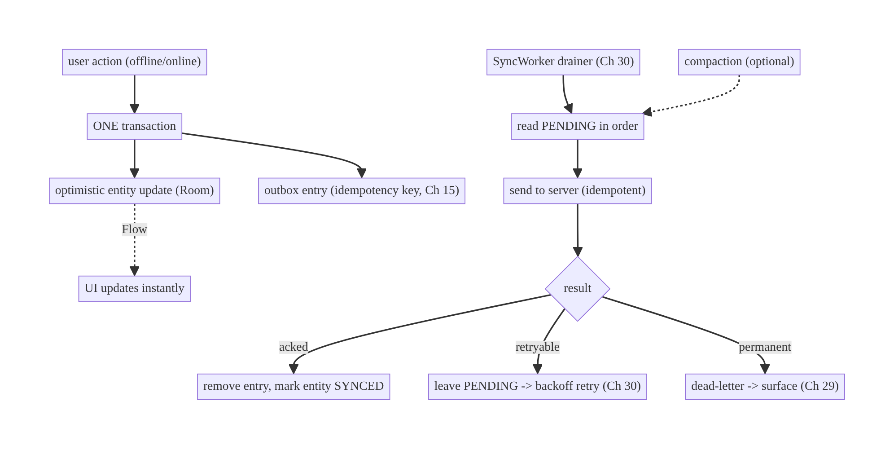
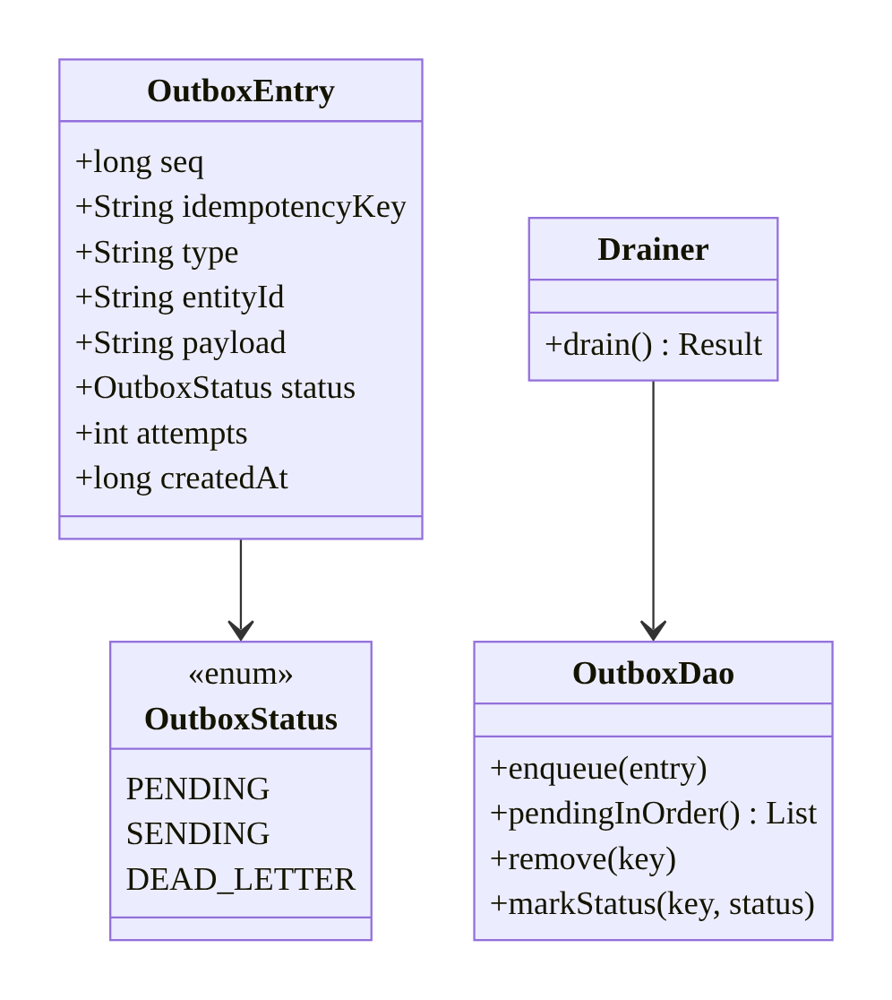
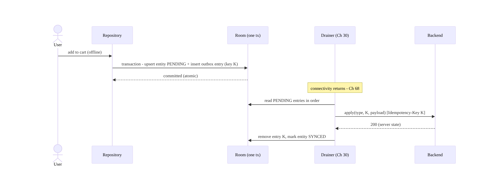
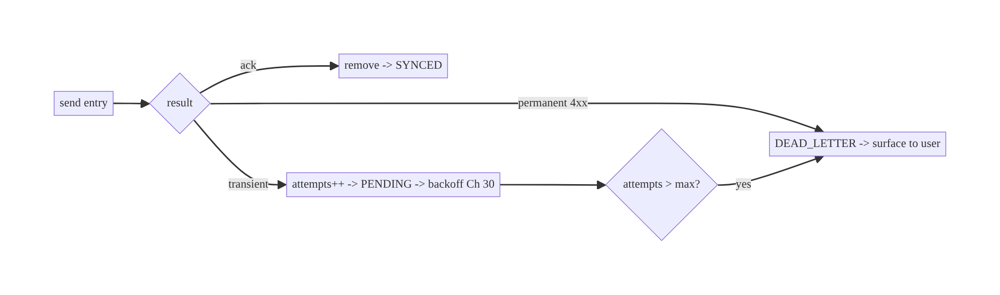
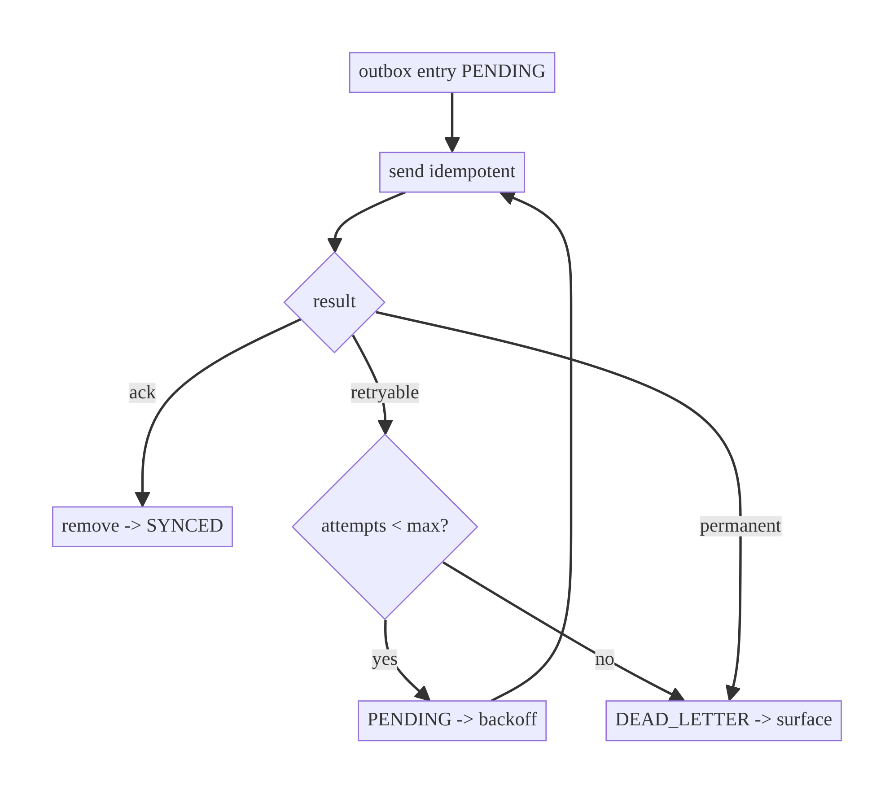

# Chapter 31 — The Outbox Pattern for Reliable Writes

> **Part IV — Offline-First & Synchronization** · Complexity: **Standard** (≥25 interview questions)
>
> **Prerequisites:** Ch 29 (offline-first — the write path), Ch 15 (idempotency —
> safe replay), Ch 30 (WorkManager — the drainer), Ch 3 (Room — durable store).
> Used by every offline write and by Ch 33 (conflicts).
>
> **Reference surface in StreamCart:** reliably delivering cart edits, wishlist
> changes, posted reviews, and watch-progress to the server — never losing a write
> even across process death and long offline periods.

---

## 31.1 Problem Definition and Real-World Context

In offline-first apps (Ch 29), a local write must be **durably recorded** so it can
be sent to the server **later** — after reconnect, after a retry, even after the
app is killed. The **outbox pattern** does this: every mutation is written to a
durable **outbox** table (in the same local transaction as the optimistic UI
update) and a background drainer (Ch 30) replays outbox entries to the server until
acknowledged. Without it, offline writes are lost or duplicated:

- **Lost writes.** A write held only in memory (or fired-and-forgotten to the
  network) vanishes if the request fails and the app is killed — the user's "sent"
  message / "added to cart" silently disappears.
- **Duplicates.** Retrying a write without a durable record + idempotency key
  (Ch 15) can create two orders / two comments.
- **Ordering violations.** Two offline edits to the same entity must be applied in
  order; an ad-hoc approach applies them out of order or drops one.
- **Inconsistent UI vs server.** The optimistic UI update and the "intent to sync"
  must be atomic — if the UI shows the change but the sync intent wasn't recorded,
  they diverge.

The outbox makes offline writes **reliable (never lost), exactly-once in effect
(via idempotency), and ordered**. It's the write-side backbone of offline-first and
a classic distributed-systems pattern (transactional outbox) adapted to the client.

### Three practical use cases

1. **E-commerce (StreamCart).** Cart/wishlist edits made offline are queued in the
   outbox and delivered on reconnect — nothing lost, no duplicate line items.
2. **Social (Social).** A posted comment appears instantly (optimistic) and is
   queued; it publishes when online, exactly once.
3. **OTT (Watch).** Watch-progress updates accumulate in the outbox (compacted to
   the latest per title) and sync efficiently.

### Why this is architectural

The outbox defines the **durability and ordering guarantees for writes**, the
**atomicity of optimistic-update + sync-intent**, and the **replay/idempotency
model** — the contract that makes "your offline action is safe" true.

---

## 31.2 Requirements Engineering

### Functional requirements

| ID | Requirement |
|----|-------------|
| F1 | Record every local mutation durably (outbox) atomically with the optimistic update. |
| F2 | Each outbox entry carries an idempotency key (Ch 15). |
| F3 | Drain the outbox to the server in order (per entity), removing entries on ack. |
| F4 | Retry transient failures; stop on permanent failures (dead-letter). |
| F5 | Survive process death / reboot (durable). |
| F6 | Compact redundant operations (optional) to reduce sync volume. |

### Non-functional requirements

| Attribute | Policy |
|-----------|--------|
| **Reliability** | No lost writes; durable; survives kill/reboot. |
| **Correctness** | Exactly-once effect (idempotency); ordered per entity. |
| **Performance** | Batched drain; compaction; bounded size. |
| **Observability** | Entry status/age; dead-letter visibility. |
| **Consistency** | Optimistic update + outbox entry atomic (one transaction). |

### Scope

- **In scope:** the outbox table + entry model, atomic enqueue with the optimistic
  update, ordered durable drain, idempotency, retry/dead-letter, compaction, status.
- **Out of scope:** the sync *orchestration* (Ch 29/30), delta *pull* (Ch 32),
  conflict resolution (Ch 33), idempotency-key semantics (Ch 15).

### Assumptions & constraints

- Room (Ch 3) for durability; WorkManager (Ch 30) as the drainer; idempotency keys
  (Ch 15); backend applies mutations idempotently. `minSdk 24`.

---

## 31.3 System Design Fundamentals

- **Transactional outbox.** The mutation's **optimistic local effect** (updating the
  entity's row) and the **outbox entry** (the intent to sync) are written in **one
  database transaction** — so they're consistent: the UI never shows a change whose
  sync intent was lost, and vice versa. This atomicity is the pattern's core.
- **Durable queue.** The outbox is a Room table (`pending_mutations`), so entries
  survive process death and reboot — the drainer picks up where it left off.
- **Ordered drain (per entity).** Entries are processed in insertion order (FIFO),
  at least per entity, so sequential edits apply correctly. A global strict order is
  possible but per-entity ordering is usually sufficient and more parallelizable.
- **Idempotency (Ch 15).** Each entry has an idempotency key; the server dedups, so
  a retried/replayed entry applies exactly once. Delivery is at-least-once; effect is
  exactly-once.
- **Retry & dead-letter.** Transient failures leave the entry for retry (with
  backoff via WorkManager, Ch 30); a permanent failure (validation/4xx) moves the
  entry to a **dead-letter** state (or marks the entity FAILED) and surfaces to the
  user — never silently dropped, never retried forever.
- **Compaction (optional).** Redundant ops can be merged before sending: multiple
  updates to the same field → keep the latest; a create followed by a delete →
  cancel both locally. Reduces sync volume for chatty updates (e.g., watch
  progress).
- **Entry lifecycle.** `PENDING → SENDING → (acked: removed) / (retryable: back to
  PENDING) / (permanent: DEAD_LETTER)`.

Core insight: **write the optimistic update and a durable, idempotent outbox entry
in one transaction, then drain the outbox in order with retry/dead-letter.** This
guarantees no lost writes, exactly-once effects, and correct ordering — the
reliability contract of offline writes.

---

## 31.4 High-Level Architecture



**Components & ownership**

- **Outbox table** (Room) durably stores entries; entity update + entry are
  **atomic**.
- **Drainer** (`SyncWorker`, Ch 30) reads PENDING entries in order, sends them
  idempotently, and acks/retries/dead-letters.
- **Compaction** (optional) merges redundant entries before send.
- **Dead-letter** surfaces permanent failures (Ch 29).

**Direction:** write → (entity + outbox entry, one tx) → drainer → server →
ack/retry/dead-letter.

---

## 31.5 Detailed Component Design



| Element | Responsibility | Note |
|---------|----------------|------|
| `OutboxEntry` | one pending mutation | seq (order), idempotency key, type, entityId, payload |
| atomic enqueue | entity update + entry in one tx | consistency (F1) |
| `OutboxDao` | durable queue access | ordered reads, ack, status |
| `Drainer` | send in order, ack/retry/dead-letter | idempotent (Ch 15), WorkManager (Ch 30) |
| compaction | merge redundant | reduce volume |

**`seq` (monotonic insertion order)** gives a total order for the drain; per-entity
ordering is derived by filtering on `entityId`.

---

## 31.6 End-to-End Data Flow

### Atomic optimistic write + outbox, then drain



### Retry vs dead-letter



---

## 31.7 Complete Kotlin Implementation

Package: `com.streamcart.sync.outbox`.

### 31.7.1 Outbox entry + DAO

```kotlin
enum class OutboxStatus { PENDING, SENDING, DEAD_LETTER }

@Entity(tableName = "outbox")
data class OutboxEntry(
    @PrimaryKey(autoGenerate = true) val seq: Long = 0,     // insertion order
    val idempotencyKey: String,                             // Ch 15
    val type: String,                                       // "cart.add"
    val entityId: String,
    val payload: String,                                    // serialized mutation
    val status: OutboxStatus = OutboxStatus.PENDING,
    val attempts: Int = 0,
    val createdAt: Long,
)

@Dao
interface OutboxDao {
    @Insert suspend fun insert(entry: OutboxEntry)
    @Query("SELECT * FROM outbox WHERE status = 'PENDING' ORDER BY seq ASC LIMIT :limit")
    suspend fun pending(limit: Int = 50): List<OutboxEntry>
    @Query("DELETE FROM outbox WHERE idempotencyKey = :key") suspend fun remove(key: String)
    @Query("UPDATE outbox SET status = :s, attempts = attempts + 1 WHERE idempotencyKey = :key")
    suspend fun bump(key: String, s: OutboxStatus)
    @Query("SELECT COUNT(*) FROM outbox WHERE status = 'PENDING'") fun pendingCount(): Flow<Int>
    // Compaction example: keep only the latest progress update per entity.
    @Query("DELETE FROM outbox WHERE type = 'progress.update' AND entityId = :id AND seq < :keepSeq")
    suspend fun compactProgress(id: String, keepSeq: Long)
}
```

### 31.7.2 Atomic enqueue (optimistic update + outbox entry in one transaction)

```kotlin
class CartRepositoryImpl @Inject constructor(
    private val db: StreamCartDatabase,
    private val cartDao: CartDao,
    private val outbox: OutboxDao,
    private val syncScheduler: SyncScheduler,       // Ch 30
    private val json: Json, private val clock: Clock,
) : CartRepository {

    override suspend fun addItem(productId: String) {
        val item = CartItemEntity(id = UUID.randomUUID().toString(), productId = productId,
            quantity = 1, updatedAt = clock.now(), syncStatus = SyncStatus.PENDING)
        db.withTransaction {                                  // ATOMIC: both or neither (F1)
            cartDao.upsert(item)                              // optimistic UI update
            outbox.insert(OutboxEntry(
                idempotencyKey = UUID.randomUUID().toString(),   // Ch 15
                type = "cart.add", entityId = item.id,
                payload = json.encodeToString(item.toRequest()), createdAt = clock.now(),
            ))
        }
        syncScheduler.requestSync()                           // nudge drainer (Ch 30)
    }
}
```

### 31.7.3 Drainer (ordered, idempotent, retry/dead-letter)

```kotlin
class OutboxDrainer @Inject constructor(
    private val outbox: OutboxDao,
    private val api: MutationApi,
    private val entityUpdater: EntityUpdater,       // marks entity SYNCED/FAILED
) {
    suspend fun drain(): DrainResult {
        var anyRetryable = false
        for (entry in outbox.pending()) {                     // ordered by seq
            outbox.bump(entry.idempotencyKey, OutboxStatus.SENDING)
            when (val r = api.apply(entry.type, entry.idempotencyKey, entry.payload)) {  // idempotent (Ch 15)
                is Outcome.Success -> { outbox.remove(entry.idempotencyKey); entityUpdater.markSynced(entry.entityId, r.data) }
                is Outcome.Failure -> when {
                    r.error.isRetryable() && entry.attempts < MAX_ATTEMPTS -> {
                        outbox.bump(entry.idempotencyKey, OutboxStatus.PENDING); anyRetryable = true
                    }
                    else -> {   // permanent OR exhausted -> dead-letter, surface
                        outbox.bump(entry.idempotencyKey, OutboxStatus.DEAD_LETTER)
                        entityUpdater.markFailed(entry.entityId, r.error)
                    }
                }
            }
        }
        return if (anyRetryable) DrainResult.Retry else DrainResult.Done   // -> WorkManager Result (Ch 30)
    }
    private companion object { const val MAX_ATTEMPTS = 8 }
}
```

### 31.7.4 Compaction (optional, before drain)

```kotlin
// For chatty updates (watch progress), keep only the latest per entity.
suspend fun compact(outbox: OutboxDao, entityId: String) {
    val latest = outbox.pending().filter { it.type == "progress.update" && it.entityId == entityId }
        .maxByOrNull { it.seq } ?: return
    outbox.compactProgress(entityId, keepSeq = latest.seq)   // delete older redundant entries
}
```

### 31.7.5 Pending count for UI (Ch 29 sync status)

```kotlin
val pendingCount: Flow<Int> = outbox.pendingCount()          // "2 changes will sync"
```

### 31.7.6 Module structure

```
:sync/outbox   OutboxEntry, OutboxDao, OutboxDrainer, compaction
:core:database outbox table (Room, Ch 3)
:sync          SyncWorker calls drainer (Ch 30); SyncScheduler
```

---

## 31.8 Concurrency and Race Conditions

| Scenario | Risk | Handling |
|----------|------|----------|
| Optimistic update without outbox entry (or vice versa) | UI/server divergence | **one transaction** (`withTransaction`) — atomic (F1) |
| Two drains run concurrently | double send | `enqueueUniqueWork` (Ch 30); `SENDING` status guard |
| Write enqueued during drain | missed/ordered wrong | `seq` ordering; new entry drained next pass |
| Retry re-sends | duplicate effect | idempotency key (Ch 15) — server dedups |
| Process death mid-drain | partial | durable entries; `SENDING` reset to `PENDING` on next run (or idempotent re-send) |
| Ordering across entities | inter-entity dependency | per-entity FIFO (seq); model dependencies explicitly if needed |

- **Atomic enqueue is the core invariant:** the optimistic update and the outbox
  entry must commit together. A `SENDING` entry interrupted by process death is
  safely re-sent next run because the server dedups by key (Ch 15).
- **Unique drain work** (Ch 30) prevents two drainers double-sending.

---

## 31.9 Failure Scenarios and Recovery

| Failure | Detection | Response | Outcome |
|---------|-----------|----------|---------|
| Offline | send fails (network) | leave PENDING; retry on reconnect | no loss |
| Transient server error (5xx/timeout) | retryable | attempts++, backoff (Ch 30) | eventual success |
| Permanent error (4xx/validation) | non-retryable | DEAD_LETTER + mark entity FAILED; surface (Ch 29) | user notified, not dropped |
| Process death mid-send | durable outbox | re-send next run (idempotent) | one effect |
| Attempts exhausted | attempts > max | dead-letter; surface | user can retry/discard |
| Chatty updates flood outbox | growth | compaction (keep latest) | bounded |
| Entry stuck SENDING | crash after mark | reset SENDING→PENDING on startup | re-drained |
| Dependency between mutations | out-of-order apply | per-entity order; model deps | correct |



> **Never silently drop a write.** A permanent failure goes to a **dead-letter**
> state the user can see and act on (retry/discard) — the outbox's promise is that
> the user's action is either delivered or visibly flagged, never lost.

---

## 31.10 Scaling the Implementation

- **Level 1.** A single outbox table + atomic enqueue + a simple drainer.
- **Level 2.** Ordered drain + idempotency (Ch 15) + retry/backoff via WorkManager
  (Ch 30).
- **Level 3 — production.** Dead-letter + user surfacing; pending-count UX;
  per-entity ordering; `SENDING` recovery; compaction for chatty updates.
- **Level 4 — large.** Batched sends (one request, many entries); priority entries
  (payments before analytics, Ch 14); per-domain outboxes; backpressure on huge
  outboxes; encrypted outbox (Ch 24).
- **Level 5 — enterprise.** Transactional outbox mirroring server patterns, exactly-
  once pipelines, conflict-aware draining (Ch 33), outbox observability/SLAs,
  cross-device de-dup.

**Avoid overengineering:** apps that only need offline *reads* (Ch 3) don't need an
outbox. Add it when users make writes that must survive offline/kill — it's the
right tool there, overkill otherwise.

---

## 31.11 Alternative Approaches and Trade-offs

| Dimension | Option A | Option B | When |
|-----------|----------|----------|------|
| Write durability | Outbox (durable table) | in-memory queue | Outbox always for offline-first (survives kill); in-memory only for ephemeral |
| Atomicity | optimistic + entry in one tx | separate writes | One tx — avoid UI/server divergence |
| Ordering | per-entity FIFO (seq) | global strict order | Per-entity usually enough + parallel; global for cross-entity deps |
| Delivery | at-least-once + idempotency | exactly-once transport | At-least-once + keys (achievable); exactly-once transport is impossible |
| Drain | WorkManager (Ch 30) | foreground loop | WorkManager (survives kill, constrained) |
| Redundant ops | compaction | send all | Compact chatty updates; send all for distinct ops |
| Failure | dead-letter + surface | retry forever / drop | Dead-letter — bounded + visible |

**Outbox vs fire-and-forget / in-memory queue:** fire-and-forget loses writes on
failure; an in-memory queue loses them on process death. The durable outbox is the
only approach that guarantees no lost writes across offline periods and kills — at
the cost of a table + drainer + idempotency discipline. For offline-first writes,
it's the correct pattern.

**Compaction vs send-all:** compaction reduces volume for chatty, last-writer-wins
updates (progress, typing, cursor) but adds logic and can lose intermediate history;
send-all preserves every operation (needed for event-sourced/auditable data).
Compact only where only the latest matters.

---

## 31.12 Security Considerations

- **Encrypt the outbox** (Ch 24) if entries contain sensitive payloads — it's
  user data persisted on device, exposed on a stolen/rooted device otherwise.
- **Idempotency keys** (Ch 15) prevent duplicate side effects on replay — critical
  for financial mutations in the outbox.
- **Server authorizes every drained mutation** (Ch 29) — a tampered client could
  insert arbitrary outbox entries; the backend re-validates authz per entry.
- **Clear the outbox on logout** (Ch 22) and scope per account (Ch 42) — pending
  mutations are the user's data/intent.
- **Don't log payloads** (Ch 28) — they may contain PII/secrets.
- **Bound dead-letter exposure:** dead-lettered sensitive mutations shouldn't linger
  unencrypted; purge per policy.
- Client vs backend: the outbox guarantees *client-side* delivery intent; the
  backend remains the authority on what's actually applied and authorized.

---

## 31.13 Performance and Resource Optimization

- **Batch sends:** drain many entries per sync run / one batched request where the
  server supports it — fewer round trips (Ch 14/30).
- **Compact** chatty updates to cut volume.
- **Bound the outbox:** cap size; backpressure or coalesce if it grows (long
  offline).
- **Index** `status`/`seq` for fast ordered reads.
- **Drain under constraints** (Ch 30): on connectivity/charging, batched — not per
  keystroke.
- **Profiling:** outbox size, drain duration, pending-entry age, dead-letter rate,
  sync round trips.

---

## 31.14 Testing Strategy

In-memory Room + fake API; test atomicity, ordering, idempotency, retry/dead-letter.

```kotlin
class OutboxTest {
    @Test fun `optimistic update and outbox entry commit atomically`() = runTest {
        repo.addItem("p1")
        assertEquals(1, cartDao.count())              // entity
        assertEquals(1, outbox.pending().size)        // entry — both present
    }

    @Test fun `drain sends in order and removes on ack`() = runTest {
        repo.addItem("p1"); repo.addItem("p2")
        val api = RecordingApi(success = true)
        OutboxDrainer(outbox, api, updater).drain()
        assertEquals(listOf("cart.add", "cart.add"), api.sentTypes)
        assertTrue(outbox.pending().isEmpty())
    }

    @Test fun `transient failure keeps entry for retry`() = runTest {
        repo.addItem("p1")
        OutboxDrainer(outbox, RecordingApi(ioError = true), updater).drain()
        assertEquals(1, outbox.pending().size)        // retried later
    }

    @Test fun `permanent failure dead-letters and surfaces`() = runTest {
        repo.addItem("p1")
        OutboxDrainer(outbox, RecordingApi(code = 422), updater).drain()
        assertEquals(OutboxStatus.DEAD_LETTER, outbox.statusOf("p1"))
        assertEquals(SyncStatus.FAILED, cartDao.findById("p1")!!.syncStatus)
    }

    @Test fun `double drain does not double-apply (idempotent)`() = runTest {
        repo.addItem("p1")
        val api = CountingApi()
        val d = OutboxDrainer(outbox, api, updater); d.drain(); d.drain()
        assertEquals(1, api.appliedKeys.size)          // server dedups by key (Ch 15)
    }

    @Test fun `compaction keeps only latest progress`() = runTest {
        repeat(5) { repo.updateProgress("t1", it) }
        compact(outbox, "t1")
        assertEquals(1, outbox.pending().count { it.type == "progress.update" })
    }
}
```

Also: process-death resume (entries persist; SENDING→PENDING recovery), per-entity
ordering, encrypted outbox (Ch 24), clear on logout.

---

## 31.15 Production Observability

- **Metrics:** outbox size, pending-entry age (how long writes wait — SLO),
  drain success/retry/dead-letter rate, batch size, write-loss incidents (0),
  compaction savings.
- **Logs:** `outbox{op, type, status, attempts}` (ids/types, no payload PII, Ch 28),
  correlation IDs (Ch 1/84).
- **Debugging:** writes lost → non-atomic enqueue / non-durable outbox; duplicates →
  missing idempotency (Ch 15); stuck SENDING → crash recovery not resetting status;
  outbox growing → drain blocked (constraints/failures) or no compaction; dead-letter
  pile-up → backend rejecting (investigate).
- **Alerting:** rising pending-entry age or dead-letter rate → sync/backend incident.
- **Privacy:** outbox entries are user data — redact logs; clear on logout/deletion.

---

## 31.16 System Design Interview Preparation

> ≥25 questions.

**Fundamentals**

1. *What is the outbox pattern?* Durably record each local mutation and replay it to
   the server until acked.
2. *Why durable (Room)?* Survive process death/offline so writes aren't lost.
3. *What's atomic?* The optimistic entity update + the outbox entry (one
   transaction) — no UI/server divergence.
4. *Delivery semantics?* At-least-once delivery + idempotency (Ch 15) → exactly-once
   effect.
5. *Entry lifecycle?* PENDING → SENDING → removed(ack) / PENDING(retry) /
   DEAD_LETTER(permanent).

**Ordering/idempotency**

6. *Ordering guarantee?* Per-entity FIFO via `seq`.
7. *Why idempotency keys?* Retries/replays must apply once (Ch 15).
8. *Two offline edits same entity?* Ordered drain applies in sequence.

**Failure handling**

9. *Transient failure?* Leave PENDING; retry with backoff (Ch 30).
10. *Permanent failure?* Dead-letter + surface; never drop; never retry forever.
11. *Process death mid-send?* Durable; re-send next run (idempotent); reset SENDING.
12. *Attempts cap?* Dead-letter after max attempts.

**Optimization**

13. *Compaction?* Merge redundant ops (keep latest progress) to cut volume.
14. *Batching?* Drain many entries per run / one request.
15. *Bounding?* Cap outbox; backpressure on long offline.

**Integration**

16. *Who drains it?* WorkManager (Ch 30) — survives kill, constrained.
17. *Relation to offline-first?* It's the write path (Ch 29).
18. *Relation to conflicts?* Drained mutations may conflict with remote (Ch 33).

**Security**

19. *Encrypt the outbox?* Yes if payloads sensitive (Ch 24).
20. *Authorization?* Backend authorizes each drained mutation (Ch 29).
21. *Logout?* Clear outbox; per-account (Ch 22/42).

**Testing**

22. *How test atomicity?* Assert entity + entry both present after a write.
23. *How test dead-letter?* Permanent error → DEAD_LETTER + entity FAILED.
24. *How test idempotency?* Double drain → one applied key.

**Production debugging**

25. *Writes lost?* Non-atomic/non-durable outbox.
26. *Duplicates?* Missing idempotency.
27. *Outbox growing?* Drain blocked or no compaction.

### Design-change challenges
1. **Chatty progress updates flood sync.** Compaction (keep latest).
2. **Payments in the outbox must not double-charge.** Idempotency keys (Ch 15).
3. **Surface failed writes to the user.** Dead-letter + mark entity FAILED (Ch 29).
4. **Batch outbox sends.** Server batch endpoint; drain in batches.
5. **Encrypt pending sensitive mutations.** Encrypted outbox (Ch 24).

### Mock walkthrough (abridged)
Clarify (offline writes? durability? ordering?) → outbox table + atomic enqueue
(entity + entry in one tx) → idempotency key (Ch 15) → ordered drain via WorkManager
(Ch 30) → retry/dead-letter → compaction/batching → security (encrypt/clear/authz) →
testing.

---

## 31.17 Practical Exercises

1. **Beginner.** Add an outbox table + atomic enqueue (optimistic update + entry in
   one transaction). *Eval:* both present; UI instant.
2. **Intermediate.** Build an ordered drainer with idempotency keys; drain via
   WorkManager on connectivity. *Eval:* in-order; no dup on double drain.
3. **Advanced.** Add retry/dead-letter + surface failures + compaction for chatty
   updates. *Eval:* transient retried; permanent dead-lettered; volume reduced.
4. **Production debugging.** Fix an app that loses offline writes (non-atomic/in-
   memory) and duplicates (no idempotency). *Eval:* durable, atomic, idempotent.
5. **System design challenge.** Batch + prioritize the outbox (payments before
   analytics) with an encrypted store. *Eval:* fewer round trips; priority honored;
   encrypted.

*(Solutions withheld unless requested.)*

---

## 31.18 Chapter Summary & Reference Sheet

**Key decisions:** record every local mutation in a **durable outbox** (Room),
writing the **optimistic entity update and the outbox entry in one transaction**
(atomic); give each entry an **idempotency key** (Ch 15); **drain in order**
(per-entity `seq`) via **WorkManager** (Ch 30), removing on ack; **retry transient**
failures with backoff and **dead-letter permanent** ones (surface, never drop);
**compact** chatty redundant ops; **encrypt + clear** the outbox (Ch 24/22); the
**backend authorizes** each drained mutation. **No lost writes, exactly-once effect,
correct order.**

**Concepts:** transactional outbox, durable queue, atomic optimistic-update+entry,
at-least-once + idempotency, per-entity ordering, retry/dead-letter, compaction,
entry lifecycle.

**Common mistakes:** in-memory/fire-and-forget writes (lost); non-atomic enqueue
(UI/server divergence); no idempotency (duplicates); retrying forever / silently
dropping (no dead-letter); unordered drain; unbounded/un-compacted outbox;
unencrypted sensitive entries; not clearing on logout.

**Checklist:**

- [ ] durable outbox (Room)
- [ ] atomic entity+entry (one tx)
- [ ] idempotency key (Ch 15)
- [ ] ordered drain (seq)
- [ ] WorkManager drainer (Ch 30)
- [ ] retry transient + dead-letter permanent
- [ ] surface failures (Ch 29)
- [ ] compaction for chatty ops
- [ ] batch sends
- [ ] encrypt + clear (Ch 24/22)
- [ ] server authorizes.

**Key APIs/patterns:** Room `@Transaction`/`withTransaction`, outbox table +
`OutboxDao`, `OutboxStatus` lifecycle, idempotency keys (Ch 15), WorkManager drainer
(Ch 30), compaction queries, `pendingCount` Flow.

**References:**
- Transactional outbox pattern: https://microservices.io/patterns/data/transactional-outbox.html
- Offline-first (writes): https://developer.android.com/topic/architecture/data-layer/offline-first
- Room transactions (Ch 3): https://developer.android.com/training/data-storage/room
- (composes) Ch 15 Idempotency, Ch 29 Offline-First, Ch 30 WorkManager, Ch 33 Conflicts

### Chapter review (Phase 4)
- **Completeness:** all 18 sections; architecture/class/sequence/failure diagrams;
  outbox entry + atomic enqueue + ordered drainer + compaction + pending count;
  concurrency (atomicity, unique drain, SENDING recovery); failure (retry/dead-
  letter, no silent loss); 5 levels; outbox-vs-in-memory and compaction-vs-send-all
  trade-offs; security (encrypt/clear/authz); perf (batch/compact/bound); atomicity/
  idempotency tests; observability (pending age); 27 Q&A + 5 challenges. ✅
- **Expand later:** WorkManager drain (Ch 30), conflicts on drained mutations
  (Ch 33), batching/priority (Ch 14), encryption (Ch 24).
- **Interview coverage:** exceeds ≥25 bar.
