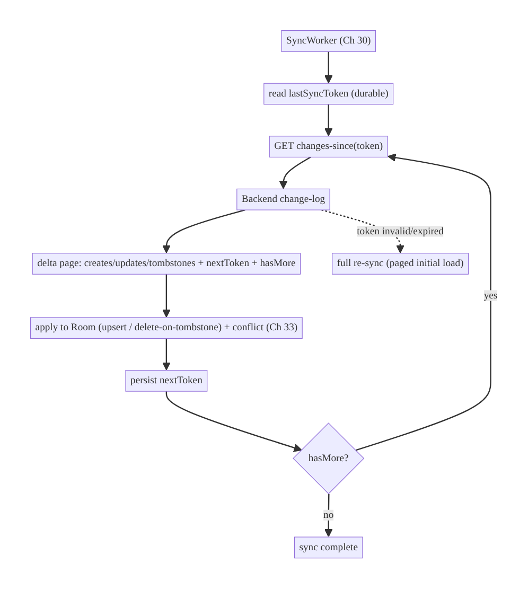
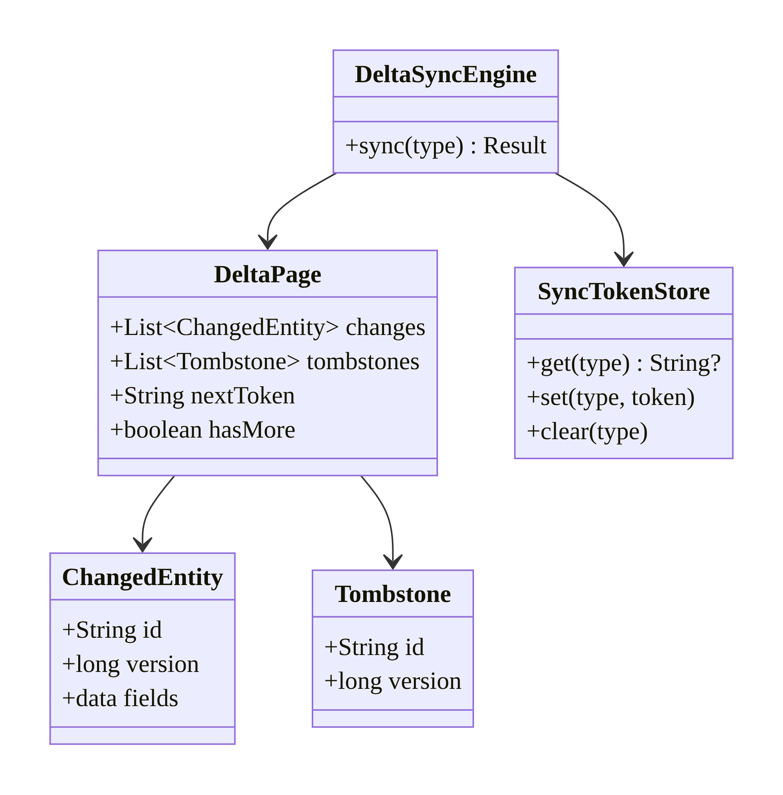
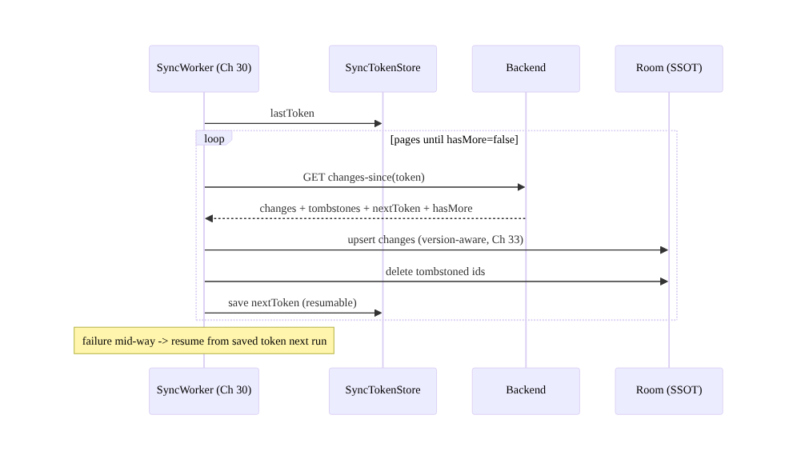
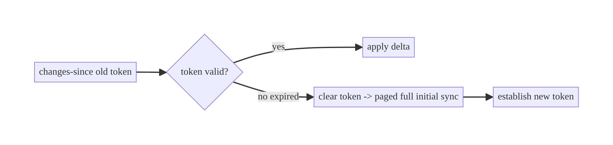
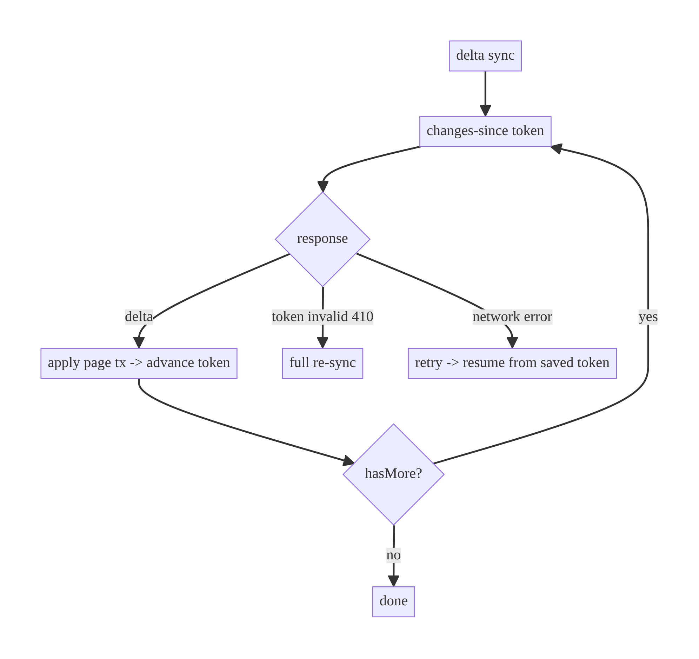

# Chapter 32 — Delta / Incremental Sync

> **Part IV — Offline-First & Synchronization** · Complexity: **Standard** (≥25 interview questions)
>
> **Prerequisites:** Ch 29 (offline-first — the pull path), Ch 3 (Room/SSOT),
> Ch 30 (WorkManager drainer), Ch 12 (caching/freshness), Ch 33 (conflicts,
> previewed). This is the **pull** half of sync (Ch 31 was the push half).
>
> **Reference surface in StreamCart:** keeping the local catalog, wishlist, and
> watch-history fresh by fetching only what changed since the last sync — not the
> whole dataset every time.

---

## 32.1 Problem Definition and Real-World Context

Offline-first apps must pull **remote changes** down to the local store (Ch 29).
The naive approach — **full sync** (refetch the entire dataset every time) — is
wasteful and doesn't scale: a 100k-item catalog or a long message history can't be
re-downloaded on every sync. **Delta (incremental) sync** fetches only what
**changed since the last sync**, using a **sync token / cursor / high-water mark**.
Naive syncing fails because:

- **Full refetch is expensive.** Re-downloading everything burns the user's data
  and battery, is slow, and overwrites local state (losing pending writes).
- **No change tracking.** Without a "changes since X" mechanism, the client can't
  know what's new/updated/deleted on the server.
- **Deletes are invisible.** A full sync infers deletes by absence (fragile); delta
  sync needs **tombstones** (explicit delete markers) so the client knows to remove
  an item.
- **Clock/ordering pitfalls.** Using wall-clock timestamps for "changes since"
  invites bugs (clock skew, same-millisecond changes, missed items at the
  boundary).
- **No resumability.** A large initial/delta sync that fails mid-way must resume,
  not restart.

Delta sync makes synchronization **efficient and scalable**: the first sync may be
a (paged) full load, but subsequent syncs transfer only deltas via an opaque
**cursor/token** the server advances. The architecture is about the **change-
tracking contract** (token, tombstones, ordering), **paging large deltas**,
**applying changes to the SSOT**, and **initial vs incremental** sync.

### Three practical use cases

1. **E-commerce catalog (StreamCart Shop).** Initial paged load, then nightly delta
   (`changes-since` token) pulling new/updated/deleted products — not the whole
   catalog.
2. **Messaging/feed (Social).** Pull messages/posts since the last cursor;
   tombstones for deletions; paged backfill for history.
3. **OTT watch-history (Watch).** Sync progress/history deltas across devices
   efficiently.

### Why this is architectural

Delta sync defines the **change-tracking contract** with the backend (token/cursor,
tombstones, ordering guarantees), the **efficiency/scalability** of sync, and how
**remote changes merge into the SSOT** (feeding conflict resolution, Ch 33) —
properties that determine whether sync works at scale and keeps data correct.

---

## 32.2 Requirements Engineering

### Functional requirements

| ID | Requirement |
|----|-------------|
| F1 | Fetch only changes since the last sync (opaque token/cursor). |
| F2 | Handle creates, updates, and **deletes** (tombstones). |
| F3 | Page large deltas (and the initial full load). |
| F4 | Persist the sync token durably; resume on failure/process death. |
| F5 | Apply changes to the SSOT (Room), feeding conflict resolution (Ch 33). |
| F6 | Support an initial (full/paged) sync distinct from incremental. |

### Non-functional requirements

| Attribute | Policy |
|-----------|--------|
| **Scalability** | Sync cost ∝ changes, not dataset size. |
| **Efficiency** | Minimal data/battery; paged; resumable. |
| **Correctness** | No missed/duplicated changes at boundaries; deletes applied. |
| **Reliability** | Durable token; resumable; idempotent apply. |
| **Consistency** | Deterministic apply order; converge with server. |

### Scope

- **In scope:** sync tokens/cursors, `changes-since` contract, tombstones, delta
  paging, durable token/resume, applying deltas to Room, initial-vs-incremental.
- **Out of scope:** the push/outbox side (Ch 31), conflict resolution details
  (Ch 33), WorkManager scheduling (Ch 30), real-time push (Ch 63).

### Assumptions & constraints

- Backend exposes a `changes-since(token)` endpoint returning changed entities +
  tombstones + a `nextToken`, with stable ordering. Room SSOT (Ch 3). `minSdk 24`.
  Prefer **opaque server-issued tokens** over client timestamps.

---

## 32.3 System Design Fundamentals

- **Sync token / cursor (high-water mark).** An **opaque, server-issued** marker
  representing "you've seen everything up to here." The client sends it; the server
  returns changes after it plus a new token. Opaque tokens let the server choose the
  mechanism (sequence number, version, change-log offset) and avoid client
  clock/ordering bugs. **Prefer this over `since=<timestamp>`.**
- **Why not timestamps?** Wall-clock `updatedAt` filtering is fragile: clock skew
  between servers, multiple changes in the same millisecond, and the boundary
  (`>=` vs `>`) cause **missed or duplicated** items. A monotonic server sequence/
  version avoids this. If timestamps must be used, use the **server's** clock,
  overlap the window slightly, and dedupe by id+version.
- **Tombstones (delete markers).** Deletes can't be inferred by absence in a delta
  (the delta only contains *changes*). The server includes explicit **tombstone**
  entries (`{id, deleted: true, version}`) so the client removes them locally. The
  server retains tombstones long enough for offline clients to catch up.
- **Paging deltas.** A large delta (or the initial load) is paged (`nextToken` /
  `hasMore`); the client applies each page and advances the token, so a failure
  resumes from the last applied page (durable token).
- **Initial vs incremental.** The **first** sync is a (paged) full load that
  establishes the token; **subsequent** syncs are deltas. A **token too old**
  (tombstones expired, client offline too long) triggers a **full re-sync**
  (server signals "token invalid").
- **Idempotent apply.** Applying a delta must be idempotent (upsert by id/version)
  so re-applying a page (after a crash) is safe.
- **Ordering & versioning.** Each entity carries a **version** (or the delta is
  ordered); the client applies in order and uses version for conflict detection
  (Ch 33) and to ignore stale updates.

Core insight: **track remote changes with an opaque server-issued sync token,
transfer creates/updates/tombstones since that token (paged, resumable), and
upsert them idempotently into the SSOT** — making sync cost proportional to change,
not dataset size, and correct across boundaries and deletes.

---

## 32.4 High-Level Architecture



**Components & ownership**

- **Durable sync token** (DataStore/Room) = the high-water mark; persisted per
  entity type.
- **`changes-since` call** returns a delta page (changes + tombstones + nextToken +
  hasMore).
- **Apply** upserts changes / deletes tombstones into Room (SSOT), running conflict
  resolution (Ch 33).
- **Token advance** after each applied page (resumable).
- **Full re-sync** when the token is too old/invalid.

**Direction:** token → `changes-since` → apply page → advance token → repeat until
no more.

---

## 32.5 Detailed Component Design



| Component | Responsibility | Note |
|-----------|----------------|------|
| `SyncTokenStore` | durable high-water mark per type | opaque token |
| `changes-since` API | return delta page | changes + tombstones + nextToken + hasMore |
| `DeltaSyncEngine` | page, apply, advance token | idempotent upsert; resume |
| apply | upsert changes / delete tombstones into Room | version-aware (Ch 33) |
| full re-sync | token invalid | paged initial load |

---

## 32.6 End-to-End Data Flow

### Incremental sync with paging + tombstones



### Token too old → full re-sync



---

## 32.7 Complete Kotlin Implementation

Package: `com.streamcart.sync.delta`.

### 32.7.1 Delta DTOs + durable token store

```kotlin
@Serializable
data class DeltaPage(
    val changes: List<ChangedProductDto> = emptyList(),
    val tombstones: List<TombstoneDto> = emptyList(),
    val nextToken: String,
    val hasMore: Boolean,
)
@Serializable data class TombstoneDto(val id: String, val version: Long)

class SyncTokenStore @Inject constructor(private val store: DataStore<Preferences>) {
    private fun key(type: String) = stringPreferencesKey("sync_token_$type")
    suspend fun get(type: String): String? = store.data.first()[key(type)]
    suspend fun set(type: String, token: String) = store.edit { it[key(type)] = token }.let {}
    suspend fun clear(type: String) = store.edit { it.remove(key(type)) }.let {}
}
```

### 32.7.2 changes-since API

```kotlin
interface DeltaApi {
    // Opaque token; null/absent on first sync. Server returns INVALID_TOKEN to force full re-sync.
    @GET("catalog/changes")
    suspend fun changes(@Query("since") token: String?, @Query("limit") limit: Int = 500): DeltaPage
}
```

### 32.7.3 Delta sync engine (page, apply, advance; resumable; full-resync fallback)

```kotlin
class DeltaSyncEngine @Inject constructor(
    private val api: DeltaApi,
    private val dao: ProductDao,
    private val tokens: SyncTokenStore,
    private val resolver: ConflictResolver,       // Ch 33
    private val db: StreamCartDatabase,
) {
    suspend fun sync(type: String = "catalog"): Result<Unit> = runCatching {
        var token = tokens.get(type)
        do {
            val page = try {
                api.changes(token)
            } catch (e: HttpException) {
                if (e.code() == 410 /* Gone: token expired */) { fullResync(type); return@runCatching }
                else throw e
            }
            db.withTransaction {                           // apply a page atomically (Ch 3)
                page.changes.forEach { remote ->
                    val local = dao.findById(remote.id)
                    // version-aware upsert: ignore stale; resolve conflicts (Ch 33)
                    val merged = resolver.resolve(local, remote.toEntity())
                    dao.upsert(merged)
                }
                page.tombstones.forEach { t ->
                    dao.deleteIfVersionOlder(t.id, t.version)   // apply delete (idempotent)
                }
            }
            token = page.nextToken
            tokens.set(type, token)                        // advance high-water mark (resumable)
        } while (page.hasMore)
    }

    private suspend fun fullResync(type: String) {
        db.withTransaction { dao.clearAll() }              // or reconcile; preserve pending (Ch 31)
        tokens.clear(type)
        sync(type)                                         // restart from scratch (paged)
    }
}
```

### 32.7.4 Version-aware DAO (ignore stale, apply tombstones)

```kotlin
@Dao
interface ProductDao {
    @Query("SELECT * FROM products WHERE id = :id") suspend fun findById(id: String): ProductEntity?
    @Upsert suspend fun upsert(entity: ProductEntity)
    // Only delete if the tombstone is newer than what we have (idempotent, out-of-order safe).
    @Query("DELETE FROM products WHERE id = :id AND version < :version")
    suspend fun deleteIfVersionOlder(id: String, version: Long)
}
```

### 32.7.5 Module structure

```
:sync/delta   DeltaSyncEngine, DeltaApi, SyncTokenStore, DeltaPage/Tombstone DTOs
:core:database ProductDao (version-aware upsert/delete)
:sync          SyncWorker calls DeltaSyncEngine (Ch 30); ConflictResolver (Ch 33)
```

---

## 32.8 Concurrency and Race Conditions

| Scenario | Risk | Handling |
|----------|------|----------|
| Timestamp boundary (`>=`/skew) | missed/duplicated changes | opaque server token (not client timestamps) |
| Apply page then crash | re-apply | idempotent upsert; token advanced only after apply |
| Delta vs local pending write | overwrite local edit | version-aware apply + conflict resolution (Ch 33) |
| Out-of-order delete/update | wrong final state | version-gated delete (`version <`); apply by version |
| Concurrent push + pull | inconsistency | phase order (push then pull, Ch 29); per-entity version |
| Token too old (tombstones expired) | missed deletes | server signals invalid → full re-sync |
| Partial page applied | inconsistent | apply each page in a transaction; advance token after |

- **Opaque server tokens eliminate the timestamp-boundary race** — the #1 delta-sync
  bug. The server owns "what's after this point."
- **Advance the token only after a page is applied** (in/after its transaction) so a
  crash resumes safely; idempotent upserts make re-apply harmless.

---

## 32.9 Failure Scenarios and Recovery

| Failure | Detection | Response | Outcome |
|---------|-----------|----------|---------|
| Network failure mid-sync | request error | retry (Ch 30); resume from saved token | no missed changes |
| Process death mid-sync | durable token | resume from last applied page | seamless |
| Token expired/too old | server 410/invalid | full re-sync (paged) | catch up |
| Missed delete (tombstone gone) | — | full re-sync reconciles | consistent |
| Delta vs pending local write | version | conflict resolution (Ch 33) | merged |
| Clock skew (if timestamps) | duplicates/misses | use server token; overlap+dedupe fallback | correct |
| Huge initial sync | slow/large | paged + resumable; background (Ch 30) | completes |
| Duplicate apply | idempotent upsert | no effect | safe |



> **Resumability is the reliability win:** because the token advances only after a
> page applies and apply is idempotent, any failure simply resumes from the last
> good token — no missed changes, no full restart.

---

## 32.10 Scaling the Implementation

- **Level 1.** Full refetch (small datasets) into Room.
- **Level 2.** Delta via an opaque token; tombstones for deletes; durable token.
- **Level 3 — production.** Paged, resumable delta; version-aware apply + conflict
  resolution (Ch 33); full-resync fallback; per-entity tokens; background (Ch 30).
- **Level 4 — large.** Selective/partial sync (only subscribed entities);
  compressed deltas; initial-load paging (Ch 13); push-triggered delta (FCM, Ch 49)
  for near-real-time.
- **Level 5 — enterprise.** Change-data-capture pipelines, per-region sync, bandwidth
  budgets, sync observability/SLAs, bidirectional sync with CRDTs (Ch 33), real-time
  deltas over WebSocket (Ch 63).

**Avoid overengineering:** small/rarely-changing datasets can full-sync simply. Add
delta sync when the dataset is large or changes often enough that full refetch is
wasteful.

---

## 32.11 Alternative Approaches and Trade-offs

| Dimension | Option A | Option B | When |
|-----------|----------|----------|------|
| Sync scope | Delta (changes-since) | Full refetch | Delta for large/changing data; full for small/rare |
| Change marker | Opaque server token | client `updatedAt` timestamp | **Token** (avoids clock/boundary bugs); timestamp only if forced (server clock + overlap) |
| Deletes | Tombstones | infer by absence (full) | Tombstones for delta; absence only works with full sync |
| Delivery | Poll delta (periodic) | Push-triggered (FCM/WebSocket) | Poll for simplicity; push for near-real-time (Ch 49/63) |
| Initial load | Paged full | one shot | Paged for large; one shot for tiny |
| Apply | Version-aware upsert | blind overwrite | Version-aware (ignore stale, enable conflicts, Ch 33) |

**Opaque token vs timestamp (the critical choice):** an opaque server-issued token
lets the server guarantee "everything after this" without the client reasoning about
clocks — avoiding missed/duplicated items at boundaries, clock skew, and
same-millisecond collisions. Client `updatedAt` filtering is simpler to start but
notoriously buggy; if you must use it, filter on the **server's** clock, overlap the
window, and dedupe by id+version. Prefer tokens.

**Delta vs full sync:** full sync is dead simple and self-correcting but
doesn't scale (bandwidth/battery) and can clobber local state; delta scales with
change but requires server support (tokens, tombstones) and careful apply. Use delta
once the dataset is non-trivial.

---

## 32.12 Security Considerations

- **Authorize deltas per user:** the `changes-since` response must contain only
  entities the user may see — the backend filters by entitlement; a tampered token
  must not leak others' data.
- **Opaque tokens** shouldn't encode sensitive/guessable info; treat as opaque and
  user-scoped.
- **Tombstones** must respect access: don't leak the existence of deleted private
  items to unauthorized users.
- **Encrypt synced sensitive data at rest** (Ch 24); clear tokens + data on logout
  (Ch 22); per-account tokens (Ch 42).
- **Validate delta payloads** (Ch 16 tolerant parsing) — a malformed/hostile delta
  must not crash or corrupt the SSOT.
- Client vs backend: the backend is the authoritative change-log and access filter;
  the client applies what it's authorized to receive.

---

## 32.13 Performance and Resource Optimization

- **Sync cost ∝ changes:** the core win — no full refetch; small deltas on battery/
  cellular.
- **Paging + resume:** bounded memory and bandwidth; resume avoids re-download.
- **Compression** of deltas; request only needed fields/entities (selective sync).
- **Batch apply** per page in one Room transaction (Ch 3) — fewer fsyncs.
- **Back off / schedule** via WorkManager constraints (Ch 30); push-triggered delta
  (Ch 49) avoids polling.
- **Profiling:** delta size/frequency, sync duration, bytes transferred vs full,
  apply latency, full-resync rate.

---

## 32.14 Testing Strategy

Fake `DeltaApi`; in-memory Room; test paging, tombstones, resume, full-resync.

```kotlin
class DeltaSyncTest {
    @Test fun `applies creates and updates by version`() = runTest {
        api.enqueue(DeltaPage(changes = listOf(product("p1", v = 2)), nextToken = "t2", hasMore = false))
        engine.sync()
        assertEquals(2, dao.findById("p1")!!.version)
        assertEquals("t2", tokens.get("catalog"))
    }

    @Test fun `applies tombstones (deletes)`() = runTest {
        dao.upsert(product("p1", v = 1))
        api.enqueue(DeltaPage(tombstones = listOf(TombstoneDto("p1", 2)), nextToken = "t2", hasMore = false))
        engine.sync()
        assertNull(dao.findById("p1"))
    }

    @Test fun `pages through multiple delta pages`() = runTest {
        api.enqueue(DeltaPage(changes = listOf(product("p1", 1)), nextToken = "t1", hasMore = true))
        api.enqueue(DeltaPage(changes = listOf(product("p2", 1)), nextToken = "t2", hasMore = false))
        engine.sync()
        assertEquals(2, dao.count()); assertEquals("t2", tokens.get("catalog"))
    }

    @Test fun `resumes from saved token after failure`() = runTest {
        api.enqueue(DeltaPage(changes = listOf(product("p1", 1)), nextToken = "t1", hasMore = true))
        api.enqueueError(IOException())
        runCatching { engine.sync() }
        assertEquals("t1", tokens.get("catalog"))        // advanced to applied page
        api.enqueue(DeltaPage(changes = listOf(product("p2", 1)), nextToken = "t2", hasMore = false))
        engine.sync()                                     // resumes from t1
        assertEquals(2, dao.count())
    }

    @Test fun `expired token triggers full re-sync`() = runTest {
        tokens.set("catalog", "old"); api.enqueueHttp(410)
        api.enqueue(DeltaPage(changes = listOf(product("p1", 1)), nextToken = "t1", hasMore = false))
        engine.sync()
        assertNotNull(dao.findById("p1"))
    }

    @Test fun `stale delta ignored (version-aware)`() = runTest {
        dao.upsert(product("p1", v = 5))
        api.enqueue(DeltaPage(changes = listOf(product("p1", v = 3)), nextToken = "t", hasMore = false))
        engine.sync()
        assertEquals(5, dao.findById("p1")!!.version)     // older version not applied (Ch 33)
    }
}
```

Also: conflict with local pending write (Ch 33), process-death resume, selective
sync, large-page paging.

---

## 32.15 Production Observability

- **Metrics:** delta size/frequency, bytes transferred (vs full-sync baseline), sync
  duration, full-resync rate (high = tokens expiring / clients too stale), tombstone
  apply rate, apply errors.
- **Logs:** `delta{type, changes, tombstones, pages, bytes, duration}`,
  `full_resync{reason}` (no PII, Ch 28), correlation IDs (Ch 1/84).
- **Debugging:** missing updates → timestamp boundary / wrong token handling;
  ghost items (not deleted) → tombstones not applied; frequent full re-syncs →
  token TTL too short / clients offline too long; duplicates → non-idempotent apply;
  data corruption → non-version-aware apply.
- **Alerting:** full-resync-rate spike → tombstone retention/token issue; delta-size
  spike → upstream data churn.
- **Privacy:** deltas carry user data — redact logs; honor deletion.

---

## 32.16 System Design Interview Preparation

> ≥25 questions.

**Fundamentals**

1. *What is delta sync?* Fetch only changes since the last sync (token/cursor),
   not the whole dataset.
2. *vs full sync?* Full refetches everything (simple, doesn't scale); delta scales
   with change.
3. *What's a sync token?* An opaque, server-issued high-water mark meaning "you've
   seen up to here."
4. *Why opaque token over timestamp?* Avoids clock skew, same-ms collisions, and
   boundary (`>=`) bugs that miss/duplicate items.
5. *How are deletes handled?* Tombstones (explicit delete markers) — absence can't
   be inferred in a delta.

**Mechanics**

6. *Paging deltas?* `nextToken`/`hasMore`; apply each page, advance token.
7. *Resumability?* Advance the token only after applying a page; durable token →
   resume from last good.
8. *Idempotent apply?* Upsert by id/version so re-applying a page is safe.
9. *Initial vs incremental?* First sync = paged full load establishing a token;
   then deltas.
10. *Token too old?* Server signals invalid → full re-sync.

**Correctness**

11. *Timestamp boundary bug?* `updatedAt >= since` with skew/same-ms →
    missed/duplicated; use tokens.
12. *Out-of-order delete?* Version-gated delete (`version <`).
13. *Stale update?* Version-aware apply ignores older versions.
14. *Delta vs local pending write?* Conflict resolution (Ch 33).

**Integration**

15. *Where does it fit?* The pull half of offline-first sync (Ch 29); push = outbox
    (Ch 31).
16. *Scheduling?* WorkManager (Ch 30); push-triggered (FCM, Ch 49) for near-real-
    time.
17. *Apply to SSOT?* Upsert/delete into Room transactionally (Ch 3).

**Security**

18. *Authorize deltas?* Server filters by entitlement per user.
19. *Tombstone leaks?* Respect access; don't reveal deleted private items.
20. *Clear on logout?* Tokens + data; per-account (Ch 22/42).

**Performance/scale**

21. *Efficiency win?* Cost ∝ changes; small deltas on battery/cellular.
22. *Large initial sync?* Paged + resumable + background.
23. *Near-real-time?* Push-triggered deltas (Ch 49/63).

**Testing**

24. *How test deltas?* Fake API: creates/updates/tombstones/paging; assert SSOT +
    token.
25. *How test resume?* Fail mid-sync; assert resume from saved token.
26. *How test full re-sync?* 410 token → full load.

**Production debugging**

27. *Missing updates?* Timestamp/token handling.
28. *Ghost (undeleted) items?* Tombstones not applied.
29. *Frequent full re-syncs?* Token TTL/tombstone retention too short.

### Design-change challenges
1. **Catalog too big to full-sync.** Opaque token + paged delta + tombstones.
2. **Deletes not propagating.** Add tombstones; version-gated delete.
3. **Near-real-time updates.** Push-triggered delta (FCM/WebSocket, Ch 49/63).
4. **Client offline for weeks.** Token expired → full re-sync; longer tombstone
   retention.
5. **Delta conflicts with local edits.** Version-aware apply + conflict policy
   (Ch 33).

### Mock walkthrough (abridged)
Clarify (dataset size, change rate, deletes, offline duration) → opaque server token
(not timestamps) → `changes-since` with tombstones → paged + resumable (advance
token after apply) → version-aware idempotent upsert → full-resync fallback →
conflict with local (Ch 33) → security (authorize/clear) → testing.

---

## 32.17 Practical Exercises

1. **Beginner.** Implement `changes-since` delta sync with an opaque durable token;
   apply creates/updates to Room. *Eval:* only changes fetched; token advances.
2. **Intermediate.** Add tombstones (version-gated delete) and delta paging. *Eval:*
   deletes applied; pages through correctly.
3. **Advanced.** Make it resumable (advance token per applied page) and add a
   full-resync fallback on an expired token. *Eval:* resumes after failure; recovers
   from 410.
4. **Production debugging.** Fix a sync using client timestamps that misses
   same-millisecond changes and never applies deletes. *Eval:* token-based;
   tombstones applied.
5. **System design challenge.** Add version-aware apply + conflict resolution
   (Ch 33) so deltas don't clobber local pending edits. *Eval:* stale ignored;
   conflicts resolved.

*(Solutions withheld unless requested.)*

---

## 32.18 Chapter Summary & Reference Sheet

**Key decisions:** sync remote changes with an **opaque, server-issued token**
(not client timestamps), transferring **creates/updates/tombstones since that
token**, **paged and resumable** (advance the token only after a page applies);
**upsert idempotently and version-aware** into the SSOT (ignore stale, enable
conflicts Ch 33); handle **deletes via tombstones**; **first sync = paged full load**
establishing the token, **then deltas**; **full re-sync** when the token expires;
**authorize + clear** per user/account. **Sync cost scales with change, not dataset
size.**

**Concepts:** delta/incremental sync, sync token/cursor/high-water mark, opaque
tokens vs timestamps, tombstones, delta paging, resumability, version-aware
idempotent apply, initial-vs-incremental, full-resync fallback.

**Common mistakes:** full refetch at scale; client-timestamp `since` (clock/boundary
bugs → missed/duplicated); inferring deletes by absence (no tombstones); advancing
the token before applying (lost changes on crash); non-idempotent/non-version-aware
apply (duplicates/corruption/clobbered edits); no full-resync fallback.

**Checklist:**

- [ ] opaque server token (durable)
- [ ] `changes-since` + tombstones
- [ ] paged + resumable (advance after apply)
- [ ] idempotent version-aware upsert
- [ ] version-gated delete
- [ ] initial paged load
- [ ] full-resync on expired token
- [ ] conflict with local (Ch 33)
- [ ] authorize per user + clear on logout
- [ ] transactional apply.

**Key APIs/patterns:** `changes-since(token)` endpoint, `SyncTokenStore` (DataStore),
`DeltaPage`(changes/tombstones/nextToken/hasMore), version field, `@Upsert` +
version-gated delete (Room), `db.withTransaction`, WorkManager (Ch 30),
`ConflictResolver` (Ch 33).

**References:**
- Offline-first (reading network data): https://developer.android.com/topic/architecture/data-layer/offline-first
- Room (SSOT, Ch 3): https://developer.android.com/training/data-storage/room
- (example contracts) Google Drive Changes API: https://developers.google.com/drive/api/guides/manage-changes
- (composes) Ch 29 Offline-First, Ch 30 WorkManager, Ch 31 Outbox, Ch 33 Conflicts

### Chapter review (Phase 4)
- **Completeness:** all 18 sections; architecture/class/sequence/failure diagrams;
  token store + delta API + paged resumable engine + version-aware apply + full-
  resync; concurrency (opaque token eliminates boundary race; advance-after-apply);
  failure (resume, 410 re-sync); 5 levels; token-vs-timestamp and delta-vs-full
  trade-offs; security (authorize/tombstone access); perf (cost ∝ change); paging/
  resume/tombstone tests; observability (full-resync rate); 29 Q&A + 5 challenges. ✅
- **Expand later:** conflict resolution (Ch 33), push-triggered delta (Ch 49/63),
  selective sync, CRDTs.
- **Interview coverage:** exceeds ≥25 bar.
