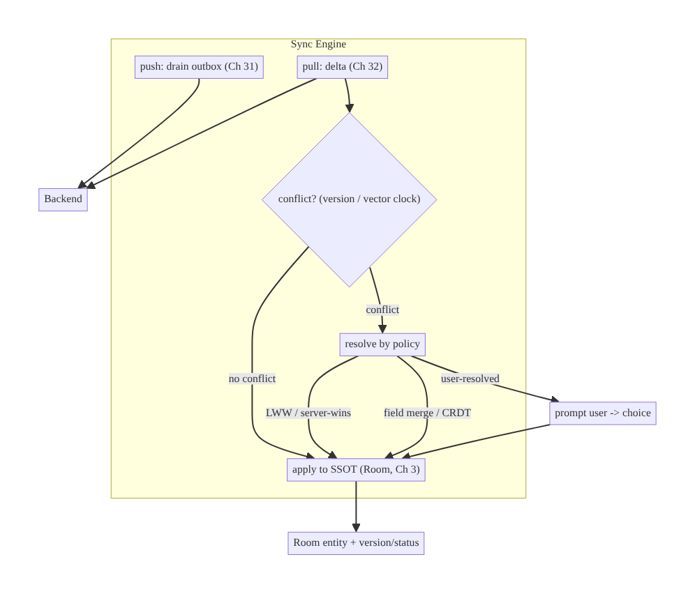
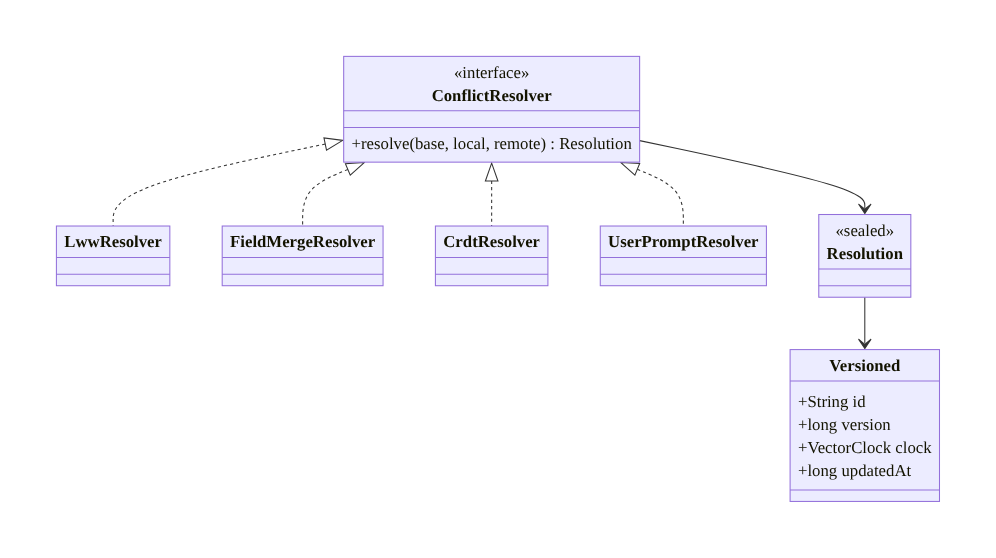
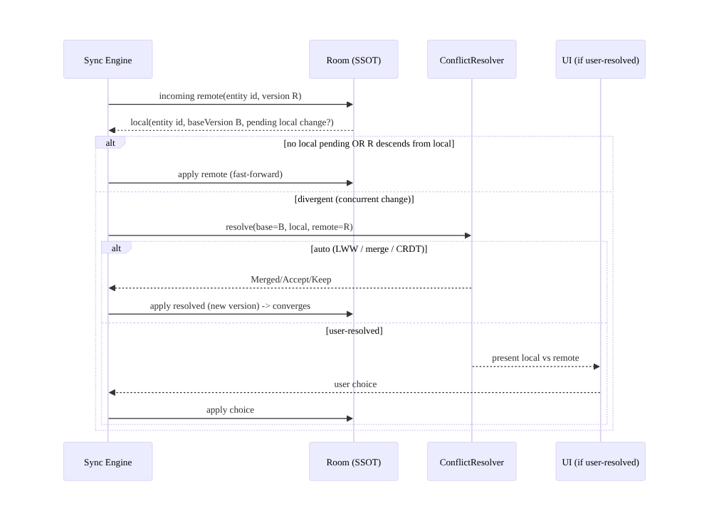
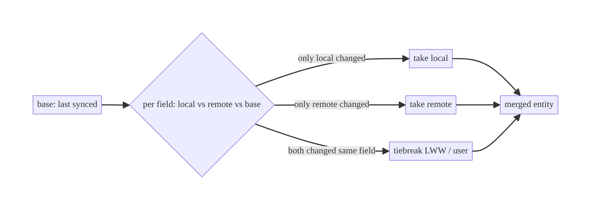
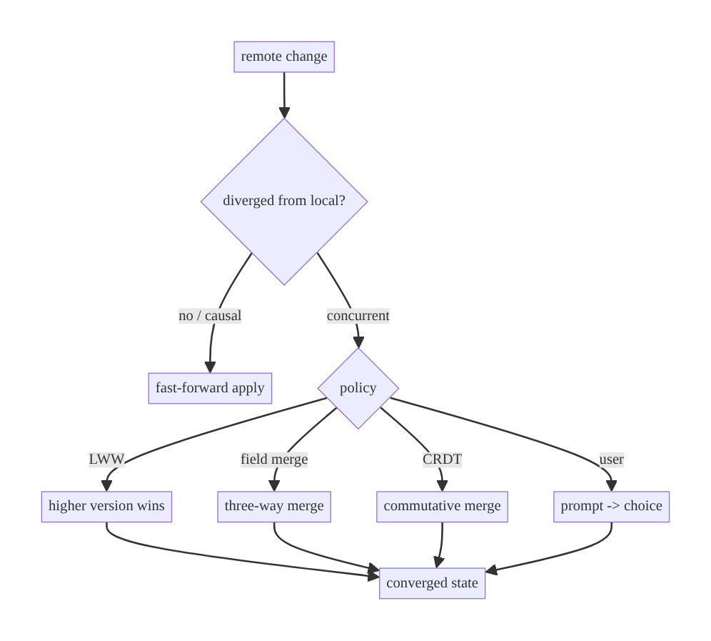

# Chapter 33 — Conflict Resolution & a Sync Engine

> **Part IV — Offline-First & Synchronization** · Complexity: **Complex** (≥40 interview questions)
>
> **Prerequisites:** Ch 29 (offline-first), Ch 31 (outbox/push), Ch 32 (delta/pull),
> Ch 30 (WorkManager), Ch 15 (idempotency), Ch 3 (SSOT). This chapter **completes
> Part IV** by resolving the divergence that push+pull create, and composes the
> pieces into one **sync engine**.
>
> **Reference surface in StreamCart:** reconciling edits made on two devices (or
> offline + server) to the same cart item, wishlist, watch-progress, or profile —
> deterministically and without losing user intent.

---

## 33.1 Problem Definition and Real-World Context

Once writes happen **both** locally (offline, Ch 31) and remotely (other devices/
users, Ch 32), the same entity can be changed in two places before they sync — a
**conflict**. Without a resolution policy, sync either **loses data** (one change
silently overwrites the other) or **corrupts state** (partial/inconsistent merges).
Conflict resolution is the hardest part of sync and the thing interviewers probe:

- **Silent last-writer-wins by accident.** A naive "upsert whatever arrived last"
  overwrites a concurrent edit — the user's change vanishes with no indication.
- **Clock-based LWW is subtly wrong.** Using wall-clock timestamps to pick a winner
  fails under clock skew and can't express causality ("did B see A's change?").
- **Field-level loss.** Entity-level overwrite discards *all* fields when only one
  field conflicts (two users edit different fields → one edit lost unnecessarily).
- **No convergence guarantee.** Devices that apply conflicting changes in different
  orders can end up in **different** final states (not eventually consistent).
- **Ignoring user intent.** For important edits (a document, a shared list), silently
  auto-resolving may be wrong; the user may need to choose.

The architecture: **detect** conflicts (versions / vector clocks), **resolve** by a
policy appropriate to the data (last-writer-wins, server-wins, field-merge,
operation-merge/**CRDT**, or **user-resolved**), guarantee **convergence** (all
devices reach the same state), and compose detection/resolution with push (Ch 31) +
pull (Ch 32) into a coherent **sync engine**. This chapter is the capstone that
makes offline-first *correct*, not just *available*.

### Three practical use cases

1. **E-commerce (StreamCart).** Cart quantity edited on phone (offline) and web
   (online); resolve by LWW or sum-merge depending on semantics — don't lose the
   user's intent.
2. **Productivity/Social (Social).** A shared list or draft edited on two devices;
   **field-level merge** or **CRDT** so both edits survive; user-resolved for true
   conflicts.
3. **OTT (Watch).** Watch-progress on two devices; **max-progress** merge (a simple
   CRDT) so the furthest position wins deterministically.

### Why this is architectural

Conflict resolution defines the app's **consistency guarantees** (convergence,
eventual consistency), the **data-loss policy** (what happens when edits collide),
and the **merge model** (entity/field/operation/CRDT/user) — the properties that
decide whether multi-device offline-first data stays correct.

---

## 33.2 Requirements Engineering

### Functional requirements

| ID | Requirement |
|----|-------------|
| F1 | Detect when local and remote versions of an entity diverge. |
| F2 | Resolve conflicts by a per-data-type policy (LWW / server-wins / merge / user). |
| F3 | Guarantee convergence: all replicas reach the same state regardless of order. |
| F4 | Preserve causality where it matters (versions/vector clocks, not wall clocks). |
| F5 | Support field-level and operation-level merge, not just entity overwrite. |
| F6 | Surface true conflicts to the user when auto-resolution is unsafe. |
| F7 | Compose with push (Ch 31) + pull (Ch 32) into one sync engine. |

### Non-functional requirements

| Attribute | Policy |
|-----------|--------|
| **Consistency** | Convergent (eventually consistent); deterministic resolution. |
| **Correctness** | No silent data loss where avoidable; causality respected. |
| **UX** | Auto-resolve safely; prompt only for genuine conflicts. |
| **Performance** | Resolution cheap; merge scalable. |
| **Observability** | Conflict rate + resolution outcomes visible. |

### Scope

- **In scope:** conflict detection (version/vector clocks), resolution strategies
  (LWW, server/client-wins, field-merge, CRDT/op-merge, user-resolved), convergence,
  three-way merge, the composed sync engine (detect→resolve→apply), conflict UX.
- **Out of scope:** push/outbox mechanics (Ch 31), delta/token mechanics (Ch 32),
  WorkManager (Ch 30), real-time transport (Ch 63).

### Assumptions & constraints

- Entities carry a **version** (and optionally a vector clock / `updatedAt` as a
  tiebreaker). Backend participates (server version, merge endpoints where needed).
  Room SSOT (Ch 3). `minSdk 24`. Eventual consistency acceptable.

---

## 33.3 System Design Fundamentals

- **Conflict detection.** A conflict exists when **both** the local replica and the
  remote changed the same entity since they last agreed. Detect via **versions**:
  the client holds `baseVersion` (what it last synced); if the server's version
  advanced *and* the client has a pending local change, they diverged. **Vector
  clocks** (a per-replica counter map) capture *causality* precisely — whether one
  change "happened-before" another or they're truly concurrent — where plain
  versions can't.
- **Why not wall-clock LWW?** Timestamps can't express causality and suffer clock
  skew; two devices with wrong clocks pick the "wrong" winner. Use **logical
  versions/vector clocks**; if you use timestamps, use them only as a deterministic
  **tiebreaker** on the server's clock.
- **Resolution strategies (choose per data type):**
  - **Last-Writer-Wins (LWW):** pick the higher version/timestamp. Simple,
    convergent, but **loses** the other edit. OK for single-value, low-stakes
    fields.
  - **Server-wins / client-wins:** always prefer one side. Simple; biased data loss.
  - **Field-level (three-way) merge:** compare `base`, `local`, `remote` per field;
    take non-conflicting field changes from both; only truly-conflicting *same*
    fields need a tiebreak. Preserves more intent.
  - **Operation-based merge / CRDTs:** model changes as commutative operations so
    any order converges without conflict — e.g., **G-Counter** (sum), **LWW-
    Register**, **OR-Set** (add/remove set), **max** (watch-progress). CRDTs
    guarantee convergence *by construction*; best for collaborative/mergeable data.
  - **User-resolved:** present both versions and let the user choose/merge. For
    high-value edits where auto-resolution is unacceptable.
- **Convergence (the correctness bar).** All replicas must reach the **same** final
  state regardless of the order changes arrive. LWW and CRDTs are convergent;
  ad-hoc merges often aren't. This is what "eventual consistency" actually requires.
- **Three-way merge** (base/local/remote) is the key to not losing concurrent edits
  to different fields — like a VCS merge.
- **The sync engine** composes: **push** local changes (outbox, Ch 31) → **pull**
  remote deltas (Ch 32) → on each incoming change, **detect** conflict vs local
  pending → **resolve** by policy → apply to SSOT (Ch 3). Idempotency (Ch 15) and
  versions keep it safe under retries.

Core insight: **detect conflicts with logical versions/vector clocks, resolve with
a strategy matched to the data's semantics (LWW for single values, field-merge or
CRDTs for collaborative data, user-resolved for high-stakes), and guarantee all
replicas converge** — then compose detect→resolve with push/pull into one engine.

---

## 33.4 High-Level Architecture



**Components & ownership**

- **Sync engine** orchestrates push→pull→detect→resolve→apply.
- **Detector** compares versions/vector clocks (local pending vs remote).
- **Resolver** applies the per-type policy (LWW / merge / CRDT / user).
- **SSOT (Room)** stores the resolved entity + version + status (Ch 3/29).
- **UI** handles user-resolved conflicts.

**Direction:** pull delta → detect vs local pending → resolve (auto or user) →
apply to SSOT (convergent).

---

## 33.5 Detailed Component Design



| Component | Strategy | Convergent? | Data loss | Use for |
|-----------|----------|-------------|-----------|---------|
| `LwwResolver` | highest version/ts wins | yes | yes (other edit) | single low-stakes values |
| server/client-wins | fixed side | yes | yes (biased) | authoritative/local-trusted fields |
| `FieldMergeResolver` | three-way per field | yes (deterministic) | minimal | structured records |
| `CrdtResolver` | commutative ops | yes (by construction) | none | collaborative/mergeable (sets, counters, progress) |
| `UserPromptResolver` | user chooses | yes (after choice) | none (user decides) | high-value edits (docs) |

**`Resolution`:** `Accept(remote)` / `Keep(local)` / `Merged(entity)` /
`NeedsUser(local, remote)` — the engine applies the first three; `NeedsUser` routes
to UI then re-applies.

---

## 33.6 End-to-End Data Flow

### Detect + resolve a conflict during pull



### Field-level three-way merge



---

## 33.7 Complete Kotlin Implementation

Package: `com.streamcart.sync.conflict`.

### 33.7.1 Versioned entity + resolver contract

```kotlin
sealed interface Resolution<out T> {
    data class Accept<T>(val remote: T) : Resolution<T>      // take remote
    data class Keep<T>(val local: T) : Resolution<T>         // keep local
    data class Merged<T>(val value: T) : Resolution<T>       // merged result
    data class NeedsUser<T>(val local: T, val remote: T) : Resolution<T>  // route to UI
}

interface ConflictResolver<T> {
    fun resolve(base: T?, local: T?, remote: T): Resolution<T>
}
```

### 33.7.2 Last-Writer-Wins (by logical version, ts tiebreaker)

```kotlin
class LwwResolver<T : Versioned> : ConflictResolver<T> {
    override fun resolve(base: T?, local: T?, remote: T): Resolution<T> = when {
        local == null -> Resolution.Accept(remote)
        remote.version > local.version -> Resolution.Accept(remote)
        remote.version < local.version -> Resolution.Keep(local)
        else -> if (remote.updatedAt >= local.updatedAt) Resolution.Accept(remote) else Resolution.Keep(local)  // deterministic tiebreak
    }
}
```

### 33.7.3 Field-level three-way merge

```kotlin
class ProfileMergeResolver : ConflictResolver<Profile> {
    override fun resolve(base: Profile?, local: Profile?, remote: Profile): Resolution<Profile> {
        if (local == null || base == null) return Resolution.Accept(remote)
        fun <F> pick(sel: (Profile) -> F): F {
            val b = sel(base); val l = sel(local); val r = sel(remote)
            return when {
                l == r -> l                      // agree
                l == b -> r                      // only remote changed -> take remote
                r == b -> l                      // only local changed -> take local
                else -> r                        // both changed same field -> tiebreak (remote/LWW) or NeedsUser
            }
        }
        val merged = Profile(
            id = remote.id,
            name = pick { it.name },
            bio = pick { it.bio },
            avatarUrl = pick { it.avatarUrl },
            version = maxOf(local.version, remote.version) + 1,
            updatedAt = maxOf(local.updatedAt, remote.updatedAt),
        )
        return Resolution.Merged(merged)
    }
}
```

### 33.7.4 CRDT examples (convergent by construction)

```kotlin
// Watch-progress: max wins (monotonic) -> a CRDT; any order converges.
class MaxProgressResolver : ConflictResolver<WatchProgress> {
    override fun resolve(base: WatchProgress?, local: WatchProgress?, remote: WatchProgress) =
        Resolution.Merged(remote.copy(positionMs = maxOf(local?.positionMs ?: 0, remote.positionMs)))
}

// Wishlist as an OR-Set: union adds, honor removes by tag -> commutative, convergent.
class OrSetResolver : ConflictResolver<WishlistSet> {
    override fun resolve(base: WishlistSet?, local: WishlistSet?, remote: WishlistSet): Resolution<WishlistSet> {
        val l = local ?: WishlistSet.EMPTY
        val added = l.addedTags + remote.addedTags            // union of add-tags
        val removed = l.removedTags + remote.removedTags      // union of remove-tags
        val live = added.filterNot { it.id in removed.map(Tag::id) }
        return Resolution.Merged(WishlistSet(live.toSet(), added, removed))
    }
}
```

### 33.7.5 The sync engine (compose push → pull → detect → resolve → apply)

```kotlin
class SyncEngine @Inject constructor(
    private val outbox: OutboxDrainer,                // Ch 31 (push)
    private val delta: DeltaSyncEngine,               // Ch 32 (pull) — delegates apply here
    private val resolvers: ResolverRegistry,          // per-type ConflictResolver
    private val dao: SyncDao, private val db: StreamCartDatabase,
    private val conflictQueue: UserConflictQueue,     // for NeedsUser
) {
    suspend fun sync(): Result<Unit> = runCatching {
        outbox.drain()                                 // push local first (fewer conflicts, Ch 29)
        delta.sync(applyRemote = ::applyRemote)        // pull; apply each change via resolver
    }

    private suspend fun applyRemote(remote: Versioned) = db.withTransaction {
        val local = dao.findById(remote.id)
        val base = dao.findBase(remote.id)             // last-synced snapshot (for 3-way)
        // Fast-forward: no local pending or remote already includes local -> just apply.
        if (local == null || local.syncStatus == SyncStatus.SYNCED) { dao.upsert(remote); return@withTransaction }
        when (val res = resolvers.forType(remote.type).resolve(base, local, remote)) {
            is Resolution.Accept -> dao.upsert(res.remote)
            is Resolution.Keep -> { /* keep local; local pending will re-push */ }
            is Resolution.Merged -> { dao.upsert(res.value); outbox.enqueueMerge(res.value) }   // push merged up
            is Resolution.NeedsUser -> { dao.setStatus(remote.id, SyncStatus.CONFLICT); conflictQueue.add(local, remote) }
        }
    }
}
```

### 33.7.6 Module structure

```
:sync/conflict  ConflictResolver, LwwResolver, FieldMergeResolver, CRDT resolvers, ResolverRegistry
:sync           SyncEngine (push+pull+resolve), UserConflictQueue
:core:database  Versioned entities (version/clock), base snapshots for 3-way merge
```

---

## 33.8 Concurrency and Race Conditions

| Scenario | Risk | Handling |
|----------|------|----------|
| Concurrent edits two devices | lost update | detect via version/clock; resolve by policy |
| Apply order differs per device | divergent final state | convergent strategy (LWW/CRDT/deterministic merge) |
| Clock skew (timestamp LWW) | wrong winner | logical versions/vector clocks; ts only as tiebreak |
| Merge then local edits again | re-conflict | push merged (new version); keep local pending if newer |
| Resolve runs during local write | races SSOT | apply in a transaction; version-gate |
| Non-commutative "merge" | non-convergence | use CRDTs / three-way deterministic merge |
| User-resolved pending | stale prompt | snapshot both versions; re-check version on apply |

- **Convergence is the correctness invariant:** the resolution function must be
  **deterministic and order-independent** (LWW by version, CRDT, or deterministic
  three-way merge) so every device computes the **same** result — otherwise
  "eventual consistency" is a lie.
- **Vector clocks** distinguish *concurrent* (true conflict) from *causal* (one saw
  the other → fast-forward) — avoiding false conflicts that plain versions flag.

---

## 33.9 Failure Scenarios and Recovery

| Failure | Detection | Response | Outcome |
|---------|-----------|----------|---------|
| Concurrent edit (true conflict) | version/clock divergence | resolve by policy (auto/user) | converged, intent preserved |
| Clock skew | — | logical versions | correct winner |
| Non-convergent ad-hoc merge | devices differ | switch to CRDT/deterministic 3-way | converge |
| Lost update (entity LWW) | field loss | field-merge / CRDT | both edits survive |
| User ignores conflict prompt | stuck CONFLICT | keep local; re-prompt; default policy after timeout | not blocked |
| Merge loop (A↔B re-conflict) | repeated conflicts | version monotonicity; CRDT commutativity | terminates |
| Delete vs edit conflict | tombstone vs update | policy (e.g., delete-wins / resurrect / user) | defined outcome |
| Process death mid-resolve | transactional apply | re-run; idempotent (Ch 15) | safe |



> **Delete-vs-edit is a conflict too:** decide a policy (delete-wins, resurrect-on-
> edit, or user-resolved) explicitly — it's a common gap that silently loses either
> the delete or the edit.

---

## 33.10 Scaling the Implementation

- **Level 1.** LWW by version on entity overwrite (simple apps, single-value
  fields).
- **Level 2.** Per-type resolver registry; server-wins for authoritative data;
  field-merge for records.
- **Level 3 — production.** Three-way merge with base snapshots; CRDTs for
  mergeable data (sets/counters/progress); user-resolved for high-value; conflict
  status UX.
- **Level 4 — large.** Vector clocks for precise causality; delete-vs-edit policy;
  merged-change re-push; conflict analytics; per-field policies.
- **Level 5 — enterprise.** Full CRDT or **Operational Transform** for real-time
  collaboration (Ch 63), multi-replica convergence proofs, server-side merge
  services, conflict audit trails, offline + realtime hybrid.

**Avoid overengineering:** most apps need LWW or simple field-merge. CRDTs/OT are
for genuinely collaborative, concurrently-edited data (docs, shared lists,
real-time). Don't build a CRDT framework for a settings screen.

---

## 33.11 Alternative Approaches and Trade-offs

| Strategy | Convergent | Data loss | Complexity | Use when |
|----------|-----------|-----------|-----------|----------|
| **LWW** (by version) | yes | yes (loser's edit) | low | single low-stakes values; last edit is "right" |
| **Server-wins** | yes | yes (local) | low | server is authoritative (prices, inventory) |
| **Client-wins** | yes | yes (remote) | low | local device is trusted (rare) |
| **Field-level 3-way merge** | yes (deterministic) | minimal | medium | structured records, different fields edited |
| **CRDT / op-merge** | yes (by construction) | none | medium–high | collaborative/mergeable (sets, counters, text) |
| **User-resolved** | yes (after choice) | none | medium (UX) | high-value edits; auto unsafe |
| **Operational Transform** | yes | none | high | real-time collaborative text (Ch 63) |

**Detection: versions vs vector clocks.** A single version counter detects
divergence but can't tell *concurrent* from *causal* — it may flag a conflict when
one change actually descended from the other (false conflict). **Vector clocks** (a
counter per replica) capture the happened-before relation precisely, distinguishing
true concurrency from causality, at the cost of storing/transmitting the clock.
Versions suffice for 2-party (client+server) LWW; vector clocks shine with many
replicas/true multi-device concurrency.

**LWW vs CRDT (the core trade-off):** LWW is trivial and convergent but **loses**
the losing write — fine when only the latest value matters. CRDTs guarantee
convergence **and** preserve all operations (no loss) by modeling changes as
commutative ops, but require designing the data as a CRDT (counter/set/register) and
can grow metadata. For collaborative data where every edit matters, invest in CRDTs;
for single values, LWW is enough.

---

## 33.12 Security Considerations

- **Server validates and authorizes merges:** a client-proposed merge must be
  re-validated server-side — a tampered client must not merge in a way that escalates
  privileges or overwrites others' data (Ch 29).
- **Conflict resolution must not leak data:** showing "remote version" to the user in
  a user-resolved conflict must respect access (don't reveal another user's content
  they shouldn't see).
- **Causality integrity:** versions/vector clocks shouldn't be client-forgeable in a
  way that lets a client suppress legitimate server changes — the backend arbitrates.
- **Encrypt conflicting copies at rest** (Ch 24); clear on logout (Ch 22).
- **Audit trails** for important merges (fintech/collaborative) — who changed what,
  for dispute resolution.
- Client vs backend: resolution runs on-device for UX, but the **backend is the
  arbiter** of the authoritative state and must enforce that merges are legal.

---

## 33.13 Performance and Resource Optimization

- **Resolution is cheap** (compare versions/fields); CRDT merges are typically O(n)
  in changed elements — keep metadata bounded (tombstone GC for OR-Sets, etc.).
- **Fast-forward the common case:** most incoming changes have no local conflict —
  detect and apply directly without invoking the resolver.
- **Store base snapshots** only where three-way merge is used (memory/storage cost).
- **Batch resolution** within a delta page transaction (Ch 32/3).
- **Avoid merge loops** (version monotonicity) that cause repeated re-sync.
- **Profiling:** conflict rate, resolution time, merged-change re-push volume, CRDT
  metadata size.

---

## 33.14 Testing Strategy

Conflict logic is pure and highly testable; the engine is tested with fakes.

```kotlin
class LwwResolverTest {
    private val r = LwwResolver<Note>()
    @Test fun `higher version wins`() {
        assertEquals(Resolution.Accept(note(v=2)), r.resolve(note(v=1), note(v=1), note(v=2)))
    }
    @Test fun `deterministic tiebreak on equal version`() {
        val a = r.resolve(null, note(v=1, ts=10), note(v=1, ts=20))
        assertTrue(a is Resolution.Accept)          // same on both devices -> convergent
    }
}

class FieldMergeTest {
    @Test fun `different fields edited both survive`() {
        val base = profile(name="A", bio="x")
        val local = base.copy(name="Ada")           // local changed name
        val remote = base.copy(bio="hi", version=2) // remote changed bio
        val m = (ProfileMergeResolver().resolve(base, local, remote) as Resolution.Merged).value
        assertEquals("Ada", m.name); assertEquals("hi", m.bio)   // no loss
    }
    @Test fun `same field conflict tiebreaks deterministically`() { /* both edit name */ }
}

class CrdtTest {
    @Test fun `max progress converges regardless of order`() {
        val r = MaxProgressResolver()
        val x = r.resolve(null, prog(10), prog(30)); val y = r.resolve(null, prog(30), prog(10))
        assertEquals(30, (x as Resolution.Merged).value.positionMs)
        assertEquals(30, (y as Resolution.Merged).value.positionMs)   // commutative
    }
    @Test fun `OR-Set add and concurrent remove converge`() { /* union adds/removes */ }
}

class SyncEngineConflictTest {
    @Test fun `concurrent edit resolved and merged pushed`() = runTest {
        // seed local pending edit; pull remote edit; assert merged entity + outbox has merge
    }
    @Test fun `convergence: two devices reach same state`() = runTest {
        // apply changes in opposite orders on two in-memory engines; assert equal final state
    }
}
```

What to test: resolver purity (LWW/merge/CRDT), **convergence** (apply in different
orders → same state), delete-vs-edit policy, user-resolved routing, engine
push→pull→resolve integration, idempotent re-apply.

---

## 33.15 Production Observability

- **Metrics:** conflict rate (conflicts / syncs), resolution outcome distribution
  (LWW/merge/CRDT/user), user-resolution completion rate, data-loss incidents (LWW
  losers — track to decide if a better strategy is needed), merge-loop detection,
  divergence incidents (should be 0).
- **Logs:** `conflict{type, strategy, outcome}`, `resolve{entityId_hash, versions}`
  (no PII content, Ch 28), correlation IDs (Ch 1/84).
- **Debugging:** data loss complaints → LWW on fields that need merge → switch to
  field-merge/CRDT; devices show different state → non-convergent resolution →
  deterministic/CRDT; false conflicts → versions flagging causal changes → vector
  clocks; merge loops → version non-monotonic.
- **Alerting:** divergence or merge-loop detection → correctness incident; conflict-
  rate spike → concurrent-edit pattern change.
- **Privacy:** conflicting copies are user data — redact; audit important merges.

---

## 33.16 System Design Interview Preparation

> 40+ questions.

**Fundamentals**

1. *What is a sync conflict?* The same entity changed in two replicas (local +
   remote) since they last agreed.
2. *How detect it?* Versions (base vs server) or vector clocks; local pending +
   remote advanced → divergence.
3. *Why not wall-clock LWW?* Can't express causality; clock skew picks wrong winner;
   use logical versions.
4. *What is convergence?* All replicas reach the same final state regardless of
   order — the eventual-consistency requirement.
5. *Resolution strategies?* LWW, server/client-wins, field-merge, CRDT/op-merge,
   user-resolved.

**Strategies**

6. *LWW — pros/cons?* Simple, convergent; **loses** the other edit. Single values.
7. *Server-wins?* Server authoritative; biased local loss (prices/inventory).
8. *Field-level three-way merge?* Compare base/local/remote per field; take
   non-conflicting changes from both; minimal loss.
9. *When user-resolved?* High-value edits where auto-resolution is unsafe (docs).
10. *CRDT?* Commutative ops → convergence by construction, no loss (counters/sets/
    progress/text).

**CRDTs / causality**

11. *Example CRDTs?* G-Counter (sum), LWW-Register, OR-Set (add/remove), max
    (progress).
12. *Why do CRDTs converge?* Operations commute — any order yields the same state.
13. *Vector clocks vs versions?* Vector clocks capture causality (concurrent vs
    causal); versions can't → false conflicts with many replicas.
14. *Watch-progress conflict?* Max-merge (a CRDT) — furthest position wins,
    convergent.

**Merge mechanics**

15. *Three-way merge needs?* A base (last-synced) snapshot.
16. *Both edit the same field?* Tiebreak (LWW) or user-resolved.
17. *Delete vs edit?* Explicit policy (delete-wins / resurrect / user) — don't
    silently drop.

**Engine**

18. *Compose with push/pull?* Push outbox (Ch 31) → pull delta (Ch 32) → detect vs
    local pending → resolve → apply (Ch 3).
19. *Why push before pull?* Fewer conflicts; send local first.
20. *Fast-forward?* No local pending / causal remote → apply directly (no resolver).
21. *Merged change?* Push the merged result up (new version).

**Convergence/correctness**

22. *How guarantee convergence?* Deterministic, order-independent resolution (LWW by
    version / CRDT / deterministic 3-way).
23. *Merge loops?* Version monotonicity; CRDT commutativity.
24. *Idempotent apply?* Version-gated upsert (Ch 15/32).

**Security**

25. *Who arbitrates?* Backend validates/authorizes merges; client resolves for UX.
26. *Leak in user-resolved UI?* Respect access to the "remote" version.

**Performance**

27. *Resolution cost?* Cheap; fast-forward the common case; bound CRDT metadata.
28. *Base snapshots cost?* Only where 3-way merge is used.

**Testing**

29. *How test convergence?* Apply changes in opposite orders → assert equal state.
30. *How test resolvers?* Pure functions — LWW/merge/CRDT cases.
31. *How test delete-vs-edit?* Assert the chosen policy outcome.

**Production debugging**

32. *Data loss complaints?* LWW where merge is needed → field-merge/CRDT.
33. *Devices differ?* Non-convergent resolution.
34. *False conflicts?* Versions flag causal changes → vector clocks.
35. *Merge loops?* Non-monotonic versions.

**Design**

36. *Real-time collaborative text?* CRDT or OT (Ch 63).
37. *When is LWW acceptable?* Single values where latest wins.
38. *When CRDT worth it?* Concurrently-edited mergeable data.
39. *Multi-device counters?* G-Counter (per-replica sums).
40. *Audit important merges?* Trails for fintech/collaborative.

### Design-change challenges
1. **Two devices edit different profile fields.** Field-level three-way merge (no
   loss).
2. **Shared list concurrently edited.** OR-Set CRDT (union adds, honor removes).
3. **Watch-progress across devices.** Max-merge CRDT.
4. **Important doc edits conflict.** User-resolved with both versions.
5. **Real-time collaborative editing.** CRDT/OT over WebSocket (Ch 63).

### Mock walkthrough (abridged)
Clarify (data semantics, multi-device, acceptable loss?) → detect via versions/
vector clocks → pick strategy per data (LWW single values, field-merge records, CRDT
collaborative, user high-value) → guarantee convergence (deterministic/commutative)
→ compose push→pull→detect→resolve→apply (engine) → delete-vs-edit policy → backend
arbitrates → testing convergence.

---

## 33.17 Practical Exercises

1. **Beginner.** Implement version-based LWW resolution with a deterministic
   tiebreaker; prove both devices pick the same winner. *Eval:* convergent.
2. **Intermediate.** Implement a field-level three-way merge (base/local/remote) so
   edits to different fields both survive. *Eval:* no loss; same-field tiebreak.
3. **Advanced.** Implement a max-progress and an OR-Set CRDT; prove commutativity
   (order-independent). *Eval:* same state regardless of order.
4. **Production debugging.** Fix a sync using entity-level LWW that loses concurrent
   field edits and whose two devices diverge. *Eval:* field-merge/CRDT; converges.
5. **System design challenge.** Build the sync engine (push→pull→detect→resolve→
   apply) with a per-type resolver registry and user-resolved routing. *Eval:* auto
   where safe; prompts for true conflicts; converges.

*(Solutions withheld unless requested.)*

---

## 33.18 Chapter Summary & Reference Sheet

**Key decisions:** **detect** conflicts with **logical versions / vector clocks**
(not wall clocks); **resolve** with a strategy matched to the data — **LWW** for
single low-stakes values, **server-wins** for authoritative data, **field-level
three-way merge** for records, **CRDTs** for collaborative/mergeable data (sets,
counters, progress), **user-resolved** for high-value edits; **guarantee
convergence** (deterministic, order-independent resolution); handle **delete-vs-edit**
explicitly; **compose** detect→resolve with **push (Ch 31) → pull (Ch 32)** into one
**sync engine**, **fast-forwarding** the non-conflicting common case and **pushing
merged results** up; the **backend arbitrates/validates** merges. **Convergence +
intent preservation** are the bars.

**Concepts:** conflict detection, versions vs vector clocks, causality/
happened-before, convergence/eventual consistency, LWW, server/client-wins, three-way
merge, CRDTs (G-Counter/LWW-Register/OR-Set/max), operational transform,
user-resolved, delete-vs-edit, sync engine composition.

**Common mistakes:** wall-clock LWW (skew/causality bugs); entity-level overwrite
losing concurrent field edits; non-convergent ad-hoc merges (devices diverge); false
conflicts from plain versions (use vector clocks); ignoring delete-vs-edit;
auto-resolving high-value edits that need the user; non-idempotent/non-version-gated
apply; unbounded CRDT metadata.

**Checklist:**

- [ ] version/vector-clock detection
- [ ] per-type resolution policy
- [ ] convergent (deterministic/commutative)
- [ ] three-way merge where fields differ
- [ ] CRDTs for collaborative data
- [ ] user-resolved for high-value
- [ ] delete-vs-edit policy
- [ ] fast-forward common case
- [ ] push merged up
- [ ] backend validates merges
- [ ] test convergence (order-independence).

**Key APIs/patterns:** `Versioned`(version/vectorClock/updatedAt), `ConflictResolver`
+ `Resolution` (Accept/Keep/Merged/NeedsUser), LWW/field-merge/CRDT resolvers,
`ResolverRegistry`, three-way merge, `SyncEngine` (push+pull+resolve+apply),
`db.withTransaction`, idempotent version-gated upsert (Ch 15/32).

**References:**
- CRDTs (intro): https://crdt.tech/
- Vector clocks / happened-before: https://en.wikipedia.org/wiki/Vector_clock
- Offline-first conflict handling: https://developer.android.com/topic/architecture/data-layer/offline-first#conflict-resolution
- Operational Transformation (real-time, Ch 63): https://en.wikipedia.org/wiki/Operational_transformation
- (composes) Ch 29 Offline-First, Ch 31 Outbox, Ch 32 Delta Sync, Ch 15 Idempotency

### Chapter review (Phase 4)
- **Completeness:** all 18 sections; architecture/class/sequence/failure diagrams;
  resolver contract + LWW + 3-way merge + CRDTs + sync engine composition;
  concurrency (convergence invariant, vector clocks); failure (delete-vs-edit, merge
  loops); 5 levels; versions-vs-vector-clocks and LWW-vs-CRDT trade-offs; security
  (backend arbitrates); perf (fast-forward, bounded CRDT); convergence tests;
  observability (conflict/divergence); 40 Q&A + 5 challenges. ✅
- **Expand later:** real-time collaboration/OT (Ch 63), WebSocket push (Ch 63),
  advanced CRDTs, audit trails. **Completes Part IV (Ch 29–33).**
- **Interview coverage:** exceeds ≥40 bar.
