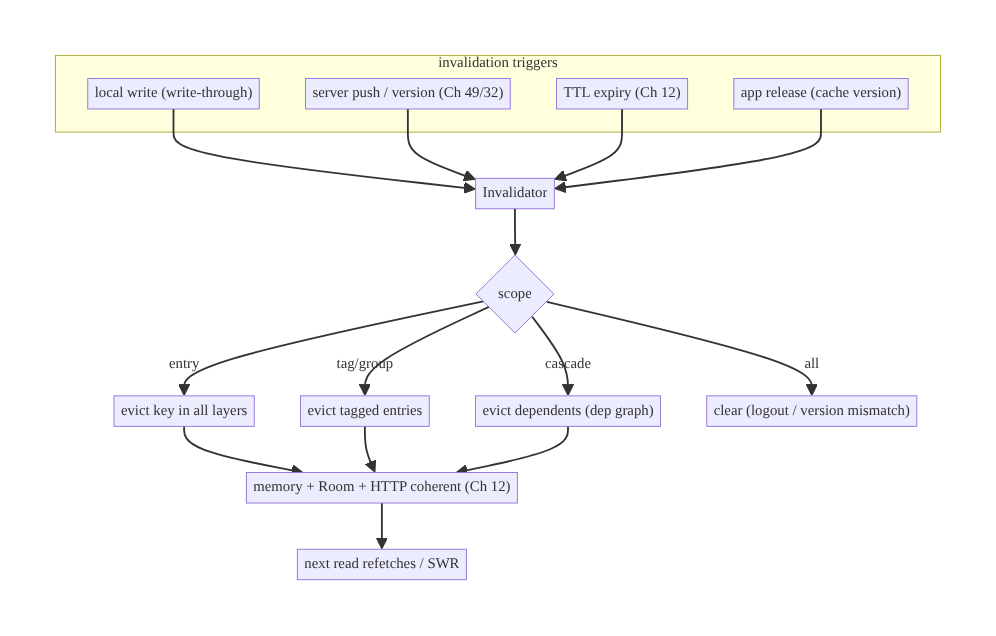
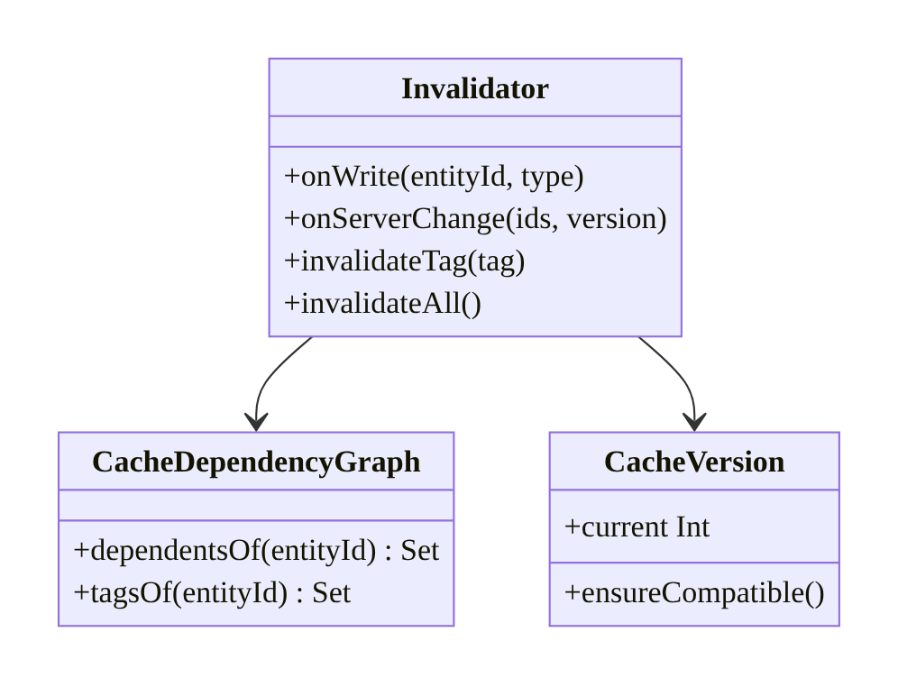
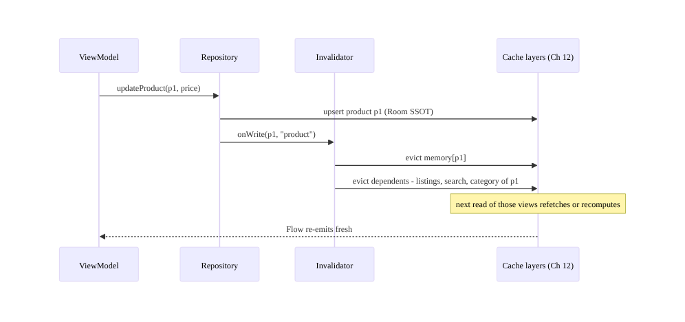
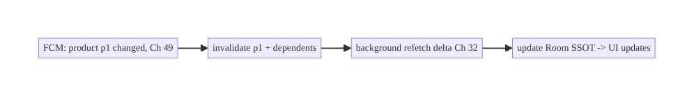
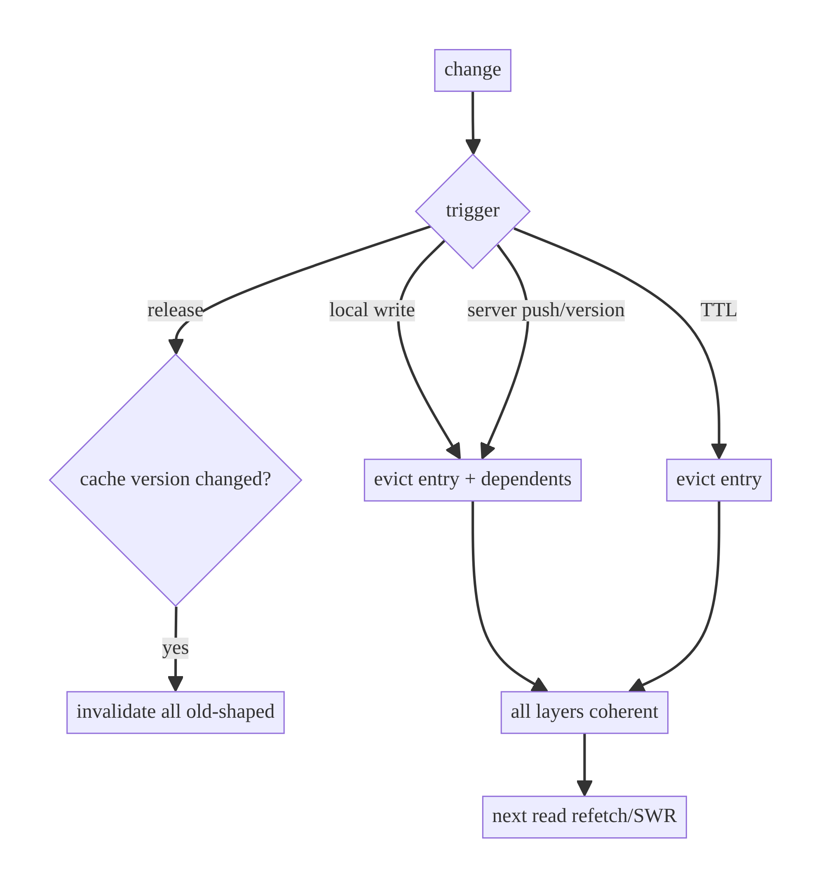

# Chapter 34 — Cache Invalidation Strategy

> **Part IV — Offline-First & Synchronization** · Complexity: **Standard** (≥25 interview questions)
>
> **Prerequisites:** Ch 12 (Caching Strategies — the layers/TTL/ETag mechanics),
> Ch 3 (SSOT), Ch 32 (delta sync — server-driven freshness), Ch 41 (remote config,
> previewed). This chapter goes deep on the **hard half** of caching: *when and how
> to invalidate*.
>
> **Reference surface in StreamCart:** keeping the cached catalog, a product's
> detail, its category listing, and the user's cart consistent after writes,
> server changes, and new app releases — without serving stale data or over-
> fetching.

---

## 34.1 Problem Definition and Real-World Context

Ch 12 built the cache **layers** (HTTP / memory / Room) and basic freshness
(TTL + ETag). This chapter tackles the famously hard part — **invalidation**:
deciding *when* a cached value is no longer valid and *what else* must be
invalidated with it. Getting this wrong is the source of the most confusing bugs:

- **Stale-after-write.** A user edits their profile; the profile screen updates but
  the cached "account header" elsewhere still shows the old name — because the write
  invalidated one cache entry but not the **dependent** ones.
- **Over-invalidation.** Clearing the entire cache on any change throws away valid
  data, causing refetch storms and jank.
- **TTL-only staleness.** Relying solely on time means data is stale for up to the
  TTL after a change the client *could* have known about (write or server push).
- **Cross-release corruption.** A new app version changes a DTO/entity shape, but old
  cached data (wrong shape) is read and mis-mapped — no **cache versioning**.
- **Cascade misses.** Updating a product should invalidate the product detail *and*
  every category/search listing that includes it — a **dependency graph** the naive
  code ignores.

Invalidation strategy defines the **triggers** (time, write-through, event/push,
version), **scope** (single entry, tag/group, dependency cascade), and
**coordination** across cache layers and app releases. It's what makes a cache
*correct*, not just fast.

### Three practical use cases

1. **E-commerce (StreamCart).** A price change (server push) invalidates the product
   detail *and* its listings; a user's wishlist write invalidates the wishlist
   count badge everywhere.
2. **OTT (Watch).** New episodes invalidate the show page and the "continue watching"
   row; a config change invalidates feature-gated UI.
3. **Social (Social).** A deleted post invalidates the feed, the author's profile
   count, and any cached thread — coordinated invalidation across entries.

### Why this is architectural

Invalidation defines the **consistency contract of the cache**: which triggers
cause invalidation, how far it cascades, and how caches stay coherent across layers
and releases — the properties that decide whether users ever see stale or corrupt
cached data.

---

## 34.2 Requirements Engineering

### Functional requirements

| ID | Requirement |
|----|-------------|
| F1 | Invalidate on local writes (write-through/after-write), not just time. |
| F2 | Invalidate dependent/related entries (cascade by relationship or tag). |
| F3 | Support server-driven invalidation (push / version / delta, Ch 32). |
| F4 | Version the cache so incompatible app releases don't read stale-shaped data. |
| F5 | Invalidate the right scope (entry / group / all) — not over-broad. |
| F6 | Keep layers (memory/DB/HTTP, Ch 12) coherent on invalidation. |

### Non-functional requirements

| Attribute | Policy |
|-----------|--------|
| **Consistency** | No read-after-write staleness; dependents stay coherent. |
| **Efficiency** | Minimal re-fetch; precise scope; no cache-clear storms. |
| **Freshness** | Server changes reflected promptly (push/version) where it matters. |
| **Reliability** | Cross-release safety (cache versioning). |
| **Observability** | Invalidation events + stale-serve rate visible. |

### Scope

- **In scope:** invalidation triggers (time/write/event/push/version), scope
  (entry/tag/cascade), cache versioning across releases, cross-layer coherence,
  server-driven invalidation, dependency graphs.
- **Out of scope:** the cache *layers/TTL/ETag* (Ch 12), delta-sync token mechanics
  (Ch 32), DB migrations (Ch 36), conflict resolution (Ch 33).

### Assumptions & constraints

- Layered cache from Ch 12 (memory LRU + Room + HTTP). Backend can signal freshness
  (version bump / push / `must-revalidate`). `minSdk 24`.

---

## 34.3 System Design Fundamentals

- **Invalidation triggers (combine them):**
  - **Time (TTL):** simplest; data is "valid for N" (Ch 12). Bounds staleness but
    can't react to known changes.
  - **Write-through / after-write:** a local mutation updates or **invalidates** the
    cached entry immediately (and its dependents) — eliminates read-after-write
    staleness. The most important trigger for correctness.
  - **Event / server-push:** the server notifies the client (FCM, Ch 49; WebSocket,
    Ch 63) that an entity changed → invalidate/refetch. Near-real-time freshness.
  - **Version / delta:** the server bumps an entity/dataset version (or the client
    pulls deltas, Ch 32) → invalidate what changed.
- **Invalidation scope.** Precise scope avoids both staleness and waste:
  - **Single entry** (by key/id).
  - **Group / tag** — entries tagged with a label (e.g., `"category:shoes"`)
    invalidated together.
  - **Dependency cascade** — invalidating an entity invalidates derived views (a
    product → its listings, search results, counts). Model dependencies explicitly
    (tags or a dependency map) rather than guessing.
  - **All** — nuclear option; reserve for logout/account-switch (Ch 22/42) or cache-
    version mismatch.
- **Cache versioning (cross-release).** A `cacheVersion` key bumped when the cached
  **shape** changes (DTO/entity/mapping) invalidates all old-shaped data on app
  update — preventing mis-mapping stale data (complements DB migrations, Ch 36).
- **Cross-layer coherence.** On invalidation, clear the entry in **every** layer
  (memory derived from DB, Ch 12) so they can't diverge; the SSOT (Room) remains
  authoritative.
- **Stale-while-revalidate (SWR, Ch 12).** Serve stale immediately, invalidate +
  refetch in the background — good UX for non-critical data; never for freshness-
  critical values.

Core insight: **combine triggers (write-through for correctness, push/version for
freshness, TTL as a backstop), invalidate the precise scope (entry/tag/cascade),
keep layers coherent, and version the cache across releases** — invalidation is a
coordination problem, not a single `evict()`.

---

## 34.4 High-Level Architecture



**Components & ownership**

- **`Invalidator`** turns a trigger into a scoped invalidation across layers.
- **Dependency map / tags** define cascade scope.
- **Cache version** guards cross-release shape changes.
- **Layers (Ch 12)** are kept coherent; Room (SSOT) is authoritative.

**Direction:** trigger → invalidator → scope (entry/tag/cascade/all) → evict across
layers → next read refetches.

---

## 34.5 Detailed Component Design



| Component | Responsibility | Note |
|-----------|----------------|------|
| `Invalidator` | apply scoped invalidation across layers | write/event/version/all |
| dependency graph / tags | define cascade scope | product → listings/search/counts |
| `CacheVersion` | cross-release shape guard | bump on DTO/entity change |
| layer coherence | evict in memory+DB+HTTP | Room SSOT authoritative (Ch 12) |

---

## 34.6 End-to-End Data Flow

### Write-through with dependency cascade



### Server-driven invalidation (push)



---

## 34.7 Complete Kotlin Implementation

Package: `com.streamcart.core.cache.invalidation`.

### 34.7.1 Tag/dependency-aware invalidator

```kotlin
class Invalidator @Inject constructor(
    private val memory: MemoryCache<String, *>,     // Ch 12
    private val dao: GenericDao,                     // Room SSOT
    private val httpCache: HttpCacheEvictor,         // OkHttp cache (Ch 12)
    private val deps: CacheDependencyGraph,
) {
    // Write-through: evict the entry + its dependents (cascade).
    suspend fun onWrite(entityId: String, type: String) {
        invalidateEntry(entityId)
        deps.dependentsOf(entityId).forEach { invalidateEntry(it) }   // cascade
    }

    // Server-driven: invalidate changed ids (from push/version/delta).
    suspend fun onServerChange(ids: List<String>) = ids.forEach { onWrite(it, "server") }

    suspend fun invalidateTag(tag: String) =
        deps.entriesWithTag(tag).forEach { invalidateEntry(it) }      // group invalidation

    suspend fun invalidateAll() {                                     // logout / version mismatch
        memory.clear(); dao.clearAll(); httpCache.evictAll()
    }

    private suspend fun invalidateEntry(id: String) {
        memory.invalidate(id)                                         // memory layer
        // Room: don't delete the row; mark stale so the next read revalidates,
        // OR delete if purely a cache (choice per data). Here: mark stale.
        dao.markStale(id)
        httpCache.evict(urlForEntity(id))                            // HTTP layer
    }
}
```

### 34.7.2 Dependency graph (tags + relationships)

```kotlin
class CacheDependencyGraph @Inject constructor(private val dao: TagDao) {
    // A product depends on: its detail, listings that include it, search, category.
    suspend fun dependentsOf(entityId: String): Set<String> =
        dao.listingsContaining(entityId) + dao.searchKeysFor(entityId) + dao.categoryOf(entityId)
    suspend fun entriesWithTag(tag: String): Set<String> = dao.keysWithTag(tag)
    suspend fun tagsOf(entityId: String): Set<String> = dao.tagsFor(entityId)
}
// Entries are tagged on insert, e.g. product p1 tagged ["category:shoes","brand:acme"].
```

### 34.7.3 Cache versioning (cross-release)

```kotlin
class CacheVersion @Inject constructor(private val store: DataStore<Preferences>) {
    private val CURRENT = 7                           // bump when cached shape changes (DTO/entity/mapping)
    private val key = intPreferencesKey("cache_version")

    // On app start: if stored version != current, wipe caches (old shape unreadable).
    suspend fun ensureCompatible(invalidator: Invalidator) {
        val stored = store.data.first()[key] ?: 0
        if (stored != CURRENT) {
            invalidator.invalidateAll()              // old-shaped data gone (complements DB migration, Ch 36)
            store.edit { it[key] = CURRENT }
        }
    }
}
```

### 34.7.4 Server-driven invalidation hook (push, Ch 49)

```kotlin
// FCM data message: {"invalidate": ["product:p1","category:shoes"]}
suspend fun onInvalidationPush(payload: InvalidationPush, invalidator: Invalidator) {
    payload.entries.forEach { ref ->
        when {
            ref.startsWith("product:") -> invalidator.onServerChange(listOf(ref.removePrefix("product:")))
            ref.startsWith("category:") -> invalidator.invalidateTag(ref)
        }
    }
    // then trigger a delta sync (Ch 32) / WorkManager (Ch 30) to refetch
}
```

### 34.7.5 Module structure

```
:core:cache/invalidation  Invalidator, CacheDependencyGraph, CacheVersion
:core:cache               MemoryCache, HttpCacheEvictor (Ch 12)
:core:database            markStale, tag/relationship DAOs (Ch 3)
:core:notifications       invalidation push handler (Ch 49)
```

---

## 34.8 Concurrency and Race Conditions

| Scenario | Risk | Handling |
|----------|------|----------|
| Write + concurrent read of same entry | stale read after write | write-through evict in the same flow; Room SSOT re-emits |
| Cascade during active read | partial invalidation | evict in a transaction where atomicity matters; next read consistent |
| Push invalidation vs local pending write | clobber local edit | version-aware (Ch 33); don't evict un-synced local changes |
| Memory/DB divergence | stale layer | evict all layers together (Ch 12) |
| Invalidate-all vs in-flight refetch | wasted/incoherent | serialize; cancel in-flight; refetch after clear |
| Over-cascade (huge dep set) | refetch storm | bound cascade; tag precisely; SWR |

- **Write-through eviction in the same code path as the write** is the core
  correctness rule: never let the write commit without invalidating the entry and
  its dependents, or read-after-write staleness returns.
- **Don't evict un-synced local changes** on a server push — the outbox (Ch 31) +
  conflict resolution (Ch 33) own those.

---

## 34.9 Failure Scenarios and Recovery

| Failure | Detection | Response | Outcome |
|---------|-----------|----------|---------|
| Stale-after-write | QA/user report | add write-through cascade for that entity | coherent |
| Over-invalidation (storms) | refetch spikes | precise scope / tags; SWR | efficient |
| Cross-release mis-map | parse/display bug | bump cache version → wipe old-shaped data | correct |
| Missed dependent | stale derived view | add to dependency graph/tags | coherent |
| Push lost (offline) | — | TTL backstop + next sync (Ch 32) | eventual |
| Invalidate-all too often | perf | reserve for logout/version mismatch | bounded |
| Evicting pending local write | lost edit | exclude un-synced entries (Ch 31/33) | preserved |



> **Precision matters both ways:** too-narrow invalidation leaves stale dependents;
> too-broad causes refetch storms. Model dependencies explicitly (tags/graph) so
> you invalidate exactly what changed and no more.

---

## 34.10 Scaling the Implementation

- **Level 1.** TTL + write-through evict of the single entry (Ch 12).
- **Level 2.** Dependency cascade (tags/graph) so dependents stay coherent; cross-
  layer eviction.
- **Level 3 — production.** Server-driven invalidation (push/version/delta);
  cache versioning across releases; SWR for non-critical.
- **Level 4 — large.** Fine-grained tag taxonomy; partial invalidation; remote-
  config invalidation rules (Ch 41); coordinated multi-cache coherence.
- **Level 5 — enterprise.** CDN/edge + client invalidation coordination, event-
  sourced invalidation, cache-coherence SLAs, observability on staleness.

**Avoid overengineering:** many apps need only TTL + write-through on single
entries. Add dependency cascades and push invalidation when derived views and
real-time freshness genuinely matter.

---

## 34.11 Alternative Approaches and Trade-offs

| Dimension | Option A | Option B | When |
|-----------|----------|----------|------|
| Trigger | Write-through (after-write) | TTL only | Write-through for read-after-write correctness; TTL as a backstop |
| Freshness | Server push/version | poll/TTL | Push for near-real-time (Ch 49/63); poll for simplicity |
| Scope | Dependency cascade (tags/graph) | invalidate-all | Cascade for precision; all only for logout/version mismatch |
| Update | Invalidate (refetch next) | update-in-place (write-through update) | Update-in-place avoids a refetch when you have the new value; invalidate when you don't |
| Cross-release | Cache version bump | hope the shape is compatible | Version bump — mis-mapping stale data is a real bug |
| Stale UX | SWR | block-until-fresh | SWR non-critical; block freshness-critical (Ch 12) |

**Invalidate vs update-in-place:** when a write already has the new value, **update**
the cache in place (write-through update) — no refetch. When you only know
*something changed* (server push without payload), **invalidate** and let the next
read refetch. Prefer update-in-place where you have the data to avoid an extra round
trip.

**Cascade (tags/graph) vs invalidate-all:** a dependency cascade keeps valid data
and refetches only what's affected; invalidate-all is simple but throws away valid
entries and causes storms. Model dependencies once (tags) and reap precise
invalidation; reserve the nuclear option for logout/version changes.

---

## 34.12 Security Considerations

- **Invalidate on logout / account switch** (Ch 22/42) — stale cached data from a
  previous user is a leak; `invalidateAll()` on session end.
- **Don't trust server-push invalidation blindly:** a push says *what* changed, but
  the client must refetch over an authenticated, pinned channel (Ch 19/23) and the
  backend authorizes the refetch — a spoofed push shouldn't reveal data.
- **Cache version** also guards against reading data cached under a prior
  (possibly less-secure) scheme after an upgrade.
- **Don't cache (or promptly invalidate) sensitive/entitlement data** — a cached
  "premium=true" must not outlive a downgrade (invalidate on entitlement change).
- Client vs backend: invalidation keeps the client replica coherent; the backend
  remains authoritative and must re-validate on each refetch.

---

## 34.13 Performance and Resource Optimization

- **Precise invalidation** avoids refetch storms (bandwidth/battery) — the main perf
  lever here.
- **Update-in-place** over invalidate+refetch when you have the value.
- **SWR** hides latency for non-critical data.
- **Batch/coalesce** invalidations (e.g., a sync that changed 100 items → one pass).
- **Bound cascades** so one change can't invalidate the world.
- **Profiling:** invalidation frequency, refetch volume post-invalidation,
  stale-serve rate, cache hit-rate before/after (Ch 12).

---

## 34.14 Testing Strategy

Pure-ish invalidation logic + in-memory Room; assert coherence and scope.

```kotlin
class InvalidationTest {
    @Test fun `write-through evicts entry across layers`() = runTest {
        memory.put("p1", product); 
        invalidator.onWrite("p1", "product")
        assertNull(memory.get("p1"))                 // memory cleared
        assertTrue(dao.isStale("p1"))                // DB marked stale
    }

    @Test fun `cascade invalidates dependents`() = runTest {
        deps.link(product = "p1", listings = listOf("home", "category:shoes"))
        invalidator.onWrite("p1", "product")
        assertTrue(dao.isStale("home") && dao.isStale("category:shoes"))
    }

    @Test fun `tag invalidation clears group`() = runTest {
        dao.tag("p1", "category:shoes"); dao.tag("p2", "category:shoes")
        invalidator.invalidateTag("category:shoes")
        assertTrue(dao.isStale("p1") && dao.isStale("p2"))
    }

    @Test fun `cache version mismatch wipes all`() = runTest {
        store.set("cache_version", 6)                // old
        CacheVersion(store).ensureCompatible(invalidator)   // CURRENT=7
        assertTrue(memory.isEmpty() && dao.isEmpty())
    }

    @Test fun `server push does not evict unsynced local write`() = runTest {
        dao.upsert(product("p1", syncStatus = PENDING))
        invalidator.onServerChange(listOf("p1"))
        assertFalse(dao.isStale("p1"))               // local pending preserved (Ch 31/33)
    }
}
```

Also: logout invalidate-all, update-in-place vs invalidate, SWR behavior, no
over-cascade.

---

## 34.15 Production Observability

- **Metrics:** invalidation events by trigger (write/push/version/TTL/all), refetch
  volume per invalidation, stale-serve rate, cache hit-rate (Ch 12), invalidate-all
  frequency, cache-version-wipe rate (per release).
- **Logs:** `invalidate{trigger, scope, count}`, `cache_version{from,to}` (no PII,
  Ch 28).
- **Debugging:** stale-after-write → missing write-through/cascade; refetch storms →
  over-broad invalidation; mis-mapped data after release → cache version not bumped;
  cross-account stale → not invalidating on logout; derived view stale → missing
  dependency.
- **Alerting:** stale-serve-rate spike or invalidate-all spike → coherence/perf
  issue.
- **Privacy:** don't log entity contents; counts/ids only.

---

## 34.16 System Design Interview Preparation

> ≥25 questions.

**Fundamentals**

1. *Why is invalidation "the hard part"?* Deciding *when* a value is invalid and
   *what else* depends on it.
2. *Invalidation triggers?* Time (TTL), write-through, server push/version, cache
   version (release).
3. *Why isn't TTL enough?* Read-after-write staleness; can't react to known changes.
4. *Write-through invalidation?* A write evicts/updates the entry (and dependents)
   immediately — correctness.
5. *Server-driven invalidation?* Push/version/delta tells the client what changed
   (Ch 49/32).

**Scope/cascade**

6. *Invalidation scope options?* Entry, tag/group, dependency cascade, all.
7. *Dependency cascade?* Invalidating an entity invalidates derived views (listings/
   search/counts) via tags/graph.
8. *When invalidate-all?* Logout/account switch (Ch 22/42), cache-version mismatch.
9. *Over- vs under-invalidation?* Over → storms; under → stale dependents; model
   dependencies precisely.

**Cross-release/layer**

10. *Cache versioning?* Bump a version when the cached shape changes → wipe old data
    on upgrade (complements DB migration, Ch 36).
11. *Cross-layer coherence?* Evict in memory+DB+HTTP together; Room SSOT
    authoritative.
12. *Invalidate vs update-in-place?* Update when you have the value; invalidate when
    you only know it changed.

**Correctness**

13. *Push vs local pending write?* Don't evict un-synced local changes (Ch 31/33).
14. *SWR?* Serve stale, refetch in background (non-critical).
15. *Freshness-critical data?* Short TTL + invalidate on change; never SWR.

**Security**

16. *Logout?* Invalidate all (prevent cross-user leak).
17. *Trust a push?* Refetch over authenticated/pinned channel; backend authorizes.
18. *Entitlement data?* Invalidate on change (don't cache a stale "premium").

**Performance**

19. *Avoid storms?* Precise scope; update-in-place; batch; bound cascades.
20. *Measure?* Stale-serve rate, refetch volume, hit-rate.

**Testing**

21. *How test cascade?* Link dependents; write; assert all invalidated.
22. *How test cache version?* Mismatch → wipe.
23. *How test push-vs-local?* Push shouldn't evict pending local.

**Production debugging**

24. *Stale-after-write?* Missing write-through/cascade.
25. *Mis-mapped after release?* Cache version not bumped.
26. *Cross-account stale?* Not invalidating on logout.

### Design-change challenges
1. **Profile name stale in the header after edit.** Write-through cascade to the
   header entry.
2. **Price change must reflect instantly.** Server push (Ch 49) → invalidate +
   delta.
3. **DTO shape changed in a release.** Bump cache version → wipe.
4. **One write invalidates too much.** Precise tags; bound cascade.
5. **Real-time collaborative data.** WebSocket push invalidation (Ch 63).

### Mock walkthrough (abridged)
Clarify (what changes, dependents, real-time?) → triggers (write-through +
push/version + TTL backstop) → scope (entry/tag/cascade; all for logout/version) →
cross-layer coherence + cache versioning → don't evict pending local → security
(logout, authorized refetch) → testing coherence.

---

## 34.17 Practical Exercises

1. **Beginner.** Add write-through invalidation of a single entry across memory+DB+
   HTTP. *Eval:* no read-after-write staleness.
2. **Intermediate.** Add tag/dependency cascade so editing a product invalidates its
   listings/search. *Eval:* dependents coherent; no over-cascade.
3. **Advanced.** Add cache versioning (wipe on release shape change) + server-push
   invalidation. *Eval:* no mis-map after upgrade; push refreshes.
4. **Production debugging.** Fix a stale account header (missing cascade) and
   mis-mapped data after a release (no cache version). *Eval:* coherent; versioned.
5. **System design challenge.** Design precise invalidation that never evicts pending
   local writes and invalidates-all on logout. *Eval:* local preserved; no
   cross-user leak.

*(Solutions withheld unless requested.)*

---

## 34.18 Chapter Summary & Reference Sheet

**Key decisions:** combine **triggers** — **write-through** (read-after-write
correctness), **server push/version** (freshness, Ch 49/32), **TTL** backstop
(Ch 12), **cache version** (cross-release) ; invalidate the **precise scope**
(entry / tag / dependency cascade), reserving **invalidate-all** for logout/account-
switch/version-mismatch; keep **all cache layers coherent** (Room SSOT
authoritative); **don't evict un-synced local writes** (Ch 31/33); prefer **update-
in-place** when you have the value; **SWR** only for non-critical data. Invalidation
is a **coordination** problem (dependencies + layers + releases), not an `evict()`.

**Concepts:** invalidation triggers (time/write/event/version), scope (entry/tag/
cascade/all), dependency graph/tags, cache versioning, cross-layer coherence,
server-driven invalidation, update-in-place vs invalidate, SWR.

**Common mistakes:** TTL-only (stale-after-write); over-invalidation (storms);
missing dependent cascade; no cache versioning (cross-release mis-map); evicting
pending local writes; not invalidating on logout; inconsistent layers.

**Checklist:**

- [ ] write-through invalidate on mutation
- [ ] dependency cascade (tags/graph)
- [ ] server push/version invalidation
- [ ] cache version bump per shape change
- [ ] evict all layers coherently
- [ ] invalidate-all on logout
- [ ] don't evict un-synced writes
- [ ] update-in-place when possible
- [ ] SWR for non-critical
- [ ] metrics on stale-serve/refetch.

**Key APIs/patterns:** write-through eviction, tag/dependency maps, `CacheVersion`
(DataStore), `Invalidator` (entry/tag/cascade/all), OkHttp `Cache.evictAll`,
Room `markStale`, push invalidation (Ch 49), delta (Ch 32).

**References:**
- (builds on) Ch 12 Caching Strategies
- HTTP caching / revalidation (MDN): https://developer.mozilla.org/docs/Web/HTTP/Caching
- Offline-first (freshness): https://developer.android.com/topic/architecture/data-layer/offline-first
- (composes) Ch 32 Delta Sync, Ch 33 Conflicts, Ch 36 Migrations, Ch 49 Push

### Chapter review (Phase 4)
- **Completeness:** all 18 sections; architecture/class/sequence/failure diagrams;
  invalidator + dependency graph + cache version + push hook; concurrency (write-
  through, don't-evict-pending); failure (stale/over-invalidation/mis-map); 5 levels;
  invalidate-vs-update and cascade-vs-all trade-offs; security (logout/authorized
  refetch); perf (precise scope); coherence tests; observability (stale-serve); 26
  Q&A + 5 challenges. ✅
- **Expand later:** push (Ch 49), real-time (Ch 63), migrations (Ch 36), remote-config
  rules (Ch 41).
- **Interview coverage:** exceeds ≥25 bar.
