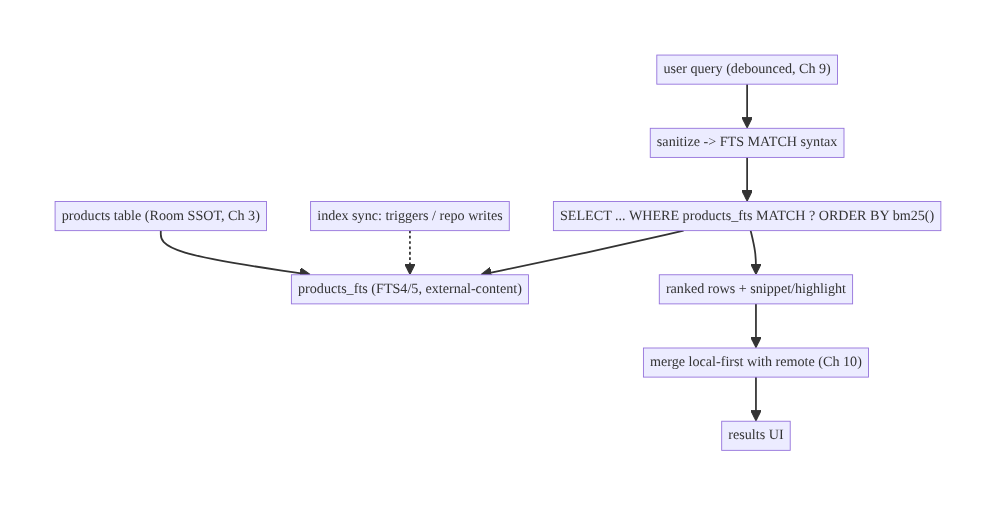
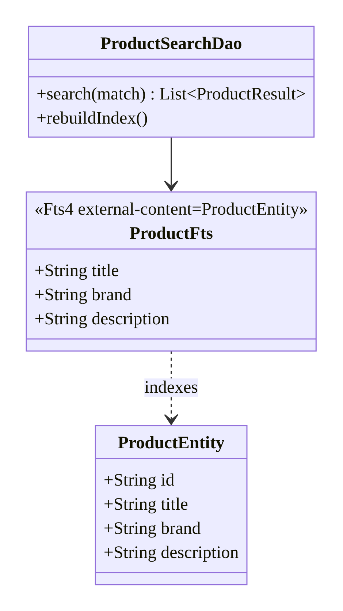
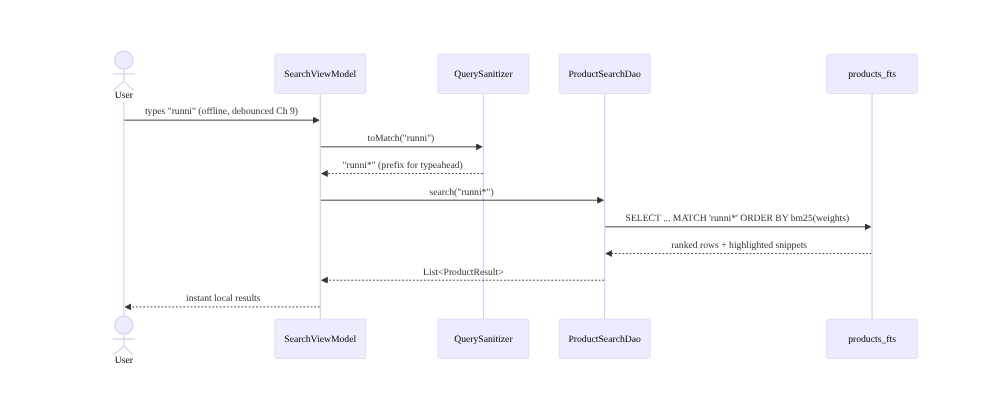
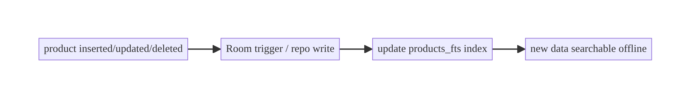
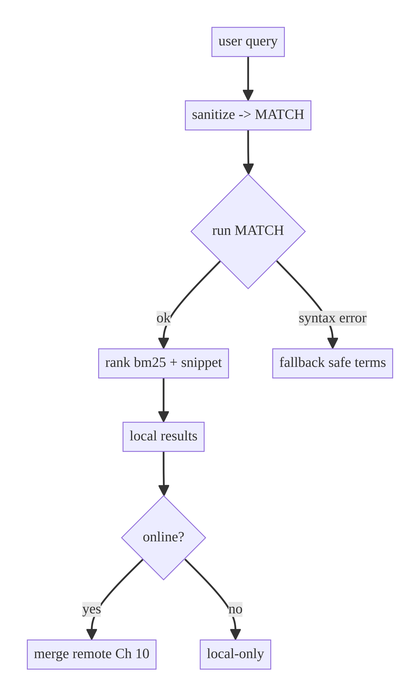

# Chapter 35 — Local Full-Text Search (FTS)

> **Part IV — Offline-First & Synchronization** · Complexity: **Standard** (≥25 interview questions)
>
> **Prerequisites:** Ch 3 (Room/SSOT), Ch 9 (Debounced Search), Ch 10 (Suggestions/
> autocomplete), Ch 29 (offline-first). Enables the "offline search" and "local
> prefix match" deferred from Ch 9/10.
>
> **Reference surface in StreamCart:** searching the cached catalog, watch history,
> and saved items **offline**, instantly — and merging local results with remote
> search (Ch 9/10).

---

## 35.1 Problem Definition and Real-World Context

Ch 9/10 built **remote** search (debounced network queries). But an offline-first
app (Ch 29) must also search its **local** data — and do it well. Naive local
search fails:

- **`LIKE '%query%'` doesn't scale or rank.** A substring `LIKE` scan over a large
  table is slow (no index use for leading wildcards), can't rank by relevance, and
  handles neither word boundaries, stemming, nor multi-term queries.
- **No offline search.** With only remote search, the app can't search cached data
  on a train — breaking offline-first.
- **Poor relevance.** Users expect matches ranked by relevance (title match >
  description match), prefix/typeahead matching, and multi-word queries — `LIKE`
  gives none of that.
- **No highlighting.** Search UIs highlight the matched terms; `LIKE` can't produce
  snippets.

**SQLite FTS (Full-Text Search)**, exposed via Room's `@Fts4`/`@Fts5`, builds an
**inverted index** over text columns, enabling fast tokenized search with
**relevance ranking** (BM25), **prefix** and **phrase** queries, and **snippet/
highlight** support — all **local and offline**. The architecture is about **what
to index**, **FTS4 vs FTS5 + external-content tables**, **query syntax/ranking**,
**keeping the index in sync** with the source table, and **merging local + remote**
results (Ch 10).

### Three practical use cases

1. **E-commerce (StreamCart).** Instant offline search over the cached product
   catalog (title/brand/description), ranked, with prefix matching for typeahead
   (merged with remote, Ch 10).
2. **OTT (Watch).** Search watch history and "my list" offline by title/cast.
3. **Productivity/Social (Social).** Search local messages/notes/drafts offline with
   highlighting.

### Why this is architectural

Local FTS defines **offline search capability**, the **index design** (what's
searchable, tokenizer, external vs contentless), **relevance/ranking**, and how
local results **compose with remote** — properties that determine whether search
works offline and feels good.

---

## 35.2 Requirements Engineering

### Functional requirements

| ID | Requirement |
|----|-------------|
| F1 | Full-text search cached data locally/offline, tokenized (not substring). |
| F2 | Rank results by relevance (BM25); weight fields (title > description). |
| F3 | Support prefix (typeahead) and multi-term/phrase queries. |
| F4 | Produce highlighted snippets of matches. |
| F5 | Keep the FTS index in sync with the source (Room) table. |
| F6 | Merge local results with remote search (Ch 10). |

### Non-functional requirements

| Attribute | Policy |
|-----------|--------|
| **Performance** | Sub-frame local query over large tables; indexed, not scanned. |
| **Storage** | Index bounded; external-content to avoid duplicating data. |
| **Freshness** | Index updated on data change (triggers / offline sync). |
| **Relevance** | Ranked; field-weighted; tokenizer handles case/diacritics. |
| **Offline** | Works with no network (Ch 29). |

### Scope

- **In scope:** Room FTS (`@Fts4`/`@Fts5`), external-content tables, tokenizers,
  MATCH queries (prefix/phrase/boolean), BM25 ranking, snippet/highlight, index
  sync, merging local+remote.
- **Out of scope:** remote search/debounce (Ch 9/10), server-side search/relevance
  (backend), offline sync (Ch 29–33).

### Assumptions & constraints

- Room 2.x with FTS support; SQLite FTS4/FTS5 (FTS5 preferred where available).
  Source data cached in Room (Ch 3). `minSdk 24` (FTS5 generally available on modern
  Android SQLite). Prefer **FTS4 with Room** for broad compatibility, FTS5 where
  the platform SQLite supports it.

---

## 35.3 System Design Fundamentals

- **Inverted index.** FTS builds a term→documents index, so a query matches by
  **tokens** (words), not substrings — fast and relevance-rankable, unlike `LIKE`.
- **Room FTS entities.** Annotate a table with `@Fts4` (broadly supported with Room)
  or `@Fts5`; Room creates the virtual FTS table. Query with `MATCH`.
- **External-content tables.** To avoid **duplicating** the data (the FTS table
  storing its own copy), use an **external-content** FTS table that indexes an
  existing Room table (the `content=` option) — the index references the source
  rows, saving storage; you keep the index in sync via triggers or Room DAO writes.
- **Tokenizers.** Control how text is split/normalized: `unicode61` (default,
  Unicode-aware, case-folding), with options like `remove_diacritics` for
  accent-insensitive search. The tokenizer determines matching behavior (case,
  diacritics, word boundaries).
- **Query syntax (MATCH).** Supports **prefix** (`shoe*`), **phrase** (`"running
  shoe"`), **boolean** (`shoe AND red`, `NOT`), and **column filters** (`title:
  shoe`). Prefix enables typeahead; sanitize user input to valid FTS syntax.
- **Ranking (BM25).** FTS5's `bm25()` ranks by relevance; you can **weight columns**
  (title weighted higher than description) to tune relevance. FTS4 offers
  `matchinfo`/`offsets` for custom ranking.
- **Snippet / highlight.** `snippet()`/`highlight()` (FTS5) produce excerpts with the
  matched terms marked — for search-result highlighting.
- **Index sync.** The FTS index must reflect the source table: update it when rows
  change (Room triggers, or write both in the repository; external-content tables
  need explicit sync on insert/update/delete).
- **Local + remote merge (Ch 10).** Offline-first search shows **local FTS results
  instantly**, then merges **remote** results when online — the same local-first
  composition as Ch 10 suggestions.

Core insight: **index searchable text in a Room FTS table (external-content to save
storage), query with MATCH for tokenized prefix/phrase search ranked by BM25 with
field weights, keep the index in sync, and merge local-first with remote** — giving
fast, ranked, offline search that `LIKE` can't.

---

## 35.4 High-Level Architecture



**Components & ownership**

- **Source table** (Room SSOT) holds the data (cached, Ch 3/29).
- **FTS table** (external-content) is the inverted index over its text columns.
- **Index sync** keeps FTS in step with the source (triggers / repo).
- **Query** sanitizes input to MATCH syntax, runs ranked search with snippets.
- **Merge** composes local (instant, offline) + remote (Ch 10).

**Direction:** data → FTS index; query → MATCH (ranked) → results → merge with
remote → UI.

---

## 35.5 Detailed Component Design



| Component | Responsibility | Note |
|-----------|----------------|------|
| source entity | the data | Room SSOT (Ch 3) |
| FTS entity (`@Fts4`/`@Fts5`) | inverted index over text cols | external-content (no data dup) |
| DAO `MATCH` query | ranked search + snippet | BM25 + field weights |
| index sync | keep FTS current | triggers / repo writes |
| sanitizer | user text → valid FTS syntax | prefix, escape specials |
| merge (Ch 10) | local-first + remote | offline-first search |

---

## 35.6 End-to-End Data Flow

### Offline local search



### Index sync on data change



---

## 35.7 Complete Kotlin Implementation

Package: `com.streamcart.data.catalog.search`.

### 35.7.1 Source entity + FTS entity (external-content)

```kotlin
@Entity(tableName = "products")
data class ProductEntity(
    @PrimaryKey val id: String,
    val title: String,
    val brand: String,
    val description: String,
    val priceCents: Long,
)

// External-content FTS4 table: indexes ProductEntity's text columns WITHOUT duplicating data.
@Fts4(contentEntity = ProductEntity::class)      // Room wires content= to the source table
@Entity(tableName = "products_fts")
data class ProductFts(
    val title: String,
    val brand: String,
    val description: String,
    // rowid links to ProductEntity's rowid (Room manages this for content tables)
)
```

### 35.7.2 Search DAO (MATCH, ranking, snippet)

```kotlin
data class ProductResult(val id: String, val title: String, val snippet: String)

@Dao
interface ProductSearchDao {
    // Join FTS match back to the source table; rank by relevance.
    // (FTS4 uses matchinfo/offsets; this shows the general shape. FTS5 adds bm25() + snippet().)
    @Query("""
        SELECT p.id AS id, p.title AS title,
               snippet(products_fts, '[', ']', '...', -1, 12) AS snippet
        FROM products_fts
        JOIN products AS p ON p.rowid = products_fts.rowid
        WHERE products_fts MATCH :match
        ORDER BY rank            -- FTS5 rank (bm25); for FTS4 compute from matchinfo
        LIMIT 50
    """)
    suspend fun search(match: String): List<ProductResult>

    @RawQuery suspend fun rebuild(query: SupportSQLiteQuery): Int   // INSERT INTO products_fts(products_fts) VALUES('rebuild')
}
```

> With **FTS5**, use `bm25(products_fts, 10.0, 5.0, 1.0)` to weight columns (title
> 10×, brand 5×, description 1×) and `highlight()`/`snippet()` for excerpts.
> **FTS4** (broadly supported by Room) ranks via `matchinfo()`/`offsets()`; compute
> a score in Kotlin or a helper.

### 35.7.3 Query sanitizer (user text → safe MATCH syntax)

```kotlin
object FtsQuery {
    // Turn free text into a safe prefix MATCH query; escape FTS specials.
    fun toMatch(input: String): String {
        val terms = input.trim().split(Regex("\\s+"))
            .filter { it.isNotBlank() }
            .map { sanitizeToken(it) }
            .filter { it.isNotEmpty() }
        if (terms.isEmpty()) return ""
        // Last term gets a prefix star for typeahead; quote to avoid operator injection.
        return terms.mapIndexed { i, t ->
            if (i == terms.lastIndex) "\"$t\"*" else "\"$t\""
        }.joinToString(" ")                                     // implicit AND
    }
    private fun sanitizeToken(t: String) = t.replace("\"", "").filter { it.isLetterOrDigit() }
}
// "running sho" -> "\"running\" \"sho\"*"
```

### 35.7.4 Index sync (external-content tables need explicit sync)

```kotlin
// For external-content FTS, writes to the source must be mirrored into the index.
// Easiest: do both in one DAO transaction, or use SQL triggers created in a Room migration.
@Dao
interface ProductWriteDao {
    @Transaction
    suspend fun upsertAndIndex(entity: ProductEntity) {
        upsert(entity)
        // Keep FTS in sync (for content tables, 'rebuild' or targeted insert/delete).
        syncFts(entity.rowidOrSelect())
    }
    @Query("INSERT INTO products_fts(products_fts, rowid, title, brand, description) " +
           "VALUES('delete', :rowid, '', '', '')")   // remove old, then re-add (illustrative)
    suspend fun ftsDelete(rowid: Long)
    // In practice: define AFTER INSERT/UPDATE/DELETE triggers on `products` to maintain `products_fts`.
}
```

> **Simplest robust approach:** create SQLite **triggers** (`AFTER INSERT/UPDATE/
> DELETE` on `products`) that maintain `products_fts`, added in a Room migration
> (Ch 36). Then normal Room writes keep the index current automatically.

### 35.7.5 Merge local + remote (Ch 10)

```kotlin
// Offline-first search: local FTS instantly, then merge remote when online.
fun search(query: String): Flow<SearchUiState> = flow {
    val match = FtsQuery.toMatch(query)
    val local = searchDao.search(match).map { it.toDomain() }
    emit(SearchUiState.Results(local, loadingRemote = connectivity.isOnline))   // local-first (Ch 10)
    if (connectivity.isOnline) {
        val remote = remoteSearch(query)                 // Ch 9
        emit(SearchUiState.Results(merge(local, remote), loadingRemote = false))
    }
}.flowOn(dispatchers.io)
```

### 35.7.6 Module structure

```
:data:catalog/search  ProductFts, ProductSearchDao, FtsQuery, merge (Ch 10)
:core:database        FTS triggers (migration, Ch 36)
:feature:search       uses local+remote (Ch 9/10)
```

---

## 35.8 Concurrency and Race Conditions

| Scenario | Risk | Handling |
|----------|------|----------|
| Index out of sync with source | stale/missing results | triggers maintain FTS; or atomic write-both in a transaction |
| Search during bulk insert | partial results | index in the same transaction; or rebuild after bulk load |
| Rapid queries (typeahead) | wasted work | debounce (Ch 9) + `flatMapLatest` |
| Unsanitized input | FTS syntax error/injection | sanitize to valid MATCH; quote terms |
| Large rebuild | jank | rebuild off main thread; incremental sync preferred |
| Concurrent read/write FTS | lock contention | SQLite serializes; keep writes batched |

- **Index sync is the core correctness concern:** use triggers (automatic) or
  transactional write-both so the FTS index never drifts from the source table.
- **Sanitize queries** — raw user input can contain FTS operators (`*`, `"`, `-`,
  `NEAR`) that cause syntax errors or unexpected matches.

---

## 35.9 Failure Scenarios and Recovery

| Failure | Detection | Response | Outcome |
|---------|-----------|----------|---------|
| Query syntax error (specials) | SQLiteException | sanitize input; fall back to safe terms | no crash |
| Index drift (missing results) | QA | triggers / rebuild index | coherent |
| Offline | connectivity | serve local FTS only (merge skips remote) | works offline |
| No local results | empty | show remote (if online) / empty state | graceful |
| FTS5 unavailable on device | build/runtime | use FTS4 (Room-supported) | compatible |
| Bulk sync invalidates index | — | rebuild or incremental update post-sync | fresh |
| Huge index | storage | external-content (no dup); prune; bound | bounded |
| Tokenizer mismatch (diacritics) | poor matches | `remove_diacritics`/`unicode61` options | better recall |



> **FTS4 vs FTS5 compatibility:** Room has first-class `@Fts4` support across
> Android versions; FTS5 depends on the device's bundled SQLite. For broad reach,
> **FTS4** is the safe default; use FTS5 (better ranking/snippet) when you control
> the SQLite version (e.g., bundling a SQLite library).

---

## 35.10 Scaling the Implementation

- **Level 1.** `LIKE` for a tiny table (acceptable < a few hundred rows).
- **Level 2.** Room `@Fts4` external-content index + MATCH queries + sanitizer.
- **Level 3 — production.** Ranking (BM25/matchinfo) + field weights + snippet;
  triggers for index sync; prefix typeahead; merge local+remote (Ch 10).
- **Level 4 — large.** FTS5 with `bm25()` column weights; `remove_diacritics`/custom
  tokenizer; incremental index updates from sync (Ch 32); paging results (Ch 13).
- **Level 5 — enterprise.** Hybrid local+server search ranking, synonyms/stemming,
  multi-language tokenizers, search analytics, on-device embeddings/semantic search.

**Avoid overengineering:** a small bounded dataset can use `LIKE`. Reach for FTS when
the dataset is large, offline search matters, or you need ranking/prefix/snippet.

---

## 35.11 Alternative Approaches and Trade-offs

| Dimension | Option A | Option B | When |
|-----------|----------|----------|------|
| Local search | FTS (inverted index) | `LIKE '%q%'` | FTS for large/ranked/offline; `LIKE` only for tiny tables |
| FTS version | FTS4 (Room-native, broad) | FTS5 (bm25/snippet, needs newer SQLite) | FTS4 for compatibility; FTS5 when you control SQLite |
| Storage | External-content table | contentless/own copy | External-content avoids duplicating data; own copy if source isn't in SQLite |
| Index sync | SQL triggers | repo write-both | Triggers (automatic, robust); repo for simple cases |
| Ranking | BM25 (FTS5) | matchinfo custom (FTS4) | BM25 easiest where available; matchinfo for FTS4 |
| Search scope | Local-only | Local + remote merge (Ch 10) | Merge for offline-first; local-only if remote not needed |

**FTS vs `LIKE`:** `LIKE '%q%'` can't use an index for a leading wildcard (full
scan), can't rank, and handles only substrings; FTS builds an inverted index for
fast tokenized, rankable, prefix/phrase search. For anything beyond a tiny table or
exact-prefix (`LIKE 'q%'` can index), use FTS.

**FTS4 vs FTS5:** FTS5 has better ranking (`bm25`), `snippet()`/`highlight()`, and
configurability, but depends on the device's SQLite version; Room's `@Fts4` works
everywhere. Choose FTS4 for maximum compatibility, FTS5 (often via a bundled SQLite)
when ranking/snippet quality matters.

---

## 35.12 Security Considerations

- **Sanitize query input** to valid MATCH syntax — prevents FTS syntax errors and
  avoids surprising matches; it's input handling, not SQL injection (Room
  parameterizes), but still validate.
- **Search is over local cached data** — if that data is sensitive, the FTS **index
  is also sensitive** and sits in the DB: encrypt the DB (Ch 24) so the index can't
  be read off a stolen device.
- **Per-account scoping / clear on logout** (Ch 22/42): the index contains the user's
  data; clear it on logout.
- **Query text is PII-ish** (names, private terms) — redact in logs (Ch 28); don't
  send local queries to analytics without consent.
- Client vs backend: local FTS searches only what the user is authorized to have
  cached; the backend owns authoritative search over data the client doesn't hold.

---

## 35.13 Performance and Resource Optimization

- **Index, don't scan:** FTS MATCH uses the inverted index — orders of magnitude
  faster than `LIKE` on large tables.
- **External-content** avoids duplicating the data (storage) — the index references
  source rows.
- **Debounce + `flatMapLatest`** (Ch 9) to avoid per-keystroke queries; run on IO.
- **Limit + page** results (Ch 13) for large result sets.
- **Incremental index updates** (triggers) over full rebuilds; rebuild only after
  bulk loads.
- **Tokenizer cost** is negligible; choose options (`remove_diacritics`) for recall.
- **Profiling:** query latency (FTS vs LIKE), index size, index-sync cost, Database
  Inspector `EXPLAIN QUERY PLAN`.

---

## 35.14 Testing Strategy

In-memory Room with the FTS table; assert matching, ranking, prefix, sync.

```kotlin
@RunWith(AndroidJUnit4::class)
class FtsSearchTest {
    private lateinit var db: AppDatabase
    @Before fun setUp() {
        db = Room.inMemoryDatabaseBuilder(ctx, AppDatabase::class.java).build()
        db.productWriteDao().apply {
            upsertAndIndex(product("1", title = "Running Shoe", brand = "Acme"))
            upsertAndIndex(product("2", title = "Dress Shirt", brand = "Acme"))
        }
    }
    @After fun tearDown() = db.close()

    @Test fun `token match finds the right row`() = runTest {
        val r = db.searchDao().search(FtsQuery.toMatch("running"))
        assertEquals(listOf("1"), r.map { it.id })
    }
    @Test fun `prefix typeahead matches`() = runTest {
        assertEquals(listOf("1"), db.searchDao().search(FtsQuery.toMatch("runni")).map { it.id })
    }
    @Test fun `multi-term is AND`() = runTest {
        db.productWriteDao().upsertAndIndex(product("3", title = "Running Shirt"))
        val r = db.searchDao().search(FtsQuery.toMatch("running shirt"))
        assertEquals(listOf("3"), r.map { it.id })        // both terms
    }
    @Test fun `index stays in sync on update`() = runTest {
        db.productWriteDao().upsertAndIndex(product("1", title = "Trail Boot"))   // retitle
        assertTrue(db.searchDao().search(FtsQuery.toMatch("running")).isEmpty())  // old term gone
        assertEquals(listOf("1"), db.searchDao().search(FtsQuery.toMatch("trail")).map { it.id })
    }
    @Test fun `sanitizer neutralizes FTS operators`() {
        assertFalse(FtsQuery.toMatch("red\" OR 1").contains("OR 1"))              // no injection
    }
}
```

Also: ranking/field-weight order (FTS5), snippet output, diacritics/case,
offline-only merge (Ch 10), large-table performance benchmark.

---

## 35.15 Production Observability

- **Metrics:** local-search latency (vs remote), local-result rate (how often local
  satisfies), index size, index-sync cost, zero-local-result rate, FTS4-vs-FTS5
  usage.
- **Logs:** `local_search{q_len, results, latency_ms}` (no raw query — PII, Ch 28).
- **Debugging:** missing results → index drift (fix triggers/sync); slow search →
  `LIKE` not FTS, or no limit; syntax crashes → unsanitized input; poor recall →
  tokenizer (diacritics/case); FTS5 crash on old device → use FTS4.
- **Privacy:** index + queries are user data; encrypt DB (Ch 24); redact logs.

---

## 35.16 System Design Interview Preparation

> ≥25 questions.

**Fundamentals**

1. *Why not `LIKE '%q%'`?* Full scan (no index for leading wildcard), no ranking, no
   tokenization/prefix/phrase.
2. *What is FTS?* SQLite full-text search — an inverted index enabling fast
   tokenized, rankable search.
3. *Room FTS?* `@Fts4`/`@Fts5` virtual tables; query with `MATCH`.
4. *Why local FTS?* Offline search over cached data (Ch 29).
5. *Inverted index?* term→documents mapping; matches by token.

**Design**

6. *External-content table?* FTS indexes an existing table without duplicating data
   (`content=`).
7. *Index sync?* Triggers (AFTER INSERT/UPDATE/DELETE) or transactional write-both.
8. *Tokenizer?* Controls splitting/normalization (case, diacritics) — `unicode61`,
   `remove_diacritics`.
9. *Query syntax?* Prefix (`shoe*`), phrase (`"a b"`), boolean (AND/NOT), column
   filters.

**Ranking/UX**

10. *Ranking?* FTS5 `bm25()` (weight columns: title > description); FTS4 `matchinfo`.
11. *Snippet/highlight?* FTS5 `snippet()`/`highlight()`.
12. *Typeahead?* Prefix `term*`; debounce (Ch 9).
13. *Merge local+remote?* Local-first instant, then remote merge (Ch 10).

**FTS4 vs FTS5**

14. *Difference?* FTS5 has bm25/snippet/config but needs newer SQLite; FTS4 is
    Room-native/broadly supported.
15. *Which to pick?* FTS4 for compatibility; FTS5 when you control SQLite/need
    ranking.

**Correctness**

16. *Index drift?* Triggers / atomic write keep FTS in sync.
17. *Sanitize queries?* Yes — neutralize FTS operators; valid MATCH.
18. *Bulk load?* Rebuild or incremental sync after.

**Security**

19. *Sensitive data?* Encrypt the DB (index included, Ch 24).
20. *Per-account?* Clear index on logout (Ch 22/42).
21. *Query PII?* Redact logs (Ch 28).

**Performance**

22. *Why FTS fast?* Inverted index vs full scan.
23. *Storage?* External-content avoids duplication.
24. *Large results?* Limit + page (Ch 13).

**Testing**

25. *How test?* In-memory Room; assert token/prefix/multi-term match + sync.
26. *How test sanitizer?* Assert operators neutralized.

**Production debugging**

27. *Missing results?* Index drift.
28. *Crash on query?* Unsanitized input.
29. *Poor recall?* Tokenizer/diacritics.

### Design-change challenges
1. **Search catalog offline.** `@Fts4` external-content + MATCH + sync triggers.
2. **Rank title over description.** FTS5 `bm25()` column weights.
3. **Typeahead over local data.** Prefix `term*` + debounce (Ch 9).
4. **Highlight matches.** FTS5 `snippet()`/`highlight()`.
5. **Merge with remote search.** Local-first + remote (Ch 10).

### Mock walkthrough (abridged)
Clarify (dataset size, offline, ranking, prefix?) → FTS over `LIKE` → `@Fts4`/`@Fts5`
external-content → MATCH (prefix/phrase) + sanitize → bm25/field weights + snippet →
index sync (triggers) → merge local+remote (Ch 10) → security (encrypt/clear) →
testing.

---

## 35.17 Practical Exercises

1. **Beginner.** Add a Room `@Fts4` external-content table over a products table;
   search by token. *Eval:* matches words, not substrings.
2. **Intermediate.** Add a query sanitizer with prefix typeahead and multi-term AND;
   keep the index synced via triggers. *Eval:* prefix works; index stays current.
3. **Advanced.** Rank results (bm25/field weights) and produce highlighted snippets;
   merge with remote (Ch 10). *Eval:* relevant order; highlights; offline-first.
4. **Production debugging.** Fix slow `LIKE` search and an index that drifts on
   update. *Eval:* FTS-fast; coherent index.
5. **System design challenge.** Encrypt the DB (index included), clear on logout, and
   add diacritic-insensitive matching. *Eval:* secure; per-account; better recall.

*(Solutions withheld unless requested.)*

---

## 35.18 Chapter Summary & Reference Sheet

**Key decisions:** use **SQLite FTS via Room** (`@Fts4` for broad compatibility,
`@Fts5` where you control SQLite) over `LIKE` for local search; use an **external-
content** table to index the source without duplicating data; query with **MATCH**
(prefix/phrase/boolean), **rank with BM25 + field weights**, and produce **snippet/
highlight**; **keep the index in sync** via SQLite **triggers** (or transactional
write-both); **sanitize** user input to valid MATCH; **merge local-first with
remote** (Ch 10) for offline-first search; **encrypt** the DB (index included,
Ch 24) and **clear per-account** (Ch 22/42).

**Concepts:** inverted index, FTS4 vs FTS5, external-content tables, tokenizers,
MATCH syntax (prefix/phrase/boolean), BM25 ranking + field weights, snippet/
highlight, index sync (triggers), local+remote merge.

**Common mistakes:** `LIKE '%q%'` on large tables (slow, no rank); duplicating data
(no external-content); index drift (no triggers/sync); unsanitized queries (syntax
errors); FTS5 on devices without it (use FTS4); unencrypted sensitive index; not
clearing on logout.

**Checklist:**

- [ ] FTS (not LIKE)
- [ ] FTS4/5 chosen for compatibility
- [ ] external-content table
- [ ] MATCH (prefix/phrase)
- [ ] sanitize input
- [ ] BM25 + field weights (FTS5)
- [ ] snippet/highlight
- [ ] index sync via triggers
- [ ] merge local+remote (Ch 10)
- [ ] encrypt DB + clear per-account.

**Key APIs:** Room `@Fts4(contentEntity=...)`/`@Fts5`, `MATCH`, `bm25()`/`snippet()`/
`highlight()` (FTS5), `matchinfo()`/`offsets()` (FTS4), `unicode61`/`remove_diacritics`
tokenizer, SQLite triggers (migration, Ch 36), `@RawQuery` rebuild.

**References:**
- Room FTS: https://developer.android.com/training/data-storage/room/defining-data#fts
- SQLite FTS5: https://www.sqlite.org/fts5.html
- SQLite FTS4: https://www.sqlite.org/fts3.html
- (composes) Ch 9 Debounced Search, Ch 10 Suggestions, Ch 29 Offline-First, Ch 24 Encryption

### Chapter review (Phase 4)
- **Completeness:** all 18 sections; architecture/class/sequence/failure diagrams;
  FTS entity + search DAO + sanitizer + index sync + merge; concurrency (index sync,
  sanitize); failure (syntax/drift/FTS5 compat); 5 levels; FTS-vs-LIKE and
  FTS4-vs-FTS5 trade-offs; security (encrypt index/clear); perf (index vs scan);
  in-memory Room tests; observability (local-result rate); 29 Q&A + 5 challenges. ✅
- **Expand later:** semantic/on-device search, synonyms/stemming, multi-language
  tokenizers, migrations for triggers (Ch 36).
- **Interview coverage:** exceeds ≥25 bar.
