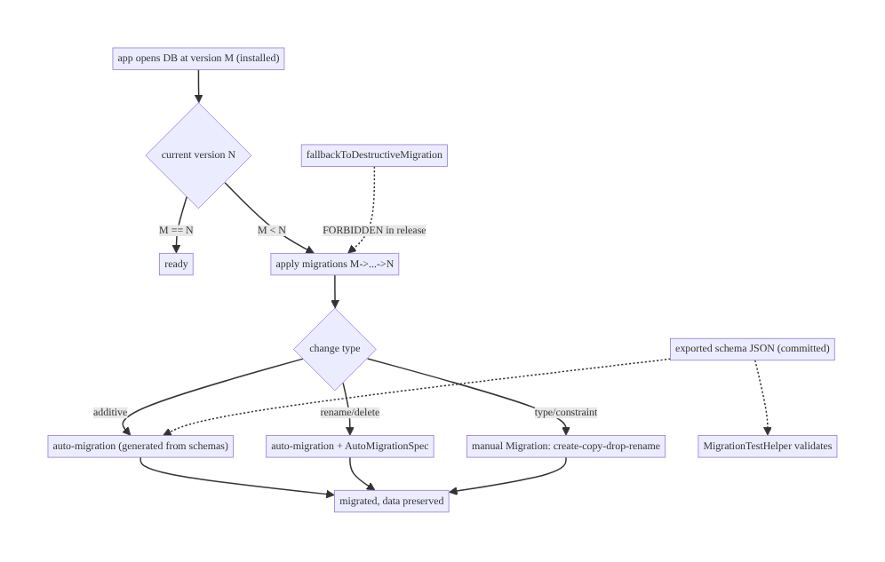
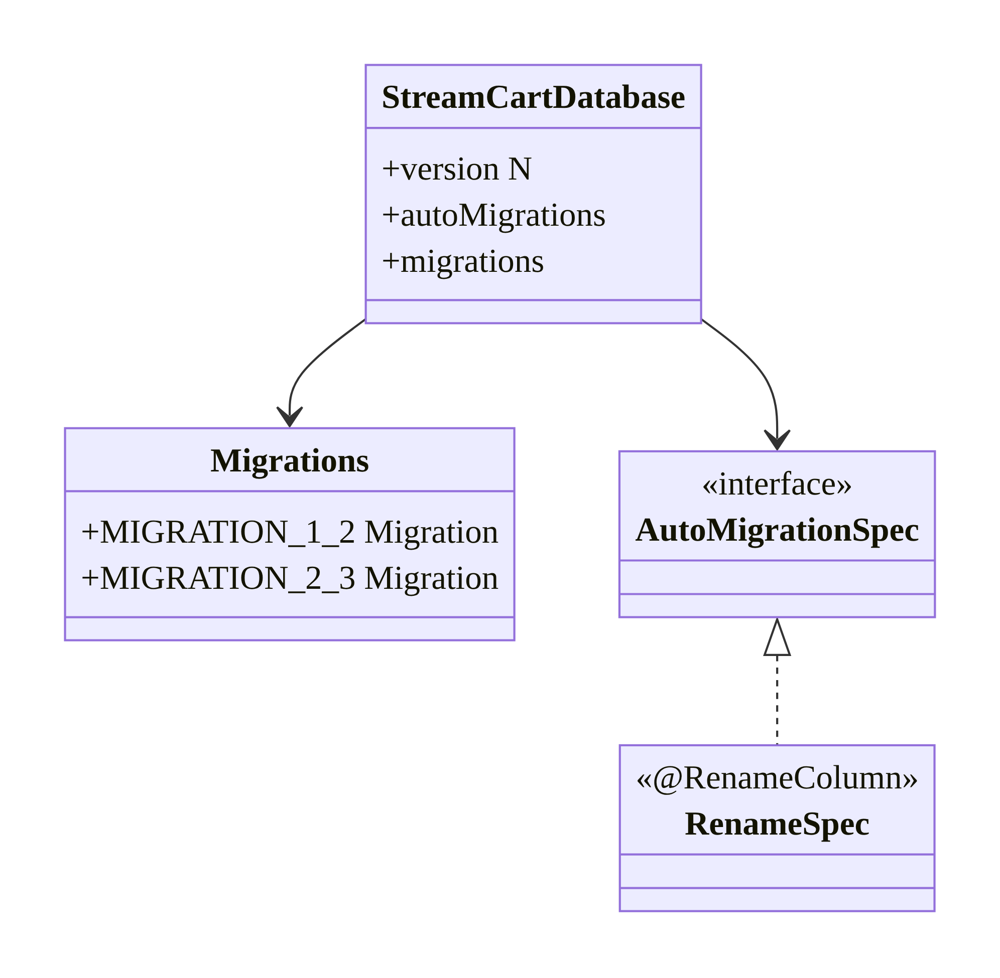
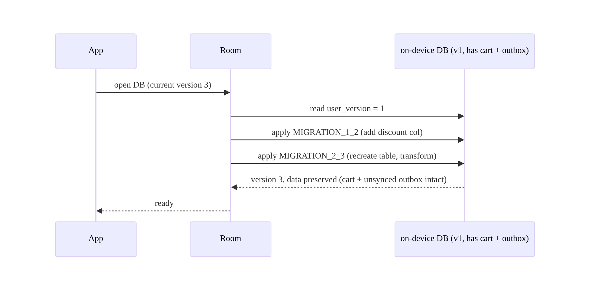
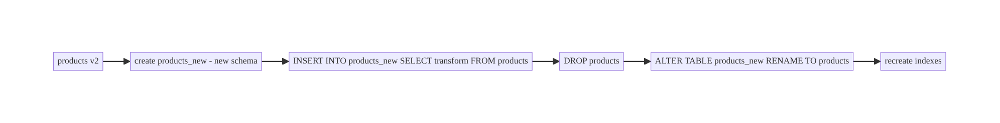
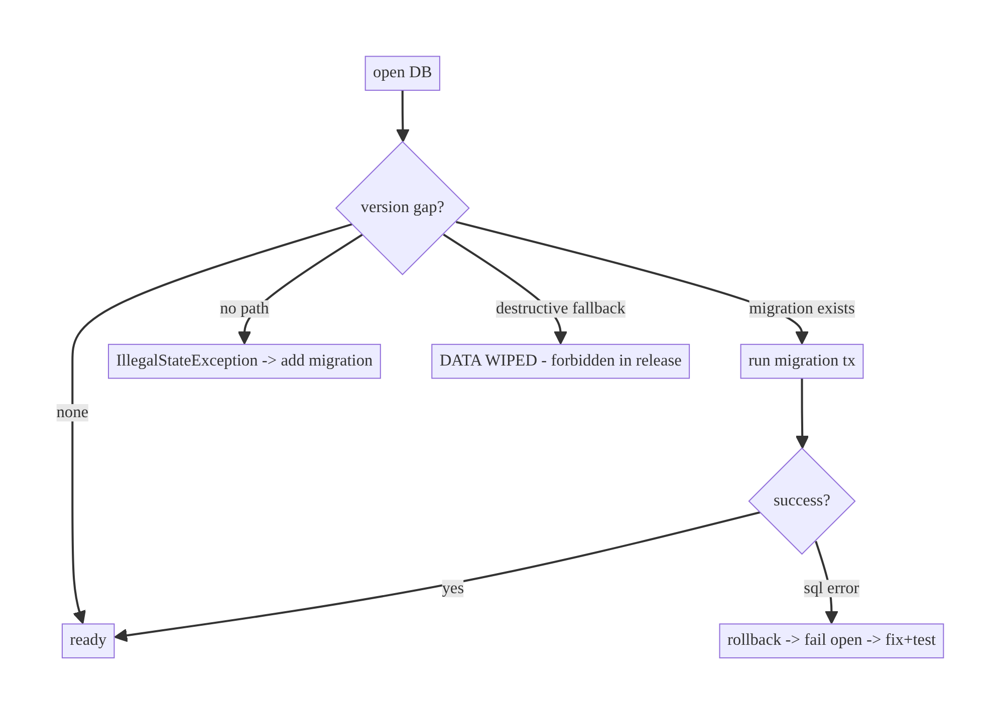

# Chapter 36 — Room Migrations & Schema Management

> **Part IV — Offline-First & Synchronization** · Complexity: **Standard** (≥25 interview questions)
>
> **Prerequisites:** Ch 3 (Room/SSOT — defined migrations briefly), Ch 16 (API
> schema evolution — the network analogue), Ch 34 (cache versioning). The local-
> storage counterpart to Ch 16; critical for offline-first apps whose local DB
> *is* the source of truth (Ch 29).
>
> **Reference surface in StreamCart:** evolving the catalog/cart/wallet/outbox
> database schemas across app releases **without losing users' offline data**.

---

## 36.1 Problem Definition and Real-World Context

In an offline-first app, the local database holds the user's data and queued writes
(Ch 29/31). When a new app version changes the schema (adds a column, a table,
changes a type), Room must **migrate** the existing on-device database to the new
schema **without data loss** — because that data may not exist anywhere else yet
(unsynced writes) and refetching is expensive or impossible offline. Mishandling
migrations is a top cause of crashes and data-loss incidents:

- **Crash on open.** Room throws `IllegalStateException` if the schema version
  increased but no `Migration` is provided — the app crashes on launch for every
  updating user.
- **Silent data wipe.** `fallbackToDestructiveMigration()` "fixes" the crash by
  **deleting the entire database** — wiping carts, drafts, downloads, and unsynced
  outbox entries. A catastrophic, irreversible loss shipped to production.
- **Untested migrations.** A hand-written SQL migration with a typo corrupts data or
  crashes — and it's only discovered in production because the test suite ran on a
  fresh DB, never exercising the migration path.
- **Lossy complex changes.** Changing a column type or constraint in SQLite requires
  a careful table-recreate-and-copy; a naive approach loses data or breaks.

Migration/schema management defines **how the local DB evolves across releases**,
the **data-preservation guarantee**, the **testing discipline** (migrations are
code that *must* be tested), and the **version lineage** — properties that decide
whether an app update is safe for users' data.

### Three practical use cases

1. **E-commerce (StreamCart).** Adding a `discount` column to products and a
   `wishlist` table across releases while preserving cart/wishlist and **unsynced
   outbox** entries.
2. **Fintech (Wallet).** Changing a column type (cents → minor-unit) via a careful
   table-recreate migration with data transformation, on encrypted data (Ch 24).
3. **OTT (Watch).** Adding indexes and an FTS table (Ch 35) via migration; renaming a
   table while keeping watch-history and downloads.

### Why this is architectural

Schema management defines the **data-durability contract across app versions**: that
an update never loses user data, how schema changes are expressed and **tested**,
and how versions chain — properties that determine whether offline data survives the
app's evolution.

---

## 36.2 Requirements Engineering

### Functional requirements

| ID | Requirement |
|----|-------------|
| F1 | Migrate existing databases to new schemas without data loss. |
| F2 | Support additive (column/table/index) and complex (type/constraint) changes. |
| F3 | Chain migrations across multiple versions (1→2→3, and jumps 1→3). |
| F4 | Test every migration (schema + data) before release. |
| F5 | Never silently destroy user data (no destructive fallback in prod). |
| F6 | Export schemas for diffing/validation and auto-migration. |

### Non-functional requirements

| Attribute | Policy |
|-----------|--------|
| **Reliability** | No data loss; no crash-on-open after update. |
| **Correctness** | Migrations tested with real DB + data; schemas validated. |
| **Performance** | Migrations fast (don't block startup for huge tables). |
| **Maintainability** | Clear version lineage; auto-migrations where possible. |
| **Safety** | Destructive fallback forbidden in release; encrypted DB migratable (Ch 24). |

### Scope

- **In scope:** `Migration` classes, auto-migrations, `@RenameColumn`/`@DeleteTable`
  specs, complex (table-recreate) migrations + data transforms, `MigrationTestHelper`,
  schema export, version management, destructive-fallback dangers, migrating
  encrypted DBs.
- **Out of scope:** the SSOT/Room basics (Ch 3), API schema evolution (Ch 16), cache
  versioning (Ch 34), encryption mechanics (Ch 24).

### Assumptions & constraints

- Room 2.6+ (auto-migrations + spec annotations), `exportSchema = true`. The local DB
  may hold **unsynced** data (Ch 31) → loss is unacceptable. `minSdk 24`.

---

## 36.3 System Design Fundamentals

- **Schema version.** `@Database(version = N)`. Incrementing it signals Room to
  migrate; opening a DB at version `M < N` without a path from M→N throws (or
  destroys, if fallback is set).
- **`Migration(from, to)`.** A class whose `migrate(db)` runs raw SQL to transform
  the schema (and data) from `from` to `to`. Room applies the chain of migrations
  covering the user's installed version to the current one (e.g., a user on v1 opens
  v3 → runs 1→2 then 2→3, or a single 1→3).
- **Auto-migrations (Room 2.4+).** For **simple additive** changes (add column/table,
  with defaults), Room **generates** the migration from the exported schemas — you
  declare `@AutoMigration(from, to)` and, for ambiguous changes (rename/delete), an
  `AutoMigrationSpec` with `@RenameColumn`/`@RenameTable`/`@DeleteColumn`/
  `@DeleteTable`. Prefer auto-migrations for simple changes; hand-write complex ones.
- **Complex migrations (table recreate).** SQLite can't `ALTER` a column's type/
  constraint. The pattern: **create a new table** with the new schema, **copy/
  transform** data from the old, **drop** the old, **rename** the new — all in the
  `Migration`. Data transformations (e.g., splitting a column) happen here.
- **Schema export (`exportSchema = true`).** Room writes JSON schema files per
  version into the repo; these enable **auto-migrations**, **schema diffing in code
  review**, and **`MigrationTestHelper`** to create/validate old-version DBs. Commit
  these files.
- **Testing is mandatory.** `MigrationTestHelper` creates a DB at the old version
  (from the exported schema), inserts data, runs the migration, and **validates**
  the resulting schema and data. **An untested migration is a production incident
  waiting to happen** — the normal test suite runs on a fresh DB and never exercises
  migrations.
- **Never `fallbackToDestructiveMigration()` in release.** It deletes all data on a
  missing/failed migration. Acceptable only for purely-disposable caches or in debug;
  for user data (especially unsynced, Ch 31) it's catastrophic. Provide real
  migrations and **fail loudly in debug**.
- **Relation to Ch 16/34.** API schema evolution (Ch 16) handles the *network* DTO;
  Room migrations handle the *storage* schema; cache versioning (Ch 34) handles
  cached-shape invalidation. All three coordinate when a data model changes.

Core insight: **increment the version, provide a tested migration (auto for simple,
hand-written table-recreate for complex) that preserves data, export and commit
schemas, and never destructively fall back** — so every app update migrates users'
offline data safely.

---

## 36.4 High-Level Architecture



**Components & ownership**

- **Version + migrations** chain the schema M→N preserving data.
- **Auto-migrations + specs** handle simple/rename/delete changes.
- **Manual migrations** handle complex type/constraint changes (recreate+copy).
- **Exported schemas** (committed) enable auto-migration + testing + review.
- **`MigrationTestHelper`** validates each migration with data.

**Direction:** open → detect version gap → apply migration chain (auto/spec/manual)
→ data preserved; schemas exported for generation + tests.

---

## 36.5 Detailed Component Design



| Change | Mechanism | Example |
|--------|-----------|---------|
| Add column (with default) | Auto-migration | `@AutoMigration(1,2)` |
| Add table / index | Auto-migration | generated |
| Rename column/table | Auto-migration + `AutoMigrationSpec` | `@RenameColumn` |
| Delete column/table | Auto-migration + spec | `@DeleteColumn` |
| Change type / constraint | **Manual** `Migration` | create-copy-drop-rename |
| Data transformation | Manual `Migration` | split/compute in SQL |

---

## 36.6 End-to-End Data Flow

### Migration chain on app update (data preserved)



### Complex migration (table recreate + transform)



---

## 36.7 Complete Kotlin Implementation

Package: `com.streamcart.core.database`.

### 36.7.1 Database with version, auto-migrations, manual migrations

```kotlin
@Database(
    entities = [ProductEntity::class, CartItemEntity::class, OutboxEntry::class],
    version = 3,
    exportSchema = true,                                   // commit schemas/ JSON (F6)
    autoMigrations = [
        AutoMigration(from = 1, to = 2),                  // simple additive (add discount col)
        AutoMigration(from = 2, to = 3, spec = Migrations.RenameBrandSpec::class),  // rename
    ],
)
abstract class StreamCartDatabase : RoomDatabase() { /* DAOs */ }

// Build with manual migrations too (for complex changes not auto-migratable).
Room.databaseBuilder(context, StreamCartDatabase::class.java, "streamcart.db")
    .addMigrations(Migrations.MIGRATION_3_4_TYPE_CHANGE)   // manual
    // NO fallbackToDestructiveMigration() in release!
    .build()
```

### 36.7.2 Auto-migration spec (rename/delete — ambiguous changes)

```kotlin
object Migrations {
    @RenameColumn(tableName = "products", fromColumnName = "brand", toColumnName = "brand_name")
    class RenameBrandSpec : AutoMigrationSpec

    // ... manual migrations below
}
```

### 36.7.3 Simple manual migration (additive — when not using auto)

```kotlin
val MIGRATION_1_2 = object : Migration(1, 2) {
    override fun migrate(db: SupportSQLiteDatabase) {
        db.execSQL("ALTER TABLE products ADD COLUMN discount INTEGER NOT NULL DEFAULT 0")
    }
}
```

### 36.7.4 Complex manual migration (type change via recreate + transform)

```kotlin
// Change price from TEXT "12.99" to INTEGER cents (1299). SQLite can't ALTER type -> recreate.
val MIGRATION_3_4_TYPE_CHANGE = object : Migration(3, 4) {
    override fun migrate(db: SupportSQLiteDatabase) {
        db.execSQL("""
            CREATE TABLE products_new (
                id TEXT NOT NULL PRIMARY KEY,
                title TEXT NOT NULL,
                price_cents INTEGER NOT NULL DEFAULT 0,
                discount INTEGER NOT NULL DEFAULT 0
            )
        """.trimIndent())
        // transform old TEXT price -> cents during copy (data transformation)
        db.execSQL("""
            INSERT INTO products_new (id, title, price_cents, discount)
            SELECT id, title, CAST(ROUND(CAST(price AS REAL) * 100) AS INTEGER), discount
            FROM products
        """.trimIndent())
        db.execSQL("DROP TABLE products")
        db.execSQL("ALTER TABLE products_new RENAME TO products")
        db.execSQL("CREATE INDEX index_products_title ON products(title)")   // recreate indexes
    }
}
```

### 36.7.5 Adding an FTS table via migration (ties to Ch 35)

```kotlin
val MIGRATION_4_5_FTS = object : Migration(4, 5) {
    override fun migrate(db: SupportSQLiteDatabase) {
        db.execSQL("CREATE VIRTUAL TABLE products_fts USING fts4(content=`products`, title, description)")
        db.execSQL("INSERT INTO products_fts(products_fts) VALUES('rebuild')")   // populate index
        // + AFTER INSERT/UPDATE/DELETE triggers to keep it in sync (Ch 35)
    }
}
```

### 36.7.6 Module structure

```
:core:database   StreamCartDatabase (version/autoMigrations), Migrations, AutoMigrationSpecs
schemas/         exported JSON per version (COMMITTED to VCS)
src/androidTest  MigrationTest (MigrationTestHelper)
```

```kotlin
// build.gradle: export schema to a committed directory
// ksp { arg("room.schemaLocation", "$projectDir/schemas") }   // and add schemas/ to sourceSets + VCS
```

---

## 36.8 Concurrency and Race Conditions

| Scenario | Risk | Handling |
|----------|------|----------|
| Migration runs on main thread at open | ANR for big tables | open DB off main; keep migrations fast; show splash |
| Migration crash mid-way | partial schema | Room runs each migration in a transaction (rolled back on failure) |
| Skipped-version jump (1→3) | missing path | provide all pairwise or chained migrations; Room chains them |
| Destructive fallback | data wiped | forbidden in release; provide migrations |
| Unsynced outbox lost | write loss | migrate (don't drop) the outbox table; test it |
| Concurrent open before migration done | inconsistent | Room serializes open/migration |

- **Each migration runs in a transaction** — a failing `migrate()` rolls back, so the
  DB isn't left half-migrated (it fails to open, surfaced in debug). Still, **test**
  to avoid shipping a failing migration.
- **Keep migrations fast**; a huge table-recreate can block startup — do heavy data
  transforms incrementally or off the critical path if needed.

---

## 36.9 Failure Scenarios and Recovery

| Failure | Detection | Response | Outcome |
|---------|-----------|----------|---------|
| Missing migration (version bumped) | `IllegalStateException` on open | add the `Migration`/auto-migration | no crash |
| Migration SQL error | crash on open (rolled back) | fix + test with `MigrationTestHelper` | safe after fix |
| Destructive fallback shipped | data wiped | remove it; provide migrations; postmortem | prevent recurrence |
| Data loss in complex migration | QA/data check | fix copy/transform SQL; test data preservation | preserved |
| Skipped versions | — | Room chains migrations; provide the path | migrates |
| Encrypted DB migration (Ch 24) | open with key | migrations run inside the encrypted DB (SQLCipher) | works |
| Huge table slow migration | ANR | optimize SQL / incremental; off-main open | no ANR |
| Downgrade (version decreased) | rare | handle/forbid; don't destroy | defined |



> **The cardinal rule: provide a migration, never destroy.** A missing migration
> should fail loudly in debug (so you catch it) — never be papered over with
> destructive fallback that wipes users' (possibly unsynced) data in production.

---

## 36.10 Scaling the Implementation

- **Level 1.** Manual `Migration` for a simple add-column; `exportSchema = true`.
- **Level 2.** Auto-migrations for additive changes + `AutoMigrationSpec` for
  renames/deletes; commit schemas; test with `MigrationTestHelper`.
- **Level 3 — production.** Complex table-recreate migrations with data transforms;
  migration tests covering schema **and** data; forbid destructive fallback; CI
  schema validation.
- **Level 4 — large.** Incremental/background migration for huge tables; coordinated
  schema changes across modules; migrating encrypted DBs (Ch 24); migration + cache
  version (Ch 34) + API evolution (Ch 16) coordination.
- **Level 5 — enterprise.** Schema governance/versioning policy, migration review
  gates, zero-downtime large-data migrations, rollback/forward-compat strategy,
  migration observability (success rate per version).

**Avoid overengineering:** simple apps use auto-migrations for additive changes.
Reserve manual table-recreate for genuine type/constraint changes; don't hand-write
what Room can generate.

---

## 36.11 Alternative Approaches and Trade-offs

| Dimension | Option A | Option B | When |
|-----------|----------|----------|------|
| Simple change | Auto-migration | manual `Migration` | Auto for additive (less error-prone); manual when auto can't express it |
| Rename/delete | Auto + `AutoMigrationSpec` | manual | Spec for clarity; manual for complex |
| Type/constraint change | Manual (recreate+copy) | auto (can't) | Manual — SQLite can't ALTER type |
| Missing migration | Provide it | `fallbackToDestructiveMigration` | **Always** provide; destructive only for disposable caches/debug |
| Schema export | `exportSchema=true` (commit) | off | On — enables auto-migration, tests, diffs |
| Big-data migration | In-migration transform | background/incremental | In-migration for small; background for huge tables |

**Auto vs manual migration:** auto-migrations (from exported schemas) are
less error-prone for additive/simple changes and reduce boilerplate, but can't
express type changes, complex data transforms, or ambiguous renames without a spec.
Manual migrations are fully general but must be hand-written and **tested**. Use auto
for what it handles; manual for the rest.

**Destructive fallback — when (rarely) OK:** only when the database is a **purely
disposable cache** that can be fully rebuilt from the network with no unsynced data
and no cost to the user. For anything holding user data or unsynced writes (Ch 31),
it's a data-loss bug. Even then, prefer cache versioning (Ch 34) to a DB wipe.

---

## 36.12 Security Considerations

- **Migrate encrypted databases** (Ch 24): migrations run **inside** the SQLCipher-
  opened DB — the key must be available at open; the migration SQL operates on
  decrypted pages. Test migrations on the encrypted DB.
- **Don't leak data during a type/transform migration** — a recreate that copies into
  a temp table must not leave plaintext temp data on an encrypted DB (SQLCipher keeps
  temp encrypted; verify).
- **Schema files** (exported JSON) are not secret but reveal structure — fine to
  commit; don't put secrets in defaults.
- **Never destructive-fallback sensitive data** — losing a user's encrypted wallet
  data on a migration miss is both a data-loss and trust failure.
- **Version-gate security changes** — if a release tightens how sensitive data is
  stored, migrate old data into the new secure form (don't leave it in the old,
  weaker form).
- Client vs backend: migrations preserve **local** user data across versions; the
  backend remains authoritative but can't recover unsynced local data a bad migration
  destroys.

---

## 36.13 Performance and Resource Optimization

- **Migrations run at open (startup):** keep them fast; a slow table-recreate on a big
  table delays launch (Ch 88). Optimize SQL; add indexes **after** bulk copy.
- **Batch/transaction:** Room wraps each migration in a transaction — one commit, fast.
- **Incremental for huge data:** for very large transforms, consider migrating lazily
  or in the background to avoid a long startup stall.
- **Avoid unnecessary recreates:** use auto-migration/`ALTER ADD COLUMN` for additive
  changes (no copy) instead of recreating.
- **Profiling:** migration duration per version (telemetry), startup time around
  releases, DB size.

---

## 36.14 Testing Strategy

`MigrationTestHelper` is **mandatory** — it creates an old-version DB from the
exported schema, inserts data, migrates, and validates schema + data.

```kotlin
@RunWith(AndroidJUnit4::class)
class MigrationTest {
    private val TEST_DB = "migration-test"
    @get:Rule val helper = MigrationTestHelper(
        InstrumentationRegistry.getInstrumentation(),
        StreamCartDatabase::class.java,            // uses exported schemas/
    )

    @Test fun migrate1To2_addsDiscount_preservesData() {
        helper.createDatabase(TEST_DB, 1).apply {
            execSQL("INSERT INTO products (id, title, price) VALUES ('1','Shoe','12.99')")
            close()
        }
        val db = helper.runMigrationsAndValidate(TEST_DB, 2, true, MIGRATION_1_2)
        db.query("SELECT discount FROM products WHERE id='1'").use {
            it.moveToFirst(); assertEquals(0, it.getInt(0))        // new col default
        }
    }

    @Test fun migrate3To4_typeChange_transformsAndPreserves() {
        helper.createDatabase(TEST_DB, 3).apply {
            execSQL("INSERT INTO products (id, title, price, discount) VALUES ('1','Shoe','12.99',0)")
            close()
        }
        val db = helper.runMigrationsAndValidate(TEST_DB, 4, true, MIGRATION_3_4_TYPE_CHANGE)
        db.query("SELECT price_cents FROM products WHERE id='1'").use {
            it.moveToFirst(); assertEquals(1299, it.getInt(0))     // "12.99" -> 1299, data preserved
        }
    }

    @Test fun migrateAll_1To5_endToEnd() {
        helper.createDatabase(TEST_DB, 1).close()
        helper.runMigrationsAndValidate(TEST_DB, 5, true,
            MIGRATION_3_4_TYPE_CHANGE, MIGRATION_4_5_FTS)          // + autos
    }
}
```

What to test: each migration (schema validates via exported JSON + **data preserved/
transformed**), full-chain 1→N, unsynced outbox survival, encrypted-DB migration
(Ch 24), and a test that fails if someone adds destructive fallback. Run these in CI.

---

## 36.15 Production Observability

- **Metrics:** migration success rate per version (should be ~100%), crash-on-open
  rate around releases, migration duration, startup-time delta per release, DB size.
- **Logs:** `migration{from, to, ms, result}` (no row data, Ch 28), DB-open errors.
- **Debugging:** crash spike after release → missing/failing migration (add/fix +
  test); data-loss reports → destructive fallback or lossy transform; slow startup →
  heavy migration on big tables; corrupt data → bad transform SQL (test with data).
- **Alerting:** crash-on-open or migration-failure spike post-release → emergency
  (hotfix the migration); never "fix" with destructive fallback.
- **Pre-release gate:** CI runs `MigrationTestHelper` for all paths; block release on
  failure.

---

## 36.16 System Design Interview Preparation

> ≥25 questions.

**Fundamentals**

1. *Why migrate instead of recreate?* The local DB holds user data (incl. unsynced,
   Ch 31) — recreating loses it.
2. *What triggers a migration?* Incrementing `@Database(version)`.
3. *What happens with no migration path?* `IllegalStateException` on open (or data
   wiped if destructive fallback).
4. *`Migration(from,to)`?* A class whose `migrate(db)` runs SQL to evolve schema/data.
5. *Does Room chain migrations?* Yes — applies the sequence covering the user's
   installed → current version (or a direct path).

**Auto vs manual**

6. *Auto-migrations?* Room generates them from exported schemas for simple additive
   changes.
7. *`AutoMigrationSpec`?* Resolves ambiguous changes (rename/delete) via
   `@RenameColumn`/`@DeleteTable`.
8. *When manual?* Type/constraint changes, data transforms — auto can't express.
9. *Why export schemas?* Enables auto-migration, `MigrationTestHelper`, and code-
   review diffs; commit them.

**Complex changes**

10. *Change a column type in SQLite?* Can't ALTER — create new table, copy/transform,
    drop old, rename.
11. *Data transformation?* Do it in the copy SQL (e.g., `CAST`/compute).
12. *Recreate indexes/triggers?* Yes — after the table recreate.

**Safety**

13. *`fallbackToDestructiveMigration` danger?* Deletes the whole DB on a missing/
    failed migration — forbidden for user data in release.
14. *When is it OK?* Purely disposable cache / debug; even then prefer cache
    versioning (Ch 34).
15. *Is a migration transactional?* Yes — fails and rolls back if the SQL errors.

**Testing**

16. *Why must migrations be tested?* The normal suite runs on a fresh DB; untested
    migrations crash/corrupt in production.
17. *How?* `MigrationTestHelper`: create old DB + data → migrate → validate schema +
    data.
18. *What to assert?* Schema matches exported JSON **and** data preserved/
    transformed.

**Relations**

19. *vs API schema evolution (Ch 16)?* Storage schema vs network DTO — coordinate on
    model changes.
20. *vs cache versioning (Ch 34)?* DB migration preserves; cache versioning wipes
    stale cache shape — different data.

**Security/perf**

21. *Encrypted DB migration (Ch 24)?* Runs inside the SQLCipher DB; key at open; test
    it.
22. *Migrations slow startup?* Keep fast; index after copy; off-main open; incremental
    for huge data.

**Production debugging**

23. *Crash-on-open after release?* Missing/failing migration.
24. *Data-loss reports?* Destructive fallback or lossy transform.
25. *Corrupt data?* Bad transform SQL (test with data).
26. *Slow launch after update?* Heavy migration.

### Design-change challenges
1. **Add a column safely.** Auto-migration (`ALTER ADD COLUMN DEFAULT`).
2. **Change price type.** Manual recreate + `CAST` transform; test data.
3. **Rename a column.** Auto-migration + `@RenameColumn` spec.
4. **Add FTS (Ch 35).** Migration creates the FTS virtual table + triggers.
5. **Crash-on-open shipped.** Hotfix the migration (never destructive fallback);
   add the missing path + test.

### Mock walkthrough (abridged)
Clarify (what changed, data to preserve, unsynced?) → bump version → auto-migration
for additive / manual recreate for type changes (transform in copy) → export + commit
schemas → **test with `MigrationTestHelper`** (schema + data) → **never** destructive
fallback → coordinate with Ch 16/34 → encrypted DB (Ch 24) → observability.

---

## 36.17 Practical Exercises

1. **Beginner.** Add a column via an auto-migration (or manual `ALTER`); export +
   commit the schema; test it preserves data. *Eval:* no crash; data intact.
2. **Intermediate.** Rename a column via `AutoMigrationSpec`; validate with
   `MigrationTestHelper`. *Eval:* renamed; data preserved.
3. **Advanced.** Change a column type via recreate+transform; test data is correctly
   converted. *Eval:* type changed; values transformed; no loss.
4. **Production debugging.** Fix a crash-on-open (missing migration) and remove a
   shipped `fallbackToDestructiveMigration`. *Eval:* migrates safely; no wipe.
5. **System design challenge.** Add an FTS table (Ch 35) and migrate an encrypted DB
   (Ch 24); test the full chain 1→N in CI. *Eval:* FTS searchable; encrypted migrate;
   all paths tested.

*(Solutions withheld unless requested.)*

---

## 36.18 Chapter Summary & Reference Sheet

**Key decisions:** evolve the local schema by **incrementing the version** and
providing a **tested migration** that **preserves data**; use **auto-migrations** for
additive changes (+ `AutoMigrationSpec` for renames/deletes) and **hand-written
`Migration`s** for **type/constraint changes** (create-copy-transform-drop-rename);
**`exportSchema = true`** and **commit** the JSON for auto-generation, review, and
testing; **test every migration with `MigrationTestHelper`** (schema **and** data);
**never `fallbackToDestructiveMigration()` in release** for user data (especially
unsynced, Ch 31); **migrate encrypted DBs** (Ch 24); coordinate with API evolution
(Ch 16) and cache versioning (Ch 34). **Provide a migration, never destroy.**

**Concepts:** schema version, `Migration` chain, auto-migrations + specs, complex
table-recreate + data transform, schema export, `MigrationTestHelper`, destructive-
fallback danger, encrypted-DB migration.

**Common mistakes:** bumping version without a migration (crash-on-open);
`fallbackToDestructiveMigration` on user data (silent wipe); untested migrations
(prod corruption); trying to ALTER a column type (recreate instead); not exporting/
committing schemas; losing unsynced outbox data; heavy migrations blocking startup.

**Checklist:**

- [ ] bump version
- [ ] auto-migration for additive / manual for complex
- [ ] data-preserving transform
- [ ] `exportSchema=true` + commit JSON
- [ ] `AutoMigrationSpec` for rename/delete
- [ ] test every migration (schema+data) in CI
- [ ] no destructive fallback (release)
- [ ] migrate encrypted DB (Ch 24)
- [ ] recreate indexes/triggers
- [ ] keep migrations fast.

**Key APIs:** `@Database(version, exportSchema=true, autoMigrations=[...])`,
`@AutoMigration`, `AutoMigrationSpec` + `@RenameColumn`/`@RenameTable`/`@DeleteColumn`/
`@DeleteTable`, `Migration(from,to)`/`migrate`, `SupportSQLiteDatabase.execSQL`,
`MigrationTestHelper.createDatabase`/`runMigrationsAndValidate`, `room.schemaLocation`.

**References:**
- Room migrations: https://developer.android.com/training/data-storage/room/migrating-db-versions
- Auto-migrations: https://developer.android.com/training/data-storage/room/migrating-db-versions#automated
- Testing migrations: https://developer.android.com/training/data-storage/room/migrating-db-versions#test
- (composes) Ch 3 Room, Ch 16 API Evolution, Ch 24 Encryption, Ch 34 Cache Versioning, Ch 35 FTS

### Chapter review (Phase 4)
- **Completeness:** all 18 sections; architecture/class/sequence/failure diagrams;
  version/auto/manual/complex-recreate/FTS migrations + export + test; concurrency
  (transactional, startup); failure (crash-on-open, data loss); 5 levels; auto-vs-
  manual and destructive-fallback trade-offs; security (encrypted migrate, version-
  gate); perf (fast migrations); mandatory `MigrationTestHelper` tests; observability
  (migration success rate); 26 Q&A + 5 challenges. ✅
- **Expand later:** encrypted-DB specifics (Ch 24), FTS triggers (Ch 35), startup
  (Ch 88), coordinated multi-module schema governance.
- **Interview coverage:** exceeds ≥25 bar.
