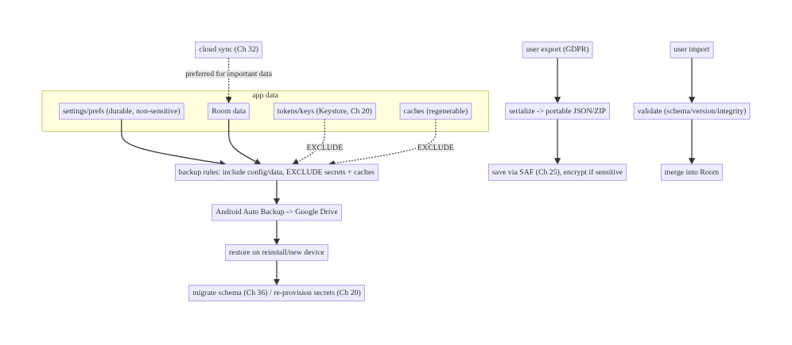
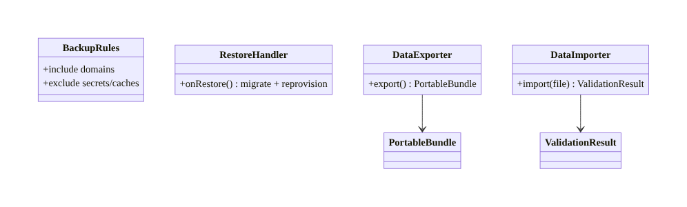
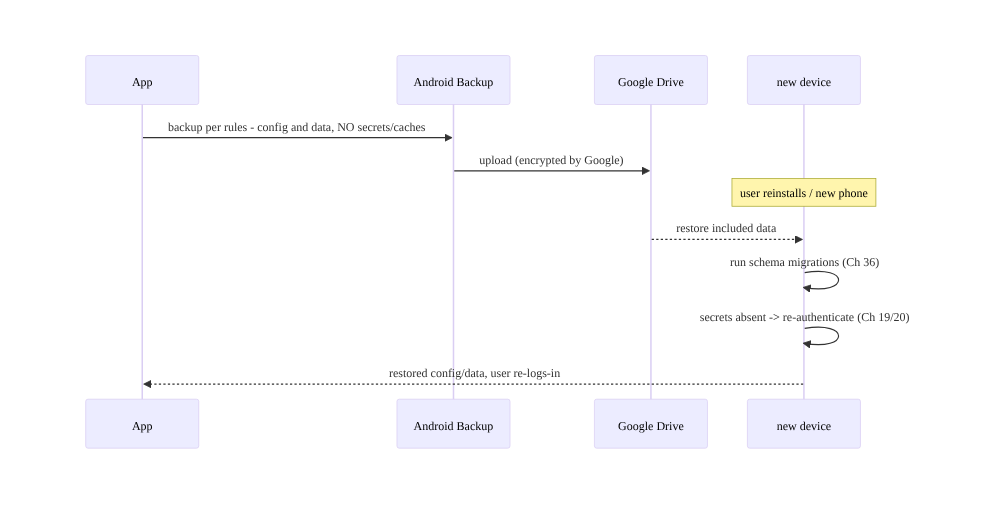
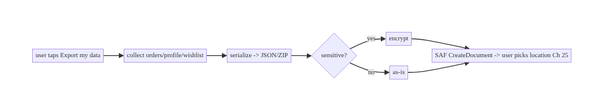
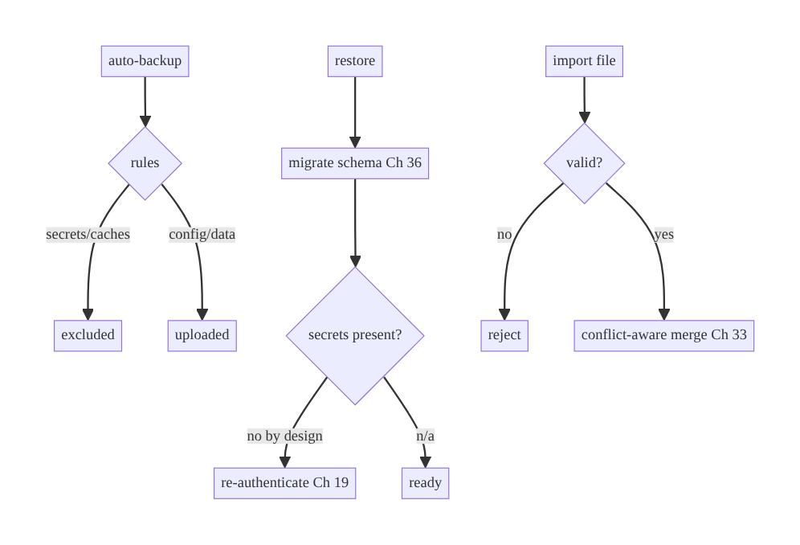

# Chapter 37 — Data Export, Import & Backup

> **Part IV — Offline-First & Synchronization** · Complexity: **Standard** (≥25 interview questions)
>
> **Prerequisites:** Ch 24 (encryption — what to exclude from backup), Ch 25
> (secure files/SAF — export destinations), Ch 3 (Room), Ch 20/22 (secrets/session),
> Ch 32 (sync — the cloud alternative to device backup). Completes **Part IV**.
>
> **Reference surface in StreamCart:** Android auto-backup of settings/preferences,
> user-initiated **data export** (GDPR portability), import/restore, and device-to-
> device transfer — all without leaking secrets.

---

## 37.1 Problem Definition and Real-World Context

Users expect their data to **survive** reinstalls and device changes, and
regulations (GDPR/CCPA) grant them the right to **export** (data portability) and
**delete** their data. Android provides **auto-backup** (to Google Drive) and
**device transfer**; apps add **user-initiated export/import**. Each is easy to get
dangerously wrong:

- **Backing up secrets.** Android **auto-backup is on by default** and copies app
  data (SharedPreferences, databases, files) to the cloud — **including tokens,
  encryption keys, and PII** unless you exclude them. A refresh token in a cloud
  backup is an account-takeover vector (Ch 19/20); a device-bound Keystore key in a
  backup is useless on the new device (Ch 20) but the *data it protected* may leak if
  not excluded.
- **Restoring stale/incompatible data.** A backup restored onto a new app version can
  carry an old schema (Ch 36) or a key that no longer decrypts (Ch 20/24) → crash or
  corruption if restore isn't handled.
- **No export for portability.** GDPR requires giving users their data in a portable
  format; apps without an export feature are non-compliant.
- **Unvalidated import.** Importing a user-supplied file without validation risks
  corruption or injection (Ch 25).
- **Over-backup.** Backing up large caches wastes the user's backup quota and bandwidth
  (caches are regenerable — exclude them).

The architecture: configure **auto-backup rules** (what to include/exclude — exclude
secrets/caches), handle **restore** (schema/version/key mismatches), provide
**user-initiated export** (portable, encrypted where sensitive) and **import**
(validated), and know when **cloud sync** (Ch 32) is the better durability mechanism
than device backup. This is about **what leaves the device, safely, and what comes
back correctly**.

### Three practical use cases

1. **Settings/preferences (StreamCart).** Auto-backup DataStore preferences (theme,
   non-sensitive config) so they survive reinstall — **excluding** the session/token
   files.
2. **Data export (GDPR).** A user exports their orders/wishlist/profile as a
   portable file (JSON/ZIP) via SAF (Ch 25), encrypted if sensitive.
3. **Device transfer (OTT).** Moving to a new phone transfers watch-history and
   settings (via sync, Ch 32) while **re-authenticating** (secrets aren't
   transferred).

### Why this is architectural

Backup/export defines **what app data leaves the device and how it returns** — the
boundary between durability/portability and **secret/PII leakage**, the **restore-
compatibility** contract (schema/keys/versions), and the **compliance** story
(export/delete) — properties that determine data safety and legal compliance.

---

## 37.2 Requirements Engineering

### Functional requirements

| ID | Requirement |
|----|-------------|
| F1 | Auto-backup non-sensitive, non-regenerable data; **exclude** secrets/keys/caches. |
| F2 | Handle restore: schema/version/key mismatches without crash/corruption. |
| F3 | Provide user-initiated **export** in a portable format (GDPR). |
| F4 | Provide **import** with validation of user-supplied data. |
| F5 | Support device transfer; **re-authenticate** (don't transfer secrets). |
| F6 | Support data **deletion** (right to erasure) across device + backend. |

### Non-functional requirements

| Attribute | Policy |
|-----------|--------|
| **Security** | No secrets/keys/PII in backups/exports unless encrypted + intended. |
| **Reliability** | Restore is safe across versions; import validated. |
| **Compliance** | GDPR/CCPA export + delete; consent. |
| **Efficiency** | Don't back up regenerable caches (quota/bandwidth). |
| **Portability** | Open, documented export format. |

### Scope

- **In scope:** Android Auto Backup (full-data + key/value), backup rules (include/
  exclude), restore handling, user-initiated export/import (format, validation,
  encryption), device transfer, deletion, sync-vs-backup.
- **Out of scope:** encryption mechanics (Ch 24), file/SAF mechanics (Ch 25), schema
  migration (Ch 36), cloud sync internals (Ch 32), session/secret storage (Ch 20/22).

### Assumptions & constraints

- Android Auto Backup (on by default; `android:dataExtractionRules` on API 31+,
  `android:fullBackupContent` earlier). SAF for export (Ch 25). Secrets in Keystore
  (Ch 20). `minSdk 24`. **Auto-backup is opt-out, so exclusion is mandatory.**

---

## 37.3 System Design Fundamentals

- **Android Auto Backup (full-data).** By default, Android backs up most app data
  (files, databases, SharedPreferences, DataStore) to the user's Google Drive
  (quota-limited, encrypted in transit/at rest by Google) and restores it on reinstall/
  new device. **It's on by default** — you control it with **backup rules**
  (`include`/`exclude` by domain: file/database/sharedpref/root). **Key/Value Backup**
  (Backup API) is an older, explicit alternative for small data.
- **Exclusion is the critical control.** **Exclude**: secrets/tokens (even if you
  think they're encrypted — a device-bound-key ciphertext is useless elsewhere, but
  don't rely on backup for it; Ch 20), encryption-key material, and **regenerable
  caches** (quota waste). **Include**: durable non-sensitive user config/state that's
  cheap to keep and expensive to lose.
- **Restore handling.** Restored data may be from an **older app version** → run
  schema migrations (Ch 36); a restored **encrypted** file whose **device-bound key**
  didn't transfer is **undecryptable** (by design, Ch 20/24) → treat as absent and
  re-provision. Design for "data may arrive stale/incompatible."
- **User-initiated export (portability/GDPR).** Serialize the user's data (orders,
  profile, wishlist) to a **portable, documented format** (JSON, or a ZIP of JSON +
  media) and let the user save it via **SAF** (Ch 25). Encrypt if sensitive; the user
  controls the destination.
- **Import.** Reading a user-supplied export: **validate** (schema/version/size/
  integrity), map tolerantly (Ch 16), and merge into the local store — treat as
  **untrusted input** (Ch 25).
- **Device transfer.** Android's device-transfer (and backup) can move app data, but
  **secrets don't transfer** (Keystore keys are device-bound) — the user
  re-authenticates (Ch 19); user data is better moved via **cloud sync** (Ch 32),
  which is device-independent.
- **Deletion (right to erasure).** Support deleting the user's data on **device**
  (clear DB/files/outbox, Ch 22) **and** request backend deletion — compliance isn't
  just local.
- **Backup vs sync.** **Cloud sync** (Ch 32) is usually the better durability/portability
  mechanism (device-independent, real-time, server-authoritative); **device backup**
  is a convenience for local-only/offline config. Prefer sync for important user data;
  use backup for settings and as a safety net.

Core insight: **auto-backup is on by default — exclude secrets and caches; handle
restore as possibly-stale/incompatible; provide validated, portable export/import for
GDPR; don't transfer secrets (re-auth); and prefer cloud sync for important data,
backup for settings.** The whole game is controlling *what leaves the device* and
*what safely returns*.

---

## 37.4 High-Level Architecture



**Components & ownership**

- **Backup rules** decide what auto-backup includes/excludes (secrets/caches out).
- **Restore handling** migrates schema (Ch 36) and re-provisions secrets (Ch 20).
- **Export/import** serialize/validate portable user data via SAF (Ch 25).
- **Sync** (Ch 32) is the preferred durability path for important data.

**Direction:** data → backup rules (exclude secrets/caches) → Drive → restore
(migrate/re-provision); export → portable file; import → validate → merge.

---

## 37.5 Detailed Component Design



| Component | Responsibility | Note |
|-----------|----------------|------|
| backup rules (XML) | include/exclude per domain | exclude secrets + caches |
| restore handling | schema migrate + secret re-provision | Ch 36/20 |
| `DataExporter` | serialize portable bundle | JSON/ZIP; encrypt sensitive |
| `DataImporter` | validate + merge | untrusted input (Ch 25) |
| deletion | device + backend erasure | GDPR (Ch 22) |

---

## 37.6 End-to-End Data Flow

### Auto-backup + restore (secrets excluded)



### User export (GDPR) via SAF



---

## 37.7 Complete Kotlin / Config Implementation

Package: `com.streamcart.core.backup`.

### 37.7.1 Backup rules — exclude secrets and caches (mandatory)

```xml
<!-- res/xml/data_extraction_rules.xml (API 31+); referenced in AndroidManifest -->
<data-extraction-rules>
  <cloud-backup>
    <!-- Include durable, non-sensitive config/data. -->
    <include domain="file" path="datastore/settings.preferences_pb"/>
    <!-- EXCLUDE secrets, keys, and regenerable caches. -->
    <exclude domain="file"     path="datastore/session.pb"/>        <!-- tokens/session (Ch 20) -->
    <exclude domain="file"     path="datastore/secure.preferences_pb"/>  <!-- wrapped keys (Ch 24) -->
    <exclude domain="database" path="wallet.db"/>                    <!-- encrypted sensitive DB (Ch 24) -->
    <exclude domain="file"     path="http/"/>                        <!-- HTTP cache (regenerable) -->
    <exclude domain="file"     path="image_cache/"/>                 <!-- image cache (Ch 56) -->
    <exclude domain="sharedpref" path="legacy_prefs.xml"/>
  </cloud-backup>
  <device-transfer>
    <exclude domain="file" path="datastore/session.pb"/>             <!-- re-auth on new device -->
    <exclude domain="database" path="wallet.db"/>
  </device-transfer>
</data-extraction-rules>
```

```xml
<!-- AndroidManifest.xml -->
<application
    android:dataExtractionRules="@xml/data_extraction_rules"
    android:fullBackupContent="@xml/backup_rules_legacy"   <!-- pre-API-31 equivalent -->
    android:allowBackup="true">  <!-- keep true, but control content precisely via rules -->
```

### 37.7.2 Restore handling (schema migrate + re-provision secrets)

```kotlin
// On first launch after restore: schema is migrated by Room (Ch 36) when the DB opens.
// Secrets were excluded -> absent -> treat as logged out and re-authenticate.
suspend fun onAppStartAfterPossibleRestore(session: SessionManager, keys: KeyManager) {
    // Room opens + migrates automatically (Ch 36). Session derives from token presence (Ch 22).
    if (keys.hasUsableKey().not() || session.current() == null) {
        session.logoutLocalOnly()        // clear any partial state; route to login (Ch 19/22)
    }
}
```

### 37.7.3 User-initiated export (portable bundle)

```kotlin
@Serializable
data class ExportBundle(
    val version: Int = 1,                 // for import compatibility (Ch 16)
    val exportedAt: Long,
    val profile: ProfileExport,
    val orders: List<OrderExport>,
    val wishlist: List<WishlistExport>,
)

class DataExporter @Inject constructor(private val repos: ExportRepos, private val json: Json) {
    suspend fun export(): ByteArray {                        // portable, documented format
        val bundle = ExportBundle(
            exportedAt = System.currentTimeMillis(),
            profile = repos.profile().toExport(),
            orders = repos.orders().map { it.toExport() },
            wishlist = repos.wishlist().map { it.toExport() },
        )
        return json.encodeToString(bundle).toByteArray()     // (zip + encrypt if sensitive/large, Ch 24/25)
    }
}

// UI: write via SAF so the user picks the destination (Ch 25).
val createExport = registerForActivityResult(ActivityResultContracts.CreateDocument("application/json")) { uri ->
    uri?.let { lifecycleScope.launch { contentResolver.openOutputStream(it)?.use { os -> os.write(exporter.export()) } } }
}
// createExport.launch("streamcart-export.json")
```

### 37.7.4 Import with validation (untrusted input, Ch 25)

```kotlin
class DataImporter @Inject constructor(private val json: Json, private val repos: ExportRepos) {
    suspend fun import(bytes: ByteArray): ImportResult {
        val bundle = try {
            json.decodeFromString<ExportBundle>(bytes.decodeToString())   // tolerant parse (Ch 16)
        } catch (e: Exception) { return ImportResult.Invalid("unreadable or wrong format") }

        if (bundle.version > CURRENT_IMPORT_VERSION) return ImportResult.Invalid("newer format; update app")
        // Validate sizes/fields; treat as UNTRUSTED (Ch 25). Then merge (don't blindly overwrite).
        repos.mergeImported(bundle)                                       // conflict-aware (Ch 33)
        return ImportResult.Success(bundle.orders.size + bundle.wishlist.size)
    }
    private companion object { const val CURRENT_IMPORT_VERSION = 1 }
}
```

### 37.7.5 Deletion (right to erasure — device + backend)

```kotlin
suspend fun deleteAllUserData(session: SessionManager, api: AccountApi) {
    runCatching { api.requestAccountDeletion() }      // backend erasure (GDPR)
    session.logout(allDevices = true)                 // clear local DB/files/outbox/secrets (Ch 22)
}
```

### 37.7.6 Module structure

```
:core:backup   DataExporter, DataImporter, RestoreHandler, deletion
res/xml        data_extraction_rules.xml, backup_rules_legacy.xml
# Secrets excluded (Ch 20); sync preferred for important data (Ch 32)
```

---

## 37.8 Concurrency and Race Conditions

| Scenario | Risk | Handling |
|----------|------|----------|
| Backup during a write | inconsistent snapshot | Android backs up at safe points; keep data transactional (Ch 3) |
| Restore + migration on open | crash/corruption | Room migrates (Ch 36); handle absent secrets |
| Import merges concurrent edits | overwrite | conflict-aware merge (Ch 33); don't blind-overwrite |
| Export during active writes | partial export | snapshot/read in a transaction |
| Restored encrypted data, key absent | undecryptable | treat as absent; re-provision (Ch 20/24) |
| Deletion vs in-flight sync | partial delete | logout cancels sync; backend erasure is authoritative |

- **Restore is the risky path:** restored data may be a stale snapshot from an older
  version with absent device-bound secrets — migrate (Ch 36) and re-provision/
  re-auth rather than assuming it's current and complete.

---

## 37.9 Failure Scenarios and Recovery

| Failure | Detection | Response | Outcome |
|---------|-----------|----------|---------|
| Secret in backup | security review | add exclusion rule; rotate leaked secret | closed |
| Restore crashes (old schema) | crash on open | Room migration (Ch 36) handles it | migrated |
| Restored encrypted data undecryptable | decrypt fails (Ch 24) | treat as absent; re-sync/re-auth | recovered |
| Import of corrupt/hostile file | validation fails | reject with message; don't merge | safe |
| Backup quota exceeded | backup skipped | exclude caches; minimize backup size | fits |
| Device transfer loses secrets | by design | re-authenticate (Ch 19) | expected |
| User requests deletion | — | device clear + backend erasure | compliant |
| Over-backup (large caches) | quota/bandwidth | exclude regenerable caches | efficient |



> **Assume restored data is stale and secrets are gone.** Migrate the schema,
> re-authenticate, and reconcile via sync (Ch 32) — never assume a restore gives you
> a current, complete, decryptable state.

---

## 37.10 Scaling the Implementation

- **Level 1.** Configure backup rules: include settings, **exclude secrets +
  caches**; `allowBackup=true` controlled by rules.
- **Level 2.** Restore handling (migrate, re-auth); basic export (JSON via SAF).
- **Level 3 — production.** Validated import (conflict-aware merge); encrypted export
  for sensitive data; deletion (device + backend); device-transfer rules.
- **Level 4 — large.** Prefer **cloud sync** (Ch 32) for important data (backup as
  safety net); ZIP export with media; versioned export format (Ch 16); background
  export for large datasets.
- **Level 5 — enterprise.** Full GDPR/CCPA tooling (export/delete/consent),
  data-residency, audit trails, encrypted end-to-end backup, cross-platform portable
  formats.

**Avoid overengineering:** most apps need correct backup rules + a simple export +
deletion. Cloud sync (Ch 32) handles durability/portability for important data better
than device backup — don't over-invest in device backup for data you sync.

---

## 37.11 Alternative Approaches and Trade-offs

| Dimension | Option A | Option B | When |
|-----------|----------|----------|------|
| Durability | Cloud sync (Ch 32) | Android device backup | Sync for important/portable data (device-independent); backup for local settings/safety net |
| Backup type | Auto Backup (full-data) | Key/Value (Backup API) | Auto for most; K/V for small explicit data/legacy |
| Secrets | Exclude (re-auth on restore) | back up encrypted | **Exclude** — device-bound keys don't transfer; re-auth |
| Export format | Open JSON/ZIP (portable) | proprietary | Open/documented for GDPR portability |
| Import | Validate + conflict-merge | blind overwrite | Validate + merge (untrusted input, conflicts) |
| Caches | Exclude (regenerable) | back up | Exclude — quota/bandwidth waste |

**Sync vs device backup:** cloud sync (Ch 32) keeps data on the server, available on
any device in real time, authoritative and access-controlled — the better choice for
important user data. Android device backup is a convenient, zero-effort safety net
for **local-only** settings and offline state, but it's a point-in-time snapshot,
can carry secrets if misconfigured, and is tied to the backup transport. **Sync the
important stuff; back up settings.**

**Exclude vs encrypt-and-backup secrets:** excluding secrets is the safe default —
device-bound Keystore keys (Ch 20) don't transfer anyway, so a backed-up ciphertext
is useless on a new device, and backing up the secret risks exposure. Re-authenticate
on restore instead. Only back up (encrypted) secrets if you have a device-independent
key-escrow scheme, which is advanced and risky.

---

## 37.12 Security Considerations

- **Exclude all secrets/keys/PII from backup** (the #1 rule) — tokens (Ch 19),
  Keystore-wrapped keys (Ch 20), sensitive DBs/files (Ch 24/25). Auto-backup is **on
  by default**, so forgetting to exclude is a leak.
- **Exports of sensitive data must be encrypted** (Ch 24) and user-controlled (SAF,
  Ch 25) — a plaintext export of personal data on shared storage leaks.
- **Import is untrusted input** (Ch 25) — validate format/size/integrity; never
  execute or blindly trust; tolerant parse (Ch 16).
- **Device-bound keys don't transfer** — re-authenticate on restore; don't attempt to
  back up Keystore material.
- **Right to erasure** (GDPR) — delete on device **and** request backend deletion;
  don't leave PII in backups you can't reach.
- **Backup transport** is Google-encrypted, but defense-in-depth: don't rely on it
  for secrets.
- Client vs backend: backups/exports handle **local** data; the backend owns the
  authoritative copy, access control, and server-side deletion.

---

## 37.13 Performance and Resource Optimization

- **Exclude regenerable caches** (HTTP/image/DB caches) — biggest win for backup
  quota/bandwidth.
- **Minimize backup size:** back up only durable, small, non-sensitive state; sync
  the rest (Ch 32).
- **Background/stream large exports:** a big ZIP export should stream (Ch 25), not
  buffer in memory; run off-main.
- **Restore cost:** migrations run at open (Ch 36/88) — keep fast.
- **Profiling:** backup size, backup frequency/skips (quota), export/import duration,
  restore-time migration cost.

---

## 37.14 Testing Strategy

Backup rules and restore are hard to unit-test; test export/import logic in isolation
and backup rules via static checks + manual/instrumentation.

```kotlin
class ExportImportTest {
    @Test fun `export is a portable readable bundle`() = runTest {
        val bytes = exporter.export()
        val bundle = json.decodeFromString<ExportBundle>(bytes.decodeToString())
        assertEquals(1, bundle.version); assertTrue(bundle.orders.isNotEmpty())
    }
    @Test fun `import round-trips exported data`() = runTest {
        val bytes = exporter.export(); val result = importer.import(bytes)
        assertTrue(result is ImportResult.Success)
    }
    @Test fun `import rejects corrupt file`() = runTest {
        assertTrue(importer.import("not json".toByteArray()) is ImportResult.Invalid)
    }
    @Test fun `import rejects newer format`() = runTest {
        val future = json.encodeToString(ExportBundle(version = 99, exportedAt = 0, /*...*/))
        assertTrue(importer.import(future.toByteArray()) is ImportResult.Invalid)
    }
    // Static/CI check: assert backup rules EXCLUDE secret paths.
    @Test fun `backup rules exclude session and secrets`() {
        val xml = readRes("data_extraction_rules.xml")
        assertTrue(xml.contains("exclude") && xml.contains("session.pb"))
        assertTrue(xml.contains("secure.preferences_pb"))
    }
}
```

Manual/instrumentation: backup+restore via `adb shell bmgr` (force backup/restore);
verify secrets absent after restore and re-auth required; restore onto a new app
version (schema migration, Ch 36).

---

## 37.15 Production Observability

- **Metrics:** backup size, backup success/skip (quota) rate, restore rate, restore-
  time migration success (Ch 36), export/import counts + failure rate, deletion
  completion rate.
- **Logs:** `backup{size}`, `restore{migrated, reauth}`, `export{items}`, `import{result}`
  (no data contents, Ch 28).
- **Debugging:** secret found in a backup → missing exclusion (fix + rotate);
  crash-on-restore → schema not migrated (Ch 36); import failures → format/validation;
  backup skipped → quota (exclude caches); users re-logged-in after restore →
  expected (secrets excluded).
- **Alerting:** a secret-in-backup finding → security incident; restore-crash spike →
  migration issue.
- **Privacy:** exports/backups are user data — never log contents; support deletion.

---

## 37.16 System Design Interview Preparation

> ≥25 questions.

**Fundamentals**
1. *Is Android auto-backup on by default?* Yes — it copies app data to Drive unless
   you exclude it.
2. *What must you exclude?* Secrets/tokens, encryption keys, sensitive DBs/files, and
   regenerable caches.
3. *Why exclude secrets?* Leak risk (account takeover); device-bound keys don't
   transfer anyway (Ch 20).
4. *Auto Backup vs Key/Value Backup?* Full-data (default, most data) vs small explicit
   key/value (legacy).
5. *How configure?* `android:dataExtractionRules` (API 31+) / `fullBackupContent`
   with include/exclude by domain.

**Restore**
6. *Restore risks?* Stale/old-version data; absent device-bound secrets.
7. *Handle old schema?* Room migrations run on open (Ch 36).
8. *Absent secrets after restore?* Re-authenticate (Ch 19); treat as logged out.
9. *Restored encrypted data, key gone?* Undecryptable by design; re-provision/re-sync.

**Export/import (GDPR)**
10. *Why export?* Data portability (GDPR/CCPA).
11. *Format?* Open, documented, versioned (JSON/ZIP); encrypt if sensitive.
12. *Where?* User-chosen via SAF (Ch 25).
13. *Import safety?* Validate (untrusted input, Ch 25); tolerant parse (Ch 16);
    conflict-aware merge (Ch 33).
14. *Right to erasure?* Delete device data + request backend deletion (Ch 22).

**Device transfer**
15. *Do secrets transfer?* No — Keystore keys are device-bound; re-auth.
16. *Better durability for important data?* Cloud sync (Ch 32), device-independent.

**Backup vs sync**
17. *When backup?* Local-only settings/offline state; safety net.
18. *When sync?* Important user data (authoritative, real-time, portable).

**Security**
19. *Sensitive export?* Encrypt (Ch 24) + user-controlled destination.
20. *Caches in backup?* Exclude (quota/bandwidth).
21. *Transport security?* Google-encrypted, but don't rely on it for secrets.

**Performance**
22. *Reduce backup size?* Exclude caches; back up only durable small state.
23. *Large export?* Stream (Ch 25); background.

**Testing**
24. *How test export/import?* Round-trip; reject corrupt/newer-format.
25. *How verify exclusions?* Static check rules; `adb bmgr` backup/restore;
    assert secrets absent.

**Production debugging**
26. *Secret in backup?* Missing exclusion.
27. *Crash on restore?* Schema not migrated.
28. *Backup skipped?* Quota (caches not excluded).

### Design-change challenges
1. **Token leaked via auto-backup.** Add exclusion; rotate; re-auth on restore.
2. **GDPR export request.** Portable JSON/ZIP via SAF; encrypt sensitive.
3. **Crash after restore on new app version.** Room migration (Ch 36).
4. **Move data to a new phone.** Cloud sync (Ch 32) + re-auth; secrets not transferred.
5. **Right to be forgotten.** Device clear + backend deletion.

### Mock walkthrough (abridged)
Clarify (what data, secrets, compliance, device change?) → auto-backup rules
(exclude secrets + caches) → restore handling (migrate Ch 36, re-auth) → export
(portable/encrypted via SAF) + validated import → deletion (device+backend) → prefer
sync (Ch 32) for important data → security (no secret leak) → testing (`bmgr`,
round-trip).

---

## 37.17 Practical Exercises

1. **Beginner.** Configure backup rules to include settings and **exclude** the
   session/secrets and caches; verify via `adb bmgr`. *Eval:* secrets absent after
   restore.
2. **Intermediate.** Handle restore: migrate schema (Ch 36) and re-authenticate when
   secrets are absent. *Eval:* no crash; user re-logs-in.
3. **Advanced.** Build a portable, versioned export (SAF) + validated import with
   conflict-aware merge. *Eval:* round-trips; rejects corrupt/newer.
4. **Production debugging.** Fix a token leaking into auto-backup and a crash-on-
   restore (old schema). *Eval:* excluded + rotated; migrated.
5. **System design challenge.** Implement GDPR export + deletion (device + backend)
   with encrypted sensitive export. *Eval:* compliant; no PII left; encrypted.

*(Solutions withheld unless requested.)*

---

## 37.18 Chapter Summary & Reference Sheet

**Key decisions:** Android **auto-backup is on by default — exclude secrets/keys/PII
and regenerable caches** via backup rules (include only durable non-sensitive state);
**handle restore as possibly-stale/incompatible** (migrate schema Ch 36,
re-authenticate since device-bound secrets don't transfer, Ch 20); provide
**user-initiated, portable, versioned export** (JSON/ZIP via SAF, encrypted if
sensitive, Ch 24/25) and **validated import** (untrusted input, conflict-aware merge
Ch 33); support **deletion** (device + backend, GDPR); **prefer cloud sync (Ch 32)**
for important data, device backup for settings/safety net. The game is controlling
**what leaves the device safely** and **what returns correctly**.

**Concepts:** Android Auto Backup / Key-Value Backup, backup rules (include/exclude
by domain), restore handling (migrate/re-provision), data portability/export,
validated import, device transfer, right to erasure, sync-vs-backup.

**Common mistakes:** backing up secrets/tokens/keys (default-on leak); backing up
regenerable caches (quota); assuming restore gives current/complete/decryptable data;
no schema migration on restore (crash); proprietary/unversioned export; blind import
(corruption/injection); no deletion support (non-compliant); over-relying on device
backup instead of sync.

**Checklist:** ☐ backup rules exclude secrets+caches ☐ `allowBackup` controlled by
rules ☐ restore: migrate (Ch 36) + re-auth ☐ portable versioned export (SAF, encrypt
sensitive) ☐ validated conflict-aware import ☐ deletion (device+backend) ☐ prefer
sync (Ch 32) for important data ☐ test with `adb bmgr` + round-trip ☐ no data in logs.

**Key APIs/config:** `android:dataExtractionRules`/`fullBackupContent`,
`<cloud-backup>`/`<device-transfer>` include/exclude, `android:allowBackup`,
`ActivityResultContracts.CreateDocument`/`OpenDocument` (SAF, Ch 25), `adb shell bmgr`,
`MigrationTestHelper` (restore schema, Ch 36), encryption (Ch 24).

**References:**
- Back up user data (Auto Backup): https://developer.android.com/guide/topics/data/autobackup
- Include/exclude backup rules: https://developer.android.com/guide/topics/data/autobackup#IncludingFiles
- Data portability / privacy: https://developer.android.com/guide/topics/data/collect-share
- (composes) Ch 24 Encryption, Ch 25 Files/SAF, Ch 32 Sync, Ch 36 Migrations, Ch 22 Session/Deletion

### Chapter review (Phase 4)
- **Completeness:** all 18 sections; architecture/class/sequence/failure diagrams;
  backup rules + restore handling + export/import + deletion; concurrency (restore
  risk, import merge); failure (secret leak, restore crash, corrupt import); 5 levels;
  sync-vs-backup and exclude-vs-encrypt trade-offs; security (exclude secrets,
  encrypt export); perf (exclude caches); export/import + rules tests + `bmgr`;
  observability (secret-in-backup alert); 28 Q&A + 5 challenges. ✅
- **Expand later:** cloud sync (Ch 32) as primary durability, GDPR tooling, encrypted
  end-to-end backup, key escrow.
- **Interview coverage:** exceeds ≥25 bar. **Completes Part IV (Ch 29–37).**
