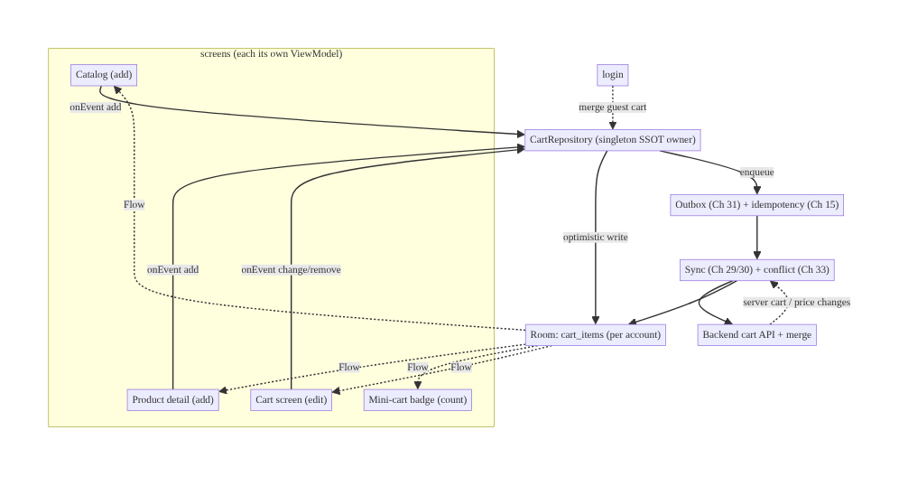
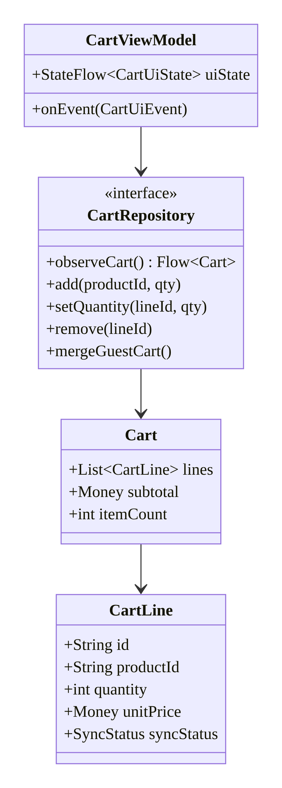
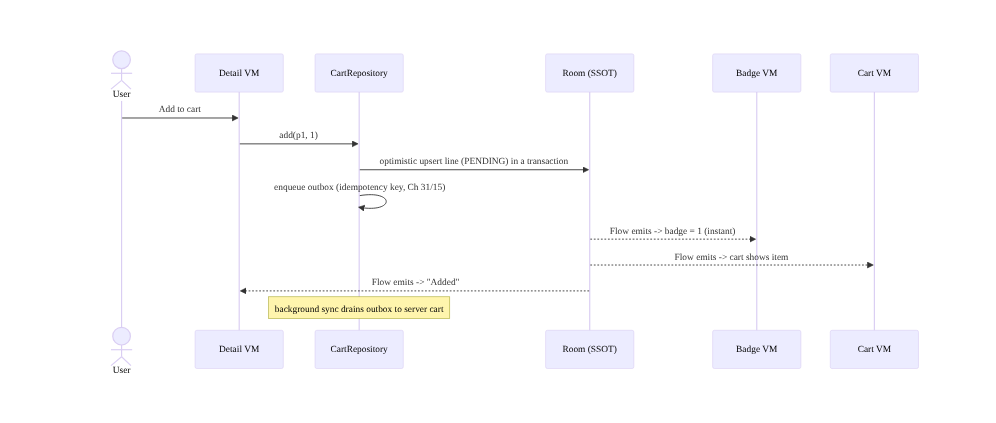
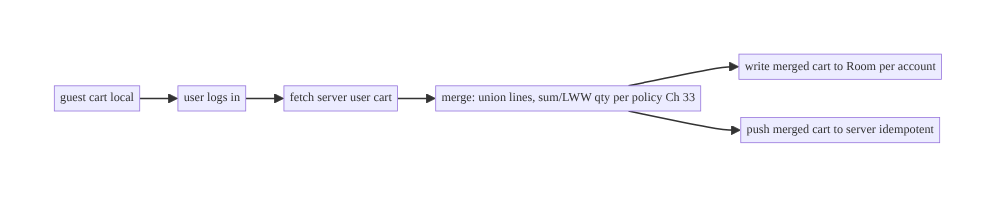
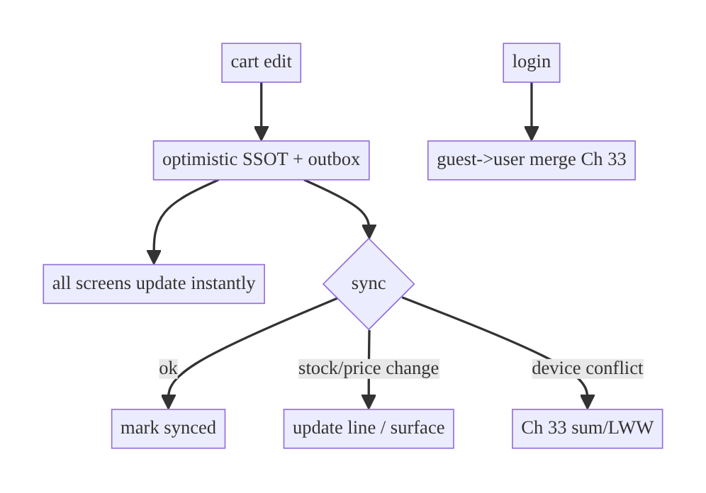

# Chapter 38 — Shared Shopping Cart Across Screens

> **Part V — Shared & Global State** · Complexity: **Complex** (≥40 interview questions)
>
> **Prerequisites:** Ch 3 (SSOT), Ch 6 (UI state/UDF), Ch 29 (offline-first),
> Ch 31 (outbox), Ch 33 (conflicts), Ch 11 (single-flight), Ch 15 (idempotency),
> Ch 42 (multi-account, previewed). This chapter is the **canonical shared-state
> problem** that ties Parts I–IV together into one feature.
>
> **Reference surface in StreamCart:** the shopping cart — edited from the product
> list, product detail, a mini-cart badge, and the cart screen; working offline;
> merging guest→user on login; consistent across devices.

---

## 38.1 Problem Definition and Real-World Context

A shopping cart is the textbook **shared, mutable, cross-screen state**: the *same*
cart is read and written from many screens (catalog, product detail, mini-cart
badge, cart screen, checkout), must stay **consistent everywhere instantly**, work
**offline**, survive process death, **merge** a guest cart into the user's cart on
login, and sync **across devices**. It's the single best vehicle for shared-state
architecture, and the naive approaches fail spectacularly:

- **Per-screen cart copies.** Each screen fetches/holds its own cart → the badge
  says 2 while the cart screen shows 3; adding on detail doesn't update the list.
  There's no single source of truth.
- **Cart in a singleton with raw mutable state.** A `CartManager` with a mutable
  list and manual listeners leaks, races under concurrent edits, and loses state on
  process death.
- **Blocking/online-only cart.** "Add to cart" hangs or fails offline; users lose
  items.
- **Lost guest cart.** A guest adds items, logs in, and their cart is empty (not
  merged) — a conversion killer.
- **Cross-device divergence.** Cart edited on phone and web diverge with no conflict
  policy.

The architecture applies the book's patterns to one feature: **one cart SSOT**
(Room, Ch 3) observed by every screen; **optimistic writes** (Ch 6/29) via an
**outbox** (Ch 31) with **idempotency** (Ch 15); **single-flight** sync (Ch 11);
**guest→user merge** on login; **conflict resolution** (Ch 33) for concurrent
edits; and **correct scoping/lifecycle** (shared ViewModel vs SSOT, Ch 40/42). This
chapter shows how the pieces compose into a production cart.

### Three practical use cases

1. **E-commerce (StreamCart Shop).** The running example — add/remove/change
   quantity from any screen; badge + cart + checkout always agree; offline + sync.
2. **OTT (Watch).** "My list" / download queue — the same shared-collection pattern
   (add from browse, detail, player).
3. **Food/travel (generic).** A booking cart / order basket edited across steps,
   persisted, merged on login, synced across devices.

### Why this is architectural

The cart crystallizes **shared-state design**: single source of truth, cross-screen
consistency, state ownership/scoping, offline + optimistic writes, merge semantics,
and conflict handling — the decisions that determine whether shared state stays
coherent. It's a favorite interview because it exercises the whole stack.

---

## 38.2 Requirements Engineering

### Functional requirements

| ID | Requirement |
|----|-------------|
| F1 | One cart, read/written from any screen; all screens reflect changes instantly. |
| F2 | Add / remove / change quantity; compute totals (subtotal, count, price). |
| F3 | Work offline: writes succeed locally immediately; sync later. |
| F4 | Survive process death / rotation. |
| F5 | Merge a guest cart into the user's cart on login. |
| F6 | Sync across devices with conflict resolution for concurrent edits. |
| F7 | Handle item availability/price changes from the server. |

### Non-functional requirements

| Attribute | Policy |
|-----------|--------|
| **Consistency** | Single source of truth; every screen coherent; eventual cross-device consistency. |
| **Availability** | Fully usable offline (Ch 29). |
| **Reliability** | No lost cart edits (outbox, Ch 31); idempotent (Ch 15). |
| **Performance** | Instant local reads/writes; no refetch per screen. |
| **Correctness** | Concurrent edits resolved (Ch 33); accurate totals. |
| **Security** | Per-account cart; cleared on logout (Ch 22/42). |

### Scope

- **In scope:** cart SSOT + cross-screen observation, optimistic writes + outbox +
  idempotency, offline, process-death survival, guest→user merge, cross-device
  conflict resolution, state ownership/scoping, totals.
- **Out of scope:** checkout/payment flow (Ch 75), wishlist (Ch 74), the underlying
  patterns' internals (Ch 3/29/31/33 — reused), multi-account mechanics (Ch 42).

### Assumptions & constraints

- Room (Ch 3), optimistic writes + outbox (Ch 29/31), idempotency (Ch 15),
  conflict resolution (Ch 33). Backend has a cart API + merge endpoint. `minSdk 24`.

---

## 38.3 System Design Fundamentals

- **Single Source of Truth for the cart.** The cart lives in **Room** (Ch 3),
  exposed by **one `CartRepository`** (a DI singleton, Ch 5). **Every screen's
  ViewModel observes the same repository `Flow`** — so one write updates the badge,
  the list, the cart screen, and checkout simultaneously. This is the core fix for
  cross-screen consistency: *don't share a ViewModel or a mutable object — share the
  SSOT.*
- **State ownership, not a god-singleton.** The cart's mutable state is owned by the
  SSOT (Room via the repository), not a hand-rolled mutable singleton. Screens are
  stateless observers (UDF, Ch 6); they emit events (`add`, `remove`), the repository
  mutates the SSOT, and all observers re-render.
- **Optimistic writes (Ch 6/29).** `addItem` updates Room immediately (UI reflects
  it at once) and enqueues an outbox mutation (Ch 31) with an idempotency key
  (Ch 15); the server write happens asynchronously. Offline works by construction.
- **Totals as derived state.** Subtotal/count/price are **computed from** the cart
  items (a mapping/`combine`), never stored and kept in sync manually — derive, don't
  duplicate.
- **Guest→user merge.** A guest has a local (device-scoped) cart; on login, **merge**
  the guest cart with the server/user cart (union items; sum or max quantities per
  policy) so nothing is lost. This is a one-time conflict resolution (Ch 33) between
  two carts.
- **Cross-device concurrency.** The same user's cart edited on two devices diverges;
  resolve with a policy — often **sum deltas** (a CRDT-ish counter per line) or LWW
  per line, so both devices' intent is honored (Ch 33).
- **Scoping (Ch 40/42).** The cart is **per account** (cleared on logout, Ch 22);
  within the app it's an app-scoped singleton (not Activity/ViewModel-scoped) so it
  survives navigation. (Ch 40 covers shared ViewModel scoping as an *alternative*
  for narrower sharing.)

Core insight: **the cart is shared state solved by a single Room-backed SSOT that
every screen observes, mutated optimistically through an outbox with idempotency,
derived totals, guest→user merge, and conflict resolution across devices** — not a
shared mutable object. Share the *source of truth*, not the *state holder*.

---

## 38.4 High-Level Architecture



**Components & ownership**

- **`CartRepository`** (singleton) owns the SSOT; the only writer; every screen reads
  it.
- **Room `cart_items`** (per account) is the SSOT, observed by all screens'
  ViewModels.
- **Outbox + idempotency** (Ch 31/15) make writes durable and exactly-once.
- **Sync + conflict** (Ch 29/30/33) reconcile with the server/other devices.
- **Merge** folds a guest cart into the user cart on login.

**Direction:** any screen → repository → Room SSOT (all screens observe) + outbox →
sync ↔ server.

---

## 38.5 Detailed Component Design



| Component | Responsibility | Note |
|-----------|----------------|------|
| `CartRepository` (singleton) | SSOT owner; single writer; optimistic + outbox | Ch 3/29/31 |
| Room `cart_items` | durable per-account cart | SSOT; observed by all screens |
| derived `Cart` (totals) | computed from lines | derive, don't store |
| per-screen `CartViewModel` | observe + emit events | UDF (Ch 6); may be shared (Ch 40) |
| merge | guest→user on login | conflict (Ch 33) |

> **Every screen gets its own ViewModel that injects the *same* `CartRepository`**
> — not a shared ViewModel holding the cart. The SSOT is shared, the ViewModels
> aren't. (Ch 40 discusses when a shared ViewModel is appropriate instead.)

---

## 38.6 End-to-End Data Flow

### Add from detail → every screen updates



### Guest → user merge on login



---

## 38.7 Complete Kotlin Implementation

Package: `com.streamcart.data.cart` and `:feature:cart`.

### 38.7.1 Cart entity + SSOT DAO (per account)

```kotlin
@Entity(tableName = "cart_items", indices = [Index(value = ["accountId","productId"], unique = true)])
data class CartItemEntity(
    @PrimaryKey val id: String,                 // client-generated (works offline)
    val accountId: String,                      // per-account scoping (Ch 42)
    val productId: String,
    val quantity: Int,
    val unitPriceCents: Long,
    val updatedAt: Long,
    val version: Long = 0,                       // conflict detection (Ch 33)
    val syncStatus: SyncStatus = SyncStatus.PENDING,
    val deleted: Boolean = false,                // soft delete (syncs)
)

@Dao
interface CartDao {
    @Query("SELECT * FROM cart_items WHERE accountId = :acct AND deleted = 0 ORDER BY updatedAt")
    fun observe(acct: String): Flow<List<CartItemEntity>>   // every screen observes this
    @Upsert suspend fun upsert(item: CartItemEntity)
    @Query("SELECT * FROM cart_items WHERE accountId = :acct AND productId = :pid AND deleted = 0")
    suspend fun findByProduct(acct: String, pid: String): CartItemEntity?
    @Query("DELETE FROM cart_items WHERE accountId = :acct") suspend fun clearAccount(acct: String)
}
```

### 38.7.2 Cart repository: single SSOT owner, optimistic + outbox

```kotlin
@Singleton
class CartRepositoryImpl @Inject constructor(
    private val db: StreamCartDatabase,
    private val dao: CartDao,
    private val outbox: OutboxDao,                 // Ch 31
    private val account: AccountProvider,          // current accountId (Ch 42)
    private val syncScheduler: SyncScheduler,      // Ch 30
    private val clock: Clock, private val json: Json,
) : CartRepository {

    // SSOT -> derived Cart (totals computed, not stored).
    override fun observeCart(): Flow<Cart> =
        account.currentId().flatMapLatest { acct -> dao.observe(acct) }
            .map { lines -> Cart(
                lines = lines.map { it.toDomain() },
                subtotal = Money(lines.sumOf { it.unitPriceCents * it.quantity }),
                itemCount = lines.sumOf { it.quantity },
            ) }

    override suspend fun add(productId: String, qty: Int) {
        val acct = account.currentIdValue()
        db.withTransaction {                                       // atomic optimistic + outbox (Ch 31)
            val existing = dao.findByProduct(acct, productId)
            val line = existing?.copy(quantity = existing.quantity + qty, updatedAt = clock.now(),
                                      version = existing.version + 1, syncStatus = SyncStatus.PENDING)
                ?: CartItemEntity(UUID.randomUUID().toString(), acct, productId, qty, lookupPrice(productId), clock.now())
            dao.upsert(line)
            outbox.insert(mutation("cart.upsert", line.id, json.encodeToString(line.toRequest())))
        }
        syncScheduler.requestSync()                               // Ch 30
    }

    override suspend fun setQuantity(lineId: String, qty: Int) {
        if (qty <= 0) return remove(lineId)
        mutateLine(lineId) { it.copy(quantity = qty) }
    }
    override suspend fun remove(lineId: String) = mutateLine(lineId) { it.copy(deleted = true) }  // soft delete

    private suspend fun mutateLine(lineId: String, f: (CartItemEntity) -> CartItemEntity) {
        db.withTransaction {
            val cur = dao.findById(lineId) ?: return@withTransaction
            val next = f(cur).copy(updatedAt = clock.now(), version = cur.version + 1, syncStatus = SyncStatus.PENDING)
            dao.upsert(next)
            outbox.insert(mutation("cart.upsert", lineId, json.encodeToString(next.toRequest())))
        }
        syncScheduler.requestSync()
    }

    // Guest -> user merge on login (Ch 33): union lines; sum quantities per policy.
    override suspend fun mergeGuestCart(guestAccountId: String) {
        val user = account.currentIdValue()
        db.withTransaction {
            dao.observe(guestAccountId).first().forEach { g ->
                val existing = dao.findByProduct(user, g.productId)
                val mergedQty = (existing?.quantity ?: 0) + g.quantity        // sum policy
                dao.upsert((existing ?: g).copy(id = existing?.id ?: UUID.randomUUID().toString(),
                    accountId = user, quantity = mergedQty, syncStatus = SyncStatus.PENDING, version = (existing?.version ?: 0) + 1))
                outbox.insert(mutation("cart.upsert", existing?.id ?: g.id, /* payload */ ""))
            }
            dao.clearAccount(guestAccountId)                                  // drop guest cart
        }
        syncScheduler.requestSync()
    }
}
```

### 38.7.3 Per-screen ViewModels share the repository (not a shared VM)

```kotlin
// Badge, detail, cart screens each inject the SAME singleton repository.
@HiltViewModel
class MiniCartViewModel @Inject constructor(repo: CartRepository) : ViewModel() {
    val count: StateFlow<Int> = repo.observeCart().map { it.itemCount }
        .stateIn(viewModelScope, SharingStarted.WhileSubscribed(5_000), 0)
}

@HiltViewModel
class CartViewModel @Inject constructor(private val repo: CartRepository) : ViewModel() {
    val uiState: StateFlow<CartUiState> = repo.observeCart()
        .map { if (it.lines.isEmpty()) CartUiState.Empty else CartUiState.Content(it) }
        .stateIn(viewModelScope, SharingStarted.WhileSubscribed(5_000), CartUiState.Loading)
    fun onEvent(e: CartUiEvent) = viewModelScope.launch {
        when (e) {
            is CartUiEvent.ChangeQty -> repo.setQuantity(e.lineId, e.qty)     // optimistic
            is CartUiEvent.Remove -> repo.remove(e.lineId)
            is CartUiEvent.Add -> repo.add(e.productId, 1)
        }
    }
}
```

### 38.7.4 Conflict-aware sync apply (cross-device, Ch 33)

```kotlin
// When the server returns an updated cart line (delta, Ch 32), resolve vs local pending.
suspend fun applyServerLine(remote: CartItemEntity, resolver: ConflictResolver<CartItemEntity>) {
    val local = dao.findById(remote.id)
    when (val r = resolver.resolve(base = dao.findBase(remote.id), local = local, remote = remote)) {
        is Resolution.Accept -> dao.upsert(r.remote)
        is Resolution.Merged -> { dao.upsert(r.value); outbox.insert(/* push merged */) }
        else -> { /* keep local / user-resolved */ }
    }
}
```

### 38.7.5 Module structure

```
:data:cart     CartRepositoryImpl (SSOT, optimistic, outbox, merge)
:core:database CartItemEntity, CartDao (per-account)
:feature:cart  CartViewModel, MiniCartViewModel, DetailAddToCart (share the repo)
:sync          outbox drain (Ch 31), conflict resolver (Ch 33)
```

---

## 38.8 Concurrency and Race Conditions

| Scenario | Risk | Handling |
|----------|------|----------|
| Add from two screens fast | duplicate lines / lost update | unique (accountId,productId) index; upsert-increment; version |
| Optimistic write + sync in flight | overwrite | version + outbox (Ch 31); server dedups (Ch 15) |
| Two devices edit same line | divergence | conflict resolution (Ch 33): sum-deltas / LWW per line |
| Guest→user merge race | lost items | merge in a transaction; idempotent push |
| Process death mid-edit | lost edit | durable SSOT + outbox (Ch 31) |
| Badge vs cart screen inconsistency | stale UI | both observe the same SSOT `Flow` — can't diverge |
| Account switch | wrong cart | per-account scoping; `flatMapLatest` on accountId (Ch 42) |

- **One SSOT observed by all screens makes cross-screen consistency automatic** —
  the badge and cart can't disagree because they read the same `Flow`. This is the
  whole point of shared *source of truth* over shared *state holder*.
- **Unique (account, product) + upsert-increment** prevents duplicate lines when the
  same product is added from two places concurrently.

---

## 38.9 Failure Scenarios and Recovery

| Failure | Detection | Response | UX |
|---------|-----------|----------|----|
| Offline add | connectivity (Ch 68) | optimistic local + outbox | works; "will sync" |
| Sync rejected (out of stock) | server error | mark line unavailable; surface; keep others | "X no longer available" |
| Price changed on server | delta (Ch 32) | update unit price; recompute totals; notify | "price updated" |
| Concurrent device edit | version conflict | resolve (Ch 33: sum/LWW) | merged |
| Guest cart lost on login | merge missing | implement guest→user merge | items preserved |
| Process death | durable SSOT+outbox | restored | seamless |
| Item removed on server | tombstone (Ch 32) | remove locally | cart updated |
| Account switch | per-account | load that account's cart; clear on logout (Ch 22) | correct cart |



> **Availability + accuracy:** the cart must stay usable offline (optimistic) **and**
> accurate (reconcile price/stock/conflicts on sync) — surface server-driven changes
> (out of stock, price) rather than silently diverging at checkout.

---

## 38.10 Scaling the Implementation

- **Level 1.** In-memory cart (single screen) — toy; loses everything.
- **Level 2.** Room SSOT + one repository observed by all screens (cross-screen
  consistency, survives rotation/process death).
- **Level 3 — production.** Optimistic writes + outbox (Ch 31) + idempotency (Ch 15)
  + offline (Ch 29); per-account scoping; derived totals; server reconcile (price/
  stock).
- **Level 4 — large.** Cross-device sync (Ch 32) + conflict resolution (Ch 33);
  guest→user merge; promotions/coupons; real-time cart updates (WebSocket, Ch 63).
- **Level 5 — enterprise.** Server-authoritative cart with client replica, inventory
  reservation, distributed consistency, A/B-tested merge/coupon logic, cart
  analytics/abandonment.

**Avoid overengineering:** a simple app may not need cross-device sync or conflict
resolution — Room SSOT + optimistic + outbox covers most. Add sync/merge when guest
carts and multi-device genuinely matter (most commerce apps do).

---

## 38.11 Alternative Approaches and Trade-offs

| Dimension | Option A | Option B | When |
|-----------|----------|----------|------|
| Shared state | **Shared SSOT** (Room repo, all screens observe) | shared ViewModel / singleton with mutable state | SSOT always for cross-screen durable state; shared VM only for narrow, ephemeral sharing (Ch 40) |
| Writes | Optimistic + outbox | pessimistic (block on server) | Optimistic for UX/offline; pessimistic only if server confirmation is mandatory pre-UI |
| Totals | Derived (computed) | stored + maintained | Derive — storing invites drift |
| Authority | Client replica + server sync | server-only (fetch every change) | Replica+sync for offline/speed; server-only loses offline |
| Cross-device | Conflict resolution (Ch 33: sum/LWW) | last-write-wins blind | Policy per semantics; blind LWW loses intent |
| Guest cart | Merge on login | discard | Merge — discarding loses conversions |
| Scope | App-scoped singleton repo | Activity/ViewModel-scoped | App-scoped so it survives navigation; narrower scope loses cross-screen sharing |

**Shared SSOT vs shared ViewModel (the core decision):** the classic "how do screens
share the cart" question. A **shared ViewModel** (Ch 40) scoped to an Activity/nav
graph can share state between a few screens, but it's **ephemeral** (lost on process
death unless SavedState), tied to a navigation scope, and doesn't survive the app or
sync across devices. The **SSOT** (Room repository) is durable, app-wide, offline,
and the single writer — the right choice for the cart. **Share the source of truth,
not the state holder.** Use a shared ViewModel only for transient UI state shared by
a tight screen group (Ch 40).

**Optimistic vs pessimistic cart writes:** optimistic (update UI now, sync later)
gives instant feedback and offline support but must reconcile (stock/price/conflicts)
on sync; pessimistic (wait for server) is simpler/accurate but unusable offline and
laggy. Carts are optimistic, with explicit reconcile at sync/checkout.

---

## 38.12 Security Considerations

- **Per-account cart; clear on logout** (Ch 22/42) — one user's cart must never show
  for another; scope by `accountId` and wipe on logout.
- **Server authorizes and re-prices** every cart mutation and the final checkout — a
  tampered client could set quantity/price locally, but the **backend is
  authoritative** on price, availability, and limits (never trust client-computed
  totals for payment, Ch 75).
- **Idempotency** (Ch 15) on cart mutations prevents duplicate lines from retries.
- **Guest cart** is device-scoped, not backed up with secrets (Ch 37); merge over an
  authenticated channel (Ch 19).
- **Encrypt** the cart DB if it contains sensitive data (usually not, but PII in
  custom fields → Ch 24).
- Client vs backend: the client holds a convenient replica for UX; the backend owns
  the authoritative cart, pricing, and inventory — the client's totals are display-
  only until server-confirmed at checkout.

---

## 38.13 Performance and Resource Optimization

- **Instant local reads/writes** (SSOT) — no network on add/view; excellent perceived
  performance.
- **One `Flow` observed by all screens** — no per-screen refetch; `WhileSubscribed`
  stops idle collection.
- **Derived totals** computed cheaply from lines (O(n)); memoize if large.
- **Batch/debounce rapid quantity changes** (stepper spam) before enqueuing outbox
  (Ch 31 compaction) to cut sync volume.
- **Single-flight** cart fetch (Ch 11) to avoid stampede when multiple screens open.
- **Profiling:** cross-screen update latency, cart DB size, sync volume, recomposition
  of badge/cart.

---

## 38.14 Testing Strategy

In-memory Room + fakes; assert cross-screen consistency, optimistic+outbox, merge,
conflicts.

```kotlin
class CartRepositoryTest {
    @Test fun `add reflects across all observers (one SSOT)`() = runTest {
        val repo = repo()
        val badge = repo.observeCart().map { it.itemCount }
        val cart = repo.observeCart()
        repo.add("p1", 2)
        assertEquals(2, badge.first())
        assertEquals(1, cart.first().lines.size)          // same SSOT -> consistent
    }

    @Test fun `add works offline and queues outbox`() = runTest {
        val repo = repo(online = false)
        repo.add("p1", 1)
        assertEquals(1, repo.observeCart().first().itemCount)   // optimistic
        assertEquals(1, outbox.pending().size)                  // queued (Ch 31)
    }

    @Test fun `adding same product twice increments, no duplicate line`() = runTest {
        val repo = repo(); repo.add("p1", 1); repo.add("p1", 2)
        val cart = repo.observeCart().first()
        assertEquals(1, cart.lines.size); assertEquals(3, cart.itemCount)
    }

    @Test fun `totals are derived correctly`() = runTest {
        val repo = repo(prices = mapOf("p1" to 1000))
        repo.add("p1", 3)
        assertEquals(3000, repo.observeCart().first().subtotal.cents)
    }

    @Test fun `guest cart merges into user cart on login`() = runTest {
        val repo = repo(account = "guest"); repo.add("p1", 2)
        account.switchTo("user"); repo.mergeGuestCart("guest")
        assertEquals(2, repo.observeCart().first().itemCount)   // preserved
    }

    @Test fun `concurrent device edit resolved by policy`() = runTest {
        // local qty 2 (v1), remote qty 3 (v2) -> sum or LWW per resolver (Ch 33)
    }

    @Test fun `cart cleared on logout`() = runTest {
        val repo = repo(); repo.add("p1", 1); session.logout()
        assertTrue(repo.observeCart().first().lines.isEmpty())
    }
}
```

Also: process-death survival (SSOT durable), price/stock reconcile on sync,
idempotent double-sync, per-account isolation, a Compose test that the badge and cart
screen update together.

---

## 38.15 Production Observability

- **Metrics:** cart conversion, add-to-cart rate, cart-sync success/failure, offline-
  cart usage, guest→user merge success, cross-device conflict rate, cart-abandonment,
  cross-screen inconsistency incidents (should be 0), price/stock reconcile rate.
- **Logs:** `cart{op, line_count, result}`, `cart_merge{guest_items, result}`,
  `cart_conflict{resolution}` (ids/counts, no PII, Ch 28), correlation IDs (Ch 1/84).
- **Debugging:** badge ≠ cart screen → not sharing the SSOT (per-screen copies);
  lost items offline → non-durable/no outbox; empty cart after login → merge missing;
  duplicate lines → missing unique index / no upsert-increment; wrong cart after
  switch → not per-account scoped.
- **Alerting:** cart-sync failure or merge-failure spike → backend/sync incident.
- **Privacy:** cart is user data; redact; clear on logout.

---

## 38.16 System Design Interview Preparation

> 40+ questions. (A canonical "design the shared cart" interview.)

**Fundamentals**
1. *How do multiple screens share the cart?* One SSOT (Room repository); every
   screen's ViewModel observes the same `Flow` — not a shared ViewModel/mutable
   singleton.
2. *Why not a shared ViewModel holding the cart?* Ephemeral (lost on process death),
   nav-scoped, no offline/sync; share the *source of truth*, not the holder.
3. *Why Room SSOT?* Durable, offline, survives process death, single writer,
   observable by all.
4. *How do the badge and cart stay consistent?* They read the same DAO `Flow` → one
   write updates both.
5. *How are totals kept in sync?* Derived (computed) from lines, never stored.

**Writes / offline**
6. *Add to cart offline?* Optimistic local write + outbox (Ch 31) + idempotency
   (Ch 15); syncs later.
7. *Why idempotency?* Retries/replays shouldn't duplicate lines (Ch 15).
8. *Client-generated line ids?* So adds work offline before the server assigns ids.
9. *Rapid quantity changes?* Debounce/compact before sync (Ch 31).

**Consistency / concurrency**
10. *Add same product from two screens?* Unique (account,product) + upsert-increment
    → one line.
11. *Two devices edit the cart?* Conflict resolution (Ch 33): sum-deltas (CRDT-ish)
    or LWW per line.
12. *Process death mid-edit?* Durable SSOT + outbox → restored.
13. *Optimistic vs pessimistic?* Optimistic for UX/offline; reconcile on sync.

**Guest / account**
14. *Guest→user merge?* On login, union lines, sum/LWW quantities, push merged
    (Ch 33).
15. *Why merge (not discard)?* Don't lose the guest's cart (conversion).
16. *Per-account?* Scope by accountId; clear on logout (Ch 22/42).
17. *Account switch?* `flatMapLatest` on accountId → load that cart.

**Server reconcile**
18. *Price changed?* Delta (Ch 32) updates unit price; recompute totals; notify.
19. *Out of stock?* Mark line unavailable at sync/checkout; surface.
20. *Who owns price/availability?* The backend (authoritative); client totals are
    display-only (Ch 75).

**Scoping/lifecycle**
21. *Repository scope?* App-scoped singleton (survives navigation), per-account data.
22. *When a shared ViewModel instead?* Narrow, ephemeral sharing of transient UI state
    among a tight screen group (Ch 40).
23. *Survive rotation?* ViewModel + SSOT; `WhileSubscribed`.

**Security**
24. *Trust client totals for payment?* No — backend re-prices at checkout (Ch 75).
25. *Cross-account leak?* Per-account scope + clear on logout.
26. *Idempotency for payment-adjacent ops?* Yes (Ch 15).

**Performance**
27. *Avoid per-screen refetch?* One shared SSOT `Flow`.
28. *Stepper spam?* Compact outbox (Ch 31).
29. *Cart fetch stampede on open?* Single-flight (Ch 11).

**Testing**
30. *How test cross-screen consistency?* Multiple observers of the repo; one write
    updates all.
31. *How test offline add?* Fake offline; assert optimistic + outbox.
32. *How test merge?* Guest cart + login → assert preserved.

**Production debugging**
33. *Badge ≠ cart?* Not sharing the SSOT.
34. *Items lost offline?* No durable outbox.
35. *Empty after login?* No merge.
36. *Duplicate lines?* No unique index/upsert.
37. *Wrong cart after switch?* Not per-account.

**Design/scale**
38. *Real-time cart (price drops)?* WebSocket push (Ch 63) → update SSOT.
39. *Inventory reservation?* Server-authoritative; client shows pending.
40. *Cross-device conflict policy?* Sum-deltas CRDT or LWW per line (Ch 33).

### Design-change challenges
1. **Cart must work offline.** Optimistic + outbox + idempotency (Ch 29/31/15).
2. **Guest adds then logs in.** Guest→user merge (Ch 33).
3. **Edited on phone + web.** Per-line conflict resolution (Ch 33).
4. **Prices change server-side.** Delta reconcile (Ch 32) + surface.
5. **Badge and cart disagree.** Single SSOT observed by both.

### Mock walkthrough (abridged)
Clarify (cross-screen? offline? guest? multi-device?) → one Room SSOT + repository;
all screens observe → optimistic writes + outbox + idempotency → derived totals →
per-account scope + clear on logout → guest→user merge + cross-device conflict (Ch 33)
→ server reconcile price/stock → "share SSOT not state holder" → testing consistency.

---

## 38.17 Practical Exercises

1. **Beginner.** Back the cart with one Room SSOT + repository; show a badge and cart
   screen that both update from a single add. *Eval:* consistent across screens;
   survives rotation.
2. **Intermediate.** Add optimistic writes + outbox + idempotency; prove offline add
   works and syncs. *Eval:* instant UI; queued; no duplicate on double-sync.
3. **Advanced.** Add guest→user merge on login and per-account scoping with
   clear-on-logout. *Eval:* guest cart preserved; no cross-account leak.
4. **Production debugging.** Fix a cart where the badge and cart screen disagree
   (per-screen copies) and items vanish offline (no outbox). *Eval:* one SSOT;
   durable.
5. **System design challenge.** Add cross-device sync with per-line conflict
   resolution (sum/LWW) and server price reconcile. *Eval:* converges; prices
   updated; intent preserved.

*(Solutions withheld unless requested.)*

---

## 38.18 Chapter Summary & Reference Sheet

**Key decisions:** solve shared cross-screen state with **one Room-backed SSOT**
(a singleton `CartRepository`) that **every screen's ViewModel observes** — **share
the source of truth, not the state holder**; mutate **optimistically** through an
**outbox** (Ch 31) with **idempotency** (Ch 15) so it works **offline** and survives
process death; **derive totals** (don't store); scope the cart **per account** and
**clear on logout** (Ch 22/42); **merge guest→user** on login and resolve
**cross-device conflicts** per line (sum/LWW, Ch 33); **reconcile** server price/
stock on sync; the **backend is authoritative** on price/availability (never trust
client totals for payment, Ch 75).

**Concepts:** shared SSOT vs shared ViewModel, cross-screen consistency via one
`Flow`, optimistic writes + outbox + idempotency, derived state, per-account scoping,
guest→user merge, cross-device conflict resolution, server reconcile.

**Common mistakes:** per-screen cart copies (badge ≠ cart); shared mutable singleton
(races/leaks/no durability); online-only/blocking writes (no offline); storing totals
(drift); no guest merge (lost cart); no per-account scope (cross-user leak); duplicate
lines (no unique index/upsert); trusting client totals for payment.

**Checklist:** ☐ one Room SSOT + singleton repo ☐ all screens observe same `Flow`
☐ optimistic + outbox + idempotency (Ch 31/15) ☐ offline (Ch 29) ☐ derived totals
☐ unique (account,product) + upsert-increment ☐ per-account + clear on logout ☐
guest→user merge (Ch 33) ☐ cross-device conflict (Ch 33) ☐ server reconcile price/
stock ☐ backend authoritative at checkout.

**Key APIs/patterns:** Room SSOT + DAO `Flow` (Ch 3), `@Singleton` repository (Ch 5),
optimistic write + `withTransaction` + outbox (Ch 31), idempotency keys (Ch 15),
`flatMapLatest` on account (Ch 42), `combine`/`map` derived totals, `ConflictResolver`
(Ch 33), `SharingStarted.WhileSubscribed`.

**References:**
- Guide to app architecture (SSOT/shared state): https://developer.android.com/topic/architecture
- Data layer / offline-first: https://developer.android.com/topic/architecture/data-layer/offline-first
- ViewModel scopes (shared VM alternative, Ch 40): https://developer.android.com/topic/libraries/architecture/viewmodel
- (composes) Ch 3 SSOT, Ch 6 UDF, Ch 29 Offline, Ch 31 Outbox, Ch 33 Conflicts, Ch 42 Multi-Account

### Chapter review (Phase 4)
- **Completeness:** all 18 sections; architecture/class/sequence/failure diagrams;
  cart entity + SSOT repo (optimistic/outbox/merge) + per-screen VMs + conflict apply;
  concurrency (one-SSOT consistency, unique index); failure (offline/stock/price/merge/
  conflict); 5 levels; SSOT-vs-shared-VM and optimistic-vs-pessimistic trade-offs;
  security (per-account, server authoritative); perf (one Flow, derived totals);
  cross-screen + merge tests; observability (badge≠cart); 40 Q&A + 5 challenges. ✅
- **Expand later:** checkout/payment (Ch 75), shared ViewModel scoping (Ch 40),
  multi-account (Ch 42), real-time cart (Ch 63).
- **Interview coverage:** exceeds ≥40 bar. **Opens Part V.**
