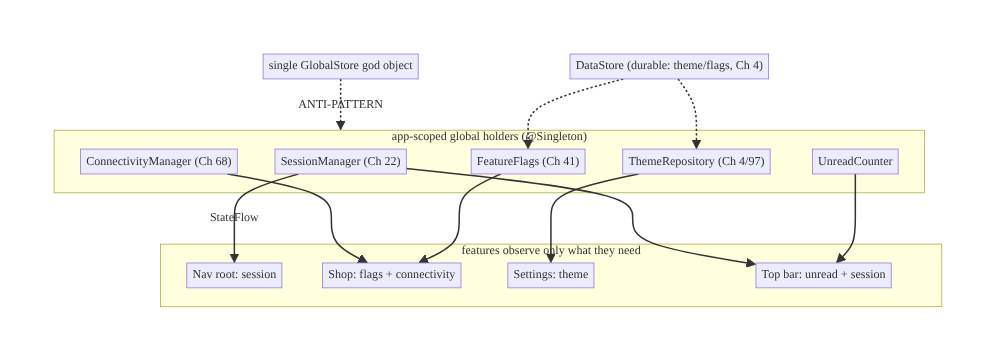
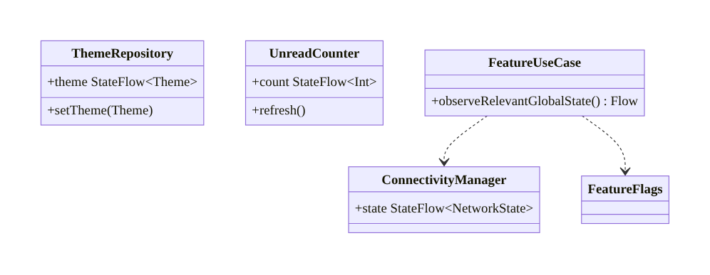
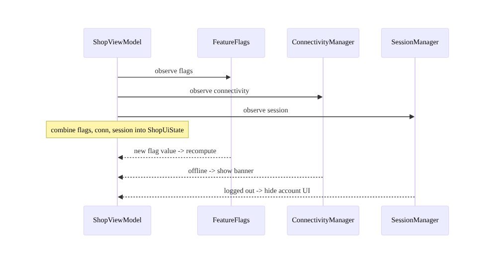
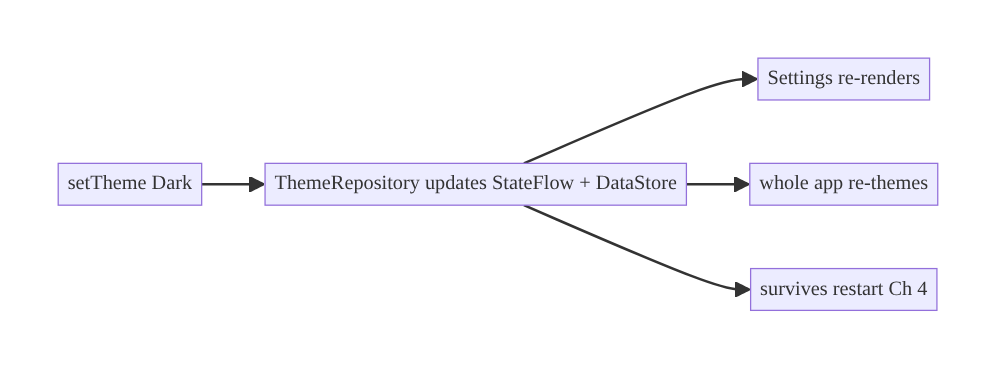
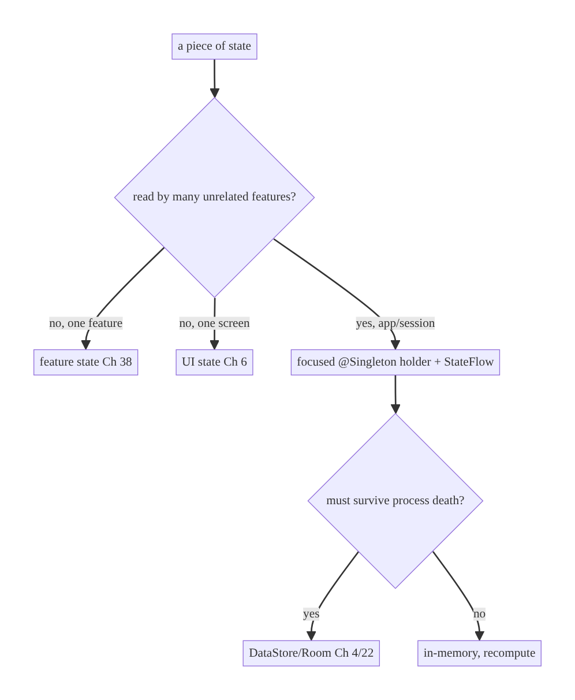

# Chapter 39 — Global App State Management

> **Part V — Shared & Global State** · Complexity: **Standard** (≥25 interview questions)
>
> **Prerequisites:** Ch 3 (SSOT), Ch 6 (UI state/UDF), Ch 22 (session state), Ch 38
> (shared cart), Ch 5 (Hilt scoping). This chapter generalizes Ch 38's shared-state
> lesson to **app-wide** state and draws the line between global and feature state.
>
> **Reference surface in StreamCart:** session/auth state (Ch 22), connectivity
> (Ch 68), theme (Ch 4/97), feature flags (Ch 41), unread-notification count, and
> the current profile — state that *many* features read.

---

## 39.1 Problem Definition and Real-World Context

Some state belongs to a single screen, some to a feature (the cart, Ch 38), and a
little is genuinely **global** — read by many unrelated features: who's logged in
(Ch 22), whether the device is online (Ch 68), the theme, active feature flags
(Ch 41), the unread-notification badge, the selected profile. Managing this
app-wide state badly is a classic source of bugs and bad architecture:

- **The god object.** A single `AppState`/`GlobalStore` holding *everything* becomes
  a dumping ground — every feature depends on it, it's impossible to test, and a
  change anywhere ripples everywhere. The opposite of modular.
- **Scattered duplication.** Without a clear owner, five features each track
  "is logged in" or "is online" differently → inconsistency (one screen thinks
  you're offline, another doesn't).
- **Wrong scope / leaks.** Holding global state in an Activity/ViewModel loses it on
  process death or leaks the Activity; holding UI-local state globally bloats memory
  and couples features.
- **Over-globalization.** Treating feature state (the cart) as "global" couples
  unrelated code; treating truly-global state (session) as feature-local causes
  divergence. Knowing *what is actually global* is the real skill.

The architecture: expose each piece of global state through a **small, focused,
app-scoped holder** (a repository/manager exposing a `StateFlow`), **owned by one
module**, observed by whoever needs it — **not** one monolithic store. Draw a clear
boundary: **global** (session, connectivity, theme, flags) vs **feature** (cart,
Ch 38) vs **screen** (UI state, Ch 6). This chapter is about **identifying,
owning, exposing, and scoping** global state without a god object.

### Three practical use cases

1. **Session/auth (StreamCart).** `SessionManager` (Ch 22) exposes `SessionState`;
   the nav root, interceptors, and features all read it — one global source.
2. **Connectivity (all).** A `ConnectivityManager` holder (Ch 68) exposes
   online/offline; many features show offline banners from the same signal.
3. **Theme / unread count / flags.** Small focused holders (DataStore-backed theme,
   Ch 4; a notifications badge count; `FeatureFlags`, Ch 41) each owned and observed
   app-wide.

### Why this is architectural

Global state management defines **what is truly app-wide**, **who owns each piece**,
**how it's exposed and observed**, and **how to avoid a monolithic store** — the
properties that keep cross-cutting state consistent without coupling the whole app.

---

## 39.2 Requirements Engineering

### Functional requirements

| ID | Requirement |
|----|-------------|
| F1 | Identify genuinely global state (read by many features) vs feature/screen state. |
| F2 | Each global state has a single owner (app-scoped holder) exposing a `StateFlow`. |
| F3 | Any feature can observe global state reactively; one source of truth each. |
| F4 | Global state survives navigation/config change; durable where needed (Ch 4). |
| F5 | Avoid a single god object; keep holders small and focused. |
| F6 | Global state is cleared/reset appropriately (logout, Ch 22). |

### Non-functional requirements

| Attribute | Policy |
|-----------|--------|
| **Consistency** | One owner per global state; no duplication/divergence. |
| **Modularity** | Features depend on narrow holders, not a monolith. |
| **Testability** | Holders injectable/fakeable; no static singletons. |
| **Lifecycle** | App-scoped; survives nav/config; durable via Ch 4 where needed. |
| **Memory** | Only truly-global state is global; no UI state bloat. |

### Scope

- **In scope:** what counts as global, app-scoped state holders (repository/manager +
  `StateFlow`), exposing/observing, scoping via Hilt, avoiding the god object,
  reset/clear, composing multiple global states.
- **Out of scope:** feature-shared state (cart, Ch 38), screen UI state (Ch 6),
  shared ViewModel scoping (Ch 40), the specific holders' internals (session Ch 22,
  connectivity Ch 68, flags Ch 41, theme Ch 97).

### Assumptions & constraints

- Hilt (`@Singleton` holders), `StateFlow`, DataStore (durable global config, Ch 4).
  `minSdk 24`. "Global" = app-scoped (survives navigation/config), **not** a static
  object.

---

## 39.3 System Design Fundamentals

- **What is "global" state?** State read by **many unrelated features** and tied to
  the app/user session, not a single feature or screen: session/auth (Ch 22),
  connectivity (Ch 68), theme (Ch 97), feature flags (Ch 41), current profile,
  app-wide counters (unread). If only one feature uses it, it's **feature state**
  (own it there); if only one screen, it's **UI state** (Ch 6). **Resist making
  things global** — globalization couples code.
- **One focused holder per global state (not a god object).** Each global state gets
  a small, app-scoped (`@Singleton`) **holder** (a repository/manager) that owns it
  and exposes a read-only **`StateFlow`** (+ methods to change it). Many small
  holders > one monolith: focused dependencies, testable in isolation, independent
  evolution.
- **App-scoped, not static.** "Global" means **application lifetime via DI**
  (`@Singleton` in `SingletonComponent`, Ch 5) — injectable and fakeable — **not** a
  Kotlin `object` singleton (untestable, leak-prone) or Activity-held state (lost on
  process death).
- **Expose as state, consume via UDF.** Holders expose `StateFlow<T>`; features
  `combine`/observe them into their own `UiState` (Ch 6). Global state flows down;
  changes go through the holder's methods — the same UDF discipline, app-wide.
- **Durability where needed.** Global state that must survive process death is backed
  by a store: **DataStore** for config (theme, flags — Ch 4), **Room** for data
  (session derived from token presence, Ch 22). In-memory-only global state
  (connectivity) is recomputed on start.
- **Composition over a central store.** When a feature needs several global states,
  it **combines** the relevant holders (`combine(session, connectivity, flags)`) — no
  central store mediates; features depend only on what they use.
- **Reset/clear.** Global state is reset on lifecycle events: logout clears session-
  scoped global state (Ch 22/42); theme/flags persist (device-scoped).

Core insight: **expose each genuinely-global state through its own small, app-scoped,
injectable holder with a `StateFlow`, owned by one module and observed via UDF —
never a monolithic god object, and never more "global" than it needs to be.**

---

## 39.4 High-Level Architecture



**Components & ownership**

- **Each global state** = one focused `@Singleton` holder exposing a `StateFlow`.
- **Features** observe only the holders they need (narrow dependencies).
- **DataStore/Room** back durable global state (Ch 4/22).
- **No central god object** mediating everything.

**Direction:** holder owns + exposes `StateFlow`; features observe (combine) what
they need; changes go through holder methods.

---

## 39.5 Detailed Component Design



| Global state | Holder | Backing | Scope |
|--------------|--------|---------|-------|
| session/auth | `SessionManager` (Ch 22) | token presence (Room, Ch 20) | app, session-scoped |
| connectivity | `ConnectivityManager` (Ch 68) | OS callback | app, in-memory |
| theme | `ThemeRepository` (Ch 4/97) | DataStore | app, durable, device |
| feature flags | `FeatureFlags` (Ch 41) | DataStore + remote | app, durable |
| unread count | `UnreadCounter` | Room/remote | app, session-scoped |

> **Test for "global":** if ≥2 unrelated features read it and it's tied to the app/
> session, make it a focused `@Singleton` holder. Otherwise keep it in the feature
> (Ch 38) or the screen (Ch 6).

---

## 39.6 End-to-End Data Flow

### A feature composing several global states



### Global state change propagates app-wide



---

## 39.7 Complete Kotlin Implementation

Package: `com.streamcart.core.global` and per-concern modules.

### 39.7.1 A focused global holder (connectivity, Ch 68)

```kotlin
@Singleton
class ConnectivityManager @Inject constructor(
    @ApplicationContext context: Context,
    @ApplicationScope scope: CoroutineScope,
) {
    // Owns ONE global state; exposes read-only StateFlow.
    val state: StateFlow<NetworkState> = callbackFlow {
        val cm = context.getSystemService(android.net.ConnectivityManager::class.java)
        val cb = object : android.net.ConnectivityManager.NetworkCallback() {
            override fun onAvailable(n: Network) { trySend(NetworkState.Online) }
            override fun onLost(n: Network) { trySend(NetworkState.Offline) }
        }
        cm.registerDefaultNetworkCallback(cb)
        awaitClose { cm.unregisterNetworkCallback(cb) }
    }.stateIn(scope, SharingStarted.WhileSubscribed(5_000), NetworkState.Unknown)
}
```

### 39.7.2 A durable global holder (theme, Ch 4/97)

```kotlin
@Singleton
class ThemeRepository @Inject constructor(
    private val store: DataStore<Preferences>,          // durable (Ch 4)
    @ApplicationScope scope: CoroutineScope,
) {
    private val key = stringPreferencesKey("theme")
    val theme: StateFlow<Theme> = store.data
        .map { Theme.valueOf(it[key] ?: Theme.System.name) }
        .stateIn(scope, SharingStarted.Eagerly, Theme.System)   // app-wide, survives restart
    suspend fun setTheme(t: Theme) = store.edit { it[key] = t.name }.let {}
}
```

### 39.7.3 Features observe ONLY what they need (no god object)

```kotlin
@HiltViewModel
class ShopViewModel @Inject constructor(
    flags: FeatureFlags,                                 // Ch 41
    connectivity: ConnectivityManager,                  // Ch 68
    session: SessionManager,                             // Ch 22
    private val getProducts: GetProductsUseCase,
) : ViewModel() {
    // Compose the relevant global states into this screen's UiState (UDF, Ch 6).
    val uiState: StateFlow<ShopUiState> = combine(
        flags.observe("new_search"), connectivity.state, session.sessionState, getProducts(),
    ) { newSearch, net, sess, products ->
        ShopUiState(products, offline = net is NetworkState.Offline,
            showNewSearch = newSearch, loggedIn = sess is SessionState.Authenticated)
    }.stateIn(viewModelScope, SharingStarted.WhileSubscribed(5_000), ShopUiState.Loading)
}
// Settings injects only ThemeRepository; the top bar injects UnreadCounter + SessionManager. Narrow deps.
```

### 39.7.4 Anti-pattern (what NOT to do)

```kotlin
// ANTI-PATTERN: a god object holding everything -> every feature depends on all of it.
// @Singleton class GlobalStore(val session, val cart, val theme, val flags, val unread, ...) { val everything: StateFlow<AppState> }
// Instead: many small focused holders; features inject only what they use.
```

### 39.7.5 Reset on logout (session-scoped global state, Ch 22)

```kotlin
// SessionManager.logout() (Ch 22) resets session-scoped global holders:
// unread counter -> 0, profile -> null, etc. Device-scoped (theme) persists.
```

### 39.7.6 Module structure

```
:core:connectivity  ConnectivityManager (Ch 68)
:core:session       SessionManager (Ch 22)
:core:theme         ThemeRepository (Ch 4/97)
:core:flags         FeatureFlags (Ch 41)
# Each a focused @Singleton holder; features depend on the ones they use.
```

---

## 39.8 Concurrency and Race Conditions

| Scenario | Risk | Handling |
|----------|------|----------|
| Multiple observers of a holder | duplicate work | `StateFlow` shares one value; `WhileSubscribed`/`Eagerly` |
| Concurrent updates to a holder | torn state | update through holder methods; `StateFlow` serializes; DataStore atomic (Ch 4) |
| Two features combine same holders | redundant collection | `StateFlow` is hot/shared; conflated |
| Global state change mid-navigation | inconsistent UI | all observers see the same conflated `StateFlow` |
| Reset during observation | stale value | reset sets a new value; observers re-render |
| Static singleton (anti) | leaks/untestable | use DI `@Singleton`, not Kotlin `object` |

- **`StateFlow` + app-scoped holder makes global state inherently consistent:** every
  observer reads the same conflated value; there's no second copy to diverge.
- **All mutations go through the holder** (its methods), preserving UDF and a single
  writer — no feature mutates another's global state directly.

---

## 39.9 Failure Scenarios and Recovery

| Failure | Detection | Response | Outcome |
|---------|-----------|----------|---------|
| God object coupling | hard-to-test/change | split into focused holders | modular |
| Divergent "is online"/"logged in" | inconsistent UI | one holder; all observe it | consistent |
| Global state lost on process death | missing after restart | back with DataStore/Room (Ch 4/22) | durable |
| Over-globalized feature state | coupling | move to feature (Ch 38) | decoupled |
| Static singleton leak | LeakCanary (Ch 89) | DI `@Singleton` | no leak |
| Stale global state (flags) | not refreshed | holder refreshes (remote config, Ch 41) | fresh |
| Not reset on logout | cross-user leak | reset session-scoped holders (Ch 22) | clean |



> **The decision tree is the chapter:** most state is *not* global. Make something
> global only when many unrelated features genuinely read it — and even then, a
> focused holder, never a god object.

---

## 39.10 Scaling the Implementation

- **Level 1.** A couple of `@Singleton` holders (session, connectivity) exposing
  `StateFlow`.
- **Level 2.** Durable global config (theme/flags via DataStore, Ch 4/41);
  features combine what they need.
- **Level 3 — production.** Clear global/feature/screen boundaries; reset-on-logout;
  focused holders per concern; no god object.
- **Level 4 — large.** Modularized global holders in `:core:*` modules; multi-module
  features depend only on needed holders; remote-config-driven global state (Ch 41).
- **Level 5 — enterprise.** Governed global-state taxonomy, per-module ownership,
  state observability, consistent reset/lifecycle policy across teams.

**Avoid overengineering:** don't build a "state management framework." A few focused
`@Singleton` holders exposing `StateFlow` is the whole solution; adding Redux-style
central stores to Android usually adds ceremony without benefit (the SSOT + UDF model
already handles it).

---

## 39.11 Alternative Approaches and Trade-offs

| Dimension | Option A | Option B | When |
|-----------|----------|----------|------|
| Structure | Many focused holders | single central store (Redux-like) | Focused holders fit Android (modular, testable); central store couples + adds ceremony |
| Scope | DI `@Singleton` (app) | Kotlin `object` singleton | DI always (testable, no leak); `object` for pure stateless utils only |
| Expose | `StateFlow` (read-only) | public mutable state | Read-only `StateFlow` + methods — enforce single writer |
| Durability | DataStore/Room backing | in-memory only | Back durable global state; in-memory for recomputable (connectivity) |
| Consumption | Feature combines needed holders | inject a monolith | Combine narrow deps — don't depend on everything |
| What's global | Only cross-cutting | "everything in a store" | Minimize global — most state is feature/screen |

**Focused holders vs a central store:** web ecosystems popularized a single global
store (Redux). On Android, the **SSOT + UDF + DI** model already provides reactive,
testable state; a central store re-introduces global coupling, boilerplate, and a
single point of change. Prefer **many small `@Singleton` holders** each owning one
global state — features depend only on what they use. Use a "store"-like structure
only if a team genuinely needs centralized time-travel/debugging and accepts the
coupling.

**DI singleton vs `object` singleton:** a Hilt `@Singleton` is app-scoped, injectable,
and fakeable in tests; a Kotlin `object` is a static global that's hard to test, can
leak `Context`, and tempts hidden coupling. Always use DI for stateful global
holders.

---

## 39.12 Security Considerations

- **Reset session-scoped global state on logout** (Ch 22/42) — session, profile,
  unread count, and any user-derived global state must clear so the next user/none
  doesn't see it (a global holder is a common leak point).
- **Don't put secrets in global holders** as plaintext — tokens live in Keystore-
  backed storage (Ch 20), not a `StateFlow<String>` everyone reads; expose only
  non-sensitive derived state (e.g., `isAuthenticated`).
- **Global flags aren't authorization** — a `FeatureFlags`/entitlement value is a
  client hint; the backend re-validates (Ch 41/26).
- **Device- vs session-scoped:** theme/flags are device-scoped (persist across
  users); session/profile are session-scoped (clear on logout). Scope correctly to
  avoid leaking user state into device state.
- Client vs backend: global state reflects the client's view; the backend remains
  authoritative for anything security-relevant (session validity, entitlements).

---

## 39.13 Performance and Resource Optimization

- **`StateFlow` is conflated + shared** — many observers, one value, minimal cost;
  `WhileSubscribed` stops idle upstream work.
- **Only truly-global state is global** — keeping UI/feature state out of global
  holders avoids memory bloat and unnecessary recomposition.
- **Combine lazily:** a feature `combine`s only the holders it needs, recomputing its
  `UiState` on relevant changes only.
- **Durable reads cached in memory** (`StateFlow` from DataStore) — no disk read per
  access.
- **Avoid a god object** that forces every feature to recompute on any global change.
- **Profiling:** recomposition driven by global-state changes, memory of holders,
  observer counts.

---

## 39.14 Testing Strategy

Focused holders are injectable → easy to fake; features test against fake global
state.

```kotlin
class ShopViewModelGlobalStateTest {
    @Test fun `offline flag from connectivity shows banner`() = runTest {
        val vm = ShopViewModel(
            flags = FakeFlags(mapOf("new_search" to false)),
            connectivity = FakeConnectivity(NetworkState.Offline),
            session = FakeSession(SessionState.Unauthenticated),
            getProducts = FakeProducts(),
        )
        assertTrue(vm.uiState.first().offline)
    }
    @Test fun `logged-out hides account UI`() = runTest {
        val vm = shopVm(session = FakeSession(SessionState.Unauthenticated))
        assertFalse(vm.uiState.first().loggedIn)
    }
}

class ThemeRepositoryTest {
    @Test fun `theme persists and emits`() = runTest {
        val repo = ThemeRepository(tempDataStore(), bgScope)
        repo.setTheme(Theme.Dark)
        assertEquals(Theme.Dark, repo.theme.first { it == Theme.Dark })
    }
}
```

What to test: features against **fake holders** (not a real god object); holder
behavior (connectivity callbacks, theme persistence); reset-on-logout clears
session-scoped holders; no feature depends on more global state than it uses (review/
lint).

---

## 39.15 Production Observability

- **Metrics:** global-state change frequency (theme/flags/session/connectivity),
  recomposition driven by global changes, logout-reset completeness, divergence
  incidents (should be 0).
- **Logs:** `global{holder, change}` (types, no PII, Ch 28); session/connectivity
  transitions.
- **Debugging:** two features disagree on a global value → duplicated state (not one
  holder); global state lost on restart → not durable (Ch 4); hard to test/change a
  feature → god-object coupling; cross-user state after logout → session-scoped holder
  not reset.
- **Privacy:** session/profile global state is user data — redact; reset on logout.

---

## 39.16 System Design Interview Preparation

> ≥25 questions.

**Fundamentals**
1. *What is global state?* State read by many unrelated features, tied to app/session
   (session, connectivity, theme, flags, unread).
2. *Global vs feature vs screen state?* Many features vs one feature (Ch 38) vs one
   screen (Ch 6).
3. *How to expose global state?* A focused `@Singleton` holder with a read-only
   `StateFlow`.
4. *Why not a god object?* Couples every feature; untestable; single point of change.
5. *"Global" = static?* No — app-scoped via DI (`@Singleton`), injectable; not a
   Kotlin `object`.

**Design**
6. *Many holders vs central store?* Many focused holders (Android-idiomatic,
   modular); central store adds coupling/ceremony.
7. *How do features consume global state?* Inject only needed holders; `combine` into
   `UiState` (UDF).
8. *Who writes global state?* The owning holder (single writer); features call its
   methods.
9. *Durable global state?* Back with DataStore/Room (Ch 4/22); in-memory for
   recomputable.

**Scoping/lifecycle**
10. *Survives process death?* Durable holders (DataStore/Room); in-memory recomputes.
11. *Device- vs session-scoped?* Theme/flags (device) vs session/profile (session,
    clear on logout).
12. *Reset on logout?* Clear session-scoped global holders (Ch 22).

**Consistency**
13. *How avoid "is online" divergence?* One holder; all observe it.
14. *Multiple observers?* `StateFlow` shares one conflated value.
15. *Over-globalization risk?* Coupling; keep feature state in the feature (Ch 38).

**Security**
16. *Secrets in global holders?* No — Keystore (Ch 20); expose only non-sensitive
    derived state.
17. *Flags as authorization?* No — backend re-validates (Ch 41/26).
18. *Scope correctly?* Device vs session to avoid leaking user state.

**Testing**
19. *How test features with global state?* Fake holders; no real god object.
20. *How test holders?* Behavior (callbacks/persistence) + reset.

**Performance**
21. *Cost of global `StateFlow`?* Minimal (conflated/shared); `WhileSubscribed`.
22. *Memory?* Only global state is global — no UI bloat.

**Production debugging**
23. *Features disagree on a value?* Duplicated state, not one holder.
24. *Lost on restart?* Not durable.
25. *Hard to change a feature?* God-object coupling.
26. *Cross-user after logout?* Holder not reset.

### Design-change challenges
1. **Five features track "is online" differently.** One `ConnectivityManager` holder.
2. **Theme must persist + apply app-wide.** DataStore-backed `ThemeRepository`.
3. **A god `GlobalStore` is unmaintainable.** Split into focused holders.
4. **Global state leaks across users.** Reset session-scoped holders on logout.
5. **Many global states in one screen.** `combine` only the needed holders.

### Mock walkthrough (abridged)
Clarify (what state, who reads it, durable?) → classify global vs feature vs screen →
focused `@Singleton` holder + `StateFlow` per global state (not a god object) →
features inject + `combine` needed holders → durability (Ch 4/22) → reset on logout →
device vs session scope → testing with fakes.

---

## 39.17 Practical Exercises

1. **Beginner.** Expose connectivity as a `@Singleton` holder with a `StateFlow`;
   observe it from two features. *Eval:* one source; both consistent.
2. **Intermediate.** Add a durable `ThemeRepository` (DataStore) applied app-wide;
   persists across restart. *Eval:* survives restart; app re-themes.
3. **Advanced.** Have a screen `combine` session + connectivity + flags into its
   `UiState`; inject only those holders. *Eval:* narrow deps; reactive.
4. **Production debugging.** Refactor a god `GlobalStore` into focused holders and fix
   a cross-user leak (no reset on logout). *Eval:* modular; cleared on logout.
5. **System design challenge.** Define the global/feature/screen boundary for an app
   and justify each; implement reset-on-logout for session-scoped holders. *Eval:*
   minimal global surface; correct scoping.

*(Solutions withheld unless requested.)*

---

## 39.18 Chapter Summary & Reference Sheet

**Key decisions:** expose each **genuinely-global** state (session, connectivity,
theme, flags, unread — read by many unrelated features) through its **own focused,
app-scoped (`@Singleton`) holder** with a read-only **`StateFlow`**, owned by one
module and observed via **UDF** (`combine` only what a feature needs) — **never a god
object** and **never more global than necessary**; back **durable** global state with
DataStore/Room (Ch 4/22), recompute in-memory state on start; **reset session-scoped**
global state on logout (Ch 22/42) while **device-scoped** (theme/flags) persists; use
**DI singletons, not `object` singletons**; keep **secrets out** of global holders
(Ch 20). Most state is **not** global.

**Concepts:** global vs feature vs screen state, focused holders vs god object,
app-scoped DI singleton vs static, `StateFlow` exposure + UDF consumption, durable vs
in-memory global state, device- vs session-scope, composition over central store.

**Common mistakes:** a god `GlobalStore` (coupling/untestable); over-globalizing
feature state (Ch 38); duplicated global state (divergence); `object` singletons
(leaks/untestable); global state lost on process death (no durability); secrets in
global holders; not resetting session-scoped global state on logout.

**Checklist:** ☐ classify global/feature/screen ☐ focused `@Singleton` holder per
global state ☐ read-only `StateFlow` + methods ☐ features combine only needed holders
☐ durable via DataStore/Room where needed ☐ in-memory recompute otherwise ☐ reset
session-scoped on logout ☐ device vs session scope ☐ no god object ☐ no secrets in
holders.

**Key APIs/patterns:** Hilt `@Singleton` holders, `StateFlow`/`stateIn`/
`SharingStarted`, `combine`, `callbackFlow` (connectivity), DataStore-backed
`StateFlow` (Ch 4), UDF (Ch 6), reset on logout (Ch 22).

**References:**
- Guide to app architecture (UI/state): https://developer.android.com/topic/architecture
- StateFlow/SharedFlow: https://developer.android.com/kotlin/flow/stateflow-and-sharedflow
- Hilt scopes (Ch 5): https://developer.android.com/training/dependency-injection/hilt-android#component-scopes
- (composes) Ch 22 Session, Ch 38 Shared Cart, Ch 40 Shared VM, Ch 41 Flags, Ch 68 Connectivity

### Chapter review (Phase 4)
- **Completeness:** all 18 sections; architecture/class/sequence/failure diagrams;
  focused holders (connectivity/theme) + feature composition + anti-pattern +
  reset; concurrency (one conflated StateFlow); failure (god object, divergence,
  durability, leak); 5 levels; holders-vs-store and DI-vs-object trade-offs;
  security (reset/scope/secrets); perf (conflated, minimal global); fake-holder
  tests; observability (divergence); 26 Q&A + 5 challenges. ✅
- **Expand later:** shared VM scoping (Ch 40), flags/remote config (Ch 41),
  multi-account scoping (Ch 42), theme (Ch 97).
- **Interview coverage:** exceeds ≥25 bar.
