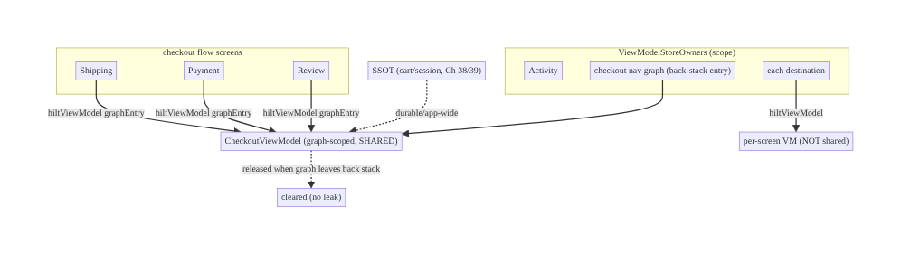
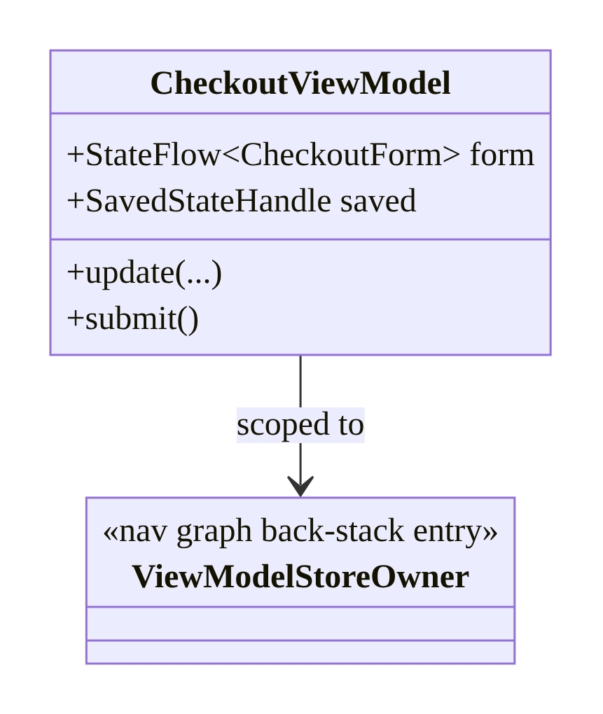
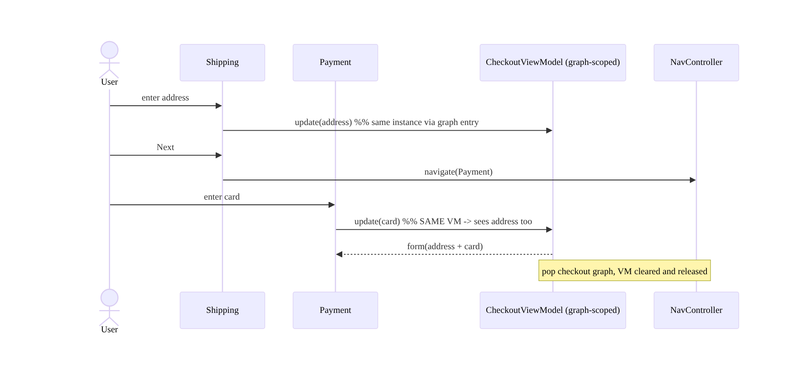
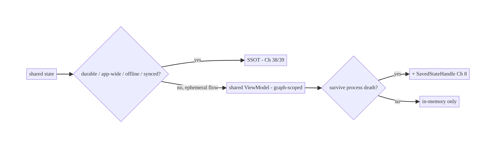
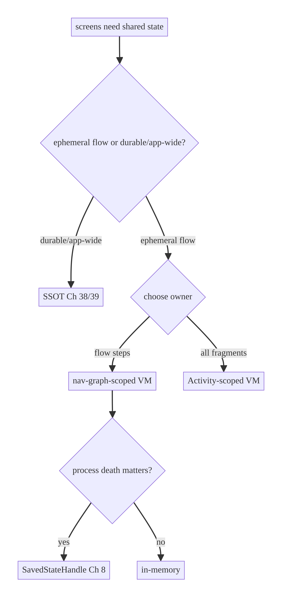

# Chapter 40 — Shared ViewModel Scoping

> **Part V — Shared & Global State** · Complexity: **Standard** (≥25 interview questions)
>
> **Prerequisites:** Ch 6 (UI state/ViewModel), Ch 5 (Hilt), Ch 8 (process death/
> SavedState), Ch 38 (shared cart — SSOT alternative), Ch 39 (global state), Ch 53
> (navigation, previewed). This chapter covers the **in-memory, scope-bounded** way
> to share state between screens — the counterpart to Ch 38's durable SSOT.
>
> **Reference surface in StreamCart:** a multi-step **checkout wizard** (shipping →
> payment → review) sharing one form across steps, and an Activity-scoped ViewModel
> shared by fragments in a legacy flow.

---

## 40.1 Problem Definition and Real-World Context

Sometimes a few screens in a **flow** need to share transient state — a checkout
wizard's form across steps, a multi-page onboarding, a master/detail pane — where
the state is **ephemeral** (only meaningful during the flow) and **scoped** to that
flow, not the whole app or a durable store. A **shared ViewModel** (one ViewModel
instance scoped to the flow's container) is the right tool. Getting the **scope**
wrong is a common source of bugs and leaks:

- **Wrong scope = not actually shared.** Each screen creating its *own* ViewModel
  (default screen scope) means the wizard's step 2 doesn't see step 1's data — the
  "shared" state isn't shared.
- **Too-broad scope = stale/leaked state.** Scoping a flow's ViewModel to the whole
  Activity means its state lingers after the flow ends (stale on re-entry) and holds
  memory longer than needed.
- **Confusing "shared" with "global/durable."** Using a shared ViewModel for the cart
  (Ch 38) or session (Ch 39) is wrong — those need an app-scoped **SSOT**, not an
  in-memory ViewModel that dies with its scope and doesn't survive process death
  (without SavedState) or sync across devices.
- **Lifecycle/leak pitfalls.** Holding an Activity/Fragment reference, or observing
  with the wrong lifecycle, leaks or crashes.

The architecture: understand **ViewModel scopes** (screen / nav-graph / Activity /
Fragment), pick the **narrowest scope that spans the sharing group** (usually a
**nav-graph-scoped** ViewModel for a flow), wire it with Hilt (`hiltViewModel` +
`navGraphViewModels`), and — crucially — know **when to use a shared ViewModel vs an
SSOT** (Ch 38/39). This chapter is about **scope selection** and the
shared-VM-vs-SSOT decision.

### Three practical use cases

1. **Checkout wizard (StreamCart).** Shipping → payment → review share one
   `CheckoutViewModel` scoped to the checkout **nav graph**; the form persists across
   steps and is released when the flow ends.
2. **Onboarding (all).** A multi-page onboarding sharing progress/answers across pages
   via a graph-scoped ViewModel.
3. **Master/detail (tablet/legacy).** List and detail fragments share an
   Activity-scoped ViewModel for the selected item in a two-pane layout.

### Why this is architectural

Scope selection defines **which screens share a ViewModel instance**, the **lifetime**
of that shared state (released at the right time, no leaks/staleness), and the
**boundary** between ephemeral shared state (ViewModel) and durable shared state
(SSOT) — properties that determine whether cross-screen flows work and clean up
correctly.

---

## 40.2 Requirements Engineering

### Functional requirements

| ID | Requirement |
|----|-------------|
| F1 | A group of screens in a flow share one ViewModel instance (shared state). |
| F2 | The shared ViewModel is scoped to the flow (nav graph), not each screen. |
| F3 | The shared state is released when the flow ends (no leak/staleness). |
| F4 | Survive config change; optionally process death (SavedState, Ch 8). |
| F5 | Choose shared ViewModel vs SSOT correctly per use case. |
| F6 | Inject via Hilt with the correct `ViewModelStoreOwner`. |

### Non-functional requirements

| Attribute | Policy |
|-----------|--------|
| **Correctness** | Right scope → actually shared, released on time. |
| **Memory** | No over-broad scope / Activity/Fragment leaks. |
| **Lifecycle** | Survives config change; SavedState for process death (Ch 8). |
| **Clarity** | Clear shared-VM vs SSOT boundary. |
| **Testability** | ViewModel testable in isolation (Ch 6). |

### Scope

- **In scope:** `ViewModelStoreOwner`, ViewModel scopes (screen/nav-graph/Activity/
  Fragment), Hilt `hiltViewModel` + `navGraphViewModels`, Compose Navigation shared
  VM, scope-selection decision, shared-VM-vs-SSOT, lifecycle/leak pitfalls,
  SavedState for shared VMs.
- **Out of scope:** UI state modeling (Ch 6), SSOT/durable shared state (Ch 38/39),
  navigation architecture (Ch 53), process death details (Ch 8).

### Assumptions & constraints

- Jetpack Compose + Navigation (or Fragments for legacy), Hilt. A ViewModel is
  retained by its `ViewModelStoreOwner` and dies when that owner is permanently
  gone. `minSdk 24`.

---

## 40.3 System Design Fundamentals

- **`ViewModelStoreOwner` determines scope.** A ViewModel is created/retained by a
  `ViewModelStore`, owned by a `ViewModelStoreOwner` (an Activity, a Fragment, a
  Navigation **back-stack entry**, or a nav **graph**). **Who you ask for the
  ViewModel decides which instance you get** and how long it lives. Two screens that
  request a ViewModel from the **same** owner share the **same** instance; from
  different owners, different instances.
- **The scope ladder (pick the narrowest that spans the sharing group):**
  - **Screen/destination scope (default):** each destination gets its own ViewModel
    (`hiltViewModel()` in Compose) — *not shared*.
  - **Nav-graph scope:** a ViewModel scoped to a **navigation graph** (a nested graph
    for the flow) is shared by all destinations in that graph and released when the
    graph leaves the back stack — **the idiomatic choice for a wizard/flow**.
  - **Activity scope:** shared by everything in the Activity; lives as long as the
    Activity — good for master/detail, but **too broad** for a transient flow
    (lingers, memory).
  - **Fragment scope / parent-fragment:** legacy equivalent (child fragments share the
    parent's VM).
- **Narrowest-that-fits.** Choose the scope that **exactly spans** the screens that
  share — no broader. A checkout flow → **nav-graph-scoped** (released when checkout
  ends), not Activity-scoped (lingers). Over-scoping causes stale state on re-entry
  and extra memory; under-scoping means it isn't shared.
- **Hilt wiring.** `hiltViewModel()` uses the current destination's owner (screen
  scope). For a **graph-scoped** shared VM in Compose Navigation, get the back-stack
  entry of the graph (`navController.getBackStackEntry(graphRoute)`) and pass it as
  the `ViewModelStoreOwner` to `hiltViewModel(entry)`. In Fragments,
  `by activityViewModels()` / `by hiltNavGraphViewModels(graphId)`.
- **Shared ViewModel vs SSOT (the key decision).** A shared ViewModel holds
  **ephemeral, scope-bounded** state shared by a **tight group** of screens; it's
  **in-memory**, dies with its scope, and (without SavedState, Ch 8) is lost on
  process death. An **SSOT** (Ch 3/38) holds **durable, app-wide** state shared by
  *any* screen, survives process death, works offline, and syncs. Use a shared VM for
  a wizard's form; use an SSOT for the cart/session.
- **Process death + SavedState.** A shared ViewModel survives config change
  automatically, but **not process death** — use `SavedStateHandle` (Ch 8) to restore
  critical shared-flow state (e.g., the checkout form).

Core insight: **a ViewModel is shared by whichever screens request it from the same
`ViewModelStoreOwner`; scope it to the narrowest owner that spans the sharing group
(a nav graph for a flow), and reach for a shared ViewModel only for ephemeral,
scope-bounded state — durable/app-wide shared state belongs in an SSOT.**

---

## 40.4 High-Level Architecture



**Components & ownership**

- **Nav-graph back-stack entry** = the `ViewModelStoreOwner` for the shared
  `CheckoutViewModel` — all flow screens request from it.
- **Shared `CheckoutViewModel`** holds the flow's ephemeral state (the form); cleared
  when the graph leaves the back stack.
- **Per-screen VMs** (default scope) for screen-local state.
- **SSOT** (Ch 38/39) for durable/app-wide shared state the flow reads.

**Direction:** flow screens → same graph-scoped owner → one shared ViewModel →
released when the flow ends.

---

## 40.5 Detailed Component Design



| Scope | Owner | Shared by | Lifetime | Use for |
|-------|-------|-----------|----------|---------|
| Screen (default) | destination entry | — | that screen | screen-local state (Ch 6) |
| **Nav-graph** | graph back-stack entry | all screens in the graph | until graph popped | **flows/wizards** |
| Activity | Activity | all fragments/destinations | Activity lifetime | master/detail; too broad for flows |
| Fragment/parent | parent fragment | child fragments | parent lifetime | legacy fragment sharing |

> **Graph scope is the sweet spot for flows:** it's shared across the flow's steps
> and **automatically cleared** when the flow's nested graph is popped — no manual
> cleanup, no lingering state.

---

## 40.6 End-to-End Data Flow

### Graph-scoped shared ViewModel across a wizard



### Shared VM vs SSOT decision



---

## 40.7 Complete Kotlin Implementation

Package: `com.streamcart.feature.checkout`.

### 40.7.1 Shared ViewModel (graph-scoped), with SavedState (Ch 8)

```kotlin
@HiltViewModel
class CheckoutViewModel @Inject constructor(
    private val saved: SavedStateHandle,            // survives process death (Ch 8)
    private val placeOrder: PlaceOrderUseCase,
) : ViewModel() {
    val form: StateFlow<CheckoutForm> = saved.getStateFlow("form", CheckoutForm())
    fun update(transform: (CheckoutForm) -> CheckoutForm) { saved["form"] = transform(form.value) }
    fun submit() = viewModelScope.launch { /* place order (Ch 15/75) */ }
}
```

### 40.7.2 Compose Navigation: share one VM across the flow's graph

```kotlin
// Nested graph for checkout; all destinations share the graph-scoped CheckoutViewModel.
fun NavGraphBuilder.checkoutGraph(navController: NavController) {
    navigation(startDestination = "checkout/shipping", route = "checkout") {
        composable("checkout/shipping") { entry ->
            val vm = entry.sharedCheckoutViewModel(navController)    // graph-scoped (shared)
            ShippingScreen(vm, onNext = { navController.navigate("checkout/payment") })
        }
        composable("checkout/payment") { entry ->
            PaymentScreen(entry.sharedCheckoutViewModel(navController))
        }
        composable("checkout/review") { entry ->
            ReviewScreen(entry.sharedCheckoutViewModel(navController))
        }
    }
}

// Get the SAME ViewModel instance by scoping to the "checkout" graph's back-stack entry.
@Composable
private fun NavBackStackEntry.sharedCheckoutViewModel(navController: NavController): CheckoutViewModel {
    val graphEntry = remember(this) { navController.getBackStackEntry("checkout") }
    return hiltViewModel(graphEntry)                 // owner = graph entry -> shared across the flow
}
```

### 40.7.3 Fragments (legacy): Activity- / nav-graph-scoped

```kotlin
// Activity-scoped shared VM (master/detail):
private val sharedVm: SelectionViewModel by activityViewModels()

// Nav-graph-scoped shared VM (flow) with Hilt:
private val checkoutVm: CheckoutViewModel by hiltNavGraphViewModels(R.id.checkout_graph)
```

### 40.7.4 When NOT to use a shared VM (use the SSOT)

```kotlin
// Cart is DURABLE + app-wide + offline + synced -> SSOT, NOT a shared ViewModel (Ch 38).
// class CartSharedViewModel : ViewModel() { val items = ... }   // WRONG for cart
@HiltViewModel
class CartViewModel @Inject constructor(repo: CartRepository) : ViewModel() {  // RIGHT: observe SSOT
    val uiState = repo.observeCart() /* ... */
}
```

### 40.7.5 Module structure

```
:feature:checkout  CheckoutViewModel (graph-scoped), checkoutGraph, sharedCheckoutViewModel
# Durable/app-wide shared state -> :data:* SSOT (Ch 38/39), not a shared VM.
```

---

## 40.8 Concurrency and Race Conditions

| Scenario | Risk | Handling |
|----------|------|----------|
| Each screen creates its own VM | not shared | request from the same owner (graph entry) |
| VM scoped too broadly (Activity) | stale on re-entry / memory | scope to the flow's nav graph |
| VM holds Activity/Fragment ref | leak | never hold View/Context refs; use app context (Ch 5) |
| Process death mid-flow | lost shared state | `SavedStateHandle` (Ch 8) |
| Graph entry recomputed per recomposition | new owner/instance | `remember` the graph entry |
| Observing without lifecycle | leak/crash | `collectAsStateWithLifecycle` (Ch 6) |

- **"Shared" is entirely about the `ViewModelStoreOwner`:** request the ViewModel from
  the **same** owner and you get the **same** instance; the whole bug class is
  requesting from the wrong owner (per-screen → not shared; Activity → too broad).
- **`remember` the graph back-stack entry** so you don't resolve a new owner each
  recomposition.

---

## 40.9 Failure Scenarios and Recovery

| Failure | Detection | Response | Outcome |
|---------|-----------|----------|---------|
| Step 2 doesn't see step 1's data | QA | scope VM to the graph, not per-screen | shared |
| Stale form on re-entering the flow | QA | graph-scoped (cleared on pop), not Activity | fresh each flow |
| Memory/leak after flow | LeakCanary (Ch 89) | narrow scope; no View refs | no leak |
| Lost form on process death | restart blank | `SavedStateHandle` (Ch 8) | restored |
| Using shared VM for cart/session | divergence/no offline | use SSOT (Ch 38/39) | correct |
| New VM instance each recomposition | state resets | `remember` graph entry | stable |
| Wrong owner in Compose | not shared/crash | pass the correct back-stack entry | shared |



> **The two decisions that matter:** (1) shared ViewModel vs SSOT, and (2) which
> scope. Most "shared state" bugs are getting one of these wrong — using a VM for
> durable state, or scoping the VM too broadly/narrowly.

---

## 40.10 Scaling the Implementation

- **Level 1.** Default per-screen ViewModels (Ch 6) — no sharing needed.
- **Level 2.** A graph-scoped shared ViewModel for a wizard/flow; Activity-scoped for
  master/detail.
- **Level 3 — production.** `SavedStateHandle` for process-death survival of flow
  state; clear boundary between shared-VM (ephemeral) and SSOT (durable, Ch 38/39).
- **Level 4 — large.** Multiple nested graphs with their own shared VMs; reusable
  flow modules; consistent scoping conventions across teams.
- **Level 5 — enterprise.** Formalized flow/navigation architecture (Ch 53),
  scope-governance, instrumentation of VM lifetimes/leaks.

**Avoid overengineering:** most screens need no shared ViewModel. Use one only for a
genuine multi-screen **flow**; for durable/app-wide sharing use an SSOT. Don't invent
custom scopes when nav-graph/Activity scopes cover it.

---

## 40.11 Alternative Approaches and Trade-offs

| Dimension | Option A | Option B | When |
|-----------|----------|----------|------|
| Shared state kind | Shared ViewModel (ephemeral, scoped) | SSOT (durable, app-wide, Ch 38/39) | VM for a flow's transient state; SSOT for cart/session/anything durable/synced |
| Scope | Nav-graph-scoped | Activity-scoped | Graph for a flow (released on pop); Activity for app-long shared (master/detail) |
| Process death | `SavedStateHandle` | in-memory only | SavedState for important flow data; in-memory for trivial/recomputable |
| Passing data | Shared VM | nav arguments | Shared VM for rich/mutable shared state; nav args for small immutable params |
| Composition | Compose Nav graph VM | Fragment `activityViewModels` | Compose Nav for Compose apps; fragment APIs for legacy |

**Shared ViewModel vs SSOT (the headline):** a shared ViewModel is the right,
lightweight tool for **ephemeral state shared by a tight group of screens in a flow**
— it's scoped, auto-released, and config-change-safe. It is the **wrong** tool for
durable, app-wide, offline, or synced state (cart, session, settings) — that belongs
in an **SSOT** (Room/DataStore-backed repository, Ch 38/39) that any screen can
observe and that survives process death and syncs. Ch 38 chose the SSOT for the cart
*precisely because* a shared ViewModel can't give durability/offline/cross-device.

**Nav-graph vs Activity scope:** graph scope spans exactly the flow and is released
when the flow's nested graph is popped (no stale state, less memory); Activity scope
spans everything and lives as long as the Activity (fine for app-long shared state
like a selected item in master/detail, but it lingers for a transient flow). **Pick
the narrowest owner that spans the sharing group.**

**Shared VM vs nav arguments:** for passing a small immutable value between two
screens, **navigation arguments** are simpler and stateless; for rich, mutable state
edited across several screens (a form), a **shared ViewModel** is appropriate. Don't
stuff large/mutable state into nav args.

---

## 40.12 Security Considerations

- **Shared ViewModels are in-memory** — don't hold secrets/tokens there (Keystore,
  Ch 20); a crash dump could expose them. Keep sensitive values in secure storage and
  reference by id.
- **SavedState is persisted to disk** (Ch 8) — never put secrets/PII in a shared VM's
  `SavedStateHandle`; save only non-sensitive flow state (and use idempotency keys for
  in-flight operations, Ch 15).
- **Scope = lifetime of sensitive flow state:** a payment form in a graph-scoped VM is
  **cleared when the flow ends** — good (don't leave card data in an Activity-scoped VM
  that lingers). Narrow scope limits exposure.
- **Clear on logout** (Ch 22): a flow in progress at logout should be abandoned and its
  VM cleared.
- Client vs backend: shared-VM state is client-side flow convenience; the backend
  authorizes the actual operation (checkout, Ch 75) regardless of client state.

---

## 40.13 Performance and Resource Optimization

- **Narrow scope = less retained memory:** a graph-scoped VM frees its state when the
  flow ends; an over-broad Activity scope retains it unnecessarily.
- **No per-screen duplication:** sharing one VM avoids recomputing/duplicating the
  flow state per step.
- **`remember` the graph entry** to avoid resolving the owner each recomposition.
- **`WhileSubscribed` / lifecycle-aware collection** (Ch 6) stops idle work.
- **Don't hold View/large objects** in the VM — leaks + memory.
- **Profiling:** VM lifetimes (created/cleared), memory retained by scope, LeakCanary
  (Ch 89) for over-retained VMs/Contexts.

---

## 40.14 Testing Strategy

The shared ViewModel is a normal ViewModel (test in isolation, Ch 6); scoping/sharing
is verified with navigation/instrumentation tests.

```kotlin
// Unit: the shared ViewModel itself (Ch 6).
class CheckoutViewModelTest {
    @Test fun `accumulates form across updates`() = runTest {
        val vm = CheckoutViewModel(SavedStateHandle(), FakePlaceOrder())
        vm.update { it.copy(address = "1 St") }
        vm.update { it.copy(card = "4111") }
        val form = vm.form.first()
        assertEquals("1 St", form.address); assertEquals("4111", form.card)   // shared accumulation
    }
    @Test fun `restores from SavedStateHandle (process death)`() = runTest {
        val vm = CheckoutViewModel(SavedStateHandle(mapOf("form" to CheckoutForm(address = "A"))), FakePlaceOrder())
        assertEquals("A", vm.form.value.address)
    }
}

// Instrumentation (Compose Nav): assert step 2 sees step 1's data (same instance via graph scope).
@Test fun checkout_flow_shares_viewmodel_across_steps() {
    // navigate shipping -> enter address -> payment -> assert address still present
}
```

What to test: the VM's logic (unit); that flow steps share one instance (navigation
test); that the VM is **cleared** when the flow is popped (no leak); SavedState
restore. A LeakCanary check that no VM/Context leaks after the flow.

---

## 40.15 Production Observability

- **Metrics:** flow-completion rate, VM-cleared-on-exit rate (should be ~100% for
  graph scope), memory retained by shared VMs, leak reports (Ch 89).
- **Logs:** `flow{name, step, shared_vm}` (no PII/secrets, Ch 28).
- **Debugging:** step 2 missing step 1 data → per-screen VM (not graph-scoped);
  stale form on re-entry → Activity-scoped (too broad); leaks → VM holding a View/
  Context, or over-broad scope; blank form after backgrounding → no SavedState.
- **Privacy:** flow state may contain form input — don't log it; don't put secrets in
  SavedState.

---

## 40.16 System Design Interview Preparation

> ≥25 questions.

**Fundamentals**

1. *How is a ViewModel "shared"?* Multiple screens request it from the **same**
   `ViewModelStoreOwner` → same instance.
2. *What determines scope?* The `ViewModelStoreOwner` you request from (screen/
   nav-graph/Activity/Fragment).
3. *Default scope?* Each destination/screen gets its own ViewModel (not shared).
4. *Idiomatic scope for a flow?* Nav-graph-scoped (shared across the flow, released on
   pop).
5. *Shared VM vs SSOT?* Ephemeral scope-bounded flow state vs durable app-wide state
   (Ch 38/39).

**Scoping**

6. *Nav-graph vs Activity scope?* Graph spans the flow (auto-released); Activity spans
   everything (lingers) — pick the narrowest that fits.
7. *Over-scoping problem?* Stale state on re-entry + extra memory.
8. *Under-scoping problem?* Not actually shared.
9. *Compose: how get a graph-scoped VM?* `hiltViewModel(navController.getBackStackEntry
   (graphRoute))`, `remember`ed.
10. *Fragments?* `by activityViewModels()` / `hiltNavGraphViewModels(graphId)`.

**Lifecycle**

11. *Survives config change?* Yes (ViewModel).
12. *Survives process death?* No — use `SavedStateHandle` (Ch 8).
13. *When cleared?* When the owner (graph entry/Activity) is permanently gone.
14. *`remember` the graph entry — why?* Avoid resolving a new owner each
    recomposition.

**Shared-VM vs SSOT**

15. *Why not a shared VM for the cart?* Not durable/offline/synced; dies with scope
    (Ch 38).
16. *Why not a shared VM for session?* App-wide + durable → SSOT/holder (Ch 39).
17. *Good shared-VM use case?* A checkout wizard's form.

**Passing data**

18. *Shared VM vs nav args?* VM for rich/mutable shared state; nav args for small
    immutable params.

**Security**

19. *Secrets in a shared VM?* No (in-memory); Keystore (Ch 20).
20. *SavedState + secrets?* Never (disk); non-sensitive only (Ch 8).
21. *Narrow scope benefit?* Clears sensitive flow state when the flow ends.

**Testing**

22. *How test the shared VM?* As a normal ViewModel (unit, Ch 6).
23. *How test sharing?* Navigation/instrumentation: step 2 sees step 1's data.
24. *How verify no leak?* LeakCanary; VM cleared on exit.

**Production debugging**

25. *Step 2 missing data?* Per-screen VM, not graph-scoped.
26. *Stale form on re-entry?* Activity-scoped (too broad).
27. *Blank after backgrounding?* No SavedState.

### Design-change challenges
1. **Wizard loses step 1 data on step 2.** Scope the VM to the checkout nav graph.
2. **Form stale when re-entering checkout.** Graph scope (not Activity) → cleared on
   pop.
3. **Form lost after process death.** `SavedStateHandle` (Ch 8).
4. **Cart implemented as a shared VM.** Move to SSOT (Ch 38).
5. **Memory leak after a flow.** Narrow scope; remove View refs.

### Mock walkthrough (abridged)
Clarify (ephemeral flow or durable/app-wide? which screens?) → shared VM vs SSOT →
pick the narrowest owner (nav-graph for a flow) → Hilt wiring (`hiltViewModel(graph
entry)`, `remember`) → SavedState for process death → security (no secrets, narrow
scope) → testing (unit VM + nav test).

---

## 40.17 Practical Exercises

1. **Beginner.** Share one ViewModel across two Compose destinations via nav-graph
   scope; prove step 2 sees step 1's data. *Eval:* same instance; shared state.
2. **Intermediate.** Add `SavedStateHandle` so the shared flow state survives process
   death. *Eval:* restored after `Don't keep activities` (Ch 8).
3. **Advanced.** Compare scopes: show stale state with Activity scope vs fresh with
   graph scope on flow re-entry. *Eval:* graph-scoped clears on pop.
4. **Production debugging.** Fix a wizard using per-screen VMs (not shared) and a
   shared VM holding a Fragment reference (leak). *Eval:* graph-scoped; no leak.
5. **System design challenge.** Decide shared-VM vs SSOT for: a checkout form, the
   cart, the theme, and a master/detail selection — justify and implement each. *Eval:*
   form=graph VM, cart=SSOT (Ch 38), theme=SSOT/holder (Ch 39), selection=Activity VM.

*(Solutions withheld unless requested.)*

---

## 40.18 Chapter Summary & Reference Sheet

**Key decisions:** a ViewModel is **shared by whichever screens request it from the
same `ViewModelStoreOwner`** — scope it to the **narrowest owner that spans the
sharing group** (a **nav-graph-scoped** VM for a flow/wizard, Activity-scoped for
app-long shared like master/detail), so it's shared **and auto-released** on exit;
use **`SavedStateHandle`** (Ch 8) for process-death survival of important flow state;
**`remember`** the graph back-stack entry; and **reach for a shared ViewModel only for
ephemeral, scope-bounded state** — **durable, app-wide, offline, or synced shared
state belongs in an SSOT** (Ch 38/39), not a ViewModel. Keep **secrets out** of
shared VMs/SavedState.

**Concepts:** `ViewModelStoreOwner`, ViewModel scopes (screen/nav-graph/Activity/
Fragment), narrowest-scope-that-fits, graph-scoped shared VM, shared-VM-vs-SSOT,
SavedState for shared flows, nav args vs shared VM.

**Common mistakes:** per-screen VMs for a flow (not shared); Activity scope for a
transient flow (stale/memory); using a shared VM for durable/app-wide state (should be
SSOT); not `remember`ing the graph entry (new instance per recomposition); no
SavedState (lost on process death); secrets in a shared VM/SavedState; holding View/
Context refs (leak).

**Checklist:**

- [ ] shared VM vs SSOT decided
- [ ] narrowest owner that spans the group
- [ ] nav-graph scope for flows
- [ ] `hiltViewModel(graphEntry)` + `remember`
- [ ] SavedState for important flow state
- [ ] cleared on flow exit (no leak)
- [ ] no View/Context refs
- [ ] no secrets in VM/SavedState
- [ ] nav args for small immutable params.

**Key APIs:** `ViewModelStoreOwner`, `hiltViewModel(owner)`, `navController.
getBackStackEntry(graphRoute)`, `navigation(route=...)` nested graph, `by
activityViewModels()`, `hiltNavGraphViewModels(graphId)`, `SavedStateHandle` (Ch 8),
`remember`.

**References:**
- ViewModel scopes / shared VM: https://developer.android.com/topic/libraries/architecture/viewmodel#sharing
- ViewModels in Compose Navigation: https://developer.android.com/develop/ui/compose/libraries#viewmodel
- Navigation graph-scoped ViewModels: https://developer.android.com/guide/navigation/navigation-programmatic#share_ui-related_data_between_destinations_with_viewmodel
- (composes) Ch 6 UI State, Ch 8 SavedState, Ch 38 Shared Cart (SSOT), Ch 39 Global State, Ch 53 Navigation

### Chapter review (Phase 4)
- **Completeness:** all 18 sections; architecture/class/sequence/failure diagrams;
  graph-scoped shared VM + Compose/Fragment wiring + SavedState + anti-pattern;
  concurrency (owner determines sharing, remember entry); failure (not-shared/stale/
  leak/process-death); 5 levels; shared-VM-vs-SSOT and graph-vs-Activity trade-offs;
  security (in-memory/SavedState/narrow scope); perf (scope=memory); unit + nav tests;
  observability (cleared-on-exit); 27 Q&A + 5 challenges. ✅
- **Expand later:** navigation architecture (Ch 53), SSOT (Ch 38/39), process death
  (Ch 8), checkout (Ch 75).
- **Interview coverage:** exceeds ≥25 bar.
