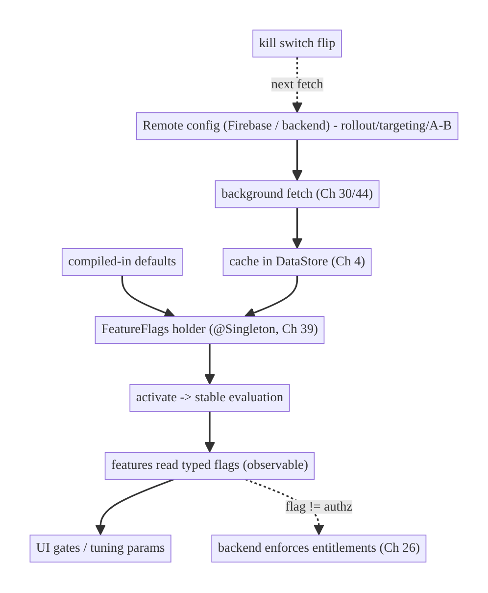
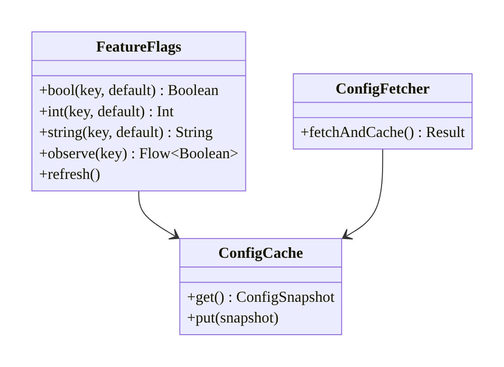
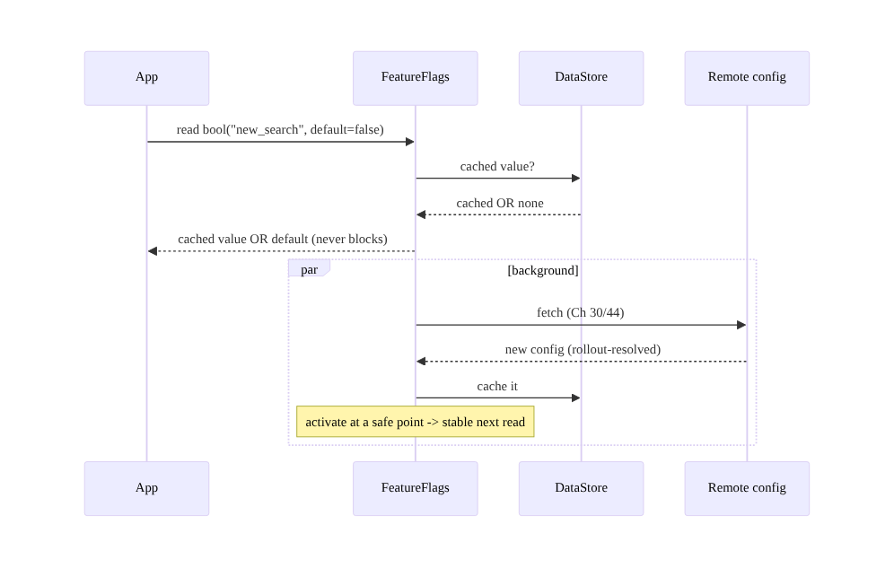
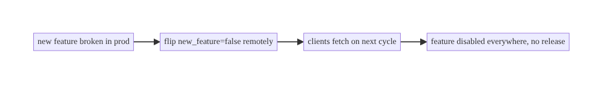
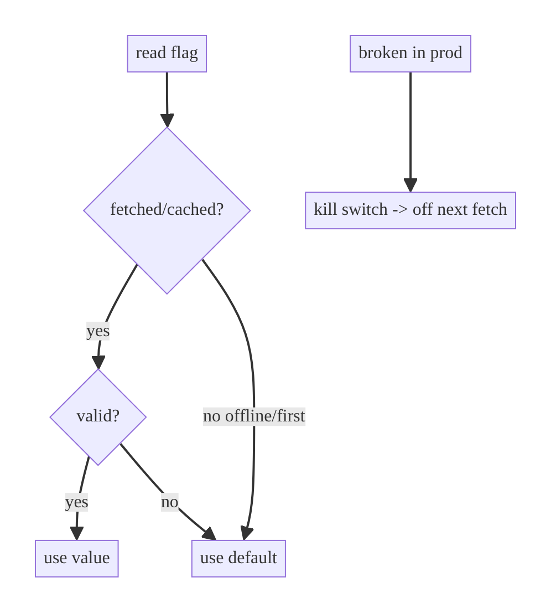

# Chapter 41 — Feature Flags & Remote Config

> **Part V — Shared & Global State** · Complexity: **Standard** (≥25 interview questions)
>
> **Prerequisites:** Ch 4 (DataStore — cache flags), Ch 39 (global state holder),
> Ch 16 (schema evolution — tolerant config), Ch 26 (integrity — flags aren't authz).
> Referenced throughout (Ch 2 tunable policies, Ch 12 TTLs, Ch 54 forced upgrade,
> Ch 86 A/B testing).
>
> **Reference surface in StreamCart:** remotely enabling a new search UI, tuning
> debounce/retry/TTL values, gradual rollout of checkout changes, and kill-switching
> a broken feature — without an app release.

---

## 41.1 Problem Definition and Real-World Context

Mobile releases are slow and irreversible — you can't instantly turn off a bad
feature or push a tuning change without an app-store round trip (days, plus users
who don't update). **Feature flags + remote config** decouple **deploy** from
**release**: ship code dark, then flip it on remotely; tune parameters live; roll out
gradually; and **kill-switch** a broken feature instantly. Done naively, this
infrastructure causes its own incidents:

- **No kill switch.** A bug ships; without a remote flag you must emergency-release
  and wait for users to update — hours/days of breakage.
- **Flags fetched synchronously / blocking startup.** Fetching config on the critical
  path blocks launch or crashes offline.
- **No defaults / offline failure.** First launch or offline has no config → missing/
  broken UI because there's no sensible **default** and no **cached** value.
- **Flags treated as authorization.** Gating a paid feature purely on a client flag
  lets a tampered client unlock it — flags are UX hints, not security (Ch 26).
- **Inconsistent evaluation.** Flags read at different times give different values
  mid-session (a feature half-on) without a stable evaluation snapshot.

The architecture: a **remote config source** (Firebase Remote Config or a custom
backend) fetched in the **background**, **cached** locally (DataStore, Ch 4) with
**defaults**, exposed as **global state** (Ch 39) via a `FeatureFlags` holder;
support **typed flags**, **gradual rollout/targeting**, **A/B** (Ch 86),
**kill switches**, **offline** operation, and a **stable evaluation** per session —
while remembering **flags ≠ authorization**. This chapter is about **decoupling
release from deploy safely**.

### Three practical use cases

1. **Kill switch (StreamCart).** A new checkout path misbehaves → flip
   `new_checkout=false` remotely; all clients revert instantly, no release.
2. **Gradual rollout / A/B (Shop).** Enable a new search UI for 10% → 50% → 100%, or
   A/B two variants, measuring impact (Ch 86).
3. **Live tuning (all).** Adjust debounce (Ch 9), retry/backoff (Ch 2), cache TTL
   (Ch 12), or min-supported-version (Ch 54) without an app update.

### Why this is architectural

Feature flags/remote config define how the app **separates release from deploy** —
the kill-switch/rollout mechanism, the **fetch/cache/default** model (offline-safe,
non-blocking), the **evaluation** contract (stable, typed), and the **boundary** that
flags are **UX hints, not security** — properties that determine release safety and
operability.

---

## 41.2 Requirements Engineering

### Functional requirements

| ID | Requirement |
|----|-------------|
| F1 | Fetch config from a remote source in the background; don't block startup. |
| F2 | Cache config locally (DataStore) with built-in defaults; work offline/first-launch. |
| F3 | Expose typed flags (bool/int/string/json) as observable global state (Ch 39). |
| F4 | Support gradual rollout / targeting / A/B (Ch 86). |
| F5 | Support instant kill switches. |
| F6 | Stable evaluation within a session (no half-applied flags). |
| F7 | Flags are client hints — backend re-validates entitlements (Ch 26). |

### Non-functional requirements

| Attribute | Policy |
|-----------|--------|
| **Reliability** | Defaults + cache → never broken offline/first-launch. |
| **Performance** | Non-blocking fetch; cached reads; no startup stall. |
| **Operability** | Instant kill switch; gradual rollout; observability. |
| **Consistency** | Stable per-session evaluation; typed. |
| **Security** | Flags ≠ authorization; backend enforces. |

### Scope

- **In scope:** remote config (Firebase/custom), fetch/cache/default model, typed
  flags, evaluation/activation, rollout/targeting/A/B basics, kill switches, offline,
  the `FeatureFlags` holder, flags-vs-authorization.
- **Out of scope:** A/B experiment design/analysis (Ch 86), forced upgrade UX
  (Ch 54), the global-state pattern (Ch 39), integrity (Ch 26).

### Assumptions & constraints

- Firebase Remote Config (common) or a custom config endpoint; DataStore cache
  (Ch 4); background fetch (WorkManager/app lifecycle, Ch 30/44). `minSdk 24`.
  **Flags are not secrets and not authorization.**

---

## 41.3 System Design Fundamentals

- **Deploy vs release.** Shipping code is **deploy**; turning it on for users is
  **release**. Flags decouple them: deploy dark, release via a remote flip. This
  enables **trunk-based development**, **gradual rollout**, and **instant rollback**
  (kill switch) without an app-store cycle.
- **Fetch → activate → read (the config lifecycle).** Config is **fetched** from the
  remote (background), **activated** (made the current values, often at a controlled
  moment to avoid mid-session changes), then **read** by the app. Separating fetch
  from activate gives a **stable evaluation** — you don't change a flag mid-screen.
- **Cache + defaults (offline/first-launch safety).** Local **defaults** (compiled
  in) guarantee the app works before any fetch and offline; the **last fetched**
  values are cached (DataStore, Ch 4) so the app uses recent config even offline.
  Read order: fetched/cached → default.
- **Typed flags.** Flags are booleans (on/off), numbers (tuning: debounce/TTL/retry),
  strings (variant names/URLs), or JSON (structured config). Expose typed accessors;
  tolerate unknown/missing (Ch 16).
- **Global-state exposure (Ch 39).** A `FeatureFlags` `@Singleton` holder exposes
  flags as observable state (`StateFlow`/suspend get), consumed app-wide via UDF —
  features re-render when a flag changes (if you allow live changes) or read a stable
  snapshot.
- **Rollout / targeting / A/B.** The remote decides who gets what: **percentage
  rollout** (10%→100%), **targeting** (by app version, country, user segment),
  **A/B** variants (Ch 86). Evaluation can be server-side (returns the resolved value)
  or client-side (client computes from rules + a stable user bucket).
- **Kill switch.** A flag that **disables** a feature; flipping it off reaches all
  clients on their next fetch (minutes) — the fastest mobile rollback. Keep risky
  features behind one.
- **Flags ≠ authorization (critical).** A flag is a **client-side UX hint**; a
  tampered client can flip it. **Never** gate entitlements/paid features/security on a
  client flag alone — the **backend must enforce** access (Ch 26). Flags control
  *presentation and rollout*, not *permission*.

Core insight: **fetch remote config in the background, cache it with compiled-in
defaults for offline/first-launch, expose typed flags as observable global state with
a stable per-session evaluation, keep risky features behind kill switches, and never
treat flags as authorization** — decoupling release from deploy safely.

---

## 41.4 High-Level Architecture



**Components & ownership**

- **Remote config** owns the source of truth for flags + rollout/targeting.
- **Background fetch + DataStore cache** (Ch 30/4) keep config fresh and offline-safe.
- **`FeatureFlags` holder** (global state, Ch 39) exposes typed flags with defaults,
  stable evaluation.
- **Features** read flags (gates/tuning); the **backend** enforces entitlements.

**Direction:** remote → fetch → cache (+defaults) → activate (stable) → features read;
kill switch flips remotely.

---

## 41.5 Detailed Component Design



| Component | Responsibility | Note |
|-----------|----------------|------|
| `ConfigFetcher` | background fetch from remote | WorkManager/app start (Ch 30/44) |
| `ConfigCache` (DataStore) | last-known config | offline (Ch 4) |
| defaults | compiled-in fallback | first-launch/offline |
| `FeatureFlags` holder | typed read + observe + activate | global state (Ch 39) |
| evaluation | stable per session | fetch≠activate |

---

## 41.6 End-to-End Data Flow

### Fetch → activate → read (non-blocking, offline-safe)



### Kill switch



---

## 41.7 Complete Kotlin Implementation

Package: `com.streamcart.core.flags`.

### 41.7.1 FeatureFlags holder (typed, defaults, cached, observable)

```kotlin
@Singleton
class FeatureFlags @Inject constructor(
    private val cache: DataStore<Preferences>,         // last-known config (Ch 4)
    @ApplicationScope private val scope: CoroutineScope,
) {
    // Compiled-in defaults: guarantee offline/first-launch behavior.
    private val defaults = mapOf(
        "new_search" to false,
        "search_debounce_ms" to 300L,                  // tune Ch 9 remotely
        "retry_max_attempts" to 3,                     // tune Ch 2 remotely
        "min_supported_version" to 0,                  // forced upgrade (Ch 54)
    )

    private val snapshot: StateFlow<Map<String, Any?>> = cache.data
        .map { prefs -> parse(prefs) }                 // last fetched config
        .stateIn(scope, SharingStarted.Eagerly, emptyMap())

    fun bool(key: String, default: Boolean = defaults[key] as? Boolean ?: false): Boolean =
        snapshot.value[key] as? Boolean ?: default      // fetched -> default; never blocks
    fun long(key: String, default: Long = defaults[key] as? Long ?: 0L): Long =
        (snapshot.value[key] as? Long) ?: default
    fun observe(key: String): Flow<Boolean> =
        snapshot.map { it[key] as? Boolean ?: (defaults[key] as? Boolean ?: false) }.distinctUntilChanged()

    suspend fun refresh(fetcher: ConfigFetcher) { fetcher.fetchAndCache() }   // background (Ch 30)
}
```

### 41.7.2 Background fetch (Firebase example) + cache

```kotlin
class ConfigFetcher @Inject constructor(
    private val remoteConfig: FirebaseRemoteConfig,    // or a custom config API
    private val cache: DataStore<Preferences>,
) {
    init {
        remoteConfig.setConfigSettingsAsync(remoteConfigSettings {
            minimumFetchIntervalInSeconds = 3600       // throttle fetches
        })
        remoteConfig.setDefaultsAsync(R.xml.remote_config_defaults)   // remote-side defaults too
    }
    suspend fun fetchAndCache(): Result<Unit> = runCatching {
        remoteConfig.fetchAndActivate().await()        // fetch + activate (stable)
        cache.edit { prefs ->                          // mirror into DataStore for offline/observe
            prefs[booleanPreferencesKey("new_search")] = remoteConfig.getBoolean("new_search")
            prefs[longPreferencesKey("search_debounce_ms")] = remoteConfig.getLong("search_debounce_ms")
        }
    }
}
// Scheduled via WorkManager (Ch 30) / on app start (Ch 44), NOT blocking the UI.
```

### 41.7.3 Feature consuming a flag (gate + tuning)

```kotlin
@HiltViewModel
class SearchViewModel @Inject constructor(private val flags: FeatureFlags, ...) : ViewModel() {
    private val debounceMs get() = flags.long("search_debounce_ms", 300)   // live-tunable (Ch 9)
    val uiState = query.debounce(debounceMs)./* ... */

    val showNewSearchUi: StateFlow<Boolean> =
        flags.observe("new_search").stateIn(viewModelScope, SharingStarted.WhileSubscribed(5_000), false)
}
```

### 41.7.4 Flags are NOT authorization (critical)

```kotlin
// WRONG: gate a paid feature on a client flag alone.
// if (flags.bool("premium_enabled")) showPremiumContent()          // tamperable (Ch 26)

// RIGHT: flag controls ROLLOUT/UX; the BACKEND enforces entitlement.
if (flags.bool("premium_ui_rollout")) {                              // UX/rollout only
    val entitled = api.checkEntitlement()                           // backend authorizes (Ch 26)
    if (entitled is Outcome.Success && entitled.data) showPremiumContent()
}
```

### 41.7.5 Module structure

```
:core:flags   FeatureFlags (holder, Ch 39), ConfigFetcher, ConfigCache (DataStore)
res/xml       remote_config_defaults.xml (defaults)
:sync         fetch scheduled via WorkManager (Ch 30)
```

---

## 41.8 Concurrency and Race Conditions

| Scenario | Risk | Handling |
|----------|------|----------|
| Flag changes mid-session | half-applied feature | fetch≠activate; read a stable snapshot per session/screen |
| Read during fetch | inconsistent | serve cached/default until activate |
| Concurrent fetch | duplicate work | unique fetch work (Ch 30); throttle interval |
| Observe live changes | mid-flow UI flip | decide per flag: live (observe) vs snapshot (read once at entry) |
| First launch no cache | missing config | compiled-in defaults |
| Default vs cached vs fetched | wrong precedence | fetched/cached → default (clear order) |

- **Separating fetch from activate gives stable evaluation:** fetch anytime in the
  background, but **activate** (apply) at a controlled point (next launch / flow entry)
  so a flag doesn't flip mid-screen and leave a feature half-on.
- **Decide per flag whether it's live or snapshot:** a kill switch may apply live
  (`observe`); a rollout variant should be stable for the session (read once).

---

## 41.9 Failure Scenarios and Recovery

| Failure | Detection | Response | Outcome |
|---------|-----------|----------|---------|
| Offline / first launch | no fetch | use cached/compiled defaults | app works |
| Fetch fails | network error | keep cached; retry later (Ch 30) | no disruption |
| Broken feature in prod | reports/metrics | flip kill switch remotely | disabled in minutes |
| Bad config value | validation | validate/clamp (e.g., debounce bounds); fall to default | safe |
| Flag as authz bypassed | security review | enforce entitlement server-side (Ch 26) | secure |
| Half-applied flag | inconsistent UI | fetch≠activate; stable snapshot | consistent |
| Config schema change | tolerant parse (Ch 16) | ignore unknown; default missing | compatible |
| Fetch blocking startup | slow launch | background fetch; never block | fast |



> **Defaults + cache = the safety net:** the app must behave correctly with **no
> network and no prior fetch**, using compiled-in defaults — remote config is an
> *enhancement*, never a *requirement* for the app to function.

---

## 41.10 Scaling the Implementation

- **Level 1.** Compiled defaults + a few boolean flags read from remote config
   (cached).
- **Level 2.** Typed flags (tuning params); `FeatureFlags` holder as global state
  (Ch 39); background fetch; kill switches.
- **Level 3 — production.** Gradual rollout + targeting; stable per-session
  evaluation (fetch≠activate); offline defaults; min-version/forced-upgrade flag
  (Ch 54); remote-tuned policies (Ch 2/9/12).
- **Level 4 — large.** A/B experiments (Ch 86); segment targeting; flag lifecycle
  management (clean up stale flags); flag analytics (exposure logging).
- **Level 5 — enterprise.** Dedicated flag platform (LaunchDarkly/custom),
  server-side evaluation, flag governance/ownership, progressive delivery pipelines,
  guardrail metrics + auto-rollback.

**Avoid overengineering:** a small app needs defaults + a config source + kill
switches. Full experimentation platforms and segment targeting are for larger apps
with real rollout/A-B needs.

---

## 41.11 Alternative Approaches and Trade-offs

| Dimension | Option A | Option B | When |
|-----------|----------|----------|------|
| Source | Firebase Remote Config | custom backend config | Firebase for quick start/rollout/A-B; custom for control/existing backend |
| Evaluation | Server-side (resolved value) | client-side (rules + bucket) | Server-side for consistency/complex targeting; client-side for offline/simple |
| Apply timing | fetch≠activate (stable) | live apply | Stable for rollout variants; live for kill switches |
| Caching | DataStore cache + defaults | fetch every read | Cache always (offline/non-blocking) |
| Flag type | typed (bool/num/str/json) | strings everywhere | Typed accessors (safe); strings only if forced |
| Gating | flag = UX/rollout + backend authz | flag = authorization | **Always** backend authz for entitlements (Ch 26) |

**Remote config vs a full experimentation platform:** Firebase Remote Config (or a
simple config endpoint) covers flags, tuning, rollout, and basic A/B cheaply. A
dedicated platform (LaunchDarkly) adds rich targeting, flag lifecycle management,
audit, and guardrails at cost/complexity — justified when flags proliferate and
experimentation is core. Start simple; adopt a platform when flag management becomes
a burden.

**Server-side vs client-side evaluation:** server-side returns the *resolved* value
(consistent, hides rules, supports complex targeting, but needs connectivity);
client-side evaluates rules locally against a stable user bucket (works offline,
simpler infra, but exposes rules and risks drift). Many apps do server-side with a
cached fallback for offline.

---

## 41.12 Security Considerations

- **Flags are NOT authorization (the cardinal rule):** a client flag is tamperable
  (rooted device, modified APK, Ch 26); **never** unlock paid/premium/security-
  sensitive features on a client flag alone — the **backend enforces entitlements**.
  Flags control *rollout and presentation*, not *permission*.
- **Don't put secrets in remote config** — it's readable by the client (and often
  cached/inspectable); config holds flags/tuning, not keys (Ch 20/27).
- **Validate/clamp config values** — a malicious or mistaken value (debounce = 0,
  retry = 1M) must be bounded; treat config as untrusted-ish input (Ch 16).
- **Fetch over a secure channel** (TLS + pinning, Ch 23) so config can't be MITM-
  altered; verify source authenticity.
- **Kill switches are a security tool** — keep risky/new features behind one so a
  vulnerability can be disabled instantly.
- Client vs backend: flags shape the client experience; the backend is authoritative
  for access and must not trust the client's flag state.

---

## 41.13 Performance and Resource Optimization

- **Non-blocking:** read cached/default synchronously; fetch in the **background**
  (WorkManager/app start) — never block startup (Ch 88).
- **Throttle fetches:** a sensible `minimumFetchInterval` (e.g., hourly) avoids
  battery/network waste; push-triggered refresh (FCM, Ch 49) for urgent changes.
- **Cache in memory** (`StateFlow` from DataStore) — no disk read per flag access.
- **Stable snapshot** avoids recomputation from live changes mid-session.
- **Clean up stale flags** — removed flags left in code bloat and confuse.
- **Profiling:** startup impact of config, fetch frequency, flag-read latency, config
  size.

---

## 41.14 Testing Strategy

Fake the flag holder; test gating/tuning and default/offline behavior.

```kotlin
class FeatureFlagsTest {
    @Test fun `returns default when no cached value`() = runTest {
        val flags = FeatureFlags(emptyDataStore(), bgScope)
        assertFalse(flags.bool("new_search", default = false))      // default
        assertEquals(300L, flags.long("search_debounce_ms", 300))
    }
    @Test fun `returns cached value when present`() = runTest {
        val ds = dataStoreWith("new_search" to true)
        val flags = FeatureFlags(ds, bgScope)
        assertTrue(flags.observe("new_search").first { it })
    }
    @Test fun `clamps out-of-range tuning value`() = runTest {
        val flags = FeatureFlags(dataStoreWith("search_debounce_ms" to 0L), bgScope)
        assertTrue(flags.long("search_debounce_ms", 300).coerceIn(50, 2000) >= 50)   // validate
    }
}

class SearchFlagTest {
    @Test fun `new search UI gated by flag`() = runTest {
        val vm = SearchViewModel(FakeFlags(mapOf("new_search" to true)), ...)
        assertTrue(vm.showNewSearchUi.first())
    }
    @Test fun `premium gated by BACKEND not flag`() = runTest {
        // flag on, entitlement off -> content NOT shown (backend authoritative)
        val vm = premiumVm(flag = true, entitled = false)
        assertFalse(vm.showsPremium.first())
    }
}
```

What to test: default/offline/first-launch behavior, cached read, gating, live vs
snapshot, value validation/clamping, and that **entitlement is backend-enforced**
(flag alone doesn't unlock). Test kill-switch flip (flag off → feature off).

---

## 41.15 Production Observability

- **Metrics:** flag exposure counts (who saw what — for A/B, Ch 86), fetch success/
  failure rate, config staleness (time since last fetch), kill-switch activations,
  rollout coverage, startup impact.
- **Logs:** `flag{key, value, source=cache/default/fetched}` (for exposure/debug; no
  PII, Ch 28), `config_fetch{result}`.
- **Debugging:** feature not toggling → fetch failing / activation timing / wrong
  default; broken offline/first-launch → missing defaults; half-applied → fetch≠
  activate violated; premium bypass → gated on flag not backend (Ch 26); slow startup
  → blocking fetch.
- **Alerting:** config-fetch-failure spike → remote/config incident; a kill switch
  activation → correlate with the incident it's mitigating.
- **Privacy:** targeting uses user attributes — honor consent; don't log sensitive
  segment data.

---

## 41.16 System Design Interview Preparation

> ≥25 questions.

**Fundamentals**
1. *Feature flags / remote config — why?* Decouple release from deploy: flip features,
   tune params, roll out, and kill-switch without an app release.
2. *Deploy vs release?* Ship code (deploy) vs turn it on for users (release); flags
   separate them.
3. *Config lifecycle?* Fetch (background) → activate (stable) → read.
4. *Why defaults + cache?* Offline/first-launch safety; app works without a fetch.
5. *Kill switch?* A flag that disables a feature; flips off on next fetch — fastest
   mobile rollback.

**Fetch/cache/eval**
6. *Why non-blocking fetch?* Don't stall startup / fail offline; read cached/default
   synchronously.
7. *Precedence?* Fetched/cached → default.
8. *Why fetch≠activate?* Stable per-session evaluation; no mid-screen flips.
9. *Live vs snapshot flags?* Kill switch live; rollout variant stable for the session.

**Rollout/targeting**
10. *Gradual rollout?* Percentage (10%→100%) via remote.
11. *Targeting?* By version/country/segment.
12. *Server- vs client-side evaluation?* Server resolves (consistent, needs network);
    client evaluates rules + bucket (offline, exposes rules).
13. *A/B?* Variants + measurement (Ch 86).

**Types/consistency**
14. *Flag types?* bool/int/string/json; typed accessors.
15. *Tolerate missing/unknown?* Defaults; tolerant parse (Ch 16).
16. *Validate values?* Clamp/bound (debounce/retry) — untrusted-ish.

**Security (critical)**
17. *Are flags authorization?* **No** — tamperable client hints; backend enforces
    entitlements (Ch 26).
18. *Secrets in remote config?* Never — client-readable.
19. *Secure fetch?* TLS + pinning (Ch 23).
20. *Kill switch as security?* Yes — disable a vulnerable feature instantly.

**Performance**
21. *Startup impact?* Background fetch; cached reads; no block.
22. *Battery?* Throttle fetch interval; push for urgent (Ch 49).
23. *Stale flags?* Clean up removed flags.

**Testing**
24. *How test defaults/offline?* No cache → default; assert app works.
25. *How test gating?* Fake flags; assert UI gated.
26. *How test premium-not-bypassable?* Flag on + entitlement off → not shown.

**Production debugging**
27. *Feature won't toggle?* Fetch/activation/default issue.
28. *Broken offline/first-launch?* Missing defaults.
29. *Premium unlocked by flag?* Not backend-enforced.

### Design-change challenges
1. **Need to disable a broken feature now.** Kill switch (remote flip).
2. **Roll out a feature to 10% then 100%.** Percentage rollout + stable evaluation.
3. **Tune debounce/retry live.** Numeric flags (Ch 9/2); clamp values.
4. **Premium gated by a flag is bypassed.** Backend entitlement enforcement (Ch 26).
5. **Config breaks the app offline.** Compiled defaults + cache.

### Mock walkthrough (abridged)
Clarify (what to flag, rollout, offline, A-B?) → remote config source → background
fetch + DataStore cache + compiled defaults → `FeatureFlags` holder (typed, global
state Ch 39) → fetch≠activate stable eval → rollout/targeting/kill switch → **flags ≠
authorization (backend enforces, Ch 26)** → secure fetch → testing defaults/gating.

---

## 41.17 Practical Exercises

1. **Beginner.** Add a `FeatureFlags` holder with compiled defaults + a DataStore
   cache; gate a UI element on a boolean flag. *Eval:* works offline (default); toggles
   from config.
2. **Intermediate.** Background-fetch remote config (Firebase/custom) via WorkManager;
   add a numeric flag that live-tunes debounce (Ch 9). *Eval:* non-blocking; tuning
   applies.
3. **Advanced.** Implement stable per-session evaluation (fetch≠activate) + a kill
   switch; validate/clamp numeric values. *Eval:* no mid-session flips; kill switch
   disables.
4. **Production debugging.** Fix a premium feature gated only on a client flag
   (bypassable) and a config that blocks startup. *Eval:* backend-enforced; non-
   blocking.
5. **System design challenge.** Add percentage rollout + A/B exposure logging (Ch 86)
   with offline defaults. *Eval:* gradual rollout; measured; offline-safe.

*(Solutions withheld unless requested.)*

---

## 41.18 Chapter Summary & Reference Sheet

**Key decisions:** decouple **release from deploy** with feature flags/remote config:
**fetch in the background** (never block startup), **cache** locally (DataStore, Ch 4)
with **compiled-in defaults** so the app works **offline/first-launch**, and expose
**typed flags** as **observable global state** (Ch 39) via a `FeatureFlags` holder;
**separate fetch from activate** for a **stable per-session evaluation**; support
**gradual rollout/targeting/A-B** (Ch 86) and keep risky features behind **kill
switches**; **validate/clamp** config values; fetch over a **secure channel** (Ch 23);
and — the cardinal rule — **flags are UX/rollout hints, not authorization; the backend
enforces entitlements** (Ch 26).

**Concepts:** deploy-vs-release, fetch/activate/read lifecycle, defaults + cache,
typed flags, gradual rollout/targeting/A-B, kill switch, stable evaluation,
server- vs client-side evaluation, flags ≠ authorization.

**Common mistakes:** blocking startup on fetch; no defaults/cache (broken offline/
first-launch); treating flags as authorization (bypassable, Ch 26); flags flipping
mid-session (fetch=activate); secrets in config; unvalidated config values; stale
flags left in code.

**Checklist:** ☐ background non-blocking fetch ☐ DataStore cache + compiled defaults
☐ typed flags (Ch 39 holder) ☐ fetch≠activate (stable eval) ☐ kill switches for risky
features ☐ gradual rollout/targeting ☐ validate/clamp values ☐ secure fetch (Ch 23)
☐ flags ≠ authz — backend enforces (Ch 26) ☐ clean up stale flags.

**Key APIs/patterns:** Firebase Remote Config (`fetchAndActivate`,
`minimumFetchInterval`, `setDefaultsAsync`) or custom config API, DataStore cache
(Ch 4), `FeatureFlags` `@Singleton` holder + `StateFlow` (Ch 39), WorkManager fetch
(Ch 30), tolerant parse (Ch 16), backend entitlement check (Ch 26).

**References:**
- Firebase Remote Config: https://firebase.google.com/docs/remote-config
- Feature flags (Martin Fowler): https://martinfowler.com/articles/feature-toggles.html
- Remote config loading strategies: https://firebase.google.com/docs/remote-config/loading
- (composes) Ch 4 DataStore, Ch 26 Integrity (not authz), Ch 39 Global State, Ch 54 Forced Upgrade, Ch 86 A/B

### Chapter review (Phase 4)
- **Completeness:** all 18 sections; architecture/class/sequence/failure diagrams;
  FeatureFlags holder + fetcher + defaults + gating + flags-not-authz; concurrency
  (fetch≠activate, live-vs-snapshot); failure (offline/kill switch/bad value); 5
  levels; remote-config-vs-platform and server-vs-client-eval trade-offs; security
  (flags≠authz, no secrets, clamp); perf (non-blocking, throttle); default/gating
  tests; observability (exposure/fetch); 29 Q&A + 5 challenges. ✅
- **Expand later:** A/B experimentation (Ch 86), forced upgrade (Ch 54), push-
  triggered refresh (Ch 49), flag lifecycle management.
- **Interview coverage:** exceeds ≥25 bar.
