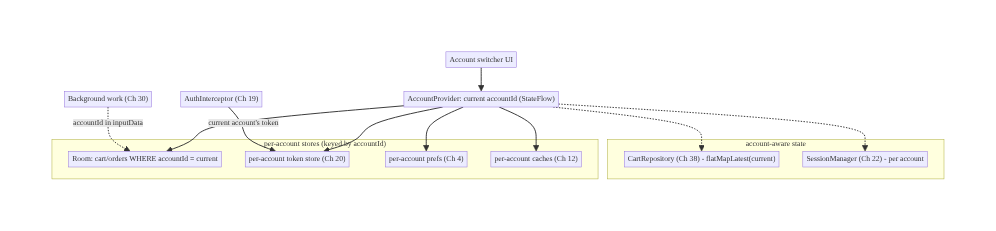
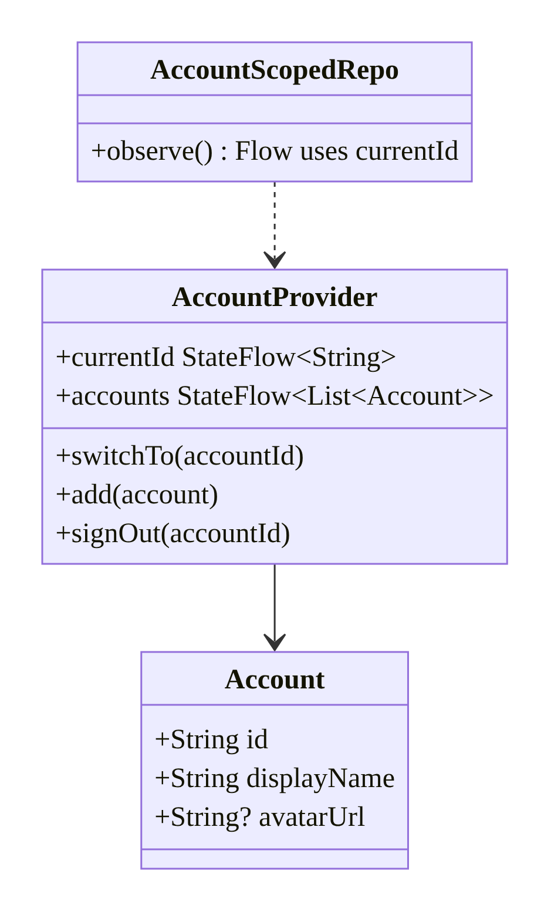
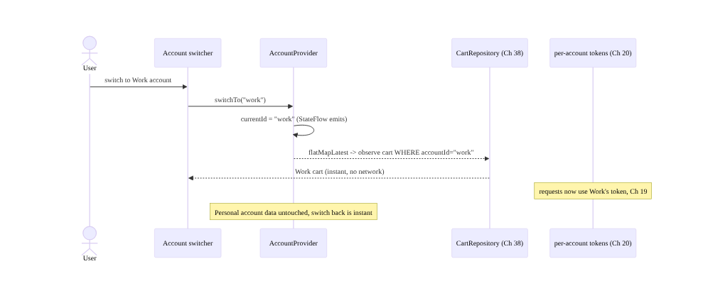
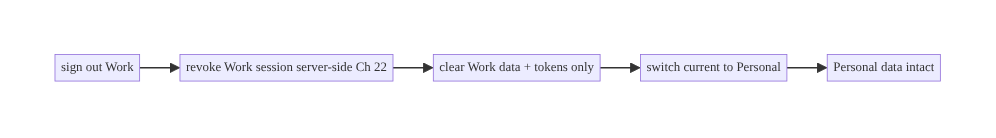
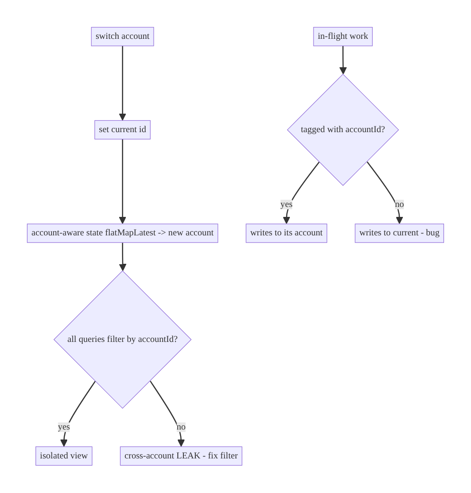

# Chapter 42 — Multi-Account & Account Switching

> **Part V — Shared & Global State** · Complexity: **Standard** (≥25 interview questions)
>
> **Prerequisites:** Ch 22 (session/logout), Ch 20 (per-account token storage),
> Ch 19 (tokens), Ch 3 (SSOT/per-account data), Ch 38/39 (shared/global state),
> Ch 24 (encryption). Generalizes single-session management to **multiple accounts**.
>
> **Reference surface in StreamCart:** a user with a personal and a work account (or
> family profiles) switching between them, with completely isolated carts, orders,
> wishlists, and settings — and fast switching without re-login.

---

## 42.1 Problem Definition and Real-World Context

Many apps support **multiple accounts** on one device — personal + work email,
multiple social profiles, family members, or a reseller managing several stores.
Each account has its **own** data (cart, orders, settings, tokens) that must be
**completely isolated**, and switching must be **fast** (no re-login) and **leak-free**.
This is the hard generalization of session management (Ch 22); naive approaches leak
data between users — a serious privacy failure:

- **Cross-account data leakage.** Account state (cart, cache, tokens) not scoped per
  account → switching shows the previous account's data, or a shared singleton mixes
  them. A top privacy incident.
- **Re-login on every switch.** Clearing everything on switch (like logout) forces
  re-authentication each time — terrible UX for frequent switchers.
- **Global state tied to one account.** A `@Singleton` holder (Ch 39) that assumes one
  account breaks: the cart/session/unread-count must become **account-aware**.
- **Token confusion.** One token store (Ch 20) holding a single token can't represent
  multiple logged-in accounts; requests use the wrong account's token.
- **Partial switch.** Switching updates some components but not others (a stale
  ViewModel, an in-flight request for the old account) → mixed data.

The architecture: a **current-account** concept driving **per-account data scoping**
(every account-scoped store keyed by `accountId`), **per-account token storage**
(Ch 20), a **fast switch** that changes the current account and re-points
account-aware state (not a full logout/login), **data isolation** (one account can't
see another's), and correct **in-flight request** handling. This chapter is about
**scoping everything by account and switching safely and fast**.

### Three practical use cases

1. **Personal + work (StreamCart).** Switch between a personal shopping account and a
   work procurement account — separate carts, orders, payment methods, settings.
2. **Family profiles (OTT).** Multiple viewer profiles (each with its own watchlist/
   history/recommendations) switched from a profile picker.
3. **Multi-tenant (B2B).** A reseller managing several stores, switching context
   while keeping each store's data isolated.

### Why this is architectural

Multi-account defines **how all account state is scoped and isolated**, the **current-
account** concept that drives data access, **fast vs full switch** semantics, and the
**privacy boundary** between accounts — properties that determine whether user data
stays isolated and switching is usable.

---

## 42.2 Requirements Engineering

### Functional requirements

| ID | Requirement |
|----|-------------|
| F1 | Support multiple logged-in accounts on one device. |
| F2 | Scope all account data (DB/caches/prefs/tokens) per account; complete isolation. |
| F3 | Switch the current account fast (no re-login) and leak-free. |
| F4 | Store per-account tokens securely (Ch 20); use the current account's token. |
| F5 | Make global/shared state account-aware (cart, session, unread — Ch 38/39). |
| F6 | Add/remove accounts; sign out one without affecting others. |
| F7 | Handle in-flight requests/work scoped to an account across a switch. |

### Non-functional requirements

| Attribute | Policy |
|-----------|--------|
| **Privacy** | Zero cross-account data leakage; complete isolation. |
| **UX** | Fast switch; no re-login; clear current-account indication. |
| **Security** | Per-account secure token storage; encrypt sensitive per-account data (Ch 24). |
| **Consistency** | Account-aware state re-points atomically on switch. |
| **Correctness** | In-flight/background work tied to the right account. |

### Scope

- **In scope:** current-account concept, per-account data scoping (keying by
  accountId), per-account token storage, fast account switch, data isolation,
  account-aware global state, add/remove/sign-out-one, in-flight request scoping.
- **Out of scope:** single-session logout (Ch 22), token refresh (Ch 19), secure
  storage internals (Ch 20), the shared-cart mechanics (Ch 38 — reused), encryption
  (Ch 24).

### Assumptions & constraints

- Per-account token storage (Ch 20); Room with `accountId` columns (Ch 3); global
  holders made account-aware (Ch 39). Fast switch = re-point, not re-login. `minSdk 24`.

---

## 42.3 System Design Fundamentals

- **Current account as the scoping key.** A single **`AccountProvider`** holds the
  **current `accountId`** (a `StateFlow`). *Every account-scoped data access is keyed
  by it.* Switching accounts = changing the current id; account-aware state re-reads
  for the new id. This is the core mechanism: **one current-account signal drives all
  per-account scoping.**
- **Per-account data scoping.** Every account-scoped store includes `accountId`:
  - **Room:** an `accountId` column on account-scoped tables; queries filter by the
    current account (`WHERE accountId = :current`). Observers use `flatMapLatest` on
    the current account so they auto-switch.
  - **DataStore/prefs:** per-account keys or per-account files (Ch 4).
  - **Tokens:** per-account secure entries (Ch 20) — a map `accountId → tokens`.
  - **Caches:** keyed by account (Ch 12); cleared per account.
- **Fast switch vs full logout.** A **switch** changes the current account and
  re-points account-aware state (instant, no network) — it does **not** clear the old
  account's data (it stays for when you switch back). **Logout of one account**
  clears *that* account's data + revokes *its* session server-side (Ch 22), leaving
  others intact.
- **Account-aware global/shared state (Ch 38/39).** The cart, session, unread count,
  and profile must be **functions of the current account**: `observeCart()` becomes
  `currentAccount.flatMapLatest { dao.observe(it) }`. A `@Singleton` holder stays a
  singleton but its *state* is account-scoped internally.
- **Data isolation (the privacy invariant).** Account A's queries must **never** return
  account B's rows — enforced by always filtering on `accountId` (and ideally a DB
  constraint/row-level discipline). Test this explicitly.
- **In-flight work scoping.** A request/sync started for account A must complete for A
  even if the user switches to B — tag work with its `accountId`; on apply, write to
  A's data, not "the current account." Background workers (Ch 30) carry the
  `accountId` in `inputData`.
- **Security (Ch 20/24).** Each account's tokens are stored securely and separately;
  sensitive per-account data is encrypted; signing out one account wipes its data +
  tokens and revokes server-side (Ch 22).

Core insight: **make a single current-account id the scoping key for all account
state, key every store by `accountId`, store tokens per account, and switch by
re-pointing account-aware state (fast, isolated) — never leaking one account's data
into another's view.**

---

## 42.4 High-Level Architecture



**Components & ownership**

- **`AccountProvider`** holds the current account id; the single scoping signal.
- **Per-account stores** (Room/tokens/prefs/caches) keyed by `accountId`.
- **Account-aware state** (cart/session) re-points via `flatMapLatest(current)`.
- **AuthInterceptor** uses the current account's token (Ch 19/20).
- **Background work** carries its `accountId`.

**Direction:** switch → change current account → account-aware state re-reads for the
new id; all stores filter by account.

---

## 42.5 Detailed Component Design



| Component | Responsibility | Note |
|-----------|----------------|------|
| `AccountProvider` | current id + account list; switch/add/sign-out | the scoping key (Ch 39 global state) |
| per-account tokens | secure, separate per account | Ch 20 (map accountId→tokens) |
| account-scoped Room | `accountId` column; filter by current | Ch 3; `flatMapLatest` to auto-switch |
| account-aware state | cart/session functions of current account | Ch 38/22 |
| sign-out-one | clear that account's data + revoke | Ch 22 (not all accounts) |

---

## 42.6 End-to-End Data Flow

### Fast account switch (no re-login, isolated)



### Sign out ONE account (others intact)



---

## 42.7 Complete Kotlin Implementation

Package: `com.streamcart.core.account`.

### 42.7.1 AccountProvider (current account + list)

```kotlin
@Singleton
class AccountProvider @Inject constructor(
    private val store: DataStore<Preferences>,          // persists current id + account list (Ch 4)
    private val tokens: AccountTokenStore,              // per-account tokens (Ch 20)
    @ApplicationScope scope: CoroutineScope,
) {
    val currentId: StateFlow<String?> = store.data
        .map { it[stringPreferencesKey("current_account")] }
        .stateIn(scope, SharingStarted.Eagerly, null)

    val accounts: StateFlow<List<Account>> = store.data
        .map { parseAccounts(it) }.stateIn(scope, SharingStarted.Eagerly, emptyList())

    fun currentIdValue(): String = currentId.value ?: error("no account")

    suspend fun switchTo(accountId: String) {           // FAST: just change the current id
        require(tokens.has(accountId)) { "account not logged in" }
        store.edit { it[stringPreferencesKey("current_account")] = accountId }
        // account-aware state re-reads via flatMapLatest(currentId) — no clearing, no re-login
    }

    suspend fun add(account: Account, accountTokens: Tokens) {   // after a login
        tokens.put(account.id, accountTokens)           // per-account secure storage (Ch 20)
        store.edit { persistAccount(it, account); it[stringPreferencesKey("current_account")] = account.id }
    }

    suspend fun signOut(accountId: String, revoke: suspend (String) -> Unit, clearData: suspend (String) -> Unit) {
        revoke(accountId)                               // revoke THIS session server-side (Ch 22)
        clearData(accountId)                            // clear THIS account's data only
        tokens.remove(accountId)
        store.edit { removeAccount(it, accountId); switchToAnotherOrNone(it, accountId) }
    }
}
```

### 42.7.2 Per-account token store (Ch 20)

```kotlin
// Keyed by accountId; each account's tokens encrypted via Keystore (Ch 20).
class AccountTokenStore @Inject constructor(private val secure: SecureStore) {
    suspend fun put(accountId: String, t: Tokens) = secure.put("tokens:$accountId", json(t))
    suspend fun get(accountId: String): Tokens? = secure.get("tokens:$accountId")?.let(::parse)
    suspend fun has(accountId: String) = secure.get("tokens:$accountId") != null
    suspend fun remove(accountId: String) = secure.remove("tokens:$accountId")
}
// AuthInterceptor (Ch 19) reads the CURRENT account's token:
class TokenProviderImpl @Inject constructor(private val accounts: AccountProvider, private val tokens: AccountTokenStore) : TokenProvider {
    override fun currentAccessToken(): String? = runBlocking { accounts.currentId.value?.let { tokens.get(it)?.access } }
}
```

### 42.7.3 Account-scoped repository (auto-switches via flatMapLatest)

```kotlin
class CartRepositoryImpl @Inject constructor(
    private val dao: CartDao, private val accounts: AccountProvider, /* ... */
) : CartRepository {
    // Re-points to the current account automatically on switch (Ch 38).
    override fun observeCart(): Flow<Cart> =
        accounts.currentId.filterNotNull()
            .flatMapLatest { acct -> dao.observe(acct) }     // WHERE accountId = acct (isolation)
            .map { it.toCart() }

    override suspend fun add(productId: String, qty: Int) {
        val acct = accounts.currentIdValue()                  // write to the CURRENT account
        dao.upsert(CartItemEntity(id = UUID.randomUUID().toString(), accountId = acct, productId = productId, /*...*/))
    }
    suspend fun clearForAccount(accountId: String) = dao.clearAccount(accountId)   // sign-out-one
}
```

### 42.7.4 Background work carries its accountId (Ch 30)

```kotlin
// A sync/upload worker must act on the account it was enqueued for, not "current".
val request = OneTimeWorkRequestBuilder<SyncWorker>()
    .setInputData(workDataOf("accountId" to accountId))       // bind to the account
    .build()
// doWork(): read inputData["accountId"] and operate on THAT account's data.
```

### 42.7.5 Module structure

```
:core:account  AccountProvider, Account, AccountTokenStore (Ch 20)
:data:*        account-scoped repos (accountId column, flatMapLatest current)
:core:network  TokenProviderImpl (current account's token, Ch 19)
```

---

## 42.8 Concurrency and Race Conditions

| Scenario | Risk | Handling |
|----------|------|----------|
| Switch during an in-flight request for A | result written to B | tag work/request with accountId; write to that account |
| Account-aware state reads mid-switch | brief wrong data | `flatMapLatest(currentId)` cancels old, reads new atomically |
| Background worker uses "current" | acts on wrong account | pass accountId in `inputData` (Ch 30) |
| Two accounts' tokens confused | wrong auth | per-account token store; current-account token |
| Concurrent switch + sign-out | inconsistent | serialize account ops; `AccountProvider` single writer |
| Query missing accountId filter | cross-account leak | always filter by accountId; test isolation |

- **`flatMapLatest` on the current account id** makes account-aware observers switch
  **atomically**: on switch, the old account's collection is cancelled and the new
  one starts — no mixed data.
- **The isolation invariant is "every account-scoped query filters by accountId"** —
  a single missing filter is a cross-account leak; enforce by convention + tests (and
  ideally a DB constraint).

---

## 42.9 Failure Scenarios and Recovery

| Failure | Detection | Response | Outcome |
|---------|-----------|----------|---------|
| Cross-account data shown | QA/privacy review | add accountId filter; `flatMapLatest` | isolated |
| In-flight result to wrong account | data in wrong cart | tag work with accountId | correct |
| Switch requires re-login | UX complaint | fast switch (re-point), per-account tokens | instant |
| One account's token expired | 401 | refresh that account (Ch 19); others unaffected | per-account |
| Sign out one wipes all | bug | clear only that account's data | others intact |
| Background worker on stale account | wrong data | accountId in inputData | correct |
| Account removed while selected | dangling current | switch to another/none | consistent |
| Device shared, no isolation | leak | encrypt per-account data (Ch 24); clear on sign-out | secure |



> **Isolation is the privacy invariant:** the whole feature succeeds or fails on
> "account A never sees account B's data." Enforce `accountId` filtering everywhere
> and **test cross-account isolation explicitly** — it's the thing that breaks.

---

## 42.10 Scaling the Implementation

- **Level 1.** Single account (Ch 22) — most apps.
- **Level 2.** `AccountProvider` with current id; per-account tokens (Ch 20);
  account-scoped Room (accountId column).
- **Level 3 — production.** Fast switch (re-point via `flatMapLatest`); account-aware
  global/shared state (cart/session, Ch 38/22); sign-out-one; in-flight work tagging;
  encrypted per-account data (Ch 24).
- **Level 4 — large.** Many accounts; account switcher UX; per-account sync (Ch 29–33)
  and notifications routing (Ch 49); per-account feature flags/entitlements.
- **Level 5 — enterprise.** Managed/work profiles, MDM, account provisioning,
  cross-account audit, strict data-isolation guarantees (row-level security/
  per-account encryption keys, Ch 24).

**Avoid overengineering:** single-account apps don't need this. Add multi-account only
when users genuinely manage multiple accounts/profiles — it touches every store and
adds real complexity.

---

## 42.11 Alternative Approaches and Trade-offs

| Dimension | Option A | Option B | When |
|-----------|----------|----------|------|
| Scoping | accountId column + filter | separate DB per account | Column+filter simplest (one DB); separate DBs for strict isolation/encryption per account |
| Switch | Fast re-point (keep both) | full logout/login | Re-point for UX (frequent switchers); full switch if data must not persist |
| Tokens | Per-account store (map) | single token store | Per-account always for multi-account |
| State | Account-aware singleton (flatMapLatest) | re-create on switch | flatMapLatest (reactive, clean); re-create is heavier |
| Isolation | Filter by accountId | per-account encryption keys (Ch 24) | Filter for most; per-account keys for high-sensitivity |
| In-flight work | Tag with accountId | cancel on switch | Tag so A's work completes for A; cancel if ephemeral |

**Column+filter vs separate DB per account:** keying one database by `accountId`
(filter on current) is simplest and shares schema/migrations, but relies on
discipline (every query filters) for isolation. A **separate database (and encryption
key, Ch 24) per account** gives stronger isolation (a query physically can't cross
accounts) at the cost of more files/complexity. Use column+filter by default;
separate DBs/keys for high-sensitivity (fintech/enterprise).

**Fast re-point vs full switch:** fast switch keeps both accounts' data resident and
just changes the current id (instant, no re-login) — great UX but both accounts'
(possibly sensitive) data lives on-device simultaneously (encrypt it, Ch 24). A full
logout/login-style switch avoids resident multi-account data but forces re-auth —
rarely acceptable for a frequent switcher. Most apps choose fast re-point + encryption.

---

## 42.12 Security Considerations

- **Complete data isolation is a privacy requirement:** account A must never see B's
  data — filter every account-scoped query by `accountId`; consider per-account
  encryption keys (Ch 24) for strong isolation.
- **Per-account secure token storage** (Ch 20): each account's tokens encrypted and
  separate; the current account's token authorizes requests (Ch 19).
- **Sign out one account** revokes *that* session server-side (Ch 22) and wipes *that*
  account's data/tokens — leaving others intact; don't leak the signed-out account's
  residual data.
- **Shared device:** multi-account means multiple users' data on one device — encrypt
  sensitive per-account data (Ch 24); consider requiring auth (Ch 21) to switch to a
  sensitive account.
- **Backend authorizes per account:** the server must scope every response to the
  authenticated account (the client's current-account is a convenience; the backend
  enforces access).
- **In-flight work isolation:** a request for A must not write to B after a switch
  (tag by accountId) — else cross-account corruption.
- Client vs backend: the client scopes/presents per account; the backend is
  authoritative and must isolate data per authenticated account server-side.

---

## 42.13 Performance and Resource Optimization

- **Fast switch** = just change an id + `flatMapLatest` re-read — instant, no network;
  the big UX win.
- **Shared schema/one DB** (column+filter) avoids N databases' overhead; index
  `accountId` for fast filtering.
- **Account-aware singletons** (not per-account instances) keep memory bounded;
  `flatMapLatest` cancels the old account's collection.
- **Lazy per-account data:** load the current account's data; the inactive account's
  data stays on disk (not in memory).
- **Bound resident accounts** if many; evict least-recently-used account caches.
- **Profiling:** switch latency (should be ~instant), per-account DB size, memory with
  multiple accounts, isolation-query performance.

---

## 42.14 Testing Strategy

The critical test is **isolation**; plus fast switch and sign-out-one.

```kotlin
class MultiAccountTest {
    @Test fun `accounts are isolated - A never sees B data`() = runTest {
        accounts.add(Account("A"), tokensA); cart.add("p1", 1)        // A's cart
        accounts.switchTo("B"); accounts.add(Account("B"), tokensB)
        assertTrue(cart.observeCart().first().lines.isEmpty())         // B sees nothing of A
        accounts.switchTo("A")
        assertEquals(1, cart.observeCart().first().itemCount)          // A intact
    }

    @Test fun `switch is fast - no re-login, data re-points`() = runTest {
        accounts.add(Account("A"), tokensA); cart.add("p1", 1)
        accounts.add(Account("B"), tokensB); cart.add("p2", 1)
        accounts.switchTo("A"); assertEquals("p1", cart.observeCart().first().lines[0].productId)
        accounts.switchTo("B"); assertEquals("p2", cart.observeCart().first().lines[0].productId)
    }

    @Test fun `current account token used for requests`() = runTest {
        accounts.add(Account("A"), Tokens("tokA")); accounts.add(Account("B"), Tokens("tokB"))
        accounts.switchTo("A"); assertEquals("tokA", tokenProvider.currentAccessToken())
        accounts.switchTo("B"); assertEquals("tokB", tokenProvider.currentAccessToken())
    }

    @Test fun `sign out one clears only that account`() = runTest {
        accounts.add(Account("A"), tokensA); cart.add("p1", 1)
        accounts.add(Account("B"), tokensB); cart.add("p2", 1)
        accounts.signOut("B", revoke = {}, clearData = { cart.clearForAccount(it) })
        accounts.switchTo("A"); assertEquals(1, cart.observeCart().first().itemCount)   // A intact
        assertFalse(tokenStore.has("B"))                                                // B gone
    }

    @Test fun `in-flight work writes to its account not current`() = runTest {
        // enqueue work for A; switch to B; worker writes to A
    }
}
```

What to test: cross-account isolation (the key one), fast switch, per-account token,
sign-out-one, in-flight work tagging, encrypted per-account data (Ch 24). An
instrumentation test for the account switcher UI.

---

## 42.15 Production Observability

- **Metrics:** account-switch frequency/latency (should be ~instant), number of
  accounts per device, cross-account-leak incidents (must be 0), sign-out-one
  success, per-account token-refresh rate, per-account data size.
- **Logs:** `account{op=switch/add/signout, count}` (ids hashed, no PII, Ch 28);
  never log which content belongs to which account.
- **Debugging:** previous account's data shows → missing `accountId` filter / not
  `flatMapLatest`; switch requires re-login → not using per-account tokens; in-flight
  result in wrong cart → work not tagged with accountId; sign-out wiped all → cleared
  globally not per account.
- **Alerting:** any cross-account-leak signal → privacy incident (highest severity).
- **Privacy:** multi-account = multiple users' data; redact; encrypt (Ch 24); honor
  per-account deletion.

---

## 42.16 System Design Interview Preparation

> ≥25 questions.

**Fundamentals**
1. *What's the core of multi-account?* A current-account id that scopes all account
   data; switching changes it.
2. *How is data scoped?* Every account-scoped store keyed by `accountId`; queries
   filter by the current account.
3. *Fast switch vs logout?* Switch re-points to another (resident) account instantly;
   logout clears + re-auth.
4. *Per-account tokens?* A secure store keyed by accountId (Ch 20); current account's
   token authorizes.
5. *Isolation invariant?* Account A never sees B's data — every query filters by
   accountId.

**Scoping/switch**
6. *How do account-aware observers switch?* `flatMapLatest(currentId)` → cancel old,
   read new atomically.
7. *Make the cart account-aware?* `currentAccount.flatMapLatest { dao.observe(it) }`
   (Ch 38).
8. *Global singleton + multi-account?* Stays a singleton; its state is account-scoped
   internally.
9. *Column+filter vs DB-per-account?* Simple shared DB vs strong isolation/per-account
   encryption.

**Correctness**
10. *In-flight request during a switch?* Tag work with accountId; write to that
    account, not "current".
11. *Background worker?* accountId in `inputData` (Ch 30).
12. *Missing accountId filter?* Cross-account leak — the main bug.

**Lifecycle**
13. *Sign out one account?* Revoke that session (Ch 22) + clear that account's data/
    tokens; others intact.
14. *Add an account?* Login → store per-account tokens → set current.
15. *Remove the current account?* Switch to another/none.
16. *Token expired for one account?* Refresh that account (Ch 19); others unaffected.

**Security/privacy**
17. *Shared device?* Encrypt per-account data (Ch 24); auth to switch to sensitive
    account (Ch 21).
18. *Who enforces access?* Backend per authenticated account; client scopes for UX.
19. *Strong isolation?* Per-account DB + encryption key (Ch 24).

**Performance**
20. *Why is switch fast?* Change an id + re-read; no network/re-login.
21. *Memory with many accounts?* Account-aware singletons; lazy per-account data;
    evict LRU.

**Testing**
22. *Key test?* Cross-account isolation.
23. *How test fast switch?* Add two accounts; switch; assert each sees its own data.
24. *How test sign-out-one?* Others intact; that account's tokens/data gone.

**Production debugging**
25. *Previous account's data shows?* Missing filter / not flatMapLatest.
26. *Re-login on switch?* Not using per-account tokens.
27. *Result in wrong account?* In-flight work not tagged.

### Design-change challenges
1. **Add personal + work accounts with isolated carts.** accountId scoping + fast
   switch.
2. **Switch must be instant.** Per-account tokens + re-point (flatMapLatest).
3. **Cross-account leak found.** Enforce accountId filter everywhere; test isolation.
4. **Sign out one account.** Revoke + clear that account only (Ch 22).
5. **High-sensitivity isolation (fintech).** Per-account DB + encryption key (Ch 24).

### Mock walkthrough (abridged)
Clarify (how many accounts, data per account, switch frequency, sensitivity?) →
current-account id as scoping key → per-account stores (accountId column) + per-account
tokens (Ch 20) → account-aware state via `flatMapLatest(current)` → fast switch
(re-point, no re-login) → isolation invariant (filter everywhere) → in-flight work
tagging → sign-out-one → encrypt per-account (Ch 24) → backend per-account authz →
testing isolation.

---

## 42.17 Practical Exercises

1. **Beginner.** Add an `AccountProvider` with a current id + per-account token store
   (Ch 20); authorize requests with the current account's token. *Eval:* correct token
   per account.
2. **Intermediate.** Scope the cart (Ch 38) by accountId with `flatMapLatest(current)`;
   prove two accounts have isolated carts. *Eval:* A never sees B.
3. **Advanced.** Implement fast switch (no re-login) + sign-out-one (others intact) +
   in-flight work tagging. *Eval:* instant switch; isolated sign-out; correct account
   writes.
4. **Production debugging.** Fix a cross-account leak (missing accountId filter) and a
   switch that forces re-login. *Eval:* isolated; instant.
5. **System design challenge.** Add per-account encryption keys (Ch 24) for strong
   isolation and require biometric (Ch 21) to switch to a sensitive account. *Eval:*
   physically isolated; gated switch.

*(Solutions withheld unless requested.)*

---

## 42.18 Chapter Summary & Reference Sheet

**Key decisions:** drive all account state from a **single current-account id**
(`AccountProvider`, a global holder, Ch 39); **scope every account store by
`accountId`** (Room column + filter, per-account tokens Ch 20, per-account prefs/
caches) for **complete isolation**; make **account-aware state re-point via
`flatMapLatest(current)`** so **switching is fast** (change id, no re-login) and
**leak-free**; **sign out one account** by revoking that session (Ch 22) + clearing
*that* account's data/tokens only; **tag in-flight/background work with its accountId**
so results go to the right account; **encrypt per-account sensitive data** (Ch 24) on
shared devices; the **backend authorizes per authenticated account**. The invariant:
**account A never sees account B's data.**

**Concepts:** current-account scoping key, per-account data/token scoping, data
isolation, fast switch vs logout, account-aware global/shared state, in-flight work
tagging, column+filter vs DB-per-account, per-account encryption.

**Common mistakes:** missing `accountId` filter (cross-account leak); re-login on every
switch (no per-account tokens); singleton assuming one account; in-flight work using
"current" account (wrong writes); sign-out-one clearing all; unencrypted per-account
data on shared devices; trusting the client's current-account for backend authz.

**Checklist:** ☐ current-account id (AccountProvider) ☐ accountId on every account
store ☐ per-account secure tokens (Ch 20) ☐ account-aware state `flatMapLatest(current)`
☐ fast switch (re-point, no re-login) ☐ isolation: filter everywhere + test ☐ sign-out
-one (others intact) ☐ tag in-flight/background work with accountId ☐ encrypt
per-account sensitive data (Ch 24) ☐ backend authorizes per account.

**Key APIs/patterns:** `AccountProvider` (current id `StateFlow`), per-account
`AccountTokenStore` (Ch 20), Room `accountId` column + `flatMapLatest(currentId)`
(Ch 3/38), `TokenProvider` using current account (Ch 19), WorkManager `inputData`
accountId (Ch 30), per-account encryption (Ch 24), sign-out-one (Ch 22).

**References:**
- (composes) Ch 22 Session, Ch 19/20 Tokens/Keystore, Ch 3 SSOT, Ch 38 Shared Cart, Ch 39 Global State, Ch 24 Encryption
- AccountManager (platform accounts): https://developer.android.com/reference/android/accounts/AccountManager
- Data isolation / privacy best practices: https://developer.android.com/privacy-and-security/security-tips

### Chapter review (Phase 4)
- **Completeness:** all 18 sections; architecture/class/sequence/failure diagrams;
  AccountProvider + per-account tokens + account-scoped repo + work tagging; concurrency
  (flatMapLatest switch, in-flight tagging); failure (leak/isolation/sign-out-one); 5
  levels; column-vs-DB-per-account and fast-vs-full-switch trade-offs; security
  (isolation/per-account encryption/backend authz); perf (instant switch); isolation
  tests; observability (leak alert); 27 Q&A + 5 challenges. ✅
- **Expand later:** per-account notifications (Ch 49), per-account sync (Ch 29–33),
  managed/work profiles, per-account encryption keys (Ch 24).
- **Interview coverage:** exceeds ≥25 bar.
