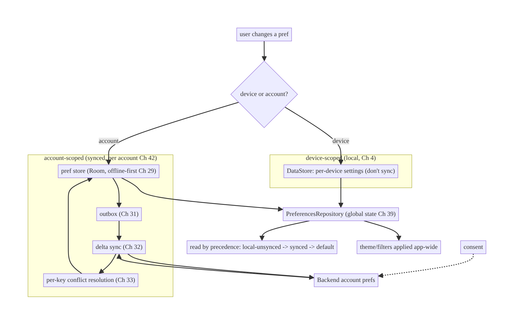
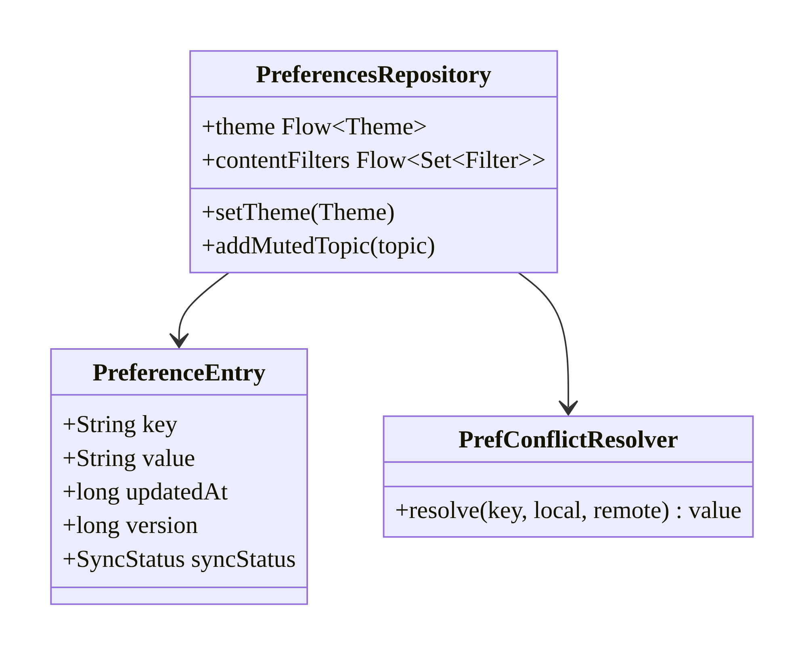
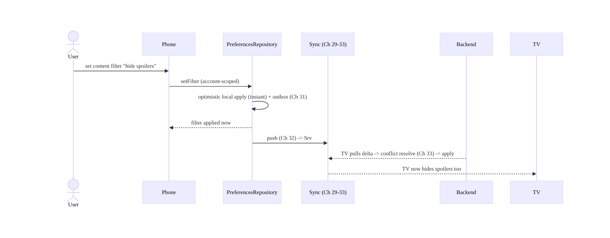
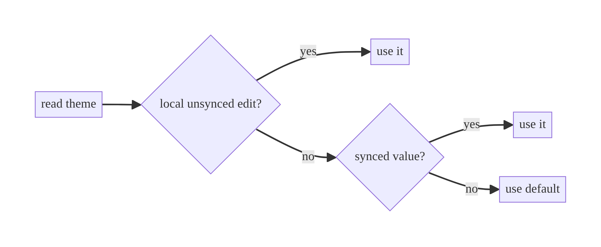
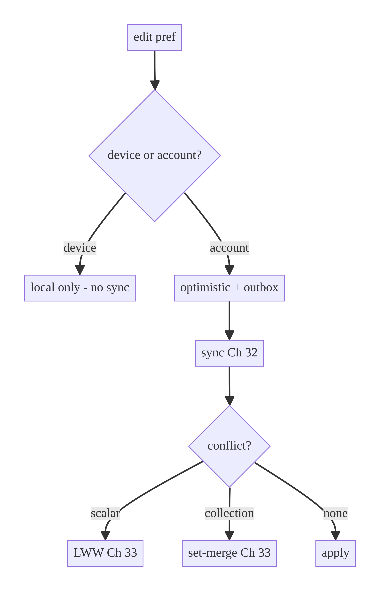

# Chapter 43 — Personalization & User-Preference Sync

> **Part V — Shared & Global State** · Complexity: **Standard** (≥25 interview questions)
>
> **Prerequisites:** Ch 4 (DataStore), Ch 29–33 (sync/conflict), Ch 42 (per-account),
> Ch 39 (global state), Ch 41 (remote config — contrast). Completes **Part V**.
>
> **Reference surface in StreamCart:** a user's settings (theme, autoplay, data-saver,
> notification prefs) and personalization (preferred categories, content filters)
> following them **across devices** — set on the phone, reflected on the tablet and TV.

---

## 43.1 Problem Definition and Real-World Context

Users expect their **preferences** (settings) and **personalization** (tastes,
filters, "for you" signals) to **follow them across devices** — change the theme or
content filters on the phone and have the tablet/TV honor them. This is a specialized
sync problem (Ch 29–33) with its own characteristics, and naive handling frustrates
users or leaks data:

- **Device-local only.** Preferences stored only in DataStore (Ch 4) don't sync — the
  user re-configures every device. Fine for device-specific settings (text size per
  screen), wrong for account-level preferences.
- **No precedence model.** With defaults, local edits, and synced values all in play,
  which wins? Without a clear **default < synced < local-unsynced** precedence (and
  conflict handling), devices show inconsistent prefs.
- **Preference conflicts.** The user changes a pref on two devices while offline;
  simple-but-wrong handling loses one change. Preferences need a conflict policy
  (usually LWW per key, Ch 33) — but some are mergeable (a *set* of muted topics).
- **Device-scoped vs account-scoped confusion.** Some settings are **device-specific**
  (don't sync: per-device text size, this-device notifications) and some are
  **account-level** (sync: theme, content filters). Syncing the wrong ones is annoying
  or wrong.
- **Privacy.** Personalization signals are sensitive (reveal interests/behavior);
  syncing/analytics must honor consent and minimize data.

The architecture: model preferences with a clear **precedence** (defaults → synced →
local unsynced), store **device-scoped** prefs locally (DataStore, Ch 4) and
**account-scoped** prefs in a **synced store** (offline-first, Ch 29; delta sync,
Ch 32) with **per-key conflict resolution** (Ch 33, usually LWW or set-merge), scoped
**per account** (Ch 42), consumed as **global state** (Ch 39), and **privacy-aware**.
This chapter is about **syncing user preferences correctly across devices**.

### Three practical use cases

1. **Cross-device settings (StreamCart).** Theme, autoplay, data-saver, and
   notification topic preferences set on the phone apply on the tablet and TV.
2. **Personalization (OTT).** Preferred genres, content filters (hide spoilers,
   maturity level), and "not interested" signals follow the user across devices.
3. **Accessibility (all).** A user's accessibility preferences (captions on, reduced
   motion) sync so every device is configured once.

### Why this is architectural

Preference sync defines **which state is device- vs account-scoped**, the **precedence
and conflict model** for settings, the **offline-first sync** of account preferences,
and the **privacy** handling of personalization signals — properties that determine
whether users get a coherent, cross-device experience.

---

## 43.2 Requirements Engineering

### Functional requirements

| ID | Requirement |
|----|-------------|
| F1 | Store device-scoped prefs locally (don't sync); account-scoped prefs sync across devices. |
| F2 | Clear precedence: default < synced < local-unsynced (optimistic). |
| F3 | Sync account preferences offline-first (Ch 29) with delta (Ch 32). |
| F4 | Resolve preference conflicts per key (LWW, or set-merge for collections, Ch 33). |
| F5 | Scope preferences per account (Ch 42). |
| F6 | Expose preferences as observable global state (Ch 39); apply instantly. |
| F7 | Honor consent/privacy for personalization signals. |

### Non-functional requirements

| Attribute | Policy |
|-----------|--------|
| **Consistency** | Coherent prefs across devices (eventual); clear precedence. |
| **Availability** | Prefs editable offline; apply immediately. |
| **Correctness** | Per-key conflict resolution; no lost changes. |
| **Privacy** | Personalization signals consented, minimized, encrypted if sensitive. |
| **UX** | Instant local apply; cross-device follow-through. |

### Scope

- **In scope:** device- vs account-scoped prefs, precedence model, offline-first pref
  sync + per-key conflict resolution, per-account scoping, global-state exposure,
  personalization-signal privacy.
- **Out of scope:** the sync engine internals (Ch 29–33), remote config/flags (Ch 41 —
  server-controlled, different from user prefs), DataStore basics (Ch 4), recommendation
  algorithms (backend/Ch 73).

### Assumptions & constraints

- DataStore for device-scoped (Ch 4); a synced account-pref store (offline-first,
  Ch 29/32/33); per-account (Ch 42). Backend stores account preferences. `minSdk 24`.
  **User preferences ≠ remote config** (user-controlled vs server-controlled).

---

## 43.3 System Design Fundamentals

- **Device- vs account-scoped preferences.** The key classification:
  - **Device-scoped** (don't sync): settings meaningful to *this device* — per-device
    text size, this-device notification channels, cache location. Stored in local
    DataStore (Ch 4).
  - **Account-scoped** (sync): settings/personalization belonging to the *user* —
    theme, autoplay, content filters, preferred genres, accessibility. Stored in a
    synced store, following the user across devices.
  Misclassifying causes "my phone's text size changed my TV" (annoying) or "my content
  filters didn't follow me" (wrong).
- **Precedence model.** When reading a preference, resolve in order: **local unsynced
  edit** (optimistic, most recent user intent) → **synced value** (from the server/
  other devices) → **default** (compiled-in). This ensures the user's latest change
  wins locally while syncing, and defaults cover gaps.
- **Offline-first pref sync (Ch 29).** Account prefs are edited **optimistically**
  (apply instantly locally), queued (outbox, Ch 31), and synced (delta, Ch 32) — just
  like any offline-first data. The user never waits to change a setting.
- **Per-key conflict resolution (Ch 33).** Preferences conflict when edited on two
  devices. Most are **scalar** → **LWW per key** (latest timestamp/version wins,
  Ch 33) — simple and acceptable (losing an older toggle is fine). Some are
  **collections** (muted topics, "not interested" items) → **set-merge/OR-Set CRDT**
  (Ch 33) so adds/removes from both devices survive. Resolve **per key**, not whole-
  blob (whole-blob LWW loses concurrent edits to different settings).
- **Personalization signals.** "For you" data (viewed/liked/skipped, preferred
  categories) is a special pref class: often **account-scoped, synced, privacy-
  sensitive**, and feeds backend recommendations (Ch 73). Treat with consent + data
  minimization.
- **Global-state exposure (Ch 39).** Preferences are read app-wide (theme, filters) →
  exposed via a `PreferencesRepository` holder as observable global state; changes
  apply instantly everywhere.
- **User prefs vs remote config (Ch 41).** Opposite control: **user preferences** are
  **user-controlled** (the user sets them, they sync to the user's account);
  **remote config/flags** are **server-controlled** (the operator sets them, rolled out
  to clients). Don't conflate — a user toggling autoplay is a preference; the operator
  enabling a new feature is a flag.

Core insight: **classify each preference as device- or account-scoped, apply account
prefs offline-first with per-key conflict resolution (LWW for scalars, set-merge for
collections), resolve reads by precedence (local-unsynced → synced → default), scope
per account, expose as global state, and keep personalization signals private** — so
preferences follow the user across devices correctly.

---

## 43.4 High-Level Architecture



**Components & ownership**

- **Classification** routes each pref to device-local (DataStore) or account-synced
  (Room offline-first).
- **Account pref sync** reuses offline-first/outbox/delta/conflict (Ch 29–33),
  per-account (Ch 42).
- **`PreferencesRepository`** exposes resolved prefs as global state (Ch 39) by
  precedence.
- **Consent** gates syncing/using personalization signals.

**Direction:** edit → classify → device-local or account-synced → read by precedence →
apply app-wide; account prefs sync across devices with per-key conflict resolution.

---

## 43.5 Detailed Component Design



| Pref | Scope | Sync? | Conflict (Ch 33) |
|------|-------|-------|------------------|
| theme | account | ✅ | LWW |
| autoplay / data-saver | account | ✅ | LWW |
| this-device notifications | device | ❌ | n/a |
| per-device text size | device | ❌ | n/a |
| muted topics / "not interested" | account | ✅ | set-merge (OR-Set) |
| preferred genres | account | ✅ | set-merge / LWW |

> **Per-key resolution matters:** store prefs as **individual keyed entries** (not one
> blob) so device A changing theme and device B changing autoplay both survive — a
> whole-blob LWW would lose one.

---

## 43.6 End-to-End Data Flow

### Change an account pref → syncs to other devices



### Read precedence



---

## 43.7 Complete Kotlin Implementation

Package: `com.streamcart.data.preferences`.

### 43.7.1 Device- vs account-scoped stores

```kotlin
// DEVICE-scoped: local only, never synced (Ch 4).
class DevicePreferences @Inject constructor(private val store: DataStore<Preferences>) {
    val textScale: Flow<Float> = store.data.map { it[floatPreferencesKey("text_scale")] ?: 1.0f }
    suspend fun setTextScale(v: Float) = store.edit { it[floatPreferencesKey("text_scale")] = v }.let {}
}

// ACCOUNT-scoped: synced, per-account (Ch 42), offline-first (Ch 29), per-key entries.
@Entity(tableName = "account_prefs", primaryKeys = ["accountId","key"])
data class PreferenceEntry(
    val accountId: String, val key: String, val value: String,
    val updatedAt: Long, val version: Long = 0,
    val syncStatus: SyncStatus = SyncStatus.PENDING,
)
```

### 43.7.2 PreferencesRepository (precedence, global state, optimistic sync)

```kotlin
@Singleton
class PreferencesRepository @Inject constructor(
    private val device: DevicePreferences,
    private val dao: AccountPrefDao,
    private val accounts: AccountProvider,            // per-account (Ch 42)
    private val outbox: OutboxDao,                    // Ch 31
    private val syncScheduler: SyncScheduler,         // Ch 30
    private val clock: Clock,
) {
    private val defaults = mapOf("theme" to "System", "autoplay" to "true")

    // Precedence: synced store already holds the latest (local-unsynced is reflected
    // optimistically in the same store); fall back to default.
    val theme: Flow<Theme> = accountPref("theme").map { Theme.valueOf(it ?: defaults["theme"]!!) }

    private fun accountPref(key: String): Flow<String?> =
        accounts.currentId.filterNotNull()
            .flatMapLatest { acct -> dao.observe(acct, key) }    // account-scoped (Ch 42)
            .map { it?.value }

    suspend fun setTheme(theme: Theme) = setAccountPref("theme", theme.name)   // account-scoped, syncs

    private suspend fun setAccountPref(key: String, value: String) {
        val acct = accounts.currentIdValue()
        val entry = PreferenceEntry(acct, key, value, clock.now(), version = nextVersion(acct, key), syncStatus = SyncStatus.PENDING)
        dao.upsert(entry)                               // optimistic (applies instantly, Ch 29)
        outbox.insert(mutation("pref.set", "$acct:$key", json(entry)))   // Ch 31
        syncScheduler.requestSync()                     // Ch 30
    }

    // Collection pref: set-merge (OR-Set, Ch 33).
    suspend fun addMutedTopic(topic: String) {
        val cur = currentMutedTopics()
        setAccountPref("muted_topics", json(cur + topic))   // merged on conflict (Ch 33)
    }
}
```

### 43.7.3 Per-key conflict resolution (Ch 33)

```kotlin
class PrefConflictResolver @Inject constructor(private val json: Json) {
    fun resolve(key: String, base: PreferenceEntry?, local: PreferenceEntry?, remote: PreferenceEntry): PreferenceEntry =
        when {
            isCollection(key) -> remote.copy(value = mergeSets(local?.value, remote.value, base?.value))  // OR-Set
            local == null || remote.version > local.version -> remote                                     // LWW
            remote.version < local.version -> local
            else -> if (remote.updatedAt >= local.updatedAt) remote else local                            // ts tiebreak
        }
    private fun isCollection(key: String) = key in setOf("muted_topics", "preferred_genres")
}
```

### 43.7.4 Personalization signal with consent

```kotlin
suspend fun recordNotInterested(itemId: String, consent: ConsentManager) {
    if (!consent.personalizationAllowed()) return       // honor consent (privacy)
    addToAccountSet("not_interested", itemId)           // account-scoped, synced, feeds recs (Ch 73)
}
```

### 43.7.5 Module structure

```
:data:preferences  DevicePreferences (Ch 4), PreferencesRepository (global state Ch 39),
                   AccountPrefDao, PrefConflictResolver (Ch 33)
:sync              pref sync via offline-first (Ch 29-32), per-account (Ch 42)
```

---

## 43.8 Concurrency and Race Conditions

| Scenario | Risk | Handling |
|----------|------|----------|
| Same pref edited on two devices | lost change | per-key LWW / set-merge (Ch 33) |
| Different prefs edited concurrently | one blob overwrites | per-key entries (not a blob) |
| Edit during sync | overwrite local | version + outbox (Ch 31); conflict resolve (Ch 33) |
| Device vs account misclassification | wrong device affected | classify correctly; device prefs never sync |
| Account switch mid-edit | wrong account's pref | account-scoped + `flatMapLatest` (Ch 42) |
| Default vs synced precedence | wrong value | local-unsynced → synced → default |

- **Per-key entries + per-key conflict resolution** is the correctness crux: it lets
  concurrent edits to *different* prefs both survive and handles same-pref conflicts by
  policy — a whole-blob approach loses one side.
- **Account scoping (Ch 42)** ensures prefs edited for account A don't bleed into B.

---

## 43.9 Failure Scenarios and Recovery

| Failure | Detection | Response | Outcome |
|---------|-----------|----------|---------|
| Offline edit | connectivity | optimistic local + outbox (Ch 31) | applies; syncs later |
| Concurrent device edit (scalar) | version | LWW (Ch 33) | latest wins (acceptable) |
| Concurrent device edit (collection) | version | set-merge (Ch 33) | both survive |
| Whole-blob overwrite | lost pref | per-key entries | preserved |
| Pref doesn't sync | wrong scope | classify as account-scoped | follows user |
| Device pref synced (annoying) | wrong scope | keep device-scoped local | per-device |
| Personalization without consent | privacy review | gate on consent | compliant |
| Account switch | per-account | load that account's prefs | correct |



> **Classify first, then sync:** the most common preference bug is wrong scoping — a
> device setting that shouldn't sync syncing (changing all devices), or an account
> setting that should sync staying local. Decide device vs account per preference.

---

## 43.10 Scaling the Implementation

- **Level 1.** Device-local prefs only (DataStore, Ch 4) — no sync.
- **Level 2.** Account-scoped prefs synced offline-first (Ch 29/31/32); per-key LWW
  (Ch 33); per-account (Ch 42).
- **Level 3 — production.** Precedence model; set-merge for collection prefs; global-
  state exposure (Ch 39); consent-gated personalization; apply instantly app-wide.
- **Level 4 — large.** Personalization signals feeding backend recs (Ch 73); fine-
  grained privacy controls; preference schema versioning (Ch 16); many prefs.
- **Level 5 — enterprise.** Managed/policy-driven preferences, cross-platform
  preference sync, preference audit, differential-privacy personalization, GDPR
  export/delete of preferences (Ch 37).

**Avoid overengineering:** many apps only need device-local settings (DataStore).
Add account sync when users genuinely use multiple devices and expect settings to
follow — and only sync account-scoped prefs.

---

## 43.11 Alternative Approaches and Trade-offs

| Dimension | Option A | Option B | When |
|-----------|----------|----------|------|
| Scope | Account-scoped (synced) | device-scoped (local) | Account for user-level prefs; device for device-specific |
| Storage | Per-key entries | one blob | Per-key (concurrent edits survive, conflict per key); blob only for atomic small config |
| Conflict | Per-key LWW / set-merge (Ch 33) | whole-blob LWW | Per-key — blob loses concurrent edits |
| Sync | Offline-first (Ch 29) | fetch-on-read | Offline-first (instant local); fetch loses offline |
| Prefs source | User preferences (user-controlled) | remote config (server-controlled, Ch 41) | Don't conflate — different control/ownership |
| Personalization | Consent-gated, minimized | collect freely | Consent + minimization (privacy/legal) |

**User preferences vs remote config (the key distinction):** both are "settings" but
opposite in control. **User preferences** are set by the *user* and sync to the
*user's* account (theme, filters); **remote config/flags** (Ch 41) are set by the
*operator* and pushed to *clients* (rollout, tuning). Store and sync them separately;
a user preference goes to the user's synced pref store, a flag comes from remote
config. Conflating them (e.g., overwriting a user's choice with a server default)
breaks UX.

**Per-key vs blob storage:** storing each preference as its own keyed entry lets
concurrent edits to different prefs both survive and allows per-key conflict policies
(LWW vs set-merge); a single JSON blob is simpler but a whole-blob LWW loses one
device's concurrent change. Use per-key for synced prefs.

---

## 43.12 Security & Privacy Considerations

- **Personalization signals are sensitive** — "not interested," viewing history,
  preferred categories reveal interests/behavior. **Gate on consent** (GDPR/CCPA);
  **minimize** what's collected/synced; let users view/clear them (Ch 37).
- **Per-account scoping** (Ch 42) — one user's preferences/personalization must not
  leak to another on a shared device.
- **Encrypt sensitive synced prefs** at rest (Ch 24) if they reveal personal data.
- **Clear on logout** (Ch 22) — account prefs/personalization are user data.
- **Export/delete** preferences for data-subject rights (Ch 37).
- **Backend authorizes** pref reads/writes per account; the client can't read another
  account's synced prefs.
- Client vs backend: the client applies prefs for UX; the backend stores the
  authoritative account preferences and must scope them per user, honoring consent.

---

## 43.13 Performance and Resource Optimization

- **Instant local apply** (optimistic) — settings change immediately; sync is
  background.
- **Observe as global state** (Ch 39) — prefs read app-wide from a conflated
  `StateFlow`; theme/filters apply without refetch.
- **Per-key entries + delta sync** (Ch 32) — sync only changed prefs, not the whole
  set.
- **Debounce rapid changes** (a slider) before enqueuing (Ch 31 compaction).
- **Device prefs stay local** — no sync cost for device-specific settings.
- **Profiling:** pref-sync volume/frequency, apply latency, pref store size,
  personalization-signal volume.

---

## 43.14 Testing Strategy

Fakes + in-memory Room; test scope classification, precedence, conflict, consent.

```kotlin
class PreferenceSyncTest {
    @Test fun `account pref applies optimistically and queues sync`() = runTest {
        repo.setTheme(Theme.Dark)
        assertEquals(Theme.Dark, repo.theme.first())          // instant
        assertEquals(1, outbox.pending().size)                // queued (Ch 31)
    }
    @Test fun `device pref does not sync`() = runTest {
        device.setTextScale(1.2f)
        assertEquals(0, outbox.pending().size)                // local only
    }
    @Test fun `precedence: synced over default`() = runTest {
        dao.upsert(prefEntry("theme", "Dark"))
        assertEquals(Theme.Dark, repo.theme.first())          // not the System default
    }
    @Test fun `scalar conflict uses LWW`() {
        val r = resolver.resolve("theme", base = e("theme","System",v=0), local = e("theme","Dark",v=1), remote = e("theme","Light",v=2))
        assertEquals("Light", r.value)                        // higher version
    }
    @Test fun `collection conflict merges sets`() {
        val r = resolver.resolve("muted_topics", base = e("muted_topics","[]",0),
            local = e("muted_topics","[\"a\"]",1), remote = e("muted_topics","[\"b\"]",1))
        assertTrue(r.value.contains("a") && r.value.contains("b"))   // both survive
    }
    @Test fun `personalization gated by consent`() = runTest {
        repo.recordNotInterested("x", consent = DeniedConsent)
        assertEquals(0, outbox.pending().size)                // not recorded
    }
    @Test fun `prefs scoped per account`() = runTest {
        accounts.switchTo("A"); repo.setTheme(Theme.Dark)
        accounts.switchTo("B"); assertNotEquals(Theme.Dark, repo.theme.first())
    }
}
```

What to test: scope classification (device vs account), precedence, per-key LWW + set-
merge conflict, consent gating, per-account isolation, offline optimistic apply.

---

## 43.15 Production Observability

- **Metrics:** pref-sync success/failure, cross-device apply latency (phone→TV),
  conflict rate + resolution outcomes, personalization opt-in rate, pref-sync volume,
  default-vs-synced read distribution.
- **Logs:** `pref{key, scope, synced}` (no values — may reveal interests, Ch 28),
  `pref_conflict{key, resolution}`.
- **Debugging:** pref didn't follow to another device → wrong scope (device not
  account) / sync failing; concurrent change lost → whole-blob not per-key; device
  setting changed all devices → wrongly account-scoped; personalization without
  consent → consent gate missing; wrong account's prefs → not per-account scoped.
- **Alerting:** personalization-without-consent → privacy incident.
- **Privacy:** personalization signals are sensitive — redact; consent; export/delete
  (Ch 37).

---

## 43.16 System Design Interview Preparation

> ≥25 questions.

**Fundamentals**

1. *Device- vs account-scoped prefs?* Device-specific (don't sync: per-device text
   size) vs user-level (sync: theme, filters).
2. *Why does scope matter?* Syncing the wrong one is annoying (changes all devices) or
   wrong (doesn't follow user).
3. *Precedence?* local-unsynced → synced → default.
4. *How sync account prefs?* Offline-first (Ch 29): optimistic + outbox (Ch 31) +
   delta (Ch 32).
5. *User prefs vs remote config?* User-controlled (sync to account) vs server-
   controlled (rolled out, Ch 41) — don't conflate.

**Conflict**

6. *Preference conflict?* Same pref edited on two devices.
7. *Resolution?* Per-key LWW (scalars) or set-merge/OR-Set (collections, Ch 33).
8. *Why per-key not blob?* Concurrent edits to different prefs both survive; blob LWW
   loses one.
9. *Muted topics conflict?* Set-merge (both devices' adds/removes survive).

**Storage/scope**

10. *Where device prefs?* Local DataStore (Ch 4), never synced.
11. *Where account prefs?* Synced store (Room offline-first), per-account (Ch 42).
12. *Per-account?* Scope by accountId; clear on logout (Ch 42/22).

**Personalization**

13. *What are personalization signals?* Viewing/liking/skipping, preferred categories —
    sensitive.
14. *Privacy?* Consent-gated, minimized, exportable/deletable (Ch 37).
15. *Feeds what?* Backend recommendations (Ch 73).

**Correctness**

16. *Offline edit?* Optimistic local + outbox; syncs later.
17. *Edit during sync?* Version + conflict resolve (Ch 33).
18. *Account switch mid-edit?* Account-scoped + flatMapLatest (Ch 42).

**Exposure**

19. *How consumed app-wide?* Global state holder (Ch 39); applies instantly.
20. *Apply latency?* Instant local (optimistic); cross-device via sync.

**Security**

21. *Encrypt synced prefs?* If sensitive (Ch 24).
22. *Who authorizes?* Backend per account.
23. *Export/delete prefs?* GDPR (Ch 37).

**Testing**

24. *How test scope?* Device pref doesn't queue sync; account pref does.
25. *How test conflict?* LWW for scalar; merge for collection.
26. *How test consent?* Denied → not recorded.

**Production debugging**

27. *Pref didn't follow device?* Wrong scope / sync failing.
28. *Concurrent change lost?* Whole-blob not per-key.
29. *Device setting changed all devices?* Wrongly account-scoped.

### Design-change challenges
1. **Theme must follow the user across devices.** Account-scoped synced pref.
2. **Text size should stay per-device.** Device-scoped local (don't sync).
3. **Muted topics edited on two devices.** Set-merge CRDT (Ch 33).
4. **Personalization must respect consent.** Gate on consent; minimize; export/delete.
5. **Per-account preferences.** accountId scoping (Ch 42).

### Mock walkthrough (abridged)
Clarify (which prefs, multi-device, personalization, privacy?) → classify device vs
account → device-local (DataStore) vs account-synced (offline-first, Ch 29) → per-key
entries + conflict (LWW/set-merge, Ch 33) → precedence (local-unsynced→synced→default)
→ per-account (Ch 42) → global-state exposure (Ch 39) → consent for personalization →
distinguish from remote config (Ch 41) → testing.

---

## 43.17 Practical Exercises

1. **Beginner.** Classify and store: text-size (device-local) and theme (account-
   synced); prove theme queues a sync and text-size doesn't. *Eval:* correct scoping.
2. **Intermediate.** Sync account prefs offline-first (optimistic + outbox + delta);
   apply instantly + follow to another device. *Eval:* instant; cross-device.
3. **Advanced.** Add per-key conflict resolution (LWW for theme, set-merge for muted
   topics); prove concurrent edits resolve correctly. *Eval:* scalar LWW; set survives.
4. **Production debugging.** Fix a pref that doesn't follow the user (wrong scope) and
   a whole-blob sync that loses concurrent edits (per-key). *Eval:* follows; both
   survive.
5. **System design challenge.** Add consent-gated personalization signals feeding recs
   (Ch 73) with export/delete (Ch 37). *Eval:* consent honored; exportable/deletable.

*(Solutions withheld unless requested.)*

---

## 43.18 Chapter Summary & Reference Sheet

**Key decisions:** **classify** each preference as **device-scoped** (local DataStore,
don't sync — per-device settings) or **account-scoped** (synced, follows the user);
sync account prefs **offline-first** (optimistic + outbox + delta, Ch 29/31/32) with
**per-key conflict resolution** (**LWW** for scalars, **set-merge/OR-Set** for
collections, Ch 33) stored as **per-key entries** (not a blob); resolve reads by
**precedence** (local-unsynced → synced → default); scope **per account** (Ch 42);
expose as **observable global state** (Ch 39) applied instantly; treat **personalization
signals** as sensitive (**consent**, minimization, export/delete Ch 37); and keep
**user preferences distinct from remote config** (Ch 41 — user-controlled vs server-
controlled).

**Concepts:** device- vs account-scoped prefs, precedence model, offline-first pref
sync, per-key vs blob, per-key LWW/set-merge conflict, personalization signals + consent,
user-prefs-vs-remote-config, global-state exposure.

**Common mistakes:** wrong scope (device setting syncs, or account setting doesn't);
whole-blob LWW (loses concurrent edits); no precedence model; conflating user prefs
with remote config; syncing personalization without consent; not per-account scoping;
unencrypted sensitive synced prefs.

**Checklist:**

- [ ] classify device vs account
- [ ] device-local (DataStore)
- [ ] account-synced offline-first (Ch 29)
- [ ] per-key entries
- [ ] per-key conflict (LWW/set-merge, Ch 33)
- [ ] precedence local-unsynced→synced→default
- [ ] per-account (Ch 42)
- [ ] global-state exposure (Ch 39)
- [ ] consent-gated personalization
- [ ] export/delete (Ch 37)
- [ ] distinct from remote config (Ch 41).

**Key APIs/patterns:** DataStore (device, Ch 4), account-pref Room entries (per-key,
per-account Ch 42), offline-first sync (Ch 29/31/32), `PrefConflictResolver` (LWW/
OR-Set, Ch 33), precedence resolution, `PreferencesRepository` global state (Ch 39),
consent gating.

**References:**
- Settings / DataStore: https://developer.android.com/develop/ui/views/components/settings
- Offline-first data layer: https://developer.android.com/topic/architecture/data-layer/offline-first
- Privacy best practices: https://developer.android.com/privacy-and-security/security-tips
- (composes) Ch 4 DataStore, Ch 29–33 Sync/Conflict, Ch 39 Global State, Ch 41 Remote Config, Ch 42 Multi-Account, Ch 37 Export/Delete

### Chapter review (Phase 4)
- **Completeness:** all 18 sections; architecture/class/sequence/failure diagrams;
  device/account stores + precedence + per-key conflict + consent; concurrency (per-key
  resolution, account scope); failure (wrong scope, blob loss, consent); 5 levels;
  user-prefs-vs-remote-config and per-key-vs-blob trade-offs; privacy (consent/
  minimize/export); perf (instant apply, delta); scope/precedence/conflict tests;
  observability (cross-device latency); 29 Q&A + 5 challenges. ✅
- **Expand later:** recommendations (Ch 73), export/delete (Ch 37), accessibility
  (Ch 96), theming (Ch 97). **Completes Part V (Ch 38–43).**
- **Interview coverage:** exceeds ≥25 bar.
