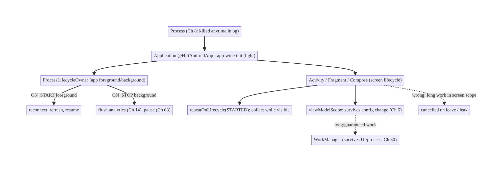
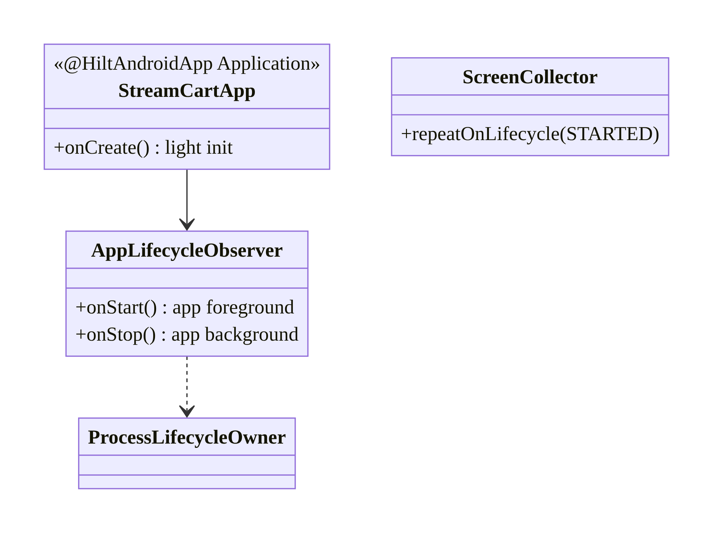
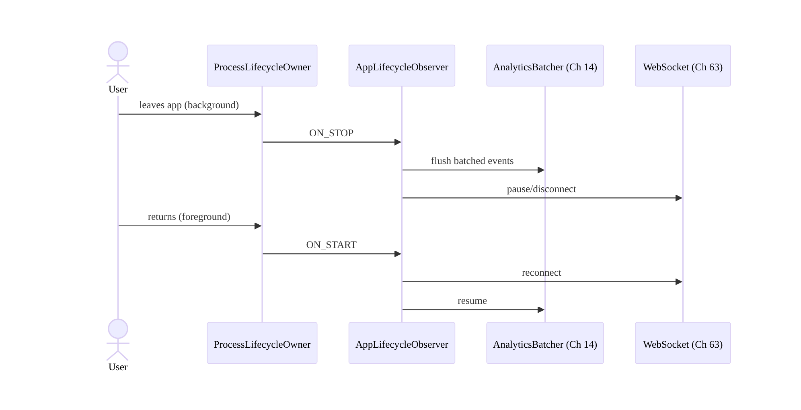
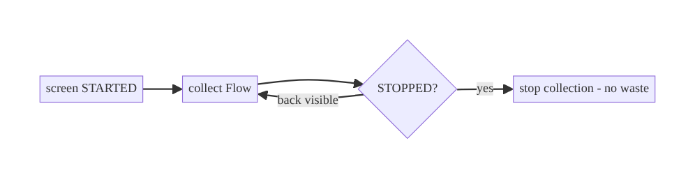
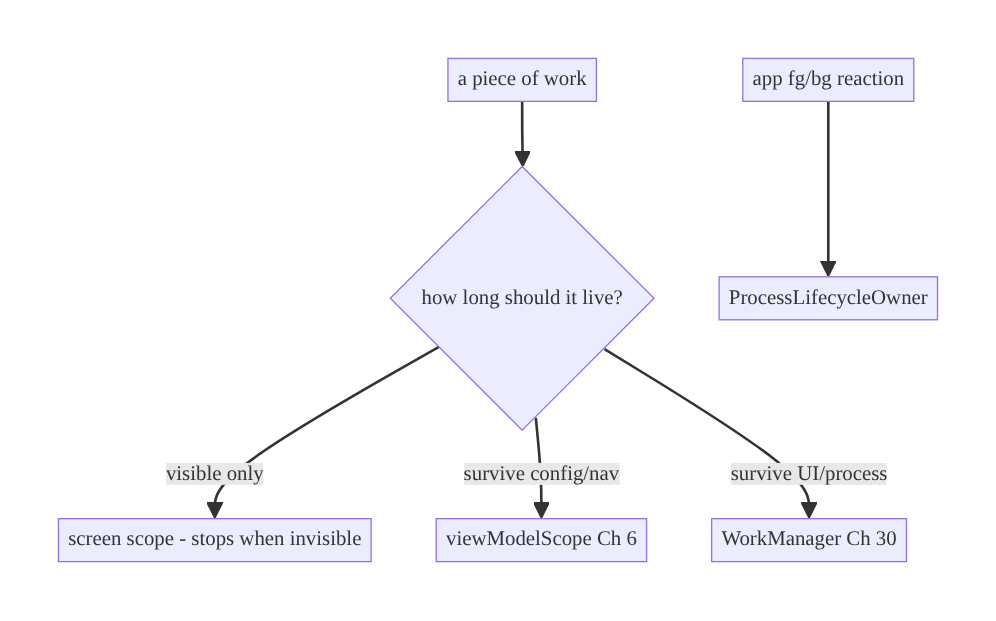

# Chapter 44 — Application Lifecycle Management

> **Part VI — Lifecycle, Background & Platform** · Complexity: **Standard** (≥25 interview questions)
>
> **Prerequisites:** Ch 6 (UI state/ViewModel), Ch 8 (process death), Ch 5 (Hilt/
> Application), Ch 14/41 (background batching, flush on background). Foundational for
> Ch 45 (startup), Ch 46/47 (services/Doze), Ch 49 (push).
>
> **Reference surface in StreamCart:** knowing when the app is foreground vs
> background, initializing/tearing down app-wide resources at the right time, and
> doing lifecycle-correct work (flush analytics on background, refresh on foreground).

---

## 44.1 Problem Definition and Real-World Context

Android apps don't have a simple "running/stopped" model — there's a **process**, an
**Application**, **Activities/Fragments** (or Compose destinations), and the whole app
moving between **foreground and background**, each with its own lifecycle. Code that
ignores these boundaries leaks, wastes battery, crashes, or misbehaves:

- **Work tied to the wrong lifecycle.** A network poll or location request started in
  an Activity keeps running after the user leaves (battery/leak), or a coroutine tied
  to a destroyed scope crashes.
- **No foreground/background awareness.** The app can't tell when it's backgrounded to
  flush analytics (Ch 14), pause expensive work, or refresh on return — so it polls
  while hidden or shows stale data on resume.
- **Initializing in the wrong place.** Heavy work in `Application.onCreate` slows every
  launch (Ch 45); per-Activity re-init duplicates work.
- **Leaks from lifecycle misuse.** Observing without lifecycle awareness, holding
  Activity references, or not unregistering callbacks leaks the Activity/memory.
- **Process-lifetime assumptions.** Treating the Application as permanent misses that
  the OS kills the process (Ch 8) and that `Application.onCreate` runs on every cold
  start.

The architecture: understand the **lifecycle hierarchy** (process → Application →
Activity/Fragment/Compose), use **lifecycle-aware components** (`LifecycleOwner`,
`repeatOnLifecycle`, `viewModelScope`, Ch 6) so work is scoped to the right lifetime,
detect **app-wide foreground/background** via `ProcessLifecycleOwner`, and place
initialization/teardown correctly. This chapter is about **doing the right work at the
right lifecycle boundary** without leaks or waste.

### Three practical use cases

1. **Foreground/background work (StreamCart).** Flush batched analytics (Ch 14) and
   pause real-time connections (Ch 63) when the app backgrounds; refresh/reconnect on
   foreground.
2. **Lifecycle-scoped work (all).** A screen's data collection stops when it's not
   visible (`repeatOnLifecycle`, Ch 6); a long task survives navigation via the
   ViewModel/WorkManager (Ch 30).
3. **App-wide init (all).** Initialize crash reporting/DI/logging once in `Application`
   (lightly, Ch 45), and app-wide observers via `ProcessLifecycleOwner`.

### Why this is architectural

Lifecycle management defines **what runs when** (process/app/screen scopes), how work
is **bounded and cancelled** (no leaks/waste), and how the app reacts to
**foreground/background** — cross-cutting properties that determine correctness,
battery, and memory across every feature.

---

## 44.2 Requirements Engineering

### Functional requirements

| ID | Requirement |
|----|-------------|
| F1 | Scope work to the correct lifecycle (process/app/screen); cancel when the scope ends. |
| F2 | Detect app-wide foreground/background transitions. |
| F3 | Do lifecycle-correct reactions (flush/pause on background; refresh/reconnect on foreground). |
| F4 | Initialize app-wide resources once, in the right place (lightly). |
| F5 | Avoid leaks (lifecycle-aware observation; no retained Activity refs). |
| F6 | Survive config change (ViewModel) and process death (Ch 8). |

### Non-functional requirements

| Attribute | Policy |
|-----------|--------|
| **Correctness** | Work bounded to its lifecycle; no crashes on destroyed scopes. |
| **Battery** | No background work while hidden (unless intended). |
| **Memory** | No lifecycle leaks (LeakCanary, Ch 89). |
| **Performance** | Light `Application.onCreate` (Ch 45). |
| **Maintainability** | Lifecycle-aware components, not manual callbacks. |

### Scope

- **In scope:** lifecycle hierarchy (process/Application/Activity/Fragment/Compose),
  `LifecycleOwner`/`repeatOnLifecycle`/`viewModelScope`, `ProcessLifecycleOwner`
  (app foreground/background), app-wide init/teardown, leak avoidance, lifecycle in
  Compose.
- **Out of scope:** startup optimization (Ch 45), services/Doze (Ch 46/47), process
  death/SavedState (Ch 8), UI state (Ch 6).

### Assumptions & constraints

- Jetpack Lifecycle (`androidx.lifecycle`), Compose + `lifecycle-runtime-compose`,
  Hilt. `minSdk 24`. Process is ephemeral (Ch 8); `Application` recreated on each cold
  start.

---

## 44.3 System Design Fundamentals

- **The lifecycle hierarchy (nested lifetimes):**
  - **Process:** the OS process. Created on cold start, killed anytime in background
    (Ch 8). `Application.onCreate` runs once per process.
  - **Application:** the app-global object (`@HiltAndroidApp`), lives as long as the
    process. Place app-wide, cheap, one-time init here (DI, crash reporting, logging).
  - **Activity / Fragment / Compose destination:** UI lifecycles (`onCreate`/`onStart`/
    `onResume`/`onPause`/`onStop`/`onDestroy`), recreated on config change. Screen-scoped
    work lives here (but state lives in the ViewModel, Ch 6).
  - **App foreground/background:** the *whole app* moving between visible and hidden —
    observed via `ProcessLifecycleOwner`.
- **Lifecycle-aware components (the modern model).** Instead of manual
  `onStart/onStop` plumbing, use **`LifecycleOwner`** + **`LifecycleObserver`** /
  **`repeatOnLifecycle(STARTED)`** / **`lifecycleScope`** / **`viewModelScope`** (Ch 6)
  so work **automatically starts/stops/cancels** with the lifecycle. This is what
  prevents leaks and wasted work — e.g., `repeatOnLifecycle(STARTED)` collects a Flow
  only while the screen is visible.
- **`ProcessLifecycleOwner` (app-wide foreground/background).** A single
  `LifecycleOwner` for the **whole app**: `ON_START` when the app comes to the
  foreground, `ON_STOP` when it goes to the background (after the last Activity stops).
  Use it for app-level reactions: flush analytics (Ch 14), pause/resume WebSockets
  (Ch 63), pause expensive polling. **Don't** infer background from a single Activity's
  `onStop` (config changes / multi-Activity flows mislead).
- **Scope selection = correctness + battery.** Match work to the lifetime it should
  have: UI-only work → screen scope (stops when invisible); work that must survive
  navigation/config → ViewModel (Ch 6); work that must survive the UI/process →
  WorkManager (Ch 30). Starting long work in a screen scope is the classic bug.
- **Init placement.** App-wide, cheap, needed-early init → `Application.onCreate` (keep
  it light, Ch 45) or **App Startup** (Ch 45). Per-feature init → lazily when the
  feature is used (DI, Ch 5). Avoid heavy work in `Application.onCreate` — it runs on
  every cold start.
- **Compose lifecycle.** Composables observe the lifecycle via
  `collectAsStateWithLifecycle` and `LocalLifecycleOwner`; `DisposableEffect`/
  `LaunchedEffect` tie work to composition + lifecycle (Ch 6/7).

Core insight: **scope every piece of work to the correct lifecycle using lifecycle-
aware components so it starts/stops/cancels automatically; detect app-wide foreground/
background with `ProcessLifecycleOwner` for app-level reactions; and place
initialization by how early and how broadly it's needed** — correctness and battery
follow from right-scoping.

---

## 44.4 High-Level Architecture



**Components & ownership**

- **Application** does light app-wide init; owns app-scoped singletons (Ch 5).
- **`ProcessLifecycleOwner`** signals app foreground/background for app-level
  reactions.
- **Screen lifecycle** scopes visible-only work (`repeatOnLifecycle`); **ViewModel**
  scopes config-surviving work; **WorkManager** for beyond-UI work.

**Direction:** process → Application → (app lifecycle via ProcessLifecycleOwner) +
(screen lifecycles); work scoped to the matching lifetime.

---

## 44.5 Detailed Component Design



| Scope | Lifetime | Mechanism | Use for |
|-------|----------|-----------|---------|
| Process | process | `Application` | app-wide singletons (Ch 5) |
| App fg/bg | app visible | `ProcessLifecycleOwner` | flush/pause/resume app-wide |
| Screen | visible | `repeatOnLifecycle(STARTED)`/`lifecycleScope` | UI-only collection |
| ViewModel | config-change | `viewModelScope` (Ch 6) | survives rotation/nav |
| Beyond UI | kill/reboot | WorkManager (Ch 30) | guaranteed background |

---

## 44.6 End-to-End Data Flow

### App foreground/background reactions



### Screen-scoped collection



---

## 44.7 Complete Kotlin Implementation

Package: `com.streamcart.app`.

### 44.7.1 Application: light app-wide init (Ch 45)

```kotlin
@HiltAndroidApp
class StreamCartApp : Application(), Configuration.Provider {   // Config.Provider for WorkManager (Ch 30)
    @Inject lateinit var workerFactory: HiltWorkerFactory
    @Inject lateinit var appLifecycleObserver: AppLifecycleObserver

    override fun onCreate() {
        super.onCreate()
        // Keep this LIGHT (runs on every cold start, Ch 45). Heavy init -> lazy / App Startup.
        Timber.plant(/* redacting tree, Ch 28 */)
        ProcessLifecycleOwner.get().lifecycle.addObserver(appLifecycleObserver)  // app fg/bg
    }
    override val workManagerConfiguration get() = Configuration.Builder().setWorkerFactory(workerFactory).build()
}
```

### 44.7.2 App-wide foreground/background observer

```kotlin
@Singleton
class AppLifecycleObserver @Inject constructor(
    private val analytics: AnalyticsBatcher,       // Ch 14
    private val realtime: RealtimeConnection,      // Ch 63
    private val sync: SyncScheduler,               // Ch 30
) : DefaultLifecycleObserver {
    override fun onStart(owner: LifecycleOwner) {  // app -> foreground
        realtime.resume()
        sync.requestSync()                          // refresh on return
    }
    override fun onStop(owner: LifecycleOwner) {   // app -> background
        analytics.flush()                           // batch flush (Ch 14)
        realtime.pause()                            // stop expensive work while hidden
    }
}
```

### 44.7.3 Screen-scoped collection (lifecycle-aware, no leak)

```kotlin
// Compose: collect only while visible (Ch 6).
@Composable
fun FeedScreen(viewModel: FeedViewModel = hiltViewModel()) {
    val state by viewModel.uiState.collectAsStateWithLifecycle()   // stops in STOPPED
    // one-time events (Ch 7) with lifecycle-aware collection:
    val lifecycleOwner = LocalLifecycleOwner.current
    LaunchedEffect(viewModel, lifecycleOwner) {
        lifecycleOwner.repeatOnLifecycle(Lifecycle.State.STARTED) {  // visible-only
            viewModel.effects.collect { /* handle */ }
        }
    }
}

// Views: equivalent.
// lifecycleScope.launch { repeatOnLifecycle(Lifecycle.State.STARTED) { vm.state.collect { render(it) } } }
```

### 44.7.4 Right-scoping work (the decision)

```kotlin
// UI-only (stop when invisible) -> screen scope.
// Survives config change / navigation -> viewModelScope (Ch 6).
class FeedViewModel @Inject constructor(...) : ViewModel() {
    init { viewModelScope.launch { /* work that should survive rotation */ } }
}
// Must survive UI/process (upload, sync) -> WorkManager (Ch 30), NOT a screen/VM scope.
```

### 44.7.5 Module structure

```
:app   StreamCartApp (@HiltAndroidApp), AppLifecycleObserver
# Screen lifecycle: per feature; WorkManager: :sync (Ch 30); App Startup: Ch 45.
```

---

## 44.8 Concurrency and Race Conditions

| Scenario | Risk | Handling |
|----------|------|----------|
| Collect without lifecycle | leak/waste while hidden | `repeatOnLifecycle(STARTED)` / `collectAsStateWithLifecycle` |
| Long work in screen scope | cancelled on leave | move to `viewModelScope` / WorkManager |
| Config change restarts work | duplicate | `viewModelScope` survives config change (Ch 6) |
| Infer bg from one Activity's onStop | false background on rotation/multi-activity | use `ProcessLifecycleOwner` |
| Callback not unregistered | leak | lifecycle-aware observer auto-removes |
| Heavy `Application.onCreate` | slow every start | keep light; lazy/App Startup (Ch 45) |

- **`ProcessLifecycleOwner` is the correct app-foreground/background signal** — a
  single Activity's `onStop` fires on rotation and when moving between the app's own
  Activities, so using it as "backgrounded" is wrong; `ProcessLifecycleOwner` debounces
  that.
- **Lifecycle-aware components auto-cancel/unregister**, which is the whole leak-
  prevention story — don't hand-roll `onStart/onStop` registration.

---

## 44.9 Failure Scenarios and Recovery

| Failure | Detection | Response | Outcome |
|---------|-----------|----------|---------|
| Work runs while backgrounded | battery/network stats | pause on `ON_STOP`; scope correctly | battery saved |
| Crash collecting after destroy | crash | lifecycle-aware collection | no crash |
| Leak (Activity retained) | LeakCanary (Ch 89) | remove refs; lifecycle-aware | no leak |
| Long task dies on navigation | incomplete | WorkManager/ViewModel (Ch 30/6) | survives |
| False background (rotation) | wrong flush/pause | `ProcessLifecycleOwner` not Activity | correct |
| Process death | state lost | SavedState/SSOT (Ch 8/3) | restored |
| Stale data on resume | user report | refresh on `ON_START` | fresh |



> **Scope is the decision that prevents most lifecycle bugs:** visible-only →
> screen; survive-config → ViewModel; survive-process → WorkManager. Choosing wrong
> causes leaks (too broad), cancelled work (too narrow), or battery drain (unscoped).

---

## 44.10 Scaling the Implementation

- **Level 1.** `viewModelScope` + `collectAsStateWithLifecycle` for screens (Ch 6).
- **Level 2.** `ProcessLifecycleOwner` observer for app-wide fg/bg reactions (flush/
  pause/resume).
- **Level 3 — production.** Correct scope per work type; light `Application.onCreate`;
  App Startup for init ordering (Ch 45); leak checks (Ch 89).
- **Level 4 — large.** Modular lifecycle observers; per-feature init on demand (DI,
  Ch 5); background pausing of expensive subsystems (real-time, Ch 63; location,
  Ch 67).
- **Level 5 — enterprise.** Lifecycle-driven resource governance, observability of
  fg/bg time + background work, consistent lifecycle conventions across teams.

**Avoid overengineering:** most lifecycle needs are met by `viewModelScope` +
lifecycle-aware collection + a single `ProcessLifecycleOwner` observer. Don't build a
custom lifecycle framework.

---

## 44.11 Alternative Approaches and Trade-offs

| Dimension | Option A | Option B | When |
|-----------|----------|----------|------|
| Observe lifecycle | Lifecycle-aware (`repeatOnLifecycle`) | manual `onStart/onStop` | Lifecycle-aware always (auto cancel/unregister); manual is leak-prone |
| App fg/bg | `ProcessLifecycleOwner` | track Activity count | ProcessLifecycleOwner (handles config/multi-activity); manual counting is error-prone |
| Work scope | Screen / ViewModel / WorkManager | one scope for all | Match scope to needed lifetime |
| Init | `Application.onCreate` (light) / App Startup | lazy per-feature | App-wide early → Application/App Startup; feature → lazy (Ch 45/5) |
| Flow collection | `collectAsStateWithLifecycle` | `collectAsState` | Lifecycle-aware default; plain only if always-visible |

**Lifecycle-aware vs manual callbacks:** lifecycle-aware components
(`repeatOnLifecycle`, `lifecycleScope`, observers) start/stop/cancel with the
lifecycle automatically — no leaked collectors, no work while hidden. Manual
`onStart/onStop` registration is verbose and the #1 source of leaks (forgetting to
unregister) and crashes (acting on a destroyed view). Always prefer lifecycle-aware.

**`ProcessLifecycleOwner` vs Activity-count tracking:** both can detect app
foreground/background, but `ProcessLifecycleOwner` correctly handles configuration
changes and transitions between the app's own Activities (debouncing), whereas manual
counting easily miscounts. Use `ProcessLifecycleOwner`.

---

## 44.12 Security Considerations

- **Hide sensitive content when backgrounded:** on `ON_STOP` / for sensitive screens,
  set `FLAG_SECURE` or show a privacy screen so the recents/app-switcher thumbnail and
  screenshots don't leak content (banking/health).
- **Pause sensitive work in background:** stop location (Ch 67), camera, or real-time
  streams when the app is hidden unless explicitly a foreground service (Ch 46).
- **Clear sensitive in-memory state on background/process death** where appropriate
  (e.g., re-auth on return for sensitive apps, Ch 21).
- **Don't log lifecycle with PII** (Ch 28).
- Client vs backend: lifecycle reactions are client resource management; the backend
  is unaffected but benefits (fewer background requests, cleaner sessions).

---

## 44.13 Performance and Resource Optimization

- **Stop work while hidden:** pause polling/real-time/animation on `ON_STOP` — the main
  battery lever from lifecycle awareness.
- **Light `Application.onCreate`:** it's on the cold-start critical path (Ch 45); defer
  heavy init (App Startup / lazy).
- **Visible-only collection** (`repeatOnLifecycle`) avoids recomposition/computation
  for off-screen UI.
- **Release resources** on the right teardown (`onStop`/`onDestroy`/`DisposableEffect`).
- **Batch and flush on background** (analytics, Ch 14) rather than continuously.
- **Profiling:** background CPU/network/wakelocks (Battery Historian), foreground/
  background time, LeakCanary (Ch 89), startup trace (Ch 45).

---

## 44.14 Testing Strategy

Lifecycle is testable with `TestLifecycleOwner`/`Lifecycle.State`; ViewModels in
isolation (Ch 6).

```kotlin
class AppLifecycleObserverTest {
    @Test fun `flushes analytics and pauses on background`() {
        val analytics = FakeAnalytics(); val realtime = FakeRealtime()
        val obs = AppLifecycleObserver(analytics, realtime, FakeSync())
        obs.onStop(TestLifecycleOwner())
        assertTrue(analytics.flushed && realtime.paused)
    }
    @Test fun `reconnects and refreshes on foreground`() {
        val realtime = FakeRealtime(); val sync = FakeSync()
        AppLifecycleObserver(FakeAnalytics(), realtime, sync).onStart(TestLifecycleOwner())
        assertTrue(realtime.resumed && sync.requested)
    }
}

// repeatOnLifecycle behavior: use TestLifecycleOwner + moveToState; assert collection
// starts in STARTED and stops in CREATED.
class ScreenCollectionTest {
    @Test fun `collects only while started`() = runTest {
        val owner = TestLifecycleOwner(initialState = Lifecycle.State.CREATED)
        // launch repeatOnLifecycle(STARTED); move to STARTED -> collects; move to CREATED -> stops
    }
}
```

What to test: fg/bg observer reactions, lifecycle-scoped collection start/stop (fake
lifecycle owner), work-scope correctness (survives config in VM; cancelled in screen),
and a leak check (LeakCanary) in instrumentation.

---

## 44.15 Production Observability

- **Metrics:** foreground/background time, background CPU/network/wakelocks, cold-start
  frequency (Ch 45), leak reports (Ch 89), analytics-flush-on-background success.
- **Logs:** `app_lifecycle{event=foreground/background}`, `scope{work, lifecycle}` (no
  PII, Ch 28).
- **Debugging:** battery drain → work not paused in background / wrong scope; crashes
  after navigation → non-lifecycle-aware collection; leaks → retained Activity/
  callback; stale on resume → no foreground refresh; slow launch → heavy
  `Application.onCreate` (Ch 45).
- **Alerting:** background-work/wakelock spike → lifecycle regression.
- **Privacy:** sensitive content in recents → `FLAG_SECURE`/privacy screen.

---

## 44.16 System Design Interview Preparation

> ≥25 questions.

**Fundamentals**

1. *Lifecycle hierarchy?* Process → Application → Activity/Fragment/Compose, plus
   app-wide foreground/background.
2. *What runs once per process?* `Application.onCreate` (every cold start).
3. *What survives config change?* ViewModel (Ch 6); not the Activity.
4. *What survives process death?* Only persisted state (SavedState/SSOT, Ch 8/3).
5. *Lifecycle-aware components?* `LifecycleOwner`/observer, `repeatOnLifecycle`,
   `lifecycleScope`, `viewModelScope` — auto start/stop/cancel.

**App fg/bg**

6. *Detect app foreground/background?* `ProcessLifecycleOwner` (ON_START/ON_STOP).
7. *Why not a single Activity's onStop?* Fires on rotation/multi-activity → false
   background.
8. *What to do on background?* Flush analytics (Ch 14), pause real-time (Ch 63),
   stop expensive work.
9. *On foreground?* Reconnect/refresh.

**Scoping**

10. *Visible-only work?* Screen scope (`repeatOnLifecycle(STARTED)`).
11. *Survive config/nav?* `viewModelScope`.
12. *Survive UI/process?* WorkManager (Ch 30).
13. *Classic scoping bug?* Long work in a screen scope (cancelled on leave).

**Leaks**

14. *How avoid leaks?* Lifecycle-aware observation; no Activity refs; auto-unregister.
15. *`collectAsState` vs `collectAsStateWithLifecycle`?* The latter stops in STOPPED.
16. *Compose lifecycle?* `LocalLifecycleOwner`, `DisposableEffect`/`LaunchedEffect`.

**Init**

17. *Where app-wide init?* `Application.onCreate` (light) or App Startup (Ch 45).
18. *Why keep onCreate light?* Cold-start critical path.
19. *Per-feature init?* Lazy via DI (Ch 5).

**Security**

20. *Sensitive content in recents?* `FLAG_SECURE`/privacy screen on background.
21. *Pause sensitive work?* Location/camera/streams when hidden.

**Testing**

22. *How test fg/bg?* Fake observer + onStart/onStop; assert reactions.
23. *How test lifecycle collection?* `TestLifecycleOwner` + move states.

**Production debugging**

24. *Battery drain?* Work not paused/wrong scope.
25. *Crash after leaving screen?* Non-lifecycle-aware collection.
26. *Stale on resume?* No foreground refresh.

### Design-change challenges
1. **Flush analytics when the app backgrounds.** `ProcessLifecycleOwner` `onStop`.
2. **Stop a WebSocket while hidden.** Pause on background, reconnect on foreground.
3. **A long task dies on navigation.** Move to WorkManager/ViewModel.
4. **Battery drain from background polling.** Pause on background; scope correctly.
5. **Sensitive content shows in recents.** `FLAG_SECURE`/privacy screen.

### Mock walkthrough (abridged)
Clarify (what work, how long should it live, app-wide reactions?) → lifecycle
hierarchy → scope work (screen/VM/WorkManager) with lifecycle-aware components →
`ProcessLifecycleOwner` for app fg/bg → light init placement (Ch 45) → leak avoidance
→ security (FLAG_SECURE) → testing.

---

## 44.17 Practical Exercises

1. **Beginner.** Add a `ProcessLifecycleOwner` observer that flushes analytics on
   background and refreshes on foreground. *Eval:* correct reactions.
2. **Intermediate.** Make a screen collect its Flow only while visible
   (`repeatOnLifecycle`/`collectAsStateWithLifecycle`). *Eval:* stops when hidden; no
   leak.
3. **Advanced.** Right-scope three work items (visible-only, survive-config,
   survive-process) to screen/VM/WorkManager. *Eval:* each has correct lifetime.
4. **Production debugging.** Fix battery drain (background polling not paused) and a
   crash (collecting after destroy). *Eval:* paused; lifecycle-aware.
5. **System design challenge.** Add `FLAG_SECURE`/privacy screen on background for a
   sensitive screen and re-auth on foreground (Ch 21). *Eval:* no recents leak; gated
   return.

*(Solutions withheld unless requested.)*

---

## 44.18 Chapter Summary & Reference Sheet

**Key decisions:** understand the **lifecycle hierarchy** (process → Application →
screen, plus app foreground/background); **scope every piece of work to the lifetime
it needs** — visible-only → **screen scope** (`repeatOnLifecycle`/
`collectAsStateWithLifecycle`), survive-config/nav → **`viewModelScope`** (Ch 6),
survive-UI/process → **WorkManager** (Ch 30) — using **lifecycle-aware components** so
it auto-cancels (no leaks/waste); detect **app foreground/background** with
**`ProcessLifecycleOwner`** (not a single Activity's `onStop`) for app-level reactions
(flush analytics Ch 14, pause real-time Ch 63, refresh on return); keep
**`Application.onCreate` light** (Ch 45); and **protect sensitive content** on
background (`FLAG_SECURE`).

**Concepts:** lifecycle hierarchy, lifecycle-aware components, `ProcessLifecycleOwner`,
scope selection (screen/ViewModel/WorkManager), app fg/bg reactions, init placement,
leak avoidance, Compose lifecycle.

**Common mistakes:** long work in a screen scope (cancelled); unscoped background work
(battery); non-lifecycle-aware collection (leak/crash); inferring background from one
Activity's `onStop`; heavy `Application.onCreate`; retained Activity refs; sensitive
content in recents.

**Checklist:**

- [ ] scope work correctly (screen/VM/WorkManager)
- [ ] lifecycle-aware collection
- [ ] `ProcessLifecycleOwner` for app fg/bg
- [ ] flush/pause on background + refresh on foreground
- [ ] light `Application.onCreate`
- [ ] no retained Activity refs
- [ ] `FLAG_SECURE`/privacy on background (sensitive)
- [ ] release resources on teardown.

**Key APIs:** `Application`/`@HiltAndroidApp`, `ProcessLifecycleOwner`,
`DefaultLifecycleObserver`, `Lifecycle.State`/`repeatOnLifecycle`, `lifecycleScope`/
`viewModelScope`, `collectAsStateWithLifecycle`, `LocalLifecycleOwner`,
`DisposableEffect`/`LaunchedEffect`, `FLAG_SECURE`, `TestLifecycleOwner`.

**References:**
- Lifecycle-aware components: https://developer.android.com/topic/libraries/architecture/lifecycle
- Process & app lifecycle: https://developer.android.com/guide/components/activities/process-lifecycle
- ProcessLifecycleOwner: https://developer.android.com/reference/androidx/lifecycle/ProcessLifecycleOwner
- Safer flow collection: https://developer.android.com/topic/libraries/architecture/coroutines#restart
- (composes) Ch 6 UI State, Ch 8 Process Death, Ch 30 WorkManager, Ch 45 Startup

### Chapter review (Phase 4)
- **Completeness:** all 18 sections; architecture/class/sequence/failure diagrams;
  Application init + ProcessLifecycleOwner observer + lifecycle-aware collection +
  scope decision; concurrency (ProcessLifecycleOwner vs Activity, auto-unregister);
  failure (battery/leak/scope); 5 levels; lifecycle-aware-vs-manual trade-offs;
  security (FLAG_SECURE); perf (pause-while-hidden); fake-lifecycle tests;
  observability (fg/bg time); 26 Q&A + 5 challenges. ✅
- **Expand later:** startup (Ch 45), services/Doze (Ch 46/47), process death (Ch 8),
  real-time pause (Ch 63).
- **Interview coverage:** exceeds ≥25 bar.
