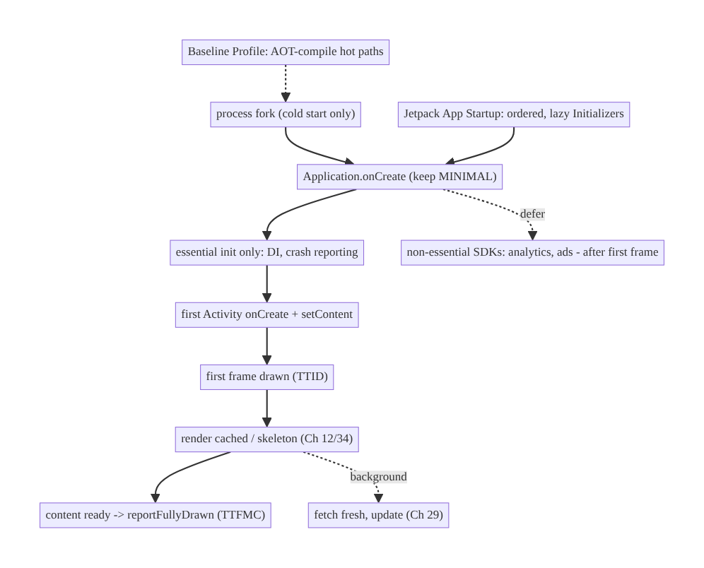
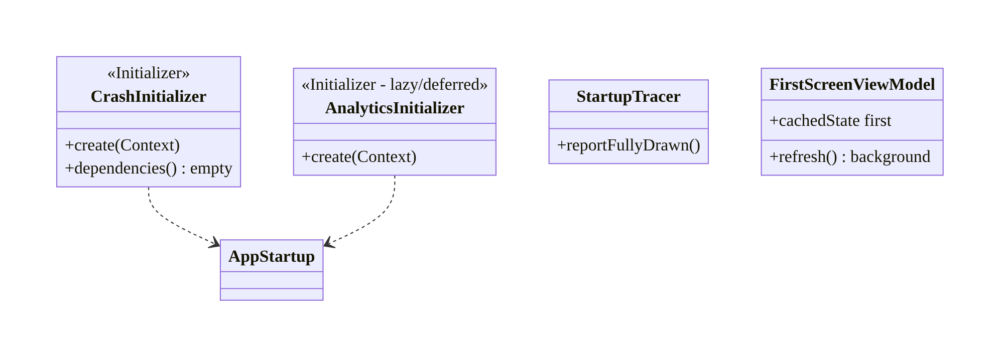
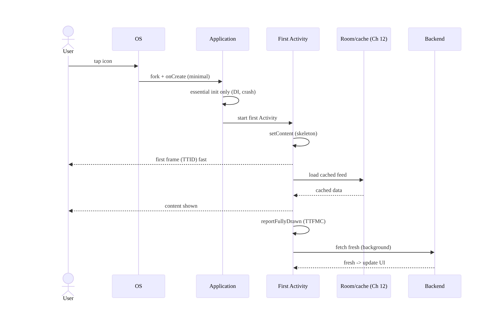
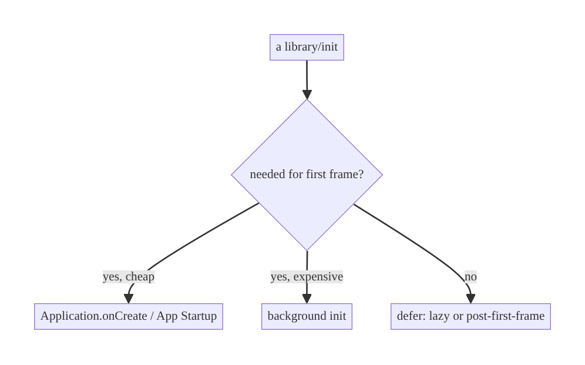
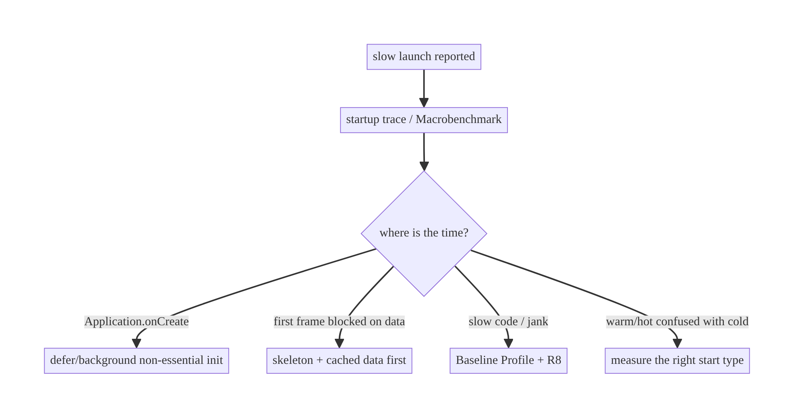

# Chapter 45 — App Startup Optimization

> **Part VI — Lifecycle, Background & Platform** · Complexity: **Standard** (≥25 interview questions)
>
> **Prerequisites:** Ch 44 (lifecycle, `Application.onCreate`), Ch 5 (Hilt/init),
> Ch 6 (UI state), Ch 12/13 (cache/paging for first screen). Pairs with Ch 46/47
> (background), Ch 86/89 (perf/profiling).
>
> **Reference surface in StreamCart:** getting from tap to usable content fast —
> cold-start time, time-to-first-frame, and time-to-first-meaningful-content on the
> home feed.

---

## 45.1 Problem Definition and Real-World Context

Startup is the user's **first impression on every launch** and a ranked Play Store /
Android vitals metric. A slow cold start (blank screen, spinner, jank) causes drop-off,
bad reviews, and (past Google's thresholds) reduced store visibility. The problem is
that everything competes to run at startup — DI graph creation, library
initialization, first network calls, database opens, first-screen layout — and if that
work lands on the **critical path to first frame**, the app feels slow.

Concretely, teams hit:

- **Heavy `Application.onCreate`.** Every SDK (analytics, crash, ads, image loader,
  feature flags) wants to initialize there; serialized on the main thread, this delays
  the first frame directly (Ch 44).
- **Three start types, one experience.** **Cold** (new process), **warm** (process
  alive, Activity recreated), and **hot** (Activity in memory) start cost very
  differently; optimizing only cold, or measuring the wrong one, misleads.
- **Blocking the first frame on data.** Waiting for a network call before showing
  anything → long blank screen. Should show cached/skeleton first (Ch 12/34).
- **Uncoordinated initialization.** Each library registers its own `ContentProvider`
  to auto-init (each one costs main-thread time); order and laziness are unmanaged.
- **No measurement.** Without startup traces / Android vitals, teams can't tell cold
  from warm, or find the slow initializer.

The architecture: understand the **three start types** and the **phases** (process
fork → `Application` → first Activity → first frame → first meaningful content); **move
work off the critical path** (lazy init, background init, defer non-essential SDKs);
**coordinate initialization** with **Jetpack App Startup** instead of per-library
`ContentProvider`s; **show content fast** (cached data + skeletons, not a blank wait on
the network); and **measure** with startup traces, `reportFullyDrawn()`, Macrobenchmark,
and Android vitals. This chapter is about **minimizing time-to-usable** and keeping it
from regressing.

### Three practical use cases

1. **StreamCart cold start.** Trim `Application.onCreate`, defer non-essential SDKs,
   show a cached/skeleton home feed immediately, and stream fresh data (Ch 29/34).
2. **Baseline Profiles.** Ship a Baseline Profile so hot code paths are AOT-compiled on
   first run → faster startup and smoother first scroll.
3. **Regression gate.** Macrobenchmark cold-start test in CI to catch startup
   regressions before release.

### Why this is architectural

Startup optimization is about **what runs on the critical path** and **what the user
sees first** — cross-cutting decisions touching DI, every SDK, the first screen's data
strategy, and the build (Baseline Profiles, R8). It's measured, gated, and defended
over time, not a one-off tweak.

---

## 45.2 Requirements Engineering

### Functional requirements

| ID | Requirement |
|----|-------------|
| F1 | Show a first frame quickly (fast time-to-initial-display). |
| F2 | Show meaningful content quickly (cached/skeleton, not a blank network wait). |
| F3 | Keep `Application.onCreate` minimal; defer non-essential init. |
| F4 | Coordinate initialization (App Startup) with correct ordering/laziness. |
| F5 | Measure cold/warm/hot startup; report fully-drawn. |
| F6 | Gate regressions (Macrobenchmark in CI; Android vitals). |

### Non-functional requirements

| Attribute | Target/Policy |
|-----------|---------------|
| **Cold start (TTID)** | Fast (target e.g. <1s initial display on mid device; team-specific). |
| **TTFMC** | Meaningful content quickly (cached first). |
| **Regression** | CI gate on cold-start benchmark. |
| **Correctness** | Deferred init must not break first-use (lazy, not broken). |
| **Battery** | Don't do unnecessary eager work at startup. |

### Scope

- **In scope:** start types (cold/warm/hot), startup phases, `Application.onCreate`
  trimming, lazy/background init, Jetpack App Startup, first-screen data strategy
  (cache + skeleton), Baseline Profiles/R8 relation, measurement (traces,
  `reportFullyDrawn`, Macrobenchmark, vitals), regression gating.
- **Out of scope:** general lifecycle (Ch 44), background work (Ch 46/47), deep perf
  profiling methodology (Ch 86), Compose perf (Ch 60).

### Assumptions & constraints

- Hilt, Compose, Jetpack App Startup, Macrobenchmark, R8/Baseline Profiles. `minSdk 24`.
  Cold start is unavoidable (process was killed, Ch 8); optimize its cost, not its
  existence.

---

## 45.3 System Design Fundamentals

- **Three start types (measure the right one):**
  - **Cold start:** no process exists. OS forks the process, creates `Application`,
    then the first Activity, then the first frame. The expensive case; `Application.
    onCreate` is on its critical path.
  - **Warm start:** process alive but the Activity was destroyed (e.g., returned after
    the OS reclaimed the Activity). Skips `Application` creation; recreates the Activity.
  - **Hot start:** Activity still in memory; cheapest (just bring to foreground).
- **Startup phases and the "critical path":** fork → `Application.onCreate` → first
  Activity `onCreate`/layout → **first frame drawn (TTID, time to initial display)** →
  **first meaningful content (TTFMC, `reportFullyDrawn`)**. Any main-thread work in
  these phases pushes the first frame later. The goal is to **shrink the critical path**:
  do only what's needed for the first frame now; defer the rest.
- **Move work off the critical path (the main lever):**
  - **Lazy init:** create expensive singletons when first used, not at startup (DI
    makes this natural, Ch 5).
  - **Background init:** initialize things that aren't needed for the first frame on a
    background dispatcher.
  - **Defer non-essential SDKs:** analytics/ads/feature-flags that aren't needed to
    render → init after first frame (e.g., post-`reportFullyDrawn`, or App Startup
    dependency ordering).
- **Jetpack App Startup (coordinated init):** replaces each library's own
  auto-initializing `ContentProvider` (each a main-thread cost) with a **single**
  `InitializationProvider` and `Initializer<T>` components with declared dependencies —
  so init order is explicit and you can make initializers lazy. Fewer providers, ordered
  init.
- **Show content fast, not a blank network wait:** render **cached data** (Ch 12/34) or
  a **skeleton** (Ch 6) on the first frame; fetch fresh in the background and update
  (offline-first, Ch 29). Blocking the first frame on a network call is the classic
  "slow launch" that's really a data-strategy problem.
- **Build-time help:**
  - **Baseline Profiles:** ship a profile of hot startup/first-scroll code so ART
    AOT-compiles it on install → faster startup and smoother first frames (big, nearly
    free win).
  - **R8** (Ch 27): smaller/faster code; startup-aware optimizations.
  - **Startup theme/splash:** a proper `SplashScreen` (windowBackground) avoids a blank
    white/black flash and gives perceived speed.
- **Measurement:** **startup traces** (Perfetto/System Trace), **`reportFullyDrawn()`**
  (marks TTFMC), **Macrobenchmark** (`StartupTimingMetric`, cold/warm/hot, in CI), and
  **Android vitals** (field cold-start distribution). Optimize what you measure.

Core insight: **cold start is the expensive case; shrink its critical path by doing
only first-frame-essential work on the main thread (lazy/background/deferred init,
coordinated via App Startup), show cached/skeleton content immediately instead of
blocking on the network, lean on Baseline Profiles, and measure/gate with traces,
`reportFullyDrawn`, Macrobenchmark and Android vitals** so startup is fast and stays
fast.

---

## 45.4 High-Level Architecture



**Components & ownership**

- **`Application`** does only essential init; non-essential SDKs deferred.
- **Jetpack App Startup** coordinates/ordered initializers (one provider).
- **First Activity** renders cached/skeleton immediately; fetches fresh in background;
  calls `reportFullyDrawn()`.
- **Baseline Profile / R8** speed the code at build/install time.
- **Macrobenchmark / vitals** measure and gate.

**Direction:** minimal critical path → fast first frame → cached content now, fresh
later → measured and gated.

---

## 45.5 Detailed Component Design



| Technique | What it does | Cost of ignoring |
|-----------|--------------|------------------|
| Minimal `onCreate` | less main-thread work | slow every cold start |
| Lazy/background init | off critical path | slow first frame |
| App Startup | ordered, single provider | many providers, unordered |
| Cache + skeleton | content now | blank network wait |
| Baseline Profile | AOT hot paths | slower startup/jank |
| `reportFullyDrawn` + Macrobenchmark | measure/gate | silent regressions |

---

## 45.6 End-to-End Data Flow

### Cold start (optimized)



### Init placement decision



---

## 45.7 Complete Kotlin Implementation

Package: `com.streamcart.startup`.

### 45.7.1 Minimal Application, deferred non-essential init

```kotlin
@HiltAndroidApp
class StreamCartApp : Application() {
    @Inject lateinit var appScope: CoroutineScope          // @ApplicationScope (Ch 5)
    @Inject lateinit var analytics: Lazy<AnalyticsSdk>     // Lazy -> not created at startup

    override fun onCreate() {
        super.onCreate()
        // ESSENTIAL, cheap, main-thread only:
        Timber.plant(/* redacting tree */)                 // crash/log context (Ch 28)
        // NON-ESSENTIAL -> background, off critical path:
        appScope.launch(Dispatchers.Default) {
            analytics.get().initialize()                    // deferred, not needed for first frame
        }
    }
}
```

### 45.7.2 Jetpack App Startup: ordered, lazy initializers

```kotlin
// Essential, must run before first frame -> App Startup with explicit order.
class CrashReportingInitializer : Initializer<CrashReporter> {
    override fun create(context: Context): CrashReporter =
        CrashReporter.init(context)                         // cheap, essential
    override fun dependencies(): List<Class<out Initializer<*>>> = emptyList()
}

// Non-essential -> remove its auto-init (manifest) and init lazily/deferred instead.
// <provider android:name="androidx.startup.InitializationProvider" ...>
//   <meta-data android:name="...AnalyticsInitializer" tools:node="remove" />
// </provider>
```

### 45.7.3 First screen: cached/skeleton now, fresh later + reportFullyDrawn

```kotlin
class FirstScreenViewModel @Inject constructor(
    private val repo: FeedRepository,                       // offline-first (Ch 29)
) : ViewModel() {
    val uiState: StateFlow<FeedUiState> = repo.observeFeed() // emits cached immediately (Ch 3)
        .map { FeedUiState.Content(it) }
        .stateIn(viewModelScope, SharingStarted.Eagerly, FeedUiState.Skeleton)  // skeleton first
    init { viewModelScope.launch { repo.refresh() } }       // fresh in background
}

@Composable
fun FirstScreen(vm: FirstScreenViewModel = hiltViewModel()) {
    val state by vm.uiState.collectAsStateWithLifecycle()
    val activity = LocalContext.current as? ComponentActivity
    when (state) {
        is FeedUiState.Skeleton -> SkeletonFeed()           // first frame content (perceived speed)
        is FeedUiState.Content  -> {
            FeedList((state as FeedUiState.Content).items)
            LaunchedEffect(Unit) { activity?.reportFullyDrawn() }  // mark TTFMC
        }
    }
}
```

### 45.7.4 Macrobenchmark cold-start gate (CI)

```kotlin
@RunWith(AndroidJUnit4::class)
class StartupBenchmark {
    @get:Rule val rule = MacrobenchmarkRule()
    @Test fun coldStartup() = rule.measureRepeated(
        packageName = "com.streamcart",
        metrics = listOf(StartupTimingMetric()),            // timeToInitialDisplay + fullDisplay
        iterations = 10,
        startupMode = StartupMode.COLD,
    ) {
        pressHome(); startActivityAndWait()                 // measures cold start to reportFullyDrawn
    }
    // CI asserts the median stays under the budget -> regression gate.
}
```

### 45.7.5 Module structure

```
:app        minimal Application, App Startup initializers, SplashScreen
:feature:*  first-screen VM (cache-first + reportFullyDrawn)
:benchmark  Macrobenchmark (StartupTimingMetric) + Baseline Profile generation
# Baseline Profile shipped in :app; R8 full mode (Ch 27).
```

---

## 45.8 Concurrency and Race Conditions

| Scenario | Risk | Handling |
|----------|------|----------|
| Background init not ready on first use | NPE/crash | `Lazy`/`await`; init essential synchronously |
| Deferred SDK used before init | missing event | essential path synchronous; others lazy-safe |
| First frame blocked on IO | slow TTID | load cache off main thread; skeleton first |
| App Startup dependency cycle | crash | acyclic `dependencies()` |
| `reportFullyDrawn` called repeatedly | wrong metric | once, when content first shown |
| Parallel init races | corrupted singletons | each init idempotent / `@Singleton` (Ch 5) |

- **Essential vs deferred must be correct:** anything the first frame truly needs must
  be ready synchronously (cheaply) or awaited; only genuinely-not-needed work is
  deferred/background. Deferring something the first screen uses causes a crash or
  missing data — the subtle bug of aggressive startup trimming.
- **First-frame work must be off the main thread for IO:** loading cache should be on a
  background dispatcher (Room suspending, Ch 3); the main thread draws the skeleton
  immediately.

---

## 45.9 Failure Scenarios and Recovery

| Failure | Detection | Response | Outcome |
|---------|-----------|----------|---------|
| Slow cold start | vitals / Macrobenchmark | trim onCreate; defer SDKs; Baseline Profile | fast |
| Blank screen on launch | user report / trace | skeleton + cache first | content now |
| Deferred init crash on use | crash | make essential-for-first-use synchronous | no crash |
| Regression shipped | vitals spike | CI Macrobenchmark gate | caught pre-release |
| White flash before UI | visual | SplashScreen (windowBackground) | smooth |
| Jank on first scroll | frame metrics | Baseline Profile | smooth |
| Measuring wrong start type | misleading data | distinguish cold/warm/hot | correct focus |



> **"Slow launch" is almost always one of four things:** heavy `Application.onCreate`,
> a first frame blocked on the network, un-AOT'd hot code, or measuring the wrong start
> type. A startup trace tells you which — don't optimize blind.

---

## 45.10 Scaling the Implementation

- **Level 1.** Minimal `Application.onCreate`; skeleton + cached first screen.
- **Level 2.** Jetpack App Startup for ordered init; defer non-essential SDKs; ship a
  Baseline Profile.
- **Level 3 — production.** `reportFullyDrawn`; Macrobenchmark cold-start in CI;
  Android vitals monitoring; SplashScreen API.
- **Level 4 — large.** Per-module init budgets; lazy feature initialization (Ch 5/96);
  R8 full mode; profile-guided optimization; startup-cost reviews per SDK added.
- **Level 5 — enterprise.** Startup SLOs with vitals alerting; automated regression
  gates per PR; per-device-class budgets (low-end vs flagship); dashboards of TTID/
  TTFMC distributions.

**Avoid overengineering:** for most apps, a minimal `onCreate` + cache-first first
screen + Baseline Profile + one Macrobenchmark gets 90% of the win. Don't micro-defer
cheap init or build elaborate startup frameworks prematurely.

---

## 45.11 Alternative Approaches and Trade-offs

| Dimension | Option A | Option B | When |
|-----------|----------|----------|------|
| Init coordination | Jetpack App Startup | per-library `ContentProvider` | App Startup (one provider, ordered); auto-providers cost main-thread time |
| Non-essential SDK | Defer/lazy | eager in onCreate | Defer unless needed for first frame |
| First screen | Cache + skeleton | block on network | Cache-first always (offline-first, Ch 29) |
| Compile | Baseline Profile + R8 | none | Always ship a Baseline Profile |
| Measurement | Macrobenchmark + vitals | manual timing | Macrobenchmark (reproducible, CI) + vitals (field) |
| Splash | SplashScreen API | custom splash Activity | SplashScreen API (no extra Activity/latency) |

**App Startup vs per-library auto-init:** many libraries auto-initialize via their own
`ContentProvider`, each adding fixed main-thread cost at process start and giving you no
control over order or laziness. Jetpack App Startup consolidates these into one
`InitializationProvider` with explicit `Initializer` dependencies, so you pay for one
provider, control ordering, and can defer/remove initializers. Prefer it; remove
auto-init providers you don't need.

**Cache-first vs network-blocking first screen:** blocking the first frame on a network
response produces a long blank/spinner launch that users perceive as "slow app," even
when `onCreate` is fast. Rendering cached data (or a skeleton) immediately and streaming
fresh data in makes launch feel instant and is the offline-first default (Ch 29). The
only cost is briefly showing slightly-stale data, which is almost always the right
trade.

---

## 45.12 Security Considerations

- **Don't do security-sensitive heavy work on the hot startup path** in a way that
  leaks timing, but **do** gate sensitive screens (re-auth, Ch 21) before showing
  content — perceived speed must not bypass auth.
- **SplashScreen must not show protected content**; keep it a brand/skeleton.
- **Deferred analytics/attribution SDKs** still must honor consent (Ch 28/87) — defer
  *initialization timing*, not *consent*.
- **Baseline Profiles / R8** don't weaken security; R8 also obfuscates (Ch 27).
- Client vs backend: startup is a client-perceived-performance concern; backend is
  unaffected except that cache-first reduces cold-start request spikes.

---

## 45.13 Performance and Resource Optimization

This chapter *is* a performance chapter; key levers recap:

- **Trim the critical path:** minimal `onCreate`; defer/background non-essential init.
- **Baseline Profiles:** AOT hot startup + first-scroll paths (largest low-effort win).
- **Cache-first first screen:** content now, not a network wait.
- **R8 full mode** (Ch 27): smaller, faster code.
- **Avoid main-thread IO** at startup (cache load off-main; lazy DB open).
- **SplashScreen API** for perceived speed without an extra Activity.
- **Measure:** startup traces (find the slow initializer), Macrobenchmark
  (`StartupTimingMetric` cold/warm/hot), `reportFullyDrawn` (TTFMC), Android vitals
  (field distribution), per-device-class budgets.

---

## 45.14 Testing Strategy

Startup is validated by **Macrobenchmark** (timing) and field **vitals**; correctness of
deferred init by unit/integration tests.

```kotlin
// Macrobenchmark: cold/warm/hot timing (see 45.7.4). Assert medians under budget in CI.

// Baseline Profile generation (run on CI/device):
@Test fun generateBaselineProfile() = baselineProfileRule.collect(packageName = "com.streamcart") {
    pressHome(); startActivityAndWait()
    // scroll the first screen so the profile captures first-scroll hot paths
}

// Correctness: deferred SDK is initialized before first use path; essential init is synchronous.
class StartupInitTest {
    @Test fun `essential init completes before first screen uses it`() { /* ... */ }
    @Test fun `deferred analytics initializes off critical path`() { /* ... */ }
}
```

What to test: cold/warm/hot timing (Macrobenchmark, CI-gated), Baseline Profile
generation + presence, first screen renders skeleton then cached content, deferred init
doesn't break first-use, `reportFullyDrawn` called exactly once.

---

## 45.15 Production Observability

- **Metrics:** Android vitals cold-start distribution (p50/p90/p95), TTID/TTFMC,
  excessive-startup rate, per-device-class startup, Baseline Profile coverage, first-
  frame jank.
- **Logs/traces:** startup Perfetto traces (per-phase), `reportFullyDrawn` timing,
  per-initializer timing (App Startup).
- **Debugging:** regression → Macrobenchmark + trace to find the new slow init; field-
  only slowness → low-end device class; blank launch → first-frame data blocking;
  jank → missing/stale Baseline Profile.
- **Alerting:** vitals cold-start p90 over budget → alert; CI benchmark regression →
  block merge.
- **Dashboards:** startup time by device class and app version over releases.

---

## 45.16 System Design Interview Preparation

> ≥25 questions.

**Fundamentals**

1. *Cold vs warm vs hot?* New process / process-alive-Activity-recreated / Activity-in-
   memory — decreasing cost.
2. *Startup phases?* fork → Application → first Activity → first frame (TTID) → first
   meaningful content (TTFMC).
3. *What's the critical path?* Main-thread work before the first frame.
4. *Biggest `onCreate` risk?* Heavy serialized SDK init.
5. *TTID vs TTFMC?* First frame drawn vs content actually meaningful
   (`reportFullyDrawn`).

**Optimizing**

6. *Main lever?* Move non-essential work off the critical path (lazy/background/defer).
7. *What to defer?* SDKs not needed for the first frame (analytics, ads).
8. *Jetpack App Startup?* One `InitializationProvider` + ordered `Initializer`s vs
   per-library providers.
9. *Why remove auto-init providers?* Each costs main-thread time at process start.
10. *First screen strategy?* Cached/skeleton now, fresh in background.
11. *Baseline Profiles?* AOT-compile hot startup/scroll paths → faster + smoother.
12. *R8's role?* Smaller/faster code (Ch 27).
13. *SplashScreen API?* Perceived speed, no extra Activity.

**Measurement**

14. *How measure startup?* Startup traces, Macrobenchmark `StartupTimingMetric`,
    `reportFullyDrawn`, Android vitals.
15. *Macrobenchmark vs manual?* Reproducible, CI-gateable, cold/warm/hot modes.
16. *Field vs lab?* Vitals (field distribution) vs Macrobenchmark (lab).
17. *Mark TTFMC?* `reportFullyDrawn()` when content is shown.

**Pitfalls**

18. *Deferring too much?* Deferred-but-needed init crashes first use.
19. *Measuring wrong type?* Confusing warm/hot with cold misleads.
20. *Blank launch cause?* First frame blocked on network.
21. *Jank on first scroll?* Missing Baseline Profile.

**Security**

22. *Speed vs auth?* Still gate sensitive screens (re-auth); splash shows no protected
    content.
23. *Deferred analytics + consent?* Defer timing, not consent.

**Production**

24. *Regression gate?* CI Macrobenchmark budget + vitals alert.
25. *Field-only slowness?* Low-end device class — set per-class budgets.
26. *Find the slow initializer?* Startup Perfetto trace.

### Design-change challenges
1. **Cold start is 3s.** Trace → trim `onCreate`/defer SDKs, cache-first screen,
   Baseline Profile.
2. **Launch shows a blank screen for 2s.** Skeleton + cached content first; fetch in
   background.
3. **An SDK must init but not block startup.** Background/deferred init; essential path
   synchronous.
4. **Startup regressed after a release.** CI Macrobenchmark gate; trace the new init.
5. **First scroll janks.** Ship/refresh Baseline Profile; R8 full mode.

### Mock walkthrough (abridged)
Clarify (which start type, target, device classes?) → phases & critical path → trim
`onCreate`/App Startup/defer SDKs → cache-first first screen + `reportFullyDrawn` →
Baseline Profile + R8 → measure (Macrobenchmark + vitals) → regression gate → security
(auth still enforced).

---

## 45.17 Practical Exercises

1. **Beginner.** Move a non-essential SDK init out of `Application.onCreate` to a
   deferred/background init. *Eval:* first frame unaffected; SDK still works.
2. **Intermediate.** Make the first screen render a skeleton, then cached data, then
   fresh; call `reportFullyDrawn`. *Eval:* no blank wait; TTFMC marked.
3. **Advanced.** Add a Macrobenchmark cold-start test and a Baseline Profile; gate in
   CI. *Eval:* benchmark runs; profile ships; CI fails on regression.
4. **Production debugging.** A trace shows `onCreate` dominated by one initializer —
   convert it to App Startup lazy/background. *Eval:* critical path shortened.
5. **System design challenge.** Define per-device-class startup budgets and vitals
   alerting; investigate a field-only regression. *Eval:* budgets + alert; low-end
   diagnosed.

*(Solutions withheld unless requested.)*

---

## 45.18 Chapter Summary & Reference Sheet

**Key decisions:** treat **cold start** as the expensive case and **shrink its critical
path** — keep `Application.onCreate` minimal, make init **lazy/background/deferred**
unless it's needed for the first frame, and coordinate it with **Jetpack App Startup**
(one provider, ordered initializers) instead of per-library auto-init providers; **show
content immediately** (skeleton + cached data, fresh in the background — offline-first,
Ch 29) rather than blocking the first frame on the network; ship a **Baseline Profile**
(+ R8) so hot paths are AOT-compiled; use the **SplashScreen API** for perceived speed;
and **measure and gate** with startup traces, `reportFullyDrawn()`, **Macrobenchmark**
(cold/warm/hot in CI) and **Android vitals** (field) so startup is fast and stays fast.

**Concepts:** start types (cold/warm/hot), startup phases, critical path, TTID/TTFMC,
lazy/background/deferred init, App Startup, cache-first first screen, Baseline Profiles,
R8, SplashScreen API, Macrobenchmark, Android vitals, regression gating.

**Common mistakes:** heavy `Application.onCreate`; eager non-essential SDK init;
blocking the first frame on the network; per-library auto-init providers; no Baseline
Profile (jank); deferring something the first screen needs (crash); measuring the wrong
start type; no CI regression gate.

**Checklist:**

- [ ] minimal `onCreate`
- [ ] defer/background non-essential init
- [ ] App Startup for ordering
- [ ] skeleton + cached first screen
- [ ] `reportFullyDrawn()`
- [ ] Baseline Profile + R8
- [ ] SplashScreen API
- [ ] Macrobenchmark cold-start in CI
- [ ] Android vitals monitoring
- [ ] per-device-class budgets.

**Key APIs:** `Application`/`@HiltAndroidApp`, `androidx.startup.Initializer`/
`InitializationProvider`, `Lazy<T>` (Hilt), `ComponentActivity.reportFullyDrawn()`,
`core-splashscreen` `SplashScreen`, Macrobenchmark `StartupTimingMetric`/`StartupMode`,
Baseline Profile (`baselineProfileRule`), R8/`proguard-rules`.

**References:**
- App startup time: https://developer.android.com/topic/performance/vitals/launch-time
- Jetpack App Startup: https://developer.android.com/topic/libraries/app-startup
- Baseline Profiles: https://developer.android.com/topic/performance/baselineprofiles/overview
- Macrobenchmark: https://developer.android.com/topic/performance/benchmarking/macrobenchmark-overview
- SplashScreen: https://developer.android.com/develop/ui/views/launch/splash-screen
- (composes) Ch 5 DI/lazy, Ch 29 Offline-First, Ch 27 R8, Ch 86 Profiling

### Chapter review (Phase 4)
- **Completeness:** all 18 sections; architecture/class/sequence/decision/failure
  diagrams; minimal Application + App Startup + cache-first screen + reportFullyDrawn +
  Macrobenchmark code; concurrency (essential-vs-deferred, off-main IO); failure (slow/
  blank/regression triage); 5 levels; App-Startup-vs-auto-init and cache-vs-network
  trade-offs; security (auth not bypassed); perf (Baseline Profiles etc.); Macrobenchmark
  + Baseline Profile tests; vitals observability; 26 Q&A + 5 challenges. ✅
- **Expand later:** profiling methodology (Ch 86), Compose perf (Ch 60), R8 (Ch 27).
- **Interview coverage:** exceeds ≥25 bar.
