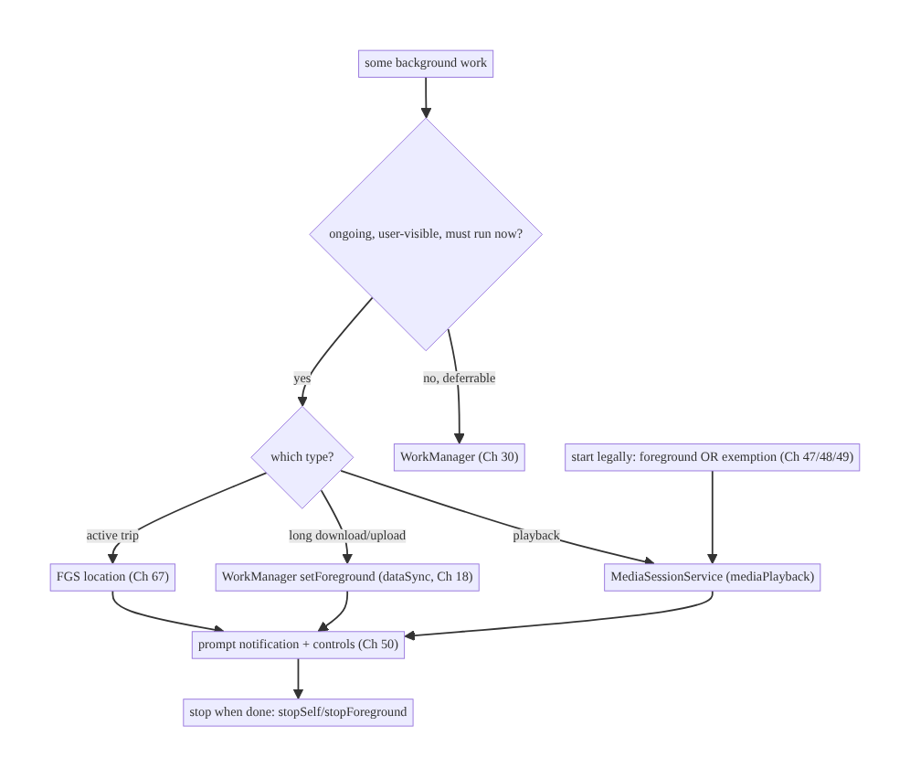
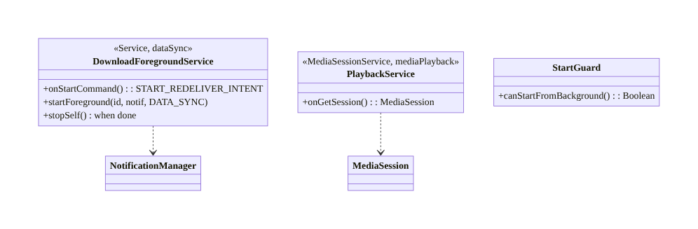
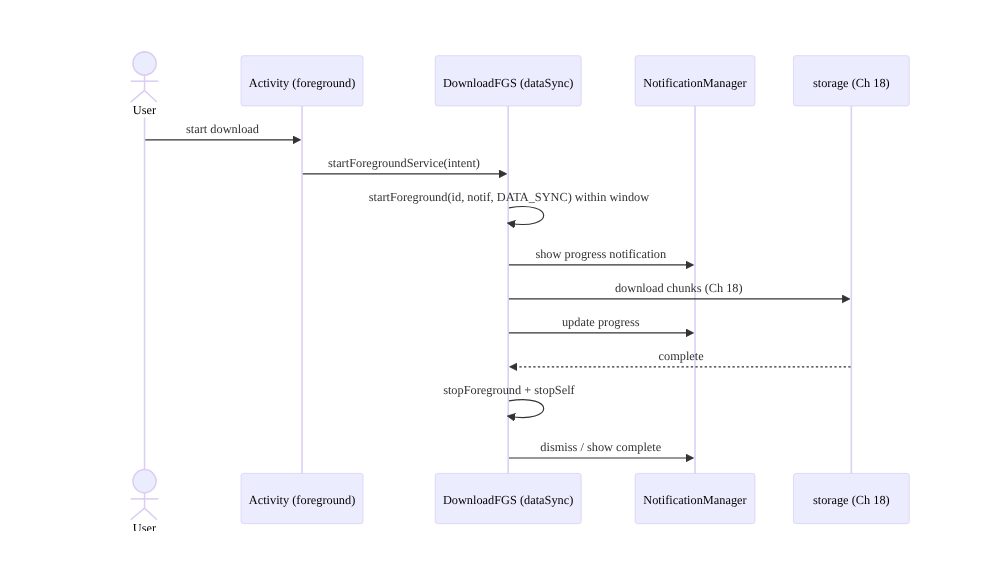
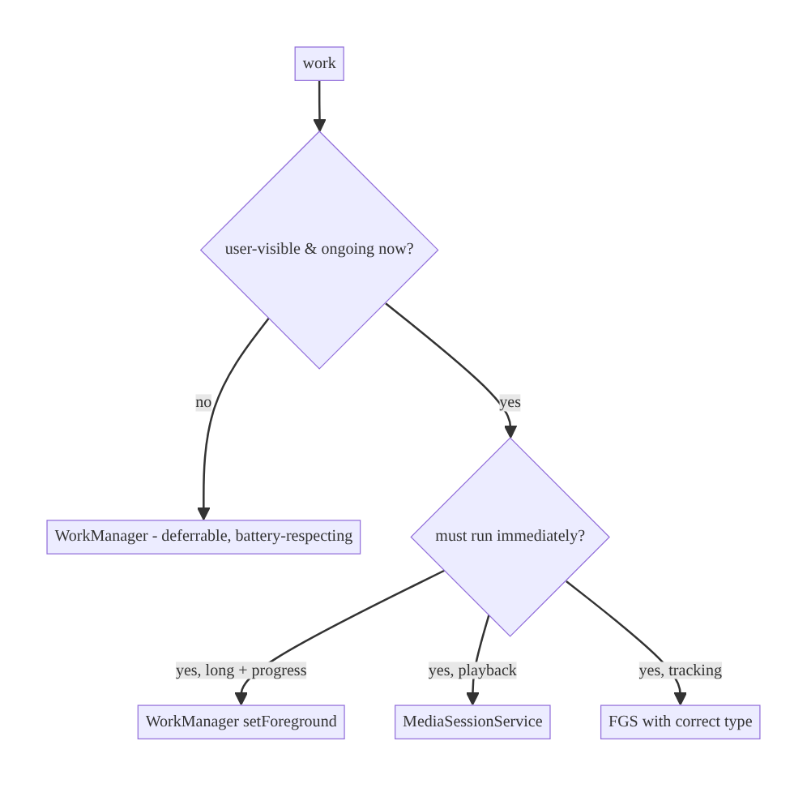
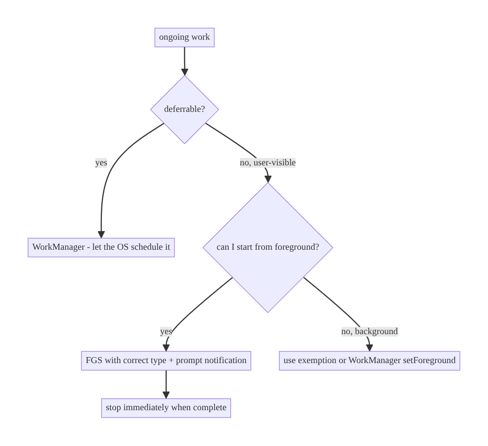

# Chapter 46 — Foreground Services

> **Part VI — Lifecycle, Background & Platform** · Complexity: **Standard** (≥25 interview questions)
>
> **Prerequisites:** Ch 44 (lifecycle), Ch 30 (WorkManager), Ch 18 (download
> manager), Ch 50 (notifications). Pairs with Ch 47 (Doze/background limits), Ch 63
> (real-time), Ch 67 (location).
>
> **Reference surface in StreamCart:** user-visible ongoing work that must keep running
> while the app is backgrounded — media playback, an active download, live order
> tracking, a navigation/location session.

---

## 46.1 Problem Definition and Real-World Context

Android aggressively restricts background execution to protect battery (Ch 47), so a
plain background thread or service is killed soon after the app leaves the foreground.
But some work is **ongoing, user-initiated, and must continue while backgrounded with
the user's knowledge** — playing music, downloading a large file, tracking a run,
navigating. The mechanism for that is a **foreground service (FGS)**: a service that
shows a persistent notification and is treated by the OS as "the user is aware this is
running," so it's far less likely to be killed and is exempt from many background limits
*while it runs*.

The problem is that FGS is powerful and therefore **heavily governed**, and misuse is a
top cause of crashes and Play policy rejections:

- **Wrong tool.** Using an FGS for deferrable or short work that should be WorkManager
  (Ch 30) — wasting battery and triggering policy issues — or using WorkManager for
  truly ongoing user-visible work it can't guarantee.
- **FGS type requirements (modern Android).** From Android 10+ (and much stricter on
  Android 14+), every FGS must declare a **type** (`mediaPlayback`, `location`,
  `dataSync`, `connectedDevice`, etc.), hold the matching permission, and only be
  started in allowed circumstances — or it crashes/`ForegroundServiceStartNotAllowed`.
- **Background-start restrictions.** Android 12+ forbids starting an FGS from the
  background except for specific exemptions; starting one from a backgrounded app throws.
- **Notification requirements.** FGS must post a notification promptly (else ANR/crash),
  and on Android 13+ needs notification permission (Ch 51) for it to be visible.
- **Lifecycle correctness.** Not stopping the service when work is done (battery, "stuck"
  notification), or not handling process death/restart (`START_STICKY` semantics, Ch 8).

The architecture: **choose FGS only for ongoing, user-visible, must-run-now work**;
declare the correct **service type** + permissions; **start it legally** (from the
foreground or an allowed exemption; or promote from WorkManager via `setForeground`);
post a **compliant notification promptly**; **manage its lifecycle** (stop when done,
handle restart); and reserve **WorkManager** (Ch 30) for everything deferrable. This
chapter is about **keeping legitimate ongoing work alive within the platform's rules**.

### Three practical use cases

1. **StreamCart media playback.** `mediaPlayback` FGS + `MediaSession`; keeps audio/
   video playing and controllable from the notification while backgrounded.
2. **Active large download.** A `dataSync` FGS (or WorkManager long-running worker via
   `setForeground`, Ch 18/30) with a progress notification; survives backgrounding.
3. **Live order tracking / navigation.** A `location` FGS for an active trip; stops when
   the trip ends (Ch 67).

### Why this is architectural

The FGS-vs-WorkManager decision, service-type declaration, start-legality, and
lifecycle management are platform-contract choices that determine whether ongoing work
survives, whether the app passes Play review, and how much battery it costs — decisions
that shape any feature doing continuous background work.

---

## 46.2 Requirements Engineering

### Functional requirements

| ID | Requirement |
|----|-------------|
| F1 | Keep ongoing, user-visible work running while backgrounded. |
| F2 | Declare the correct FGS type + permissions; start only when allowed. |
| F3 | Post a compliant notification promptly; reflect progress/controls. |
| F4 | Stop the service when work completes (no stuck notification). |
| F5 | Handle process death/restart correctly. |
| F6 | Use WorkManager for deferrable work, not FGS. |

### Non-functional requirements

| Attribute | Policy |
|-----------|--------|
| **Compliance** | Correct FGS type; legal start; Play policy adherence. |
| **Battery** | FGS only while truly needed; stop promptly. |
| **Reliability** | Survives backgrounding; restart semantics defined. |
| **UX** | Clear, actionable notification; controls where relevant. |
| **Correctness** | No `ForegroundServiceStartNotAllowed`/ANR. |

### Scope

- **In scope:** FGS concept and when to use it vs WorkManager; service types +
  permissions; start legality (Android 12+/14+); notification requirements (+ Android 13
  permission); lifecycle (`startForeground`, `stopSelf`, restart/`START_STICKY`);
  WorkManager `setForeground`; media/download/location examples.
- **Out of scope:** Doze/background limits detail (Ch 47), WorkManager internals (Ch 30),
  notifications design (Ch 50), location specifics (Ch 67), media session detail (media
  chapter).

### Assumptions & constraints

- `minSdk 24`, `targetSdk` current (so Android 12+ background-start and 14+ type
  enforcement apply). Hilt, WorkManager, `MediaSessionService`/`MediaSession` for media.
  FGS is governed by OS version + Play policy; rules tighten over versions.

---

## 46.3 System Design Fundamentals

- **What an FGS is.** A `Service` that calls `startForeground(id, notification, type)`
  within a few seconds of starting, showing a persistent notification. The OS treats it
  as user-aware ongoing work: far lower kill priority, and exempt from most background-
  execution limits (Ch 47) **while running**. It is **not** for deferrable or invisible
  work.
- **FGS vs WorkManager (the core decision):**
  - **WorkManager** (Ch 30): **deferrable, guaranteed-eventually** background work
    (sync, upload, cleanup). The OS schedules it respecting Doze/battery. Use for almost
    all background work.
  - **Foreground service:** **immediate, ongoing, user-visible, must-run-now** work the
    user started (playback, active download, live tracking). The user sees a
    notification and could stop it.
  - **Bridge:** a WorkManager worker can become a long-running foreground worker via
    `setForeground()` (Ch 30) — WorkManager-managed but FGS-backed for user-visible
    long tasks (e.g., a big upload/download, Ch 18). Prefer this for "long task that's
    deferrable-ish but must show progress."
- **Service types (Android 10+, enforced on 14+).** Each FGS declares a type in the
  manifest (`android:foregroundServiceType`) and passes it to `startForeground`:
  `mediaPlayback`, `location`, `dataSync`, `connectedDevice`, `camera`, `microphone`,
  `phoneCall`, `health`, `remoteMessaging`, `shortService`, `specialUse`, `systemExempted`.
  Each type requires specific permissions and allowed use cases; on Android 14+ starting
  a type you can't justify throws. `dataSync` and `shortService` are time-limited.
- **Start legality (Android 12+).** You generally cannot **start** an FGS while the app
  is in the **background**; doing so throws `ForegroundServiceStartNotAllowed`. Start it
  from the foreground, or rely on a defined **exemption** (e.g., responding to a
  high-priority FCM, from an exact alarm, from a visible notification action, Bluetooth/
  companion-device cases, Ch 47/48/49). For background-triggered ongoing work, the clean
  path is often WorkManager/`setForeground` or an exemption.
- **Notification requirements.** The FGS notification must appear promptly (missing it →
  crash/ANR). On Android 13+ a service's notification is only **shown** if the app holds
  `POST_NOTIFICATIONS` (Ch 51) — the service still runs, but silently, which hurts the
  "user is aware" contract. Design the notification with meaningful content and actions
  (play/pause, cancel).
- **Lifecycle & restart.** Start with `startForegroundService()`/`ContextCompat.
  startForegroundService()` (then `startForeground` within the window), stop with
  `stopSelf()`/`stopForeground()` when work is done (critical — else a stuck
  notification + battery). `onStartCommand` return (`START_STICKY`/`START_NOT_STICKY`/
  `START_REDELIVER_INTENT`) defines restart behavior after process death (Ch 8); choose
  per semantics (sticky for playback that should resume state, not-sticky for one-shot).
- **Modern media = `MediaSessionService`.** For playback, use Media3's
  `MediaSessionService` (handles the FGS, notification, and system controls) rather than
  hand-rolling — the recommended, compliant path.

Core insight: **use a foreground service only for ongoing, user-visible, must-run-now
work the user initiated; declare the correct type and permissions; start it legally
(foreground or a defined exemption, or via WorkManager's `setForeground`); post a
compliant notification promptly; and stop it the moment work is done — while routing all
deferrable work to WorkManager** so the app stays within the platform's tightening
background rules.

---

## 46.4 High-Level Architecture



**Components & ownership**

- **Decision gate:** deferrable → WorkManager; ongoing user-visible → FGS.
- **FGS** (or `MediaSessionService` / WorkManager `setForeground`) runs the ongoing
  work, posts the notification, and stops when done.
- **Start path** must be legal (foreground or exemption).

**Direction:** classify work → choose FGS type/mechanism → start legally → notify →
stop promptly.

---

## 46.5 Detailed Component Design



| Mechanism | Type | Use for | Notes |
|-----------|------|---------|-------|
| `MediaSessionService` | `mediaPlayback` | audio/video | Media3 handles FGS + controls |
| FGS (`dataSync`) / WM `setForeground` | `dataSync` | active download/upload | time-limited; prefer WM for deferrable-long |
| FGS `location` | `location` | active trip/navigation | needs location perms (Ch 67) |
| WorkManager | — | deferrable sync/upload | default for background work |

---

## 46.6 End-to-End Data Flow

### Starting & stopping an FGS (download)



### Decision: FGS vs WorkManager



---

## 46.7 Complete Kotlin Implementation

Package: `com.streamcart.fgs`.

### 46.7.1 Manifest: type + permissions (Android 14+)

```xml
<uses-permission android:name="android.permission.FOREGROUND_SERVICE" />
<uses-permission android:name="android.permission.FOREGROUND_SERVICE_DATA_SYNC" />
<uses-permission android:name="android.permission.POST_NOTIFICATIONS" />   <!-- Android 13+ (Ch 51) -->

<service
    android:name=".fgs.DownloadForegroundService"
    android:exported="false"
    android:foregroundServiceType="dataSync" />
```

### 46.7.2 A compliant foreground service (download)

```kotlin
@AndroidEntryPoint
class DownloadForegroundService : Service() {
    @Inject lateinit var downloader: FileDownloader           // Ch 18
    private val scope = CoroutineScope(SupervisorJob() + Dispatchers.IO)

    override fun onStartCommand(intent: Intent?, flags: Int, startId: Int): Int {
        val url = intent?.getStringExtra(EXTRA_URL) ?: run { stopSelf(); return START_NOT_STICKY }
        // MUST call startForeground promptly with a notification + the declared type:
        startForeground(NOTIF_ID, buildNotification(progress = 0),
            ServiceInfo.FOREGROUND_SERVICE_TYPE_DATA_SYNC)
        scope.launch {
            downloader.download(url) { pct -> updateNotification(pct) }   // progress
            withContext(Dispatchers.Main) { stopSelf(startId) }           // STOP when done
        }
        return START_REDELIVER_INTENT   // re-deliver intent if killed mid-work (Ch 8)
    }
    override fun onDestroy() { scope.cancel(); super.onDestroy() }
    override fun onBind(intent: Intent?): IBinder? = null

    private fun buildNotification(progress: Int): Notification =
        NotificationCompat.Builder(this, CHANNEL_DOWNLOADS)
            .setContentTitle("Downloading")
            .setSmallIcon(R.drawable.ic_download)
            .setProgress(100, progress, false)
            .setOngoing(true)
            .addAction(cancelAction())        // user can stop (Ch 50)
            .build()
}
```

### 46.7.3 Starting legally (from the foreground only)

```kotlin
class DownloadStarter @Inject constructor(@ApplicationContext private val context: Context) {
    fun start(url: String) {
        // Call this ONLY from the foreground (Android 12+). From background -> use WorkManager
        // or a defined exemption (high-priority FCM, exact alarm, notification action).
        val intent = Intent(context, DownloadForegroundService::class.java).putExtra(EXTRA_URL, url)
        ContextCompat.startForegroundService(context, intent)
    }
}
```

### 46.7.4 Preferred for long deferrable work: WorkManager `setForeground` (Ch 30)

```kotlin
@HiltWorker
class LongDownloadWorker @AssistedInject constructor(
    @Assisted ctx: Context, @Assisted params: WorkerParameters, private val downloader: FileDownloader,
) : CoroutineWorker(ctx, params) {
    override suspend fun getForegroundInfo() =
        ForegroundInfo(NOTIF_ID, buildNotification(0), ServiceInfo.FOREGROUND_SERVICE_TYPE_DATA_SYNC)
    override suspend fun doWork(): Result {
        setForeground(getForegroundInfo())                    // promote to FGS-backed
        return runCatching { downloader.download(inputData.getString("url")!!) { setProgressAsync(workDataOf("p" to it)) } }
            .fold({ Result.success() }, { Result.retry() })   // WorkManager handles retry/constraints (Ch 30)
    }
}
```

### 46.7.5 Media playback = `MediaSessionService` (don't hand-roll)

```kotlin
@AndroidEntryPoint
class PlaybackService : MediaSessionService() {              // foregroundServiceType="mediaPlayback"
    @Inject lateinit var player: ExoPlayer
    private lateinit var session: MediaSession
    override fun onCreate() { super.onCreate(); session = MediaSession.Builder(this, player).build() }
    override fun onGetSession(controllerInfo: MediaSession.ControllerInfo) = session
    override fun onDestroy() { session.release(); player.release(); super.onDestroy() }
}
```

### 46.7.6 Module structure

```
:core:fgs     DownloadForegroundService, DownloadStarter, StartGuard
:feature:media PlaybackService (MediaSessionService), MediaSession
:core:work    LongDownloadWorker (setForeground), WorkManager setup (Ch 30)
```

---

## 46.8 Concurrency and Race Conditions

| Scenario | Risk | Handling |
|----------|------|----------|
| `startForeground` not called in time | crash/ANR | call it synchronously in `onStartCommand` |
| Start FGS from background (Android 12+) | `ForegroundServiceStartNotAllowed` | start from foreground / exemption / WorkManager |
| Service not stopped | stuck notification + battery | `stopSelf`/`stopForeground` on completion |
| Process death mid-work | lost work | `START_REDELIVER_INTENT`/`START_STICKY` (Ch 8); WorkManager for guarantees |
| Multiple starts | duplicate work | `startId` handling / single service instance |
| No `POST_NOTIFICATIONS` (Android 13+) | silent FGS (user unaware) | request permission (Ch 51) |

- **`startForeground` must happen fast** — the OS gives a few seconds after
  `startForegroundService`; missing it crashes. Build the notification cheaply and call
  it first thing.
- **Background start is the common crash:** on Android 12+ you cannot start an FGS from
  the background without an exemption; route background-triggered ongoing work through
  WorkManager/`setForeground` or an allowed exemption (high-priority FCM for a
  call/alarm, Ch 48/49).

---

## 46.9 Failure Scenarios and Recovery

| Failure | Detection | Response | Outcome |
|---------|-----------|----------|---------|
| FGS killed in background | work incomplete | WorkManager/`setForeground`; restart semantics | survives/resumes |
| `ForegroundServiceStartNotAllowed` | crash | start legally; exemption; WorkManager | compliant |
| Missing `startForeground` | ANR/crash | call promptly | stable |
| Stuck notification | user report | stop service on completion | dismissed |
| Silent FGS (no notif) | user unaware | request `POST_NOTIFICATIONS` | visible |
| Play policy rejection | review | correct type + justified use | approved |
| Wrong tool (FGS for deferrable) | battery/policy | move to WorkManager | compliant, efficient |



> **Most FGS failures are policy/lifecycle, not logic:** wrong tool (deferrable work in
> an FGS), illegal background start, missing/late `startForeground`, or not stopping.
> Classify the work first — if it's deferrable, it's WorkManager, full stop.

---

## 46.10 Scaling the Implementation

- **Level 1.** Media playback via `MediaSessionService`; WorkManager for all deferrable
  work.
- **Level 2.** `dataSync` FGS (or WM `setForeground`) for active downloads/uploads with
  progress notifications; correct types + permissions.
- **Level 3 — production.** Legal start paths (foreground/exemption); `POST_
  NOTIFICATIONS` handling (Ch 51); restart semantics; stop-on-complete discipline.
- **Level 4 — large.** Multiple FGS types (media + location trip + sync) coordinated;
  consistent notification/controls; policy review per type; battery budgets.
- **Level 5 — enterprise.** FGS usage governance (which teams may use which types),
  Play-policy compliance checks in CI (manifest lint for types/permissions),
  observability of FGS runtime + kills, migration of misused FGS to WorkManager.

**Avoid overengineering:** most apps need exactly one or two FGS types (media, maybe
download/location) and WorkManager for everything else. Don't build custom background
frameworks around FGS; prefer `MediaSessionService` and WorkManager `setForeground`.

---

## 46.11 Alternative Approaches and Trade-offs

| Dimension | Option A | Option B | When |
|-----------|----------|----------|------|
| Ongoing vs deferrable | Foreground service | WorkManager | FGS only for ongoing user-visible; WorkManager otherwise |
| Long download | WM `setForeground` | raw FGS | Prefer WM (retry/constraints + FGS-backed) |
| Playback | `MediaSessionService` | hand-rolled FGS | Always `MediaSessionService` (compliant, controls) |
| Background-triggered ongoing | Exemption (FCM/alarm) | start FGS directly | Exemption/WorkManager; direct start throws (Android 12+) |
| Restart | `START_REDELIVER_INTENT`/`STICKY` | `START_NOT_STICKY` | Per semantics (resume vs one-shot) |

**FGS vs WorkManager:** the single most important decision. WorkManager is for
deferrable, guaranteed-eventually work and respects Doze/battery — it's the default.
A foreground service is for ongoing, user-visible, must-run-now work and costs a
persistent notification and battery. Using an FGS for deferrable work drains battery and
risks Play rejection; using WorkManager for genuine ongoing playback fails because it
can't guarantee immediate continuous execution. For long user-visible tasks that are
"deferrable-ish but must show progress," WorkManager's `setForeground` gives you both.

**`MediaSessionService` vs hand-rolled playback FGS:** Media3's `MediaSessionService`
manages the foreground service, the media notification, system/Bluetooth/Auto controls,
and audio focus for you, and stays compliant with changing FGS rules. Hand-rolling all
of that is error-prone and a frequent source of policy and lifecycle bugs. Always use
`MediaSessionService`.

---

## 46.12 Security Considerations

- **`android:exported="false"`** for internal services — don't let other apps start your
  FGS.
- **Validate start intents** (the `EXTRA_URL`/params) — an exported or
  `PendingIntent`-triggered service must treat inputs as untrusted (Ch 23/52).
- **Least-privilege types/permissions:** declare only the FGS types you use; `location`/
  `camera`/`microphone` types require the matching runtime permissions and should run
  only during an active, user-understood session (privacy).
- **Notification must not leak sensitive content** on the lock screen (Ch 50) — use
  public/private versions.
- **Don't abuse `specialUse`/`systemExempted`** — Play scrutinizes these; justify or
  you'll be rejected.
- Client vs backend: FGS is client execution; the backend only sees the resulting
  requests (download/sync), which follow normal auth (Ch 19).

---

## 46.13 Performance and Resource Optimization

- **Stop the service the instant work is done** — the #1 battery lever (a lingering FGS
  holds wakelocks/CPU).
- **Prefer WorkManager** for deferrable work so the OS batches it in maintenance windows
  (Ch 47) instead of running an FGS continuously.
- **Throttle notification updates** (e.g., progress at most a few times/sec) — frequent
  `notify()` calls are costly.
- **Release resources** (`ExoPlayer`, sockets, GPS) in `onDestroy`/on stop.
- **`shortService`/`dataSync` time limits:** design long work to checkpoint and resume
  via WorkManager rather than hold an FGS indefinitely.
- **Profiling:** FGS runtime duration, wakelocks, battery (Battery Historian), kill/
  restart counts.

---

## 46.14 Testing Strategy

FGS is tested with Robolectric/instrumentation (service lifecycle) and WorkManager test
APIs for `setForeground` workers.

```kotlin
@RunWith(AndroidJUnit4::class)
class DownloadForegroundServiceTest {
    @Test fun `calls startForeground promptly and stops when done`() {
        val controller = Robolectric.buildService(DownloadForegroundService::class.java,
            Intent().putExtra(EXTRA_URL, "https://x/file")).create().startCommand(0, 0)
        val svc = controller.get()
        // assert a foreground notification was posted (shadow), and stopSelf on completion
    }
}

// WorkManager setForeground worker (Ch 30 TestListenableWorkerBuilder):
class LongDownloadWorkerTest {
    @Test fun `promotes to foreground and succeeds`() = runTest {
        val worker = TestListenableWorkerBuilder<LongDownloadWorker>(context, inputData = workDataOf("url" to "...")).build()
        assertEquals(Result.success(), worker.doWork())
    }
}
```

What to test: `startForeground` called with correct type/notification promptly;
`stopSelf` on completion; restart return value; `setForeground` worker promotion;
manifest lint (declared types match `startForeground` types); notification content/
actions. Instrumentation on real devices for Android-13/14 start-legality behavior.

---

## 46.15 Production Observability

- **Metrics:** FGS start success vs `ForegroundServiceStartNotAllowed`, FGS runtime
  duration distribution, kill/restart counts, stuck-notification reports, FGS-related
  crashes/ANRs, battery attribution, Play policy flags.
- **Logs:** `fgs{type, start_reason, duration, stop_reason}` (no PII, Ch 28).
- **Debugging:** `ForegroundServiceStartNotAllowed` → background start / wrong exemption;
  stuck notification → service not stopped; silent FGS → missing `POST_NOTIFICATIONS`;
  frequent kills → wrong tool (should be WorkManager) or missing restart semantics.
- **Alerting:** spike in FGS-start failures or FGS crashes after an OS/`targetSdk`
  update (tightened rules).
- **Compliance:** monitor Play Console policy notices for FGS types.

---

## 46.16 System Design Interview Preparation

> ≥25 questions.

**Fundamentals**
1. *What is an FGS?* A service with a persistent notification, treated as user-aware
   ongoing work; low kill priority; exempt from most background limits while running.
2. *FGS vs WorkManager?* Ongoing user-visible must-run-now vs deferrable guaranteed-
   eventually.
3. *Default for background work?* WorkManager.
4. *When is FGS the only option?* Continuous user-initiated work (playback, active
   download/tracking).
5. *FGS service types?* `mediaPlayback`, `location`, `dataSync`, `connectedDevice`,
   etc.; declared + permissioned (Android 14+ enforced).

**Rules**
6. *Android 12+ background start?* Forbidden without exemption →
   `ForegroundServiceStartNotAllowed`.
7. *Exemptions?* High-priority FCM, exact alarm, notification action, companion device,
   etc.
8. *`startForeground` timing?* Must call within a few seconds → else crash/ANR.
9. *Android 13+ notification?* Needs `POST_NOTIFICATIONS` to be visible (Ch 51).
10. *Time-limited types?* `dataSync`/`shortService`.

**Lifecycle**
11. *How start?* `startForegroundService` (then `startForeground`).
12. *How stop?* `stopSelf`/`stopForeground` when done (critical).
13. *Restart semantics?* `START_STICKY`/`NOT_STICKY`/`REDELIVER_INTENT` per need (Ch 8).
14. *Stuck notification cause?* Service not stopped.

**Mechanisms**
15. *Long download best practice?* WorkManager `setForeground`.
16. *Playback best practice?* `MediaSessionService` (Media3).
17. *Why not hand-roll playback FGS?* Media3 handles FGS/notification/controls/
    compliance.

**Security**
18. *Exported?* `false` for internal services.
19. *Least privilege?* Declare only used types; `location`/`camera` need runtime perms.
20. *Lock-screen leak?* Public/private notification versions.

**Testing**
21. *How test an FGS?* Robolectric service controller; assert `startForeground`/
    `stopSelf`.
22. *How test `setForeground` worker?* `TestListenableWorkerBuilder` (Ch 30).

**Production**
23. *`ForegroundServiceStartNotAllowed`?* Background start — use foreground/exemption/
    WorkManager.
24. *Silent FGS?* Missing notification permission.
25. *Frequent kills?* Wrong tool or missing restart semantics.
26. *Play rejection?* Wrong/unjustified FGS type.

### Design-change challenges
1. **Music must keep playing in background.** `MediaSessionService` (`mediaPlayback`) +
   controls.
2. **A large download must survive backgrounding.** WorkManager `setForeground`
   (`dataSync`) + progress notification.
3. **Start ongoing work from a push while backgrounded.** High-priority FCM exemption
   or WorkManager (Ch 49).
4. **FGS notification is stuck after completion.** Stop the service on completion.
5. **App crashes starting an FGS from the background.** Move to legal start/exemption/
   WorkManager.

### Mock walkthrough (abridged)
Clarify (is the work ongoing/user-visible/immediate, what type, what start trigger?) →
classify FGS vs WorkManager → pick mechanism (`MediaSessionService`/`setForeground`/FGS)
→ declare type + permissions → legal start → prompt notification + controls → stop on
completion → restart semantics → security (exported, least privilege) → testing.

---

## 46.17 Practical Exercises

1. **Beginner.** Add background music playback via `MediaSessionService`
   (`mediaPlayback`). *Eval:* plays while backgrounded; notification controls work.
2. **Intermediate.** Make a large download survive backgrounding with WorkManager
   `setForeground` (`dataSync`) + progress. *Eval:* continues; stops/clears on done.
3. **Advanced.** Add a `location` FGS for an active trip that stops when the trip ends;
   request `POST_NOTIFICATIONS`. *Eval:* correct type/perms; visible; stops.
4. **Production debugging.** Fix a `ForegroundServiceStartNotAllowed` crash (background
   start) and a stuck notification (no stop). *Eval:* legal start; stops.
5. **System design challenge.** Audit all services; migrate deferrable work from FGS to
   WorkManager and justify remaining FGS types for Play. *Eval:* minimal FGS; compliant.

*(Solutions withheld unless requested.)*

---

## 46.18 Chapter Summary & Reference Sheet

**Key decisions:** use a **foreground service only for ongoing, user-visible,
must-run-now work the user started** (playback, active download/upload, live tracking) —
route everything **deferrable to WorkManager** (Ch 30), and for long user-visible tasks
prefer **WorkManager `setForeground`**; for media always use **`MediaSessionService`**;
declare the **correct FGS type + permissions** (enforced on Android 14+); **start
legally** (from the foreground, or a defined exemption like high-priority FCM/exact
alarm — background start throws on Android 12+); call **`startForeground` promptly** with
a **compliant notification** (and hold `POST_NOTIFICATIONS` on Android 13+, Ch 51);
define **restart semantics** (`START_*`, Ch 8); and **stop the service the moment work is
done**. Keep services `exported=false` and types least-privilege.

**Concepts:** foreground service, FGS types, start legality (Android 12+/14+),
`startForeground`/`stopSelf`, restart semantics, WorkManager `setForeground`,
`MediaSessionService`, notification requirements + `POST_NOTIFICATIONS`.

**Common mistakes:** FGS for deferrable work (battery/policy); background start
(`ForegroundServiceStartNotAllowed`); missing/late `startForeground` (ANR); not stopping
(stuck notification/battery); wrong/undeclared type (Android 14+ crash/rejection); silent
FGS (no notification permission); hand-rolling playback.

**Checklist:** ☐ classify FGS vs WorkManager ☐ correct type + permissions ☐ legal start
(foreground/exemption) ☐ `startForeground` promptly ☐ compliant notification +
`POST_NOTIFICATIONS` ☐ stop on completion ☐ restart semantics ☐ `MediaSessionService`
for media ☐ `setForeground` for long downloads ☐ `exported=false` + least privilege.

**Key APIs:** `Service`/`startForeground`/`stopSelf`/`stopForeground`,
`ContextCompat.startForegroundService`, `ServiceInfo.FOREGROUND_SERVICE_TYPE_*`,
`android:foregroundServiceType`, `CoroutineWorker.setForeground`/`ForegroundInfo` (Ch 30),
`MediaSessionService`/`MediaSession` (Media3), `NotificationCompat` (Ch 50),
`POST_NOTIFICATIONS` (Ch 51).

**References:**
- Foreground services: https://developer.android.com/develop/background-work/services/foreground-services
- FGS types (Android 14): https://developer.android.com/about/versions/14/changes/fgs-types-required
- Background start restrictions: https://developer.android.com/guide/components/foreground-services#background-start-restrictions
- Long-running workers: https://developer.android.com/develop/background-work/background-tasks/persistent/how-to/long-running
- Media3 MediaSessionService: https://developer.android.com/media/media3/session/background-playback
- (composes) Ch 30 WorkManager, Ch 18 Downloads, Ch 47 Doze, Ch 50 Notifications, Ch 51 Permissions

### Chapter review (Phase 4)
- **Completeness:** all 18 sections; decision/architecture/class/sequence/failure
  diagrams; compliant FGS + legal start + `setForeground` worker + `MediaSessionService`
  code; concurrency (startForeground timing, background start); failure (policy/
  lifecycle triage); 5 levels; FGS-vs-WorkManager and MediaSessionService trade-offs;
  security (exported/least-privilege/lock-screen); perf (stop-promptly); Robolectric/WM
  tests; observability (FGS runtime/failures); 26 Q&A + 5 challenges. ✅
- **Expand later:** Doze/limits (Ch 47), WorkManager (Ch 30), notifications (Ch 50),
  location (Ch 67), media session (media chapter).
- **Interview coverage:** exceeds ≥25 bar.
