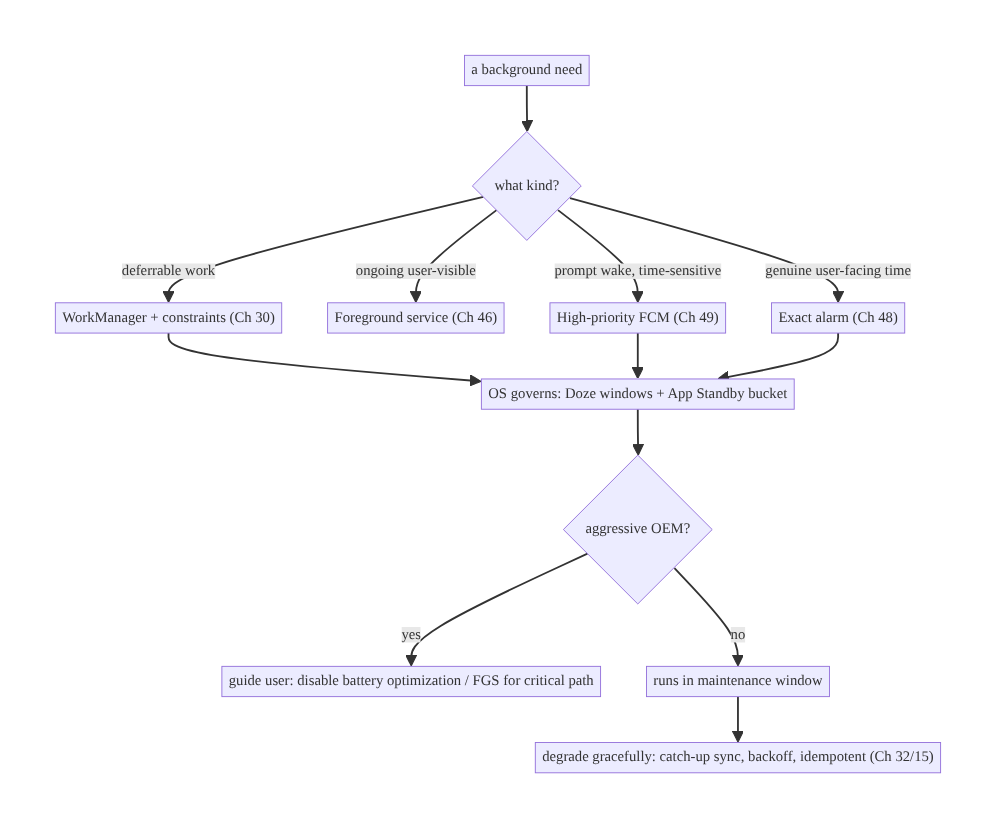
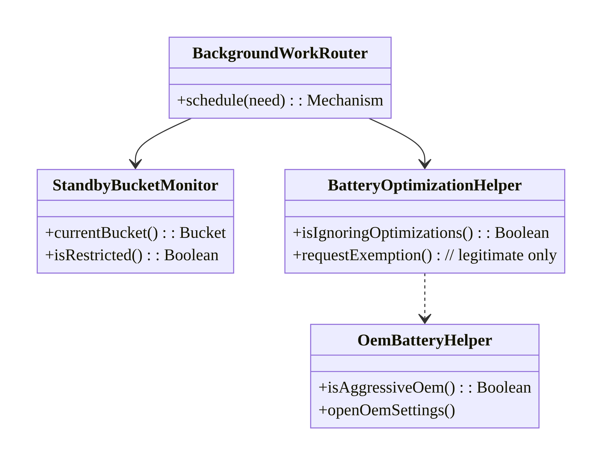
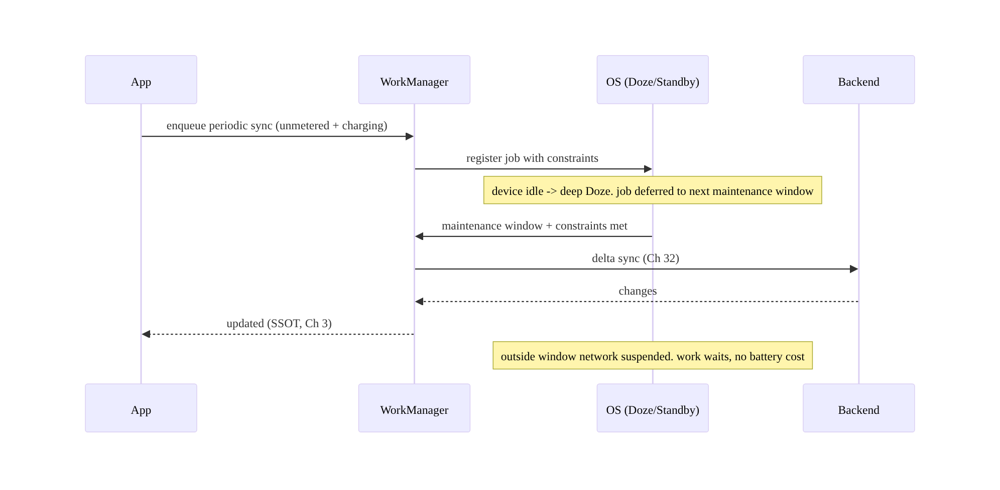
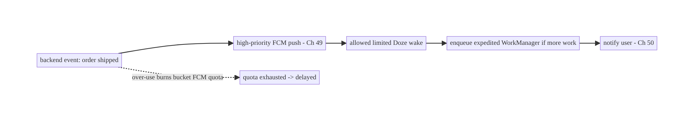
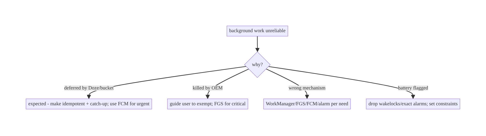

# Chapter 47 — Doze, App Standby & Background Execution Limits

> **Part VI — Lifecycle, Background & Platform** · Complexity: **Complex** (≥40 interview questions)
>
> **Prerequisites:** Ch 30 (WorkManager), Ch 46 (foreground services), Ch 44
> (lifecycle), Ch 48 (alarms), Ch 49 (FCM). Foundational for every background feature
> (sync Ch 29/32, outbox Ch 31, uploads Ch 17).
>
> **Reference surface in StreamCart:** making background sync, uploads, and
> notifications reliable *and* battery-friendly across Doze, App Standby Buckets, and
> OEM battery managers — so work completes without draining the battery or getting the
> app killed.

---

## 47.1 Problem Definition and Real-World Context

Android's single biggest source of user complaints historically was **battery drain
from apps working in the background**. Over many releases Google built an escalating set
of **background execution restrictions** — **Doze**, **App Standby Buckets**,
**background service limits**, **background location limits**, **battery optimization**,
and (on top of AOSP) aggressive **OEM battery managers** (Xiaomi, Huawei, Samsung,
OnePlus, etc.). The result: **you cannot assume your background code runs when you want
it to.** Alarms are deferred, network is blocked, services are killed, and jobs are
delayed — sometimes for hours — unless you cooperate with the system.

This is the central reliability tension of Android background work:

- **Deferred/blocked work.** In Doze, the device batches background activity into
  periodic **maintenance windows**; outside them, network access and wakelocks are
  suspended and **alarms/jobs are deferred**. A naive `AlarmManager` alarm or raw thread
  simply won't fire/run on time.
- **App Standby Buckets.** The OS classifies each app into **active / working-set /
  frequent / rare / restricted** based on usage, and throttles its jobs, alarms, FCM
  quota, and network accordingly. A rarely-used app's background work is heavily
  limited.
- **Background service limits (Android 8+).** You can't freely start background
  services; `startService` from the background throws unless it becomes a foreground
  service (Ch 46) — pushing most background work to **WorkManager/JobScheduler**.
- **OEM killers.** Many OEMs kill or "optimize" backgrounded apps far more
  aggressively than AOSP, breaking even correct WorkManager usage unless the user
  exempts the app.
- **Doing it wrong both ways.** Fighting the system (wakelocks, exact alarms,
  foreground-service abuse) drains battery and gets you flagged/killed; ignoring it
  means work never completes. The craft is **cooperating** with the restrictions.

The architecture: **understand each restriction** (Doze, Buckets, service/location
limits, battery optimization, OEM behavior); **use the OS-blessed mechanisms** —
**WorkManager** for deferrable work (it respects and schedules around all of this),
**foreground services** (Ch 46) for ongoing user-visible work, **exact alarms** (Ch 48)
only for genuine user-facing time precision, **high-priority FCM** (Ch 49) for
time-sensitive wake-ups; **set correct constraints** (network, charging, idle) so work
runs in the right window; **request exemptions sparingly and legitimately** (battery-
optimization/exact-alarm exemptions) with clear justification; and **degrade gracefully**
when work is throttled. This chapter is about **reliable background work that respects
battery** — the hardest, most device-fragmented area of Android.

### Three practical use cases

1. **StreamCart periodic sync.** A periodic WorkManager job with network constraints
   that runs in Doze maintenance windows / per the app's bucket, batching efficiently
   (Ch 29/32) — not an exact alarm.
2. **Time-sensitive notification.** A price-drop/order-update that must wake the app
   promptly → **high-priority FCM** (Ch 49), which is allowed limited Doze wake-ups,
   rather than a background poll.
3. **OEM-killed sync.** Detecting an aggressive OEM, guiding the user to disable battery
   optimization for the app, and using a foreground service for the critical path.

### Why this is architectural

Background execution limits are a **platform contract that shapes every background
feature**: which mechanism to use, what constraints to set, how to handle deferral and
device fragmentation, and when (and how legitimately) to seek exemptions. Getting it
wrong fails sync reliability *or* battery life — both are user-visible and ranked by the
Play Store.

---

## 47.2 Requirements Engineering

### Functional requirements

| ID | Requirement |
|----|-------------|
| F1 | Deferrable background work completes reliably (eventually), respecting battery. |
| F2 | Time-sensitive work wakes the app promptly via allowed mechanisms. |
| F3 | Set correct constraints so work runs in the right conditions (network/charging/idle). |
| F4 | Detect and handle restriction (bucket demotion, battery optimization, OEM killing). |
| F5 | Request exemptions only when legitimate, with user consent. |
| F6 | Degrade gracefully under throttling (backoff, catch-up on next window). |

### Non-functional requirements

| Attribute | Target/Policy |
|-----------|---------------|
| **Battery** | Cooperate with Doze/Buckets; no wakelock/exact-alarm abuse. |
| **Reliability** | Work completes within acceptable latency per its urgency. |
| **Compatibility** | Works across OS versions + major OEMs. |
| **Compliance** | Exemptions justified (Play scrutinizes); correct mechanism per use. |
| **Observability** | Measure completion latency, deferral, kills by device/bucket. |

### Scope

- **In scope:** Doze (deep + light), App Standby Buckets, background service/location
  limits, battery optimization/allowlist, OEM battery managers, choosing mechanisms
  (WorkManager/FGS/exact alarm/high-priority FCM), constraints, exemptions
  (`REQUEST_IGNORE_BATTERY_OPTIMIZATIONS`, exact-alarm permission), graceful degradation,
  measurement.
- **Out of scope:** WorkManager internals (Ch 30), FGS detail (Ch 46), alarms detail
  (Ch 48), FCM detail (Ch 49), sync algorithms (Ch 32).

### Assumptions & constraints

- `minSdk 24` (Doze since 23, Buckets since 28, service limits since 26). WorkManager as
  the primary scheduler. Device fragmentation is a hard reality; OEM behavior is not
  fully controllable — design for it, don't assume AOSP.

---

## 47.3 System Design Fundamentals

- **Doze (device idle):** when the device is unplugged, screen-off, and stationary for a
  while, it enters **deep Doze**: periodic **maintenance windows** (increasingly far
  apart) are the only times background apps run; outside them network access and
  wakelocks are suspended, standard alarms and jobs are **deferred** to the next window,
  and `AlarmManager` is batched. **Light Doze** (screen-off but moving / recently used)
  is a lighter version with more frequent windows. **What survives Doze:** high-priority
  FCM (limited), foreground services, exact alarms (`setExactAndAllowWhileIdle`/
  `setAlarmClock`, Ch 48), and WorkManager jobs (run in windows).
- **App Standby Buckets (Android 9+):** the OS buckets each app by usage —
  **active** (in use / just used), **working set** (regular use), **frequent**,
  **rare**, **restricted** (rarely used or misbehaving) — and throttles **jobs, alarms,
  FCM quota, and network** progressively per bucket. The worse the bucket, the more your
  background work is delayed and the smaller your high-priority-FCM budget. Keeping the
  app useful (so users open it) keeps it in a good bucket; the **restricted** bucket is
  near-total background suspension.
- **Background service limits (Android 8+):** apps can't start background services at
  will; `startService` from background throws `BackgroundServiceStartNotAllowed`. The OS
  pushes you to **WorkManager/JobScheduler** for deferrable work and **foreground
  services** (Ch 46) for ongoing visible work.
- **Battery optimization / allowlist:** by default apps are "optimized" (subject to Doze/
  Standby). An app can be **allowlisted** (exempt from some Doze restrictions) — either
  by the user via settings or by prompting with
  `ACTION_REQUEST_IGNORE_BATTERY_OPTIMIZATIONS`. **Use this sparingly and
  legitimately** — Play restricts which app categories may request it, and abuse causes
  rejection.
- **OEM battery managers (the fragmentation reality):** many OEMs add **aggressive**
  background killing on top of AOSP (killing WorkManager jobs, ignoring standard
  guarantees) unless the user manually exempts the app (varies per OEM; see
  dontkillmyapp.com-style guidance). You **cannot** fully control this in code — detect
  likely-aggressive OEMs and **guide the user** to the right settings; use a foreground
  service for truly critical paths.
- **Mechanism selection (the decision):**

  | Need | Mechanism | Why |
  |------|-----------|-----|
  | Deferrable background work (sync, upload) | **WorkManager** (Ch 30) | Respects Doze/Buckets; reschedules; constraints |
  | Ongoing user-visible work (playback, active download) | **Foreground service** (Ch 46) | Exempt while running |
  | Prompt wake for time-sensitive data | **High-priority FCM** (Ch 49) | Allowed limited Doze wake-ups |
  | Genuine user-facing exact time (alarm clock, calendar) | **Exact alarm** (Ch 48) | `setAlarmClock`/`setExactAndAllowWhileIdle` |
  | Precise periodic polling | ❌ (don't) | Fights the system; use FCM/WorkManager |

- **Constraints (make work run in the right window):** WorkManager constraints
  (`NetworkType`, `requiresCharging`, `requiresDeviceIdle`, `requiresBatteryNotLow`) tell
  the OS *when* to run — e.g., heavy sync only on **unmetered + charging** runs during
  Doze maintenance windows at low cost. Correct constraints = reliable *and*
  battery-friendly.
- **Graceful degradation:** assume work may be **deferred**; design for **catch-up**
  (delta/incremental sync on next window, Ch 32), **backoff** (Ch 2/30), and
  **idempotency** (Ch 15) so deferral/retry is safe. Don't assume exact timing.

Core insight: **you cannot run arbitrary background code on your own schedule — Doze,
App Standby Buckets, service limits, battery optimization, and OEM killers all throttle
it. Cooperate: use WorkManager for deferrable work (with correct constraints so it runs
in the right Doze window), foreground services for ongoing visible work, high-priority
FCM for prompt wake-ups, and exact alarms only for genuine user-facing time; request
battery-optimization/OEM exemptions only when legitimate and user-consented; and design
work to be deferrable, idempotent, and catch-up-capable so throttling degrades it
gracefully instead of breaking it.**

---

## 47.4 High-Level Architecture



**Components & ownership**

- **Classifier/decision** maps each need to the OS-blessed mechanism.
- **WorkManager** carries deferrable work with constraints; the **OS** governs when
  (Doze/bucket).
- **OEM handling** detects aggressive devices and guides the user; FGS for critical
  paths.
- **Degradation** (catch-up/backoff/idempotency) makes deferral safe.

**Direction:** classify → OS-blessed mechanism + constraints → OS schedules in window →
handle OEM/exemptions → degrade gracefully.

---

## 47.5 Detailed Component Design



| Component | Responsibility |
|-----------|----------------|
| `BackgroundWorkRouter` | pick mechanism per need (WM/FGS/FCM/alarm) |
| `StandbyBucketMonitor` | read `UsageStatsManager.appStandbyBucket` → adapt expectations |
| `BatteryOptimizationHelper` | check/request allowlist (legitimate cases only) |
| `OemBatteryHelper` | detect aggressive OEMs; guide user |

---

## 47.6 End-to-End Data Flow

### Deferrable sync under Doze



### Time-sensitive wake via high-priority FCM



---

## 47.7 Complete Kotlin Implementation

Package: `com.streamcart.background`.

### 47.7.1 Deferrable periodic sync with correct constraints (not an alarm)

```kotlin
@Singleton
class SyncScheduler @Inject constructor(private val workManager: WorkManager) {
    fun schedulePeriodicSync() {
        val constraints = Constraints.Builder()
            .setRequiredNetworkType(NetworkType.UNMETERED)   // run on wifi
            .setRequiresBatteryNotLow(true)
            .build()                                          // OS runs it in a Doze window when met
        val request = PeriodicWorkRequestBuilder<SyncWorker>(6, TimeUnit.HOURS)
            .setConstraints(constraints)
            .setBackoffCriteria(BackoffPolicy.EXPONENTIAL, 30, TimeUnit.SECONDS)  // graceful retry (Ch 2)
            .build()
        workManager.enqueueUniquePeriodicWork("sync", ExistingPeriodicWorkPolicy.KEEP, request)
    }
    // Time-sensitive one-off that should run ASAP within OS allowance:
    fun expedite() = workManager.enqueue(
        OneTimeWorkRequestBuilder<SyncWorker>()
            .setExpedited(OutOfQuotaPolicy.RUN_AS_NON_EXPEDITED_WORK_REQUEST)  // expedited where allowed
            .build())
}
```

### 47.7.2 Standby bucket awareness (adapt expectations, log)

```kotlin
@Singleton
class StandbyBucketMonitor @Inject constructor(@ApplicationContext private val ctx: Context) {
    private val usageStats = ctx.getSystemService(Context.USAGE_STATS_SERVICE) as UsageStatsManager
    fun currentBucket(): Int = usageStats.appStandbyBucket   // ACTIVE/WORKING_SET/FREQUENT/RARE/RESTRICTED
    fun isRestricted(): Boolean =
        currentBucket() >= UsageStatsManager.STANDBY_BUCKET_RESTRICTED
    // Use to: log/measure, widen sync intervals in bad buckets, and warn if RESTRICTED.
}
```

### 47.7.3 Battery-optimization exemption (legitimate cases only, user-consented)

```kotlin
@Singleton
class BatteryOptimizationHelper @Inject constructor(@ApplicationContext private val ctx: Context) {
    private val pm = ctx.getSystemService(Context.POWER_SERVICE) as PowerManager
    fun isIgnoringOptimizations(): Boolean = pm.isIgnoringBatteryOptimizations(ctx.packageName)

    /** Only for app categories Play allows (e.g., alarm/health). Show rationale FIRST (Ch 51 pattern). */
    @SuppressLint("BatteryLife")
    fun exemptionIntent(): Intent = Intent(Settings.ACTION_REQUEST_IGNORE_BATTERY_OPTIMIZATIONS)
        .setData(Uri.parse("package:${ctx.packageName}"))
    // Prefer linking to Settings.ACTION_IGNORE_BATTERY_OPTIMIZATION_SETTINGS for general apps.
}
```

### 47.7.4 OEM detection + guidance (can't fix in code; guide the user)

```kotlin
object OemBatteryHelper {
    private val aggressive = setOf("xiaomi", "huawei", "honor", "oppo", "vivo", "oneplus", "samsung", "meizu")
    fun isAggressiveOem(): Boolean = Build.MANUFACTURER.lowercase() in aggressive

    /** Best-effort deep link to the OEM's auto-start/battery settings; fall back to app settings. */
    fun oemSettingsIntents(): List<Intent> = listOf(
        Intent().setComponent(ComponentName("com.miui.securitycenter",
            "com.miui.permcenter.autostart.AutoStartManagementActivity")),
        // ... other OEM components (wrapped in try/catch when launching) ...
        Intent(Settings.ACTION_APPLICATION_DETAILS_SETTINGS, Uri.parse("package:$PKG")),  // fallback
    )
}
```

### 47.7.5 Graceful degradation: idempotent catch-up sync

```kotlin
// SyncWorker is idempotent (Ch 15) and does delta/catch-up sync (Ch 32), so deferral/retry is safe.
@HiltWorker
class SyncWorker @AssistedInject constructor(
    @Assisted ctx: Context, @Assisted p: WorkerParameters, private val repo: SyncRepository,
) : CoroutineWorker(ctx, p) {
    override suspend fun doWork(): Result = runCatching {
        repo.deltaSyncSince(repo.lastSyncCursor())   // catch up whatever was missed while deferred
    }.fold({ Result.success() }, { if (runAttemptCount < 5) Result.retry() else Result.failure() })
}
```

### 47.7.6 Module structure

```
:core:background  SyncScheduler, StandbyBucketMonitor, BatteryOptimizationHelper, OemBatteryHelper, BackgroundWorkRouter
:core:work        SyncWorker (idempotent, delta/catch-up) [Ch 30/32]
# FGS -> :core:fgs (Ch 46); FCM -> :feature:push (Ch 49); alarms -> :core:alarm (Ch 48).
```

---

## 47.8 Concurrency and Race Conditions

| Scenario | Risk | Handling |
|----------|------|----------|
| Work deferred to a later window | stale data | idempotent delta/catch-up sync (Ch 32/15) |
| Retry after throttle | duplicates | idempotency keys (Ch 15) |
| Multiple windows run overlapping work | races | `enqueueUniqueWork`/single-flight (Ch 11/30) |
| Bucket demotion mid-session | unexpected delay | adapt intervals; measure bucket |
| FCM quota exhausted | push dropped/delayed | don't over-send high-priority; fall back to WorkManager |
| Exact alarm fires in Doze | battery/abuse flag | use only for genuine user-facing time (Ch 48) |

- **Design for deferral, not timing.** Because the OS decides *when* work runs, two
  "scheduled" runs can collapse into one window or be far apart — make work **idempotent**
  (Ch 15) and **catch-up-based** (sync since a cursor, Ch 32) so order/timing don't
  matter.
- **Unique work** prevents overlapping jobs when windows and triggers coincide
  (`enqueueUniquePeriodicWork`/`enqueueUniqueWork`, Ch 30).

---

## 47.9 Failure Scenarios and Recovery

| Failure | Detection | Response | Outcome |
|---------|-----------|----------|---------|
| Sync never runs (OEM kill) | completion telemetry by OEM | guide user to exempt; FGS for critical path | runs |
| Work delayed hours (RESTRICTED bucket) | bucket telemetry | encourage engagement; widen intervals; high-priority FCM for urgent | acceptable |
| Exact alarm abuse → flagged | Play/battery stats | switch to WorkManager/FCM | compliant |
| High-priority FCM dropped | delivery telemetry (Ch 49) | reduce volume; expedited WorkManager fallback | delivered within quota |
| Battery drain complaint | Android vitals (wakelocks) | remove wakelock/exact-alarm abuse; constraints | battery ok |
| Background start crash | crash | WorkManager/FGS, not `startService` | compliant |
| Stale data after long idle | user report | catch-up delta sync on next window | fresh |



> **The system is not broken when it defers your work — it is working as designed.**
> Reliability comes from choosing the OS-blessed mechanism, setting constraints, and
> making work idempotent/catch-up — not from fighting Doze. Fighting it (wakelocks,
> exact alarms, FGS abuse) gets you battery-flagged *and* OEM-killed.

---

## 47.10 Scaling the Implementation

- **Level 1.** All deferrable work on WorkManager with sensible constraints; FGS for
  ongoing visible work (Ch 46).
- **Level 2.** High-priority FCM for time-sensitive wake-ups (Ch 49); expedited work
  where allowed; idempotent catch-up sync (Ch 32/15).
- **Level 3 — production.** Standby-bucket awareness; battery-optimization exemption for
  legitimate categories (consented); OEM detection + user guidance; completion telemetry
  by bucket/OEM/OS.
- **Level 4 — large.** Per-feature background budgets; adaptive sync intervals by bucket/
  battery; FCM-quota-aware prioritization (Ch 14); FGS reserved for truly critical paths;
  Android-vitals battery monitoring.
- **Level 5 — enterprise.** Background-work governance (which mechanisms teams may use),
  device-fragmentation dashboards (completion by OEM/OS/bucket), automated battery-
  regression gates, documented degradation SLOs per feature urgency tier.

**Avoid overengineering:** for most apps, **WorkManager with correct constraints +
high-priority FCM for urgent + idempotent catch-up sync** is the whole story. Don't add
exemption prompts, OEM deep-links, or bucket logic unless telemetry shows you need them —
each adds friction and Play risk.

---

## 47.11 Alternative Approaches and Trade-offs

| Dimension | Option A | Option B | When |
|-----------|----------|----------|------|
| Deferrable work | WorkManager | exact alarm + raw service | WorkManager always (respects limits); alarms fight the system |
| Prompt wake | High-priority FCM | background polling | FCM (allowed Doze wake); polling is blocked/battery-flagged |
| Ongoing visible | Foreground service | wakelock + background service | FGS (Ch 46); wakelock abuse is killed/flagged |
| Reliability on OEMs | User-guided exemption + FGS critical path | assume AOSP guarantees | Guide/FGS; AOSP assumption breaks on OEMs |
| Exemption | Request only for legitimate categories | request for everyone | Legitimate-only (Play rejects abuse) |
| Degradation | Idempotent catch-up + backoff | assume exact timing | Catch-up (deferral-safe); exact-timing breaks |

**WorkManager vs exact alarms for periodic work:** exact alarms
(`setExactAndAllowWhileIdle`) *can* fire in Doze, which tempts developers to use them for
"reliable" periodic sync — but this fights the battery model, is heavily rate-limited,
flags your app for battery drain, and on Android 12+ requires the `SCHEDULE_EXACT_ALARM`/
`USE_EXACT_ALARM` permission reserved for genuine user-facing timing (alarm clocks,
calendars, Ch 48). WorkManager with constraints is the correct tool for deferrable
periodic work: it runs in maintenance windows at low battery cost and reschedules
automatically.

**High-priority FCM vs background polling:** to react to a server event promptly, polling
from the background is blocked/deferred by Doze and burns battery for nothing most of the
time. High-priority FCM is the OS-blessed way to wake the app for time-sensitive data
(limited Doze wake-ups, bucket-dependent quota). Use FCM to *push* the trigger, then do
the work with WorkManager/expedited work (Ch 49).

**Battery-optimization exemption vs cooperating:** an exemption makes your background work
more reliable but costs battery, annoys users, and is Play-restricted to certain app
categories. Most apps should **cooperate** (WorkManager + FCM) rather than request
exemptions; reserve exemptions for apps whose core function genuinely requires it (alarms,
health monitoring, sync-heavy enterprise), always with a clear rationale and user consent.

---

## 47.12 Security & Privacy Considerations

- **Background location is doubly restricted** (Doze + background-location permission,
  Ch 67): only access it during an active, user-understood foreground session or FGS —
  never silently in the background.
- **Exemption prompts are a social-engineering surface:** be honest about *why* you need
  the exemption; don't trick users into allowlisting for battery-draining purposes
  (Play policy + user trust).
- **High-priority FCM payloads** reach the app in Doze — treat them as untrusted (Ch 49),
  validate, and don't include sensitive data in the push itself (Ch 28).
- **OEM deep-links** must fall back gracefully and never assume a component exists (wrap
  in try/catch) — a crash here is a trust/UX hit.
- **Don't abuse `systemExempted`/`specialUse` FGS types** (Ch 46) to dodge limits — Play
  scrutinizes this.
- Client vs backend: the backend should **send time-sensitive events as pushes** rather
  than expecting the client to poll, and should tolerate **catch-up sync** patterns
  (delta since cursor, Ch 32) since client timing is non-deterministic.

---

## 47.13 Performance and Resource Optimization

- **Correct constraints are the main battery lever:** heavy work on **unmetered +
  charging + battery-not-low** runs in Doze windows essentially for free.
- **Batch background work** (one periodic sync, not many timers) so the OS coalesces it
  into fewer windows (Ch 14).
- **Don't hold wakelocks**; let WorkManager manage execution. Wakelocks are a top battery
  offender and OEM-kill trigger.
- **Adapt to bucket/battery:** widen sync intervals in worse buckets / low battery; skip
  non-essential work.
- **Minimize high-priority FCM** (quota- and battery-costly); use normal-priority for
  non-urgent, and coalesce server events.
- **Profiling:** Battery Historian (Doze state, wakelocks, alarms, jobs), Android vitals
  (excessive wakeups/wakelocks), completion-latency telemetry by bucket/OEM.

---

## 47.14 Testing Strategy

Background limits are tested with **`adb` Doze/Standby simulation**, WorkManager test
APIs, and **device-matrix** (OEM) testing.

```bash
# Simulate deep Doze (force the device idle) and verify work defers/catches up:
adb shell dumpsys deviceidle force-idle
adb shell dumpsys deviceidle unforce
# Set a standby bucket to verify throttled behavior:
adb shell am set-standby-bucket com.streamcart restricted
# Inspect scheduled jobs/alarms:
adb shell dumpsys jobscheduler | grep streamcart
adb shell dumpsys alarm | grep streamcart
```

```kotlin
// WorkManager constraints + catch-up (Ch 30 TestDriver):
@Test fun `periodic sync runs when constraints met and catches up`() = runTest {
    val wm = WorkManagerTestInitHelper.getTestDriver(context)!!
    // enqueue; setAllConstraintsMet(id); setPeriodDelayMet(id); assert delta/catch-up sync ran
}
@Test fun `sync worker is idempotent under retry`() = runTest { /* run twice, assert no duplicates (Ch 15) */ }
```

What to test: Doze deferral + catch-up (adb force-idle), restricted-bucket behavior
(set-standby-bucket), constraint gating (WM TestDriver), idempotent retry, FCM→expedited
path (Ch 49), exemption-state read, OEM deep-link fallback (no crash). Device-matrix
testing on major OEMs is essential — emulator behavior under-represents OEM killing.

---

## 47.15 Production Observability

- **Metrics:** background-work **completion latency** and success rate **by standby
  bucket / OEM / OS version**; deferral counts; WorkManager job attempts/failures; FGS
  kill counts (Ch 46); high-priority FCM delivery + quota (Ch 49); Android vitals
  excessive-wakeup/wakelock rates; battery-optimization-exemption acceptance.
- **Logs:** `bg_work{mechanism, bucket, oem, os, latency, result}` (no PII, Ch 28).
- **Debugging:** sync unreliable on one OEM → OEM killing (guide user / FGS); work always
  delayed → RESTRICTED bucket (engagement) or wrong mechanism; battery flagged → wakelock/
  exact-alarm abuse; FCM delayed → quota exhausted (reduce volume).
- **Alerting:** completion-rate drop on a specific OEM/OS after an update; battery-vitals
  regression.
- **Dashboards:** completion by OEM × OS × bucket (the fragmentation matrix) — the key
  artifact for this domain.

---

## 47.16 System Design Interview Preparation

> ≥40 questions.

**Doze**

1. *What is Doze?* Device-idle mode batching background activity into maintenance
   windows; network/wakelocks suspended, alarms/jobs deferred outside them.
2. *Deep vs light Doze?* Stationary+unplugged+screen-off (windows far apart) vs
   screen-off/recently-used (more frequent).
3. *What survives Doze?* High-priority FCM (limited), FGS, exact alarms
   (`setExactAndAllowWhileIdle`/`setAlarmClock`), WorkManager jobs (in windows).
4. *Maintenance window?* Periodic interval when deferred background work runs.
5. *Why Doze exists?* Battery life; top historical complaint.

**App Standby Buckets**

6. *What are buckets?* Active/working-set/frequent/rare/restricted usage tiers that
   throttle jobs/alarms/FCM/network.
7. *How assigned?* By usage/recency (and misbehavior → restricted).
8. *Restricted bucket?* Near-total background suspension.
9. *How to stay in a good bucket?* Keep the app useful so users open it.
10. *Read the bucket?* `UsageStatsManager.appStandbyBucket`.

**Service/background limits**

11. *Android 8 background service limit?* Can't start background services freely;
    `startService` from background throws.
12. *What replaced free background services?* WorkManager/JobScheduler + FGS.
13. *Background location limits?* Throttled; needs background-location permission (Ch 67).

**Battery optimization / OEM**

14. *Battery optimization?* Default state subjecting apps to Doze/Standby; allowlist
    exempts.
15. *How request exemption?* `ACTION_REQUEST_IGNORE_BATTERY_OPTIMIZATIONS` (legitimate
    categories only).
16. *Risk of exemption?* Battery cost, user annoyance, Play restriction.
17. *OEM battery managers?* Aggressive killing beyond AOSP; need user to exempt; not
    code-fixable.
18. *Handling OEMs?* Detect + guide user; FGS for critical path.

**Mechanism selection**

19. *Deferrable work?* WorkManager.
20. *Ongoing visible?* Foreground service (Ch 46).
21. *Prompt time-sensitive wake?* High-priority FCM (Ch 49).
22. *Genuine user-facing exact time?* Exact alarm (Ch 48).
23. *Why not exact alarms for sync?* Fights battery model; rate-limited; permission-
    restricted; flagged.
24. *Why not background polling?* Blocked/deferred/battery-flagged — use FCM.

**Constraints & degradation**

25. *WorkManager constraints?* Network/charging/idle/battery — run in the right window.
26. *Heavy sync constraint?* Unmetered + charging → runs in Doze windows cheaply.
27. *Expedited work?* `setExpedited` for time-sensitive one-offs within quota.
28. *Graceful degradation?* Idempotent catch-up delta sync + backoff.
29. *Why idempotent?* Deferral/retry can duplicate (Ch 15).
30. *Catch-up sync?* Sync since a cursor (Ch 32) regardless of timing.

**Security/privacy**

31. *Background location?* Only during active/foreground/FGS session; permission-gated.
32. *Exemption honesty?* Don't trick users; Play policy + trust.
33. *FCM payload in Doze?* Untrusted; no sensitive data in push.
34. *OEM deep-link safety?* try/catch + fallback (component may not exist).

**Testing**

35. *Simulate Doze?* `adb dumpsys deviceidle force-idle`.
36. *Set a bucket?* `adb am set-standby-bucket ... restricted`.
37. *Why device-matrix?* OEM killing varies; emulator under-represents.
38. *Test constraints?* WorkManager `TestDriver`.

**Production**

39. *Sync unreliable on one OEM?* OEM killing — guide user / FGS.
40. *Always-delayed work?* Restricted bucket or wrong mechanism.
41. *Battery flagged in vitals?* Wakelock/exact-alarm abuse — cooperate.
42. *FCM delayed?* Quota exhausted — reduce volume; expedited fallback.
43. *Key dashboard?* Completion by OEM × OS × bucket.

### Design-change challenges
1. **Sync works on Pixel but not Xiaomi.** OEM killing — detect + guide to disable
   battery optimization; FGS for critical path.
2. **React to a server event within seconds while backgrounded.** High-priority FCM →
   expedited WorkManager (not polling).
3. **Battery team flags the app for wakeups.** Remove wakelocks/exact alarms; move to
   WorkManager + constraints.
4. **Periodic sync is deferred for hours.** Expected under Doze/restricted bucket —
   idempotent catch-up; FCM for urgent; improve engagement.
5. **An "alarm" feature needs exact timing.** Exact alarm with proper permission (Ch 48)
   — the legitimate exemption case.

### Mock walkthrough (abridged)
Clarify (urgency, frequency, user-visible?, target OEMs/OS?) → explain Doze/Buckets/
limits → classify mechanism (WorkManager/FGS/FCM/alarm) → set constraints → design for
deferral (idempotent catch-up + backoff) → OEM/exemption handling (legitimate only) →
measure completion by OEM/bucket → security (background location, exemption honesty).

---

## 47.17 Practical Exercises

1. **Beginner.** Convert a periodic sync from an `AlarmManager` alarm to a WorkManager
   periodic job with `unmetered` + `batteryNotLow` constraints. *Eval:* runs in Doze
   windows; no battery flag.
2. **Intermediate.** Add high-priority FCM → expedited WorkManager for a time-sensitive
   update; verify it wakes under `adb` force-idle. *Eval:* wakes promptly; no polling.
3. **Advanced.** Make sync idempotent + catch-up (delta since cursor) so deferral/retry
   is safe; test under forced Doze and `restricted` bucket. *Eval:* no duplicates;
   catches up.
4. **Production debugging.** Diagnose OEM-killed sync: detect aggressive OEM, guide the
   user to exempt, use an FGS for the critical path. *Eval:* reliable on the OEM;
   graceful fallback.
5. **System design challenge.** Build a completion-by-OEM×OS×bucket dashboard and a
   policy for when (and how legitimately) to request battery-optimization exemptions.
   *Eval:* fragmentation visible; exemption policy sound.

*(Solutions withheld unless requested.)*

---

## 47.18 Chapter Summary & Reference Sheet

**Key decisions:** accept that **you cannot run arbitrary background code on your own
schedule** — Doze (maintenance windows), App Standby Buckets, background service/location
limits, battery optimization, and aggressive OEM managers all throttle it — and
**cooperate** instead of fighting: use **WorkManager** for deferrable work with **correct
constraints** (network/charging/idle) so it runs in Doze windows cheaply, **foreground
services** (Ch 46) for ongoing user-visible work, **high-priority FCM** (Ch 49) for
prompt time-sensitive wake-ups (then expedited WorkManager), and **exact alarms** (Ch 48)
**only** for genuine user-facing time; design work to be **idempotent and catch-up-based**
(delta since cursor, Ch 32/15) so deferral/retry degrades gracefully; **detect aggressive
OEMs and guide users** to exempt the app (and use an FGS for truly critical paths); and
**request battery-optimization exemptions only for legitimate app categories, with
consent**. Measure **completion by OEM × OS × bucket** — the fragmentation matrix is the
key artifact.

**Concepts:** Doze (deep/light, maintenance windows), App Standby Buckets, background
service/location limits, battery optimization/allowlist, OEM battery managers, mechanism
selection (WorkManager/FGS/FCM/alarm), WorkManager constraints, expedited work, graceful
degradation (idempotent catch-up), exemptions.

**Common mistakes:** exact alarms / background polling for periodic sync (battery-flagged,
throttled); assuming AOSP guarantees on OEM devices; holding wakelocks; requesting battery
exemptions for all apps (Play rejection); assuming exact background timing (not idempotent/
catch-up); no completion telemetry by OEM/bucket; silent background location.

**Checklist:**

- [ ] deferrable work → WorkManager + constraints
- [ ] ongoing visible → FGS
- [ ] prompt wake → high-priority FCM → expedited work
- [ ] exact time → exact alarm (legit only)
- [ ] idempotent catch-up sync + backoff
- [ ] standby-bucket awareness
- [ ] OEM detection + user guidance
- [ ] exemptions legitimate + consented
- [ ] no wakelock/exact-alarm abuse
- [ ] completion telemetry by OEM × OS × bucket.

**Key APIs:** WorkManager `Constraints`/`setExpedited`/`enqueueUniquePeriodicWork`
(Ch 30), `UsageStatsManager.appStandbyBucket`, `PowerManager.isIgnoringBatteryOptimizations`/
`ACTION_REQUEST_IGNORE_BATTERY_OPTIMIZATIONS`, `Build.MANUFACTURER`,
`AlarmManager.setExactAndAllowWhileIdle`/`setAlarmClock` (Ch 48), high-priority FCM
(Ch 49), `adb dumpsys deviceidle` / `am set-standby-bucket`.

**References:**
- Doze and App Standby: https://developer.android.com/training/monitoring-device-state/doze-standby
- App Standby Buckets: https://developer.android.com/topic/performance/appstandby
- Background execution limits: https://developer.android.com/about/versions/oreo/background
- Optimize for Doze (testing): https://developer.android.com/training/monitoring-device-state/doze-standby#testing_doze
- (composes) Ch 30 WorkManager, Ch 46 FGS, Ch 48 Alarms, Ch 49 FCM, Ch 32 Delta Sync, Ch 15 Idempotency

### Chapter review (Phase 4)
- **Completeness:** all 18 sections; decision/architecture/class/sequence/failure
  diagrams; constraints + bucket monitor + exemption + OEM + idempotent catch-up code;
  concurrency (deferral/idempotency/unique work); failure (OEM/bucket/battery triage);
  5 levels; WorkManager-vs-alarm, FCM-vs-polling, exemption-vs-cooperate trade-offs;
  security (background location, exemption honesty); perf (constraints/batching);
  adb-Doze + WM + idempotency tests; observability (OEM×OS×bucket matrix); 43 Q&A + 5
  challenges. ✅
- **Expand later:** WorkManager (Ch 30), FGS (Ch 46), alarms (Ch 48), FCM (Ch 49),
  location (Ch 67).
- **Interview coverage:** exceeds ≥40 Complex bar.
