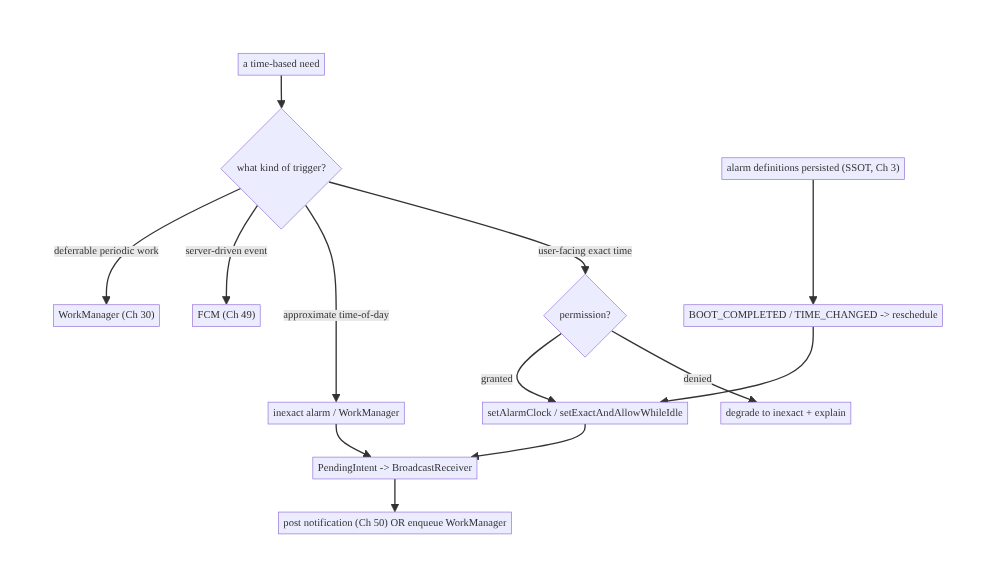
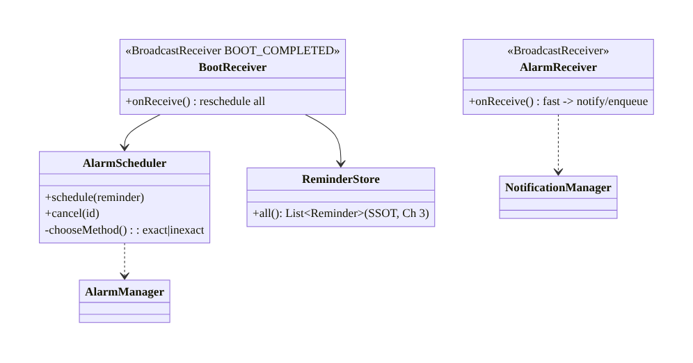
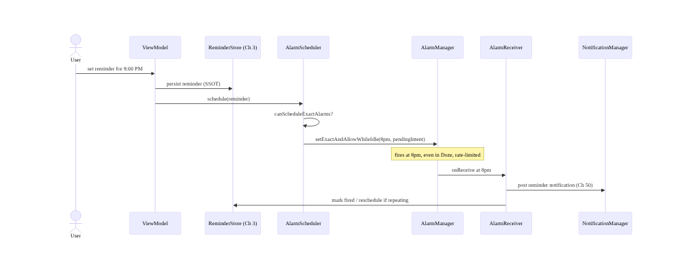
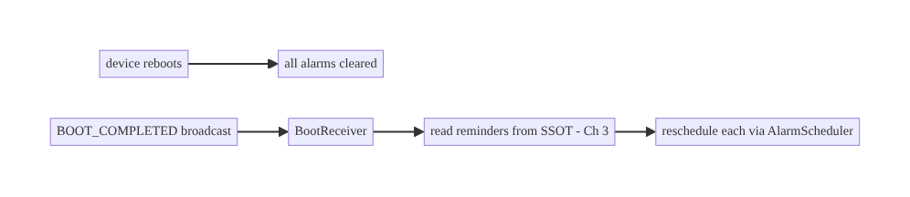
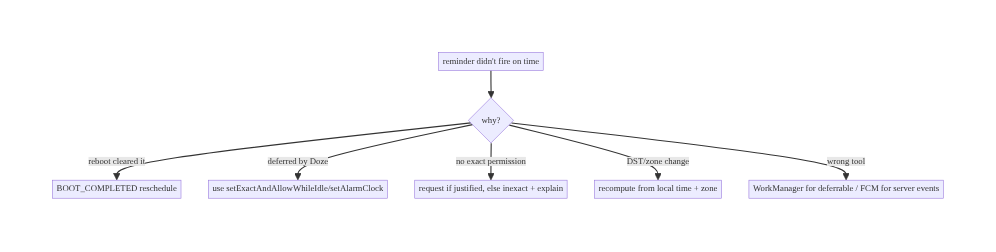

# Chapter 48 — Alarms & Exact Scheduling

> **Part VI — Lifecycle, Background & Platform** · Complexity: **Standard** (≥25 interview questions)
>
> **Prerequisites:** Ch 47 (Doze/background limits), Ch 30 (WorkManager), Ch 46 (FGS),
> Ch 49 (FCM), Ch 8 (process death/reboot). Pairs with Ch 50 (notifications).
>
> **Reference surface in StreamCart:** time-triggered features — a flash-sale reminder
> at an exact moment, a "watch party starts at 8pm" alert, a daily digest — scheduled
> correctly so they fire on time *and* respect battery and the platform's exact-alarm
> rules.

---

## 48.1 Problem Definition and Real-World Context

Some features must happen **at a specific time**: an alarm clock at 7:00, a medication
reminder, a calendar event alert, a scheduled flash sale. Android's `AlarmManager` is the
API for time-based triggers, but it sits squarely inside the background-restriction
world (Ch 47): **inexact alarms are batched and deferred** (good for battery, bad for
precision), and **exact alarms are a privileged, permission-gated, Play-restricted
capability** because they wake the device and cost battery. Choosing the wrong alarm type
means either the feature fires late (missed reminder) or the app is battery-flagged and
rejected from Play.

Concretely, teams hit:

- **Using exact alarms for everything.** Developers reach for `setExact` to be "safe,"
  but on Android 12+ exact alarms require `SCHEDULE_EXACT_ALARM`/`USE_EXACT_ALARM`, are
  reserved for genuine user-facing timing, and drain battery — most "reminders" should be
  inexact or WorkManager.
- **Alarms lost on reboot.** Alarms don't survive a device reboot; without a
  `BOOT_COMPLETED` receiver to reschedule, every alarm vanishes after a restart (Ch 8).
- **Alarms deferred by Doze.** A plain `setExact` is still deferred in Doze; only
  `setExactAndAllowWhileIdle` / `setAlarmClock` fire during Doze (and sparingly).
- **Wrong tool entirely.** Using alarms for **deferrable periodic work** (sync) that
  should be WorkManager, or for **server-driven events** that should be FCM (Ch 47/49).
- **Android 14+ tightening.** `SCHEDULE_EXACT_ALARM` is no longer granted by default to
  most apps on Android 13+/14+; only specific categories get `USE_EXACT_ALARM`
  automatically — the rest must request and justify it, or design around it.

The architecture: **classify the trigger** — is it genuinely user-facing exact time, or
deferrable, or server-driven?; use **WorkManager** for deferrable periodic/one-off work
(Ch 30), **FCM** for server events (Ch 49), and **`AlarmManager` only for user-facing
time-of-day triggers**; within alarms, pick the **right method** (`setAlarmClock` for
true alarm-clock UX, `setExactAndAllowWhileIdle` for exact-must-fire-in-Doze,
`setWindow`/`setInexactRepeating` for battery-friendly approximate); **reschedule on
reboot** (`BOOT_COMPLETED`) and time/timezone changes; and **request the exact-alarm
permission only when justified**, degrading to inexact otherwise. This chapter is about
**firing time-based work on time without abusing the platform**.

### Three practical use cases

1. **Flash-sale reminder (StreamCart).** "Sale starts at 8:00 PM" — a user-set exact
   reminder via `setExactAndAllowWhileIdle` (or `setAlarmClock` if it's alarm-clock-like),
   rescheduled on reboot.
2. **Daily digest at ~9am.** Not time-critical to the minute → **inexact** window /
   WorkManager periodic — battery-friendly.
3. **Server-driven "your order ships now."** Not a client timer at all → **FCM** (Ch 49).

### Why this is architectural

Alarm selection (exact vs inexact vs WorkManager vs FCM), permission handling, Doze
behavior, and reboot/timezone rescheduling are platform-contract decisions that
determine whether time-based features fire correctly and whether the app passes Play
review and battery vitals — recurring choices across any time-triggered feature.

---

## 48.2 Requirements Engineering

### Functional requirements

| ID | Requirement |
|----|-------------|
| F1 | Fire user-facing time triggers at (or near) the intended time. |
| F2 | Choose the correct mechanism (exact alarm / inexact / WorkManager / FCM). |
| F3 | Survive reboot and time/timezone changes (reschedule). |
| F4 | Request exact-alarm permission only when justified; degrade to inexact otherwise. |
| F5 | Deliver the alarm's effect correctly (notification/work) even in Doze. |
| F6 | Cancel/update alarms when the underlying need changes. |

### Non-functional requirements

| Attribute | Policy |
|-----------|--------|
| **Battery** | Inexact/WorkManager by default; exact only when necessary. |
| **Compliance** | Exact-alarm permission justified (Play-restricted). |
| **Reliability** | Survives reboot/time change; fires in Doze when exact. |
| **Correctness** | Right time; idempotent effect; no duplicates. |
| **UX** | Late/missed reminders avoided for genuinely time-critical cases. |

### Scope

- **In scope:** `AlarmManager` methods (`set`, `setWindow`, `setExact`,
  `setExactAndAllowWhileIdle`, `setAlarmClock`, `setInexactRepeating`), exact-alarm
  permission (Android 12+/13+/14+), Doze behavior, `BOOT_COMPLETED`/time-change
  rescheduling, `PendingIntent` + `BroadcastReceiver`, alarm→WorkManager/notification
  handoff, mechanism selection vs WorkManager/FCM, cancellation/update.
- **Out of scope:** Doze mechanics in depth (Ch 47), WorkManager internals (Ch 30), FCM
  (Ch 49), notification design (Ch 50), process death detail (Ch 8).

### Assumptions & constraints

- `minSdk 24`, `targetSdk` current (Android 12+ exact-alarm permission, 14+ tightening).
  Hilt, WorkManager. Alarms don't survive reboot; exact alarms are privileged; Doze
  defers non-exact alarms.

---

## 48.3 System Design Fundamentals

- **`AlarmManager` fires a `PendingIntent` at a time** — typically to a
  `BroadcastReceiver` that then posts a notification (Ch 50) or enqueues WorkManager
  (Ch 30) for anything beyond a few seconds of work (a receiver must return fast).
- **Exact vs inexact (the core axis):**
  - **Inexact** (`set`, `setWindow`, `setInexactRepeating`): the OS **batches** them to
    coalesce wake-ups → battery-friendly, but fires **approximately** (could be minutes
    off, more in Doze). Use for anything not needing to-the-minute precision (daily
    digest, periodic refresh — or better, WorkManager).
  - **Exact** (`setExact`, `setExactAndAllowWhileIdle`, `setAlarmClock`): fires at the
    precise time. Privileged and battery-costly. Use only for **genuine user-facing
    timing**.
- **Doze interaction (Ch 47):** in Doze, **inexact alarms and plain `setExact` are
  deferred** to maintenance windows. Only **`setExactAndAllowWhileIdle`** (rate-limited —
  roughly once per ~9 minutes per app) and **`setAlarmClock`** fire during Doze. So "must
  fire exactly, even in Doze" = `setExactAndAllowWhileIdle` or `setAlarmClock`.
- **`setAlarmClock` is special:** it represents a **user-visible alarm clock**, shows the
  next-alarm in the status bar, and is the most reliable (least restricted) — but is
  meant for actual alarm-clock-style UX, not arbitrary reminders.
- **Exact-alarm permission (Android 12+):**
  - **`SCHEDULE_EXACT_ALARM`** — requestable; on Android 13+ **not granted by default**
    for most apps; the user grants it in settings (you can deep-link via
    `ACTION_REQUEST_SCHEDULE_EXACT_ALARM`). Check `AlarmManager.canScheduleExactAlarms()`.
  - **`USE_EXACT_ALARM`** — auto-granted but **only** for apps whose **core function** is
    alarms/clocks/calendars (Play-enforced); using it without qualifying → rejection.
  - If you can't/shouldn't hold the permission, **degrade to inexact / WorkManager** and
    accept approximate timing.
- **Reboot & time changes:** alarms are **cleared on reboot**. Register a
  `BOOT_COMPLETED` receiver (with `RECEIVE_BOOT_COMPLETED`) to **reschedule** all alarms
  from persisted state (Ch 3/8). Also handle `ACTION_TIMEZONE_CHANGED`/
  `ACTION_TIME_CHANGED` to recompute absolute trigger times. Alarm definitions live in a
  DB/DataStore (SSOT), not just in `AlarmManager`.
- **Mechanism selection (don't default to alarms):**

  | Trigger | Mechanism |
  |---------|-----------|
  | User-facing exact time, must fire in Doze (alarm clock, med reminder) | `setAlarmClock` / `setExactAndAllowWhileIdle` (+ permission) |
  | Approximate time-of-day (daily digest) | inexact alarm **or** WorkManager periodic |
  | Deferrable periodic work (sync) | **WorkManager** (Ch 30) — not an alarm |
  | Server-driven event (order shipped) | **FCM** (Ch 49) — not an alarm |

- **`PendingIntent` correctness:** use `FLAG_IMMUTABLE` (required Android 12+) plus
  `FLAG_UPDATE_CURRENT`/distinct request codes to update/cancel the right alarm; cancel
  via a matching `PendingIntent` + `AlarmManager.cancel`.

Core insight: **use `AlarmManager` only for genuine user-facing time-of-day triggers,
not for deferrable work (WorkManager) or server events (FCM); within alarms, pick inexact
(battery-friendly, approximate) by default and exact (`setExactAndAllowWhileIdle`/
`setAlarmClock`, permission-gated, fires in Doze) only when precision truly matters;
persist alarm definitions as the source of truth and reschedule on reboot and time
changes; and request the exact-alarm permission only when justified, degrading to inexact
otherwise.**

---

## 48.4 High-Level Architecture



**Components & ownership**

- **Classifier** routes to WorkManager/FCM/alarm (alarms only for user-facing time).
- **`AlarmScheduler`** sets/cancels alarms via `PendingIntent`; picks exact vs inexact
  per need + permission.
- **`AlarmReceiver`** fires fast → notification/WorkManager.
- **SSOT + reboot/time receivers** persist alarm definitions and reschedule.

**Direction:** classify → schedule (right method) → receiver → effect; persisted
definitions reschedule on reboot/time change.

---

## 48.5 Detailed Component Design



| Method | Precision | Doze | Permission | Use for |
|--------|-----------|------|------------|---------|
| `setInexactRepeating`/`setWindow` | approx | deferred | none | battery-friendly periodic/time-of-day |
| `setExact` | exact | deferred in Doze | exact-alarm | exact but Doze-tolerant (rare) |
| `setExactAndAllowWhileIdle` | exact | fires (rate-limited) | exact-alarm | exact reminder in Doze |
| `setAlarmClock` | exact | fires | exact-alarm | true alarm-clock UX (most reliable) |

---

## 48.6 End-to-End Data Flow

### Scheduling & firing an exact reminder



### Reboot rescheduling



---

## 48.7 Complete Kotlin Implementation

Package: `com.streamcart.alarm`.

### 48.7.1 Manifest: permissions + receivers

```xml
<!-- Android 12+: requestable; NOT default-granted on 13+. USE_EXACT_ALARM only if app qualifies. -->
<uses-permission android:name="android.permission.SCHEDULE_EXACT_ALARM" />
<uses-permission android:name="android.permission.RECEIVE_BOOT_COMPLETED" />
<uses-permission android:name="android.permission.POST_NOTIFICATIONS" />   <!-- Ch 51 -->

<receiver android:name=".alarm.AlarmReceiver" android:exported="false" />
<receiver android:name=".alarm.BootReceiver" android:exported="true">
    <intent-filter>
        <action android:name="android.intent.action.BOOT_COMPLETED" />
        <action android:name="android.intent.action.TIMEZONE_CHANGED" />
    </intent-filter>
</receiver>
```

### 48.7.2 AlarmScheduler: choose method, handle permission, degrade

```kotlin
@Singleton
class AlarmScheduler @Inject constructor(@ApplicationContext private val ctx: Context) {
    private val am = ctx.getSystemService(Context.ALARM_SERVICE) as AlarmManager

    fun schedule(reminder: Reminder) {
        val pi = pendingIntent(reminder)
        val canExact = Build.VERSION.SDK_INT < 31 || am.canScheduleExactAlarms()
        when {
            reminder.isAlarmClockLike && canExact ->                  // most reliable, fires in Doze
                am.setAlarmClock(AlarmManager.AlarmClockInfo(reminder.triggerAtMillis, null), pi)
            reminder.needsExact && canExact ->                        // exact, fires in Doze (rate-limited)
                am.setExactAndAllowWhileIdle(AlarmManager.RTC_WAKEUP, reminder.triggerAtMillis, pi)
            else ->                                                   // degrade: battery-friendly, approximate
                am.setWindow(AlarmManager.RTC_WAKEUP, reminder.triggerAtMillis, WINDOW_MS, pi)
        }
    }

    fun cancel(reminder: Reminder) = am.cancel(pendingIntent(reminder))

    private fun pendingIntent(r: Reminder): PendingIntent {
        val intent = Intent(ctx, AlarmReceiver::class.java).putExtra(EXTRA_ID, r.id)
        return PendingIntent.getBroadcast(ctx, r.id.hashCode(), intent,
            PendingIntent.FLAG_UPDATE_CURRENT or PendingIntent.FLAG_IMMUTABLE)  // IMMUTABLE required 12+
    }

    /** Deep-link to grant exact-alarm permission (only prompt if feature truly needs it). */
    fun requestExactPermissionIntent() = Intent(Settings.ACTION_REQUEST_SCHEDULE_EXACT_ALARM,
        Uri.parse("package:${ctx.packageName}"))
}
```

### 48.7.3 AlarmReceiver: fire fast → notification / WorkManager

```kotlin
@AndroidEntryPoint
class AlarmReceiver : BroadcastReceiver() {
    @Inject lateinit var notifier: ReminderNotifier            // Ch 50
    @Inject lateinit var store: ReminderStore                  // Ch 3
    @Inject lateinit var scheduler: AlarmScheduler

    override fun onReceive(context: Context, intent: Intent) {
        val id = intent.getStringExtra(EXTRA_ID) ?: return
        // Receivers must return quickly. Light work inline; heavy work -> WorkManager (goAsync for short IO).
        val pending = goAsync()
        CoroutineScope(Dispatchers.Default).launch {
            try {
                val reminder = store.get(id) ?: return@launch
                notifier.notifyReminder(reminder)              // post notification (idempotent, Ch 50)
                if (reminder.repeating) scheduler.schedule(reminder.nextOccurrence())  // reschedule
            } finally { pending.finish() }
        }
    }
}
```

### 48.7.4 BootReceiver: reschedule from SSOT

```kotlin
@AndroidEntryPoint
class BootReceiver : BroadcastReceiver() {
    @Inject lateinit var store: ReminderStore
    @Inject lateinit var scheduler: AlarmScheduler
    override fun onReceive(context: Context, intent: Intent) {
        if (intent.action !in setOf(Intent.ACTION_BOOT_COMPLETED, Intent.ACTION_TIMEZONE_CHANGED)) return
        val pending = goAsync()
        CoroutineScope(Dispatchers.Default).launch {
            try { store.all().filter { it.isFuture() }.forEach { scheduler.schedule(it) } }  // reschedule all
            finally { pending.finish() }
        }
    }
}
```

### 48.7.5 Module structure

```
:core:alarm   AlarmScheduler, AlarmReceiver, BootReceiver, ExactAlarmPermission
:core:data    ReminderStore (Room/DataStore SSOT, Ch 3/4)
# Effect: notification -> :core:notifications (Ch 50); heavy work -> :core:work (Ch 30).
```

---

## 48.8 Concurrency and Race Conditions

| Scenario | Risk | Handling |
|----------|------|----------|
| Receiver does slow work | ANR | `goAsync()` for short IO; WorkManager for heavy |
| Alarm fires twice | duplicate notification | idempotent effect (dedupe by id, Ch 15) |
| Reboot before reschedule | lost alarms | `BOOT_COMPLETED` rescheduling from SSOT |
| Timezone/DST change | wrong fire time | recompute on `TIMEZONE_CHANGED`; store local time + zone |
| Update vs cancel race | stale alarm fires | `FLAG_UPDATE_CURRENT` + matching request code |
| Exact permission revoked at runtime | `SecurityException` | `canScheduleExactAlarms()` check + degrade |

- **Receivers must be fast:** `onReceive` runs on the main thread with a short budget;
  use `goAsync()` only for brief IO and hand anything substantial to WorkManager (Ch 30).
- **Idempotent effect:** an alarm can fire more than once (reschedule races, duplicate
  pending intents); dedupe the notification/work by reminder id (Ch 15).
- **Store local time + zone, compute absolute at schedule time:** so DST/timezone changes
  recompute correctly on `TIMEZONE_CHANGED` (don't just persist an absolute epoch for a
  "9am local" reminder).

---

## 48.9 Failure Scenarios and Recovery

| Failure | Detection | Response | Outcome |
|---------|-----------|----------|---------|
| Alarm lost after reboot | fire telemetry | `BOOT_COMPLETED` reschedule from SSOT | survives |
| Reminder late | user report | use exact (`setExactAndAllowWhileIdle`/`setAlarmClock`) if truly time-critical | on time |
| Battery-flagged (exact abuse) | vitals | move non-critical to inexact/WorkManager | battery ok |
| Play rejection (`USE_EXACT_ALARM`) | review | use `SCHEDULE_EXACT_ALARM` (requested) or degrade | approved |
| `SecurityException` on exact | crash | `canScheduleExactAlarms()` + degrade | no crash |
| Wrong time after DST | user report | recompute on time/zone change | correct |
| Deferrable work via alarm | battery/policy | WorkManager (Ch 30) | compliant |



> **Two failure families dominate:** alarms vanishing (reboot/time change → reschedule
> from SSOT) and alarms firing late (Doze/inexact/permission → use the right exact method
> *if* truly time-critical, else accept approximate). And the meta-failure: using alarms
> for work that should be WorkManager or FCM.

---

## 48.10 Scaling the Implementation

- **Level 1.** Inexact alarms / WorkManager for approximate time-of-day; notification
  effect.
- **Level 2.** Exact alarms (`setExactAndAllowWhileIdle`/`setAlarmClock`) for genuine
  time-critical reminders with permission handling + degradation; `BOOT_COMPLETED`
  reschedule.
- **Level 3 — production.** SSOT alarm definitions; timezone/DST handling; idempotent
  effects; WorkManager handoff for heavy work; exact-alarm permission UX (rationale +
  deep-link).
- **Level 4 — large.** Many reminder types routed correctly (alarm vs WorkManager vs
  FCM, Ch 47); alarm budget/consolidation; per-feature precision requirements;
  server-synced reminders (Ch 32).
- **Level 5 — enterprise.** Reminder reliability SLOs; fire-latency telemetry; exact-
  alarm-permission governance (which features qualify); cross-device reminder sync.

**Avoid overengineering:** most reminders are **not** to-the-minute critical — use
inexact/WorkManager and avoid the exact-alarm permission entirely. Reserve exact alarms
for the few genuinely user-facing timing features.

---

## 48.11 Alternative Approaches and Trade-offs

| Dimension | Option A | Option B | When |
|-----------|----------|----------|------|
| Precision | Exact alarm | inexact/WorkManager | Exact only for user-facing time-critical; inexact by default |
| Deferrable periodic | WorkManager | `setInexactRepeating` | WorkManager (constraints, reliability, Ch 30) |
| Server event | FCM | client alarm polling | FCM (Ch 49) — no client timer |
| Exact in Doze | `setExactAndAllowWhileIdle`/`setAlarmClock` | `setExact` | AllowWhileIdle/AlarmClock (setExact is deferred in Doze) |
| Permission | `SCHEDULE_EXACT_ALARM` (request) | `USE_EXACT_ALARM` (auto) | USE_EXACT only if app's core is alarms/clock; else request SCHEDULE |
| Reschedule | SSOT + `BOOT_COMPLETED` | re-set at app launch only | SSOT + boot receiver (alarms cleared on reboot) |

**Exact alarm vs inexact/WorkManager:** exact alarms fire precisely but are privileged,
battery-costly, permission-gated (Android 12+), and Play-restricted — abusing them for
non-critical reminders drains battery and risks rejection. Inexact alarms and WorkManager
are battery-friendly and reliable for anything that doesn't need to-the-minute precision.
**Default to inexact/WorkManager; escalate to exact only for genuine user-facing timing.**

**Alarm vs WorkManager vs FCM:** `AlarmManager` is for **time-of-day client triggers**;
**WorkManager** is for **deferrable periodic/one-off work** (sync/upload) and respects
Doze/constraints (Ch 30/47); **FCM** is for **server-driven events** (Ch 49). Using an
alarm for deferrable work fights the battery model; using one to poll for server events is
wasteful and blocked — route each to its proper mechanism.

---

## 48.12 Security Considerations

- **`PendingIntent` must be `FLAG_IMMUTABLE`** (required Android 12+) so other components
  can't tamper with the intent; use explicit intents (your own receiver class).
- **`BootReceiver` is `exported=true`** (the system sends `BOOT_COMPLETED`) — validate
  the action and do minimal work; don't trust extras.
- **`AlarmReceiver` `exported=false`** so other apps can't trigger it.
- **Validate reminder data** read in the receiver (it's from your own store, but treat
  intent extras as just an id, then load from SSOT).
- **Don't leak sensitive content** in the fired notification on the lock screen (Ch 50).
- **Exact-alarm permission is Play-scrutinized** — only declare `USE_EXACT_ALARM` if the
  app genuinely qualifies; misuse is a policy violation.
- Client vs backend: alarms are client timers; server-synced reminders should round-trip
  through normal auth/sync (Ch 19/32), and server-driven alerts belong in FCM (Ch 49).

---

## 48.13 Performance and Resource Optimization

- **Prefer inexact/WorkManager** — the OS coalesces inexact alarms, saving wake-ups
  (Ch 47); exact alarms wake the device and cost battery.
- **Rate-limit exact-while-idle:** `setExactAndAllowWhileIdle` is throttled (~1 per 9 min)
  — don't schedule many; consolidate.
- **Keep receivers trivial:** fire fast; hand heavy work to WorkManager to avoid ANR and
  wake-time.
- **Cancel stale alarms** so you don't wake for nothing.
- **Batch time-of-day work** into a single alarm/window rather than many.
- **Profiling:** `adb shell dumpsys alarm` (scheduled alarms, wake-up counts), Battery
  Historian (alarm-driven wake-ups), fire-latency telemetry.

---

## 48.14 Testing Strategy

Alarms are tested with Robolectric (`ShadowAlarmManager`), `adb` for exact/Doze behavior,
and receiver unit tests.

```kotlin
@RunWith(AndroidJUnit4::class)
class AlarmSchedulerTest {
    @Test fun `schedules exact-while-idle when permitted and needed`() {
        val scheduler = AlarmScheduler(context)
        scheduler.schedule(Reminder(id = "1", triggerAtMillis = future, needsExact = true))
        val shadow = shadowOf(context.getSystemService(AlarmManager::class.java))
        assertEquals(future, shadow.nextScheduledAlarm.triggerAtTime)
    }
    @Test fun `degrades to window when exact not permitted`() { /* deny canScheduleExactAlarms -> setWindow */ }
}

class BootReceiverTest {
    @Test fun `reschedules all future reminders on boot`() { /* fake store with 3 future -> 3 scheduled */ }
}
```

```bash
# Verify alarm fires in Doze (exact-while-idle) and survives idle:
adb shell dumpsys deviceidle force-idle
adb shell dumpsys alarm | grep streamcart
# Reboot persistence (manual/instrumented): set alarm, reboot, assert rescheduled.
```

What to test: method selection (exact when permitted+needed, degrade otherwise),
`PendingIntent` immutability/update, receiver fires fast + idempotent effect, boot/
timezone rescheduling from SSOT, Doze firing (`setExactAndAllowWhileIdle`), permission
revoked → degrade (no crash). Device testing for real reboot/Doze behavior.

---

## 48.15 Production Observability

- **Metrics:** reminder **fire latency** (scheduled vs actual), missed-fire rate,
  reboot-reschedule success, exact-alarm-permission grant rate, battery-attribution of
  alarms, duplicate-fire rate.
- **Logs:** `alarm{id, method, scheduled_at, fired_at, latency}` (no PII, Ch 28).
- **Debugging:** late reminders → inexact/Doze/no-permission; missing after reboot →
  boot receiver not firing (OEM auto-start, Ch 47) / reschedule failed; battery flag →
  exact-alarm overuse; duplicates → non-idempotent effect.
- **Alerting:** missed-fire or latency spike after an OS/`targetSdk` change (exact-alarm
  tightening).
- **Device matrix:** OEM boot-receiver reliability varies (Ch 47) — track reschedule
  success by OEM.

---

## 48.16 System Design Interview Preparation

> ≥25 questions.

**Fundamentals**
1. *What does `AlarmManager` do?* Fires a `PendingIntent` at a time (→ receiver →
   notification/WorkManager).
2. *Exact vs inexact?* Precise (privileged, battery-costly) vs batched/approximate
   (battery-friendly).
3. *Default choice?* Inexact / WorkManager; exact only for user-facing time-critical.
4. *Why not exact for everything?* Battery, permission, Play restriction.
5. *What runs in the receiver?* Fast work only; heavy → WorkManager (`goAsync` for brief
   IO).

**Doze & methods**
6. *Doze effect on alarms?* Inexact and `setExact` deferred to windows.
7. *What fires in Doze?* `setExactAndAllowWhileIdle` (rate-limited) and `setAlarmClock`.
8. *`setAlarmClock`?* User-visible alarm clock; most reliable; for alarm-clock UX.
9. *Rate limit on exact-while-idle?* ~1 per 9 minutes per app.

**Permission**
10. *Android 12+ exact-alarm permission?* `SCHEDULE_EXACT_ALARM` (request) /
    `USE_EXACT_ALARM` (auto for qualifying apps).
11. *Android 13+ change?* `SCHEDULE_EXACT_ALARM` not default-granted for most apps.
12. *Check before scheduling?* `canScheduleExactAlarms()`.
13. *No permission?* Degrade to inexact / WorkManager.
14. *`USE_EXACT_ALARM` misuse?* Play rejection (only alarm/clock/calendar apps qualify).

**Reboot/time**
15. *Alarms after reboot?* Cleared — reschedule via `BOOT_COMPLETED` from SSOT.
16. *Why SSOT for alarms?* `AlarmManager` isn't persistent storage.
17. *Timezone/DST?* Recompute on `TIMEZONE_CHANGED`; store local time + zone.

**PendingIntent**
18. *`FLAG_IMMUTABLE`?* Required Android 12+; prevents tampering.
19. *Update/cancel the right alarm?* `FLAG_UPDATE_CURRENT` + matching request code.

**Mechanism selection**
20. *Deferrable periodic work?* WorkManager, not an alarm.
21. *Server event?* FCM, not an alarm.
22. *When is an alarm right?* User-facing time-of-day trigger.

**Security**
23. *Receiver exported?* `AlarmReceiver` false; `BootReceiver` true (validate action).
24. *Lock-screen leak?* Public/private notification (Ch 50).

**Testing/production**
25. *Test alarms?* Robolectric `ShadowAlarmManager`; `adb dumpsys alarm`/`deviceidle`.
26. *Late reminders?* Inexact/Doze/no-permission.
27. *Missing after reboot?* Boot receiver / OEM auto-start (Ch 47).

### Design-change challenges
1. **A medication reminder must fire exactly, even in Doze.** `setExactAndAllowWhileIdle`/
   `setAlarmClock` + permission; reschedule on reboot.
2. **Reminders vanish after reboot.** `BOOT_COMPLETED` receiver rescheduling from SSOT.
3. **App battery-flagged for alarm wake-ups.** Move non-critical reminders to inexact/
   WorkManager; consolidate.
4. **Daily digest doesn't need exact time.** Inexact window / WorkManager periodic —
   avoid the exact-alarm permission.
5. **"Order shipped" alert.** FCM (server-driven), not a client alarm.

### Mock walkthrough (abridged)
Clarify (precision needed? user-facing? deferrable? server-driven?) → classify (alarm vs
WorkManager vs FCM) → pick alarm method (inexact default, exact if critical) → permission
handling + degradation → `PendingIntent` (immutable) → receiver fires fast → effect
(notification/WorkManager, idempotent) → reboot/timezone reschedule from SSOT → security/
testing.

---

## 48.17 Practical Exercises

1. **Beginner.** Schedule an approximate daily-digest trigger with `setWindow`/WorkManager
   (no exact-alarm permission). *Eval:* fires roughly on time; battery-friendly.
2. **Intermediate.** Add an exact reminder with `setExactAndAllowWhileIdle`, permission
   check, and degradation to inexact when denied. *Eval:* exact when permitted; no crash
   when not.
3. **Advanced.** Persist reminders (SSOT) and reschedule all on `BOOT_COMPLETED` and
   `TIMEZONE_CHANGED`. *Eval:* survives reboot; correct after DST.
4. **Production debugging.** Fix duplicate reminder notifications (non-idempotent) and a
   slow receiver (ANR). *Eval:* dedup by id; `goAsync`/WorkManager.
5. **System design challenge.** Route a mixed set of triggers (sync, digest, med
   reminder, order alert) to WorkManager/inexact/exact/FCM correctly and justify the
   exact-alarm permission. *Eval:* each on the right mechanism; permission justified.

*(Solutions withheld unless requested.)*

---

## 48.18 Chapter Summary & Reference Sheet

**Key decisions:** use `AlarmManager` **only for genuine user-facing time-of-day
triggers** — route **deferrable periodic/one-off work to WorkManager** (Ch 30) and
**server-driven events to FCM** (Ch 49); within alarms, **default to inexact**
(`setWindow`/`setInexactRepeating`, battery-friendly, approximate) and escalate to
**exact only when precision truly matters** (`setExactAndAllowWhileIdle` or
`setAlarmClock`, which fire in Doze, permission-gated on Android 12+); **persist alarm
definitions as the SSOT** (Ch 3) and **reschedule on `BOOT_COMPLETED` and timezone/DST
changes** (alarms are cleared on reboot); keep receivers **fast and idempotent**
(hand heavy work to WorkManager); use **`FLAG_IMMUTABLE` PendingIntents**; and
**request the exact-alarm permission only when justified** (`SCHEDULE_EXACT_ALARM` for
most, `USE_EXACT_ALARM` only for true alarm/clock apps), degrading to inexact otherwise.

**Concepts:** `AlarmManager` methods, exact vs inexact, Doze behavior
(`setExactAndAllowWhileIdle`/`setAlarmClock`), exact-alarm permission (12+/13+/14+),
`PendingIntent` immutability, `BroadcastReceiver`, reboot/timezone rescheduling, SSOT,
alarm→notification/WorkManager handoff, mechanism selection.

**Common mistakes:** exact alarms for non-critical reminders (battery/Play); alarms lost
on reboot (no boot receiver); `setExact` expecting it to fire in Doze; alarms for
deferrable work (should be WorkManager) or server events (should be FCM); slow receiver
(ANR); non-idempotent effect (duplicates); mutable `PendingIntent`; `USE_EXACT_ALARM`
without qualifying.

**Checklist:** ☐ classify alarm vs WorkManager vs FCM ☐ inexact by default, exact only if
critical ☐ `setExactAndAllowWhileIdle`/`setAlarmClock` for Doze-exact ☐ exact-alarm
permission check + degrade ☐ `FLAG_IMMUTABLE` PendingIntent ☐ receiver fast + idempotent
☐ heavy work → WorkManager ☐ SSOT alarm definitions ☐ reschedule on reboot + timezone
change ☐ receivers exported correctly.

**Key APIs:** `AlarmManager.set`/`setWindow`/`setInexactRepeating`/`setExact`/
`setExactAndAllowWhileIdle`/`setAlarmClock`/`cancel`/`canScheduleExactAlarms`,
`AlarmManager.AlarmClockInfo`, `PendingIntent.getBroadcast`/`FLAG_IMMUTABLE`/
`FLAG_UPDATE_CURRENT`, `BroadcastReceiver`/`goAsync`, `BOOT_COMPLETED`/`TIMEZONE_CHANGED`,
`SCHEDULE_EXACT_ALARM`/`USE_EXACT_ALARM`/`ACTION_REQUEST_SCHEDULE_EXACT_ALARM`.

**References:**
- Schedule alarms: https://developer.android.com/develop/background-work/services/alarms/schedule
- Exact alarm permission: https://developer.android.com/about/versions/14/changes/schedule-exact-alarms
- Alarms and Doze: https://developer.android.com/training/monitoring-device-state/doze-standby
- (composes) Ch 47 Doze/Limits, Ch 30 WorkManager, Ch 49 FCM, Ch 50 Notifications, Ch 8 Process Death

### Chapter review (Phase 4)
- **Completeness:** all 18 sections; decision/architecture/class/sequence/failure
  diagrams; scheduler (method choice + degrade) + receiver (`goAsync`) + boot receiver +
  manifest code; concurrency (fast receiver, idempotency, DST); failure (vanish/late/
  tool triage); 5 levels; exact-vs-inexact and alarm-vs-WorkManager-vs-FCM trade-offs;
  security (immutable PendingIntent, exported receivers); perf (inexact/batching);
  Robolectric + adb tests; observability (fire latency, OEM reschedule); 27 Q&A + 5
  challenges. ✅
- **Expand later:** Doze/limits (Ch 47), WorkManager (Ch 30), FCM (Ch 49), notifications
  (Ch 50).
- **Interview coverage:** exceeds ≥25 bar.
