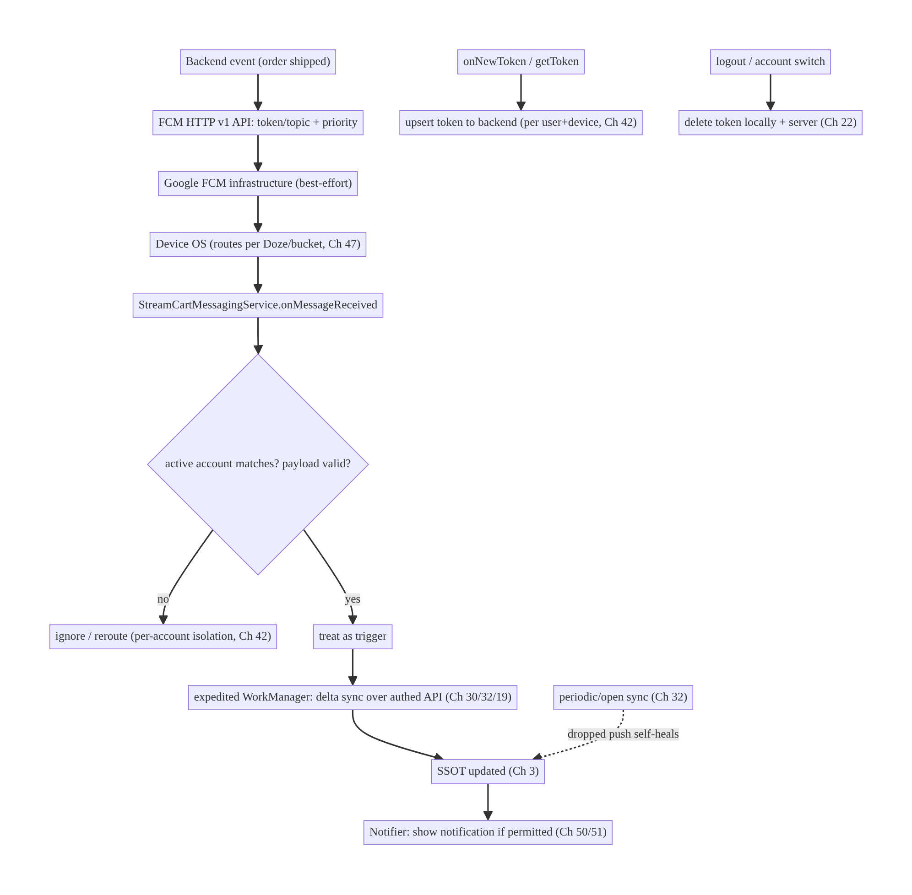
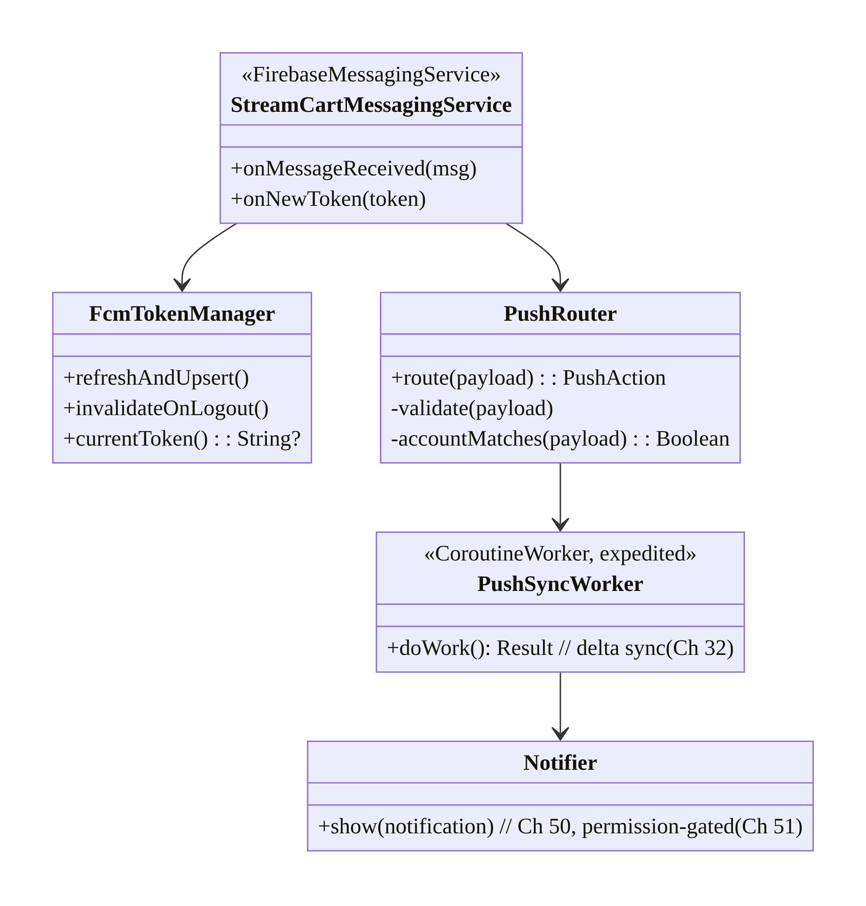
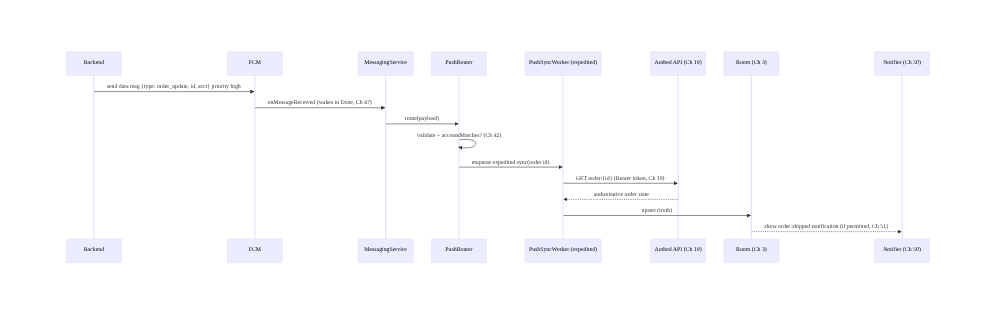
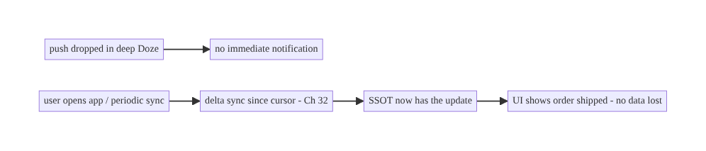
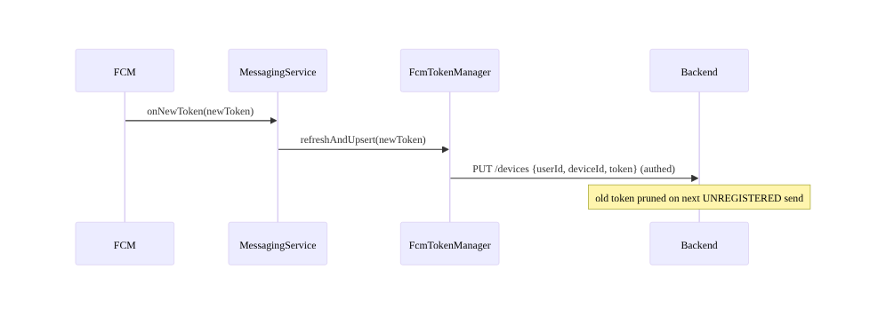
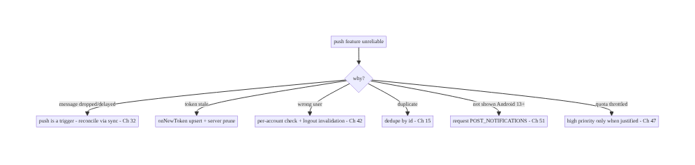

# Chapter 49 — Push Notifications (FCM) Architecture

> **Part VI — Lifecycle, Background & Platform** · Complexity: **Complex** (≥40 interview questions)
>
> **Prerequisites:** Ch 47 (Doze/background limits), Ch 30 (WorkManager), Ch 46 (FGS),
> Ch 19 (auth), Ch 51 (notification permission), Ch 50 (notification inbox). Pairs with
> Ch 48 (alarms), Ch 32 (sync).
>
> **Reference surface in StreamCart:** server-driven real-time signals — order
> shipped, price drop, chat message, live-stream starting — delivered to the device
> promptly and reliably, turned into notifications or silent data syncs, across app
> states and the platform's background limits.

---

## 49.1 Problem Definition and Real-World Context

Apps constantly need the **server to reach the client** when something happens:
your order shipped, a message arrived, a watched item dropped in price, a live stream
is starting. The client can't poll for this — polling is blocked/deferred by Doze
(Ch 47), wastes battery, and scales terribly. The platform answer is **push
notifications via Firebase Cloud Messaging (FCM)**: a single OS-level, battery-efficient
channel from your server through Google's infrastructure to the device, even when the
app is backgrounded or killed.

FCM looks simple ("send a notification") but is a **distributed delivery system** with
real engineering depth:

- **Delivery is best-effort, not guaranteed.** FCM may drop, delay, or collapse
  messages (especially in Doze / bad App Standby buckets, Ch 47). You cannot assume a
  push arrived — critical state must be **reconciled via sync** (Ch 32), with push as a
  *trigger*, not the source of truth.
- **Notification vs data messages, × app state.** A "notification message" is
  auto-displayed by the system when backgrounded but delivered to your code when
  foregrounded; a "data message" always goes to your code. Behavior differs across
  **foreground / background / killed**, and getting this matrix wrong means missed or
  duplicated notifications.
- **Token lifecycle.** Each app install has an FCM **registration token** that can
  **rotate** at any time (`onNewToken`); the server must store it per user/device, and
  **stale tokens** must be pruned or sends fail. Logout/account-switch (Ch 22/42) must
  invalidate tokens.
- **Priority & quotas.** **High-priority** messages can wake the app in Doze (limited,
  bucket-dependent quota, Ch 47); **normal-priority** may be delayed. Over-using high
  priority burns quota and gets throttled.
- **Security.** Payloads traverse Google's servers — **never put secrets/PII in the
  payload**; treat received payloads as **untrusted input**; authenticate the *effect*
  (fetch over authed API, Ch 19). Topic subscriptions and misrouting can leak data
  across users/accounts.
- **Fan-out & targeting.** Sending to millions (topics, device groups, per-user tokens)
  is a backend scaling problem; the client must subscribe/unsubscribe correctly and
  handle multi-device.

The architecture: integrate **FCM** for the transport; model **notification vs data
messages** and handle each across **app states**; manage the **token lifecycle**
(register, `onNewToken`, server upsert, logout invalidation, multi-device); choose
**priority** deliberately (high only for time-sensitive, Ch 47); **treat push as a
trigger, reconcile truth via sync** (Ch 32) so dropped messages self-heal; do heavy work
in **WorkManager/expedited** (Ch 30), not in the receiver; render notifications via a
central **Notifier** (channels, grouping, Ch 50) gated by **notification permission**
(Ch 51); and **secure** payloads (no secrets, untrusted input, authed effects,
per-account isolation). This chapter is the **client-side architecture of a reliable,
secure push system** — one of the most-asked Android system-design topics.

### Three practical use cases

1. **StreamCart order update.** High-priority data message "order X shipped" → wake →
   (optionally) expedited WorkManager fetches details over authed API (Ch 19) →
   notification (Ch 50); truth reconciled by order sync (Ch 32) if the push was dropped.
2. **Chat message.** Data message with a lightweight signal → fetch the message, show a
   grouped conversation notification; mark read syncs back.
3. **Marketing / topic broadcast.** Normal-priority topic message (e.g.,
   "flash-sale-subscribers") → notification; respects user notification preferences and
   consent (Ch 28/51).

### Why this is architectural

Push touches the **server↔client contract**, **background execution limits**, **auth/
security**, **sync/consistency**, **permissions**, and **notification UX** at once. The
decisions — message type, priority, token management, trigger-vs-truth, payload security,
fan-out — determine whether real-time features are reliable, battery-friendly, secure,
and correct across every app state and device.

---

## 49.2 Requirements Engineering

### Functional requirements

| ID | Requirement |
|----|-------------|
| F1 | Receive server-driven messages across foreground/background/killed states. |
| F2 | Manage FCM token lifecycle (register, rotate, server upsert, invalidate on logout). |
| F3 | Turn messages into notifications (Ch 50) or silent data syncs, correctly per state. |
| F4 | Use push as a trigger; reconcile authoritative state via sync (Ch 32). |
| F5 | Choose priority deliberately; do heavy work off the receiver (WorkManager). |
| F6 | Respect notification permission/consent (Ch 51) and per-account isolation (Ch 42). |

### Non-functional requirements

| Attribute | Target/Policy |
|-----------|---------------|
| **Reliability** | Dropped/delayed push self-heals via sync; no missing critical state. |
| **Latency** | Time-sensitive via high-priority (prompt Doze wake); others normal. |
| **Battery/Quota** | High priority only when justified; receiver does minimal work. |
| **Security** | No secrets/PII in payload; untrusted input; authed effects; per-account routing. |
| **Correctness** | No duplicate/missed notifications across states; idempotent. |
| **Scale** | Token storage + fan-out handle millions (backend); client multi-device. |

### Scope

- **In scope:** FCM integration, notification vs data messages, app-state matrix, token
  lifecycle (`onNewToken`, server upsert, logout/account invalidation, multi-device),
  priority/quota (Ch 47), trigger-vs-truth reconciliation (Ch 32), receiver→WorkManager
  handoff, topics/targeting (client side), notification rendering handoff (Ch 50),
  permission gating (Ch 51), payload security + per-account isolation.
- **Out of scope:** notification UI/inbox detail (Ch 50), permission UX detail (Ch 51),
  Doze mechanics (Ch 47), sync algorithm (Ch 32), backend fan-out internals (described,
  not built), WorkManager internals (Ch 30).

### Assumptions & constraints

- Firebase/FCM (HTTP v1 API server-side), `minSdk 24`, `targetSdk` current (Android 13+
  notification permission). Hilt, WorkManager, Retrofit/OkHttp (Ch 1). Delivery is
  best-effort; tokens rotate; payload ≤ ~4KB; high-priority quota is bucket-dependent.

---

## 49.3 System Design Fundamentals

- **FCM transport model.** Your backend sends a message to the **FCM HTTP v1 API**
  (authed via a service account), targeting a **registration token**, a **topic**, or a
  **device group**. Google's infrastructure holds a persistent, battery-efficient
  connection to the device and delivers the message to the OS, which routes it to your
  app (even if killed, subject to limits). It's a **best-effort** channel.
- **Message types (critical distinction):**
  - **Notification message:** payload has a `notification` block. When the app is
    **backgrounded/killed**, the **system** displays it automatically (you don't run
    code); the data arrives in the launch intent if tapped. When **foregrounded**, it's
    delivered to `onMessageReceived` and you display it.
  - **Data message:** payload has only a `data` block. **Always** delivered to
    `onMessageReceived` (your code), in all states (subject to limits) — you control
    display. **Recommended** for apps that want consistent control.
  - **Mixed** (both blocks): system shows the notification when backgrounded; data is in
    the intent. Avoid relying on `onMessageReceived` for mixed messages when
    backgrounded.
- **App-state × type matrix (the thing to get right):**

  | State | Notification message | Data message |
  |-------|---------------------|--------------|
  | Foreground | `onMessageReceived` (you show) | `onMessageReceived` |
  | Background | system shows; data in tap intent | `onMessageReceived` (limited by Doze/bucket) |
  | Killed | system shows; data in tap intent | `onMessageReceived` if delivered (more likely dropped/delayed) |

  For full control + background sync, use **data messages** with **high priority** for
  time-sensitive ones — and still reconcile via sync.
- **Token lifecycle.** On first run (and on rotation) FCM issues a **registration
  token** (`FirebaseMessaging.getToken()` / `onNewToken`). The client must **upsert it
  to the backend keyed by user + device** (Ch 42 per-account). Tokens **rotate**
  unpredictably; always honor `onNewToken`. On **logout/account switch**, **delete/
  invalidate** the token server-side and locally (Ch 22/42) so the next user doesn't get
  the previous user's pushes. The server must **prune stale tokens** (FCM returns
  `UNREGISTERED`/`NOT_FOUND` on send → remove).
- **Priority & Doze (Ch 47).** **`high`** priority can wake the app in Doze for prompt
  delivery (limited, **App Standby bucket**-dependent quota); **`normal`** may be batched/
  delayed. Use high **only** for genuinely time-sensitive, user-impacting messages
  (chat, order status); over-use exhausts quota and gets you throttled. High-priority
  data message → optionally **expedited WorkManager** (Ch 30) for the follow-up work.
- **Push is a trigger, not the source of truth.** Because delivery is best-effort,
  **never treat a push as authoritative state**. A push says "something may have
  changed" → the client does a **delta sync** (Ch 32) over the authed API to get the
  real state, into the SSOT (Ch 3). This way a **dropped push self-heals** at the next
  sync/app-open, and a **duplicate push is idempotent** (Ch 15). Critical flows (payments,
  orders) must not depend solely on push.
- **Receiver discipline.** `onMessageReceived` runs on a background thread with a short
  budget (~seconds, and heavily limited in Doze). Do **minimal** work: parse, maybe show
  a notification, and **enqueue WorkManager** (expedited for urgent) for any fetch/sync —
  don't do network/DB heavy lifting inline.
- **Targeting:** **per-user tokens** (most control, multi-device via multiple tokens),
  **topics** (pub/sub broadcast — client `subscribeToTopic`, good for broad segments,
  but coarse and public-ish so no sensitive targeting), **device groups** (legacy). The
  client subscribes/unsubscribes to topics per preference and **unsubscribes on logout**.
- **Security:** payloads pass through Google → **no secrets/PII** in them (Ch 28);
  treat payload fields as **untrusted** (validate, don't `eval`/deep-link blindly,
  Ch 52); **authenticate the effect** (fetch over authed API, Ch 19); ensure
  **per-account isolation** (a push for account A must not render under account B,
  Ch 42) by checking the active account against the payload's target.

Core insight: **FCM is a best-effort, battery-efficient server→client transport;
model notification-vs-data messages across foreground/background/killed states (prefer
data messages for control), manage the rotating per-user/device token lifecycle
(upsert, `onNewToken`, invalidate on logout), choose high priority only for
time-sensitive messages within quota, keep the receiver minimal (hand work to
WorkManager), and — above all — treat push as a trigger and reconcile authoritative
state via sync so dropped/duplicate messages self-heal; secure payloads (no secrets,
untrusted input, authed effects, per-account isolation) and gate display on notification
permission.**

---

## 49.4 High-Level Architecture



**Components & ownership**

- **Backend** emits events → FCM API (targeting + priority).
- **`FirebaseMessagingService`** receives messages, validates/per-account-checks, and
  hands off to WorkManager + Notifier.
- **Token manager** upserts/invalidates tokens.
- **Sync** (Ch 32) is the safety net that makes dropped push self-heal (truth lives in
  the SSOT, not the push).

**Direction:** event → FCM → OS → service (validate) → WorkManager sync → SSOT →
notification; token lifecycle + sync keep it reliable and secure.

---

## 49.5 Detailed Component Design



| Component | Responsibility |
|-----------|----------------|
| `StreamCartMessagingService` | receive messages + token; minimal work; hand off |
| `FcmTokenManager` | token upsert/rotation/invalidation (per account, Ch 42) |
| `PushRouter` | validate payload (untrusted), per-account check, classify action |
| `PushSyncWorker` | expedited delta sync over authed API → SSOT (Ch 30/32/19) |
| `Notifier` | render notification (channels/grouping, Ch 50), permission-gated (Ch 51) |

---

## 49.6 End-to-End Data Flow

### High-priority data message → sync → notification



### Dropped push self-heals via sync



### Token rotation



---

## 49.7 Complete Kotlin Implementation

Package: `com.streamcart.push`.

### 49.7.1 Manifest + service registration

```xml
<uses-permission android:name="android.permission.POST_NOTIFICATIONS" />  <!-- Android 13+ (Ch 51) -->

<service
    android:name=".push.StreamCartMessagingService"
    android:exported="false">
    <intent-filter><action android:name="com.google.firebase.MESSAGING_EVENT" /></intent-filter>
</service>
```

### 49.7.2 FirebaseMessagingService: minimal, hand off

```kotlin
@AndroidEntryPoint
class StreamCartMessagingService : FirebaseMessagingService() {
    @Inject lateinit var router: PushRouter
    @Inject lateinit var tokenManager: FcmTokenManager

    override fun onMessageReceived(message: RemoteMessage) {
        // Runs on a background thread with a short budget. Do MINIMAL work; hand off to WorkManager.
        router.route(message.data, message.notification?.let { NotificationPart(it.title, it.body) })
    }

    override fun onNewToken(token: String) {
        // Token rotated -> upsert to backend (fire-and-forget via WorkManager so it survives process death).
        tokenManager.enqueueUpsert(token)
    }
}
```

### 49.7.3 PushRouter: validate (untrusted), per-account check, enqueue sync

```kotlin
@Singleton
class PushRouter @Inject constructor(
    @ApplicationContext private val ctx: Context,
    private val activeAccount: ActiveAccountProvider,   // Ch 42
    private val workManager: WorkManager,
    private val notifier: Notifier,                     // Ch 50
) {
    fun route(data: Map<String, String>, notif: NotificationPart?) {
        // 1) Treat payload as UNTRUSTED input.
        val type = data["type"]?.takeIf { it in KNOWN_TYPES } ?: return   // allowlist, no eval
        val targetAccount = data["acct"]
        // 2) Per-account isolation (Ch 42): drop/stash if not the active account.
        if (targetAccount != null && targetAccount != activeAccount.current()?.id) return
        // 3) Push is a TRIGGER: enqueue expedited sync to fetch authoritative state over authed API.
        val id = data["id"]
        workManager.enqueue(
            OneTimeWorkRequestBuilder<PushSyncWorker>()
                .setInputData(workDataOf("type" to type, "id" to id))
                .setExpedited(OutOfQuotaPolicy.RUN_AS_NON_EXPEDITED_WORK_REQUEST)   // prompt (Ch 30/47)
                .build())
        // 4) Optionally show an immediate lightweight notification (content confirmed after sync).
    }
    companion object { val KNOWN_TYPES = setOf("order_update", "chat_message", "price_drop") }
}
```

### 49.7.4 PushSyncWorker: fetch truth over authed API → SSOT → notify

```kotlin
@HiltWorker
class PushSyncWorker @AssistedInject constructor(
    @Assisted ctx: Context, @Assisted p: WorkerParameters,
    private val syncRepo: SyncRepository,     // Ch 32, authed (Ch 19)
    private val notifier: Notifier,           // Ch 50
) : CoroutineWorker(ctx, p) {
    override suspend fun getForegroundInfo() = ForegroundInfo(/* for expedited on older OS */ ...)
    override suspend fun doWork(): Result = runCatching {
        val type = inputData.getString("type") ?: return Result.failure()
        val id = inputData.getString("id")
        val update = syncRepo.fetchAuthoritative(type, id)   // GET over Bearer token; idempotent (Ch 15)
        notifier.notifyFor(update)                            // render (permission-gated, Ch 50/51)
    }.fold({ Result.success() }, { if (runAttemptCount < 3) Result.retry() else Result.failure() })
}
```

### 49.7.5 FcmTokenManager: register, upsert, invalidate on logout

```kotlin
@Singleton
class FcmTokenManager @Inject constructor(
    private val firebaseMessaging: FirebaseMessaging,
    private val api: DeviceApi,                  // authed (Ch 19)
    private val workManager: WorkManager,
    private val session: SessionManager,         // Ch 22
) {
    /** Call after login / on app start (while logged in). */
    suspend fun refreshAndUpsert() {
        val token = firebaseMessaging.token.await()
        api.upsertDevice(DeviceDto(deviceId = session.deviceId, token = token))  // keyed by user+device (Ch 42)
    }
    fun enqueueUpsert(token: String) = workManager.enqueue(
        OneTimeWorkRequestBuilder<TokenUpsertWorker>().setInputData(workDataOf("t" to token))
            .setConstraints(Constraints.Builder().setRequiredNetworkType(NetworkType.CONNECTED).build())
            .build())   // survives process death; retried until delivered

    /** On logout / account switch (Ch 22/42): stop pushes for this user. */
    suspend fun invalidateOnLogout() {
        runCatching { api.deleteDevice(session.deviceId) }   // server stops sending
        firebaseMessaging.deleteToken().await()              // rotate token locally
        // unsubscribe from all topics tied to the account:
        // topics.forEach { firebaseMessaging.unsubscribeFromTopic(it).await() }
    }
}
```

### 49.7.6 Topic subscription (per preference; unsubscribe on logout)

```kotlin
suspend fun setMarketingOptIn(enabled: Boolean, fm: FirebaseMessaging) {
    if (enabled) fm.subscribeToTopic("flash_sale").await()
    else fm.unsubscribeFromTopic("flash_sale").await()
    // Never use topics for sensitive/targeted content (coarse, not per-user-secure).
}
```

### 49.7.7 Module structure

```
:feature:push   StreamCartMessagingService, PushRouter, PushSyncWorker, FcmTokenManager, TokenUpsertWorker
:core:notifications Notifier (Ch 50), permission (Ch 51)
:core:sync      SyncRepository (Ch 32), authed API (Ch 19)
:core:session   SessionManager, ActiveAccountProvider (Ch 22/42)
```

---

## 49.8 Concurrency and Race Conditions

| Scenario | Risk | Handling |
|----------|------|----------|
| Duplicate push (FCM re-delivery) | duplicate notification/work | idempotent sync + notification dedupe by id (Ch 15) |
| Token rotates mid-session | sends fail / wrong device | `onNewToken` → upsert via WorkManager (survives death) |
| Logout then stale push arrives | wrong user sees data | per-account check (Ch 42) + token invalidation |
| Receiver does heavy work | dropped/ANR under Doze | hand to WorkManager (expedited) |
| Multiple pushes trigger overlapping sync | races | `enqueueUniqueWork` / single-flight (Ch 11/30) |
| Notification shown before truth fetched | wrong content | show after sync, or update notification post-sync |
| Topic subscribe race on login/logout | cross-account leakage | subscribe on login, unsubscribe on logout (await) |

- **Idempotency is mandatory:** FCM can deliver a message more than once and your sync +
  notification must dedupe by a stable id (Ch 15) so re-delivery doesn't double-notify or
  double-apply.
- **Token upsert must survive process death:** do it via **WorkManager** (retried),
  not an inline network call in `onNewToken` (the process may die before it completes).
- **Per-account check guards cross-user leakage:** always compare the payload's target
  account to the **active** account before rendering/applying (Ch 42); invalidate tokens
  on logout so the server stops sending.

---

## 49.9 Failure Scenarios and Recovery

| Failure | Detection | Response | Outcome |
|---------|-----------|----------|---------|
| Push dropped (Doze/bucket) | missing notification | delta sync on open/periodic (Ch 32) | self-heals |
| Delivered but delayed | late notification | high priority for time-sensitive; sync backstop | acceptable |
| Stale token (send fails) | FCM `UNREGISTERED` | server prunes; client re-registers (`onNewToken`) | restored |
| Duplicate delivery | double notification | idempotent dedupe by id (Ch 15) | single |
| Cross-account push | wrong user content | per-account check + logout invalidation (Ch 42) | isolated |
| Payload tampered/malformed | crash/exploit | validate as untrusted; allowlist types (Ch 52) | safe |
| No notification permission | silent (Android 13+) | request permission (Ch 51); still sync | data correct |
| High-priority quota exhausted | throttled/delayed | reduce high-priority volume; normal + sync | within quota |



> **The golden rule: push is a trigger, never the source of truth.** Because FCM is
> best-effort, correctness comes from reconciling via sync (Ch 32) — then dropped,
> delayed, and duplicate messages all self-heal. Every other failure (token, account,
> permission, quota) has a specific fix, but this one principle is what makes push
> reliable at all.

---

## 49.10 Scaling the Implementation

- **Level 1.** FCM integration; data messages → notification; token upsert on login +
  `onNewToken`.
- **Level 2.** Push-as-trigger + delta sync reconciliation (Ch 32); receiver →
  expedited WorkManager; notification permission gating (Ch 51).
- **Level 3 — production.** Per-account isolation + logout token invalidation (Ch 42/22);
  idempotent dedupe; priority discipline; payload validation; topics per preference;
  notification channels/grouping (Ch 50).
- **Level 4 — large.** Multi-device token management; quota-aware priority (Ch 14/47);
  push analytics (delivery/open rates); server-side token pruning + fan-out via topics/
  device groups; A/B of notification content; consent/preference center (Ch 28).
- **Level 5 — enterprise.** Push reliability SLOs (delivery/latency by bucket/OS/OEM);
  dead-letter/retry on the backend; multi-region FCM; per-notification-type priority
  policy; privacy/consent governance; observability of trigger→sync→notify funnel.

**Avoid overengineering:** for most apps, **data messages + token upsert + push-as-
trigger-with-sync + permission gating** is the core. Don't build custom delivery
guarantees on top of FCM (sync is your guarantee); don't high-priority everything.

---

## 49.11 Alternative Approaches and Trade-offs

| Dimension | Option A | Option B | When |
|-----------|----------|----------|------|
| Message type | Data message | notification message | Data for control/consistency; notification for simple system-shown broadcasts |
| Source of truth | Sync (push = trigger) | trust the payload | Always sync-reconcile (push best-effort); never trust payload as truth |
| Priority | High (time-sensitive) | normal (default) | High only for chat/order-status; normal otherwise (quota, Ch 47) |
| Follow-up work | Expedited WorkManager | inline in receiver | WorkManager (receiver budget tiny, Doze-limited) |
| Targeting | Per-user token | topic | Token for personal/secure; topic for broad non-sensitive segments |
| Real-time transport | FCM push | WebSocket (Ch 63) | FCM for background/killed wake; WebSocket for live foreground session |
| Token upsert | WorkManager (durable) | inline network | WorkManager (survives process death) |

**Data vs notification messages:** notification messages are simplest (system shows them
when backgrounded, no code), but you lose control when backgrounded/killed and can't
customize or reconcile reliably. Data messages always reach your code, giving consistent
control to validate, per-account-check, sync, and render — at the cost of handling
display yourself and running under tighter Doze limits. For a real app that needs
correctness and per-account isolation, **prefer data messages** (high priority for
time-sensitive) and always reconcile via sync.

**Push vs WebSocket for real-time (Ch 63):** FCM is the right transport when the app may
be **backgrounded or killed** (it wakes the app battery-efficiently via the OS). A
WebSocket (Ch 63) is right for a **live foreground session** (chat open, live stream)
where you need low-latency bidirectional streaming — but it dies when backgrounded. Real
apps use **both**: WebSocket while foregrounded/active, FCM to wake for background events,
with sync (Ch 32) as the reconciliation layer behind both.

**Push as truth vs push as trigger:** trusting the payload as authoritative state is the
classic mistake — a dropped push then means permanently missed state, and a duplicate
means double-applied changes. Treating push as a **trigger** that prompts an authed,
idempotent **sync** (Ch 32/15/19) makes the system self-healing and secure (the payload
can even be minimal, avoiding PII). This is the single most important design decision in
the chapter.

---

## 49.12 Security & Privacy Considerations

- **No secrets or PII in the payload.** Payloads traverse Google's servers and may be
  logged/cached; send a **minimal signal** (type + id), fetch details over the **authed
  API** (Ch 19). Never put tokens, full messages, prices tied to identity, etc., in the
  push (Ch 28).
- **Treat payloads as untrusted input.** Validate/allowlist `type`; never blindly
  deep-link from a payload (open-redirect/intent-injection risk, Ch 52); never `eval` or
  trust URLs/ids without server verification.
- **Authenticate the effect.** The notification's data is fetched with the user's auth
  (Bearer, Ch 19); the push itself grants no access.
- **Per-account isolation (Ch 42).** Check the payload's target account against the
  **active** account before rendering/applying; **invalidate the token on logout/switch**
  so the previous user's pushes stop. A chat push for account A must never render under
  account B.
- **Topics are coarse/semi-public.** Never use topics for sensitive or per-user targeting
  (anyone who reverse-engineers the app can subscribe); use per-user tokens for anything
  personal.
- **Notification content on lock screen** must respect sensitivity (public/private
  versions, Ch 50) and consent (Ch 51/28).
- **Token theft/misuse:** tokens are not secrets that grant access, but a leaked token
  lets someone send to that device *via your authed backend only* — protect the send API,
  rotate on logout, and prune stale tokens.
- Client vs backend: the backend owns **token storage (per user/device), fan-out,
  pruning stale tokens, priority policy, and never embedding PII**; the client owns
  **validation, per-account routing, sync reconciliation, and permission gating**.

---

## 49.13 Performance and Resource Optimization

- **Minimal receiver work** → hand to WorkManager; avoids ANR and Doze drops.
- **High priority sparingly** (quota + battery, Ch 47); batch/coalesce server events so
  you send fewer, more meaningful pushes (Ch 14).
- **Collapsible messages** (`collapseKey`): let FCM collapse superseded messages (e.g.,
  "3 new messages" replaces older) to save battery/bandwidth.
- **Small payloads** (≤4KB; keep well under) — signal, not content.
- **Coalesce sync triggers:** multiple pushes → unique/debounced sync work (Ch 11/30)
  rather than N fetches.
- **Notification throttling/grouping** (Ch 50) to avoid spamming + battery from many
  `notify()` calls.
- **Profiling:** delivery/open funnel, wake-ups and battery attributed to push (Battery
  Historian), high-priority quota usage, sync-after-push cost.

---

## 49.14 Testing Strategy

Push is tested with faked `RemoteMessage`, WorkManager test APIs, and the FCM console/
`adb` for end-to-end.

```kotlin
class PushRouterTest {
    @Test fun `drops push for non-active account`() {
        val router = PushRouter(ctx, FakeActiveAccount("A"), fakeWm, fakeNotifier)
        router.route(mapOf("type" to "chat_message", "id" to "1", "acct" to "B"), null)
        assertTrue(fakeWm.enqueued.isEmpty())   // per-account isolation (Ch 42)
    }
    @Test fun `ignores unknown message type`() {
        PushRouter(ctx, FakeActiveAccount("A"), fakeWm, fakeNotifier).route(mapOf("type" to "evil"), null)
        assertTrue(fakeWm.enqueued.isEmpty())   // allowlist validation
    }
    @Test fun `enqueues expedited sync for known type`() { /* assert WorkManager enqueue */ }
}

class PushSyncWorkerTest {
    @Test fun `sync is idempotent across duplicate pushes`() = runTest {
        val worker = TestListenableWorkerBuilder<PushSyncWorker>(ctx, workDataOf("type" to "order_update","id" to "1")).build()
        worker.doWork(); worker.doWork()         // twice
        assertEquals(1, fakeNotifier.shown.count { it.id == "1" })   // deduped (Ch 15)
    }
}

class FcmTokenManagerTest {
    @Test fun `invalidateOnLogout deletes device and rotates token`() = runTest { /* assert deleteDevice + deleteToken */ }
}
```

```bash
# End-to-end with adb (send a data message to the app):
adb shell am broadcast -a com.google.android.c2dm.intent.RECEIVE ...   # or FCM test console
adb shell dumpsys deviceidle force-idle   # verify high-priority wakes it (Ch 47)
```

What to test: router validation + per-account drop + unknown-type drop; expedited
enqueue; idempotent sync (duplicate pushes → one notification); token upsert via
WorkManager; logout invalidation; permission-gated rendering (Ch 51); app-state behavior
(foreground vs background) on device; Doze high-priority wake.

---

## 49.15 Production Observability

- **Metrics:** delivery → open **funnel** (sent / delivered / displayed / tapped);
  delivery latency and **drop rate by App Standby bucket / OS / OEM** (Ch 47); token
  upsert success + stale-token prune rate; high-priority **quota usage**; duplicate-
  delivery rate; per-account mis-route count (should be 0); notification-permission grant
  rate (Ch 51); sync-after-push success.
- **Logs:** `push{type, priority, delivered_at, synced, notified, account_ok}` — **no PII/
  payload content** (Ch 28).
- **Debugging:** missing notifications → drop (Doze/bucket) → rely on sync; late →
  priority/quota; wrong user → per-account/token invalidation bug; duplicates →
  non-idempotent; not shown on 13+ → permission; sends failing → stale tokens not pruned.
- **Alerting:** delivery-rate drop on an OS/OEM after update; high-priority quota
  exhaustion; any cross-account mis-route (security alert).
- **Dashboards:** delivery funnel and drop-by-bucket/OEM; trigger→sync→notify success
  rate (the reliability KPI).

---

## 49.16 System Design Interview Preparation

> ≥40 questions.

**Fundamentals**

1. *Why not poll?* Doze blocks/defers it, battery/scale — use push (Ch 47).
2. *What is FCM?* Battery-efficient OS-level server→client transport via Google infra;
   best-effort.
3. *Notification vs data message?* System-shown when backgrounded vs always delivered to
   your code.
4. *Which to prefer?* Data messages (control/consistency); notification for simple
   broadcasts.
5. *App-state matrix?* Foreground → your code; background/killed → system shows
   notification messages, data messages may be dropped/delayed.

**Reliability**

6. *Is delivery guaranteed?* No — best-effort; may drop/delay/collapse.
7. *Golden rule?* Push is a trigger, not the source of truth.
8. *How dropped push self-heals?* Delta sync on open/periodic (Ch 32).
9. *Duplicate delivery?* Idempotent sync + dedupe by id (Ch 15).
10. *Critical flows (payment) on push alone?* Never — reconcile via sync.

**Tokens**

11. *Registration token?* Per-install id to target; can rotate.
12. *`onNewToken`?* Rotation callback — upsert to backend.
13. *Store token keyed by?* User + device (multi-device, per-account, Ch 42).
14. *Logout?* Delete/invalidate token + unsubscribe topics.
15. *Stale tokens?* Server prunes on `UNREGISTERED`/`NOT_FOUND`.
16. *Upsert durably?* WorkManager (survives process death).

**Priority/Doze**

17. *High vs normal priority?* High can wake in Doze (limited quota); normal may be
    delayed (Ch 47).
18. *When high?* Time-sensitive (chat, order status) only.
19. *Quota?* Bucket-dependent; over-use throttled.
20. *Follow-up work?* Expedited WorkManager, not inline.

**Receiver**

21. *`onMessageReceived` constraints?* Short budget, background thread, Doze-limited.
22. *What to do inline?* Validate, per-account check, enqueue WorkManager, maybe
    lightweight notify.

**Targeting**

23. *Per-user token vs topic vs device group?* Control/secure vs broad pub/sub vs legacy.
24. *Topics for sensitive content?* No — coarse/semi-public.
25. *Subscribe/unsubscribe lifecycle?* On preference change; unsubscribe on logout.

**Security**

26. *Secrets/PII in payload?* Never (traverses Google).
27. *Payload trust?* Untrusted — validate/allowlist; no blind deep-link (Ch 52).
28. *Authenticate the effect?* Fetch over authed API (Ch 19).
29. *Per-account isolation?* Check active account vs payload; invalidate on logout
    (Ch 42).
30. *Token a secret?* No, but protect the send API; rotate/prune.

**Push vs WebSocket**

31. *When WebSocket?* Live foreground session (Ch 63).
32. *When FCM?* Background/killed wake.
33. *Use both?* Yes — WS foreground, FCM background, sync reconciles.

**Permissions/UX**

34. *Android 13+ display?* Needs `POST_NOTIFICATIONS` (Ch 51).
35. *No permission?* Data still syncs; just not shown.
36. *Notification rendering?* Central Notifier, channels/grouping (Ch 50).

**Testing/Production**

37. *Test the router?* Fake `RemoteMessage`; assert validation/per-account/enqueue.
38. *Test idempotency?* Run sync twice → one notification.
39. *Missing notifications in prod?* Drops (Doze/bucket) → rely on sync.
40. *Wrong user sees push?* Per-account/token invalidation bug.
41. *Sends failing?* Stale tokens not pruned.
42. *Key reliability KPI?* Trigger→sync→notify success + delivery-by-bucket.

### Design-change challenges
1. **Design push for chat.** Data message (high priority) → fetch message → grouped
   notification; WebSocket when foregrounded; sync reconciles; per-account isolation.
2. **Order-status push must never be missed.** Push as trigger + authoritative order
   sync (Ch 32); don't depend on delivery.
3. **Users report pushes for the wrong account after switching.** Per-account check +
   token invalidation on switch (Ch 42).
4. **Battery/quota complaints from too many high-priority pushes.** Downgrade non-urgent
   to normal; coalesce/collapse; sync backstop (Ch 47).
5. **Notifications not showing on Android 13+.** Request `POST_NOTIFICATIONS`; data still
   syncs (Ch 51).

### Mock walkthrough (abridged)
Clarify (what events, how time-sensitive, multi-account/device, foreground live too?) →
FCM transport + message type (data) → token lifecycle (upsert/rotate/invalidate) →
priority policy (Ch 47) → **push-as-trigger + sync reconciliation** (Ch 32) → receiver →
expedited WorkManager → per-account isolation + payload security (Ch 42/28/52) →
notification rendering + permission (Ch 50/51) → push vs WebSocket (Ch 63) → observability
(delivery funnel, drop-by-bucket).

---

## 49.17 Practical Exercises

1. **Beginner.** Integrate FCM: receive a data message, show a notification, upsert the
   token on login and in `onNewToken`. *Eval:* message received across states; token
   stored.
2. **Intermediate.** Make push a trigger: on receipt, enqueue an expedited WorkManager
   delta sync over the authed API; show the notification after truth is fetched. *Eval:*
   dropped push self-heals on next sync.
3. **Advanced.** Add per-account isolation + logout token invalidation + idempotent
   dedupe. *Eval:* no cross-account rendering; duplicates → one notification; logout stops
   pushes.
4. **Production debugging.** Diagnose "notifications missing in prod": confirm drops by
   bucket, verify sync backstop, and fix a stale-token pruning gap. *Eval:* reliability
   restored; stale tokens pruned.
5. **System design challenge.** Design chat real-time using FCM (background) + WebSocket
   (foreground) + sync (reconcile), with priority policy and a delivery funnel dashboard.
   *Eval:* correct across states; self-healing; observable.

*(Solutions withheld unless requested.)*

---

## 49.18 Chapter Summary & Reference Sheet

**Key decisions:** use **FCM** as a **best-effort, battery-efficient server→client
transport**; prefer **data messages** (consistent code control across app states) with
**high priority only for time-sensitive** events (bucket-limited quota, Ch 47); manage
the **token lifecycle** rigorously (register, `onNewToken`, durable WorkManager upsert
keyed by **user+device**, **invalidate on logout/account switch**, server prunes stale
tokens); keep **`onMessageReceived` minimal** and hand follow-up work to **expedited
WorkManager** (Ch 30); and above all treat **push as a trigger, reconciling authoritative
state via sync** (Ch 32) so **dropped, delayed, and duplicate messages self-heal**
(idempotent, Ch 15) — never trust the payload as truth; **secure** it (no secrets/PII,
untrusted input, authed effects via Ch 19, **per-account isolation** via Ch 42, topics
only for coarse non-sensitive segments); **gate display on `POST_NOTIFICATIONS`** (Ch 51)
and render via a central **Notifier** (Ch 50); and combine FCM (background) with a
**WebSocket** (foreground live, Ch 63) when real-time matters.

**Concepts:** FCM transport, notification vs data messages, app-state matrix, token
lifecycle/rotation/invalidation, priority & Doze quota, push-as-trigger + sync
reconciliation, receiver→WorkManager handoff, topics/targeting, per-account isolation,
payload security, permission gating, FCM vs WebSocket.

**Common mistakes:** treating push as the source of truth (dropped = lost); heavy work in
the receiver; not handling `onNewToken`/not pruning stale tokens; high-priority
everything (quota throttle); PII in payload; trusting payload (blind deep-link); no
per-account check / no logout invalidation (cross-account leak); topics for sensitive
targeting; no `POST_NOTIFICATIONS` handling; non-idempotent (duplicates).

**Checklist:**

- [ ] data messages + deliberate priority
- [ ] token upsert (user+device, durable) + `onNewToken`
- [ ] invalidate token + unsubscribe topics on logout
- [ ] receiver minimal → expedited WorkManager
- [ ] **push = trigger; reconcile via sync**
- [ ] idempotent dedupe by id
- [ ] validate payload (allowlist, no blind deep-link)
- [ ] authed effect (Ch 19)
- [ ] per-account isolation (Ch 42)
- [ ] no secrets/PII in payload
- [ ] `POST_NOTIFICATIONS` gating
- [ ] delivery funnel + drop-by-bucket telemetry.

**Key APIs:** `FirebaseMessagingService`/`onMessageReceived`/`onNewToken`,
`FirebaseMessaging.getToken`/`deleteToken`/`subscribeToTopic`/`unsubscribeFromTopic`,
`RemoteMessage` (data/notification), FCM HTTP v1 API (server), `priority: high|normal`,
`collapseKey`, `CoroutineWorker.setExpedited`/`OutOfQuotaPolicy` (Ch 30),
`POST_NOTIFICATIONS` (Ch 51), `NotificationCompat` (Ch 50).

**References:**
- FCM overview: https://firebase.google.com/docs/cloud-messaging
- Message types: https://firebase.google.com/docs/cloud-messaging/concept-options
- Receive messages on Android: https://firebase.google.com/docs/cloud-messaging/android/receive
- Manage tokens: https://firebase.google.com/docs/cloud-messaging/manage-tokens
- Notifications & Doze/priority: https://firebase.google.com/docs/cloud-messaging/concept-options#setting-the-priority-of-a-message
- (composes) Ch 47 Doze/Limits, Ch 30 WorkManager, Ch 32 Delta Sync, Ch 19 Auth, Ch 42 Multi-Account, Ch 50 Notifications, Ch 51 Permissions, Ch 63 WebSockets

### Chapter review (Phase 4)
- **Completeness:** all 18 sections; architecture/class/3 sequence+flow/failure diagrams;
  messaging service + router (validate/per-account) + expedited sync worker + token
  manager + topics code; concurrency (idempotency, token-durability, per-account);
  failure (drop/token/account/dupe/perm/quota triage with golden rule); 5 levels; data-vs-
  notification, push-vs-WebSocket, trigger-vs-truth trade-offs; security/privacy (no PII,
  untrusted, authed, per-account, topics); perf (minimal receiver, collapse, coalesce);
  router/worker/token tests + adb; observability (delivery funnel, drop-by-bucket); 42
  Q&A + 5 challenges. ✅
- **Expand later:** notifications UI (Ch 50), permissions (Ch 51), WebSockets (Ch 63),
  sync (Ch 32).
- **Interview coverage:** exceeds ≥40 Complex bar.
