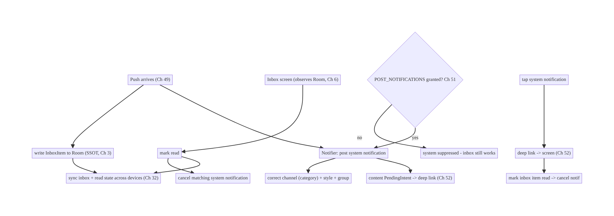
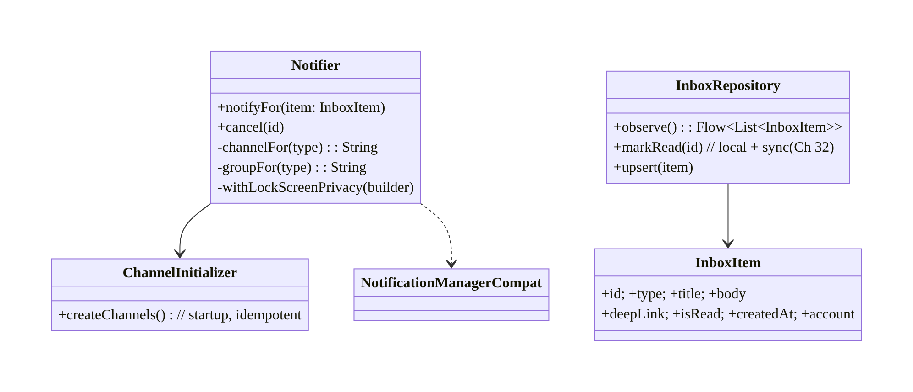
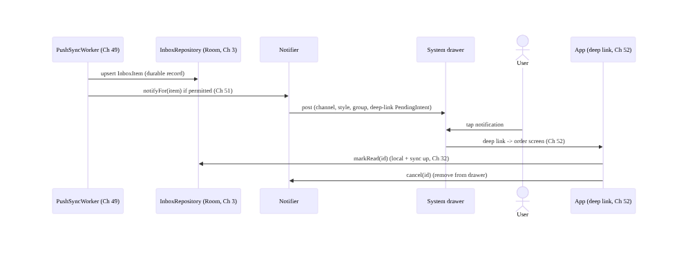
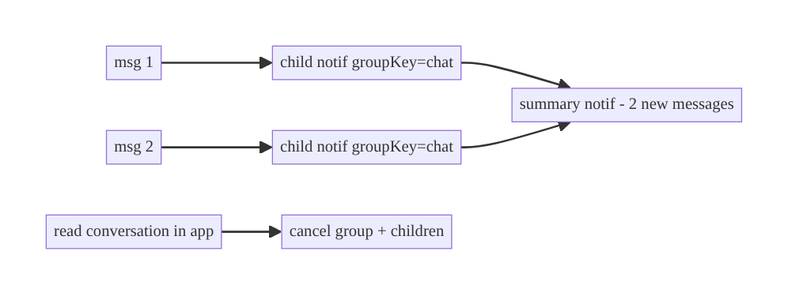
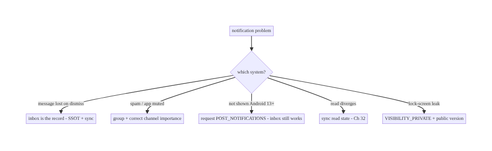

# Chapter 50 — Notification Center / Inbox

> **Part VI — Lifecycle, Background & Platform** · Complexity: **Standard** (≥25 interview questions)
>
> **Prerequisites:** Ch 49 (FCM/push), Ch 51 (notification permission), Ch 3 (SSOT/
> Room), Ch 32 (sync), Ch 52 (deep links). Pairs with Ch 46 (FGS notifications),
> Ch 6 (UI state).
>
> **Reference surface in StreamCart:** both halves of "notifications" — the **system
> notifications** (channels, grouping, styles, actions, lock-screen) shown in the
> status bar, and the **in-app notification inbox** (a persistent, synced list of
> messages the user can read, mark read, and act on).

---

## 50.1 Problem Definition and Real-World Context

"Notifications" means two related systems that teams often conflate:

1. **System notifications** — the OS status-bar/drawer notifications, governed by
   **channels** (Android 8+), importance, grouping, styles (BigText, Inbox, Messaging),
   actions, and lock-screen visibility. These are **ephemeral** (dismissed = gone) and
   fully user-controllable (per-channel settings).
2. **In-app notification inbox** — a **persistent, synced list** inside the app (bell
   icon → list of order updates, messages, promos) that survives dismissal, shows
   read/unread, and is the source of truth for "what did I get." This is a normal
   **offline-first data feature** (SSOT + sync, Ch 3/32), not a system-notification
   concern.

The problems arise when these aren't designed together:

- **Treating the system notification as the record.** Once dismissed, it's gone — if
  there's no inbox, the user permanently loses the message. The **inbox** (persisted,
  synced) is the record; the system notification is a transient *alert*.
- **Channel mismanagement.** No channels (required Android 8+), one giant channel (user
  can't tune), or wrong importance → users disable *all* notifications. Channels created
  late or renamed badly confuse settings.
- **Notification spam & no grouping.** Posting many individual notifications instead of
  **grouping** (summary + children) floods the drawer and gets the app muted.
- **Inconsistent rendering.** Scattered `NotificationCompat` calls across the codebase →
  inconsistent styling, missing actions, duplicate ids, lock-screen leaks. A central
  **Notifier** is needed.
- **Read-state divergence.** Tapping a system notification doesn't mark the inbox item
  read; reading in-app doesn't dismiss the system notification; read state doesn't sync
  across devices (Ch 32).
- **Permission (Android 13+).** Without `POST_NOTIFICATIONS` (Ch 51), system
  notifications are silently suppressed — but the inbox should still work.

The architecture: build a central **Notifier** that owns **channels** (created at
startup, correct importance), consistent **styles/actions/grouping**, lock-screen
visibility, and ids; model the **inbox as an offline-first feature** (Room SSOT + sync,
Ch 3/32) with read/unread and actions; **link the two** (tapping a system notification
deep-links into the app and marks the inbox item read, Ch 52; in-app read optionally
cancels the system notification; read state syncs, Ch 32); and gate system display on
**notification permission** (Ch 51) while keeping the inbox functional regardless. This
chapter is about **a coherent notification experience across the status bar and an
in-app inbox**.

### Three practical use cases

1. **StreamCart order update.** Push (Ch 49) → inbox row persisted (SSOT) + system
   notification posted (right channel, deep-link action, Ch 52); tapping marks read and
   navigates; read syncs across devices.
2. **Grouped chat messages.** Multiple messages → **grouped** notification (summary + per-
   message children, Messaging style); inbox shows the conversation; reading in-app
   cancels the system group.
3. **Promotions channel.** A separate low-importance "Promotions" channel the user can
   mute independently without losing transactional notifications.

### Why this is architectural

The notification experience spans **push (Ch 49)**, **persistence/sync (Ch 3/32)**,
**deep links (Ch 52)**, **permissions (Ch 51)**, and **UI (Ch 6)** — and the key
insight (system notification = transient alert; inbox = durable record; keep them in
sync) is a design decision that affects reliability, UX, and user trust (spam → muting).

---

## 50.2 Requirements Engineering

### Functional requirements

| ID | Requirement |
|----|-------------|
| F1 | Post consistent system notifications (channels, styles, actions, grouping, lock-screen). |
| F2 | Maintain a persistent, synced in-app inbox (read/unread, actions). |
| F3 | Link the two: tap → deep-link + mark read; in-app read → optionally cancel system notif; read syncs. |
| F4 | Group related notifications; avoid spam. |
| F5 | Gate system display on permission (Ch 51); inbox works regardless. |
| F6 | Respect per-channel user settings and consent/preferences. |

### Non-functional requirements

| Attribute | Policy |
|-----------|--------|
| **Durability** | Inbox persists (SSOT); system notifications are transient alerts. |
| **Consistency** | Central Notifier; one style/id scheme; read state in sync. |
| **UX / trust** | Grouping, correct importance; no spam → avoid muting. |
| **Privacy** | Lock-screen sensitivity (public/private); no PII leak (Ch 28). |
| **Resilience** | Works without notification permission (inbox); offline-first inbox. |

### Scope

- **In scope:** notification channels/groups/importance, styles (BigText/Inbox/
  Messaging/BigPicture), actions + `PendingIntent`, grouping (summary + children),
  lock-screen visibility, central Notifier, in-app inbox (Room SSOT + sync, read/unread),
  linking system↔inbox (deep link + read sync), permission gating, channel settings
  deep-link.
- **Out of scope:** push transport (Ch 49), permission request UX (Ch 51), deep-link
  routing detail (Ch 52), sync algorithm (Ch 32), SSOT internals (Ch 3), FGS
  notifications (Ch 46).

### Assumptions & constraints

- `minSdk 24`; channels required Android 8+ (`targetSdk` enforces); Android 13+
  notification permission. `NotificationCompat`, Room, WorkManager/sync, Compose. Inbox
  is an offline-first feature; system notifications are ephemeral and user-controllable.

---

## 50.3 System Design Fundamentals

- **System notification = transient alert; inbox = durable record.** This is the core
  mental model. The status-bar notification *alerts* the user now and can be dismissed;
  the **inbox** (persisted in Room, synced, Ch 3/32) is the authoritative list of what
  the user received and its read state. Design both and keep them consistent.
- **Channels (Android 8+, mandatory).** Every notification belongs to a **channel**
  with a user-controllable **importance** (HIGH/DEFAULT/LOW/MIN), sound, vibration, and
  lock-screen behavior. Create channels **at app startup** (idempotent), one per
  *category* (Transactional, Chat, Promotions, …) so users can tune/mute each
  independently. **You cannot change a channel's importance after creation** (the user
  owns it) — so choose categories thoughtfully and don't over-split.
- **Channel groups** organize many channels in settings (e.g., "Account A" vs "Account
  B" for multi-account, Ch 42).
- **Styles & content.** `NotificationCompat` with `BigTextStyle` (long text),
  `InboxStyle` (list), `MessagingStyle` (chat — the correct style for conversations,
  shows avatars/sender), `BigPictureStyle` (image). Set a small icon, content title/
  text, timestamp, and a **content `PendingIntent`** (deep link, Ch 52) + **action
  buttons** (`PendingIntent`s: Reply/Mark read/Archive).
- **Grouping (avoid spam).** Related notifications share a **group key**; post a
  **summary** notification plus children. The system collapses them into one group in the
  drawer. Essential for chat/updates — posting N separate notifications floods the drawer
  and gets the app muted.
- **Lock-screen visibility & privacy.** `setVisibility(PUBLIC/PRIVATE/SECRET)` and a
  **public version** (`setPublicVersion`) control what shows on the lock screen; keep
  sensitive content off it (Ch 28). Respect the channel's lock-screen setting too.
- **PendingIntent correctness (Ch 49/52).** Content/action intents use
  `FLAG_IMMUTABLE` (Android 12+), explicit intents (your own component / a deep-link
  `Uri`), and distinct request codes per notification; tapping routes via deep links
  (Ch 52) into the right screen *and* marks the inbox item read.
- **Inbox as offline-first (Ch 3/29/32).** The inbox is a Room table
  (`InboxItem{id, type, title, body, deepLink, isRead, createdAt, account}`), written
  when a push arrives (Ch 49) and reconciled by **sync** (Ch 32) so it's consistent
  across devices and survives reinstalls (server-backed). The UI (Ch 6) observes it;
  **read state is a synced field** (mark read locally → sync up → other devices reflect
  it).
- **Linking the two systems:**
  - Push (Ch 49) → **write inbox item (SSOT)** *and* **post system notification** (same
    id/deep link).
  - **Tap system notification** → deep-link (Ch 52) → screen + **mark inbox item read** →
    **cancel the system notification**.
  - **Read in-app** → optionally **cancel** the corresponding system notification
    (`NotificationManager.cancel(id)`); **sync read state** (Ch 32).
- **Permission gating (Ch 51).** On Android 13+, no `POST_NOTIFICATIONS` → system
  notifications are suppressed, but the **inbox still receives and shows items** (push
  data still arrives, Ch 49). So the inbox is the resilient channel; design it to work
  regardless of permission.

Core insight: **treat the system notification as a transient alert and the in-app inbox
(Room SSOT + sync) as the durable record; render all system notifications through one
central Notifier that owns channels (by category, created at startup), consistent styles/
actions/grouping, and lock-screen privacy; link the two so a tap deep-links and marks
read and in-app reads cancel/sync, with read state synced across devices; and keep the
inbox functional even without notification permission** — so the user never loses a
message and never gets spammed into muting the app.

---

## 50.4 High-Level Architecture



**Components & ownership**

- **Notifier** centralizes system-notification rendering (channels/styles/grouping/
  privacy/ids).
- **Inbox** (Room SSOT + sync) is the durable record with read state.
- **Linking** (deep link, mark-read, cancel, read-sync) keeps the two consistent.
- **Permission** gates system display only; the inbox is resilient.

**Direction:** push → inbox (durable) + system alert (transient) → tap/read links them →
read state syncs.

---

## 50.5 Detailed Component Design



| Component | Responsibility |
|-----------|----------------|
| `Notifier` | one place to build/post/cancel system notifications (channel/style/group/privacy/PendingIntent) |
| `ChannelInitializer` | create channels+groups at startup (idempotent) |
| `InboxRepository` | Room-backed inbox (SSOT) + read state + sync (Ch 3/32) |
| Inbox UI | observe + render + mark read (Ch 6) |

---

## 50.6 End-to-End Data Flow

### Push → inbox + system notification → tap



### Grouping chat messages



---

## 50.7 Complete Kotlin Implementation

Package: `com.streamcart.notifications`.

### 50.7.1 Channels created at startup (idempotent)

```kotlin
@Singleton
class ChannelInitializer @Inject constructor(@ApplicationContext private val ctx: Context) {
    fun createChannels() {
        if (Build.VERSION.SDK_INT < Build.VERSION_CODES.O) return
        val mgr = ctx.getSystemService(NotificationManager::class.java)
        // Channel groups (e.g., per account, Ch 42) optional.
        val channels = listOf(
            channel(CH_TRANSACTIONAL, "Order & account", NotificationManager.IMPORTANCE_HIGH),
            channel(CH_CHAT, "Messages", NotificationManager.IMPORTANCE_HIGH),
            channel(CH_PROMOS, "Promotions", NotificationManager.IMPORTANCE_LOW),  // user can mute separately
        )
        mgr.createNotificationChannels(channels)   // idempotent; existing channels untouched (user owns importance)
    }
    private fun channel(id: String, name: String, importance: Int) =
        NotificationChannel(id, name, importance).apply { lockscreenVisibility = Notification.VISIBILITY_PRIVATE }
}
// Called from Application.onCreate / App Startup (Ch 45).
```

### 50.7.2 Central Notifier (channel/style/group/privacy/PendingIntent)

```kotlin
@Singleton
class Notifier @Inject constructor(
    @ApplicationContext private val ctx: Context,
    private val deepLinks: DeepLinkFactory,   // Ch 52
) {
    private val nm = NotificationManagerCompat.from(ctx)

    fun notifyFor(item: InboxItem) {
        if (!nm.areNotificationsEnabled()) return   // permission off (Ch 51) -> inbox still has it
        val channel = channelFor(item.type)
        val contentPI = deepLinks.pendingIntent(item.deepLink, item.id)  // FLAG_IMMUTABLE, explicit (Ch 52)
        val builder = NotificationCompat.Builder(ctx, channel)
            .setSmallIcon(R.drawable.ic_notification)
            .setContentTitle(item.title)
            .setContentText(item.body)
            .setStyle(NotificationCompat.BigTextStyle().bigText(item.body))
            .setContentIntent(contentPI)
            .setAutoCancel(true)                      // tap dismisses
            .setVisibility(NotificationCompat.VISIBILITY_PRIVATE)
            .setPublicVersion(publicVersion(item))    // lock-screen privacy (Ch 28)
            .setGroup(groupFor(item.type))            // grouping
            .addAction(markReadAction(item.id))       // action button
        nm.notify(item.id.hashCode(), builder.build())
        postGroupSummaryIfNeeded(groupFor(item.type), channel)
    }

    fun cancel(id: String) = nm.cancel(id.hashCode())

    private fun channelFor(type: String) = when (type) {
        "chat_message" -> CH_CHAT; "price_drop" -> CH_PROMOS; else -> CH_TRANSACTIONAL
    }
    private fun groupFor(type: String) = "group_$type"
}
```

### 50.7.3 Inbox as offline-first (Room SSOT + read sync)

```kotlin
@Entity(tableName = "inbox")
data class InboxItem(
    @PrimaryKey val id: String, val type: String, val title: String, val body: String,
    val deepLink: String, val isRead: Boolean, val createdAt: Long, val account: String,
)

@Dao interface InboxDao {
    @Query("SELECT * FROM inbox WHERE account = :acct ORDER BY createdAt DESC")
    fun observe(acct: String): Flow<List<InboxItem>>
    @Query("UPDATE inbox SET isRead = 1 WHERE id = :id") suspend fun markRead(id: String)
    @Upsert suspend fun upsert(item: InboxItem)
}

@Singleton
class InboxRepository @Inject constructor(
    private val dao: InboxDao, private val syncRepo: SyncRepository,  // Ch 32
    private val activeAccount: ActiveAccountProvider,                 // Ch 42
) {
    fun observe() = dao.observe(activeAccount.require().id)
    suspend fun upsert(item: InboxItem) = dao.upsert(item)
    suspend fun markRead(id: String) {
        dao.markRead(id)                 // SSOT update -> UI reflects immediately (Ch 3)
        syncRepo.pushReadState(id)       // sync read across devices (Ch 32, outbox Ch 31)
    }
}
```

### 50.7.4 Linking: deep-link tap marks read + cancels

```kotlin
// In the destination (Ch 52 routes here with the inbox id):
@Composable
fun OrderScreen(orderId: String, inboxId: String?, vm: OrderViewModel = hiltViewModel()) {
    LaunchedEffect(inboxId) {
        inboxId?.let { vm.onOpenedFromNotification(it) }  // markRead(it) + notifier.cancel(it)
    }
    // ... screen ...
}
```

### 50.7.5 Module structure

```
:core:notifications  Notifier, ChannelInitializer, DeepLinkFactory binding (Ch 52)
:feature:inbox       InboxItem, InboxDao, InboxRepository, InboxScreen/ViewModel (Ch 6)
:core:sync           read-state sync (Ch 32/31)
# Channels created from :app at startup (Ch 45).
```

---

## 50.8 Concurrency and Race Conditions

| Scenario | Risk | Handling |
|----------|------|----------|
| Duplicate push → duplicate notification | spam | dedupe by stable id (`notify(id.hashCode())` overwrites) + idempotent inbox upsert (Ch 15/49) |
| Read in-app vs tap race | double mark / stale | idempotent `markRead`; cancel is idempotent |
| Read state sync conflict across devices | divergence | LWW/synced boolean (Ch 32/33) |
| Many notifications at once | drawer flood | grouping (summary + children) |
| Channel created after first notify | notification dropped | create channels at startup (before any notify) |
| Account switch mid-notify | cross-account inbox | filter inbox by active account (Ch 42); per-account channel group |

- **Stable ids make posting idempotent:** using `item.id.hashCode()` as the
  notification id means a re-delivered push **updates** the same notification instead of
  stacking a duplicate (pairs with idempotent inbox upsert, Ch 15/49).
- **Read is idempotent and synced:** `markRead` is safe to call twice (tap + in-app),
  and read state syncs as a field (LWW is fine, Ch 32/33) so devices converge.
- **Channels must exist before the first notify** — create them at startup (Ch 45), not
  lazily, or the first notification on Android 8+ is dropped.

---

## 50.9 Failure Scenarios and Recovery

| Failure | Detection | Response | Outcome |
|---------|-----------|----------|---------|
| User dismisses, loses message | support report | inbox is the durable record (SSOT) | never lost |
| Notification spam → app muted | opt-out rate | group + correct importance; separate promo channel | retained |
| No permission (Android 13+) | `areNotificationsEnabled` false | inbox still works; request permission (Ch 51) | data intact |
| Read state diverges across devices | user report | sync read state (Ch 32) | converges |
| Notification dropped (no channel) | logs | create channels at startup | shown |
| Lock-screen leak | privacy review | `VISIBILITY_PRIVATE`/public version | safe |
| Stale system notification after read | user report | cancel on in-app read | consistent |



> **The durable record is the inbox, not the status-bar notification.** Every "lost
> message" and "read state" problem dissolves once the inbox (SSOT + sync) is the source
> of truth and the system notification is just a transient, groupable, permission-gated
> alert that links back to it.

---

## 50.10 Scaling the Implementation

- **Level 1.** Central Notifier + channels at startup; basic inbox (Room) written on
  push.
- **Level 2.** Grouping + styles (Messaging for chat); deep-link tap → mark read +
  cancel; lock-screen privacy.
- **Level 3 — production.** Inbox sync (read state across devices, Ch 32); permission
  gating (Ch 51); per-channel user settings + settings deep-link; idempotent dedupe.
- **Level 4 — large.** Many categories/channels with channel groups (per-account, Ch 42);
  notification preference center; batching/digest notifications; rich actions (inline
  reply for chat); analytics (delivery/open/mute).
- **Level 5 — enterprise.** Notification governance (which teams own which channels),
  consent/compliance (Ch 28), cross-device inbox consistency SLOs, A/B of content/
  timing, mute-rate dashboards and alerting.

**Avoid overengineering:** a few well-chosen channels + grouping + a Room-backed inbox
with synced read state covers most needs. Don't create a channel per notification or
build a custom notification framework over `NotificationCompat`.

---

## 50.11 Alternative Approaches and Trade-offs

| Dimension | Option A | Option B | When |
|-----------|----------|----------|------|
| Record of truth | In-app inbox (SSOT + sync) | the system notification | Inbox always (notification is ephemeral) |
| Channels | By category (few) | one channel / per-item | By category (user-tunable); never per-item |
| Many related notifs | Grouping (summary+children) | individual notifications | Grouping (avoid spam/muting) |
| Chat style | `MessagingStyle` | plain text | MessagingStyle (avatars/senders, system-optimized) |
| Read state | Synced field (Ch 32) | local only | Synced for multi-device; local-only diverges |
| Lock screen | `VISIBILITY_PRIVATE` + public version | PUBLIC always | Private for sensitive; public only for non-sensitive |
| Rendering | Central Notifier | scattered `NotificationCompat` | Central (consistency, ids, privacy) |

**Inbox vs system notification as the record:** relying on the status-bar notification as
the record loses the message on dismissal and can't show history, read state, or sync
across devices. A persisted, synced **inbox** (Ch 3/32) is a durable record that works
even without notification permission and across reinstalls; the system notification
becomes a transient alert that links into it. Build both; the inbox is authoritative.

**Few category channels vs many channels:** too few channels give users an all-or-nothing
mute (they disable everything after one spammy promo); too many (per-feature or per-item)
clutter settings and confuse users. A small set of **category** channels (Transactional,
Chat, Promotions) with correct importance lets users mute marketing while keeping
transactional alerts — the right balance.

---

## 50.12 Security & Privacy Considerations

- **Lock-screen privacy:** `setVisibility(PRIVATE/SECRET)` + `setPublicVersion` so
  sensitive content (messages, order details, amounts) isn't shown on the lock screen;
  respect the channel's lock-screen setting (Ch 28).
- **No PII in notification logs/analytics** (Ch 28) — log type/id, not content.
- **PendingIntents `FLAG_IMMUTABLE` + explicit** (Ch 49/52) so other apps can't hijack
  the intent; validate deep-link targets (Ch 52).
- **Per-account isolation (Ch 42):** inbox filtered by active account; don't render
  account A's notifications/inbox under account B; per-account channel groups if needed.
- **Respect consent/preferences (Ch 28):** marketing channels honor opt-in; provide a
  clear settings deep-link (`Settings.ACTION_CHANNEL_NOTIFICATION_SETTINGS`).
- **Don't abuse importance/full-screen intents** to force attention — Play/UX scrutinizes
  this, and users mute.
- Client vs backend: the backend provides inbox data + read-state sync (Ch 32) and must
  not include sensitive content in the push payload (fetch over authed API, Ch 49/19);
  the client enforces channels, privacy, grouping, and per-account rendering.

---

## 50.13 Performance and Resource Optimization

- **Group and throttle** notifications (summary + children; rate-limit `notify()`) to
  avoid drawer flood and battery from many posts.
- **Reuse stable ids** so re-delivery updates rather than stacks.
- **Inbox paging** (Ch 13) for long histories; observe with Flow (Ch 3/6) — don't load
  all rows.
- **Cheap channel creation** at startup is idempotent and fast; don't recreate on every
  notify.
- **Load notification images** off the main thread with size limits (BigPicture) to
  avoid jank/OOM.
- **Profiling:** notification post rate, mute/opt-out rate by channel, inbox query cost,
  read-sync latency.

---

## 50.14 Testing Strategy

System notifications test with Robolectric shadows / `NotificationManagerCompat`;
inbox tests like any Room/sync feature (Ch 3/32).

```kotlin
@RunWith(AndroidJUnit4::class)
class NotifierTest {
    @Test fun `posts on correct channel with deep-link intent`() {
        val notifier = Notifier(ctx, FakeDeepLinks())
        notifier.notifyFor(InboxItem(id="1", type="order_update", ...))
        val shadow = shadowOf(ctx.getSystemService(NotificationManager::class.java))
        val posted = shadow.allNotifications.single()
        assertEquals(CH_TRANSACTIONAL, posted.channelId)
    }
    @Test fun `duplicate id updates instead of stacking`() { /* notify twice same id -> 1 notification */ }
    @Test fun `does nothing when notifications disabled`() { /* areNotificationsEnabled=false -> no post */ }
}

class InboxRepositoryTest {
    @Test fun `markRead updates SSOT and pushes read state`() = runTest {
        repo.markRead("1"); assertTrue(dao.get("1").isRead); assertTrue(fakeSync.pushedRead.contains("1"))
    }
    @Test fun `inbox filtered by active account`() = runTest { /* Ch 42 */ }
}
```

What to test: channel creation (idempotent, at startup), Notifier channel/style/group/
privacy + stable-id dedupe + permission-off no-op; deep-link tap marks read + cancels;
inbox upsert/observe/markRead + read-state sync; per-account filtering; lock-screen
public version. Instrumentation on Android 13+ for permission-off inbox-still-works.

---

## 50.15 Production Observability

- **Metrics:** notification post / display / tap / dismiss rates by channel; **mute/
  opt-out rate per channel** (the key UX health signal); inbox read rate; read-sync
  latency/conflicts (Ch 32); permission grant rate (Ch 51); per-account mis-render (0);
  spam complaints.
- **Logs:** `notif{type, channel, grouped, shown, tapped}` and `inbox{action, synced}` —
  no content/PII (Ch 28).
- **Debugging:** high mute rate → spam/wrong importance → group + separate channels; lost
  messages → inbox not persisting; read diverges → sync bug; not shown on 13+ →
  permission; cross-account render → account filter bug.
- **Alerting:** mute-rate spike on a channel; read-sync failure; any cross-account
  render.
- **Dashboards:** per-channel mute rate + tap rate; inbox consistency across devices.

---

## 50.16 System Design Interview Preparation

> ≥25 questions.

**Fundamentals**

1. *Two notification systems?* System (status bar, transient) + in-app inbox (durable
   record).
2. *Which is the record?* The inbox (SSOT + sync); the system notification is a transient
   alert.
3. *Channels (Android 8+)?* Mandatory, user-controllable importance per category.
4. *Create channels when?* At startup, idempotent, before any notify.
5. *Can you change importance later?* No — user owns it; choose categories carefully.

**Rendering**

6. *Why a central Notifier?* Consistency (channels/styles/ids/privacy); avoid scattered
   calls.
7. *Grouping?* Summary + children by group key — avoid spam/muting.
8. *Chat style?* `MessagingStyle`.
9. *Actions?* Action buttons via `PendingIntent` (`FLAG_IMMUTABLE`).
10. *Lock-screen privacy?* `VISIBILITY_PRIVATE` + `setPublicVersion`.

**Inbox**

11. *Inbox storage?* Room SSOT (Ch 3), synced (Ch 32).
12. *Read/unread?* Synced boolean field.
13. *Survives dismissal/reinstall?* Yes (persisted/server-backed).
14. *UI?* Observe Flow → Compose (Ch 6); paging for history (Ch 13).

**Linking**

15. *Tap behavior?* Deep link (Ch 52) → screen + mark read + cancel.
16. *In-app read?* Optionally cancel system notification; sync read state.
17. *Read across devices?* Sync the read field (Ch 32).

**Permission**

18. *Android 13+ no permission?* System suppressed; inbox still works.
19. *Request permission?* Ch 51 (rationale, in-context).
20. *Settings deep-link?* `ACTION_CHANNEL_NOTIFICATION_SETTINGS`.

**Security/UX**

21. *Lock-screen sensitive content?* Private + public version.
22. *Per-account?* Filter inbox by active account; per-account channel group (Ch 42).
23. *Avoid muting?* Group, correct importance, separate promo channel.

**Testing/Production**

24. *Test notifications?* Robolectric shadow `NotificationManager`.
25. *Dedupe duplicates?* Stable notification id.
26. *Key UX metric?* Per-channel mute/opt-out rate.
27. *Lost messages?* Inbox not persisting (fix SSOT).

### Design-change challenges
1. **Users lose messages when they dismiss notifications.** Build the inbox as the
   durable record (SSOT + sync).
2. **App is getting muted from chat spam.** Group with `MessagingStyle` summary+children;
   correct channel.
3. **Promos annoy users who still want order updates.** Separate low-importance
   Promotions channel.
4. **Read state doesn't sync across devices.** Sync the read field (Ch 32).
5. **Sensitive content shows on the lock screen.** `VISIBILITY_PRIVATE` + public version.

### Mock walkthrough (abridged)
Clarify (what notification types, need history/read state, multi-device, sensitive?) →
two systems (transient alert vs durable inbox) → channels by category at startup →
central Notifier (styles/grouping/privacy/PendingIntent) → inbox as offline-first (Room +
sync, read state) → link (deep link tap → mark read + cancel; in-app read → cancel +
sync) → permission gating (inbox resilient) → privacy (lock screen) + per-account →
observability (mute rate).

---

## 50.17 Practical Exercises

1. **Beginner.** Create category channels at startup and post an order notification on
   the right channel via a central Notifier. *Eval:* correct channel; consistent style.
2. **Intermediate.** Build a Room-backed inbox written on push; show read/unread; tapping
   a notification deep-links and marks read + cancels. *Eval:* durable; tap links + marks
   read.
3. **Advanced.** Group chat notifications (`MessagingStyle` summary + children) and cancel
   the group when the conversation is read in-app; sync read state. *Eval:* grouped; read
   cancels + syncs.
4. **Production debugging.** Fix a high mute rate (split promos into their own channel,
   add grouping) and a lock-screen leak (private + public version). *Eval:* mute rate
   drops; no leak.
5. **System design challenge.** Make the inbox work with notifications permission off
   (Android 13+) and consistent across two devices (read-state sync). *Eval:* inbox
   functional without permission; devices converge.

*(Solutions withheld unless requested.)*

---

## 50.18 Chapter Summary & Reference Sheet

**Key decisions:** design **two systems together** — the **system notification as a
transient, groupable, permission-gated alert**, and the **in-app inbox (Room SSOT +
sync, Ch 3/32) as the durable record** with read/unread; render all system notifications
through **one central Notifier** that owns **channels by category** (created at startup,
correct importance — users own importance, so don't over-split), consistent **styles**
(`MessagingStyle` for chat), **grouping** (summary + children to avoid spam/muting),
**lock-screen privacy** (`VISIBILITY_PRIVATE` + public version), and **`FLAG_IMMUTABLE`
deep-link PendingIntents** (Ch 52) with **stable ids** (dedupe); **link** the two so a
**tap deep-links + marks read + cancels** and **in-app read cancels + syncs read state**
across devices; **gate system display on `POST_NOTIFICATIONS`** (Ch 51) while keeping the
inbox fully functional without it; and enforce **per-account isolation** (Ch 42) and
**consent/preferences** (Ch 28).

**Concepts:** system vs inbox, channels/groups/importance, styles, grouping (summary/
children), lock-screen visibility, central Notifier, offline-first inbox + synced read
state, deep-link linking, permission gating, per-account isolation.

**Common mistakes:** treating the system notification as the record (lost messages);
no/one/too-many channels; no grouping (spam → muting); scattered `NotificationCompat`;
read state not synced (divergence); sensitive content on lock screen; channels created
lazily (first notification dropped); no per-account filtering; inbox broken without
permission.

**Checklist:**

- [ ] inbox = durable record (SSOT + sync)
- [ ] channels by category at startup
- [ ] central Notifier (style/group/privacy/ids)
- [ ] grouping (summary+children)
- [ ] `MessagingStyle` for chat
- [ ] lock-screen private + public version
- [ ] `FLAG_IMMUTABLE` deep-link PendingIntents
- [ ] stable ids (dedupe)
- [ ] tap → mark read + cancel
- [ ] synced read state
- [ ] permission-gated display; inbox resilient
- [ ] per-account isolation.

**Key APIs:** `NotificationChannel`/`NotificationManager.createNotificationChannels`,
`NotificationCompat.Builder`/`BigTextStyle`/`InboxStyle`/`MessagingStyle`/
`BigPictureStyle`, `setGroup`/`setGroupSummary`, `setVisibility`/`setPublicVersion`,
`NotificationManagerCompat.notify`/`cancel`/`areNotificationsEnabled`, `PendingIntent`
(`FLAG_IMMUTABLE`), Room `@Dao`/`Flow` (Ch 3), `Settings.ACTION_CHANNEL_NOTIFICATION_SETTINGS`.

**References:**
- Notifications overview: https://developer.android.com/develop/ui/views/notifications
- Channels: https://developer.android.com/develop/ui/views/notifications/channels
- Groups/stacking: https://developer.android.com/develop/ui/views/notifications/group
- Notification runtime permission: https://developer.android.com/develop/ui/views/notifications/notification-permission
- (composes) Ch 49 Push/FCM, Ch 51 Permissions, Ch 3 SSOT, Ch 32 Sync, Ch 52 Deep Links, Ch 42 Multi-Account

### Chapter review (Phase 4)
- **Completeness:** all 18 sections; architecture/class/sequence/grouping/failure
  diagrams; channels + central Notifier + offline-first inbox + linking code; concurrency
  (stable-id dedupe, idempotent read, channel-before-notify); failure (lost/spam/perm/
  diverge triage); 5 levels; inbox-vs-notification and channel-granularity trade-offs;
  security (lock screen, per-account, consent); perf (group/throttle/paging); Robolectric
  + Room tests; observability (mute rate); 27 Q&A + 5 challenges. ✅
- **Expand later:** push (Ch 49), permissions (Ch 51), deep links (Ch 52), sync (Ch 32).
- **Interview coverage:** exceeds ≥25 bar.
